# Edura — Product Requirements Document for QA Handoff

| Item | Value |
|---|---|
| Document | PRD_QA_HANDOFF.md (1 of 5 in `docs/qa-handoff/`) |
| Product | Edura — education platform for Egyptian K-12 private lessons and teaching centres |
| Baseline | Repository `main` at commit `f7e33102`, inspected 2026-11-01 |
| Method | Reverse-engineered from source code (routes, services, schema, migrations, UI, tests). Decision records in `docs/decisions/` were used as statements of intent and checked against the code. |
| Audience | Independent software tester / QA lead |
| Companion documents | `QA_TEST_PLAN.md`, `DETAILED_TEST_CASES.md`, `REQUIREMENT_TRACEABILITY_MATRIX.md`, `OPEN_QUESTIONS_AND_GAPS.md` |

## How to read this document

- **Requirement IDs are global and unique**: `FR-###` functional requirements, `BR-###` business rules,
  `WF-###` workflows, `EC-###` edge cases, `NFR-###` non-functional requirements, `AC-###` acceptance
  criteria. Test cases (`TC-###`) live in `DETAILED_TEST_CASES.md`; gaps (`GAP-###`) and Product Owner
  questions (`Q-###`) live in `OPEN_QUESTIONS_AND_GAPS.md`.
- **Implementation status labels** on every requirement: `IMPLEMENTED` (present and verifiable in code),
  `PARTIALLY IMPLEMENTED`, `NOT IMPLEMENTED`, `UNCLEAR`, `CONFLICTING`. A requirement marked
  IMPLEMENTED means the code exists — **not** that it is correct. Testing decides correctness.
- **Evidence** is given as repository-relative `path:line` or function/route names. Anything that could
  not be verified from code is marked `UNKNOWN — NEEDS PRODUCT OWNER CONFIRMATION`.
- **Expected behaviour** describes how the feature SHOULD behave. Where the code and the recorded intent
  differ, the requirement says so and a `CONFLICTING` gap is raised.
- No secrets appear in this package. Test-account passwords are kept in `docs/guides/test-credentials.md`.
- All UI is Arabic-first (right-to-left) with an English locale; URLs carry the locale (`/ar/...`, `/en/...`).
  User-facing strings are quoted in English with Arabic where useful.

## Module inventory and ID ranges

| # | Module | FR range | FRs | TCs | Gaps |
|---|---|---|---|---|---|
| 1 | Authentication, Accounts & Onboarding | FR-001 – FR-041 | 41 | 114 | 16 |
| 2 | Catalog, Discovery, Search & Public Site | FR-042 – FR-099 | 58 | 114 | 15 |
| 3 | Center Administration | FR-100 – FR-172 | 73 | 153 | 22 |
| 4 | Courses, Sessions, Enrollment & Attendance | FR-173 – FR-215 | 43 | 83 | 22 |
| 5 | Payments, Subscriptions, Wallets & Settlement | FR-216 – FR-263 | 48 | 99 | 17 |
| 6 | Teacher Portal, Assistants, Collaboration & Academic Content | FR-264 – FR-310 | 47 | 83 | 23 |
| 7 | Student & Parent Portals | FR-311 – FR-348 | 38 | 92 | 17 |
| 8 | Messaging, Notifications & Communication Integrations | FR-349 – FR-418 | 70 | 157 | 26 |
| 9 | Reports, Dashboards & Exports | FR-419 – FR-447 | 29 | 65 | 25 |
| 10 | Super Admin Platform Operations | FR-448 – FR-512 | 65 | 131 | 29 |
| 11 | Finance & Accounting (Back-office) | FR-513 – FR-547 | 35 | 84 | 23 |
| 12 | Platform, Infrastructure & Non-Functional | FR-548 – FR-594 | 47 | 89 | 24 |
| 13 | Data Model & Data Integrity | FR-595 – FR-630 | 36 | 83 | 16 |
| | **Total** | | **630** | **1347** | **275** |

Implementation status across all functional requirements:

| Implementation status | FRs |
|---|---|
| IMPLEMENTED | 350 |
| UNSPECIFIED | 166 |
| PARTIALLY IMPLEMENTED | 59 |
| IMPLEMENTED · PRIORITY: CRITICAL | 15 |
| IMPLEMENTED · PRIORITY: HIGH | 14 |
| UNCLEAR | 8 |
| CONFLICTING | 7 |
| IMPLEMENTED · PRIORITY: MEDIUM | 6 |
| NOT IMPLEMENTED | 4 |
| PARTIALLY IMPLEMENTED · PRIORITY: HIGH | 1 |

---

## 1. Executive Summary

### 1.1 Product overview
Edura is a multi-tenant SaaS platform for the Egyptian private-tutoring market. It digitises the daily
operations of **teaching centres** (سناتر) and **independent teachers**: student registration (online and
walk-in at the counter), class scheduling in centre rooms, attendance at the counter and the classroom
door, subscriptions and per-lesson payments (online through Paymob or cash at the counter), wallets,
revenue settlement between centre and teacher, grades, materials, messaging and notifications. Students and
parents get their own portals; the platform operator runs a separate back-office (super admin and
accountant) that has oversight of every centre, teacher, user and money movement.

### 1.2 Product purpose
- Replace the paper registers, cash books and WhatsApp groups that centres use today with one system of record.
- Give each student a single identity (student code / ID card with QR) that works across centres and teachers.
- Settle money correctly and auditably between students/parents, centres, teachers and the platform.
- Keep minors safe: parents oversee their children, and adult-facing messaging is locked for a minor without a verified guardian email.

### 1.3 Business objectives (as evidenced in code and decision records)
1. Run a centre's front desk end-to-end: walk-in registration, check-in, cash collection, receipts (Center Administration; Courses, Sessions, Enrollment & Attendance; Payments).
2. Let teachers work independently or inside centres, including collaboration requests between teachers and centres and delegation to assistants (Teacher module).
3. Collect money online (Paymob) and at the counter, distribute lesson revenue automatically, and pay out centres/teachers (Payments; Finance & Accounting).
4. Give the operator full oversight with audit trails and no hidden money paths (Super Admin; Finance & Accounting).
5. Give parents visibility and payment ability for their children (Student & Parent Portals).

### 1.4 Target audience
| Audience | Typical user |
|---|---|
| Centre owners / managers | `center_admin` — runs one or more teaching centres |
| Front-desk staff | `center_staff` (sub-roles in `CenterStaffRole`) — Egyptian counter staff; plain, readable forms matter more than density |
| Teachers | `teacher` — independent or affiliated with centres; may be an "external teacher" shell record with no login |
| Teacher assistants | `assistant` — acts on behalf of a teacher, with audit attribution |
| Students | `student` — K-12, assumed a minor unless an adult birth date is verified |
| Parents / guardians | `parent` — linked to one or more children |
| Platform operator | `super_admin` and `accountant` in the separate back-office app |
| Visitors | anonymous users of the public site and public profiles |

### 1.5 Main value proposition
One platform that connects the student, the parent, the teacher and the centre around the same lesson,
with the money for that lesson settled by a single, auditable engine.

## 2. Product Scope

### 2.1 In scope (documented in this package)
Every module in the inventory above: authentication and onboarding; catalog, discovery, search and public
site (including the `apps/www` marketing site); centre administration; courses, sessions, enrollment and
attendance; payments, subscriptions, wallets and settlement; teacher portal, assistants, collaboration,
grades, materials and reviews; student and parent portals; messaging, notifications, WhatsApp/email/push;
reports, dashboards and exports; super-admin platform operations; back-office finance and accounting;
platform infrastructure and non-functional behaviour; the data model and data integrity mechanisms.

### 2.2 Out of scope (deliberately not built — do not test as features, do report if they appear)
| Item | Basis |
|---|---|
| AI bot / chatbot / AI assistant (the `chatbot_*` tables are inert) | Descoped 2026-07-21, `.claude/rules/domain-decisions.md` |
| Scholarships | Descoped 2026-07-21 |
| Bookstore | Descoped 2026-07-21 |
| Video lessons (a "lesson" is a live class `Session`) | Descoped 2026-07-21 |
| Debt / credit / pay-later ("بالأجل") | Deferred — no build, no placeholder UI |
| Next.js rendering/caching pass | Post-launch only |
| Any superadmin function inside the ERP app | Binding rule: back-office functions exist only in `apps/superadmin` |

A tester who finds UI, routes or data for any of these should log it as a defect against scope.

### 2.3 System boundaries
- **apps/erp** — Next.js 16 UI for the six ERP roles plus public pages. No database access of its own after the backend separation; it calls `apps/api`.
- **apps/superadmin** — Next.js 16 back-office UI for `super_admin` and `accountant`; calls `apps/admin-api`.
- **apps/api / apps/admin-api** — Hono services on Bun serving `/api/**`; all business logic, auth server, cron and webhooks.
- **apps/realtime** — Bun websocket service for presence and live notifications.
- **apps/www** — public marketing site.
- **PostgreSQL (Neon)** — single database with row-level security and append-only ledgers.

### 2.4 External dependencies
| Dependency | Used for | Test mode available |
|---|---|---|
| Paymob | Online card/wallet payments, webhook | Sandbox and an internal **mock** mode (see Payments module) |
| WhatsApp provider | Walk-in onboarding links, notifications | See Messaging module — verify mock/sandbox per environment |
| Resend (HTTP API) | Transactional email (invites, verification, reset) | Setting the mail transport to `smtp` sends no mail (see Messaging module) |
| Cloudinary | Media (logos, materials) | Real account required |
| Web Push / FCM | Push notifications | Browser-dependent |
| Neon PostgreSQL | Primary database | Separate dev / test / production databases |
| Sentry | Error monitoring | Optional in test |
| Vercel / Railway | Hosting (ERP + API on Vercel, realtime on Railway) | — |

## 3. User Roles & Permissions

### 3.1 Role catalogue
| Role (enum `Role`) | App | Description | Data visibility (summary) |
|---|---|---|---|
| `super_admin` | superadmin | Platform operator with full control; the only role that may refund a lesson from the back-office; may "view as" an ERP user. Every write is audited. | All tenants |
| `accountant` | superadmin | Finance-only back-office user. | Finance data across tenants; no non-finance operations |
| `center_admin` | erp (`/dashboard/admin`) | Owner/manager of a centre. **Note:** in this codebase `dashboard/admin` is the CENTRE portal, not the platform admin. | Own centre(s) only |
| `center_staff` | erp (`/dashboard/staff`) | Front-desk employee of a centre with a sub-role from `CenterStaffRole`. | Own centre, limited by sub-role |
| `teacher` | erp (`/dashboard/teacher`) | Independent or centre-affiliated teacher. External teachers are `users` rows with `status='shell'` and no password — they cannot log in. | Own classes/students; centre data only through affiliation |
| `assistant` | erp (`/dashboard/assistant`) | Acts on behalf of an employing teacher; actions are attributed in the audit log. | The employing teacher's scope, minus restricted actions |
| `parent` | erp (`/dashboard/parent`) | Guardian linked to one or more students; can pay and oversee. | Linked children only |
| `student` | erp (`/dashboard/student`) | Learner; default-minor unless an adult date of birth is verified. | Own data |
| anonymous | erp public pages, www | Visitor | Public profiles, catalog, pricing |

Exact per-action permissions are in §3.2. The detailed allowed/restricted actions per role are the union of
the module tables below; the FR for each action names its role(s) and preconditions.

### 3.2 Role & permission matrix (per module)
Legend: `✓` allowed, `✗` denied, `scoped: …` allowed within the stated boundary.

### 3.2.1. Authentication, Accounts & Onboarding

Legend: ✓ allowed · ✗ denied (401 `unauthenticated` when signed out, 403 `forbidden` when the wrong role) · `scoped: <rule>` allowed under the stated rule. `public` = no session. Paths are repo-relative to `/Users/ali/edura`. The two back-office roles (`super_admin`, `accountant`) cannot sign in to the ERP at all (`packages/server-core/src/auth/login-policy.ts` `canSignIn`), so every ERP row shows ✗ for them unless they arrive through "view as", in which case they act under the TARGET's role and the target's column applies.

| Action | public | student | parent | teacher | assistant | center_admin | center_staff | super_admin | accountant | Evidence |
|---|---|---|---|---|---|---|---|---|---|---|
| ERP sign-in with email + password (`POST /api/auth/sign-in/email`) | ✓ (becomes the role's session) | ✓ | ✓ | ✓ | ✓ | ✓ | ✓ | ✗ `canSignIn("www", role)` false → "Invalid email or password" | ✗ same | `packages/server-core/src/auth/login-policy.ts`; `packages/server-core/src/erp-auth/create-auth.ts` (sign-in before-hook) |
| ERP sign-in when `users.status` ≠ `active` or `password_hash` NULL | ✗ | ✗ `ACCOUNT_PENDING` / `ACCOUNT_INACTIVE` only after the password matched | ✗ same | ✗ same (teacher self-registration is `pending`) | ✗ same | ✗ same (center self-registration is `pending`) | ✗ same | ✗ | ✗ | `packages/server-core/src/erp-auth/create-auth.ts` (eligibility check); `apps/api/src/routes/v1/auth/register/teacher/route.ts:26`; `apps/api/src/routes/v1/auth/register/center/route.ts:42` |
| Back-office sign-in (`POST /api/auth/sign-in/email` on the superadmin host) | ✓ (form) | ✗ "Invalid credentials or unauthorized account." | ✗ same | ✗ same | ✗ same | ✗ same | ✗ same | ✓ | ✓ | `packages/server-core/src/backoffice-auth/create-auth.ts`; `apps/superadmin/src/messages/en.json` `auth.invalidCredentialsBackoffice` |
| Complete a 2FA challenge (`/two-factor/verify-totp`, `/verify-backup-code`) | ✗ (needs the pending 2FA cookie) | ✓ when 2FA enabled | ✓ | ✓ | ✓ | ✓ | ✓ | ✓ (back-office instance) | ✓ (back-office instance) | `packages/server-core/src/erp-auth/create-auth.ts` (twoFactor plugin); `packages/server-core/src/backoffice-auth/create-auth.ts` |
| Enable / disable own 2FA (`/two-factor/enable`, `/two-factor/disable`) | ✗ | ✓ | ✓ | ✓ | ✓ | ✓ | ✓ | ✓ — and it is FORCED: dashboard redirects to `/two-factor-setup` until enabled | ✓ forced likewise | `apps/superadmin/src/app/[locale]/dashboard/layout.tsx:19-22`; `apps/erp/src/features/security/*` |
| Sign out (`POST /api/auth/sign-out`) — deletes every presented session token | ✓ (no-op) | ✓ | ✓ | ✓ | ✓ | ✓ | ✓ | ✓ (back-office) | ✓ (back-office) | `apps/api/src/routes/auth/[...all]/route.ts`; `apps/admin-api/src/routes/auth/[...all]/route.ts:15-36` |
| Self-register as student (`POST /api/v1/auth/register/student`) | ✓ → `status active` | ✗ (signed-in callers are not blocked by role but the route is public; a second account needs a different email/phone) | ✗ same | ✗ same | ✗ same | ✗ same | ✗ same | ✗ | ✗ | `apps/api/src/routes/v1/auth/register/student/route.ts:19-27` |
| Self-register as parent (`POST /api/v1/auth/register/parent`) | ✓ → `active` | — (same note) | — | — | — | — | — | — | — | `apps/api/src/routes/v1/auth/register/parent/route.ts:17` |
| Self-register as teacher (`POST /api/v1/auth/register/teacher`) | ✓ → `status pending` (cannot sign in until approved) | — | — | — | — | — | — | — | — | `apps/api/src/routes/v1/auth/register/teacher/route.ts:26` |
| Self-register a center (`POST /api/v1/auth/register/center`) | ✓ → center + `center_admin` user `status pending` | — | — | — | — | — | — | — | — | `apps/api/src/routes/v1/auth/register/center/route.ts:27-42` |
| Approve a pending teacher / center registration | ✗ | ✗ | ✗ | ✗ | ✗ | ✗ | ✗ | ✓ (back-office — Superadmin Operations module) | `scoped: UNKNOWN — NEEDS PRODUCT OWNER CONFIRMATION whether accountant may approve` | out of AUTH scope; see Superadmin Operations |
| Request a password reset (`POST /api/v1/auth/password/forgot`) | ✓ (always 200 "If an account exists…") | ✓ | ✓ | ✓ | ✓ | ✓ | ✓ | ✗ ERP route; back-office has its own `/forgot-password` page — `UNKNOWN` whether a back-office reset route exists | same | `apps/api/src/routes/v1/auth/password/forgot/route.ts:22-32`; `packages/server-core/src/services/auth/password-reset.ts` |
| Reset a password with a token (`POST /api/v1/auth/password/reset`) | ✓ (token is the credential) | ✓ | ✓ | ✓ | ✓ | ✓ | ✓ | ✗ | ✗ | `apps/api/src/routes/v1/auth/password/reset/route.ts:14-21` |
| Accept a legacy invite (`POST /api/v1/auth/invite/accept`) | ✓ (token) | — | — | — | — | — | — | — | — | `apps/api/src/routes/v1/auth/invite/accept/route.ts:15-22` |
| Claim an invite token and get a session (`POST /api/auth/invite-token/claim`) | ✓ (token; purpose must be in `CLAIMABLE`) → session for the token's user | n/a | n/a | n/a | n/a | n/a | n/a | ✗ (no back-office purpose is claimable) | ✗ | `packages/server-core/src/erp-auth/invite-token-plugin.ts` (`CLAIMABLE` map) |
| Set first credentials after a claim (`POST /api/v1/me/credentials`) | ✗ | `scoped: own account, only while password_hash is NULL` | ✗ 422 (has a password) | ✗ | `scoped: same` | ✗ | `scoped: same` | ✗ | ✗ | `apps/api/src/routes/v1/me/credentials/route.ts:17-30`; `packages/server-core/src/services/account/credentials.ts` |
| Mint a view-as handoff token | ✗ | ✗ | ✗ | ✗ | ✗ | ✗ | ✗ | ✓ (back-office — Superadmin Operations) | ✗ `UNKNOWN — NEEDS PRODUCT OWNER CONFIRMATION` | `packages/server-core/src/erp-auth/view-as-plugin.ts`; `docs/decisions/superadmin-view-as.md` |
| Claim a view-as token (`POST /api/v1/auth/view-as/claim`) | ✓ (signed token ≤ 60 s, single use) → ERP session AS the target role | n/a | n/a | n/a | n/a | n/a | n/a | ✓ (that is the caller) | ✗ | `apps/api/src/routes/v1/auth/view-as/claim/route.ts:6`; `packages/server-core/src/erp-auth/view-as-plugin.ts` |
| Stop a view-as session (`POST /api/v1/auth/view-as/stop`) | ✗ | `scoped: only a session carrying the view-as marker` | same | same | same | same | same | n/a | n/a | `apps/api/src/routes/v1/auth/view-as/stop/route.ts:9` |
| Read own account (`GET /api/v1/me`) | ✗ 401 | ✓ | ✓ | ✓ | ✓ | ✓ | ✓ | ✓ on back-office `GET /api/v1/me` only | ✓ same | `apps/api/src/routes/v1/me/route.ts:11-12`; `apps/admin-api/src/routes/v1/me/route.ts` |
| Update own name / phone / locale (`PATCH /api/v1/me`) | ✗ | ✓ | ✓ | ✓ | ✓ | ✓ | ✓ | ✓ back-office only | ✓ back-office only | `apps/api/src/routes/v1/me/route.ts:48-53`; `packages/server-core/src/backoffice/account/profile.ts` |
| Change own password (`POST /api/v1/me/password`) — signs out every device | ✗ | ✓ | ✓ | ✓ | ✓ | ✓ | ✓ | ✗ ERP route; back-office uses better-auth `/change-password` — `UNKNOWN` whether exposed in UI | same | `apps/api/src/routes/v1/me/password/route.ts:17-27`; `packages/server-core/src/services/account/password.ts` |
| Request / confirm an email change (`POST /api/v1/me/email`, `POST /api/v1/me/email/confirm`) | confirm ✓ (token) / request ✗ | ✓ | ✓ | ✓ | ✓ | ✓ | ✓ | ✗ | ✗ | `apps/api/src/routes/v1/me/email/route.ts:23-30`; `apps/api/src/routes/v1/me/email/confirm/route.ts:15-22` |
| Read / update own prefs (`/api/v1/me/prefs`) | ✗ | ✓ | ✓ | ✓ | ✓ | ✓ | ✓ | ✓ back-office `/api/v1/me/prefs` | ✓ same | `apps/api/src/routes/v1/me/prefs/route.ts:8-18`; `apps/admin-api/src/routes/v1/me/prefs/route.ts` |
| Own public handle (`GET/PUT/DELETE /api/v1/me/public-handle`, `GET …/check`) | ✗ | ✗ 403 "Only a center admin or a teacher owns a public handle" | ✗ same | `scoped: needs a teacher profile, else 404` | ✗ | `scoped: needs centerId on session, else 403 "No center on this session"` | ✗ | ✗ | ✗ | `apps/api/src/routes/v1/me/public-handle/route.ts:33-54`; `packages/server-core/src/services/public-handles/public-handles.ts:21-38` |
| Onboarding state (`GET /api/v1/me/onboarding`) | ✗ | ✓ | ✓ (returns complete) | ✓ | ✓ (complete) | ✓ | ✓ (complete) | ✗ | ✗ | `apps/api/src/routes/v1/me/onboarding/route.ts:16-17`; `packages/server-core/src/services/catalog/onboarding.ts:8-36` |
| Save onboarding draft / complete onboarding (`PATCH`/`POST /api/v1/me/onboarding`) | ✗ | ✓ (student schema) | ✗ 403 "No onboarding flow for this role" | ✓ (teacher schema) | ✗ 403 | `scoped: center schema; needs centerId else 403 "Center onboarding requires a center admin"` | ✗ 403 | ✗ | ✗ | `apps/api/src/routes/v1/me/onboarding/route.ts:21-69`; `packages/server-core/src/services/catalog/onboarding.ts:110-119,275-288` |
| Onboarding welcome-email status / resend (`GET`/`POST /api/v1/me/onboarding-email`) | GET ✗ / POST ✗ | ✓ (POST student only, 3 per user then 1 per 10 min) | GET ✓ / POST ✗ | GET ✓ / POST ✗ | GET ✓ / POST ✗ | GET ✓ / POST ✗ | GET ✓ / POST ✗ | ✗ | ✗ | `apps/api/src/routes/v1/me/onboarding-email/route.ts:11-23` |
| Profile checklist (`GET /api/v1/me/profile-checklist?studentId`) | ✗ | `scoped: self only, else 403 "Not your profile"` | `scoped: approved child only (assertApprovedChild)` | ✗ 403 "Not allowed" | ✗ | ✗ | ✗ | ✗ | ✗ | `apps/api/src/routes/v1/me/profile-checklist/route.ts:6-10`; `packages/server-core/src/services/students/student-card.ts:304-334` |
| Submit an account deletion request (`POST /api/v1/me/delete-request`) | ✗ | ✓ | ✓ | ✓ | ✓ | ✓ | ✓ | ✗ | ✗ | `apps/api/src/routes/v1/me/delete-request/route.ts:12-13` |
| Data-rights deletion (`GET`/`POST /api/v1/me/data-rights/deletion`, `DELETE …/[id]`) | ✗ | `scoped: self` | `scoped: self, or an approved child via studentId` | `scoped: self` | `scoped: self` | `scoped: self` | `scoped: self` | ✗ | ✗ | `apps/api/src/routes/v1/me/data-rights/deletion/route.ts:12-35`; `packages/server-core/src/services/data-rights/*` |
| Data-rights export (`GET`/`POST /api/v1/me/data-rights/exports`, `GET`/`DELETE …/[id]`) | ✗ | `scoped: self` | `scoped: self or approved child` | `scoped: self` | `scoped: self` | `scoped: self` | `scoped: self` | ✗ | ✗ | `apps/api/src/routes/v1/me/data-rights/exports/route.ts:8-17`; `apps/api/src/routes/v1/me/data-rights/exports/[id]/route.ts:10-28` |
| Guardian verification status / resend (`GET`/`POST /api/v1/me/guardian-verification`) | ✗ | ✓ (`requireRole("student")`) | ✗ 403 | ✗ 403 | ✗ | ✗ | ✗ | ✗ | ✗ | `apps/api/src/routes/v1/me/guardian-verification/route.ts:14-20` |
| Confirm a guardian email by token (`POST /api/v1/guardian/verify`) | ✓ (token; mints NO session) | ✓ | ✓ | ✓ | ✓ | ✓ | ✓ | ✓ | ✓ | `apps/api/src/routes/v1/guardian/verify/route.ts:8-16`; `packages/server-core/src/services/invites/guardian-verification.ts:78-127` |
| Guardian contact status / set (`GET`/`POST /api/v1/me/guardian-contact`) | ✗ | `scoped: self` | `scoped: studentId required (404 "studentId is required") and link approved, else 403` | ✗ 403 | ✗ 403 | ✗ 403 | ✗ 403 | ✗ | ✗ | `packages/server-core/src/services/invites/guardian-contact-target.ts:4-21`; `apps/api/src/routes/v1/me/guardian-contact/route.ts:21-36` |
| SSR session probe (`GET /api/v1/me/ssr-session`) | ✓ (200 `user:null`) | ✓ | ✓ | ✓ | ✓ | ✓ | ✓ | ✓ (back-office twin) | ✓ | `apps/api/src/routes/v1/me/ssr-session/route.ts:12`; `apps/admin-api/src/routes/v1/me/ssr-session/route.ts` |
| Open a portal URL (`/[locale]/dashboard/<segment>/**`) | ✗ → `/login` | `scoped: own segment only; other segment → redirected to own portal; onboarding incomplete → /onboarding` | same | same | same | same | same | ✗ (no ERP sign-in) | ✗ | `apps/erp/src/lib/auth/portal-gate.ts:6-22`; `packages/shared/src/portal-segments.ts:28-35` |
| Open the back-office dashboard (`/[locale]/dashboard/**` on the superadmin host) | `UNKNOWN — NEEDS PRODUCT OWNER CONFIRMATION` (layout has no signed-out redirect; the API returns 401) | ✗ | ✗ | ✗ | ✗ | ✗ | ✗ | `scoped: 2FA enabled, else redirected to /two-factor-setup (unless impersonated)` | same | `apps/superadmin/src/app/[locale]/dashboard/layout.tsx:19-22` |
| Any back-office better-auth `/admin/*` sub-route | ✗ 404 | ✗ 404 | ✗ 404 | ✗ 404 | ✗ 404 | ✗ 404 | ✗ 404 | ✗ 404 (sealed) | ✗ 404 | `packages/server-core/src/backoffice-auth/create-auth.ts` (`/admin/` prefix → 404) |

### 3.2.2. Catalog, Discovery, Search & Public Site

Legend: Y = allowed and verified in code; N = refused or returns nothing; S = allowed but result scoped (see note); n/a = not applicable. Evidence column cites the guard. Accounts are referred to by role only; test accounts and the shared password are listed in docs/guides/test-credentials.md (password: see docs/guides/test-credentials.md).

Roles: anonymous visitor; student; parent; teacher; assistant (acts for a teacher); center_admin (owner); center_staff with sub-roles receptionist, manager, center_accountant; accountant (back office); super_admin (back office).

#### Endpoint x role

| Endpoint | anon | student | parent | teacher | assistant | center_admin | center_staff | accountant | super_admin | Evidence |
|---|---|---|---|---|---|---|---|---|---|---|
| GET /api/v1/catalog/tree | N (401) | Y | Y | Y | Y | Y | Y | Y (ERP session only) | Y (ERP session only) | `requireSession()` apps/api/src/routes/v1/catalog/tree/route.ts |
| GET /api/v1/catalog/subjects | N (401) | S (`mine=1` own grade/track; other modes open) | S (`mine=1&studentId=` approved children only; other modes open) | Y | Y | Y | Y | n/a | n/a | `requireSession`, `assertParentOfApprovedChild` in catalog/subjects/route.ts |
| GET /api/v1/subjects | Y | Y | Y | Y | Y | Y | Y | Y | Y | no guard; `withPublicCache` |
| GET /api/v1/public/sitemap-handles | Y | Y | Y | Y | Y | Y | Y | Y | Y | no guard |
| GET /api/v1/public/pricing | Y | Y | Y | Y | Y | Y | Y | Y | Y | no guard |
| GET /api/v1/public/profiles/[handle] | Y (cached) | Y | Y | Y | Y | S (owner sees fresh) | S | Y | Y | `publicProfileForRequest` (cookie branch) |
| GET /api/v1/search/courses | Y | S (grade/track scope) | S (child scope via `studentId`) | Y | Y | Y | Y | Y | Y | `resolveStudentCatalogScope` |
| GET /api/v1/search/teacher-days | Y | S | S | Y | Y | Y | Y | Y | Y | same |
| GET /api/v1/search/centers | Y | Y | Y | Y | Y | Y | Y | Y | Y | no guard; cached |
| GET /api/v1/search/teachers | Y | Y | Y | Y | Y | Y | Y | Y | Y | no guard; cached |
| GET /api/v1/search (global) | N (401) | S | S | S | S | S | S (by sub-role tier) | N (empty groups on ERP) | N (empty groups on ERP) | role switch in search/route.ts; `default` returns empty groups |
| GET /admin-api/v1/search | N | N | N | N | N | N | N | Y | Y | `withRole(["super_admin","accountant"])` |
| POST /api/v1/contact | Y | Y | Y | Y | Y | Y | Y | Y | Y | no auth; rate limited 5/3 per minute per IP |
| GET /api/v1/centers/[id] | Y | Y | Y | Y | Y | Y | Y | Y | Y | public read |
| GET /api/v1/courses/[id] | Y | Y | Y | Y | Y | Y | Y | Y | Y | public read; meeting link only for entitled viewers (see below) |

Note on back-office roles in the ERP: an accountant or super_admin who calls `GET /api/v1/search` with an ERP session receives `{q, groups: [], truncated: false}` (switch default). Back-office users use `/admin-api/v1/search` through the superadmin app.

#### Global search: what each principal may find (GLOBAL SEARCH ADDS NO REACH)

| Principal | Kinds returned | Source of scope | Evidence |
|---|---|---|---|
| center_admin (portal admin) | student, course, teacher, external_teacher, room, staff, payment | `CENTER_PROVIDERS` rows, `centerHolds(staffRole, tier)`, `scopedDb` (RLS) | services/search/global-search.ts:420-426 |
| center_staff receptionist (portal staff) | student only | tier `reception` | global-search.ts:108-116, 420 |
| center_staff manager (portal staff) | student, room | tiers `reception` and `manager` | global-search.ts:112, 420-424 |
| center_staff center_accountant (portal staff) | payment only | tier `accountant` | global-search.ts:116, 426 |
| teacher | student (own rosters), course (own), center (only if the teacher has centers) | `platformDb` bounded by `teacherId` | global-search.ts:444-594 |
| assistant | same as teacher, hrefs use the assistant portal | `toActingUser` | search/route.ts, global-search.ts:472 |
| parent | child (approved links only) | approved `ParentStudentLink` | global-search.ts:598-649 |
| student | course (own enrolments only) | student's own enrolments | global-search.ts:653-691 |
| super_admin (back office) | users of any role, centres, payment intents | `PROVIDERS` role table, backoffice/admin/global-search.ts:181-186 | admin-api search route |
| accountant (back office) | payment intents only | same table | admin-api search route |

Rules observed in code:
- A center sub-role can never read a kind above its tier, even though the API accepts the call (provider is filtered out, not errored).
- Off-roster student hits are masked and point to `/checkin?code=` (see BR-CAT rules file), so a center cannot open another center's student record through search.
- Hrefs are portal-aware (`/dashboard/${p.portal}/...`).

#### Page access

| Page | anon | signed-in | Notes |
|---|---|---|---|
| ERP /centers/[id], /courses/[id], /p/[handle], /pricing, /faq, /help, /help/[slug], /contact, /privacy, /terms, /changelog | Y | Y | public pages |
| ERP /courses/[id] "Request enrollment" | N (redirect to sign-in is UNKNOWN — NEEDS PRODUCT OWNER CONFIRMATION, see Q-013) | Y student or parent (role rules owned by Student and parent module) | page posts to enrolment-requests |
| ERP /[id] (affiliation invite) | N | teacher only | invitation landing |
| ERP global search palette | n/a (hidden) | Y | any signed-in portal |
| Superadmin global search palette | n/a | super_admin, accountant | |
| www (all pages) | Y | Y | marketing site is never authenticated |

#### Public-data exposure rules (what an anonymous caller may read)

| Data | Anonymous may read | Evidence |
|---|---|---|
| Centre and teacher discovery rows | only status `active` entities (centre active; teacher user active, role teacher) | services/discovery/discovery.ts:98, 134, 372 |
| Public profile by handle | only when owner passes the status gate; otherwise 404 | services/public-handles/public-profiles.ts |
| Course online meeting link `courses.online_url` | never in discovery; only on `GET /courses/[id]` for entitled viewers | discovery/meeting-link.ts (`canSeeMeetingLink`) |
| Settlement splits, internal status, is_demo, data_source on `GET /api/v1/courses/[id]` | currently readable by anonymous callers for any course status | see GAP-017 (CONFLICTING: no decision document read in this analysis lists these fields as intended to be public) |
| Pricing examples | public by design | services/pricing/public-rates.ts |
| Contact submissions | write-only for anonymous; read belongs to the Superadmin operations module | services/marketing/contact.ts |

### 3.2.3. Center Administration

Legend: ✓ allowed · ✗ refused (401 unauthenticated / 403 forbidden) · `scoped: <rule>`.
Sub-roles of center_staff: R = receptionist, M = manager, A = center_accountant (`packages/server-core/src/authz/center-actor.ts:14-20`). A center_accountant is refused every POST/PUT/PATCH/DELETE (center-actor.ts:77-84) even where listed.
super_admin and accountant are back-office roles; they do not hold an ERP session for these routes (`requireRole` / `centerStaff` admit only the listed ERP roles). Back-office oversight and "view as" belong to "Super Admin Operations". Route paths are relative to `apps/api/src/routes/v1/`.
All center_admin / center_staff rows are additionally `scoped: own center` — the center comes from the session (`centerId` fixed at login, `packages/server-core/src/erp-auth/create-auth.ts:192-203`) or from the live `center_staff` link (center-actor.ts:22-47), never from the URL.

| Action | public | student | parent | teacher | assistant | center_admin | center_staff | super_admin | accountant | Evidence |
|---|---|---|---|---|---|---|---|---|---|---|
| View / edit own center profile | ✗ | ✗ | ✗ | ✗ | ✗ | ✓ | ✗ | ✗ | ✗ | centers/me/route.ts:9-10,33 |
| Upload / remove center logo | ✗ | ✗ | ✗ | ✗ | ✗ | ✓ | scoped: M only | ✗ | ✗ | centers/me/logo/route.ts:11-34 |
| View a center's public profile | ✓ | ✓ | ✓ | ✓ | ✓ | ✓ | ✓ | ✓ | ✓ | centers/[id]/route.ts:8 (no guard) |
| Browse a center's rooms | ✗ | ✗ | ✗ | ✓ | ✓ | ✗ | ✗ | ✗ | ✗ | centers/[id]/rooms/route.ts:7 |
| List / invite / remove co-admins | ✗ | ✗ | ✗ | ✗ | ✗ | scoped: cannot remove self or last admin | ✗ | ✗ | ✗ | centers/me/admins/**; services/center/admins.ts |
| List / create / update / remove staff, resend staff invite | ✗ | ✗ | ✗ | ✗ | ✗ | ✓ | ✗ | ✗ | ✗ | center/staff/route.ts:9,22; center/staff/[id]/route.ts:18,27; center/staff/[id]/invite/route.ts:15 |
| Read own staff profile (staff/me) | ✗ | ✗ | ✗ | ✗ | ✗ | ✗ | ✓ | ✗ | ✗ | center/staff/me/route.ts:7 |
| List roster students, add an existing student, view detail | ✗ | ✗ | ✗ | ✗ | ✗ | ✓ | scoped: R, M | ✗ | ✗ | roster/students/route.ts:21,29; roster/students/[studentId]/route.ts:18 |
| Edit roster student (name, login email/phone of a shell, parent contact, blacklist flag) | ✗ | ✗ | ✗ | ✗ | ✗ | ✓ | scoped: M only | ✗ | ✗ | roster/students/[studentId]/route.ts:31-37 |
| Remove a student from the roster | ✗ | ✗ | ✗ | ✗ | ✗ | ✓ | ✗ | ✗ | ✗ | roster/students/[studentId]/route.ts:40-41 |
| Look up / invite a student by email | ✗ | ✗ | ✗ | ✗ | ✗ | ✓ | scoped: R, M | ✗ | ✗ | roster/students/lookup/route.ts:21; roster/students/invite/route.ts:23 |
| List / look up / invite / remove roster teachers | ✗ | ✗ | ✗ | ✗ | ✗ | ✓ | ✗ | ✗ | ✗ | roster/teachers/**/route.ts (requireRole center_admin) |
| Register a walk-in student / resend the claim | ✗ | ✗ | ✗ | ✗ | ✗ | ✓ | scoped: R, M | ✗ | ✗ | center/walk-in/route.ts:26; center/walk-in/resend/route.ts:21 |
| Create a temp student (center route) | ✗ | ✗ | ✗ | ✗ | ✗ | ✓ | scoped: R, M | ✗ | ✗ | center/temp-students/route.ts:19 |
| Create a temp student (shared route) / send its invite | ✗ | ✗ | ✗ | ✓ | scoped: delegated for its teacher | ✓ | ✗ (no staffAllow) | ✗ | ✗ | temp-students/route.ts:18; temp-students/[id]/send-invite/route.ts:9; authz/teacher-actor.ts |
| Claim a temp-student invite code | ✗ | ✓ | ✗ | ✗ | ✗ | ✗ | ✗ | ✗ | ✗ | temp-students/claim/route.ts:15 |
| Bulk CSV import of students | ✗ | ✗ | ✗ | ✗ | ✗ | ✓ | scoped: M only | ✗ | ✗ | center/students/import/route.ts:33 |
| View / set guardian contact of a roster student | ✗ | ✗ | ✗ | ✗ | ✗ | scoped: active roster only | scoped: R, M; active roster only | ✗ | ✗ | center/students/[id]/guardian-contact/route.ts:38,52; services/students/guardian-contact-access.ts |
| List / add / lift a center-level blacklist entry | ✗ | ✗ | ✗ | ✗ | ✗ | scoped: own center entries; platform entries need super_admin | ✗ | ✗ | ✗ | center/blacklist/route.ts:10,21; center/blacklist/[id]/route.ts:13; services/blacklist/blacklist.ts:414-422 |
| Read center audit log | ✗ | ✗ | ✗ | ✗ | ✗ | ✓ | ✗ | ✗ | ✗ | center/audit-logs/route.ts:7; center/audit-logs/actors/route.ts:10 |
| Manage rooms (list, create, edit, deactivate, photos, per-student availability) | ✗ | ✗ | ✗ | ✗ | ✗ | ✓ | scoped: M only | ✗ | ✗ | rooms/route.ts:13,22; rooms/[id]/route.ts:17,26; rooms/[id]/photos/route.ts:22; rooms/per-student-availability/route.ts:10 |
| Read team-notes board | ✗ | ✗ | ✗ | ✓ (teacher board) | ✓ (teacher board) | ✓ | scoped: R, M, A | ✗ | ✗ | team-notes/route.ts:14 |
| Write team note (create) | ✗ | ✗ | ✗ | ✓ | ✓ | ✓ | scoped: R, M | ✗ | ✗ | team-notes/route.ts:23 |
| Edit note text | ✗ | ✗ | ✗ | scoped: author | scoped: author | scoped: author | scoped: R, M, author | ✗ | ✗ | team-notes/[id]/route.ts:20; services/team-notes/team-notes.ts:184-188 |
| Pin / delete a note | ✗ | ✗ | ✗ | ✓ (lead) | ✓ (lead on teacher board) | ✓ (lead) | scoped: M (lead) any note; R own notes only | ✗ | ✗ | services/team-notes/team-notes.ts:36-42,189-191,241-243; docs/decisions/team-notes.md:32-34 |
| Change a note's status (open / done / declined) | ✗ | ✗ | ✗ | ✓ | ✓ | ✓ | scoped: R, M | ✗ | ✗ | team-notes/[id]/route.ts:20; team-notes.ts:193-206 |
| Scan a student card / QR | scoped: masked identity | scoped: masked | scoped: masked | scoped: full if teaches the student | scoped: full if its teacher teaches the student | scoped: full if on own roster | scoped: full if on own roster | UNKNOWN — NEEDS PRODUCT OWNER CONFIRMATION | UNKNOWN — NEEDS PRODUCT OWNER CONFIRMATION | students/scan/[payload]/route.ts:8; services/students/student-scan.ts:73-107 |
| Off-system teachers: list / view | ✗ | ✗ | ✗ | ✗ | ✗ | ✓ | scoped: M only | ✗ | ✗ | center/external-teachers/route.ts:26; [teacherId]/route.ts:21 |
| Off-system teachers: create / edit / remove / restore / convert / resend invite | ✗ | ✗ | ✗ | ✗ | ✗ | ✓ | ✗ | ✗ | ✗ | center/external-teachers/route.ts:41; [teacherId]/route.ts:38,48; restore/route.ts:11; convert/route.ts:26; invite/route.ts:14 |
| Off-system teachers: students lookup / add / enroll / list, grades, scores | ✗ | ✗ | ✗ | ✗ | ✗ | ✓ | scoped: R, M | ✗ | ✗ | .../students/**/route.ts; .../grades/route.ts:13,30; .../scores/route.ts:21 |
| Off-system teachers: balances, gaps, statement, settlement history (read) | ✗ | ✗ | ✗ | ✗ | ✗ | ✓ | scoped: M, A | ✗ | ✗ | balances/route.ts:7; gaps/route.ts:24; statement/route.ts:29; settlements/route.ts:21 |
| Off-system teachers: record a settlement (money) | ✗ | ✗ | ✗ | ✗ | ✗ | ✓ | ✗ | ✗ | ✗ | .../settlements/route.ts:40-41 — maths: "Payments, Subscriptions, Wallets & Settlement" |

Notes
- A center_staff whose `center_staff` row has `removed_at` set loses access on the next request (live lookup, center-actor.ts:22-47).
- A center_admin removed as co-admin keeps the center in its session until the session ends — see GAP-032.
- Roster blacklisting is possible two ways with different permissions: `center/blacklist` (center_admin only) and `roster/students/[id]` PATCH `blacklisted` (manager too) — see GAP-034.

### 3.2.4. Courses, Sessions, Enrollment & Attendance

Scope: the ERP API routes in `apps/api/src/routes/v1/**` listed in inventory.md. Guard vocabulary is defined in inventory.md.

Notes on the two back-office roles:
- `super_admin` and `accountant` are back-office roles. Their app is `apps/superadmin`, which has its own center-oversight services (`apps/superadmin/tests/db/center-academic.test.ts`, `center-operations.test.ts`). They are "✗" on every ERP route below.
- A `super_admin` may enter the ERP through "view as" (`docs/decisions/superadmin-view-as.md`), under the target's own ERP session. They then hold exactly that role's column. This is not a separate permission.

Notes on `center_staff`:
- `center_staff` sub-roles: receptionist (R), manager (M), center_accountant (A, read-only).
- Staff act through an `acting` user re-keyed to the center (`packages/server-core/src/authz/*`). Their writes are audited on behalf of the center.

Notes on `assistant`:
- An assistant acts for exactly one active teacher. This is enforced by the partial unique index `teacher_assistants_one_active_teacher_per_assistant` (`packages/database/prisma/migrations/20260720150000_assistant_delegation/migration.sql:5`) and resolved by `resolveActingTeacher` (`packages/server-core/src/authz/acting-teacher.ts:5-17`).

| Action | public | student | parent | teacher | assistant | center_admin | center_staff | super_admin | accountant | Evidence |
|---|---|---|---|---|---|---|---|---|---|---|
| Browse a center's courses (`GET /courses?centerId`) | scoped: rate-limited 60/min per IP; onlineUrl always null; max 500 | scoped: own enrollments (any status) | scoped: linked children's courses | scoped: own courses | scoped: acting teacher's courses | scoped: own center | ✗ | ✗ | ✗ | courses/route.ts:22; services/courses/list-courses.ts:26 |
| View course detail (`GET /courses/[id]`) | scoped: meeting link hidden | scoped: link only if `canSeeMeetingLink` | scoped: link gated | scoped: link gated | scoped: link gated | scoped: link gated | scoped: link gated | ✗ | ✗ | services/courses/get-course.ts:32-56 |
| Create center course + schedule | ✗ | ✗ | ✗ | ✗ | ✗ | scoped: own center; teacher must be actively affiliated | ✗ | ✗ | ✗ | courses/route.ts:113; services/center/courses.ts:97-105 |
| Create teacher-direct course | ✗ | ✗ | ✗ | ✓ | scoped: route admits it, service says "Teacher only" (UNCLEAR) | ✗ | ✗ | ✗ | ✗ | services/center/courses.ts:188 |
| Update center course | ✗ | ✗ | ✗ | ✗ | ✗ | scoped: own center | ✗ | ✗ | ✗ | courses/[id]/route.ts:71; services/center/courses.ts:252-312 |
| Update teacher-direct pricing/delivery | ✗ | ✗ | ✗ | scoped: own teacher-direct course | ✗ | ✗ | ✗ | ✗ | ✗ | courses/[id]/route.ts:71; services/center/courses.ts:352-379 |
| Cancel course | ✗ | ✗ | ✗ | ✗ | ✗ | scoped: own center | ✗ | ✗ | ✗ | courses/[id]/cancel/route.ts; services/center/courses.ts:395-421 |
| Reassign course teacher | ✗ | ✗ | ✗ | ✗ | ✗ | scoped: own center; new teacher actively affiliated | ✗ | ✗ | ✗ | services/center/courses.ts:461-476 |
| List sessions | ✗ | scoped: enrolled courses | scoped: linked children ("No linked children" otherwise) | scoped: own | scoped: acting teacher | scoped: own center | scoped: R, M, A only | ✗ | ✗ | services/sessions/sessions.ts:34-97 |
| View session detail | ✗ | scoped: "Not enrolled in this course" | scoped: "No linked child enrolled in this course" | scoped: "Not your session" | scoped: acting teacher | scoped: "Session not in your center" | scoped: R, M, A; own center | ✗ | ✗ | services/sessions/sessions.ts:124-160 |
| Cancel session | ✗ | ✗ | ✗ | scoped: assigned teacher only | scoped: acting teacher's session | scoped: guard admits it, but the service always refuses 403 (GAP-054) | ✗ | ✗ | ✗ | sessions/[id]/cancel/route.ts:9-19; session-actions.ts:53 |
| Postpone session | ✗ | ✗ | ✗ | scoped: assigned teacher only | scoped: acting teacher's session | scoped: guard admits it, but the service always refuses 403 (GAP-054) | ✗ | ✗ | ✗ | sessions/[id]/postpone/route.ts:10-26; session-actions.ts:130 |
| Complete session (settle) | ✗ | ✗ | ✗ | scoped: own session | scoped: acting teacher's session | scoped: same center | scoped: R, M; audited `auditStaffSessionCompleted` | ✗ | ✗ | sessions/[id]/complete/route.ts:6-24; finance/distribution.ts:445-473 |
| Settlement preview | ✗ | ✗ | ✗ | scoped: own session | scoped: acting teacher | scoped: same center | scoped: R, M | ✗ | ✗ | sessions/[id]/settlement-preview/route.ts; finance/distribution.ts:475 |
| Read attendance register | ✗ | ✗ | scoped: see GAP-067 | scoped: own session | scoped: acting teacher | scoped: own center | scoped: R, M, A | ✗ | ✗ | services/attendance/attendance.ts:40-75; session-scope.ts:6-23 |
| Bulk mark attendance | ✗ | ✗ | ✗ | scoped: assigned teacher; not locked | scoped: acting teacher; audited | scoped: own center; not locked | ✗ | ✗ | ✗ | sessions/[id]/attendance/route.ts:57; attendance.ts:113-147 |
| Reopen attendance | ✗ | ✗ | ✗ | scoped: own session | scoped: acting teacher | scoped: own center | scoped: M only | ✗ | ✗ | attendance/reopen route (`delegatedWithCenter{MANAGER}`); attendance.ts:250-275 |
| Edit one attendance record | ✗ | ✗ | ✗ | ✗ | ✗ | scoped: own center; window rules | ✗ | ✗ | ✗ | attendance/[id]/route.ts; attendance.ts:327-352 |
| Read / set attendance mode | ✗ | ✗ | ✗ | ✓ (own) | scoped: acting teacher's mode | ✗ | ✗ | ✗ | ✗ | teacher/attendance-mode/route.ts; services/teacher/attendance-mode.ts:7-18 |
| Counter check-in | ✗ | ✗ | ✗ | ✗ | ✗ | scoped: own center session | scoped: R, M | ✗ | ✗ | center/checkin/route.ts:12; checkin.ts:283-307 |
| Counter lookup / suggest / board reads | ✗ | ✗ | ✗ | ✗ | ✗ | scoped: own center | scoped: R, M (A absent — counter-board decision #3) | ✗ | ✗ | center/checkin/lookup, suggest, counter/* routes; counter.ts:37 |
| Door check-in (POST / GET) | ✗ | ✗ | ✗ | scoped: own session | scoped: acting teacher's session | ✗ | ✗ | ✗ | ✗ | door-checkin/route.ts:21-27; checkin.ts:453-508 |
| Offline attendance sync | ✗ | ✗ | ✗ | scoped: own sessions | scoped: acting teacher's sessions | ✗ | ✗ | ✗ | ✗ | teacher/attendance/sync/route.ts:26; sync.ts:23-70 |
| Teacher coverage view | ✗ | ✗ | ✗ | scoped: own courses | scoped: acting teacher | ✗ | ✗ | ✗ | ✗ | teacher/coverage/route.ts; services/subscriptions/teacher-coverage.ts |
| My attendance summary (`GET /me/attendance`) | ✗ | ✓ (own) | scoped: `studentId` of an approved linked child | ✗ | ✗ | scoped: `studentId` on own roster | ✗ ("Role not allowed") | ✗ | ✗ | services/me/attendance.ts:6-34 |
| Create enrollment request | ✗ | scoped: not blacklisted; center course only | ✗ | ✗ | ✗ | ✗ | ✗ | ✗ | ✗ | enrollment-requests/route.ts; services/enrollments/requests.ts |
| Cancel own enrollment request | ✗ | scoped: own pending request | ✗ | ✗ | ✗ | ✗ | ✗ | ✗ | ✗ | enrollment-requests/[id]/route.ts; requests.ts (cancelEnrollmentRequest) |
| List enrollment requests | ✗ | scoped: own | ✗ (403) | ✗ (403) | ✗ (403) | scoped: own center | ✗ (403) | ✗ | ✗ | requests.ts (listEnrollmentRequestsForUser) |
| Approve / decline enrollment request | ✗ | ✗ | ✗ | ✗ | ✗ | scoped: own center; pending only | ✗ | ✗ | ✗ | center/enrollments.ts:211-348 |
| Direct enroll / unenroll | ✗ | ✗ | ✗ | ✗ | ✗ | scoped: own center | ✗ | ✗ | ✗ | center/enrollments.ts:81-168 |
| List enrollments | ✗ | scoped: own | scoped: approved children | scoped: own courses | scoped: acting teacher | scoped: own center | ✗ (403) | ✗ | ✗ | services/enrollments/list.ts:36-66 |

### 3.2.5. Payments, Subscriptions, Wallets & Settlement

Legend: `✓` allowed, `✗` refused (401 if anonymous, 403 otherwise), `scoped: <rule>` allowed under the rule stated.
`center_staff` sub-roles: `receptionist`, `manager`, `center_accountant` (`centerStaff(handler,{allow})`, `RECEPTION = ["receptionist","manager"]`, `ACCOUNTANT = ["center_accountant"]`; the accountant sub-role is read-only — any write returns 403 "Center accountant is read-only"). `super_admin` / `accountant` never hold an ERP session of their own; they reach ERP money only through "view as", which mints the target's own ERP session (`docs/decisions/superadmin-view-as.md`), so their column here is `✗` unless noted. Back-office money screens belong to "Finance & Accounting (Back-office)".

| Action | public | student | parent | teacher | assistant | center_admin | center_staff | super_admin | accountant | Evidence |
|---|---|---|---|---|---|---|---|---|---|---|
| Record a counter payment (`POST /api/v1/payments`) | ✗ | ✗ | ✗ | ✗ | ✗ | scoped: own center, student on own roster | ✗ (route is `requireRole("center_admin")`) | ✗ | ✗ | `apps/api/src/routes/v1/payments/route.ts:36-41`; `packages/server-core/src/services/payments/payments.ts:51` |
| List payments (`GET /api/v1/payments`) | ✗ | scoped: own rows only | scoped: own `payerUserId` rows, or an approved child via `studentId` | ✗ | ✗ | scoped: own center | ✗ | ✗ | ✗ | `services/payments/payments.ts:136-203` (`:155` "Not linked to this student", `:161` 403) |
| View one payment / receipt JSON / receipt document | ✗ | scoped: own `studentId` | scoped: approved child or payer | ✗ | ✗ | scoped: own center | ✗ | ✗ | ✗ | `services/payments/payments.ts:205-230`; `apps/api/src/routes/v1/payments/[id]/receipt-document/route.ts:10-19` |
| Printable receipt page `/[locale]/receipts/[paymentId]` | ✗ | scoped: as above | scoped: as above | ✗ | ✗ | scoped: own center | ✗ | ✗ | ✗ | same service as GET payment (`ui.md`) |
| Arm a refund (`POST /api/v1/payments/[id]/refund`) | ✗ | ✗ | ✗ | ✗ | ✗ | scoped: own center's payment; not a refund; lessons not yet settled | ✗ | ✗ (uses `refundLessonForStudent` in back-office — other module) | ✗ | `apps/api/src/routes/v1/payments/[id]/refund/route.ts:21-27`; `services/payments/refund-payment.ts:142-146,187-191` |
| Confirm a refund (`POST /api/v1/payments/[id]/refund/confirm`) | ✗ | ✗ | ✗ | ✗ | ✗ | scoped: own center | ✗ | ✗ | ✗ | `apps/api/src/routes/v1/payments/[id]/refund/confirm/route.ts:16-22`; `services/payments/refund-payment.ts:471-502` |
| List unconfirmed refunds | ✗ | ✗ | ✗ | ✗ | ✗ | scoped: own center | ✗ | ✗ | ✗ | `apps/api/src/routes/v1/payments/refunds/unconfirmed/route.ts:6-9` |
| Read online-payment availability (`GET /api/v1/payments/availability`) | ✓ | ✓ | ✓ | ✓ | ✓ | ✓ | ✓ | ✓ | ✓ | `apps/api/src/routes/v1/payments/availability/route.ts:6-9` |
| Initiate a course payment intent (`POST /api/v1/payments/initiate`) | ✗ | scoped: self; idempotency key must be own | ✗ | ✗ | ✗ | ✗ | ✗ | ✗ | ✗ | `apps/api/src/routes/v1/payments/initiate/route.ts:18-26`; `services/payments/payment-intents.ts:38,54` |
| Read a payment intent (`GET /api/v1/payments/intents/[id]`) | ✗ | scoped: own intent | scoped: own intent (`payerUserId`) | ✗ | ✗ | ✗ | ✗ | ✗ | ✗ | `apps/api/src/routes/v1/payments/intents/[id]/route.ts:6-10`; `services/payments/payment-intents.ts:182-196` |
| Mock-complete an intent (`POST .../mock-complete`) | ✗ | scoped: own intent, `PAYMENTS_MODE=mock` only, never in production | scoped: same | ✗ | ✗ | scoped: own center-credit intent, same mode rule | ✗ | ✗ | ✗ | `apps/api/src/routes/v1/payments/intents/[id]/mock-complete/route.ts:12-27`; `services/payments/mock-complete.ts:15-27` |
| Paymob webhook (`POST /api/v1/payments/paymob/webhook`) | ✓ (HMAC-verified, rate-limited 120/120 s) | ✓ | ✓ | ✓ | ✓ | ✓ | ✓ | ✓ | ✓ | `apps/api/src/routes/v1/payments/paymob/webhook/route.ts:7-37`; `gateway/paymob-driver.ts:111-117` |
| Initiate student wallet top-up (`POST /api/v1/payments/wallet-topup/initiate`) | ✗ | ✓ (self) | ✗ | ✗ | ✗ | ✗ | ✗ | ✗ | ✗ | `apps/api/src/routes/v1/payments/wallet-topup/initiate/route.ts:18-26`; `services/wallet/wallet-facade.ts:62` "Students only" |
| Initiate parent wallet top-up (`POST /api/v1/payments/parent-wallet-topup/initiate`) | ✗ | ✗ | ✓ (self) | ✗ | ✗ | ✗ | ✗ | ✗ | ✗ | `apps/api/src/routes/v1/payments/parent-wallet-topup/initiate/route.ts:18-26`; `services/wallet/parent-wallet-facade.ts:55` "Parents only" |
| Subscription checkout (`POST /api/v1/subscriptions/checkout`) | ✗ | scoped: self only ("A student can only subscribe for themselves"); `method=wallet` student only | scoped: approved child via `studentId`; `method=parent_wallet` parent only | ✗ | ✗ | ✗ | ✗ | ✗ | ✗ | `apps/api/src/routes/v1/subscriptions/checkout/route.ts:23-33`; `services/subscriptions/subscriptions.ts:330-350,370-373` |
| Cancel a pending subscription (`POST /api/v1/subscriptions/[id]/cancel`) | ✗ | scoped: own subscription | scoped: subscription it created (`createdBy`) | ✗ | ✗ | ✗ | ✗ | ✗ | ✗ | `services/subscriptions/subscriptions.ts:961-984` |
| List my subscriptions (`GET /api/v1/me/subscriptions`) | ✗ | scoped: self | scoped: approved child (`studentId` required) | ✗ | ✗ | ✗ | ✗ | ✗ | ✗ | `services/subscriptions/subscriptions.ts:929-959` |
| Walk-in subscription at counter (`POST /api/v1/center/subscriptions`) | ✗ | ✗ | ✗ | ✗ | ✗ | scoped: own center's course | scoped: receptionist, manager (acting as the center) | ✗ | ✗ | `apps/api/src/routes/v1/center/subscriptions/route.ts:18-24`; `services/subscriptions/subscriptions.ts:798-925` |
| List center subscriptions (`GET /api/v1/center/subscriptions`) | ✗ | ✗ | ✗ | ✗ | ✗ | scoped: own center | scoped: receptionist, manager | ✗ | ✗ | `apps/api/src/routes/v1/center/subscriptions/route.ts:26-33` |
| Cash wallet top-up at counter (`POST /api/v1/center/wallet-topup`) | ✗ | ✗ | ✗ | ✗ | ✗ | scoped: student on own roster | scoped: receptionist, manager | ✗ | ✗ | `apps/api/src/routes/v1/center/wallet-topup/route.ts:14-20`; `services/wallet/cash-topup.ts:29-38` |
| View center credit (`GET /api/v1/center/credit`) | ✗ | ✗ | ✗ | ✗ | ✗ | scoped: own center | ✗ | ✗ | ✗ | `apps/api/src/routes/v1/center/credit/route.ts:6-9` |
| Top up center credit online (`POST /api/v1/center/credit/topup`) | ✗ | ✗ | ✗ | ✗ | ✗ | scoped: own center ("Center owners only") | ✗ | ✗ | ✗ | `apps/api/src/routes/v1/center/credit/topup/route.ts:17-21`; `services/wallet/center-credit-topup.ts` ("Center owners only") |
| View center wallet, transactions, payouts | ✗ | ✗ | ✗ | ✗ | ✗ | scoped: own center | scoped: center_accountant only (read) | ✗ | ✗ | `apps/api/src/routes/v1/center/wallet/route.ts:5-10`; `.../wallet/transactions/route.ts:5-16`; `.../wallet/payouts/route.ts:5-10` |
| Request a center payout (`POST /api/v1/center/wallet/payout-request`) | ✗ | ✗ | ✗ | ✗ | ✗ | scoped: own center | ✗ | ✗ | ✗ | `apps/api/src/routes/v1/center/wallet/payout-request/route.ts:24-28` |
| Cancel own payout request | ✗ | ✗ | ✗ | scoped: own request (teacher route) | ✗ | scoped: own center's request | ✗ | ✗ | ✗ | `services/finance/payout-cancel.ts:8-16` |
| Open shift / read current shift | ✗ | ✗ | ✗ | ✗ | ✗ | ✓ | scoped: receptionist, manager | ✗ | ✗ | `apps/api/src/routes/v1/center/shifts/route.ts:11-17`; `.../shifts/current/route.ts:5-8` |
| Close shift | ✗ | ✗ | ✗ | ✗ | ✗ | scoped: own shift only ("Only the shift's owner can close it") | scoped: receptionist, manager; own shift only | ✗ | ✗ | `apps/api/src/routes/v1/center/shifts/[id]/close/route.ts:11-18`; `services/center/shifts.ts:127-128` |
| Shift reconciliation list / shift summary | ✗ | ✗ | ✗ | ✗ | ✗ | scoped: own center | scoped: receptionist, manager, center_accountant | ✗ | ✗ | `apps/api/src/routes/v1/center/shifts/route.ts:19-30`; `.../shifts/[id]/route.ts:5-11` |
| Propose / list teacher agreements | ✗ | ✗ | ✗ | ✗ (approve/reject are back-office — other module) | ✗ | scoped: own center, active affiliation | ✗ | ✗ | ✗ | `apps/api/src/routes/v1/center/teacher-agreements/route.ts:22-32`; `services/finance/agreements.ts:76` |
| View teacher wallet, transactions, payouts | ✗ | ✗ | ✗ | ✓ (self) | ✗ (wallet/payouts excluded from delegation — `domain-decisions.md:66-69`) | ✗ | ✗ | ✗ | ✗ | `apps/api/src/routes/v1/teacher/wallet/route.ts:6-9` |
| Request a teacher payout | ✗ | ✗ | ✗ | ✓ (self) | ✗ | ✗ | ✗ | ✗ | ✗ | `apps/api/src/routes/v1/teacher/wallet/payout-request/route.ts:24-28` |
| View student wallet + history (`GET /api/v1/me/wallet[/history]`) | ✗ | scoped: self | scoped: approved child (`studentId`) | ✗ | ✗ | ✗ | ✗ | ✗ | ✗ | `services/wallet/wallet-facade.ts:196-215` |
| View parent wallet + history | ✗ | ✗ | ✓ (self) | ✗ | ✗ | ✗ | ✗ | ✗ | ✗ | `apps/api/src/routes/v1/me/parent-wallet/route.ts:6-9` |
| View points + points history | ✗ | ✓ (self) | ✗ | ✗ | ✗ | ✗ | ✗ | ✗ | ✗ | `apps/api/src/routes/v1/me/points/route.ts:6-10` |
| List expenses | ✗ | ✗ | ✗ | ✗ | ✗ | scoped: own center | scoped: center_accountant (read) | ✗ | ✗ | `apps/api/src/routes/v1/expenses/route.ts:11-23` |
| Create / update / delete expense | ✗ | ✗ | ✗ | ✗ | ✗ | scoped: own center | ✗ | ✗ | ✗ | `apps/api/src/routes/v1/expenses/route.ts:25-37`; `apps/api/src/routes/v1/expenses/[id]/route.ts:16-29` |
| Complete a session (triggers lesson settlement) | ✗ | ✗ | ✗ | scoped: the session's own teacher ("Only the session's teacher can complete it") | UNKNOWN — NEEDS PRODUCT OWNER CONFIRMATION (route owned by "Courses, Sessions & Attendance") | scoped: own center ("Session belongs to a different center") | ✗ | ✗ | ✗ | `services/finance/distribution.ts:443-473` |
| Run expiry sweeps (`POST /api/v1/cron/expire-payment-intents`, `.../expire-subscriptions`) | ✗ (bearer `CRON_SECRET` only) | ✗ | ✗ | ✗ | ✗ | ✗ | ✗ | ✗ | ✗ | `apps/api/src/routes/v1/cron/[job]/route.ts:17-38` |
| Delete a payment row | ✗ | ✗ | ✗ | ✗ | ✗ | ✗ (no route; `REVOKE DELETE ON "payments" FROM "edura_app"`) | ✗ | ✗ | ✗ | `packages/database/prisma/migrations/20260909120100_money_tables_revoke/migration.sql:24` |

### 3.2.6. Teacher Portal, Assistants, Collaboration & Academic Content

Cells: ✓ allowed, ✗ refused, `scoped: <rule>`. "assistant" always means: acts as the single teacher it is actively linked to (BR-223); an unlinked or revoked assistant gets 403 on everything. Staff column = `center_staff`; "manager" is the CenterStaffRole sub-role (`MANAGER`). Cells marked (verify) are derived from code reading, not from a test.

| Action | public | student | parent | teacher | assistant | center_admin | center_staff | super_admin | accountant | Evidence |
|---|---|---|---|---|---|---|---|---|---|---|
| Add / list / invite / revoke assistant | ✗ | ✗ | ✗ | ✓ | ✗ | ✗ | ✗ | ✗ | ✗ | teacher/assistants/**/route.ts requireRole("teacher") |
| Teacher blacklist add / list / lift | ✗ | ✗ | ✗ | ✓ | scoped: on behalf of employing teacher | ✗ | ✗ | ✗ (lift of a teacher entry by super_admin is allowed in the service, but the route is delegated-only) | ✗ | teacher/blacklist/**; blacklist.ts l.420 |
| Create temp student | ✗ | ✗ | ✗ | ✓ | scoped: on behalf of employing teacher | ✗ | ✗ | ✗ | ✗ | teacher/temp-students/route.ts |
| Read public teacher profile | ✓ | ✓ | ✓ | ✓ | ✓ | ✓ | ✓ | ✓ | ✓ | teachers/[teacherId]/route.ts |
| Upload / remove teacher photo | ✗ | ✗ | ✗ | ✓ | ✗ | ✗ | ✗ | ✗ | ✗ | teachers/me/photo/route.ts requireRole("teacher") |
| Create collaboration request | ✗ | ✗ | ✗ | scoped: as self, apply to a centre | scoped: on behalf of employing teacher | scoped: own centre, invite a teacher | scoped: manager sub-role only | ✗ | ✗ | collaboration-requests/route.ts (MANAGER); collaboration.ts l.62 |
| List collaboration requests | ✗ | ✗ | ✗ | scoped: own | scoped: employing teacher's | scoped: own centre | scoped: manager only | ✗ (platform override lives in Superadmin) | ✗ | collaboration.ts:listCollaborationRequests |
| Accept / reject a request | ✗ | ✗ | ✗ | scoped: only requests initiated by a centre and addressed to them | scoped: same, on behalf | scoped: only requests initiated by a teacher for own centre | scoped: manager only, same as centre | ✗ | ✗ | collaboration.ts:assertResponder |
| Cancel a request | ✗ | ✗ | ✗ | scoped: only own teacher-initiated | scoped: on behalf | scoped: only centre-initiated of own centre | scoped: manager only | ✗ | ✗ | collaboration.ts:cancelCollaborationRequest |
| List / accept / decline / leave affiliations | ✗ | ✗ | ✗ | scoped: own | scoped: employing teacher's | ✗ | ✗ | ✗ | ✗ | me/affiliations, affiliations/** (delegated) |
| Create / update / delete grade, save scores | ✗ | ✗ | ✗ | scoped: own courses only | scoped: employing teacher's courses | ✗ | ✗ | ✗ | ✗ | grades.ts getCourseAndVerifyTeacher; routes delegated |
| List grades (GET /grades) | ✗ | scoped: own scores in enrolled courses | scoped: linked approved child only (studentId required) | scoped: own courses | scoped: employing teacher's | scoped: own centre | ✓ unrestricted (RISK GAP-093, verify) | ✓ unrestricted (RISK GAP-093, verify) | ✓ unrestricted (RISK GAP-093, verify) | grades.ts:listGrades l.69-121 |
| Get one grade | ✗ | scoped: enrolled, own scores | scoped: linked child | scoped: own | scoped: employing teacher's | scoped: own centre | ✗ | ✗ | ✗ | grades.ts:getGrade |
| Upload / update / delete material | ✗ | ✗ | ✗ | scoped: own courses | scoped: employing teacher's | ✗ | ✗ | ✗ | ✗ | materials routes delegated; materials.ts |
| List materials | ✗ | scoped: enrolled courses | scoped: linked children's courses | scoped: own | scoped: employing teacher's | scoped: own centre | ✗ | ✗ | ✗ | materials.ts:listMaterials |
| Download material | ✗ | scoped: active enrollment | scoped: linked child enrolled | scoped: owner | scoped: employing teacher's | scoped: own centre | ✗ | ✗ | ✗ | materials.ts:getMaterialDownloadUrl |
| Create / edit review | ✗ | ✓ (eligibility rules apply; edit own within 24 h) | ✗ | ✗ | ✗ | ✗ | ✗ | ✗ | ✗ | reviews/route.ts, [id]/route.ts student-only |
| List eligible-to-review teachers | ✗ | ✓ | ✗ | ✗ | ✗ | ✗ | ✗ | ✗ | ✗ | reviews/eligible/route.ts |
| List reviews (GET /reviews) | ✗ | scoped: own by default, filters can widen (RISK GAP-095) | ✓ unrestricted filters (RISK) | scoped: own by default, filters can widen | ✓ via session role assistant, same unrestricted behaviour (verify) | ✓ unrestricted filters | ✓ unrestricted filters | ✓ unrestricted filters | ✓ unrestricted filters | reviews.ts:listReviews l.119 (requireSession only) |
| Team notes read / write | ✗ | ✗ | ✗ | ✓ lead | ✓ lead | scoped: own centre team | scoped: read all sub-roles, write receptionist | ✗ | ✗ | team-notes/route.ts (reference only) |
| Wallet / payouts | — | — | — | Payments module | ✗ (never delegated) | — | — | — | — | docs/decisions assistant exclusions; owned by Payments |

### 3.2.7. Student & Parent Portals

Legend: `✓` allowed, `✗` denied, `scoped: <rule>`. Assistant is listed as its own column; no STU action allows assistant except scan and `me/subjects` / `me/subject-requests` (teacher side). "Denied" means the guard rejects with 403 `forbidden` (wrong role via `requireRole`) unless noted; unauthenticated callers get 401 `unauthenticated`. Authorization for parent and student is application-level only: `scopedDb` runs these users in platform context, so no database RLS backs these checks (`packages/server-core/src/db/scope.ts`; see GAP-116).

| Action | public | student | parent | teacher | assistant | center_admin | center_staff | super_admin | accountant | Evidence |
|---|---|---|---|---|---|---|---|---|---|---|
| View own family code (`GET me/family-code`) | ✗ | ✓ | ✗ | ✗ | ✗ | ✗ | ✗ | ✗ | ✗ | `me/family-code/route.ts:7` |
| Rotate family code (`POST me/family-code/rotate`) | ✗ | ✓ | ✗ | ✗ | ✗ | ✗ | ✗ | ✗ | ✗ | `me/family-code/rotate/route.ts:7` |
| Link to child by family code | ✗ | ✗ (400 "Students cannot use a family code to link; use email or phone") | ✓ (instant approval) | ✗ | ✗ | ✗ | ✗ | ✗ | ✗ | `parent-links/route.ts:20-25`; `parent-links.ts:47-53` |
| Request link by email / phone | ✗ | ✓ (finds a parent) | ✓ (finds a student) | ✗ | ✗ | ✗ | ✗ | ✗ | ✗ | `parent-links/route.ts:20`; `parent-links.ts:54-76` |
| List own link requests (`GET parent-links`) | ✗ | scoped: rows where `studentId = self` | scoped: rows where `parentId = self` | ✗ | ✗ | ✗ | ✗ | ✗ | ✗ | `parent-links.ts:116-122` |
| Approve a pending link | ✗ | scoped: only if parent initiated and student is the target | scoped: only if student initiated and parent is the target | ✗ | ✗ | ✗ | ✗ | ✗ | ✗ | `parent-links.ts:148-150` |
| Reject a pending link | ✗ | scoped: counterparty only | scoped: counterparty only | ✗ | ✗ | ✗ | ✗ | ✗ | ✗ | `parent-links.ts:171-173` |
| Revoke a link (any non-revoked status) | ✗ | scoped: link where `studentId = self` | scoped: link where `parentId = self` | ✗ | ✗ | ✗ | ✗ | ✗ | ✗ | `parent-links.ts:188-191` |
| List approved children (`GET me/children`) | ✗ | ✗ | scoped: own approved links | ✗ | ✗ | ✗ | ✗ | ✗ | ✗ | `me/children/route.ts:7`; `parent-links.ts:202-207` |
| View own ID card | ✗ | scoped: self only (`caller.id === studentUserId` else 403 "Not your student card") | ✗ | ✗ | ✗ | ✗ | ✗ | ✗ | ✗ | `student-card.ts:39-42` |
| View a child's ID card | ✗ | ✗ | scoped: approved link only (403 "Not an approved child of this parent") | ✗ (403 "Not allowed to view this student card") | ✗ | ✗ | ✗ | ✓ (audited `student.card_viewed`; skips completeness gate) | ✗ | `student-card.ts:43-56,84` |
| Profile checklist (`GET me/profile-checklist`) | ✗ | scoped: self | scoped: approved child | ✗ | ✗ | ✗ | ✗ | ✗ (403 "Not allowed") | ✗ | `student-card.ts:309-315` |
| Reissue or revoke a student card | ✗ | ✗ | ✗ | ✗ | ✗ | ✗ | ✗ | ✓ (reason >= 3 chars, audited) — API surface owned by the Super Admin module | ✗ | `student-card.ts:141-153,155,204` |
| Scan card payload (`GET students/scan/{payload}`) | scoped: payload must be a signed QR; bare code -> `invalid`; masked name, education system only | scoped: tier `signed_in` (masked name, education system) | scoped: tier `signed_in` | scoped: tier `teacher` only if actively teaches the student, else `signed_in` | scoped: tier `teacher` via acting teacher's enrollment, else `signed_in` | scoped: tier `counter` only if student on own center roster (`leftAt` null) | scoped: same as center_admin | scoped: tier `signed_in` | scoped: tier `signed_in` | `student-scan.ts:47-97` |
| Print ID card sheet (`/student-id/print`) | ✗ (login) | scoped: self | scoped: approved child | ✗ | ✗ | ✗ | ✗ | UNKNOWN — page not inspected for super_admin | ✗ | `student-id/print/page.tsx:36-46` |
| Student's own subjects (`catalog/subjects?mine=1`) | ✗ (401) | ✓ self | scoped: requires `studentId` UUID + approved link | ✗ (400 "mine=1 is for students and parents") | ✗ (400) | ✗ (400) | ✗ (400) | ✗ (400) | ✗ (400) | `catalog/subjects/route.ts:26-38` |
| All active subjects (`catalog/subjects?all=1`) | ✗ (401) | ✓ | ✓ | ✓ | ✓ | ✓ | ✓ | ✓ | ✓ | `catalog/subjects/route.ts:22-24` |
| Course search with track scope (`search/courses`) | ✓ unscoped | scoped: auto-scoped to own grade+track once onboarded; `scope=all` lifts scope | scoped: child scope only with `studentId` + approved link; otherwise unscoped | ✓ unscoped | ✓ unscoped | ✓ unscoped | ✓ unscoped | ✓ unscoped | ✓ unscoped | `student-scope.ts:10-40` |
| Choose roster center (`POST me/roster/choice`) | ✗ | ✓ (must be on that center's roster) | ✗ | ✗ | ✗ | ✗ | ✗ | ✗ | ✗ | `me/roster/choice/route.ts:11`; `roster-choice.ts:8-12` |
| Create subject request (`POST me/subject-requests`) | ✗ | ✗ | ✗ | ✓ | ✗ | ✗ | ✗ | ✗ | ✗ | `me/subject-requests/route.ts:15` |
| List oversight children (`GET parent/oversight/children`) | ✗ | ✗ | scoped: own approved links | ✗ | ✗ | ✗ | ✗ | ✗ | ✗ | `parent/oversight/children/route.ts:7` |
| List a child's conversations | ✗ | ✗ | scoped: approved link AND child is a minor (else `not_participant` / `policy_denied`) | ✗ | ✗ | ✗ | ✗ | ✗ | ✗ | `chat-oversight.ts:28-48` |
| Read a child's conversation thread | ✗ | ✗ | scoped: approved link, minor, conversation belongs to child, partner is an adult role | ✗ | ✗ | ✗ | ✗ | ✗ | ✗ | `chat-oversight.ts:185-250` |
| Student portal pages (`/dashboard/student/**`) | ✗ (redirect to login) | ✓ | ✗ (redirect to parent portal) | ✗ | ✗ | ✗ | ✗ | ✗ | ✗ | `portal-gate.ts:6-13` |
| Parent portal pages (`/dashboard/parent/**`) | ✗ | ✗ | ✓ | ✗ | ✗ | ✗ | ✗ | ✗ | ✗ | `portal-gate.ts:6-13` |

### 3.2.8. Messaging, Notifications & Communication Integrations

Legend: `✓` allowed, `✗` denied, `scoped: <rule>` allowed with a condition. All routes under `apps/api/src/routes/v1/` unless stated. "session" = any logged-in ERP user (`requireSession`).
Role values come from the session role; `center_staff` sub-roles (receptionist, manager, center_accountant) change the result (see notes). Initiation matrix source: `chat-policy.ts` `CONVERSATION_INITIATION`; relationship edges: `chat-scope.ts` `assertCanReach`.

| Action | public | student | parent | teacher | assistant | center_admin | center_staff | super_admin | accountant | Evidence |
|---|---|---|---|---|---|---|---|---|---|---|
| List contacts directory | ✗ | scoped: teachers/assistants/center via active enrollment; locked minor sees no adult roles | scoped: teachers/assistants/center of linked children (approved link) | scoped: own students, parents, assistants, centers | scoped: linked teacher's students/parents/centers | scoped: roster students, parents, teachers, assistants | scoped: receptionist/manager = families; manager also teaching side; center_accountant = nobody | ✗ (matrix = none) | ✗ (matrix = none) | messages/contacts/route.ts:6; chat-scope.ts (contacts); chat-policy.ts |
| Start new conversation (recipientId) | ✗ | scoped: to teacher, assistant, center_admin, center_staff with relationship AND not guardian-locked AND not blocked | scoped: to teacher, assistant, center_admin, center_staff with approved-link relationship, not blocked | scoped: to assistant, center_admin, center_staff, student, parent with relationship | scoped: to teacher, student, parent, center_admin, center_staff with relationship | scoped: to student, parent, teacher, assistant with relationship | scoped: to student, parent, teacher, assistant; sub-role limits apply | ✗ | ✗ | messages/conversations/route.ts:25; chat-policy.ts; chat-scope.ts `assertCanReach` ~799 |
| Student to student / parent to parent / student to parent | ✗ | ✗ (not in matrix) | ✗ | n/a | n/a | n/a | n/a | n/a | n/a | chat-policy.ts |
| Send message in existing conversation (REST POST /messages with conversationId) | ✗ | scoped: participant and not blocked (guardian lock and relationship NOT re-checked, see GAP) | scoped: participant and not blocked | scoped: participant and not blocked | scoped: participant and not blocked | scoped: participant and not blocked | scoped: participant and not blocked | ✗ (cannot be a participant; no initiation) | ✗ | messages/route.ts:20; chat.ts `appendMessage` |
| Send message over websocket (`message:send`) | ✗ | scoped: valid 60 s JWT at connect; same rules as REST | scoped: same | scoped: same | scoped: same | scoped: same | scoped: same | scoped: can connect; cannot send (no participation) | scoped: same as super_admin | apps/realtime/src/server.ts; realtime/token/route.ts |
| List own conversations | ✗ | ✓ (own) | ✓ (own) | ✓ (own) | ✓ (own) | ✓ (own) | ✓ (own) | ✓ (own, empty) | ✓ (own, empty) | messages/conversations/route.ts:11 |
| Open conversation thread | ✗ | scoped: participant | scoped: participant | scoped: participant | scoped: participant | scoped: participant | scoped: participant | ✗ unless participant | ✗ unless participant | messages/conversations/[id]/route.ts:6 |
| Mark conversation read | ✗ | scoped: participant | scoped: participant | scoped: participant | scoped: participant | scoped: participant | scoped: participant | ✗ | ✗ | messages/conversations/[id]/read/route.ts:6 |
| Typing / presence events | ✗ | scoped: partner rooms only | scoped: same | scoped: same | scoped: same | scoped: same | scoped: same | scoped: same | scoped: same | apps/realtime/src/server.ts |
| Block a user | ✗ | ✓ (any existing user except self) | ✓ | ✓ | ✓ | ✓ | ✓ | ✓ | ✓ | messages/blocks/route.ts:23; chat-safety.ts `blockUser` |
| Unblock a user | ✗ | scoped: own blocks | scoped: own blocks | scoped: own blocks | scoped: own blocks | scoped: own blocks | scoped: own blocks | scoped: own blocks | scoped: own blocks | messages/blocks/route.ts:35 |
| List own blocks | ✗ | ✓ (own, 200 max) | ✓ | ✓ | ✓ | ✓ | ✓ | ✓ | ✓ | messages/blocks/route.ts:12 |
| File a report | ✗ | scoped: conversation participant or group member, or bare reportedUserId (no check, see GAP) | same | same | same | same | same | same | same | messages/reports/route.ts:27; chat-safety.ts `fileReport` |
| Receive report notification (`chat_report_filed`) | ✗ | ✗ | ✗ | ✗ | ✗ | ✗ | ✗ | ✓ (all active) | ✗ | chat-safety.ts |
| Create group channel | ✗ | ✗ | ✗ | scoped: teaching side of the course | scoped: teaching side (assistant of the teacher) | scoped: center groups and course groups of the center | scoped: manager only | ✗ | ✗ | messages/groups/route.ts:30; chat-groups.ts `createGroup` |
| List my groups | ✗ | scoped: member | scoped: member | scoped: member | scoped: member | scoped: member | scoped: member | ✗ | ✗ | messages/groups/route.ts:8 |
| Open group thread | ✗ | scoped: member | scoped: member | scoped: member | scoped: member | scoped: member | scoped: member | ✗ | ✗ | messages/groups/[id]/route.ts:10 |
| Post to group | ✗ | scoped: member AND not archived AND not guardian-locked AND (owner side or postPolicy=members) -> normally read-only | scoped: member, not archived, owner side or postPolicy=members | scoped: owner side (post allowed) | scoped: owner side | scoped: owner side | scoped: owner side | ✗ | ✗ | chat-groups.ts `assertGroupAccess` |
| Mute / unmute group | ✗ | scoped: member | scoped: member | scoped: member | scoped: member | scoped: member | scoped: member | ✗ | ✗ | messages/groups/[id]/mute/route.ts:8 |
| Mark group read | ✗ | scoped: member | scoped: member | scoped: member | scoped: member | scoped: member | scoped: member | ✗ | ✗ | messages/groups/[id]/read/route.ts:6 |
| Parent oversight: list children | ✗ | ✗ | ✓ (approved links) | ✗ | ✗ | ✗ | ✗ | ✗ | ✗ | parent/oversight/children/route.ts:6 |
| Parent oversight: list/read a minor child's adult conversations | ✗ | ✗ | scoped: approved link AND child isMinor | ✗ | ✗ | ✗ | ✗ | ✗ | ✗ | parent/oversight/.../route.ts; chat-oversight.ts |
| Read oversight banner flag (monitored) | ✗ | scoped: own thread, banner text "Your parent can view this conversation." | scoped: own thread | scoped: sees "A parent can view this conversation." | scoped: same | scoped: same | scoped: same | ✗ | ✗ | chat-oversight.ts `oversightNoticeFor`; i18n chat.* |
| Get realtime token | ✗ | ✓ | ✓ | ✓ | ✓ | ✓ | ✓ | ✓ | ✓ | realtime/token/route.ts:7 |
| Call internal chat-notify | ✗ (needs `x-internal-secret`) | ✗ | ✗ | ✗ | ✗ | ✗ | ✗ | ✗ | ✗ | internal/chat-notify/route.ts:15 (server-to-server only) |
| Call realtime /internal/message, /internal/read | ✗ (needs secret) | ✗ | ✗ | ✗ | ✗ | ✗ | ✗ | ✗ | ✗ | apps/realtime/src/internal.ts |
| List own notifications | ✗ | ✓ (own) | ✓ (own) | ✓ (own) | ✓ (own) | ✓ (own) | ✓ (own) | ✓ (own) | ✓ (own) | notifications/route.ts:7 |
| Mark one notification read | ✗ | scoped: own row (else 404) | scoped: own | scoped: own | scoped: own | scoped: own | scoped: own | scoped: own | scoped: own | notifications/[id]/read/route.ts:6 |
| Mark all notifications read | ✗ | ✓ (own) | ✓ | ✓ | ✓ | ✓ | ✓ | ✓ | ✓ | notifications/read-all/route.ts:6 |
| Center broadcast | ✗ | ✗ | ✗ | ✗ | ✗ | ✓ (own center; course scope needs courseId) | ✗ | ✗ | ✗ | notifications/broadcast/route.ts:15 |
| Register / remove web push subscription | ✗ | ✓ | ✓ | ✓ | ✓ | ✓ | ✓ | ✓ | ✓ | me/push-subscription/route.ts:19,36 |
| Register / remove FCM device token | ✗ | ✓ | ✓ | ✓ | ✓ | ✓ | ✓ | ✓ | ✓ | me/device-tokens/route.ts:13; [token]/route.ts:6 |
| Get unread counts | ✗ | ✓ | ✓ | ✓ | ✓ | ✓ | ✓ | ✓ | ✓ | me/unread-counts/route.ts:6 |
| Read / set guardian contact | ✗ | scoped: self | scoped: for a child with approved link | ✗ | ✗ | ✗ | ✗ | ✗ | ✗ | me/guardian-contact/route.ts:21,28; `resolveGuardianContactTarget` |
| Request guardian email verification | ✗ | ✓ (student only) | ✗ | ✗ | ✗ | ✗ | ✗ | ✗ | ✗ | me/guardian-verification/route.ts (requireRole student) |
| Confirm guardian email verification | ✓ (token holder, rate-limited 10/60) | ✓ | ✓ | ✓ | ✓ | ✓ | ✓ | ✓ | ✓ | guardian/verify/route.ts |
| Run cron guardian-contact-reminders / weekly-center-digest | ✗ (bearer `CRON_SECRET` / `x-cron-secret`) | ✗ | ✗ | ✗ | ✗ | ✗ | ✗ | ✗ | ✗ | cron/[job]/route.ts:26-50 |
| Receive center escalation / digest | ✗ | ✗ | ✗ | ✗ | ✗ | scoped: guardian-contact escalation; weekly digest to center owner with email | scoped: manager receives guardian escalation | ✗ | ✗ | guardian-contact reminders; `runWeeklyCenterDigest` jobs.ts:191 |
| Messaging in superadmin app | n/a | n/a | n/a | n/a | n/a | n/a | n/a | UNKNOWN: back-office messaging services (`admin/messaging.ts`, `admin/whatsapp-messages.ts`) not inspected | UNKNOWN | UNKNOWN — NEEDS PRODUCT OWNER CONFIRMATION |

#### Notes

- center_staff sub-roles: receptionist or manager reach families (students, parents); manager also reaches teaching side (teachers, assistants); center_accountant reaches nobody (`chat-scope.ts` EDGES).
- Child-safety gate: for a MINOR student with no guardian email (`locked = minor && !hasGuardianChannel`), adult roles disappear from the student's directory, and new conversations with adults are denied. A guardian PHONE does not satisfy the gate. The account is never suspended (`chat-guardian.ts`).
- Notifications are always scoped to the caller's own rows; no role can read another user's notifications through these routes.
- super_admin and accountant have an empty initiation matrix: they can neither start nor receive new conversations, but they receive `chat_report_filed` (super_admin only).

### 3.2.9. Reports, Dashboards & Exports

Legend: `center_staff` cells name the sub-roles allowed (receptionist = R, manager = M, center_accountant = A). `center_admin` is the owner (staffRole null) and passes every allow-list. The last-but-one column `accountant` is the BACK-OFFICE `accountant` role (superadmin app); it has no ERP access. `super_admin` reaches ERP data only through "view as" (a separate ERP session as the target user, see docs/decisions/superadmin-view-as.md), so it is shown as scoped.
Evidence for tiers: `packages/server-core/src/authz/center-actor.ts` (MANAGER, ACCOUNTANT, RECEPTION constants; `centerStaff(handler,{allow})`; forbidden sub-role = 403 "Center staff role '<role>' is not allowed on this route").

| Action | public | student | parent | teacher | assistant | center_admin | center_staff | super_admin | accountant | Evidence |
|---|---|---|---|---|---|---|---|---|---|---|
| GET reports/revenue | ✗ | ✗ | ✗ | ✗ | ✗ | ✓ own center | scoped: A only (R, M get 403) | scoped: via view-as only | ✗ | reports/revenue/route.ts allow ACCOUNTANT |
| GET reports/expenses | ✗ | ✗ | ✗ | ✗ | ✗ | ✓ own center | scoped: A only | scoped: via view-as only | ✗ | reports/expenses/route.ts |
| GET reports/net-profit | ✗ | ✗ | ✗ | ✗ | ✗ | ✓ own center | scoped: A only | scoped: via view-as only | ✗ | reports/net-profit/route.ts |
| GET reports/revenue-timeseries, expenses-timeseries | ✗ | ✗ | ✗ | ✗ | ✗ | ✓ own center | scoped: A only | scoped: via view-as only | ✗ | reports/*-timeseries/route.ts |
| GET reports/enrollment-funnel | ✗ | ✗ | ✗ | ✗ | ✗ | ✓ own center | scoped: M only | scoped: via view-as only | ✗ | reports/enrollment-funnel/route.ts allow MANAGER |
| GET reports/attendance-by-course | ✗ | ✗ | ✗ | ✗ | ✗ | ✓ own center | scoped: M only | scoped: via view-as only | ✗ | reports/attendance-by-course/route.ts |
| GET reports/course-fill-rates | ✗ | ✗ | ✗ | ✗ | ✗ | ✓ own center | scoped: M only | scoped: via view-as only | ✗ | reports/course-fill-rates/route.ts |
| GET reports/export (money reports: net-profit, revenue-by-course, revenue-timeseries, expenses-timeseries, expenses, shift-reconciliation) | ✗ | ✗ | ✗ | ✗ | ✗ | ✓ | scoped: A only; M and R refused (route allows A+M, then 422 `forbidden_report` for M) | scoped: via view-as only | ✗ | report-export.ts registry tiers; route allow ACCOUNTANT+MANAGER |
| GET reports/export (ops reports: course-fill-rates, attendance-by-course, enrollment-funnel) | ✗ | ✗ | ✗ | ✗ | ✗ | ✓ | scoped: M only; A refused (422 `forbidden_report`) | scoped: via view-as only | ✗ | report-export.ts; buildReportExport enforces tier only when staffRole !== null |
| GET reports/print (+ page /reports/print) | ✗ (401 redirects to login) | ✗ | ✗ | ✗ | ✗ | ✓ | scoped: A or M, per report tier; wrong tier becomes 404 | scoped: via view-as only | ✗ | reports/print/route.ts converts every AppError to 404 |
| GET dashboards/admin (full financials) | ✗ | ✗ | ✗ | ✗ | ✗ | ✓ | scoped: M gets payload with revenue, expenses, netProfit, revenueVsExpenses, feeDefaulters stripped; R and A get 403 | scoped: via view-as only | ✗ | dashboards/admin/route.ts allow MANAGER |
| GET dashboards/admin/checklist | ✗ | ✗ | ✗ | ✗ | ✗ | ✓ | scoped: M only | scoped: via view-as only | ✗ | dashboards/admin/checklist/route.ts |
| GET dashboards/teacher | ✗ | ✗ | ✗ | ✓ own data | scoped: on behalf of employing teacher (`delegated()`) | ✗ | ✗ | scoped: via view-as only | ✗ | dashboards/teacher/route.ts |
| GET dashboards/student | ✗ | ✓ own data | ✗ | ✗ | ✗ | ✗ | ✗ | scoped: via view-as only | ✗ | dashboards/student/route.ts requireRole("student") |
| View page /dashboard/admin, /dashboard/admin/reports | ✗ | ✗ | ✗ | ✗ | ✗ | ✓ | ✗ (staff portal at /dashboard/staff) | scoped: via view-as | ✗ | app/[locale]/dashboard/admin |
| View page /dashboard/staff/reports | ✗ | ✗ | ✗ | ✗ | ✗ | ✗ (own portal) | scoped: M in nav; R and A can open the URL but the API returns 403 and the screen shows a load error | scoped: via view-as | ✗ | portal-chrome.tsx; center-staff-reports-screen.tsx |
| View teacher home | ✗ | ✗ | ✗ | ✓ | scoped: assistant home is messages, not this page | ✗ | ✗ | scoped: via view-as | ✗ | teacher-dashboard.tsx |
| View student home | ✗ | ✓ | ✗ | ✗ | ✗ | ✗ | ✗ | scoped: via view-as | ✗ | student-dashboard.tsx |
| View parent home (per selected child) | ✗ | ✗ | ✓ linked children only | ✗ | ✗ | ✗ | ✗ | scoped: via view-as | ✗ | parent-dashboard.tsx uses grades, payments, me/attendance with studentId (ownership enforced by those routes; owned by Student & Parent module) |
| Weekly center digest email recipient | ✗ | ✗ | ✗ | ✗ | ✗ | ✓ owner email, active account only | ✗ | ✗ | ✗ | jobs.ts runWeeklyCenterDigest (owner.status === "active") |
| Trigger digest cron | ✗ | ✗ | ✗ | ✗ | ✗ | ✗ | ✗ | ✗ | ✗ | POST /api/v1/cron/[job] with x-cron-secret (Platform module owns) |

### 3.2.10. Super Admin Platform Operations

How to read this:
- ERP roles (`student`, `parent`, `teacher`, `assistant`, `center_admin`, `center_staff`) cannot hold a back-office session at all: `LOGIN_APP` maps them to `"www"` and `canSignIn("superadmin", role)` is false (`packages/server-core/src/auth/login-policy.ts:8-17,38-40`). Every back-office route therefore answers them 401 `unauthenticated` (no back-office session), shown as ✗.
- `super_admin` passes every `withRole` tier (`packages/server-core/src/backoffice-auth/require-role.ts`). `accountant` passes only routes that list it; otherwise 403 `forbidden` "Role 'accountant' is not allowed (need one of: super_admin)".
- Every ✓ for a back-office role also requires 2FA enabled (`backoffice-auth/two-factor.ts`), except a session minted by in-app impersonation, which is treated as 2FA-satisfied.
- "public" = no session at all.

| Action | public | student | parent | teacher | assistant | center_admin | center_staff | super_admin | accountant | Evidence |
|---|---|---|---|---|---|---|---|---|---|---|
| Open any `/dashboard/superadmin/**` page | ✗ | ✗ | ✗ | ✗ | ✗ | ✗ | ✗ | ✓ | ✗ (RoleGuard; home redirects to `/dashboard/finance`) | `apps/superadmin/src/app/[locale]/dashboard/superadmin/layout.tsx` (RoleGuard `super_admin`); `dashboard/page.tsx` ROLE_HOME |
| View platform dashboard (KPIs, decision queue, charts) | ✗ | ✗ | ✗ | ✗ | ✗ | ✗ | ✗ | ✓ | ✗ | `routes/v1/admin/dashboard/*/route.ts` `withRole("super_admin")` |
| List / count registrations; approve / reject centre or teacher | ✗ | ✗ | ✗ | ✗ | ✗ | ✗ | ✗ | ✓ | ✗ | `routes/v1/admin/registrations/**`, `centers/[id]/approve|reject`, `teachers/[id]/approve|reject` |
| List / view / edit centres; activate / deactivate centre | ✗ | ✗ | ✗ | ✗ | ✗ | ✗ | ✗ | ✓ | ✗ | `routes/v1/admin/centers/route.ts`, `centers/[id]/route.ts`, `centers/[id]/status/route.ts` |
| Act on behalf of a centre (admins, staff, rooms, roster, courses, enrollments, sessions, attendance, broadcast, centre blacklist, centre deletion requests, collaboration request) | ✗ | ✗ | ✗ | ✗ | ✗ | ✗ (does it in ERP, other module) | ✗ | ✓ | ✗ | `routes/v1/admin/centers/[id]/**` (all `withRole("super_admin")`); acting identity `superadminAsCenter` `backoffice/center-actor.ts` |
| Read centre oversight tabs (non-money), centre dashboard, centre reports | ✗ | ✗ | ✗ | ✗ | ✗ | ✗ | ✗ | ✓ | ✗ | `centers/[id]/oversight/*`, `dashboard`, `reports/[report]` |
| Create teacher; view / edit teacher; activate / deactivate; attendance mode; link / unlink centre; teacher oversight | ✗ | ✗ | ✗ | ✗ | ✗ | ✗ | ✗ | ✓ | ✗ | `routes/v1/admin/teachers/**` |
| List / view students; link / unlink parent | ✗ | ✗ | ✗ | ✗ | ✗ | ✗ | ✗ | ✓ | ✗ | `routes/v1/admin/students/**` |
| Platform-blacklist a user (users / students / teachers door) | ✗ | ✗ | ✗ | ✗ | ✗ | ✗ | ✗ | ✓ | ✗ | `users/[id]/blacklist`, `students/[id]/blacklist`, `teachers/[id]/blacklist` → `platformBlacklistUser` |
| View blacklist ledger (all levels); lift any entry | ✗ | ✗ | ✗ | ✗ | ✗ | ✗ | ✗ | ✓ | ✗ | `routes/v1/admin/blacklist/**`; lift of platform level additionally checks `user.role === "super_admin"` (`services/blacklist/blacklist.ts:414-415`) |
| Move student between centres; verify DOB; force logout | ✗ | ✗ | ✗ | ✗ | ✗ | ✗ | ✗ | ✓ | ✗ | `routes/v1/admin/platform/**`; DOB service re-checks super_admin (`backoffice/admin/center-platform.ts:198`) |
| List users; view user detail | ✗ | ✗ | ✗ | ✗ | ✗ | ✗ | ✗ | ✓ | ✗ | `routes/v1/admin/users/route.ts`, `users/[id]/route.ts` |
| Suspend / reinstate; revoke sessions; reset 2FA; send password reset | ✗ | ✗ | ✗ | ✗ | ✗ | ✗ | ✗ | scoped: not on own account (suspend/reinstate) | ✗ | `backoffice/admin/admin-users.ts` `refuseSelf` in `setUserSuspended` only |
| View / reissue / revoke student card | ✗ | ✗ | ✗ | ✗ | ✗ | ✗ | ✗ | ✓ | ✗ | `users/[id]/card/route.ts`; service re-checks "Only a super admin may act on a student card" (`services/students/student-card.ts:143`) |
| Impersonate (in-app) | ✗ | ✗ | ✗ | ✗ | ✗ | ✗ | ✗ | scoped: target must be an active `accountant`, not self | ✗ | `assertImpersonatable`, `IMPERSONATABLE = {"accountant"}` (`admin-users.ts`) |
| Stop impersonation | ✗ | ✗ | ✗ | ✗ | ✗ | ✗ | ✗ | ✓ (any session) | ✓ (any session; the impersonated accountant session is the normal caller) | `routes/v1/admin/impersonation/stop/route.ts` (no role guard) |
| Start "view as" (ERP) | ✗ | ✗ | ✗ | ✗ | ✗ | ✗ | ✗ | scoped: target must be an active ERP-role account, not self | ✗ | `assertViewAsTarget` (`WWW_LOGIN_ROLES`), `admin-users.ts` |
| Create accountant | ✗ | ✗ | ✗ | ✗ | ✗ | ✗ | ✗ | ✓ | ✗ | `routes/v1/admin/accountants/route.ts` |
| Catalog CRUD (systems, stages, grades, tracks, grade-track links, subjects, offerings); decide subject requests | ✗ | ✗ | ✗ | ✗ | ✗ | ✗ | ✗ | ✓ | ✗ | `routes/v1/admin/catalog/**` |
| Platform deletion queue: list, approve, reject, anonymize | ✗ | ✗ | ✗ | ✗ | ✗ | ✗ | ✗ | ✓ | ✗ | `routes/v1/admin/deletion-requests/**`; service re-checks `actor.role !== "super_admin"` (`services/data-rights/account-deletion.ts:209,278,332,373`) |
| Feature flags: list, set | ✗ | ✗ | ✗ | ✗ | ✗ | ✗ | ✗ | ✓ | ✗ | `routes/v1/admin/feature-flags/route.ts` |
| Audit log: list, action list | ✗ | ✗ | ✗ | ✗ | ✗ | ✗ | ✗ | ✓ | ✗ | `routes/v1/admin/audit-logs/**` |
| Collaboration requests: list, view, decide | ✗ | ✗ | ✗ | ✗ | ✗ | ✗ | ✗ | ✓ | ✗ | `routes/v1/admin/collaboration-requests/**`; service re-check `center-control.ts:285` |
| Messaging moderation: search conversations, read thread, remove message, reports, blocks | ✗ | ✗ | ✗ | ✗ | ✗ | ✗ | ✗ | ✓ | ✗ | `routes/v1/admin/messaging/**` |
| WhatsApp log; notification history; contact submissions | ✗ | ✗ | ✗ | ✗ | ✗ | ✗ | ✗ | ✓ | ✗ | `whatsapp-messages`, `notifications/history`, `contact-submissions/**` |
| Global search (`v1/search`) | ✗ | ✗ | ✗ | ✗ | ✗ | ✗ | ✗ | ✓ (people, centres, payment intents) | scoped: payment intents only | `routes/v1/search/route.ts`; `PROVIDERS` `backoffice/admin/global-search.ts:180-186` |
| Own notifications inbox (`v1/notifications/**`) | ✗ | ✗ | ✗ | ✗ | ✗ | ✗ | ✗ | ✓ | ✓ | `routes/v1/notifications/**` (`requireSession`) |
| Own profile / prefs (`v1/me`, `v1/me/prefs`) | ✗ | ✗ | ✗ | ✗ | ✗ | ✗ | ✗ | ✓ | ✓ | `routes/v1/me/**` (`requireSession`) |
| SSR session probe (`v1/me/ssr-session`) | ✓ (returns `user: null`) | ✓ (`user: null` — no back-office session) | ✓ (same) | ✓ (same) | ✓ (same) | ✓ (same) | ✓ (same) | ✓ | ✓ | `routes/v1/me/ssr-session/route.ts` |
| Submit CSP violation report | ✓ | ✓ | ✓ | ✓ | ✓ | ✓ | ✓ | ✓ | ✓ | `routes/v1/security/csp-report/route.ts` (public, rate-limited 60/min) |
| Own security page (own sessions, enable 2FA) | ✗ | ✗ | ✗ | ✗ | ✗ | ✗ | ✗ | ✓ | ✗ (page is under the super_admin RoleGuard; accountant equivalent UNKNOWN — NEEDS PRODUCT OWNER CONFIRMATION) | `features/security/security-screen.tsx` |

### 3.2.11. Finance & Accounting (Back-office)

Mechanism: every admin-api route is `withRole([...], handler)`; `requireRole` lets `super_admin` through every tier and rejects any other role not in the list with 403 `forbidden` ("Role '<role>' is not allowed (need one of: …)"). Unauthenticated → 401 `unauthenticated`; a back-office user without 2FA → 403 `two_factor_required` (`packages/server-core/src/backoffice-auth/require-role.ts`, `require-session.ts`). ERP roles (student, parent, teacher, assistant, center_admin, center_staff) hold no back-office session at all — the back-office cookie is a separate door (`docs/decisions/superadmin-view-as.md`), so every ERP cell below is ✗ at the session layer, not merely at the role layer.

| Action | public | student | parent | teacher | assistant | center_admin | center_staff | super_admin | accountant | Evidence |
|---|---|---|---|---|---|---|---|---|---|---|
| View finance dashboard / alerts (`finance/dashboard`, `finance/alerts`) | ✗ | ✗ | ✗ | ✗ | ✗ | ✗ | ✗ | ✓ | ✓ | `apps/admin-api/src/routes/v1/finance/dashboard/route.ts`, `finance/alerts/route.ts` `withRole(["accountant","super_admin"])` |
| Read ledger transactions (`finance/transactions`) | ✗ | ✗ | ✗ | ✗ | ✗ | ✗ | ✗ | ✓ | ✓ | `finance/transactions/route.ts` |
| Read platform subscriptions list | ✗ | ✗ | ✗ | ✗ | ✗ | ✗ | ✗ | ✓ (`admin/subscriptions` + `finance/subscriptions`) | ✓ (`finance/subscriptions` only) | `finance/subscriptions/route.ts`, `admin/subscriptions/route.ts` |
| Read online payment intents (`admin/payment-intents`) | ✗ | ✗ | ✗ | ✗ | ✗ | ✗ | ✗ | ✓ | ✗ (no `finance/payment-intents` route exists — see GAP-224) | `admin/payment-intents/route.ts` `withRole(["super_admin"])` |
| Read finance reports (revenue, trial balance, refunds, teacher/centre statements) | ✗ | ✗ | ✗ | ✗ | ✗ | ✗ | ✗ | ✓ | ✓ | `finance/reports/*/route.ts` |
| List / view invoices, download PDF, send invoice email | ✗ | ✗ | ✗ | ✗ | ✗ | ✗ | ✗ | ✓ | ✓ | `finance/invoices/**` routes |
| Generate an invoice (`POST finance/invoices`) | ✗ | ✗ | ✗ | ✗ | ✗ | ✗ | ✗ | ✓ | ✓ | `finance/invoices/route.ts` POST |
| List payouts / counts / receipt | ✗ | ✗ | ✗ | ✗ | ✗ | ✗ | ✗ | ✓ | ✓ | `finance/payouts/route.ts`, `counts`, `[id]/receipt` |
| Generate month-end payouts | ✗ | ✗ | ✗ | ✗ | ✗ | ✗ | ✗ | ✓ | ✓ | `finance/payouts/route.ts` POST → `generatePayouts` |
| Approve a payout | ✗ | ✗ | ✗ | ✗ | ✗ | ✗ | ✗ | scoped: not the payout's own `generatedBy` | scoped: not the payout's own `generatedBy` | `backoffice/finance/payouts.ts` `approvePayout` 422 "You generated this payout — a second person must approve it"; test `apps/superadmin/tests/db/m03-payout-maker-checker.test.ts` [1] |
| Mark a payout paid (write ledger + wallet) | ✗ | ✗ | ✗ | ✗ | ✗ | ✗ | ✗ | scoped: not the payout's own `approvedBy`; `externalRef` required | scoped: not the payout's own `approvedBy`; `externalRef` required | `payouts.ts` `payPayout` 422 "You approved this payout — a different person must record the transfer"; `[id]/pay/route.ts` zod `externalRef` min 3 |
| Reject a payout (pending or approved) | ✗ | ✗ | ✗ | ✗ | ✗ | ✗ | ✗ | ✓ (reason 1–500 chars) | ✓ (reason 1–500 chars) | `[id]/reject/route.ts`; `rejectPayout` |
| Cancel a payout request | ✗ | ✗ | ✗ | scoped: own pending request, ERP side | ✗ | scoped: own centre's pending request, ERP side | ✗ | ✗ (no back-office route) | ✗ (no back-office route) | `services/finance/payout-cancel.ts` `cancelOwnPayoutRequest` — owned by "Payments, Subscriptions, Wallets & Settlement" |
| Refund a lesson to a student (`POST finance/refunds`) | ✗ | ✗ | ✗ | ✗ | ✗ | ✗ | ✗ | ✓ | ✗ | `finance/refunds/route.ts` `withRole(["super_admin"])`; CLAUDE.md "refundLessonForStudent (`super_admin` only)" |
| Read global commission settings | ✗ | ✗ | ✗ | ✗ | ✗ | ✗ | ✗ | ✓ | ✓ (`finance/commission-settings`, read-only screen) | `finance/commission-settings/route.ts`; `apps/superadmin/src/app/[locale]/dashboard/finance/commission/page.tsx` `readOnly` |
| Update global commission settings | ✗ | ✗ | ✗ | ✗ | ✗ | ✗ | ✗ | ✓ | ✗ | `admin/commission-settings/route.ts` PUT `withRole(["super_admin"])` |
| Read / update wallet top-up policy | ✗ | ✗ | ✗ | ✗ | ✗ | ✗ | ✗ | ✓ | ✗ | `admin/wallet-settings/route.ts` |
| Read / update revenue split (global, centre, room) and M2 per-student rates | ✗ | ✗ | ✗ | ✗ | ✗ | scoped: own hall rate, ERP side, bounded by the platform ceiling (not this module) | ✗ | ✓ | ✗ | `admin/revenue-split/**`, `admin/centers/[id]/split`, `.../rooms/[roomId]/split`, `.../per-student-rate`; `docs/decisions/superadmin-center-oversight.md` 2026-08-01 amendment |
| Read session settlements list | ✗ | ✗ | ✗ | ✗ | ✗ | ✗ | ✗ | ✓ | ✗ | `admin/session-settlements/route.ts` `withRole(["super_admin"])` |
| Export session settlements (xlsx) | ✗ | ✗ | ✗ | ✗ | ✗ | ✗ | ✗ | ✓ | ✓ | `admin/session-settlements/export/route.ts` `withRole(["accountant","super_admin"])` — see GAP-225 (accountant can export what it cannot list) |
| List / approve / reject / terminate teacher agreements | ✗ | ✗ | ✗ | scoped: propose only, ERP side (not this module) | ✗ | scoped: propose only, ERP side (not this module) | ✗ | ✓ | ✗ | `admin/teacher-agreements/**/route.ts` `withRole(["super_admin"])` |
| Points rules CRUD, student points adjust / ledger | ✗ | ✗ | ✗ | ✗ | ✗ | ✗ | ✗ | ✓ | ✗ | `admin/points/**/route.ts`; `docs/architecture/fee-points-engine.md` "super_admin-only" |
| Record a cash payment for a centre (`money/payments`) | ✗ | ✗ | ✗ | ✗ | ✗ | ✗ | ✗ | ✓ (acts as `center_admin` of that centre, attributed to own id) | ✗ | `admin/centers/[id]/money/payments/route.ts`; `backoffice/center-actor.ts` `superadminAsCenter` |
| Top up a student wallet for a centre | ✗ | ✗ | ✗ | ✗ | ✗ | ✗ | ✗ | ✓ | ✗ | `money/wallet-topup/route.ts` |
| Create a walk-in subscription for a centre | ✗ | ✗ | ✗ | ✗ | ✗ | ✗ | ✗ | ✓ | ✗ | `money/subscriptions/route.ts` |
| Raise a centre payout request | ✗ | ✗ | ✗ | ✗ | ✗ | ✗ | ✗ | ✓ | ✗ | `money/payout-request/route.ts` |
| Centre expenses CRUD | ✗ | ✗ | ✗ | ✗ | ✗ | ✗ | ✗ | ✓ | ✗ | `money/expenses/**/route.ts` |
| Read centre money oversight (finance summary, statement, transactions, payments, payouts, settlements, invoices, wallet movements, subscriptions) | ✗ | ✗ | ✗ | ✗ | ✗ | ✗ | ✗ | ✓ | ✗ | `admin/centers/[id]/oversight/*/route.ts` `withRole(["super_admin"])` |
| Read teacher subscriptions oversight | ✗ | ✗ | ✗ | ✗ | ✗ | ✗ | ✗ | ✓ | ✗ | `admin/teachers/[id]/oversight/subscriptions/route.ts` |
| Delete a payment / transaction / audit row / settlement | ✗ | ✗ | ✗ | ✗ | ✗ | ✗ | ✗ | ✗ (no route; DB `REVOKE DELETE … FROM edura_app`) | ✗ | `packages/database/prisma/migrations/00000000000003_integrity_sequences_indexes/migration.sql:83-88`; `20260722100100_session_settlements/migration.sql:50` |
| Update / delete a ledger `transactions` row | ✗ | ✗ | ✗ | ✗ | ✗ | ✗ | ✗ | ✗ (`REVOKE UPDATE, DELETE`) | ✗ | same migration :83 |

Notes
- The accountant's nav (`apps/superadmin/src/messages/en.json` `nav.*`) exposes `dashboard/finance/**` pages only; the `dashboard/superadmin/**` pages (wallet, points, settlements list, commission edit, centre money actions) are `super_admin` pages. Server enforcement is the `withRole` list, not the nav.
- "Role split" tests therefore have two layers per action: (a) accountant hits an SA-only route → 403 `forbidden`; (b) the maker-checker rule rejects the *same person* regardless of role with 422 `business_rule`.

### 3.2.12. Platform, Infrastructure & Non-Functional

Infrastructure endpoints are not role-gated; they are gated by secrets. A secret caller is a machine, not a user, so the user-role cells are `✗`. UNKNOWN cells await product-owner confirmation (Q-128).

| Action | public | student | parent | teacher | assistant | center_admin | center_staff | super_admin | accountant | Evidence |
|---|---|---|---|---|---|---|---|---|---|---|
| GET api /api/health (shallow) | ✓ | ✓ | ✓ | ✓ | ✓ | ✓ | ✓ | ✓ | ✓ | packages/server-core/src/http/health-route.ts; rate limited 60/min/IP |
| GET api /api/health?deep=mail | scoped: only with cron secret | scoped: only with cron secret | scoped: only with cron secret | scoped: only with cron secret | scoped: only with cron secret | scoped: only with cron secret | scoped: only with cron secret | scoped: only with cron secret | scoped: only with cron secret | health-route.ts deep gate; apps/api/tests/unit/m10-health-deep-mail.test.ts |
| GET admin-api /api/health | ✓ | ✓ | ✓ | ✓ | ✓ | ✓ | ✓ | ✓ | ✓ | apps/admin-api/src/routes/health/route.ts:1-10 |
| GET /api/v1/_ping | ✓ | ✓ | ✓ | ✓ | ✓ | ✓ | ✓ | ✓ | ✓ | apps/api/src/routes/v1/_ping/route.ts:5-13 |
| POST /api/v1/cron/[job] (any of 9 jobs) | scoped: needs cron secret | ✗ | ✗ | ✗ | ✗ | ✗ | ✗ | ✗ | ✗ | apps/api/src/routes/v1/cron/[job]/route.ts:17-52; a session role grants nothing |
| POST /api/v1/internal/revalidate | scoped: needs internal secret | ✗ | ✗ | ✗ | ✗ | ✗ | ✗ | ✗ | ✗ | apps/api/src/routes/v1/internal/revalidate/route.ts:22-30 |
| POST /api/v1/internal/chat-notify | scoped: needs internal secret | ✗ | ✗ | ✗ | ✗ | ✗ | ✗ | ✗ | ✗ | apps/api/src/routes/v1/internal/chat-notify/route.ts:15-23 |
| POST /api/v1/security/csp-report (both services) | ✓ | ✓ | ✓ | ✓ | ✓ | ✓ | ✓ | ✓ | ✓ | csp-report/route.ts; rate limited 60/min/ip |
| GET /api/v1/me/ssr-session (api) | ✓ (user null) | ✓ | ✓ | ✓ | ✓ | ✓ | ✓ | UNKNOWN (back-office cookie is separate; answer is user null unless a view-as ERP session exists) | UNKNOWN (as super_admin) | apps/api/src/routes/v1/me/ssr-session/route.ts:12-17 |
| GET /api/v1/me/ssr-session (admin-api) | ✓ (user null) | ✓ (user null: no back-office session) | ✓ (user null) | ✓ (user null) | ✓ (user null) | ✓ (user null) | ✓ (user null) | ✓ (own id and 2FA flag) | ✓ (own id and 2FA flag) | apps/admin-api/src/routes/v1/me/ssr-session/route.ts:13-21 |
| Open /[locale]/ui-preview | ✗ (404 in production) | ✗ (404 in production) | ✗ (404 in production) | ✗ (404 in production) | ✗ (404 in production) | ✗ (404 in production) | ✗ (404 in production) | ✗ (404 in production) | ✗ (404 in production) | apps/erp/src/app/[locale]/ui-preview/page.tsx:4-6; outside production the role check is UNKNOWN |
| Open /dashboard/admin/tour | ✗ | UNKNOWN | UNKNOWN | UNKNOWN | UNKNOWN | ✓ | UNKNOWN | UNKNOWN | UNKNOWN | apps/erp/src/app/[locale]/dashboard/admin/tour/page.tsx:1-5; no role check in page file (GAP-243) |
| Open /dashboard/teacher/tour | ✗ | UNKNOWN | UNKNOWN | ✓ | UNKNOWN | UNKNOWN | UNKNOWN | UNKNOWN | UNKNOWN | apps/erp/src/app/[locale]/dashboard/teacher/tour/page.tsx:1-5 (GAP-243) |
| Open /dashboard/parent/tour | ✗ | UNKNOWN | ✓ | UNKNOWN | UNKNOWN | UNKNOWN | UNKNOWN | UNKNOWN | UNKNOWN | apps/erp/src/app/[locale]/dashboard/parent/tour/page.tsx (GAP-243) |
| Open /dashboard/assistant/tour | ✗ | UNKNOWN | UNKNOWN | UNKNOWN | ✓ | UNKNOWN | UNKNOWN | UNKNOWN | UNKNOWN | apps/erp/src/app/[locale]/dashboard/assistant/tour/page.tsx (GAP-243) |
| Read manifest, offline page, sw.js | ✓ | ✓ | ✓ | ✓ | ✓ | ✓ | ✓ | ✓ | ✓ | apps/erp/src/app/manifest.ts:5-33; public static files |
| Receive web push on this device | ✗ | scoped: after notification permission and subscription | scoped: same | scoped: same | scoped: same | scoped: same | scoped: same | UNKNOWN | UNKNOWN | apps/erp/src/lib/pwa/use-push-subscription.ts; back-office push is UNKNOWN |
| Queue offline attendance rows | ✗ | ✗ | ✗ | scoped: own rows (filtered by teacherId) | scoped: UNKNOWN whether assistant acts on behalf of teacher | ✗ | ✗ | ✗ | ✗ | apps/erp/src/lib/pwa/attendance-outbox.ts:180; assistant behaviour UNKNOWN |
| Install the app prompt | ✓ | ✓ | ✓ | ✓ | ✓ | ✓ | ✓ | ✓ | ✓ | apps/erp/src/lib/pwa/use-install-prompt.ts (browser capability, not role-gated) |
| Change locale (ar/en) | ✓ | ✓ | ✓ | ✓ | ✓ | ✓ | ✓ | ✓ | ✓ | apps/erp/src/i18n/routing.ts; URL prefix |
| Run backup, restore test, deploy, migrate-production workflows | ✗ | ✗ | ✗ | ✗ | ✗ | ✗ | ✗ | scoped: repository maintainers via GitHub, not a platform role | scoped: repository maintainers via GitHub, not a platform role | Workflows in .github/workflows; platform roles have no access |

Notes
- ✓ means reachable without extra secret; the first cell is `public`.
- Rows for secrets are listed in the `public` column because the caller is unauthenticated from the user-session perspective.
- BR links: BR-450 (secrets), BR-476 (ssr-session), BR-477 (tours).

### 3.2.13. Data Model & Data Integrity

The database knows only two roles. `edura_app` serves every request; the owner role (DIRECT_URL / ADMIN_URL) runs migrations, seeds that purge, wipes and backups. Application roles are told apart in code, and RLS sees only the GUCs that the wrappers set. The table below shows the effect each app role ends up with at the data layer.

| Action | public | student | parent | teacher | assistant | center_admin | center_staff | super_admin | accountant | Evidence |
|---|---|---|---|---|---|---|---|---|---|---|
| Read/write rows of an RLS table (41 tables, `tenant_isolation`) | ✗ | scoped: bypass context, app-layer filters only | scoped: bypass context, app-layer filters only | scoped: bypass context, app-layer filters only | scoped: bypass context, app-layer filters only | scoped: own center (`app.current_center_id`) | scoped: own center when the route goes through `authorizeCenterActor`; bypass if a raw staff user reaches `scopedDb` | scoped: bypass (all centers) | scoped: bypass (all centers) | packages/server-core/src/db/scope.ts:24-27; packages/server-core/src/authz/center-actor.ts:62-66; packages/database/prisma/migrations/00000000000001_rls_and_constraints/migration.sql:14-21 |
| Read rows with NULL `center_id` in an RLS table (teacher-direct subscriptions/courses) | ✗ | scoped: bypass only | scoped: bypass only | scoped: bypass only | scoped: bypass only | ✗ (policy hides them) | ✗ under withTenant | ✓ | ✓ | migrations/20260719120000_subscriptions/migration.sql:87-91 |
| Read catalog (systems, stages, grades, tracks, subjects, offerings) | scoped: via public routes | ✓ | ✓ | ✓ | ✓ | ✓ | ✓ | ✓ | ✓ | migrations/20260714142944_education_catalog/migration.sql:346-351 |
| Write catalog | ✗ | ✗ | ✗ | ✗ | ✗ | ✗ (withTenant ⇒ no bypass) | ✗ | scoped: bypass context through catalog-admin | UNKNOWN — NEEDS PRODUCT OWNER CONFIRMATION | migrations/20260714142944_education_catalog/migration.sql:346-351; packages/server-core/src/services/catalog/catalog-admin.ts:427,451 |
| UPDATE / DELETE ledger rows (transactions, points_ledger, wallet_ledger, parent_wallet_ledger, center_wallet_ledger, session_settlements, teacher_system_status_changes, external_teacher_settlements, audit_logs) | ✗ | ✗ | ✗ | ✗ | ✗ | ✗ | ✗ | ✗ | ✗ | migrations/00000000000003_integrity_sequences_indexes/migration.sql:83-89; migrations/20260909120100_money_tables_revoke/migration.sql; packages/database/src/extensions/index.ts:6-15 |
| DELETE payments / invoices / payouts | ✗ | ✗ | ✗ | ✗ | ✗ | ✗ | ✗ | ✗ | ✗ | packages/database/src/extensions/index.ts:19; scripts/verify-db.ts:20-27 |
| Hard-DELETE a `users` row | ✗ | ✗ | ✗ | ✗ | ✗ | ✗ | ✗ | ✗ (soft delete only) | ✗ | migrations/20260912120000_users_revoke_delete/migration.sql; packages/database/src/extensions/index.ts:98-110 |
| Reverse a blacklist cascade (UPDATE journal row; DELETE refused) | ✗ | ✗ | ✗ | scoped: own teacher-level ban | ✗ | scoped: own center ban | UNKNOWN — NEEDS PRODUCT OWNER CONFIRMATION | ✓ | ✗ | migrations/20260723120100_blacklist_cascade_journal/migration.sql:87-88; packages/server-core/src/services/blacklist/blacklist.ts:410-427 |
| Run seeds, `owner-purge`, `wipe-data`, `production-cleanup` | ✗ | ✗ | ✗ | ✗ | ✗ | ✗ | ✗ | ✗ (operator with the owner connection, outside the app) | ✗ | packages/database/prisma/owner-purge.ts:20-27; scripts/wipe-data.ts:15-20 |

### 3.3 Authorization requirements (cross-cutting)
- ERP routes use one of five guard shapes: `requireRole`, `centerStaff`, `requireSession`, `delegated`, `delegatedWithCenter` (plus `cron-secret` and `internal-secret` for machine callers). `centerStaff` and `delegated` write an audit row after a successful mutation.
- Back-office routes use `withRole` (super_admin and/or accountant per route).
- Tenancy is enforced twice: in the service layer (scoped queries) and in PostgreSQL row-level security (`scopedDb` / `platformDb`). See §8 and the Data Model module.
- A user is disabled only through `users.status` plus the three-level blacklist; the better-auth ban columns are never used.
- The public doors that carry no guard are intentional (registration, password reset, invite accept, view-as claim, contact, CSP report, public search/profile/subjects, health) — plus the Paymob webhook, which verifies an HMAC signature.

## 4. System Architecture Overview

### 4.1 Components
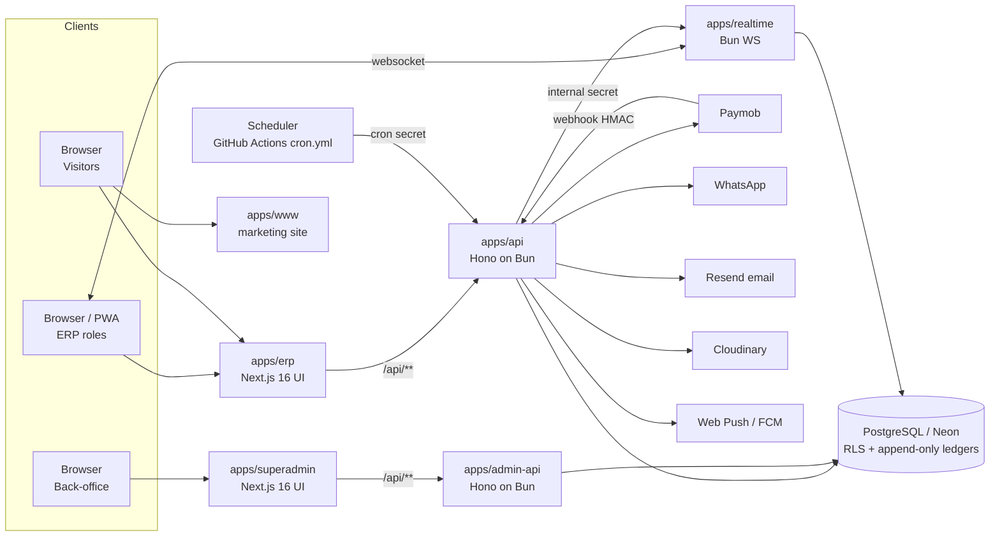

### 4.2 Frontend
Next.js 16 (React 19) App Router with locale-prefixed routes (`/[locale]/...`, next-intl, Arabic RTL and
English), Refine v5 data layer, Tailwind-based design system in `packages/ui`. The ERP is installable as a
PWA (Serwist service worker, offline outbox for attendance, Web Push). A server-side portal gate
(`proxy.ts`) routes each role to its own dashboard.

### 4.3 Backend
Two Hono services on Bun (`apps/api` for the ERP, `apps/admin-api` for the back-office) expose versioned
JSON endpoints under `/api/v1/**` with a common response envelope. Business logic is in
`packages/server-core` (services, back-office services, authz guards, rate limiting, mail, media). Input is
validated with Zod 4. Cron jobs are HTTP endpoints (`/api/v1/cron/[job]`) protected by a secret.

### 4.4 Database
PostgreSQL on Neon, schema managed by Prisma migrations (`packages/database/prisma`). Objects Prisma cannot
model — row-level security policies, triggers, append-only ledger grants, partial indexes, check
constraints — live in SQL migrations. The application connects as a restricted role (`edura_app`). Demo
data is flagged `is_demo = true` and is purgeable; the Egyptian education catalog and the real back-office
accounts are permanent reference data. Three databases exist: dev, test and production, each labelled
`edura-env:<env>` inside itself.

### 4.5 Authentication
better-auth in both services with separate cookie namespaces for the ERP and the back-office; email and
password with optional/required TOTP two-factor; session invalidation through `users.token_version`;
invite tokens; tokenized onboarding links; a signed 60-second single-use "view as" handoff from the
back-office into the ERP. Details: Authentication module (§5.1).

### 4.6 Main data flows
1. **Walk-in at the counter** → student account + WhatsApp link → student completes onboarding (track → subjects) → subscription created at the counter (cash) → check-in at counter (and at the door in mode B) → session completed → revenue distributed to centre/teacher wallets.
2. **Online payment** → payment intent → Paymob (or mock) → HMAC-verified webhook → payment recorded → subscription/wallet credited.
3. **Collaboration** → teacher↔centre request → acceptance → class and schedule created.
4. **Back-office oversight** → super admin/accountant read every tenant; money moves only through four audited writers.

## 5. Functional Requirements

Each requirement is self-contained. Fields: module, implementation status, role(s), description,
preconditions, trigger, expected behaviour, business rules, inputs, validation, output, success and failure
scenarios, dependencies and evidence.

### 5.1. Authentication, Accounts & Onboarding

Module: Authentication, Accounts & Onboarding. All paths repo-relative to `/Users/ali/edura`. Status labels: IMPLEMENTED / PARTIALLY IMPLEMENTED / NOT IMPLEMENTED / UNCLEAR / CONFLICTING. Rate limits are `withRateLimit(handler, capacity, refillPerMinute)` keyed `${pathname}:${ip}` → 429 `{error:{code:"rate_limited",message:"Too many requests, please slow down."}}` + `Retry-After: 60` (`packages/server-core/src/rate-limit/middleware.ts`). Responses use the envelope `{data, meta?}` with `Cache-Control: no-store`; errors `{error:{code,message,messageAr?,fields?,details?}}` (`apps/erp/src/lib/http/envelope.ts`). Password rule everywhere = `passwordSchema`: min 8 characters, at least one letter and one digit (`packages/server-core/src/services/auth/password-schema.ts`).

#### Sign-in, sessions, 2FA (ERP)

##### FR-001 — ERP sign-in with email and password
| Field | Value |
|---|---|
| Module | AUTH |
| Implementation status | IMPLEMENTED |
| User role(s) | public → student, parent, teacher, assistant, center_admin, center_staff |
| Description | A user signs in to the ERP with email + password through better-auth `POST /api/auth/sign-in/email`; a 30-day session cookie (prefix `edura`, refreshed every 1 day) is issued. |
| Preconditions | `users.status = active`, `password_hash` set, role allowed on the `www` app by `canSignIn`. |
| Trigger / action | UI `/[locale]/login` form → `authClient.signIn.email`; API `POST /api/auth/sign-in/email {email, password}`. |
| Expected system behavior | 1. Per-IP limiter `login-ip` (20 cap / 20 per min) and per-email limiter `login-email` (5 / 5) are checked. 2. Password compared with bcrypt (`DUMMY_HASH` used when the user does not exist, equalising timing). 3. Eligibility: `canSignIn("www", role)`, status `active`, password present. 4. If `twoFactorEnabled`, no session is minted; the response carries `twoFactorRedirect: true` and the UI goes to `/[locale]/two-factor`. 5. Otherwise an `auth_sessions` row is created and the `edura*` session cookie set. 6. UI writes `edura_state` to localStorage and navigates to `?next` or `/dashboard`, where the portal gate forwards to the role's portal. |
| Business rules | BR-001 (login policy by app), BR-002 (eligibility), BR-003 (no account-state hint before password match), BR-004 (login limiters), BR-014 (session lifetime). |
| Input fields | email — string — required; password — string — required |
| Validation rules | Client: `z.string().email()`, password `min(1)` (`apps/erp/src/app/[locale]/login/page.tsx:65-70`). Server: better-auth email/password; `minPasswordLength: 8` applies to sign-up/change, not to sign-in comparison. |
| Expected output | 200 `{token, user}` from better-auth + `Set-Cookie`; or `{twoFactorRedirect:true}`. |
| Success scenario | Student `lina.hassan@student.nile-academy.eg` (password: see docs/guides/test-credentials.md) signs in → redirected to `/[locale]/dashboard/student`. |
| Failure scenario(s) | 401 `INVALID_EMAIL_OR_PASSWORD` → UI "Invalid email or password" with a "not registered? → /register?email=" CTA; 403 `ACCOUNT_PENDING` / `ACCOUNT_INACTIVE` (FR-002); 429 `RATE_LIMITED` → "Too many attempts — please wait a moment and try again."; back-office role → 401 generic (never reveals that the account exists). |
| Related features / dependencies | FR-002, 003, 030, 031; Superadmin Operations (approval of pending accounts). |
| Evidence | `packages/server-core/src/erp-auth/create-auth.ts` (sign-in before-hook, limiters, `twoFactor` plugin, session 30 d / updateAge 1 d); `packages/server-core/src/auth/login-policy.ts`; `apps/erp/src/app/[locale]/login/page.tsx:49-133`; `apps/erp/src/messages/en.json` `auth.invalidCredentials` |

##### FR-002 — Account-state errors on sign-in (pending / inactive / rate-limited)
| Field | Value |
|---|---|
| Module | AUTH |
| Implementation status | IMPLEMENTED |
| User role(s) | public (any ERP role whose account is not sign-in eligible) |
| Description | When the password is correct but the account cannot sign in, the ERP returns a specific error code so the UI can explain; when the password is wrong the generic message is returned so that account existence is not leaked. |
| Preconditions | Account exists with a password hash. |
| Trigger / action | `POST /api/auth/sign-in/email` with a correct password for a `pending` / non-active account. |
| Expected system behavior | 1. Password verified first. 2. `status = pending` → 403 `ACCOUNT_PENDING`; any other non-active status (`suspended`, `blacklisted`, `shell`, `deleted`) → 403 `ACCOUNT_INACTIVE`. 3. Limiter exhausted → 429 `RATE_LIMITED` regardless of credentials. 4. UI maps codes to `auth.accountPending` "Your account is still under review by the Edura team…", `auth.accountInactive` "Your account is currently inactive. Contact support or your center to reactivate it.", `auth.rateLimited`. |
| Business rules | BR-002, BR-003, BR-004, BR-013 (one suspension mechanism = `users.status`). |
| Input fields | as FR-001 |
| Validation rules | as FR-001 |
| Expected output | 403 `{code:"ACCOUNT_PENDING"|"ACCOUNT_INACTIVE"}` / 429 `{code:"RATE_LIMITED"}`. |
| Success scenario | Teacher who self-registered (status `pending`) enters the correct password → "Your account is still under review…" screen. |
| Failure scenario(s) | Wrong password on a pending account → generic "Invalid email or password" (by design). |
| Related features / dependencies | FR-008, 009 (registrations that create `pending`), Superadmin Operations (suspension, blacklist). |
| Evidence | `packages/server-core/src/erp-auth/create-auth.ts` (eligibility branch after password compare); `apps/erp/src/app/[locale]/login/page.tsx:78-133`; `packages/database/prisma/schema.prisma:32-41` (`UserStatus`) |

##### FR-003 — ERP two-factor challenge (TOTP or backup code)
| Field | Value |
|---|---|
| Module | AUTH |
| Implementation status | IMPLEMENTED |
| User role(s) | any ERP role with 2FA enabled |
| Description | After a correct password, a user with 2FA enabled must enter a 6-digit TOTP code or a one-time backup code; "trust this device for 60 days" skips the challenge on that browser. |
| Preconditions | `users.two_factor_enabled = true`; pending 2FA cookie from FR-001 step 4. |
| Trigger / action | UI `/[locale]/two-factor` → `authClient.twoFactor.verifyTotp({code, trustDevice})` or `verifyBackupCode({code, trustDevice})`; API `POST /api/auth/two-factor/verify-totp` / `verify-backup-code`. |
| Expected system behavior | 1. In-hook limiter `2fa-ip` (cap 10, refill 5/min) and better-auth `two-factor` limiter (15 per 60 s). 2. Code verified against the `two_factor` row (issuer "Edura"); failed attempts increment `failedVerificationCount`, `lockedUntil` may be set. 3. Backup code consumed on use. 4. Session minted; `trustDevice` sets the trust cookie. 5. UI → `/dashboard`. |
| Business rules | BR-005 (2FA limiter), BR-006 (backup codes single use). |
| Input fields | code — string — required; trustDevice — boolean — optional |
| Validation rules | TOTP 6 digits / backup code format enforced by better-auth; limits above. |
| Expected output | 200 with session cookie. |
| Success scenario | User with 2FA enters current TOTP → lands on their portal. |
| Failure scenario(s) | Invalid code → `security.invalidCode` "Invalid code — try again"; expired challenge → `security.twoFactorExpired` "This sign-in step expired. Start again from the sign-in page."; 429 → `auth.rateLimited`. |
| Related features / dependencies | FR-001, FR-005. |
| Evidence | `apps/erp/src/app/[locale]/two-factor/page.tsx`; `packages/server-core/src/erp-auth/create-auth.ts` (twoFactor plugin + `2fa-ip` limiter); `packages/database/prisma/schema.prisma:744-758` (`TwoFactor`); `apps/erp/src/messages/en.json` `security.*` |

##### FR-004 — Sign out (all presented tokens)
| Field | Value |
|---|---|
| Module | AUTH |
| Implementation status | IMPLEMENTED |
| User role(s) | any signed-in user (ERP and back-office) |
| Description | Signing out deletes EVERY session token the browser presents under the app's cookie prefix, not only the active one, and clears the cookie. |
| Preconditions | Session cookie present (a no-op otherwise). |
| Trigger / action | UI sign-out button → `authClient.signOut()`; API `POST /api/auth/sign-out`. |
| Expected system behavior | 1. Route handler collects all cookies with the app prefix (`edura` ERP / `edura-superadmin` back-office). 2. Each token's `auth_sessions` row is deleted. 3. Cookie cleared; UI navigates to `/login`. |
| Business rules | BR-007 (ambiguous multiple cookies → signed out). |
| Input fields | none |
| Validation rules | none |
| Expected output | 200 `{success:true}`. |
| Success scenario | After sign-out, `GET /api/v1/me` → 401 `unauthenticated` "Not authenticated". |
| Failure scenario(s) | No cookie → 200 (idempotent). |
| Related features / dependencies | FR-030, FR-040. |
| Evidence | `apps/api/src/routes/auth/[...all]/route.ts`; `apps/admin-api/src/routes/auth/[...all]/route.ts:15-36`; `apps/superadmin/src/app/[locale]/two-factor-setup/page.tsx:27-33` |

##### FR-005 — Enable / disable own 2FA (ERP security settings)
| Field | Value |
|---|---|
| Module | AUTH |
| Implementation status | IMPLEMENTED |
| User role(s) | any ERP role |
| Description | From the Security settings a user confirms their password, scans a TOTP QR, enters a code, receives backup codes, and can later disable 2FA with their password. |
| Preconditions | Signed in; account has a password. |
| Trigger / action | UI settings → Security → "Enable 2FA" / "Disable 2FA"; API better-auth `/two-factor/enable`, `/two-factor/verify-totp`, `/two-factor/disable`, `/two-factor/generate-backup-codes`. |
| Expected system behavior | 1. Password re-confirmed ("Confirm your password to continue"). 2. `two_factor` row created with secret + hashed backup codes; `users.two_factor_enabled` set after first successful verification. 3. Toast "Two-factor authentication enabled" / "Two-factor authentication disabled". |
| Business rules | BR-006. |
| Input fields | password — string — required; code — string — required (on enable) |
| Validation rules | better-auth defaults (password must match; 6-digit TOTP). |
| Expected output | 200 with `totpURI` + `backupCodes` on enable. |
| Success scenario | Teacher enables 2FA; next sign-in requires a code. |
| Failure scenario(s) | Wrong password → better-auth 400 `INVALID_PASSWORD`; wrong code → "Invalid code — try again". |
| Related features / dependencies | FR-003; FR-039 (back-office forced setup reuses `TwoFactorSetup`). |
| Evidence | `apps/erp/src/features/security/security-screen.tsx`; `apps/erp/src/messages/en.json` `security.enable/disable/passwordPrompt/backupCodes/enabledToast/disabledToast`; `packages/server-core/src/erp-auth/create-auth.ts` |

#### Self-registration

##### FR-006 — Student self-registration
| Field | Value |
|---|---|
| Module | AUTH |
| Implementation status | IMPLEMENTED |
| User role(s) | public |
| Description | A visitor creates an `active` student account (optionally with a center invite code) and is signed in immediately, then sent to onboarding. |
| Preconditions | Email (and phone, if given) not already used by a live user. |
| Trigger / action | UI `/[locale]/register?role=student`; API `POST /api/v1/auth/register/student`. |
| Expected system behavior | 1. Rate limit 20 / 20 per min per IP. 2. Body validated (below). 3. `users` row role `student`, status `active`, bcrypt hash (cost 10); `student_profiles` row with `onboardingCompleted=false`; better-auth credential account synced by DB trigger. 4. Optional `inviteCode` resolved to a center (Center Administration decides the roster effect). 5. UI calls `signIn.email`, then → `/dashboard` → portal gate → `/onboarding`. |
| Business rules | BR-008 (password rule), BR-009 (unique email/phone), BR-010 (Egyptian phone format), BR-020 (default-minor). |
| Input fields | name — string — required; email — string — required; phone — string — optional; password — string — required; inviteCode — string — optional |
| Validation rules | Client: name min 1, email format, phone `EGYPT_PHONE_RE`, password ≥ 8 + letter + digit, confirm must match (`apps/erp/src/app/[locale]/register/page.tsx:125-156`). Server: `inviteCode` trim 1..20 (`register/student/route.ts:16`); `passwordSchema`; `phoneSchema`. |
| Expected output | 201/200 `{data:{id, role:"student", status:"active"}}` (shape per route). |
| Success scenario | New visitor registers → lands on `/[locale]/onboarding`. |
| Failure scenario(s) | 409 `conflict` "This email or phone number is already registered." (`auth.emailOrPhoneTaken`); 400 `validation_error` with `fields` anchored to inputs; 429. |
| Related features / dependencies | FR-024..026, 028 (welcome e-mail), BR-021 (guardian lock applies once onboarding exists). |
| Evidence | `apps/api/src/routes/v1/auth/register/student/route.ts:10-27`; `packages/server-core/src/services/auth/register.ts`; `apps/erp/src/app/[locale]/register/page.tsx:110-209` |

##### FR-007 — Parent self-registration
| Field | Value |
|---|---|
| Module | AUTH |
| Implementation status | IMPLEMENTED |
| User role(s) | public |
| Description | A visitor creates an `active` parent account; linking children happens later via family code (Student & Parent module). |
| Preconditions | Unique email / phone. |
| Trigger / action | UI `/[locale]/register?role=parent`; API `POST /api/v1/auth/register/parent`. |
| Expected system behavior | 1. Rate limit 20 / 20. 2. Validate. 3. Create `users` (role `parent`, status `active`). 4. Sign in → `/dashboard` → `/dashboard/parent` (no onboarding wizard for parents). |
| Business rules | BR-008, 09, 10. |
| Input fields | name, email, phone (optional), password |
| Validation rules | as FR-006 minus `inviteCode`. |
| Expected output | user summary envelope. |
| Success scenario | `mona.hassan@email.eg`-style account created and signed in. |
| Failure scenario(s) | 409 duplicate; 400 validation; 429. |
| Related features / dependencies | Student & Parent (family code, approval). |
| Evidence | `apps/api/src/routes/v1/auth/register/parent/route.ts:17`; `packages/shared/src/portal-segments.ts:28-35` |

##### FR-008 — Teacher self-registration (pending approval)
| Field | Value |
|---|---|
| Module | AUTH |
| Implementation status | IMPLEMENTED |
| User role(s) | public |
| Description | A teacher registers and is created with `status = pending`; the UI shows "Account created — awaiting review" and sign-in is refused with `ACCOUNT_PENDING` until a back-office user approves. |
| Preconditions | Unique email / phone. |
| Trigger / action | UI `/[locale]/register?role=teacher`; API `POST /api/v1/auth/register/teacher`. |
| Expected system behavior | 1. Rate limit 10 / 10. 2. Validate. 3. `users` role `teacher`, status `pending`, `teacher_profiles` row. 4. Response `status:"pending"` → UI pending-approval screen (no sign-in attempted). |
| Business rules | BR-002, BR-011 (teacher/center self-registration lands `pending`). |
| Input fields | name, email, phone (optional), password |
| Validation rules | as FR-006. |
| Expected output | `{data:{..., status:"pending"}}`. |
| Success scenario | Screen "Account created — awaiting review". |
| Failure scenario(s) | 409 / 400 / 429 as above. |
| Related features / dependencies | Superadmin Operations (approval), Teacher & Collaboration (profile). |
| Evidence | `apps/api/src/routes/v1/auth/register/teacher/route.ts:26`; `apps/erp/src/app/[locale]/register/page.tsx:206-209`; `apps/erp/src/messages/en.json` `auth.pendingApprovalTitle` |

##### FR-009 — Center self-registration (center + pending admin)
| Field | Value |
|---|---|
| Module | AUTH |
| Implementation status | IMPLEMENTED |
| User role(s) | public |
| Description | A visitor registers a center: a `centers` row (name, optional address/description/subjects/location point, 6-char `shortId`) and its first `center_admin` user with `status = pending`. |
| Preconditions | Unique admin email / phone. |
| Trigger / action | UI `/[locale]/register?role=center` (field "Center name" required); API `POST /api/v1/auth/register/center`. |
| Expected system behavior | 1. Rate limit 10 / 10. 2. Validate. 3. Transaction: center + admin user; `shortId` from the confusable-free alphabet. 4. Response `status:"pending"` → pending screen. |
| Business rules | BR-011, BR-012 (random identifiers exclude 0/O/1/I). |
| Input fields | centerName — string — required; name, email, phone?, password; address? — string; description? — string; subjects? — string[]; location? — GeoJSON Point `[lng, lat]` |
| Validation rules | `centerName` trim min 1 (`register/center/route.ts:28`); `pointSchema` `coordinates: tuple(number, number)` (`:22-24`); others as FR-006. |
| Expected output | `{data:{center:{id, shortId}, user:{..., status:"pending"}}}` (shape per route). |
| Success scenario | Center admin sees "Account created — awaiting review". |
| Failure scenario(s) | 400 "Center name is required" (client); 409 duplicate admin email; 429. |
| Related features / dependencies | Center Administration (activation checklist), Superadmin Operations (approval). |
| Evidence | `apps/api/src/routes/v1/auth/register/center/route.ts:22-94`; `packages/server-core/src/utils/random.ts` |

#### Password recovery and invitation entry

##### FR-010 — Forgot password (request reset link)
| Field | Value |
|---|---|
| Module | AUTH |
| Implementation status | IMPLEMENTED |
| User role(s) | public |
| Description | Submitting an email always returns success; if a live account with a password exists, a one-hour reset link is e-mailed (Resend). |
| Preconditions | none |
| Trigger / action | UI `/[locale]/forgot-password`; API `POST /api/v1/auth/password/forgot {email, locale?}`. |
| Expected system behavior | 1. Route limiter 5 / 60 per IP; per-email throttle 3 per hour (`reset-throttle.ts`). 2. Lookup by email; silently skip unknown / deleted / passwordless users. 3. Insert `password_reset_tokens` (sha256 of a 32-byte token, `expiresAt = now + 1 h`). 4. Send the mail with `/[locale]/reset-password?token=`. 5. Always 200. |
| Business rules | BR-015 (no enumeration), BR-016 (reset TTL 1 h), BR-017 (`sendResetPassword` deliberately not set). |
| Input fields | email — string — required; locale — "ar"\|"en" — optional |
| Validation rules | `z.string().email()`, `z.enum(["ar","en"]).optional()` (`password/forgot/route.ts:15-17`). |
| Expected output | 200 `{data:{sent:true}}`; UI "If an account exists for {email}, we've sent a password reset link. It expires in 1 hour." |
| Success scenario | Known email → mail delivered with a working link. |
| Failure scenario(s) | 400 invalid email; 429 after 5 requests/min per IP; 4th request per hour for the same email → still 200 but no mail. |
| Related features / dependencies | FR-011; Platform & NFR (email delivery). |
| Evidence | `apps/api/src/routes/v1/auth/password/forgot/route.ts:15-32`; `packages/server-core/src/services/auth/password-reset.ts`; `packages/server-core/src/services/auth/reset-throttle.ts`; `packages/database/prisma/schema.prisma:760-773` |

##### FR-011 — Reset password with token
| Field | Value |
|---|---|
| Module | AUTH |
| Implementation status | PARTIALLY IMPLEMENTED (works; does not check `users.status`, leaves sibling tokens live — see GAP-002) |
| User role(s) | public (token holder) |
| Description | Sets a new password from a valid, unused, unexpired token; bumps `token_version` so every existing session is revoked. |
| Preconditions | Valid token from FR-010. |
| Trigger / action | UI `/[locale]/reset-password?token=`; API `POST /api/v1/auth/password/reset {token, password}`. |
| Expected system behavior | 1. Limiter 10 / 60. 2. Token hashed and matched; must be unused and unexpired. 3. New bcrypt hash written, `token_version += 1` → DB trigger `users_revoke_sessions` deletes all `auth_sessions`. 4. Token marked used. 5. UI "Password reset" → "Back to sign in". |
| Business rules | BR-008, BR-016, BR-018 (credential change revokes every session). |
| Input fields | token — string — required; password — string — required |
| Validation rules | `token: min(1)`; `password: passwordSchema` (`password/reset/route.ts:9-12`); client re-checks ≥ 8 + letter + digit + confirm match (`reset-password/page.tsx:86-102`). |
| Expected output | 200 `{data:{ok:true}}`. |
| Success scenario | User signs in with the new password; old sessions are gone. |
| Failure scenario(s) | 410 `expired` / 400 for invalid or used token (message per `password-reset.ts`); 400 validation; 429. |
| Related features / dependencies | FR-010, FR-030. |
| Evidence | `apps/api/src/routes/v1/auth/password/reset/route.ts:9-21`; `packages/server-core/src/services/auth/password-reset.ts`; `packages/database/prisma/migrations/20260801170000_better_auth/migration.sql:159-173` |

##### FR-012 — Accept a legacy invite (set password by token)
| Field | Value |
|---|---|
| Module | AUTH |
| Implementation status | PARTIALLY IMPLEMENTED (user resolved by `row.email` with no purpose check — GAP-001) |
| User role(s) | public (token holder) |
| Description | Older activation invites (`student_activation`, `teacher_activation`, `admin_invite`) are redeemed by setting a password, which activates the account. |
| Preconditions | Unused, unexpired `invite_tokens` row. |
| Trigger / action | UI `/[locale]/invite/accept?token=`; API `POST /api/v1/auth/invite/accept {token, password}`. |
| Expected system behavior | 1. Limiter 20 / 30. 2. Token matched (hash, unused, unexpired). 3. User located, password hash written, `status = active`, token marked used (race-guarded — see `l04-invite-accept-race.test.ts`). 4. UI "Account activated!" → "Go to sign in". |
| Business rules | BR-008, BR-019 (invite TTL). |
| Input fields | token — required; password — required |
| Validation rules | `token: min(1)`; `passwordSchema` (`invite/accept/route.ts:10-13`). |
| Expected output | 200 `{data:{ok:true}}`. |
| Success scenario | Invited user sets password, signs in normally. |
| Failure scenario(s) | 400/410 invalid or expired token → UI "Failed to activate account"; missing token → "Invalid invite link". |
| Related features / dependencies | FR-013 (modern claim flow). |
| Evidence | `apps/api/src/routes/v1/auth/invite/accept/route.ts:10-22`; `packages/server-core/src/services/invites/accept.ts`; `apps/erp/src/app/[locale]/invite/accept/page.tsx` |

##### FR-013 — Claim an invite token (`/claim` → session for the invited user)
| Field | Value |
|---|---|
| Module | AUTH |
| Implementation status | IMPLEMENTED |
| User role(s) | public (token holder) → student, assistant, center_staff, teacher |
| Description | A tokenized link (walk-in WhatsApp, assistant/staff/teacher invite) is exchanged through the better-auth plugin `POST /api/auth/invite-token/claim` for a real session of the token's owner; if the owner has no password yet the `/claim` page asks for credentials first. |
| Preconditions | `invite_tokens` row with purpose in `CLAIMABLE` (`walk_in_onboarding`, `assistant_invite`, `center_staff_invite`, `teacher_invite`), unused, unexpired; owner not deleted. |
| Trigger / action | UI `/[locale]/claim?token=` → `authClient.$fetch("/invite-token/claim", {method:"POST", body:{token}})` then `GET /api/v1/me`. |
| Expected system behavior | 1. Limiter `invite-token:${ip}` 10 / 10 and better-auth `invite-token` 10 per 60 s. 2. Token verified; purpose must map to the owner's role. 3. Token marked used, session minted. 4. UI: `hasPassword` → `LANDING[role]`; else credentials form (email fixed if present), `POST /api/v1/me/credentials` (FR-021). 5. Student lands on `/onboarding`. |
| Business rules | BR-019, BR-022 (`guardian_email_verification` and the card credential are NOT claimable). |
| Input fields | token — string — required |
| Validation rules | plugin schema; purpose/role whitelist. |
| Expected output | 200 + session cookie. |
| Success scenario | Walk-in student opens WhatsApp link → signed in → onboarding. |
| Failure scenario(s) | Invalid/used/expired token → UI phase `invalid` ("This link is not valid or has expired"-style, `claim.*`); 429. |
| Related features / dependencies | FR-021, 024-026; Center Administration (walk-in), Teacher & Collaboration (assistant invites). |
| Evidence | `packages/server-core/src/erp-auth/invite-token-plugin.ts` (`CLAIMABLE`); `apps/erp/src/app/[locale]/claim/page.tsx:30-90`; `packages/database/prisma/schema.prisma:268-279` |

#### View-as (claim side)

##### FR-014 — Claim a view-as handoff token
| Field | Value |
|---|---|
| Module | AUTH |
| Implementation status | IMPLEMENTED |
| User role(s) | super_admin (via back-office mint) → ERP session as the target |
| Description | The ERP accepts a signed, 60-second, single-target handoff token posted by the back-office and mints its OWN ERP session for the target user, marked as view-as; no back-office cookie ever crosses. |
| Preconditions | Token signed with `VIEW_AS_SECRET`, within TTL, `jti` never seen; target eligible for the ERP. |
| Trigger / action | `POST /api/v1/auth/view-as/claim` (form post from the back-office) → plugin `POST /api/auth/view-as/claim`. |
| Expected system behavior | 1. Limiter `view-as:${ip}` 10 / 10. 2. HMAC verified, `exp` ≤ 60 s. 3. Replay guard: `audit_logs` row `user.view_as_claimed` with unique `jti` (duplicate → rejected). 4. ERP session created with the view-as marker; ViewAsBanner shown in layouts. 5. Session validity window 1 hour measured from `auth_sessions.created_at`. |
| Business rules | BR-023 (view-as is a second door), BR-024 (1 h from `created_at`). |
| Input fields | token — string — required |
| Validation rules | signature, TTL, jti uniqueness, target role allowed on `www`. |
| Expected output | 302/200 into the target's portal with the view-as cookie. |
| Success scenario | Super admin views a center admin's portal; the banner names the target. |
| Failure scenario(s) | Expired / bad signature / replayed → 401/403 per plugin; dev-only fallback secret when `VIEW_AS_SECRET` unset (GAP-005). |
| Related features / dependencies | FR-015; Superadmin Operations (mint side); money writes under view-as are the target's own (Center Administration). |
| Evidence | `apps/api/src/routes/v1/auth/view-as/claim/route.ts:6`; `packages/server-core/src/erp-auth/view-as-plugin.ts`; `docs/decisions/superadmin-view-as.md`; `apps/erp/src/app/[locale]/onboarding/layout.tsx` (ViewAsBanner) |

##### FR-015 — Stop a view-as session
| Field | Value |
|---|---|
| Module | AUTH |
| Implementation status | IMPLEMENTED |
| User role(s) | the view-as ERP session only |
| Description | Ends the view-as session early, deleting it, so the super admin returns to the back-office. |
| Preconditions | Current ERP session carries the view-as marker. |
| Trigger / action | ViewAsBanner "stop" → `POST /api/v1/auth/view-as/stop`. |
| Expected system behavior | 1. Session read; non-view-as sessions refused. 2. Session row deleted, cookie cleared. 3. Audit entry. |
| Business rules | BR-023. |
| Input fields | none |
| Validation rules | session marker check. |
| Expected output | 200 `{data:{stopped:true}}` (shape per route). |
| Success scenario | Banner disappears; `GET /api/v1/me` → 401. |
| Failure scenario(s) | Ordinary session → 403 `forbidden`. |
| Related features / dependencies | FR-014. |
| Evidence | `apps/api/src/routes/v1/auth/view-as/stop/route.ts:9`; `packages/server-core/src/erp-auth/view-as-plugin.ts` |

#### Own account (ERP)

##### FR-016 — Read own account (`GET /api/v1/me`)
| Field | Value |
|---|---|
| Module | AUTH |
| Implementation status | IMPLEMENTED |
| User role(s) | any ERP role |
| Description | Returns the session user's identity, role, status, locale, centerId, `hasPassword`, onboarding flags and view-as marker for the client shell. |
| Preconditions | Valid single session cookie. |
| Trigger / action | `GET /api/v1/me` (client shell, `/claim` page). |
| Expected system behavior | `requireSession()`; builds the `me` object from `users` + profile. |
| Business rules | BR-007. |
| Input fields | none |
| Validation rules | none |
| Expected output | 200 `{data:{id,email,phone,name,role,status,locale,centerId?,hasPassword,onboardingComplete,viewAs?}}` (exact keys per route). |
| Success scenario | Signed-in teacher gets role `teacher`. |
| Failure scenario(s) | 401 `unauthenticated` "Not authenticated"; 401 `session_conflict` "Multiple sessions present". |
| Related features / dependencies | FR-030. |
| Evidence | `apps/api/src/routes/v1/me/route.ts:11-12`; `packages/server-core/src/erp-auth/session.ts` |

##### FR-017 — Update own profile (`PATCH /api/v1/me`)
| Field | Value |
|---|---|
| Module | AUTH |
| Implementation status | IMPLEMENTED |
| User role(s) | any ERP role |
| Description | Edits name, phone and locale of the signed-in user; public data caches are invalidated. |
| Preconditions | Signed in. |
| Trigger / action | Settings → Account form; `PATCH /api/v1/me {name?, phone?, locale?}`. |
| Expected system behavior | 1. Validate. 2. Update `users`. 3. `invalidatesPublicData` wrapper revalidates public pages. |
| Business rules | BR-009 (phone unique), BR-010. |
| Input fields | name — string — optional; phone — string — optional/nullable; locale — "ar"\|"en" — optional |
| Validation rules | name 1..120 chars, `phoneSchema` (Egyptian mobile), locale enum (route schema at `apps/api/src/routes/v1/me/route.ts` ~L40-47). |
| Expected output | 200 updated `me`. |
| Success scenario | Locale switched to `ar` → UI language changes after reload. |
| Failure scenario(s) | 400 validation; 409 phone already used. |
| Related features / dependencies | FR-019 (email is changed separately). |
| Evidence | `apps/api/src/routes/v1/me/route.ts:48-53`; `packages/server-core/src/services/account/*` |

##### FR-018 — Change own password (signs out every device)
| Field | Value |
|---|---|
| Module | AUTH |
| Implementation status | IMPLEMENTED |
| User role(s) | any ERP role with a password |
| Description | Requires the current password; writes the new hash and bumps `token_version`, so the DB trigger deletes all sessions including the current one; UI shows "Password changed — please sign in again". |
| Preconditions | Signed in, has password. |
| Trigger / action | Settings → Security → "Change password"; `POST /api/v1/me/password {currentPassword, newPassword}`. |
| Expected system behavior | 1. Limiter 10 / 10. 2. bcrypt compare current. 3. New hash + `token_version += 1`. 4. All sessions revoked by trigger → redirect to login. |
| Business rules | BR-008, BR-018. |
| Input fields | currentPassword — string — required; newPassword — string — required (confirm client-side) |
| Validation rules | `currentPassword: min(1)` (`me/password/route.ts:12`), `newPassword: passwordSchema`; client "The two passwords do not match". |
| Expected output | 200. |
| Success scenario | User must sign in again; old devices are signed out. |
| Failure scenario(s) | 400/422 "Current password is incorrect" (`security.currentPasswordWrong`); 422 "This account has no password yet — use your invite link to set one." (`security.noPasswordSet`); 429. |
| Related features / dependencies | FR-021. |
| Evidence | `apps/api/src/routes/v1/me/password/route.ts:12-27`; `packages/server-core/src/services/account/password.ts`; `apps/erp/src/messages/en.json` `security.passwordDesc/passwordChanged` |

##### FR-019 — Request a login e-mail change
| Field | Value |
|---|---|
| Module | AUTH |
| Implementation status | IMPLEMENTED |
| User role(s) | any ERP role |
| Description | The user asks to move the account to a new e-mail; a confirmation link (1 h) is mailed to the NEW address; the current password is required when the account has one. |
| Preconditions | Signed in; new email not used by another live user. |
| Trigger / action | Settings → Account → e-mail; `POST /api/v1/me/email {newEmail, currentPassword?}`. |
| Expected system behavior | 1. Limiter 10 / 10. 2. Password verified if `password_hash` set. 3. `email_change_requests` row (hash, expires in 1 h), earlier pending requests superseded. 4. Mail to the new address with `/[locale]/confirm-email?token=`. |
| Business rules | BR-009, BR-025 (email change TTL 1 h and confirmation at the new address). |
| Input fields | newEmail — string — required; currentPassword — string — optional (required when a password exists) |
| Validation rules | `newEmail` email, lowercased; `currentPassword: min(1).optional()` (`me/email/route.ts:13`). |
| Expected output | 200 `{data:{sent:true}}`. |
| Success scenario | Confirmation mail received at the new address. |
| Failure scenario(s) | 409 "already registered"; 422 wrong password; 400 same as current email; 429. |
| Related features / dependencies | FR-020. |
| Evidence | `apps/api/src/routes/v1/me/email/route.ts:13-30`; `packages/server-core/src/services/account/email-change.ts`; `packages/database/prisma/schema.prisma:775-787` |

##### FR-020 — Confirm the e-mail change (token; signs out everywhere)
| Field | Value |
|---|---|
| Module | AUTH |
| Implementation status | IMPLEMENTED |
| User role(s) | public (token holder) |
| Description | Applies the pending e-mail change, bumps `token_version` (every session signed out) and shows "Your login email has been changed. For your safety every session was signed out…". |
| Preconditions | Valid unexpired request token. |
| Trigger / action | UI `/[locale]/confirm-email?token=`; `POST /api/v1/me/email/confirm {token}`. |
| Expected system behavior | 1. Limiter 10 / 60. 2. Token matched; new email still free. 3. `users.email` updated, `token_version += 1`, request marked used. 4. UI done screen → sign in. |
| Business rules | BR-018, BR-025. |
| Input fields | token — string — required |
| Validation rules | `min(1).max(512)` (`me/email/confirm/route.ts:8`). |
| Expected output | 200. |
| Success scenario | Sign-in works with the new e-mail only. |
| Failure scenario(s) | 410 expired / 400 invalid → UI error state; 409 if the address was taken meanwhile. |
| Related features / dependencies | FR-019. |
| Evidence | `apps/api/src/routes/v1/me/email/confirm/route.ts:8-22`; `apps/erp/src/app/[locale]/confirm-email/page.tsx`; `apps/erp/src/messages/en.json` `auth.confirmEmailDoneSubtitle` |

##### FR-021 — Set first credentials after a claim (`/api/v1/me/credentials`)
| Field | Value |
|---|---|
| Module | AUTH |
| Implementation status | PARTIALLY IMPLEMENTED (no `token_version` bump — GAP-003) |
| User role(s) | student, assistant, center_staff (shell accounts just claimed) |
| Description | A claimed account without a password sets its login email (if none) and password once; afterwards the account behaves like any registered one. |
| Preconditions | Signed in via FR-013; `password_hash` NULL. |
| Trigger / action | `/[locale]/claim` credentials form; `POST /api/v1/me/credentials {email?, password}`. |
| Expected system behavior | 1. Limiter 10 / 10. 2. Refuse if a password already exists (422). 3. Email required when the user has none; must be free. 4. Hash written; status moves `shell → active` where applicable. 5. UI → `LANDING[role]`. |
| Business rules | BR-008, BR-009. |
| Input fields | email — string — optional (required when the account has no email); password — string — required |
| Validation rules | `email` trim/lowercase/email optional (`me/credentials/route.ts:12`); `passwordSchema`; client checks for a digit (`claim/page.tsx:74`) and keeps submit disabled below 8 characters (`:92`). |
| Expected output | 200. |
| Success scenario | Walk-in student sets password and continues to onboarding. |
| Failure scenario(s) | 422 "already has a password"-class error; 409 email taken; 400 validation. |
| Related features / dependencies | FR-013, FR-018. |
| Evidence | `apps/api/src/routes/v1/me/credentials/route.ts:12-30`; `packages/server-core/src/services/account/credentials.ts`; `apps/erp/src/app/[locale]/claim/page.tsx:60-90` |

##### FR-022 — Own UI preferences (`/api/v1/me/prefs`)
| Field | Value |
|---|---|
| Module | AUTH |
| Implementation status | IMPLEMENTED |
| User role(s) | any ERP role (back-office twin for super_admin / accountant) |
| Description | Stores per-user UI preferences; today only `tourCompleted`. |
| Preconditions | Signed in. |
| Trigger / action | `GET /api/v1/me/prefs`; `PATCH /api/v1/me/prefs {tourCompleted?}`. |
| Expected system behavior | GET returns the row or the default `{tourCompleted:false}`; PATCH upserts `user_prefs`. |
| Business rules | — |
| Input fields | tourCompleted — boolean — optional |
| Validation rules | strict object (unknown keys rejected). |
| Expected output | 200 `{data:{tourCompleted}}`. |
| Success scenario | Tour marked done → not shown again. |
| Failure scenario(s) | 400 on unknown key; 401. |
| Related features / dependencies | FR-041 (back-office). |
| Evidence | `apps/api/src/routes/v1/me/prefs/route.ts:8-18`; `packages/server-core/src/services/me/prefs.ts:6-21`; `packages/database/prisma/schema.prisma:871` |

##### FR-023 — Own public handle (teacher / center admin)
| Field | Value |
|---|---|
| Module | AUTH |
| Implementation status | IMPLEMENTED |
| User role(s) | teacher (own profile), center_admin (own center) |
| Description | Lets a teacher or a center admin choose, check and clear the public handle that becomes the public-page slug and the tenant host label. |
| Preconditions | Teacher profile exists / session carries `centerId`. |
| Trigger / action | Settings → Public page; `GET /api/v1/me/public-handle`, `GET /api/v1/me/public-handle/check?handle=`, `PUT /api/v1/me/public-handle {handle}`, `DELETE /api/v1/me/public-handle`. |
| Expected system behavior | 1. `resolveHandleOwner` decides the owner row. 2. Check: availability (own handle counts as available). 3. PUT: normalise + validate (`handle-rules`), write, audit `public_handle.set`; unique violation → 409. 4. DELETE: clear + audit `public_handle.cleared`. |
| Business rules | BR-026 (handle rule: 3..40 chars, `^[a-z0-9][a-z0-9-]{1,38}[a-z0-9]$`, reserved words and prefixes `edura`, `paymob`, `official`, `support`). |
| Input fields | handle — string — required (PUT / check) |
| Validation rules | `packages/shared/src/handle-rules.ts:9-54`. |
| Expected output | 200 `{data:{handle, available?}}`. |
| Success scenario | Teacher sets `hossam-math` → public page reachable (Catalog & Public Site). |
| Failure scenario(s) | 422 "Invalid public handle" `details:{reason:"too_short"|"too_long"|"reserved"|...}`; 409 "This public handle is already taken"; 403 "Only a center admin or a teacher owns a public handle"; 403 "No center on this session"; 404 "Teacher profile not found". |
| Related features / dependencies | Catalog & Public Site (public page rendering, tenant host). |
| Evidence | `apps/api/src/routes/v1/me/public-handle/route.ts:33-54`; `packages/server-core/src/services/public-handles/public-handles.ts:21-161`; `packages/shared/src/handle-rules.ts:9-54` |

#### Onboarding

##### FR-024 — Read onboarding state
| Field | Value |
|---|---|
| Module | AUTH |
| Implementation status | IMPLEMENTED |
| User role(s) | any ERP role |
| Description | Returns whether onboarding is complete and the saved draft, so the wizard can resume. |
| Preconditions | Signed in. |
| Trigger / action | `GET /api/v1/me/onboarding`; SSR of `/[locale]/onboarding`. |
| Expected system behavior | `isOnboardingComplete`: non-wizard roles → true; center_admin without centerId → true; missing profile → true (do not gate); else profile flag. Returns `{complete, draft, role}`. |
| Business rules | BR-027 (missing profile does not gate). |
| Input fields | none |
| Validation rules | none |
| Expected output | 200 `{data:{complete:boolean, draft:object|null}}`. |
| Success scenario | New student → `complete:false`. |
| Failure scenario(s) | 401. |
| Related features / dependencies | FR-025-027, 031. |
| Evidence | `apps/api/src/routes/v1/me/onboarding/route.ts:16-17`; `packages/server-core/src/services/catalog/onboarding.ts:8-36` |

##### FR-025 — Save onboarding draft
| Field | Value |
|---|---|
| Module | AUTH |
| Implementation status | IMPLEMENTED |
| User role(s) | student, teacher, center_admin |
| Description | Persists the wizard's partial selections so the user can continue later. |
| Preconditions | Signed in with a wizard role. |
| Trigger / action | Wizard step change → `PATCH /api/v1/me/onboarding {draft}`. |
| Expected system behavior | Draft stored as JSON on the profile; other roles refused. |
| Business rules | — |
| Input fields | draft — object — required |
| Validation rules | `z.record(z.string(), z.unknown())` (`me/onboarding/route.ts:21`). |
| Expected output | 200. |
| Success scenario | Reloading the wizard restores the step. |
| Failure scenario(s) | 403 "No onboarding flow for this role"; 400. |
| Related features / dependencies | FR-024. |
| Evidence | `apps/api/src/routes/v1/me/onboarding/route.ts:21-28`; `packages/server-core/src/services/catalog/onboarding.ts:110-119` |

##### FR-026 — Complete student onboarding (system → stage → grade → track → second language)
| Field | Value |
|---|---|
| Module | AUTH |
| Implementation status | IMPLEMENTED |
| User role(s) | student |
| Description | The student picks education system, stage, grade level, a track (شعبة) when the grade has tracks and a second language when the stage asks for one; completion finalises the student code. Subjects are NOT written — they are derived at read time from the track/offerings (Catalog module). |
| Preconditions | Signed in student; active catalog chain. |
| Trigger / action | `/[locale]/onboarding` wizard → `POST /api/v1/me/onboarding {educationSystemId, stageId, gradeLevelId, trackId?, secondLanguageSubjectId?}`. |
| Expected system behavior | 1. Grade loaded with stage/system; inactive or missing → 404. 2. Chain consistency checked. 3. Track rules (required / offered / none). 4. Second-language rules. 5. Profile updated: `onboardingCompleted=true`, draft cleared, `grade = nameAr`. 6. `finalizeStudentCode` (SHA-256 derived code, no personal data). 7. UI → `/dashboard/student`. `?edit=1` re-opens a completed wizard. |
| Business rules | BR-028 (chain + track + language rules), BR-029 (student code carries no personal data). |
| Input fields | educationSystemId — uuid — required; stageId — uuid — required; gradeLevelId — uuid — required; trackId — uuid — optional/nullable; secondLanguageSubjectId — uuid — optional/nullable |
| Validation rules | `me/onboarding/route.ts:30-36`; service rules at `onboarding.ts:134-205`. |
| Expected output | 200 `{data:{complete:true}}`. |
| Success scenario | Student selects Thanaweya → Grade 11 → Scientific track → lands on the student portal with track subjects. |
| Failure scenario(s) | 404 "Grade level not found"; 400 "Selection chain mismatch (system/stage/grade)"; 400 "Track is required for this grade level"; 400 "Track is not offered at this grade level"; 400 "This grade level has no tracks"; 400 "This stage does not ask for a second language"; 400 "Second language is not offered for this selection". |
| Related features / dependencies | Catalog & Public Site (catalog tree, subject derivation); Student & Parent (student card). |
| Evidence | `apps/api/src/routes/v1/me/onboarding/route.ts:30-69`; `packages/server-core/src/services/catalog/onboarding.ts:134-205`; `apps/erp/src/app/[locale]/onboarding/page.tsx:13-77` |

##### FR-027 — Complete teacher / center onboarding
| Field | Value |
|---|---|
| Module | AUTH |
| Implementation status | IMPLEMENTED |
| User role(s) | teacher; center_admin |
| Description | Teacher picks grade levels + subjects offered at those grades; center admin picks the stages the center serves. |
| Preconditions | Signed in; teacher profile / center on session. |
| Trigger / action | `POST /api/v1/me/onboarding` with `{gradeLevelIds[], subjectIds[]}` (teacher) or `{stageIds[]}` (center). |
| Expected system behavior | Teacher: every grade and subject must exist and every subject must be offered in a chosen grade. Center: caller must be center_admin with center; stages must exist. Profile flagged complete. |
| Business rules | BR-028. |
| Input fields | gradeLevelIds — uuid[] 1..100; subjectIds — uuid[] 1..100; stageIds — uuid[] |
| Validation rules | `me/onboarding/route.ts:38-45`; `onboarding.ts:211-244, 275-288`. |
| Expected output | 200. |
| Success scenario | Teacher lands on `/dashboard/teacher`. |
| Failure scenario(s) | 400 "Select at least one grade level" / "Select at least one subject" / "Select at least one stage"; 404 "Grade level not found" / "Subject not found" / "Stage not found" / "Center not found"; 400 "Some subjects are not offered in the selected grade levels"; 403 "Center onboarding requires a center admin". |
| Related features / dependencies | Teacher & Collaboration, Center Administration. |
| Evidence | `packages/server-core/src/services/catalog/onboarding.ts:211-288`; `apps/api/src/routes/v1/me/onboarding/route.ts:38-69` |

##### FR-028 — Onboarding welcome e-mail: token status and resend
| Field | Value |
|---|---|
| Module | AUTH |
| Implementation status | IMPLEMENTED |
| User role(s) | student (resend); any signed-in role (status) |
| Description | A registered student receives one welcome e-mail with a signed link `/[locale]/onboarding?token=`; the wizard verifies the token against the signed-in user and lets the student resend (3 then 1 per 10 min). |
| Preconditions | Student with an e-mail, not deleted. |
| Trigger / action | `GET /api/v1/me/onboarding-email?token=` → `ok|mismatch|expired|invalid`; `POST /api/v1/me/onboarding-email` (resend). |
| Expected system behavior | 1. Token is an HS256 JWT (`purpose student_onboarding`, `sub` = userId, exp = invite TTL) signed with `BETTER_AUTH_SECRET`. 2. Status compares `sub` with the session user. 3. Resend is one-shot via `onboardingEmailSentAt` unless `force`; limiter `onboarding-resend:${userId}` cap 3 refill 0.1/min. 4. Banner strings `auth.onboardingLink*`. |
| Business rules | BR-019 (TTL), BR-030 (one welcome mail unless forced). |
| Input fields | token — string — optional (GET) |
| Validation rules | JWT signature + exp; role student for POST. |
| Expected output | 200 `{data:{status}}` / `{data:{sent, reason?}}`. |
| Success scenario | Student opens the mailed link while signed in → `ok`, no banner. |
| Failure scenario(s) | `mismatch` (another account), `expired`, `invalid` → banner with resend; 403 non-student POST; 429 after 3 resends. |
| Related features / dependencies | FR-006, 026; Platform & NFR (mail). |
| Evidence | `apps/api/src/routes/v1/me/onboarding-email/route.ts:11-23`; `packages/server-core/src/services/onboarding/welcome-email.ts`; `apps/erp/src/app/[locale]/onboarding/onboarding-client.tsx` |

#### Session, audit, SSR

##### FR-029 — Authentication audit trail
| Field | Value |
|---|---|
| Module | AUTH |
| Implementation status | IMPLEMENTED |
| User role(s) | system |
| Description | Security-relevant account events are written to `audit_logs` (e.g. `user.view_as_claimed`, `public_handle.set/cleared`, `student.guardian_email_set/phone_set/verified`); back-office writes are audited by the Superadmin Operations module. |
| Preconditions | — |
| Trigger / action | side effect of FR-014, 023, 036, 037. |
| Expected system behavior | Append-only rows with actor, action, target, metadata. |
| Business rules | BR-031 (append-only ledgers/audit for `edura_app`). |
| Input fields | — |
| Validation rules | — |
| Expected output | row per event. |
| Success scenario | After a view-as claim an `audit_logs` row with the `jti` exists. |
| Failure scenario(s) | Duplicate `jti` → unique violation → claim rejected. |
| Related features / dependencies | Superadmin Operations (audit viewer). |
| Evidence | `packages/server-core/src/erp-auth/view-as-plugin.ts`; `packages/server-core/src/services/public-handles/public-handles.ts:94-161`; `packages/server-core/src/services/invites/guardian-contact.ts:87-96`; `guardian-verification.ts:116-123` |

##### FR-030 — Session reads and guards (`requireSession`, `withRole`, ambiguous cookies)
| Field | Value |
|---|---|
| Module | AUTH |
| Implementation status | IMPLEMENTED |
| User role(s) | all |
| Description | Every API route reads the session through one seam: missing → 401 `unauthenticated`; more than one session cookie under the prefix → 401 `session_conflict` and the UI signs out "to keep your account safe"; wrong role → 403 `forbidden`. Sessions last 30 days, are refreshed daily, and are destroyed by the DB trigger when status leaves `active`, the user is soft-deleted, or `token_version` changes. |
| Preconditions | — |
| Trigger / action | any guarded route. |
| Expected system behavior | as described; `?reason=session_conflict|session_expired|session_mismatch` on `/login` shows the matching notice. |
| Business rules | BR-007, BR-013, BR-014, BR-018. |
| Input fields | — |
| Validation rules | — |
| Expected output | 401 `{error:{code:"unauthenticated",message:"Not authenticated"}}`; 401 `{code:"session_conflict",message:"Multiple sessions present"}`; 403 `forbidden`. |
| Success scenario | Suspending a user in the back-office kills their ERP session instantly (trigger). |
| Failure scenario(s) | Two valid cookies (e.g. two tabs on different ports in dev) → conflict notice. |
| Related features / dependencies | all FRs. |
| Evidence | `packages/server-core/src/erp-auth/session.ts`; `packages/server-core/src/authz/require-role.ts`; `packages/database/prisma/migrations/20260801170000_better_auth/migration.sql:159-173`; `apps/erp/src/app/[locale]/login/page.tsx:51,204-207` |

##### FR-031 — SSR session and server-side portal gate
| Field | Value |
|---|---|
| Module | AUTH |
| Implementation status | IMPLEMENTED (note: the login page still writes the dead `edura_state` localStorage key, acknowledged in `docs/decisions/server-side-portal-gate.md:78-79,108` — see GAP-008) |
| User role(s) | all ERP roles |
| Description | Server components read the session (`ssr-session`) and `requirePortal` enforces, in order: identity (→ `/login`), role (→ own portal segment), onboarding (→ `/onboarding`). The middleware (`proxy.ts`) does NOT gate portals. |
| Preconditions | — |
| Trigger / action | Request to `/[locale]/dashboard` or any `/[locale]/dashboard/<segment>/**`. |
| Expected system behavior | 1. No user → `/${locale}/login`. 2. Role has no portal → login. 3. Segment ≠ role's segment → redirect to own portal. 4. `!onboardingComplete` → `/onboarding`. 5. `/dashboard` resolves the entry page. |
| Business rules | BR-032 (gate order identity → role → onboarding; single derivation `PORTAL_SEGMENT_BY_ROLE`). |
| Input fields | — |
| Validation rules | — |
| Expected output | redirects as above; `GET /api/v1/me/ssr-session` 200 `{user|null}` even signed out. |
| Success scenario | Student typing `/dashboard/teacher` lands on `/dashboard/student`. |
| Failure scenario(s) | Signed out → login with `?next`. |
| Related features / dependencies | every portal module. |
| Evidence | `apps/erp/src/lib/auth/portal-gate.ts:6-22`; `apps/erp/src/app/[locale]/dashboard/page.tsx`; `packages/shared/src/portal-segments.ts:15-35`; `apps/api/src/routes/v1/me/ssr-session/route.ts:12`; `docs/decisions/server-side-portal-gate.md` |

##### FR-032 — Profile completeness checklist
| Field | Value |
|---|---|
| Module | AUTH |
| Implementation status | IMPLEMENTED |
| User role(s) | student (self), parent (approved child) |
| Description | Returns the items still missing on a student's profile (used by the portal and the card). |
| Preconditions | Signed in. |
| Trigger / action | `GET /api/v1/me/profile-checklist?studentId=` (default = session user). |
| Expected system behavior | student may read only self; parent via `assertApprovedChild`; others 403. |
| Business rules | BR-033 (parent reach = approved link only). |
| Input fields | studentId — uuid — optional |
| Validation rules | — |
| Expected output | 200 checklist. |
| Success scenario | Parent sees child's checklist. |
| Failure scenario(s) | 403 "Not your profile"; 403 "Not allowed"; 404 "Student not found" / "Student profile not found". |
| Related features / dependencies | Student & Parent (card). |
| Evidence | `apps/api/src/routes/v1/me/profile-checklist/route.ts:6-10`; `packages/server-core/src/services/students/student-card.ts:304-334` |

#### Deletion and data rights

##### FR-033 — Account deletion request (`/api/v1/me/delete-request`)
| Field | Value |
|---|---|
| Module | AUTH |
| Implementation status | IMPLEMENTED |
| User role(s) | any ERP role |
| Description | A user asks for their account to be deleted, giving a reason; a `deletion_requests` row is created for review (center or back-office side is another module). |
| Preconditions | Signed in. |
| Trigger / action | Settings → Danger zone; `POST /api/v1/me/delete-request {reason}`. |
| Expected system behavior | Row created with status pending; duplicate open request refused. |
| Business rules | BR-034 (soft-delete only). |
| Input fields | reason — string — required |
| Validation rules | `trim().min(1, "Reason is required")` (`me/delete-request/route.ts:9`). |
| Expected output | 200/201 request. |
| Success scenario | Request visible to the reviewer. |
| Failure scenario(s) | 400 "Reason is required"; 409 `conflict` "You already have a pending deletion request" (`packages/server-core/src/services/data-rights/deletion-request.ts:14`). |
| Related features / dependencies | Center Administration (review), FR-034. |
| Evidence | `apps/api/src/routes/v1/me/delete-request/route.ts:8-13`; `packages/database/prisma/schema.prisma:1579-1601` |

##### FR-034 — Data-rights deletion (self or approved child)
| Field | Value |
|---|---|
| Module | AUTH |
| Implementation status | IMPLEMENTED |
| User role(s) | any ERP role (self); parent for an approved child |
| Description | GDPR-style deletion request list/create/cancel. |
| Preconditions | Signed in. |
| Trigger / action | `GET /api/v1/me/data-rights/deletion`; `POST {studentId?, reason?}`; `DELETE /api/v1/me/data-rights/deletion/[id]`. |
| Expected system behavior | Subject = self or approved child; cancel only by requester while pending. |
| Business rules | BR-033, BR-034. |
| Input fields | studentId — uuid — optional; reason — string ≤ 1000 — optional |
| Validation rules | `me/data-rights/deletion/route.ts:24-25`. |
| Expected output | 200 list / request. |
| Success scenario | Parent files deletion for child; cancels it. |
| Failure scenario(s) | 403 not approved child; 404 unknown id; 409 not cancellable. |
| Related features / dependencies | FR-035. |
| Evidence | `apps/api/src/routes/v1/me/data-rights/deletion/route.ts:12-35`; `apps/api/src/routes/v1/me/data-rights/deletion/[id]/route.ts:6-7`; `packages/server-core/src/services/data-rights/*` |

##### FR-035 — Data-rights export (request, download, cancel)
| Field | Value |
|---|---|
| Module | AUTH |
| Implementation status | IMPLEMENTED |
| User role(s) | any ERP role (self); parent for approved child |
| Description | Requests a personal-data export; status moves through `DataExportStatus`; the file is downloaded through the API when ready. |
| Preconditions | Signed in. |
| Trigger / action | `GET`/`POST /api/v1/me/data-rights/exports {studentId?}`; `GET`/`DELETE /api/v1/me/data-rights/exports/[id]`. |
| Expected system behavior | Create request → worker builds file → GET streams it to requester/subject; DELETE cancels while pending. |
| Business rules | BR-033. |
| Input fields | studentId — uuid — optional |
| Validation rules | strict object (`exports/route.ts:14`). |
| Expected output | 200. |
| Success scenario | Export downloaded. |
| Failure scenario(s) | 403; 404; 409 not ready/cancelled. |
| Related features / dependencies | Platform & NFR (job runner). |
| Evidence | `apps/api/src/routes/v1/me/data-rights/exports/route.ts:8-17`; `apps/api/src/routes/v1/me/data-rights/exports/[id]/route.ts:10-28`; `packages/database/prisma/schema.prisma:258-266,1616-1633` |

#### Guardian (child-safety gate)

##### FR-036 — Guardian e-mail verification (issue, resend, confirm)
| Field | Value |
|---|---|
| Module | AUTH |
| Implementation status | IMPLEMENTED |
| User role(s) | student (status/resend); public token holder (confirm) |
| Description | Proves that the guardian e-mail on a student profile reaches a real inbox. Confirming mints NO session and grants no access. |
| Preconditions | Student profile with `guardianEmail`. |
| Trigger / action | `GET /api/v1/me/guardian-verification`; `POST /api/v1/me/guardian-verification` (resend, 5 / 60); `POST /api/v1/guardian/verify {token}` (10 / 60) from `/[locale]/guardian/verify?token=`. |
| Expected system behavior | 1. Issue: supersede unused tokens, create `invite_tokens` purpose `guardian_email_verification`, TTL `inviteTtlMs()`, mail link. 2. Confirm: all failures 422 "This link is not valid or has expired"; success sets `guardianEmailVerifiedAt/Value`, audit `student.guardian_email_verified`, returns `{verified:true, emailHint}`. 3. Status: `{hasGuardianEmail, guardianEmailHint, verified, verifiedAt}` where verified = verifiedAt AND verifiedValue == current email. |
| Business rules | BR-021, BR-022, BR-035 (verification tied to the exact e-mail value). |
| Input fields | token — string — required (confirm) |
| Validation rules | `min(1).max(512)` strict (`guardian/verify/route.ts:8`). |
| Expected output | 200. |
| Success scenario | Guardian clicks link → "address confirmed" screen; still signed out. |
| Failure scenario(s) | 422 (empty, unknown, used, expired, profile missing, e-mail changed); 404 "Student profile not found"; 422 "This student has no guardian email to verify"; 429. |
| Related features / dependencies | FR-037; Messaging & Notifications (lock). |
| Evidence | `packages/server-core/src/services/invites/guardian-verification.ts:14-133`; `guardian-verification-status.ts:5-23`; `apps/api/src/routes/v1/me/guardian-verification/route.ts:14-44`; `apps/api/src/routes/v1/guardian/verify/route.ts:8-16`; `apps/erp/src/features/student/guardian-verify-screen.tsx:10-69` |

##### FR-037 — Guardian contact (status and set e-mail / phone)
| Field | Value |
|---|---|
| Module | AUTH |
| Implementation status | IMPLEMENTED |
| User role(s) | student (self), parent (approved child) |
| Description | Shows whether a guardian contact is required (minor without a guardian channel), the grace due date, and whether messaging is locked; lets the student or parent add a guardian e-mail or phone. |
| Preconditions | Signed in. |
| Trigger / action | `GET /api/v1/me/guardian-contact?studentId=`; `POST /api/v1/me/guardian-contact {guardianEmail?, guardianPhone?, studentId?}` (10 / 10). |
| Expected system behavior | 1. Target resolution: student → self; parent → `studentId` required + approved link. 2. Status `{required, guardianEmail, guardianPhone, messagingLocked, dueAt, overdue, dismissable:!overdue}`. 3. Set: at least one of e-mail/phone; e-mail ≠ student's own login e-mail; new e-mail resets verification and stamps `addedAt/addedBy`; phone-only sets `guardianContactDueAt = now + GUARDIAN_EMAIL_GRACE_DAYS (14)` if none; audit; if the student self-added on a roster, center admins/managers are notified "Guardian email added by the student". 4. Reminders every `GUARDIAN_REMINDER_EVERY_DAYS` (3) by cron. |
| Business rules | BR-020, BR-021, BR-036 (grace 14 d / reminders 3 d), BR-037 (guardian e-mail ≠ own e-mail). |
| Input fields | guardianEmail — string — optional; guardianPhone — string 6..20 — optional; studentId — uuid — optional |
| Validation rules | `me/guardian-contact/route.ts:15-17`. |
| Expected output | 200 status. |
| Success scenario | Minor adds a guardian e-mail → "Guardian email saved — messaging is now available." |
| Failure scenario(s) | 422 "Provide a guardian email or phone number"; 422 "The guardian email must be different from the student's own login email"; 404 "studentId is required" (parent without id); 403 (not approved / other role); 404 "Student not found" / "Student profile not found". |
| Related features / dependencies | Messaging & Notifications (`chat-guardian.ts` lock), Student & Parent (links). |
| Evidence | `packages/server-core/src/services/invites/guardian-contact.ts:18-238`; `guardian-contact-target.ts:4-21`; `invites/recipient.ts:55-56`; `packages/database/src/queries/chat-minors.ts:4-37`; `packages/database/src/queries/chat-guardian.ts:63-122`; `apps/erp/src/messages/en.json` `guardian.*` |

#### Back-office (superadmin app)

##### FR-038 — Back-office sign-in
| Field | Value |
|---|---|
| Module | AUTH |
| Implementation status | IMPLEMENTED |
| User role(s) | super_admin, accountant |
| Description | Separate better-auth instance with its own cookie prefix (`edura-superadmin`); only `super_admin` and `accountant` may sign in; every failure is the same generic message. |
| Preconditions | `canSignIn("superadmin", role)`, status active, password set. |
| Trigger / action | `/[locale]/login` on the superadmin host → `POST /api/auth/sign-in/email`. |
| Expected system behavior | 1. Limiters `LOGIN_IP` 10/10, `LOGIN_EMAIL` cap 5 refill 1/min; better-auth sign-in 10 per 60 s. 2. Eligibility checked; no hint on failure. 3. 2FA challenge if enabled (FR-039). 4. `/admin/*` plugin routes sealed → 404. |
| Business rules | BR-001, BR-038 (back-office never hints account state), BR-039 (`/admin/` sealed). |
| Input fields | email, password |
| Validation rules | better-auth. |
| Expected output | session cookie. |
| Success scenario | Super admin lands on `/dashboard`. |
| Failure scenario(s) | "Invalid credentials or unauthorized account." for wrong password, unknown user, ERP role, inactive; network error → `common.genericError`; 429. |
| Related features / dependencies | FR-039, 040. |
| Evidence | `packages/server-core/src/backoffice-auth/create-auth.ts`; `apps/superadmin/src/app/[locale]/login/page.tsx:28-46`; `apps/superadmin/src/messages/en.json` `auth.invalidCredentialsBackoffice` |

##### FR-039 — Back-office 2FA challenge and forced setup
| Field | Value |
|---|---|
| Module | AUTH |
| Implementation status | IMPLEMENTED |
| User role(s) | super_admin, accountant |
| Description | 2FA is mandatory: a signed-in back-office user without 2FA is redirected to `/two-factor-setup` (unless impersonated) and cannot reach the dashboard until enabled. |
| Preconditions | Back-office session. |
| Trigger / action | `/[locale]/two-factor` (`verifyTotp`/`verifyBackupCode`, trust 60 d); `/[locale]/two-factor-setup` (`TwoFactorSetup required`, sign-out escape). |
| Expected system behavior | Layout: `if (user && !impersonated && !user.twoFactorEnabled) redirect(/two-factor-setup)`; limiters 2FA 10/5 and better-auth 10 per 60 s. |
| Business rules | BR-040 (2FA mandatory for back-office). |
| Input fields | code, trustDevice |
| Validation rules | better-auth. |
| Expected output | session usable. |
| Success scenario | New accountant sets up 2FA before seeing data. |
| Failure scenario(s) | "Invalid code — try again"; 429. |
| Related features / dependencies | FR-038, 040. |
| Evidence | `apps/superadmin/src/app/[locale]/dashboard/layout.tsx:19-22`; `apps/superadmin/src/app/[locale]/two-factor/page.tsx:16-31`; `apps/superadmin/src/app/[locale]/two-factor-setup/page.tsx:9-40` |

##### FR-040 — Back-office SSR session and fail-closed `requireSession`
| Field | Value |
|---|---|
| Module | AUTH |
| Implementation status | PARTIALLY IMPLEMENTED (dashboard layout has no signed-out redirect — GAP-009) |
| User role(s) | super_admin, accountant |
| Description | `GET /api/v1/me/ssr-session` returns `{user:{id,twoFactorEnabled}|null, impersonated}` (200 even signed out); API `requireSession` fails closed when 2FA is not enabled. |
| Preconditions | — |
| Trigger / action | server components; every admin-api route. |
| Expected system behavior | API: no session → 401; 2FA disabled → 403 `two_factor_required`. UI: `UNKNOWN` where a signed-out visitor to `/dashboard` is bounced. |
| Business rules | BR-040. |
| Input fields | — |
| Validation rules | — |
| Expected output | as above. |
| Success scenario | API calls from a non-2FA session → 403 `two_factor_required`. |
| Failure scenario(s) | see GAP-009. |
| Related features / dependencies | Superadmin Operations. |
| Evidence | `apps/admin-api/src/routes/v1/me/ssr-session/route.ts`; `packages/server-core/src/backoffice-auth/session.ts`; `apps/superadmin/src/app/[locale]/dashboard/layout.tsx:19-22` |

##### FR-041 — Back-office own profile and prefs
| Field | Value |
|---|---|
| Module | AUTH |
| Implementation status | IMPLEMENTED |
| User role(s) | super_admin, accountant |
| Description | `GET /api/v1/me` returns id, email, role, status, name, locale, phone, emailVerified, centerId; `PATCH` edits name/phone/locale; `/api/v1/me/prefs` as FR-022. |
| Preconditions | Back-office session with 2FA. |
| Trigger / action | settings screen; API above. |
| Expected system behavior | empty patch → `{updated:false}`. |
| Business rules | BR-010. |
| Input fields | name — 1..120 — optional; phone — `phoneSchema` — optional; locale — ar\|en — optional; tourCompleted — boolean — optional |
| Validation rules | `apps/admin-api/src/routes/v1/me/route.ts`; `prefs/route.ts` strict. |
| Expected output | 200. |
| Success scenario | Locale changed. |
| Failure scenario(s) | 400; 401; 403 `two_factor_required`. |
| Related features / dependencies | FR-022. |
| Evidence | `apps/admin-api/src/routes/v1/me/route.ts`; `packages/server-core/src/backoffice/account/profile.ts`; `apps/admin-api/src/routes/v1/me/prefs/route.ts` |

### 5.2. Catalog, Discovery, Search & Public Site

Each requirement was derived from code; "Evidence" cites the function, route or file. Status uses the brief labels. Product-owner questions are collected in gaps.md.

#### A. Education catalog

##### FR-042 — Catalog tree
Status: IMPLEMENTED. A signed-in user can fetch the full active tree: education system > stage (with `hasSecondLanguage`) > grade level > track options (sorted by `sortOrder`). Inactive systems, stages, grades and tracks are excluded.
Evidence: `readCatalogTree` (services/catalog/catalog-read.ts), `GET /api/v1/catalog/tree` guarded by `requireSession()`.

##### FR-043 — Subjects for a selection
Status: IMPLEMENTED. `GET /api/v1/catalog/subjects?gradeLevelId=<uuid>[&trackId=<uuid>]` returns the subjects offered for a grade level, plus offerings for a chosen track and offerings with no track (track-agnostic). Only active offerings with an active subject are returned. Variants: `gradeLevelIds` (1..50 UUIDs), `all=1`, `secondLanguage=1`. Malformed UUIDs return 400.
Evidence: `getSubjectsForSelection(gradeLevelId, trackId)` (catalog-read.ts), catalog/subjects/route.ts.

##### FR-044 — Own-track subject default and browse-all mode
Status: IMPLEMENTED. A student sees only the subjects of their own grade and track by default; `scope=all` (browse) widens it. Domain rule from CLAUDE.md "Core Domain Rules".
Evidence: `catalog-cache.ts` (cached all-subjects and per-grade subjects), `resolveStudentCatalogScope` (discovery/student-scope.ts).

##### FR-045 — Second-language scoping
Status: IMPLEMENTED. For stages that have a second language, a student's catalog shows only the second language they chose; the other language options are filtered out.
Evidence: `filterStudentSecondLanguage` (catalog/second-language.ts); test apps/erp/tests/db/second-language-scoping.

##### FR-046 — Public subjects list
Status: IMPLEMENTED. `GET /api/v1/subjects` returns the subject list without a session, CDN-cached (60 s plus 60 s stale-while-revalidate).
Evidence: apps/api/src/routes/v1/subjects/route.ts, `withPublicCache(PUBLIC_CACHE.catalog)`, `catalog-cache.ts`.

##### FR-047 — Own subjects (mine) and parent-for-child
Status: IMPLEMENTED. `mine=1` returns the signed-in student's own subjects; a parent must add a UUID `studentId` and is refused unless the link is approved; any other role gets 400.
Evidence: catalog/subjects/route.ts, `assertParentOfApprovedChild`.

##### FR-048 — Catalog structure integrity
Status: IMPLEMENTED (read side). The structure is system > stage > grade level > track (via grade-track link) > subject > subject offering; the QA tester can only read it from this module. Writes are back-office operations owned by the Superadmin operations module (`catalog-admin.ts`).
Evidence: `readCatalogTree`, docs/architecture/education-catalog.md. Permanent reference data: never purged (CLAUDE.md "Conventions").

#### B. Public discovery

##### FR-049 — Course search
Status: IMPLEMENTED. `GET /api/v1/search/courses` returns only `status = active` courses. Filters: `subject`, `subjectId`, `priceMin`, `priceMax`, `daysOfWeek`, `timeBucket`, `distanceKm` with `nearLat`/`nearLng`, `minRating`, `q`, `page`, `limit`. The centre of a course must be active when the course belongs to a centre. Text search uses the normalised `search_text` column. Result shape: array plus `meta {page, limit}`.
Evidence: `searchCourses` / `searchCoursesCached` (discovery/discovery.ts:98-195, discovery-cache.ts); route 60 requests per minute per IP.

##### FR-050 — Student and parent catalog scope on discovery
Status: IMPLEMENTED. When a student (or a parent giving `studentId`) searches, results are limited to the child's grade and track unless `scope=all`. Anonymous callers are not scoped.
Evidence: `resolveStudentCatalogScope(user, browseAll, studentId)` (discovery/student-scope.ts). Parent `studentId` must belong to an approved link: UNKNOWN for the failure response — NEEDS PRODUCT OWNER CONFIRMATION (see Q-011 in gaps.md).

##### FR-051 — Teacher-days search
Status: PARTIALLY IMPLEMENTED. `GET /api/v1/search/teacher-days` returns scheduled day slots per teacher with the same filters as course search. Its teacher filter admits users with status `active` OR `shell`, whereas the teachers search admits only `active`.
Evidence: discovery.ts:430-525 (`status: { in: ["active","shell"] }` at :473). Conflict raised as GAP-023.

##### FR-052 — Centres search
Status: IMPLEMENTED. `GET /api/v1/search/centers` returns centres with `status = active` and at least one active course (unless `includeEmpty`), ordered by name. Supports `q`, near/distance, paging.
Evidence: discovery.ts:310-352.

##### FR-053 — Teachers search
Status: IMPLEMENTED. `GET /api/v1/search/teachers` returns teachers whose user is active; supports `q`, `minRating`, paging.
Evidence: discovery.ts:365-390.

##### FR-054 — Paging and filter parsing
Status: PARTIALLY IMPLEMENTED. `page` defaults to 1 (minimum 1); `limit` defaults to 20 and is clamped to 1..100. Numeric filters (`priceMin`, `priceMax`, `nearLat`, `nearLng`, `distanceKm`, `minRating`) are parsed with `parseFloat` and there is no explicit NaN rejection in the route, so a non-numeric value is not answered with a 400.
Evidence: `parsePageLimit` (validation/common.ts), discovery.ts:138-151. See GAP-022.

##### FR-055 — Caching and live counts
Status: IMPLEMENTED. Centre and teacher search responses carry `Cache-Control` s-maxage 60 plus stale-while-revalidate 60. Course and teacher-day searches read the session so they are never CDN-cached. A shared public-data store (about 60 s) caches discovery rows, but enrolment counts and sessions are always read live.
Evidence: `withPublicCache`, `discovery-cache.ts`, packages/server-core/src/http/public-cache.ts. Caching of money, wallets, subscriptions, attendance, messaging, auth or per-user data is forbidden by CLAUDE.md and none is cached here.

#### C. Public pages and profiles

##### FR-056 — Centre public page
Status: IMPLEMENTED. `/[locale]/centers/[id]` renders a centre's public profile (name, courses, location) from `GET /api/v1/centers/[id]`.
Evidence: apps/erp/src/app/[locale]/centers/[id]/page.tsx; apps/api/src/routes/v1/centers/[id]/route.ts. Behaviour for a non-active centre: UNKNOWN — NEEDS PRODUCT OWNER CONFIRMATION (Q-012).

##### FR-057 — Course detail
Status: CONFLICTING. `GET /api/v1/courses/[id]` is readable without a session and returns the full course row for any course id regardless of course status. The meeting link `onlineUrl` is returned only to entitled viewers (owning teacher, owning centre user, a student or approved parent with paid coverage today); everyone else gets `null` and `hasOnlineUrl: true/false`. The same response also exposes `splitPlatformBp`, `splitTeacherBp`, `splitCenterBp`, `pricingMethod`, `m2CenterFee`, `m2CenterBp`, `settlementBasis`, `status`, `dataSource`, `isDemo`, `searchText`, `teacherId`, `defaultRoomId`, `createdAt`, `updatedAt` to anonymous callers.
Evidence: `getCourseDetail` and `COURSE_COLUMNS` (courses/get-course.ts, courses/list-courses.ts:36-47), `canSeeMeetingLink` (discovery/meeting-link.ts). Intent (meeting link is a paid credential, SECURITY_AUDIT DIFF-02) is implemented; no decision document read in this analysis states that exposing internal money configuration to anonymous callers is intended. See GAP-017.

##### FR-058 — Request enrollment from the course page
Status: PARTIALLY IMPLEMENTED. The course page offers a request-enrollment action that posts to `enrollment-requests`. What a signed-out visitor sees is not confirmed by code read in this module.
Evidence: apps/erp/src/app/[locale]/courses/[id]/page.tsx:64. The enrollment-request rules belong to the Student and parent module. See Q-013.

##### FR-059 — Public profile page
Status: IMPLEMENTED. `/[locale]/p/[handle]` renders a centre or teacher public profile; a missing or gated handle returns the not-found page with `noindex`.
Evidence: apps/erp/src/app/[locale]/p/[handle]/page.tsx; features/public-profile/*.

##### FR-060 — Profile status gate
Status: IMPLEMENTED. `GET /api/v1/public/profiles/[handle]` returns 404 unless the owner passes the gate: centre `status = active`, or teacher user `status = active` and `role = teacher`. `courses.online_url` is never selected for profiles.
Evidence: services/public-handles/public-profiles.ts; route throws `NotFoundError`.

##### FR-061 — Handle format and reserved words
Status: IMPLEMENTED. A handle must match `HANDLE_RE` and not be on the reserved list; handles are unique across centres and teachers (one `public_handles` table). This module only reads handles; creating and changing a handle belongs to the Centre administration and Teacher modules.
Evidence: packages/shared/src/handle-rules.ts; docs/decisions/public-handles.md; test apps/erp/tests/db/public-handles. Exact regular expression and reserved list: read from the file before writing test data (the tester should open packages/shared/src/handle-rules.ts).

##### FR-062 — Fresh versus cached profile read
Status: IMPLEMENTED. Anonymous visitors are served from the shared public-data store (about 60 s); a signed-in editor of that handle is served a fresh read so edits show immediately. Because the route reads the session cookie, it is never CDN-cached.
Evidence: `publicProfileForRequest` (public-profile-for-request.ts), `public-profiles-cache.ts`, route comment in profiles/[handle]/route.ts.

#### D. Sitemap, tenant hosts, invitations, 404

##### FR-063 — Sitemap handles API
Status: IMPLEMENTED. `GET /api/v1/public/sitemap-handles` returns `{handle, updatedAt}` for handles whose owner passes the same status gate as the page, ordered by handle, capped at 5000.
Evidence: services/public-handles/sitemap-handles.ts.

##### FR-064 — ERP sitemap
Status: PARTIALLY IMPLEMENTED. The ERP sitemap lists, for the default locale with ar/en alternates: marketing links flagged `inSitemap` (pricing, faq, help, changelog, contact, terms, privacy and the root), every help article, the auth pages `/login`, `/register`, `/forgot-password`, and the public handles from FR-063 (priority 0.7, with `lastModified`). A failure of the handles call is swallowed (the sitemap is served without handles). Centre, course and teacher id pages are not listed. The ERP app has no `robots` route (no `robots.ts` under apps/erp/src/app), so the sitemap is not advertised by robots.txt from the ERP host.
Evidence: apps/erp/src/app/sitemap.ts, features/marketing/nav.ts (`inSitemap`). See GAP-024.

##### FR-065 — Tenant sub-domain routing
Status: PARTIALLY IMPLEMENTED. The proxy that maps `<handle>.<PUBLIC_ROOT_DOMAIN>` to `/p/<handle>` exists but is dormant until `PUBLIC_ROOT_DOMAIN` is set. `app.edura.eg` is not in use and must not appear.
Evidence: apps/erp/src/proxy.ts, services/public-handles/host.ts, test apps/erp/tests/unit/public-handle-host. Production state of the env var: UNKNOWN — NEEDS PRODUCT OWNER CONFIRMATION (Q-014).

##### FR-066 — Affiliation-invite landing
Status: IMPLEMENTED. `/[locale]/[id]` is the landing for an affiliation invite id; a signed-in teacher can act on it. An unknown invite shows a localised not-found card.
Evidence: apps/erp/src/app/[locale]/[id]/page.tsx:104,179,230 (teacher-only action; other roles see a role-mismatch message; not-found copy `affiliationInvite.notFoundTitle`). Invite rules belong to the Teacher and collaboration module.

##### FR-067 — 404 handling in the ERP
Status: IMPLEMENTED. `/[locale]/[...rest]` always calls `notFound()`; `not-found.tsx` renders a localised page; `help/[slug]` has `dynamicParams = false` and unknown slugs return 404.
Evidence: apps/erp/src/app/[locale]/[...rest]/page.tsx, not-found.tsx, help/[slug]/page.tsx.

#### E. Global search (ERP)

##### FR-068 — Global search endpoint
Status: PARTIALLY IMPLEMENTED. `GET /api/v1/search?q=&locale=` requires a session, builds a principal from the role and returns `{q, groups:[{kind,hits[]}], truncated}`. `q` is normalised, shorter than 2 characters returns empty groups, at most 5 hits per kind, scan limit 120 rows per provider. No maximum query length and no rate limit are applied to this route.
Evidence: apps/api/src/routes/v1/search/route.ts; `globalSearch`, `MIN_QUERY_LENGTH=2`, `PER_KIND=5` (global-search.ts:62-63, 706-733). See GAP-018.

##### FR-069 — Centre providers and tiers
Status: IMPLEMENTED. Centre search runs seven providers: student (tier reception; portals admin, staff), course (owner; admin), teacher (owner; admin), external teacher (owner; admin), room (manager; admin, staff), staff (owner; admin), payment (accountant; admin, staff).
Evidence: `CENTER_PROVIDERS` global-search.ts:420-426, `centerHolds` :108-116. Reads use `scopedDb`, so RLS applies.

##### FR-070 — Teacher search scope
Status: IMPLEMENTED. A teacher finds only their own students (by roster or student code), their own courses, and (only if affiliated) centres.
Evidence: global-search.ts:444-594 (`teacherStudents`, `teacherCourses`, `teacherCenters`).

##### FR-071 — Assistant search scope
Status: IMPLEMENTED. An assistant searches on behalf of the teacher they act for, with hrefs in the assistant portal.
Evidence: search/route.ts (`toActingUser`, `portal: "assistant"`); global-search.ts:472.

##### FR-072 — Parent search scope
Status: IMPLEMENTED. A parent finds only children with an approved link, by name or student code, one group `child`.
Evidence: global-search.ts:598-649.

##### FR-073 — Student search scope
Status: IMPLEMENTED. A student finds only courses they are enrolled in, one group `course`.
Evidence: global-search.ts:653-691.

##### FR-074 — Ranking
Status: IMPLEMENTED. Within a group hits are ranked: exact identifier match first (badge), then title prefix, then the rest.
Evidence: `rankHits` (global-search.ts:728).

##### FR-075 — Off-roster masking and portal-aware links
Status: IMPLEMENTED. A centre student hit that is not on the centre's roster is masked and links to `/checkin?code=` rather than a profile; every href points into the caller's own portal (`/dashboard/admin|staff|teacher|assistant|parent|student/...`).
Evidence: global-search.ts:123-141 (`onOurRoster`), hrefs at :205, 241, 274, 303, 342, 403, 472, 541, 577, 645, 687.

##### FR-076 — Text normalisation
Status: IMPLEMENTED. Queries and stored `search_text` are normalised: hamza forms to alef, ة to ه, ى to ي, tashkeel and tatweel removed, bidi control characters removed, Arabic-Indic and Persian digits mapped to ASCII, punctuation collapsed, Latin lowercased. Matching uses fragments (`exactQuery`) so every term must match.
Evidence: packages/shared/src/search-text.ts (`normalizeSearchText`, `exactQuery`); tests apps/erp/tests/unit/search-text-arabic, tests/db/search-normalize.

##### FR-077 — Search adds no reach (invariant)
Status: IMPLEMENTED. Every provider reads what the caller's role already reads through an existing route, under the same tier and tenancy, and offers no link the role cannot open.
Evidence: docs/decisions/global-search.md; tests apps/erp/tests/db/global-search, apps/superadmin/tests/db/global-search.

##### FR-078 — Back-office global search
Status: IMPLEMENTED. `GET /admin-api/v1/search` serves super_admin and accountant. Providers: people (users of any role, super_admin only), centres (super_admin only), payment intents (super_admin and accountant). An accountant therefore finds payment intents only. Minimum 2 characters.
Evidence: apps/admin-api/src/routes/v1/search/route.ts (`withRole`), packages/server-core/src/backoffice/admin/global-search.ts:56-200 (`PROVIDERS` role table).

##### FR-079 — ERP search palette
Status: PARTIALLY IMPLEMENTED. A command palette (header trigger, Cmd/Ctrl+K) debounces the query and shows grouped hits. In the ERP shell, a failed request is rendered as an empty result ("nothing found") because the error state is not wired.
Evidence: packages/ui/src/components/nav-command-palette.tsx, packages/client-core/src/hooks/use-global-search.ts, apps/erp/src/components/refine/dashboard-shell.tsx:193 (no error wiring) versus apps/superadmin/.../dashboard-shell.tsx:167. See GAP-021.

##### FR-080 — Back-office search palette
Status: IMPLEMENTED. The superadmin shell wires results, loading and error into the same palette component.
Evidence: apps/superadmin/src/components/refine/dashboard-shell.tsx:167.

##### FR-081 — Non-searching roles
Status: IMPLEMENTED. Any role outside the switch (accountant, super_admin on the ERP API) receives empty groups, not an error.
Evidence: search/route.ts `default:` branch.

#### F. Contact, pricing and informational pages (ERP)

##### FR-082 — Contact submission validation
Status: PARTIALLY IMPLEMENTED. `POST /api/v1/contact` accepts a strict body: `name` 2..120 (trimmed), `email` valid, lower-cased, max 200, `phone` optional max 40, `subject` one of demo, pricing, support, partnership, other, `message` 10..4000, `locale` ar or en. Unknown fields are rejected. Rate limit: 5 per bucket, refill 3 per minute per IP and path. There is no CAPTCHA, honeypot, duplicate detection or content filter.
Evidence: apps/api/src/routes/v1/contact/route.ts. See GAP-019.

##### FR-083 — Contact persistence
Status: PARTIALLY IMPLEMENTED. A valid submission is stored in `contact_submissions` with `source = "website_contact"`, IP (only if it is a valid IPv4 or IPv6 literal) and user agent (first 500 characters); the response is 201 `{received:true}`. No e-mail or WhatsApp notification to staff and no read screen in this module.
Evidence: `recordContactSubmission` (services/marketing/contact.ts). Where staff read submissions: UNKNOWN — NEEDS PRODUCT OWNER CONFIRMATION (Q-015).

##### FR-084 — ERP contact page
Status: IMPLEMENTED. `/[locale]/contact` renders `ContactScreen` with localised metadata, canonical and hreflang alternates.
Evidence: apps/erp/src/app/[locale]/contact/page.tsx.

##### FR-085 — Public pricing
Status: PARTIALLY IMPLEMENTED. `GET /api/v1/public/pricing` and the `/[locale]/pricing` page show worked examples computed from the global commission settings. If the global row is missing or the read fails, code-default rates are shown silently and `live` is false.
Evidence: services/pricing/public-rates.ts (`readRates`, `getPricingExamples`); the page is `force-dynamic`. See GAP-025.

##### FR-086 — FAQ page
Status: IMPLEMENTED. `/[locale]/faq` renders localised FAQ content.
Evidence: apps/erp/src/app/[locale]/faq/page.tsx.

##### FR-087 — Help centre
Status: IMPLEMENTED. `/[locale]/help` lists help articles; `/[locale]/help/[slug]` renders one article from a fixed slug set, unknown slug returns 404.
Evidence: apps/erp/src/app/[locale]/help/page.tsx, help/[slug]/page.tsx (`dynamicParams = false`).

##### FR-088 — Changelog page
Status: IMPLEMENTED. `/[locale]/changelog` renders release notes.
Evidence: apps/erp/src/app/[locale]/changelog/page.tsx.

##### FR-089 — Legal pages
Status: IMPLEMENTED. `/[locale]/privacy` and `/[locale]/terms` render localised legal text through a shared layout.
Evidence: apps/erp/src/features/legal/legal-page.tsx and the two page files. Legal wording is a product-owner matter (Q-016).

##### FR-090 — ERP locale handling and metadata
Status: IMPLEMENTED. ERP public pages generate static params for the configured locales and emit canonical and hreflang alternates (`languages`) per page.
Evidence: contact/page.tsx pattern repeated across marketing pages; apps/erp/src/i18n/routing.ts.

#### G. Marketing site (apps/www)

##### FR-091 — Landing page
Status: IMPLEMENTED. `/[locale]` renders the student-first landing (brand "Linktich") with sections from `sections/home/*`.
Evidence: apps/www/src/app/[locale]/page.tsx; memory note "Landing app (www)".

##### FR-092 — Role pages
Status: IMPLEMENTED. `/[locale]/for/[role]` renders a role page for each slug in `ROLE_SLUGS` (statically generated for every locale); metadata is empty for an invalid locale or role slug, which also returns not-found. The exact slug list is in apps/www/src/i18n/roles.ts (the tester should read it; the brief assumed student and parent).
Evidence: apps/www/src/app/[locale]/for/[role]/page.tsx:17-28 (`isRoleSlug`).

##### FR-093 — Pricing, FAQ, trust, privacy, terms (www)
Status: IMPLEMENTED. Five static localised pages built from `i18n/pages.ts` copy.
Evidence: apps/www/src/app/[locale]/{pricing,faq,trust,privacy,terms}/page.tsx.

##### FR-094 — www contact form
Status: PARTIALLY IMPLEMENTED. The form posts to the www route `/api/contact`, which re-validates with the same limits as the API (own email regex), forwards to `/api/v1/contact` with a 10 s timeout and the visitor's `x-forwarded-for` and user agent, and maps outcomes: invalid body 400 `INVALID`, network failure 502 `UNREACHABLE`, API 429 to 429 `RATE_LIMITED`, any other API failure 502 `FAILED`, success `{ok:true}`. The form shows states sending, sent, limited, failed and per-field errors (bad name, bad email, minimum message). It offers only the subjects pricing, support and other; demo and partnership (accepted by the API) are not offered.
Evidence: apps/www/src/app/api/contact/route.ts, apps/www/src/components/contact-form.tsx:11,37-41. See GAP-020 and GAP-019.

##### FR-095 — www locale routing
Status: IMPLEMENTED. A request without a locale prefix is redirected (307) to `/ar` or `/en`; supported locales are ar and en; default ar.
Evidence: apps/www/src/proxy.ts, i18n/config.ts.

##### FR-096 — www sitemap and robots
Status: IMPLEMENTED. The www sitemap lists `PUBLIC_ROUTES` (root, each role page, pricing, faq, trust, contact, privacy, terms) for every locale, each with ar, en and `x-default` (ar) alternates; `robots.txt` allows all and names the sitemap and host.
Evidence: apps/www/src/app/sitemap.ts, robots.ts, lib/routes.ts. Overlap with the ERP sitemap (both host a pricing, faq, contact, terms, privacy page): GAP-026.

##### FR-097 — www 404
Status: IMPLEMENTED. Unknown paths under a valid locale call `notFound()` and render the localised not-found page.
Evidence: apps/www/src/app/[locale]/[...missing]/page.tsx, not-found.tsx.

##### FR-098 — www catalogue copy
Status: PARTIALLY IMPLEMENTED. The education catalogue shown on www (stages, grades, subjects) is static copy, not read from the API, so it can drift from the real catalogue.
Evidence: apps/www/src/lib/catalog.ts, catalog-data.ts, fold.ts. See GAP-027.

##### FR-099 — www theme, direction and fonts
Status: IMPLEMENTED. The layout sets `dir="rtl"` for Arabic and `ltr` for English, uses the Readex Pro font and www-local design tokens.
Evidence: apps/www/src/app/[locale]/layout.tsx; memory note "Landing app (www)".

### 5.3. Center Administration

Module for every FR: Center Administration. Path prefixes: `R/` = `apps/api/src/routes/v1/`, `SV/` = `packages/server-core/src/services/`, `SC/` = `packages/server-core/src/`, `ET` = `SV/external-teachers/external-teachers.ts`, `MS` = `SV/external-teachers/manual-students.ts`, `MG` = `SV/external-teachers/manual-grades.ts`. Error responses use the envelope `{error:{code,message}}`; status codes per `SC/errors/classes.ts` (400 validation_error, 401 unauthenticated, 403 forbidden, 404 not_found, 409 conflict, 422 business_rule, 429 "Too many requests, please slow down.").

#### A. Access control (cross-cutting)

##### FR-100 — Center actor resolution and sub-role gating
| Field | Value |
|---|---|
| Module | Center Administration |
| Implementation status | IMPLEMENTED |
| User role(s) | center_admin, center_staff (receptionist, manager, center_accountant) |
| Description | Routes wrapped in `centerStaff()` resolve the acting center and admit center_staff only for allowed sub-roles. |
| Preconditions | Authenticated ERP session. |
| Trigger / action | Any request to a `centerStaff()` route. |
| Expected system behavior | center_admin uses the session centerId; center_staff is looked up live in `center_staff` (removed_at null). The handler runs as the center, with `onBehalfOf = centerId` for staff. |
| Business rules | BR-087, BR-088 |
| Input fields | None (session). |
| Validation rules | Role ∈ {center_admin, center_staff}; sub-role ∈ route `allow`. |
| Expected output | Handler result. |
| Success scenario | A manager calls `GET /rooms` and receives the center's rooms. |
| Failure scenario(s) | 403 "Center admin has no center"; 403 "Staff account is not linked to a center"; 403 "Center staff role '<role>' is not allowed on this route"; other roles 403. |
| Related features / dependencies | All `centerStaff()` routes; "Auth & Accounts" (session). |
| Evidence | SC/authz/center-actor.ts:14-75; SC/authz/center-scope.ts |

##### FR-101 — Audit of staff mutations on behalf of the center
| Field | Value |
|---|---|
| Module | Center Administration |
| Implementation status | PARTIALLY IMPLEMENTED |
| User role(s) | center_staff |
| Description | A successful POST/PUT/PATCH/DELETE by staff writes an audit row. |
| Preconditions | FR-100 passed; response successful. |
| Trigger / action | Staff mutation through `runCenterActor`. |
| Expected system behavior | Insert `audit_logs` action `center_staff.<method>`, targetType center, afterState {path, method, staffRole}, onBehalfOf center. |
| Business rules | BR-090 |
| Input fields | — |
| Validation rules | — |
| Expected output | Unchanged handler response. |
| Success scenario | Receptionist registers a walk-in; one `center_staff.post` row appears in the center audit log. |
| Failure scenario(s) | Audit insert fails → error logged, request still succeeds (swallowed). center_admin mutations write no wrapper row (GAP-037). |
| Related features / dependencies | FR-140 |
| Evidence | SC/authz/center-actor.ts:86-141 |

##### FR-102 — Center accountant is read-only
| Field | Value |
|---|---|
| Module | Center Administration |
| Implementation status | IMPLEMENTED |
| User role(s) | center_staff (center_accountant) |
| Description | A center_accountant cannot mutate through any `centerStaff()` route. |
| Preconditions | Accountant session. |
| Trigger / action | POST/PUT/PATCH/DELETE on a route whose `allow` includes ACCOUNTANT (or any). |
| Expected system behavior | Refuse before the handler. |
| Business rules | BR-089 |
| Input fields | — |
| Validation rules | HTTP method. |
| Expected output | 403. |
| Success scenario | Accountant `GET /center/external-teachers/balances` succeeds. |
| Failure scenario(s) | Accountant POST → 403 "Center accountant is read-only". |
| Related features / dependencies | FR-149, FR-170 |
| Evidence | SC/authz/center-actor.ts:77-84; apps/erp/tests/db/center-staff-delegation.test.ts ([2]) |

#### B. Center profile

##### FR-103 — View own center profile
| Field | Value |
|---|---|
| Module | Center Administration |
| Implementation status | IMPLEMENTED |
| User role(s) | center_admin |
| Description | Return the admin's own center record. |
| Preconditions | center_admin with centerId. |
| Trigger / action | `GET /centers/me`. |
| Expected system behavior | Load center by session centerId. |
| Business rules | BR-087 |
| Input fields | — |
| Validation rules | — |
| Expected output | 200 `{data: center}`. |
| Success scenario | Settings page shows name, address, contacts. |
| Failure scenario(s) | 404 "Center not found"; non-admin 403. |
| Related features / dependencies | FR-104 |
| Evidence | R/centers/me/route.ts:9-10; SV/center/center-profile.ts:18-22 |

##### FR-104 — Update own center profile
| Field | Value |
|---|---|
| Module | Center Administration |
| Implementation status | PARTIALLY IMPLEMENTED |
| User role(s) | center_admin |
| Description | Edit the center's public and contact details; invalidates cached public data. |
| Preconditions | center_admin. |
| Trigger / action | `PATCH /centers/me`. |
| Expected system behavior | Validate, map `location` GeoJSON Point to lng/lat, update the center, invalidate public cache. |
| Business rules | BR-087 |
| Input fields | name, description, address, phone, whatsapp, subjects[], email, governorate, area, location {type:"Point", coordinates:[lng,lat]} |
| Validation rules | name trimmed min 1; email format; governorate/area ≤ 100 nullish; description/address/phone/whatsapp any string; coordinates any numbers. |
| Expected output | 200 updated center. |
| Success scenario | Admin changes the address; the public profile shows it after cache refresh. |
| Failure scenario(s) | 400 validation_error; bad JSON 400 "Invalid JSON body"; 404 "Center not found". No range check on coordinates, no phone format, no length cap (GAP-045); no audit (GAP-037). |
| Related features / dependencies | FR-106; "Catalog & Public Site". |
| Evidence | R/centers/me/route.ts:33-38; SV/center/center-profile.ts:26-37 |

##### FR-105 — Center logo management
| Field | Value |
|---|---|
| Module | Center Administration |
| Implementation status | IMPLEMENTED |
| User role(s) | center_admin, center_staff (manager) |
| Description | Read, upload or remove the center logo. |
| Preconditions | Media uploads configured for POST. |
| Trigger / action | `GET/POST/DELETE /centers/me/logo` (multipart field `file`). |
| Expected system behavior | Store the image and set the center logo; DELETE clears it; public cache invalidated. |
| Business rules | BR-088 |
| Input fields | file (multipart) |
| Validation rules | Multipart with a `file` field. Image size/type limits: see "Platform & NFR" media rules. |
| Expected output | 200 logo info. |
| Success scenario | Manager uploads a PNG; the settings page shows it. |
| Failure scenario(s) | 400 "Expected multipart/form-data with a file field"; 400 "A file is required"; receptionist 403. |
| Related features / dependencies | Media service. |
| Evidence | R/centers/me/logo/route.ts:11-38 |

##### FR-106 — Public center profile
| Field | Value |
|---|---|
| Module | Center Administration |
| Implementation status | IMPLEMENTED |
| User role(s) | public (any) |
| Description | Unauthenticated read of a center's public profile, cached 60 s. |
| Preconditions | — |
| Trigger / action | `GET /centers/[id]`. |
| Expected system behavior | `getCenterPublicProfileShared(id)` through a 60 s shared store. |
| Business rules | — |
| Input fields | id (path) |
| Validation rules | Malformed uuid → 404 (Prisma P2023 mapping). |
| Expected output | 200 public profile. |
| Success scenario | Visitor opens a center page. |
| Failure scenario(s) | 404 "Resource not found". |
| Related features / dependencies | "Catalog & Public Site" owns the page. |
| Evidence | R/centers/[id]/route.ts:8; SC/errors/http.ts:4-24 |

#### C. Co-admins

##### FR-107 — List center admins
| Field | Value |
|---|---|
| Module | Center Administration |
| Implementation status | IMPLEMENTED |
| User role(s) | center_admin |
| Description | List admins of the actor's center. |
| Preconditions | center_admin. |
| Trigger / action | `GET /centers/me/admins`. |
| Expected system behavior | Read center admin profiles for the center. |
| Business rules | BR-087 |
| Input fields | — |
| Validation rules | — |
| Expected output | 200 list. |
| Success scenario | Admin sees co-admins. |
| Failure scenario(s) | 403 "Actor has no center scope". No UI found (ui.md). |
| Related features / dependencies | FR-108, FR-109 |
| Evidence | R/centers/me/admins/route.ts:6-7; SV/center/admins.ts:22 |

##### FR-108 — Invite a co-admin
| Field | Value |
|---|---|
| Module | Center Administration |
| Implementation status | NOT IMPLEMENTED (invite cannot be accepted) |
| User role(s) | center_admin |
| Description | Invite an email to become co-admin. |
| Preconditions | center_admin. |
| Trigger / action | `POST /centers/me/admins/invite` `{email}`. |
| Expected system behavior | Existing non-shell admin of this center → 409. New email → shell center_admin user named after the email local part; `admin_invite` token (7 days); existing user notified, new user mailed a plain-text raw token. |
| Business rules | BR-123, BR-124 |
| Input fields | email |
| Validation rules | Email format. No check of the existing user's role. |
| Expected output | 201 (new user) or 200 `{invited, existingUser}`. |
| Success scenario | UNKNOWN — NEEDS PRODUCT OWNER CONFIRMATION (no acceptance path for `admin_invite` in the ERP). |
| Failure scenario(s) | 409 "User is already an admin of this center"; 400 validation. |
| Related features / dependencies | "Auth & Accounts" invite claim; GAP-033. |
| Evidence | R/centers/me/admins/invite/route.ts:12-13; SV/center/admins.ts:15,89-127; SV/invites/invite-token.ts:18-35 |

##### FR-109 — Remove a co-admin
| Field | Value |
|---|---|
| Module | Center Administration |
| Implementation status | PARTIALLY IMPLEMENTED |
| User role(s) | center_admin |
| Description | Remove another admin from the center. |
| Preconditions | ≥ 2 admins. |
| Trigger / action | `DELETE /centers/me/admins/[userId]`. |
| Expected system behavior | Delete the target's `center_admin_profiles` row (hard delete). |
| Business rules | BR-094 |
| Input fields | userId (path) |
| Validation rules | Not self; target is admin here; not last. |
| Expected output | 200. |
| Success scenario | Second admin removed. |
| Failure scenario(s) | 403 "You cannot remove yourself as admin"; 404 "Admin not found in this center"; 422 "Cannot remove the last admin of a center". Removed admin keeps the center in the existing session; no audit (GAP-032). |
| Related features / dependencies | "Auth & Accounts" session. |
| Evidence | R/centers/me/admins/[userId]/route.ts:6-7; SV/center/admins.ts:37-73; SC/erp-auth/create-auth.ts:192-203 |

#### D. Staff

##### FR-110 — List staff
| Field | Value |
|---|---|
| Module | Center Administration |
| Implementation status | IMPLEMENTED |
| User role(s) | center_admin |
| Description | List the center's staff links with user status. |
| Preconditions | center_admin. |
| Trigger / action | `GET /center/staff`. |
| Expected system behavior | Read `center_staff` rows of the center. |
| Business rules | BR-087 |
| Input fields | — |
| Validation rules | — |
| Expected output | 200 list. |
| Success scenario | Staff page lists receptionists/managers/accountants. |
| Failure scenario(s) | center_staff 403. |
| Related features / dependencies | FR-111..015 |
| Evidence | R/center/staff/route.ts:8-9; SV/center/staff.ts:45 |

##### FR-111 — Create staff member and send invite
| Field | Value |
|---|---|
| Module | Center Administration |
| Implementation status | IMPLEMENTED |
| User role(s) | center_admin |
| Description | Add a staff member by email with a sub-role; new emails get a shell account and invite. |
| Preconditions | center_admin. |
| Trigger / action | `POST /center/staff`. |
| Expected system behavior | Existing email paths per BR-091 (removed link is relinked; existing name ignored). New email → shell `center_staff` user + link; after commit `center_staff_invite` issued, mail sent, audit `center_staff.invited`. |
| Business rules | BR-091, BR-092 |
| Input fields | name, email, role, title?, locale? |
| Validation rules | name trimmed 2–120; email format; role ∈ receptionist, manager, center_accountant; title ≤ 120; locale ar/en. |
| Expected output | 201 `{id, staffUserId, role, title, existingAccount, user{id,name,email,status}, invite{delivery, claimLink, expiresAt} \| null}`. |
| Success scenario | New receptionist created; claim link returned and emailed. |
| Failure scenario(s) | 409 different role; 422 "This staff account is not active"; 422 "…already active at another center"; 409 "This staff member is already on your team"; 400 validation. |
| Related features / dependencies | "Auth & Accounts" claim (center_staff_invite is claimable). |
| Evidence | R/center/staff/route.ts:21-22; SV/center/staff.ts:89-168 |

##### FR-112 — Resend staff invite
| Field | Value |
|---|---|
| Module | Center Administration |
| Implementation status | IMPLEMENTED |
| User role(s) | center_admin |
| Description | Re-issue the claim link for a staff member without a password. |
| Preconditions | Link exists on this center. |
| Trigger / action | `POST /center/staff/[id]/invite` `{locale?}` (10/10 rate limit). |
| Expected system behavior | Issue a new invite (earlier ones revoked) and mail it. |
| Business rules | BR-093, BR-122 |
| Input fields | id (path), locale? |
| Validation rules | Strict body; an invalid locale is silently dropped (`.catch`). |
| Expected output | 200 `{delivery, claimLink, expiresAt}`. |
| Success scenario | Admin resends; new link works, old one does not. |
| Failure scenario(s) | 404 "Staff member not found on your team"; 404 "Staff account not found"; 422 "…already set a password — ask them to use 'forgot password'"; 429. |
| Related features / dependencies | FR-111 |
| Evidence | R/center/staff/[id]/invite/route.ts:13-15; SV/center/staff.ts:295-330 |

##### FR-113 — Update staff (role, title, active)
| Field | Value |
|---|---|
| Module | Center Administration |
| Implementation status | PARTIALLY IMPLEMENTED |
| User role(s) | center_admin |
| Description | Change sub-role, title, or deactivate/reactivate a staff link. |
| Preconditions | Link on this center. |
| Trigger / action | `PATCH /center/staff/[id]`. |
| Expected system behavior | Update link; `active:false` sets removedAt (access ends next request); reactivation checks other centers. |
| Business rules | BR-091 |
| Input fields | role?, title? (≤120, nullable), active? |
| Validation rules | At least one field: "No fields to update". |
| Expected output | 200 updated link. |
| Success scenario | Receptionist promoted to manager; manager-only routes open on next request. |
| Failure scenario(s) | 404 "Staff member not found on your team"; 422 "…already active at another center"; 400. No audit row (GAP-037). |
| Related features / dependencies | FR-100 |
| Evidence | R/center/staff/[id]/route.ts:16-18; SV/center/staff.ts:345-412 |

##### FR-114 — Remove staff
| Field | Value |
|---|---|
| Module | Center Administration |
| Implementation status | PARTIALLY IMPLEMENTED |
| User role(s) | center_admin |
| Description | Soft-remove a staff link. |
| Preconditions | Link on this center. |
| Trigger / action | `DELETE /center/staff/[id]`. |
| Expected system behavior | Set removedAt; return `{removed:true}`. |
| Business rules | BR-087 |
| Input fields | id (path) |
| Validation rules | — |
| Expected output | 200 `{removed:true}`. |
| Success scenario | Removed staff gets 403 on next request. |
| Failure scenario(s) | 404 "Staff member not found on your team". No audit (GAP-037); the UI never calls DELETE (ui.md). |
| Related features / dependencies | FR-100 |
| Evidence | R/center/staff/[id]/route.ts:25-27; SV/center/staff.ts:414-429 |

##### FR-115 — Staff self profile
| Field | Value |
|---|---|
| Module | Center Administration |
| Implementation status | IMPLEMENTED |
| User role(s) | center_staff |
| Description | Return the staff member's role, title and center. |
| Preconditions | Active link. |
| Trigger / action | `GET /center/staff/me`. |
| Expected system behavior | Read active link. |
| Business rules | BR-087 |
| Input fields | — |
| Validation rules | — |
| Expected output | 200 `{role, title, centerId, centerName}`. |
| Success scenario | Staff portal shows the sub-role. |
| Failure scenario(s) | 403 "Staff account is not linked to a center"; other roles 403. |
| Related features / dependencies | Staff portal navigation. |
| Evidence | R/center/staff/me/route.ts:6-7; SV/center/staff.ts:431-450 |

#### E. Student roster

##### FR-116 — List roster students
| Field | Value |
|---|---|
| Module | Center Administration |
| Implementation status | IMPLEMENTED |
| User role(s) | center_admin, center_staff (receptionist, manager) |
| Description | List students currently on the center roster with filters. |
| Preconditions | Center actor. |
| Trigger / action | `GET /roster/students?blacklisted=&courseId=&q=` |
| Expected system behavior | Rows with `leftAt = null`; filter by blacklisted flag, by active enrollment in courseId, by q on name/phone. |
| Business rules | BR-097 |
| Input fields | blacklisted (true/false), courseId, q |
| Validation rules | Query strings only; no schema. |
| Expected output | 200 list of {id, studentId, rosterId, blacklisted, blacklistReason, addedAt, leftAt, coursesCount, studentCode, name, email, phone, status}. |
| Success scenario | Receptionist searches by phone and finds the student. |
| Failure scenario(s) | Accountant 403 (not in RECEPTION); no center 403 "Actor has no center scope". |
| Related features / dependencies | FR-118 |
| Evidence | R/roster/students/route.ts:11-21; SV/center/roster.ts:29-107 |

##### FR-117 — Add an existing student to the roster
| Field | Value |
|---|---|
| Module | Center Administration |
| Implementation status | IMPLEMENTED |
| User role(s) | center_admin, center_staff (receptionist, manager) |
| Description | Attach an existing non-shell student to the roster and notify the student. |
| Preconditions | Student exists, not shell, not already on roster. |
| Trigger / action | `POST /roster/students` `{studentId}` |
| Expected system behavior | Create roster row; notification `student_added_to_roster`. |
| Business rules | BR-096 |
| Input fields | studentId |
| Validation rules | studentId min 1. |
| Expected output | 201 roster row. |
| Success scenario | Student found by lookup is added; student is notified. |
| Failure scenario(s) | 404 "Student not found"; 409 "Student already in roster"; 422 "Use invite for shell accounts". |
| Related features / dependencies | FR-121; "Messaging & Notifications". |
| Evidence | R/roster/students/route.ts:24-29; SV/center/roster.ts:117-163 |

##### FR-118 — View a roster student
| Field | Value |
|---|---|
| Module | Center Administration |
| Implementation status | PARTIALLY IMPLEMENTED |
| User role(s) | center_admin, center_staff (receptionist, manager) |
| Description | Student detail for the center (profile, contact, wallet balance). |
| Preconditions | A roster row for (center, student). |
| Trigger / action | `GET /roster/students/[studentId]` |
| Expected system behavior | Return student detail only while the student is on the roster. |
| Business rules | BR-097 |
| Input fields | studentId (path) |
| Validation rules | — |
| Expected output | 200 student detail. |
| Success scenario | Detail page shows the student. |
| Failure scenario(s) | 404 "Student not in roster". The lookup does not filter `leftAt`, so a removed student remains readable (GAP-040). |
| Related features / dependencies | FR-120 |
| Evidence | R/roster/students/[studentId]/route.ts:13-18; SV/center/roster.ts:165-190 |

##### FR-119 — Update a roster student (identity and operational contact)
| Field | Value |
|---|---|
| Module | Center Administration |
| Implementation status | IMPLEMENTED |
| User role(s) | center_admin, center_staff (manager) |
| Description | Edit name/email/phone and the roster's operational parent contact. |
| Preconditions | Student on roster. |
| Trigger / action | `PATCH /roster/students/[studentId]` |
| Expected system behavior | Identity edits allowed only under the identity rule; writes audit `center.roster_student_identity_changed`. |
| Business rules | BR-095 |
| Input fields | name (1–120), email, phone (≤20), operationalParentName, operationalParentPhone, blacklisted, blacklistReason |
| Validation rules | Zod per field; email unique. |
| Expected output | 200 updated row. |
| Success scenario | Manager corrects a misspelt name; audit row written. |
| Failure scenario(s) | 404 "Student not in roster"; 422 identity-rule refusal; 409 "Email already in use"; receptionist 403. |
| Related features / dependencies | FR-138 (blacklisted flag on the same route) |
| Evidence | R/roster/students/[studentId]/route.ts:21-37; SV/center/roster.ts:210-277 |

##### FR-120 — Remove a student from the roster
| Field | Value |
|---|---|
| Module | Center Administration |
| Implementation status | PARTIALLY IMPLEMENTED |
| User role(s) | center_admin |
| Description | Soft-remove the roster row (sets leftAt). |
| Preconditions | Active roster row. |
| Trigger / action | `DELETE /roster/students/[studentId]` |
| Expected system behavior | Update leftAt; no audit. |
| Business rules | BR-097 |
| Input fields | studentId (path) |
| Validation rules | — |
| Expected output | 200. |
| Success scenario | Student disappears from the roster list. |
| Failure scenario(s) | 404 "Student not in roster"; staff 403. Detail still readable after removal (GAP-040); no audit (GAP-037). |
| Related features / dependencies | FR-116, FR-118 |
| Evidence | R/roster/students/[studentId]/route.ts:40-41; SV/center/roster.ts:318-330 |

##### FR-121 — Look up a student by email or phone
| Field | Value |
|---|---|
| Module | Center Administration |
| Implementation status | IMPLEMENTED |
| User role(s) | center_admin, center_staff (receptionist, manager) |
| Description | Check whether a student exists before adding or inviting. |
| Preconditions | — |
| Trigger / action | `POST /roster/students/lookup` (rate limit 20/20). |
| Expected system behavior | Return `{found, inviteSendable}` and minimal identity. |
| Business rules | BR-122 |
| Input fields | email?, phone? |
| Validation rules | Email format; phone trimmed. |
| Expected output | 200 lookup result. |
| Success scenario | Lookup finds an active student → "Add" offered. |
| Failure scenario(s) | 429 on the 21st call per window; 400 validation. |
| Related features / dependencies | FR-117, FR-122 |
| Evidence | R/roster/students/lookup/route.ts:9-24; SV/center/roster.ts:332-350 |

##### FR-122 — Invite a student by email
| Field | Value |
|---|---|
| Module | Center Administration |
| Implementation status | NOT IMPLEMENTED (no acceptance path) |
| User role(s) | center_admin, center_staff (receptionist, manager) |
| Description | Create a shell student and email an activation token. |
| Preconditions | No active user and no pending invite for the email. |
| Trigger / action | `POST /roster/students/invite` `{email, name?}` |
| Expected system behavior | Shell user + `student_activation` token (30 days); mail with raw token. |
| Business rules | BR-123, BR-124 |
| Input fields | email, name? |
| Validation rules | Email format; name min 1. |
| Expected output | 201 invite info. |
| Success scenario | UNKNOWN — NEEDS PRODUCT OWNER CONFIRMATION (`student_activation` is not a claimable purpose). |
| Failure scenario(s) | 422 "Active user with this email exists; use lookup instead"; 409 "Pending invite already exists for this email". |
| Related features / dependencies | "Auth & Accounts" claim; GAP-044. |
| Evidence | R/roster/students/invite/route.ts:7-23; SV/center/roster.ts:369-416; SV/invites/invite-token.ts:18-35 |

#### F. Teacher roster

##### FR-123 — List roster teachers
| Field | Value |
|---|---|
| Module | Center Administration |
| Implementation status | IMPLEMENTED |
| User role(s) | center_admin |
| Description | List teacher affiliations of the center. |
| Preconditions | center_admin. |
| Trigger / action | `GET /roster/teachers` |
| Expected system behavior | Read affiliations with teacher info. |
| Business rules | BR-087 |
| Input fields | — |
| Validation rules | — |
| Expected output | 200 list. |
| Success scenario | Teachers page lists active and pending teachers. |
| Failure scenario(s) | Staff 403. |
| Related features / dependencies | FR-156 (off-system teachers listed separately) |
| Evidence | R/roster/teachers/route.ts:6-7; SV/center/roster.ts:447 |

##### FR-124 — Look up a teacher by email
| Field | Value |
|---|---|
| Module | Center Administration |
| Implementation status | IMPLEMENTED |
| User role(s) | center_admin |
| Description | Check whether a teacher exists. |
| Preconditions | — |
| Trigger / action | `POST /roster/teachers/lookup` `{email}` (20/20). |
| Expected system behavior | Return lookup result. |
| Business rules | BR-122 |
| Input fields | email |
| Validation rules | Email format. |
| Expected output | 200. |
| Success scenario | Lookup reports the teacher exists → collaboration request suggested. |
| Failure scenario(s) | 429; 400. |
| Related features / dependencies | FR-125; "Collaboration" module. |
| Evidence | R/roster/teachers/lookup/route.ts:9-20; SV/center/roster.ts:558 |

##### FR-125 — Invite a teacher (optionally as shell)
| Field | Value |
|---|---|
| Module | Center Administration |
| Implementation status | NOT IMPLEMENTED (no acceptance path) |
| User role(s) | center_admin |
| Description | Invite a teacher by email; with `createShell` create a shell teacher and a pending affiliation. |
| Preconditions | Email not used by another role; teacher not already registered/affiliated. |
| Trigger / action | `POST /roster/teachers/invite` `{email, name?, createShell?}` |
| Expected system behavior | Shell + pending affiliation; `teacher_activation` token; email containing the raw token; response includes the token. |
| Business rules | BR-123, BR-124 |
| Input fields | email, name?, createShell? |
| Validation rules | Email format. |
| Expected output | 201 with token. |
| Success scenario | UNKNOWN — NEEDS PRODUCT OWNER CONFIRMATION (`teacher_activation` not claimable). |
| Failure scenario(s) | 409 "Email exists with a different role"; 409 "This teacher is already registered — send them a collaboration request instead"; 409 "Teacher already has an active or pending affiliation". |
| Related features / dependencies | GAP-044 |
| Evidence | R/roster/teachers/invite/route.ts:8-17; SV/center/roster.ts:587-660 |

##### FR-126 — Remove a roster teacher
| Field | Value |
|---|---|
| Module | Center Administration |
| Implementation status | IMPLEMENTED |
| User role(s) | center_admin |
| Description | End a teacher affiliation. |
| Preconditions | Affiliation exists; no active courses. |
| Trigger / action | `DELETE /roster/teachers/[teacherId]` |
| Expected system behavior | Set affiliation status `removed`. |
| Business rules | — |
| Input fields | teacherId (path) |
| Validation rules | — |
| Expected output | 200. |
| Success scenario | Teacher with no active course removed. |
| Failure scenario(s) | 404 "Affiliation not found"; 422 "Cannot remove teacher with active courses". |
| Related features / dependencies | "Courses & Scheduling". |
| Evidence | R/roster/teachers/[teacherId]/route.ts:6-7; SV/center/roster.ts:531-550 |

#### G. Walk-in and temporary students

##### FR-127 — Walk-in registration at the counter
| Field | Value |
|---|---|
| Module | Center Administration |
| Implementation status | IMPLEMENTED |
| User role(s) | center_admin, center_staff (receptionist, manager) |
| Description | Register a walk-in by phone: recognise an existing student or create a shell student, then send the claim link by WhatsApp (and email when a recipient exists). |
| Preconditions | Center actor. |
| Trigger / action | `POST /center/walk-in` (30/30). |
| Expected system behavior | Normalise phone. Existing non-shell student on our roster → WhatsApp `student_code_reminder`. Existing student not on our roster → masked name, no code, nothing sent, not attached. Otherwise → temp student created and rostered, guardian contact stored, `walk_in_onboarding` invite, email (if recipient) + WhatsApp `walk_in_welcome`; if no recipient, `guardianContactDueAt` is set. |
| Business rules | BR-098, BR-099 |
| Input fields | fullName (2–120), phone, grade (≤60), locale ar/en, guardianEmail, guardianPhone |
| Validation rules | Strict body; Egyptian phone schema; email format. |
| Expected output | 200 `{existing, onOurRoster, studentId, studentCode, fullName, invite{email, whatsapp, recipient, claimLink, guardianEmailRequired, guardianContactDueAt?}, whatsapp}`. |
| Success scenario | New phone → student code shown at the counter and WhatsApp queued. |
| Failure scenario(s) | 422 "This phone belongs to a non-student account"; 404 "Student not found" (not on roster when sending claim); 429; 400. Duplicate check is phone-only, not `findStudentByKeys` (GAP-035). |
| Related features / dependencies | FR-129, FR-154; "Messaging & Notifications" (WhatsApp); "Auth & Accounts" (claim). |
| Evidence | R/center/walk-in/route.ts:9-26; SV/walk-in/walk-in.ts:46-130,136-247 |

##### FR-128 — Resend walk-in claim
| Field | Value |
|---|---|
| Module | Center Administration |
| Implementation status | IMPLEMENTED |
| User role(s) | center_admin, center_staff (receptionist, manager) |
| Description | Re-issue the claim link for a rostered student. |
| Preconditions | Student on roster with a phone. |
| Trigger / action | `POST /center/walk-in/resend` `{studentId, locale?}` (30/30). |
| Expected system behavior | New `walk_in_onboarding` invite; deliveries as FR-127. |
| Business rules | BR-100 |
| Input fields | studentId (uuid), locale |
| Validation rules | Strict; uuid. |
| Expected output | 200 invite result. |
| Success scenario | Parent lost the message; receptionist resends. |
| Failure scenario(s) | 404 "Student not found"; 422 "Student has no phone number"; 429. |
| Related features / dependencies | FR-127 |
| Evidence | R/center/walk-in/resend/route.ts:8-24; SV/walk-in/walk-in.ts:280-303 |

##### FR-129 — Create a temporary student (center route)
| Field | Value |
|---|---|
| Module | Center Administration |
| Implementation status | IMPLEMENTED |
| User role(s) | center_admin, center_staff (receptionist, manager) |
| Description | Create a shell student with an invite code from the center portal. |
| Preconditions | No active (non-shell, non-deleted) user with the phone. |
| Trigger / action | `POST /center/temp-students` |
| Expected system behavior | Reuse an existing shell with the phone or create one; upsert profile (new inviteCode each time); roster row when acting role is center_admin. |
| Business rules | — |
| Input fields | fullName (1–120), phone, grade (≤50) |
| Validation rules | Zod (differs from FR-130). |
| Expected output | 201 `{id, studentProfileId, fullName, phone, inviteCode, entityType, studentCode}`. |
| Success scenario | Temp student created and visible on the roster. |
| Failure scenario(s) | 409 "A registered user already has this phone — use lookup to link instead". Re-registering the same shell overwrites name/grade and rotates the code (GAP-041). |
| Related features / dependencies | FR-131, FR-132 |
| Evidence | R/center/temp-students/route.ts:8-19; SV/temp-students/temp-students.ts:19-86 |

##### FR-130 — Create a temporary student (shared route)
| Field | Value |
|---|---|
| Module | Center Administration |
| Implementation status | PARTIALLY IMPLEMENTED |
| User role(s) | center_admin, teacher, assistant (center_staff refused) |
| Description | Same service through `delegatedWithCenter` without staffAllow. |
| Preconditions | As FR-129. |
| Trigger / action | `POST /temp-students` |
| Expected system behavior | As FR-129; no roster row unless acting role is center_admin. |
| Business rules | — |
| Input fields | fullName (2–120), phone, grade (≤60) |
| Validation rules | Strict Zod. |
| Expected output | 201 as FR-129. |
| Success scenario | Teacher creates a temp student. |
| Failure scenario(s) | center_staff 403; 409 as FR-129. Field limits disagree with FR-129 (GAP-047). |
| Related features / dependencies | FR-129 |
| Evidence | R/temp-students/route.ts:10-18; SV/temp-students/temp-students.ts:19-86 |

##### FR-131 — Send a temporary student invite
| Field | Value |
|---|---|
| Module | Center Administration |
| Implementation status | PARTIALLY IMPLEMENTED |
| User role(s) | center_admin, teacher, assistant |
| Description | Send the invite code of a temp student the caller currently owns. |
| Preconditions | Caller owns the temp student (current roster row, or active enrollment in the teacher's course). |
| Trigger / action | `POST /temp-students/[id]/send-invite` |
| Expected system behavior | Deliver to `<phone>@sms.local` (stub channel). |
| Business rules | — |
| Input fields | id (path) |
| Validation rules | Ownership check. |
| Expected output | 200 delivery info. |
| Success scenario | UNKNOWN — NEEDS PRODUCT OWNER CONFIRMATION (no real SMS channel). |
| Failure scenario(s) | 404 "Temp student not found"; 422 "This student is not an invited temp student"; 422 "Temp student has no invite code". |
| Related features / dependencies | GAP-042 |
| Evidence | R/temp-students/[id]/send-invite/route.ts:9; SV/temp-students/temp-students.ts:88-160 |

##### FR-132 — Claim a temporary student record
| Field | Value |
|---|---|
| Module | Center Administration |
| Implementation status | IMPLEMENTED |
| User role(s) | student |
| Description | A signed-in student redeems an invite code, merging the temp record's history and balance. |
| Preconditions | Valid invite code of an invited temp profile. |
| Trigger / action | `POST /temp-students/claim` `{inviteCode}` (10/10). |
| Expected system behavior | Merge temp history into the caller's account. |
| Business rules | BR-125 |
| Input fields | inviteCode (1–20) |
| Validation rules | Zod. |
| Expected output | 200 claim result. |
| Success scenario | Student enters the code; history appears in their account. |
| Failure scenario(s) | 404 "Invite code not found"; 422 "This invite code is not claimable"; 422 "Your account has no student profile to receive the claimed balance"; 429. |
| Related features / dependencies | "Payments, Subscriptions, Wallets & Settlement" (balance move). |
| Evidence | R/temp-students/claim/route.ts:9-20; SV/temp-students/temp-students.ts:161-239 |

#### H. Bulk import

##### FR-133 — Parse a student CSV
| Field | Value |
|---|---|
| Module | Center Administration |
| Implementation status | IMPLEMENTED |
| User role(s) | center_admin, center_staff (manager) |
| Description | Parse uploaded CSV text with header aliases and delimiter detection. |
| Preconditions | — |
| Trigger / action | Part of `POST /center/students/import`. |
| Expected system behavior | Strip BOM, detect `,` / tab / `;`, map header aliases, skip blank rows, number lines from 1 (header). |
| Business rules | BR-102, BR-103 |
| Input fields | csv (1–1,000,000 chars) |
| Validation rules | Non-empty; a recognised name column. |
| Expected output | Parsed rows (internal). |
| Success scenario | An Excel-exported semicolon CSV with Arabic headers parses. |
| Failure scenario(s) | 400 "The file is empty"; 400 "File is too large — split it"; 422 parse error (no recognised name column). |
| Related features / dependencies | FR-134 |
| Evidence | R/center/students/import/route.ts:11-16; SV/center/student-csv.ts:31-36,167-217; SV/center/bulk-import-students.ts:100-107 |

##### FR-134 — Import students (dry run, commit, de-duplication)
| Field | Value |
|---|---|
| Module | Center Administration |
| Implementation status | IMPLEMENTED |
| User role(s) | center_admin, center_staff (manager) |
| Description | Create or reuse students row by row through the single "same child" rule; dry run writes nothing. |
| Preconditions | ≤ 1000 rows. |
| Trigger / action | `POST /center/students/import` `{csv, dryRun?, lineOffset?}` (120/120). |
| Expected system behavior | Per row: name required, phones canonicalised, national ID normalised; in-file duplicates flagged; `findStudentByKeys` match → reuse (and roster upsert) or new shell; dry run returns would_create / would_reuse (masked when not ours); commit writes one audit row `center.students_imported`. |
| Business rules | BR-101, BR-103..BR-108 |
| Input fields | csv, dryRun, lineOffset (0–1,000,000) |
| Validation rules | Strict body; row-level errors isolated. |
| Expected output | 200 summary {total, created, reused, duplicatesInFile, failed, rows[{line, name, status, errorCode?, studentCode?, matchedOn?, duplicateOfLine?}]}. |
| Success scenario | Clean file of 50 rows → 50 created, one audit row. |
| Failure scenario(s) | 422 "The file has a header but no student rows"; 422 row-limit message; row errors name_required / invalid_national_id / national_id_scientific / invalid_phone / invalid_guardian_phone / already_exists. A commit match not on our roster is attached and its code returned (GAP-038); guardianEmail not validated (GAP-052). |
| Related features / dependencies | FR-172 |
| Evidence | R/center/students/import/route.ts:22-33; SV/center/bulk-import-students.ts:14,113-202,215-325; docs/decisions/bulk-student-import.md:8-41 |

#### I. Guardian contact

##### FR-135 — View guardian contact (audited)
| Field | Value |
|---|---|
| Module | Center Administration |
| Implementation status | IMPLEMENTED |
| User role(s) | center_admin, center_staff (receptionist, manager) |
| Description | Return a rostered student's unmasked guardian email/phone and record who read it. |
| Preconditions | Active roster row. |
| Trigger / action | `GET /center/students/[id]/guardian-contact` (20/20). |
| Expected system behavior | Assert roster membership, write audit `student.guardian_contact_viewed`, return status. |
| Business rules | BR-109 |
| Input fields | id (path) |
| Validation rules | Roster membership. |
| Expected output | 200 guardian contact status. |
| Success scenario | Receptionist reads the parent phone; audit row names them. |
| Failure scenario(s) | 404 "Student not found"; 429. Limit is per path, so different ids are not jointly limited (GAP-043). No UI found (ui.md). |
| Related features / dependencies | Child-safety gate ("Messaging & Notifications"). |
| Evidence | R/center/students/[id]/guardian-contact/route.ts:22-41; SV/students/guardian-contact-access.ts:4-25; SV/center/roster-membership.ts:13-40 |

##### FR-136 — Set guardian contact
| Field | Value |
|---|---|
| Module | Center Administration |
| Implementation status | IMPLEMENTED |
| User role(s) | center_admin, center_staff (receptionist, manager) |
| Description | Record a guardian email and/or phone for a rostered student. |
| Preconditions | Active roster row. |
| Trigger / action | `POST /center/students/[id]/guardian-contact` (20/20). |
| Expected system behavior | Assert roster membership, then `setGuardianContact`. |
| Business rules | BR-109 |
| Input fields | guardianEmail, guardianPhone (6–20) |
| Validation rules | Strict; email format. |
| Expected output | 200. |
| Success scenario | Guardian email added; adult-facing messaging unlocks for the minor ("Messaging & Notifications"). |
| Failure scenario(s) | 404 "Student not found"; 400; 429. |
| Related features / dependencies | "Auth & Accounts" guardian email verification. |
| Evidence | R/center/students/[id]/guardian-contact/route.ts:15-55 |

#### J. Blacklist

##### FR-137 — List center blacklist
| Field | Value |
|---|---|
| Module | Center Administration |
| Implementation status | IMPLEMENTED |
| User role(s) | center_admin |
| Description | List blacklist entries for the center. |
| Preconditions | center_admin. |
| Trigger / action | `GET /center/blacklist` |
| Expected system behavior | `listCenterBlacklist(centerId)`. |
| Business rules | BR-110 |
| Input fields | — |
| Validation rules | — |
| Expected output | 200 list. |
| Success scenario | Admin sees active entries. |
| Failure scenario(s) | Staff 403. Entries set via the roster PATCH flag are not listed (GAP-034). |
| Related features / dependencies | FR-138 |
| Evidence | R/center/blacklist/route.ts:9-12; SV/blacklist/blacklist.ts:516 |

##### FR-138 — Blacklist a student at the center
| Field | Value |
|---|---|
| Module | Center Administration |
| Implementation status | CONFLICTING |
| User role(s) | center_admin (entry route); center_admin, manager (roster flag) |
| Description | Two paths: `POST /center/blacklist` creates an entry with cascade and notification; `PATCH /roster/students/[id]` `{blacklisted:true}` sets only roster flags. |
| Preconditions | Student on roster; not already blacklisted. |
| Trigger / action | POST /center/blacklist `{studentId, reason}` or roster PATCH. |
| Expected system behavior | Entry path: create `blacklist_entries`, set roster flags, cascade, notify "Blocked from a center". Flag path: roster flags only. |
| Business rules | BR-110, BR-112 |
| Input fields | studentId, reason (1–500) |
| Validation rules | Reason required. |
| Expected output | 201 entry / 200 roster row. |
| Success scenario | Admin blacklists; enrollment requests at this center are refused. |
| Failure scenario(s) | 422 "Reason is required"; 403 "Not authorized to blacklist at another center"; 404 "Student is not in this center's roster"; 409 "Student is already blacklisted at this center". |
| Related features / dependencies | Enrollment refusal ("Courses & Scheduling"); GAP-034. |
| Evidence | R/center/blacklist/route.ts:15-27; SV/blacklist/blacklist.ts:38-60,317-368; SV/center/roster.ts:284-295 |

##### FR-139 — Lift a center blacklist entry
| Field | Value |
|---|---|
| Module | Center Administration |
| Implementation status | IMPLEMENTED |
| User role(s) | center_admin |
| Description | Deactivate an entry, reverse the cascade and notify. |
| Preconditions | Active entry of this center. |
| Trigger / action | `DELETE /center/blacklist/[id]` |
| Expected system behavior | Entry inactive; cascade reversed; notification "Block lifted". |
| Business rules | BR-111 |
| Input fields | id (path), reason? |
| Validation rules | — |
| Expected output | 200. |
| Success scenario | Student can request enrollment again. |
| Failure scenario(s) | 404 "Active blacklist entry not found"; 403 "Only super_admin can lift a platform blacklist"; 403 "Not authorized to lift this center blacklist". |
| Related features / dependencies | apps/erp/tests/db/h04-blacklist-cascade-reversal.test.ts |
| Evidence | R/center/blacklist/[id]/route.ts:12-13; SV/blacklist/blacklist.ts:404-465 |

#### K. Center audit log

##### FR-140 — Browse the center audit log
| Field | Value |
|---|---|
| Module | Center Administration |
| Implementation status | IMPLEMENTED |
| User role(s) | center_admin |
| Description | Paginated audit rows of the center with filters. |
| Preconditions | center_admin. |
| Trigger / action | `GET /center/audit-logs?actorId=&action=&from=&to=&page=&limit=` |
| Expected system behavior | Rows where centerId = own center; actorId exact; action prefix; from ≥; to ≤ (date-only `to` extended to 23:59:59.999 UTC); newest first; default page size 50. |
| Business rules | BR-113 |
| Input fields | actorId, action, from, to, page, limit |
| Validation rules | No schema on query strings. |
| Expected output | 200 rows {id, action, actorId, actorName, actorRole, targetType, targetId, beforeState, afterState, onBehalfOf, onBehalfOfName, createdAt} + meta. |
| Success scenario | Admin filters by a receptionist and sees their walk-ins. |
| Failure scenario(s) | 403 "Actor has no center scope"; staff 403. A malformed actorId or date returns 404/500 instead of 400 (GAP-046). |
| Related features / dependencies | FR-101 |
| Evidence | R/center/audit-logs/route.ts:6-10; SV/center/center-audit.ts:31-60 |

##### FR-141 — Audit log filter options (actors, actions)
| Field | Value |
|---|---|
| Module | Center Administration |
| Implementation status | IMPLEMENTED |
| User role(s) | center_admin |
| Description | Distinct actors and actions for the filter dropdowns. |
| Preconditions | center_admin. |
| Trigger / action | `GET /center/audit-logs/actors` |
| Expected system behavior | Distinct actors (and actions) appearing in the center's audit rows. |
| Business rules | BR-113 |
| Input fields | — |
| Validation rules | — |
| Expected output | 200 lists. |
| Success scenario | Dropdown lists staff who acted. |
| Failure scenario(s) | 403. |
| Related features / dependencies | FR-140 |
| Evidence | R/center/audit-logs/actors/route.ts:9-10; SV/center/center-audit.ts:99-131 |

#### L. Rooms

##### FR-142 — List center rooms
| Field | Value |
|---|---|
| Module | Center Administration |
| Implementation status | IMPLEMENTED |
| User role(s) | center_admin, center_staff (manager) |
| Description | List active rooms of the center. |
| Preconditions | Center actor. |
| Trigger / action | `GET /rooms` |
| Expected system behavior | Rooms with isActive true for the actor's center. |
| Business rules | BR-116 |
| Input fields | — |
| Validation rules | — |
| Expected output | 200 list. |
| Success scenario | Rooms page lists halls. |
| Failure scenario(s) | Receptionist/accountant 403. |
| Related features / dependencies | FR-143 |
| Evidence | R/rooms/route.ts:8; SV/rooms/manage-rooms.ts:20-24 |

##### FR-143 — Create a room
| Field | Value |
|---|---|
| Module | Center Administration |
| Implementation status | IMPLEMENTED |
| User role(s) | center_admin, center_staff (manager) |
| Description | Create a hall with capacity, facilities, price and pricing methods. |
| Preconditions | Method 2 (per attending student) enablable when requested. |
| Trigger / action | `POST /rooms` |
| Expected system behavior | Validate, check Method 2 enablement, create the room and its per-student rate. |
| Business rules | BR-114 |
| Input fields | name, capacity, facilities[] (≤30), photos[] (≤12 urls), price (piasters), description (≤2000), allowedPricingMethods (1–2 of whole_room_percent, per_attending_student), perStudentRate {fee ≤ 99,999,900, bp 0–10,000} |
| Validation rules | `roomCreateSchema`. |
| Expected output | 201 room. |
| Success scenario | Manager adds "Hall A", capacity 40. |
| Failure scenario(s) | 400 validation; 422 Method 2 not enablable. No capacity maximum (GAP-052). |
| Related features / dependencies | Room pricing ("Payments, Subscriptions, Wallets & Settlement"). |
| Evidence | R/rooms/route.ts:26; SV/rooms/rooms.ts:20-42; SV/rooms/manage-rooms.ts:26-44 |

##### FR-144 — Update a room
| Field | Value |
|---|---|
| Module | Center Administration |
| Implementation status | PARTIALLY IMPLEMENTED |
| User role(s) | center_admin, center_staff (manager) |
| Description | Edit room fields; photos array replaces the set. |
| Preconditions | Room of this center. |
| Trigger / action | `PATCH /rooms/[id]` |
| Expected system behavior | Scope check, update, prune removed photos. |
| Business rules | BR-114, BR-116 |
| Input fields | As FR-143, all optional; capacity nullable. |
| Validation rules | `roomPatchSchema`. |
| Expected output | 200 room. |
| Success scenario | Capacity changed. |
| Failure scenario(s) | 404 "Room not found"; 403 other center. A deactivated room can still be patched (GAP-052). |
| Related features / dependencies | FR-146 |
| Evidence | R/rooms/[id]/route.ts:30; SV/rooms/rooms.ts:44-53; SV/rooms/manage-rooms.ts:46-79 |

##### FR-145 — Deactivate ("delete") a room
| Field | Value |
|---|---|
| Module | Center Administration |
| Implementation status | IMPLEMENTED |
| User role(s) | center_admin, center_staff (manager) |
| Description | Soft-deactivate a room not used by future sessions. |
| Preconditions | No future scheduled/postponed sessions in the room. |
| Trigger / action | `DELETE /rooms/[id]` |
| Expected system behavior | Set isActive false. |
| Business rules | BR-115 |
| Input fields | id (path) |
| Validation rules | — |
| Expected output | 200. |
| Success scenario | Unused room disappears from the list. |
| Failure scenario(s) | 404 "Room not found"; 422 "Cannot delete room referenced by future sessions". UI copy says "can't be undone" (ui.md). |
| Related features / dependencies | "Sessions & Attendance". |
| Evidence | R/rooms/[id]/route.ts:31; SV/rooms/manage-rooms.ts:81-99 |

##### FR-146 — Upload a room photo
| Field | Value |
|---|---|
| Module | Center Administration |
| Implementation status | IMPLEMENTED |
| User role(s) | center_admin, center_staff (manager) |
| Description | Upload one image to an active room, up to 12 photos. |
| Preconditions | Image uploads configured; active room. |
| Trigger / action | `POST /rooms/[id]/photos` (multipart). |
| Expected system behavior | Validate image, upload, append url with a re-check of the limit inside the transaction. |
| Business rules | BR-114 |
| Input fields | file |
| Validation rules | Image size ≤ MAX_IMAGE_BYTES (4 MB, `SC/media/images.ts:6`). |
| Expected output | 200 room photos. |
| Success scenario | Photo appears in the room card. |
| Failure scenario(s) | 422 "Image uploads are not configured on this server…"; 404 "Room not found"; 422 "A room can have at most 12 photos". Client allows 5 MB (ui.md). |
| Related features / dependencies | Media service. |
| Evidence | R/rooms/[id]/photos/route.ts:6-22; SV/rooms/rooms.ts:67-136 |

##### FR-147 — Per-student rate availability for rooms
| Field | Value |
|---|---|
| Module | Center Administration |
| Implementation status | IMPLEMENTED |
| User role(s) | center_admin, center_staff (manager) |
| Description | Return the Method 2 rate ceiling and each active room's own per-student rate. |
| Preconditions | Center actor. |
| Trigger / action | `GET /rooms/per-student-availability` |
| Expected system behavior | Read commission settings of scope room. |
| Business rules | — |
| Input fields | — |
| Validation rules | — |
| Expected output | 200 `{ceiling, rooms{roomId: rate}}`. |
| Success scenario | Room form shows the allowed ceiling. |
| Failure scenario(s) | 403. |
| Related features / dependencies | "Payments, Subscriptions, Wallets & Settlement" (commission). |
| Evidence | R/rooms/per-student-availability/route.ts:5-10; SV/rooms/manage-rooms.ts:103-122 |

##### FR-148 — Teacher browses a center's rooms
| Field | Value |
|---|---|
| Module | Center Administration |
| Implementation status | IMPLEMENTED |
| User role(s) | teacher, assistant |
| Description | List active rooms of an active center, for collaboration requests. |
| Preconditions | Center status active. |
| Trigger / action | `GET /centers/[id]/rooms` |
| Expected system behavior | Rooms with pricing methods and per-student rates. |
| Business rules | — |
| Input fields | id (path) |
| Validation rules | — |
| Expected output | 200 `{center, rooms}`. |
| Success scenario | Teacher picks a hall in a request. |
| Failure scenario(s) | 404 "Center not found"; other roles 403. |
| Related features / dependencies | "Collaboration" module. |
| Evidence | R/centers/[id]/rooms/route.ts:6-7; SV/rooms/browse-center-rooms.ts:5-30 |

#### M. Team notes

##### FR-149 — List team notes
| Field | Value |
|---|---|
| Module | Center Administration |
| Implementation status | IMPLEMENTED |
| User role(s) | center_admin, center_staff (all sub-roles); teacher/assistant (teacher board) |
| Description | Board of notes, pinned first, at most 500. |
| Preconditions | Center or teacher actor. |
| Trigger / action | `GET /team-notes` |
| Expected system behavior | List non-deleted notes for the board with read receipts. |
| Business rules | BR-117 |
| Input fields | — |
| Validation rules | — |
| Expected output | 200 list. |
| Success scenario | Accountant reads the board. |
| Failure scenario(s) | 403 "Center actor has no center". |
| Related features / dependencies | FR-150 |
| Evidence | R/team-notes/route.ts:12-17; SV/team-notes/team-notes.ts:61,66-129 |

##### FR-150 — Create a team note
| Field | Value |
|---|---|
| Module | Center Administration |
| Implementation status | IMPLEMENTED |
| User role(s) | center_admin, center_staff (receptionist, manager) |
| Description | Post a note to the board; members are notified. |
| Preconditions | — |
| Trigger / action | `POST /team-notes` `{body}` |
| Expected system behavior | Create note; fan-out notification. |
| Business rules | BR-117 |
| Input fields | body (1–2000) |
| Validation rules | Zod. |
| Expected output | 201 `{id}`. |
| Success scenario | Receptionist posts a handover note. |
| Failure scenario(s) | 400; accountant 403 (read-only). |
| Related features / dependencies | "Messaging & Notifications". |
| Evidence | R/team-notes/route.ts:19-30; SV/team-notes/team-notes.ts:131-170 |

##### FR-151 — Update a team note (text, pin, status)
| Field | Value |
|---|---|
| Module | Center Administration |
| Implementation status | IMPLEMENTED |
| User role(s) | center_admin, center_staff (receptionist, manager) |
| Description | Author edits text; author or lead pins; status open/done/declined. |
| Preconditions | Note exists on the board. |
| Trigger / action | `PATCH /team-notes/[id]` |
| Expected system behavior | Apply permitted changes. |
| Business rules | BR-117 |
| Input fields | body?, pinned?, status? |
| Validation rules | Non-empty patch ("Empty patch"). |
| Expected output | 200 `{id, body, pinned, status}`. |
| Success scenario | Manager pins a receptionist's note. |
| Failure scenario(s) | 404 "Note not found"; 403 "Only the author can edit a note's text"; 403 "Only the author or a team lead can pin a note". |
| Related features / dependencies | — |
| Evidence | R/team-notes/[id]/route.ts:7-33; SV/team-notes/team-notes.ts:36-42,172-231 |

##### FR-152 — Remove a team note
| Field | Value |
|---|---|
| Module | Center Administration |
| Implementation status | IMPLEMENTED |
| User role(s) | center_admin, center_staff (receptionist, manager) |
| Description | Soft-delete a note. |
| Preconditions | Author or team lead. |
| Trigger / action | `DELETE /team-notes/[id]` |
| Expected system behavior | Set deletedAt. |
| Business rules | BR-117 |
| Input fields | id (path) |
| Validation rules | — |
| Expected output | 200 `{deleted:true}`. |
| Success scenario | Author removes own note. |
| Failure scenario(s) | 404 "Note not found"; 403 "Only the author or a team lead can remove a note". |
| Related features / dependencies | — |
| Evidence | R/team-notes/[id]/route.ts:35-42; SV/team-notes/team-notes.ts:233-250 |

#### N. Student card scan and code

##### FR-153 — Resolve a scanned student card
| Field | Value |
|---|---|
| Module | Center Administration |
| Implementation status | IMPLEMENTED |
| User role(s) | any (session optional) |
| Description | Decode a card payload and disclose by tier: counter, teacher, signed_in, public. |
| Preconditions | — |
| Trigger / action | `GET /students/scan/[payload]` |
| Expected system behavior | Forged or (anonymous) scanned-code payload → invalid. Tier counter when the viewer's center holds the student; teacher when the viewer teaches them; full identity only for counter/teacher. Outcome valid, revoked (revokedAt) or superseded. |
| Business rules | BR-119 |
| Input fields | payload (path) |
| Validation rules | Signature check. |
| Expected output | 200 `{outcome, ...identity by tier, counter?, door?}`. |
| Success scenario | Receptionist scans; `counter.studentId` returned. |
| Failure scenario(s) | `outcome: invalid` for forged payloads. Tier for super_admin/accountant UNKNOWN — NEEDS PRODUCT OWNER CONFIRMATION (Q-029). |
| Related features / dependencies | "Sessions & Attendance" (counter check-in). |
| Evidence | R/students/scan/[payload]/route.ts:8-12; SV/students/student-scan.ts:42-141 |

##### FR-154 — Student code generation
| Field | Value |
|---|---|
| Module | Center Administration |
| Implementation status | IMPLEMENTED |
| User role(s) | system |
| Description | Each student profile gets an 8-character code with no personal data and a check character. |
| Preconditions | Student profile created. |
| Trigger / action | Profile insert (DB default `gen_student_code()`). |
| Expected system behavior | Education-system letter + 6-character body from SHA-256 of the profile id + weighted check character; alphabet excludes I, L, O, U, Z. |
| Business rules | BR-118 |
| Input fields | — |
| Validation rules | Check character rejects any single mistype or adjacent transposition. |
| Expected output | studentCode on the profile. |
| Success scenario | Walk-in result shows an 8-character code. |
| Failure scenario(s) | Typed code with wrong check character → not found. |
| Related features / dependencies | FR-127, FR-164 |
| Evidence | packages/shared/src/student-code.ts; packages/database/src/queries/student-code-issue.ts; packages/database/prisma/schema.prisma:477; docs/decisions/student-id-card.md:7,18 |

#### O. Off-system (external) teachers

##### FR-155 — Create an off-system teacher
| Field | Value |
|---|---|
| Module | Center Administration |
| Implementation status | IMPLEMENTED |
| User role(s) | center_admin |
| Description | Record a teacher who has no platform login; managed by this center. |
| Preconditions | No clashing phone/email. |
| Trigger / action | `POST /center/external-teachers` |
| Expected system behavior | Shell teacher user + profile (managedByCenterId) + affiliation; audit. |
| Business rules | BR-120 |
| Input fields | fullName (2–120), phone (6–20), email, bio (≤2000), subjects[] (≤20 × ≤80), qualifications (≤500), lessonPrice, centerShare (piasters ≥0) |
| Validation rules | Zod. |
| Expected output | 201 teacher. |
| Success scenario | Admin records an existing hall teacher. |
| Failure scenario(s) | 422 "Teacher name is required"; 409 "This phone or email already belongs to an account with a different role"; 409 "This teacher is already on the platform — send them a collaboration request instead"; 409 "You already have an off-system teacher with these details"; 409 "Another center already keeps records for this teacher". |
| Related features / dependencies | docs/decisions/external-teachers.md |
| Evidence | R/center/external-teachers/route.ts:29-47; ET:188-305 |

##### FR-156 — List center teachers (on- and off-system)
| Field | Value |
|---|---|
| Module | Center Administration |
| Implementation status | IMPLEMENTED |
| User role(s) | center_admin, center_staff (manager) |
| Description | List teachers with systemStatus filter, search and removed toggle. |
| Preconditions | — |
| Trigger / action | `GET /center/external-teachers?systemStatus=&q=&includeRemoved=` |
| Expected system behavior | `listCenterTeachers`. |
| Business rules | BR-120 |
| Input fields | systemStatus, q, includeRemoved |
| Validation rules | — |
| Expected output | 200 list. |
| Success scenario | Manager filters off-system teachers. |
| Failure scenario(s) | Receptionist 403. |
| Related features / dependencies | — |
| Evidence | R/center/external-teachers/route.ts:13-26; ET:310 |

##### FR-157 — View an off-system teacher
| Field | Value |
|---|---|
| Module | Center Administration |
| Implementation status | IMPLEMENTED |
| User role(s) | center_admin, center_staff (manager) |
| Description | Teacher detail with record counts. |
| Preconditions | Teacher affiliated with this center. |
| Trigger / action | `GET /center/external-teachers/[teacherId]` |
| Expected system behavior | `getExternalTeacher`. |
| Business rules | BR-120 |
| Input fields | teacherId |
| Validation rules | — |
| Expected output | 200 detail. |
| Success scenario | Detail page loads. |
| Failure scenario(s) | 404 "Teacher not found". |
| Related features / dependencies | — |
| Evidence | R/center/external-teachers/[teacherId]/route.ts:16-21; ET:90-145,412 |

##### FR-158 — Update an off-system teacher
| Field | Value |
|---|---|
| Module | Center Administration |
| Implementation status | IMPLEMENTED |
| User role(s) | center_admin |
| Description | Replace the teacher's editable fields (full payload). |
| Preconditions | Managed off-system teacher. |
| Trigger / action | `PATCH /center/external-teachers/[teacherId]` |
| Expected system behavior | Uniqueness checks on email/phone; update; audit. |
| Business rules | BR-120 |
| Input fields | Same fields as create, all required (nullable). |
| Validation rules | Zod; centerShare ≥ 0. |
| Expected output | 200 teacher. |
| Success scenario | Lesson price changed. |
| Failure scenario(s) | 422 "Teacher name cannot be empty"; 409 "Email already in use"; 409 "Phone already in use"; 422 "Center share cannot be negative"; 404. |
| Related features / dependencies | — |
| Evidence | R/center/external-teachers/[teacherId]/route.ts:24-43; ET:469-570 |

##### FR-159 — Remove an off-system teacher
| Field | Value |
|---|---|
| Module | Center Administration |
| Implementation status | IMPLEMENTED |
| User role(s) | center_admin |
| Description | Soft-remove the affiliation with a reason. |
| Preconditions | No active groups. |
| Trigger / action | `DELETE /center/external-teachers/[teacherId]` `{reason}` |
| Expected system behavior | Affiliation status removed, removedAt; audit. |
| Business rules | BR-121 |
| Input fields | reason (3–500) |
| Validation rules | Zod. |
| Expected output | 200. |
| Success scenario | Teacher removed; history kept. |
| Failure scenario(s) | 422 "A reason is required"; 422 "This teacher still has active groups — end or reassign them first". Outstanding balance not checked (GAP-049). |
| Related features / dependencies | FR-160 |
| Evidence | R/center/external-teachers/[teacherId]/route.ts:45-56; ET:572-621 |

##### FR-160 — Restore an off-system teacher
| Field | Value |
|---|---|
| Module | Center Administration |
| Implementation status | IMPLEMENTED |
| User role(s) | center_admin |
| Description | Re-activate a removed teacher. |
| Preconditions | Teacher removed. |
| Trigger / action | `POST /center/external-teachers/[teacherId]/restore` |
| Expected system behavior | Affiliation active again; audit. |
| Business rules | BR-121 |
| Input fields | teacherId |
| Validation rules | — |
| Expected output | 200. |
| Success scenario | Teacher back in the list. |
| Failure scenario(s) | 422 "This teacher is not removed"; 404. |
| Related features / dependencies | FR-159 |
| Evidence | R/center/external-teachers/[teacherId]/restore/route.ts:11-17; ET:623-668 |

##### FR-161 — Convert an off-system teacher to enrolled
| Field | Value |
|---|---|
| Module | Center Administration |
| Implementation status | PARTIALLY IMPLEMENTED |
| User role(s) | center_admin |
| Description | Move the teacher onto the platform; records are kept. |
| Preconditions | Off-system; an email exists or is supplied. |
| Trigger / action | `POST /center/external-teachers/[teacherId]/convert` `{to:"enrolled", email?, reason, locale?}` |
| Expected system behavior | systemStatus enrolled, accessLevel full; user status active (has password) or shell; deletedAt cleared; status-change row; invite sent. |
| Business rules | BR-120 |
| Input fields | email, reason (3–500), locale |
| Validation rules | Discriminated union on `to`. |
| Expected output | 200. |
| Success scenario | Teacher receives an invite and logs in. |
| Failure scenario(s) | 422 "A reason is required"; 422 "An email address is required before this teacher can join the platform"; 409 "Email already in use". A suspended user is set back to active (GAP-048). No UI confirm (ui.md). |
| Related features / dependencies | "Auth & Accounts" (teacher_invite claim). |
| Evidence | R/center/external-teachers/[teacherId]/convert/route.ts:12-43; ET:670-776 |

##### FR-162 — Convert an enrolled teacher to off-system
| Field | Value |
|---|---|
| Module | Center Administration |
| Implementation status | IMPLEMENTED |
| User role(s) | center_admin |
| Description | Take a teacher off the platform when only this center uses them. |
| Preconditions | Teacher enrolled; no active affiliation with another center. |
| Trigger / action | `POST .../convert` `{to:"external", reason}` |
| Expected system behavior | systemStatus external; status-change row; audit. |
| Business rules | BR-120 |
| Input fields | reason (3–500) |
| Validation rules | — |
| Expected output | 200. |
| Success scenario | Teacher becomes off-system. |
| Failure scenario(s) | 404 "Teacher not found"; 422 "This teacher is already off-system"; 422 "This teacher also works with another center on the platform and cannot be taken off-system here". |
| Related features / dependencies | — |
| Evidence | R/center/external-teachers/[teacherId]/convert/route.ts:19-43; ET:778-870 |

##### FR-163 — Resend the converted teacher's invite
| Field | Value |
|---|---|
| Module | Center Administration |
| Implementation status | IMPLEMENTED |
| User role(s) | center_admin |
| Description | Re-send the platform invite to a converted teacher without a password. |
| Preconditions | Converted (enrolled), no password, has email. |
| Trigger / action | `POST /center/external-teachers/[teacherId]/invite` |
| Expected system behavior | New invite issued and mailed. |
| Business rules | BR-123 |
| Input fields | teacherId, locale? |
| Validation rules | — |
| Expected output | 200 delivery. |
| Success scenario | Teacher gets a fresh link. |
| Failure scenario(s) | 404 "Teacher not found"; 422 "This teacher has not been converted to the platform yet"; 422 "This teacher has already set a password"; 422 "This teacher has no email address". |
| Related features / dependencies | FR-161 |
| Evidence | R/center/external-teachers/[teacherId]/invite/route.ts:13-14; ET:872-910 |

##### FR-164 — Look up a student for manual entry
| Field | Value |
|---|---|
| Module | Center Administration |
| Implementation status | IMPLEMENTED |
| User role(s) | center_admin, center_staff (receptionist, manager) |
| Description | Find a student by phone, national ID or student code before adding to an off-system teacher. |
| Preconditions | Managed off-system teacher. |
| Trigger / action | `POST .../[teacherId]/students/lookup` |
| Expected system behavior | `findStudentByKeys`; identity unmasked only when on this roster. |
| Business rules | BR-101 |
| Input fields | phone (6–20), nationalId (14–20), studentCode (3–40) |
| Validation rules | At least one key: "Provide a phone, a national ID or a student code". |
| Expected output | 200 `{found, studentId (ours only), onThisCenterRoster, name (masked if not ours), phone (masked), studentCode (ours only)}`. |
| Success scenario | Receptionist finds a rostered student by code. |
| Failure scenario(s) | 422 no key; 422 "National ID must be 14 digits". |
| Related features / dependencies | FR-172 |
| Evidence | R/center/external-teachers/[teacherId]/students/lookup/route.ts:7-22; MS:47-118 |

##### FR-165 — Create or link a student manually
| Field | Value |
|---|---|
| Module | Center Administration |
| Implementation status | PARTIALLY IMPLEMENTED |
| User role(s) | center_admin, center_staff (receptionist, manager) |
| Description | Create a shell student, or reuse a matched one, add to roster and optionally enroll. |
| Preconditions | Managed off-system teacher. |
| Trigger / action | `POST .../[teacherId]/students` |
| Expected system behavior | Match via `findStudentByKeys` → reuse (fill nationalId); else create shell; upsert roster (re-activate if left); optional enroll; audit `external_teacher.student_created` / `student_linked`. |
| Business rules | BR-101, BR-120 |
| Input fields | fullName (2–120), phone, nationalId, guardianName, guardianPhone, guardianEmail, gradeLevelId, courseId |
| Validation rules | Zod. |
| Expected output | 201 `{studentId, studentCode, name, created, reusedBecause, enrolledInCourseId}`. |
| Success scenario | New student created and enrolled in the teacher's group. |
| Failure scenario(s) | 422 "Student name is required"; 409 "This student was just created by someone else — search again to find them"; 409 "A student with this national ID already exists — search for them instead"; 422 "Group is full". Links another center's student and returns its code (GAP-038); blacklist not checked when courseId given (GAP-039). |
| Related features / dependencies | FR-166 |
| Evidence | R/center/external-teachers/[teacherId]/students/route.ts:15-32; MS:216-363,406-440 |

##### FR-166 — Enroll a rostered student with an off-system teacher
| Field | Value |
|---|---|
| Module | Center Administration |
| Implementation status | IMPLEMENTED |
| User role(s) | center_admin, center_staff (receptionist, manager) |
| Description | Enroll a rostered, non-blacklisted student in the teacher's group. |
| Preconditions | Active roster row; group of this teacher; seats left. |
| Trigger / action | `POST .../[teacherId]/students/enroll` `{studentId, courseId}` |
| Expected system behavior | Idempotent if already enrolled; capacity check; enrollment; audit `external_teacher.student_enrolled`. |
| Business rules | BR-112 |
| Input fields | studentId (uuid), courseId (uuid) |
| Validation rules | Zod. |
| Expected output | 200 `{enrolled:true, courseId}`. |
| Success scenario | Student enrolled. |
| Failure scenario(s) | 404 "Student is not on this center's roster"; 422 "Student is blacklisted at this center"; 404 "Group not found for this teacher"; 422 "Group is full" (code course_full). Count-then-insert race (GAP-050). |
| Related features / dependencies | "Courses & Scheduling". |
| Evidence | R/center/external-teachers/[teacherId]/students/enroll/route.ts:7-18; MS:365-440 |

##### FR-167 — List an off-system teacher's students
| Field | Value |
|---|---|
| Module | Center Administration |
| Implementation status | IMPLEMENTED |
| User role(s) | center_admin, center_staff (receptionist, manager) |
| Description | Students enrolled with the teacher at this center. |
| Preconditions | Managed teacher. |
| Trigger / action | `GET .../[teacherId]/students` |
| Expected system behavior | `listTeacherStudents`. |
| Business rules | — |
| Input fields | teacherId |
| Validation rules | — |
| Expected output | 200 list. |
| Success scenario | Detail tab lists students. |
| Failure scenario(s) | 404 "Teacher not found". |
| Related features / dependencies | — |
| Evidence | R/center/external-teachers/[teacherId]/students/route.ts:7-12; MS:476 |

##### FR-168 — Manual assessments (create, list)
| Field | Value |
|---|---|
| Module | Center Administration |
| Implementation status | IMPLEMENTED |
| User role(s) | center_admin, center_staff (receptionist, manager) |
| Description | Record an assessment for a group of an off-system teacher. |
| Preconditions | Group of this teacher. |
| Trigger / action | `GET .../grades?courseId=`, `POST .../grades` |
| Expected system behavior | Create grade with maxScore and date; list by course. |
| Business rules | — |
| Input fields | courseId (uuid), name (1–120), gradeType numeric/letter, maxScore (>0), date YYYY-MM-DD |
| Validation rules | Zod; service re-checks name and maxScore. |
| Expected output | 201 grade / 200 list. |
| Success scenario | Monthly test recorded. |
| Failure scenario(s) | 404 "Group not found for this teacher"; 422 "Assessment name is required"; 422 "Max score must be positive". |
| Related features / dependencies | "Grades" (teacher module). |
| Evidence | R/center/external-teachers/[teacherId]/grades/route.ts:7-30; MG:20-76,160 |

##### FR-169 — Set assessment scores
| Field | Value |
|---|---|
| Module | Center Administration |
| Implementation status | IMPLEMENTED |
| User role(s) | center_admin, center_staff (receptionist, manager) |
| Description | Upsert scores for enrolled students. |
| Preconditions | Assessment exists. |
| Trigger / action | `PUT .../grades/[gradeId]/scores` `[{studentId, score}]` |
| Expected system behavior | Validate enrollment and range; upsert scores. |
| Business rules | — |
| Input fields | studentId (uuid), score (≥0) |
| Validation rules | score ≤ maxScore. |
| Expected output | 200. |
| Success scenario | Scores saved. |
| Failure scenario(s) | 404 "Assessment not found"; 422 "Some students are not enrolled in this group"; 422 "Score must be between 0 and <max>". |
| Related features / dependencies | — |
| Evidence | R/center/external-teachers/[teacherId]/grades/[gradeId]/scores/route.ts:8-21; MG:78-158 |

##### FR-170 — Off-system teacher money reads (hand-off)
| Field | Value |
|---|---|
| Module | Center Administration (owned by "Payments, Subscriptions, Wallets & Settlement") |
| Implementation status | IMPLEMENTED |
| User role(s) | center_admin, center_staff (manager, center_accountant) |
| Description | Balances, gap report, statement and settlement history. |
| Preconditions | — |
| Trigger / action | GET balances, gaps, [teacherId]/statement, [teacherId]/settlements |
| Expected system behavior | Read-only reports. |
| Business rules | BR-089 |
| Input fields | teacherId, from, to |
| Validation rules | "The end of the period must be after its start". |
| Expected output | 200 reports. |
| Success scenario | Accountant opens balances. |
| Failure scenario(s) | 422 period; receptionist 403. |
| Related features / dependencies | "Payments, Subscriptions, Wallets & Settlement". |
| Evidence | R/center/external-teachers/balances/route.ts:5; .../gaps/route.ts:6-24; .../[teacherId]/statement/route.ts:6-29; SV/external-teachers/reconciliation.ts:40-47,281-293; SV/external-teachers/gaps.ts:73 |

##### FR-171 — Settle with an off-system teacher (hand-off)
| Field | Value |
|---|---|
| Module | Center Administration (owned by "Payments, Subscriptions, Wallets & Settlement") |
| Implementation status | IMPLEMENTED |
| User role(s) | center_admin |
| Description | Record a payout; debits the teacher wallet by a conditional decrement. |
| Preconditions | Amount ≤ amount owed. |
| Trigger / action | `POST .../[teacherId]/settlements` |
| Expected system behavior | Conditional decrement; transaction row with ref number. |
| Business rules | — |
| Input fields | amount (int > 0, piasters), from, to, paymentMethod, note (≤500), snapshot totals |
| Validation rules | Zod; period order. |
| Expected output | 201 settlement. |
| Success scenario | Owed amount settled. |
| Failure scenario(s) | 422 "Amount must be a positive whole number of piasters"; 422 period; 422 "This teacher is owed <x> EGP — you cannot settle more than that". No idempotency key / period overlap check (GAP-049). |
| Related features / dependencies | "Payments, Subscriptions, Wallets & Settlement". |
| Evidence | R/center/external-teachers/[teacherId]/settlements/route.ts:24-41; SV/external-teachers/reconciliation.ts:180-280 |

##### FR-172 — One definition of "the same child"
| Field | Value |
|---|---|
| Module | Center Administration |
| Implementation status | CONFLICTING |
| User role(s) | system |
| Description | `findStudentByKeys` matches national ID, then student code, then phone (Egyptian variants, role student); `normalizeNationalId` converts Arabic digits and requires 14 digits. |
| Preconditions | — |
| Trigger / action | Called by import (FR-134), manual lookup/create (FR-164, FR-165). |
| Expected system behavior | First match wins; deleted users skipped. |
| Business rules | BR-101, BR-102 |
| Input fields | phone, nationalId, studentCode |
| Validation rules | National ID 14 digits. |
| Expected output | {userId, name, phone, studentCode, matchedOn} or null. |
| Success scenario | Same national ID in two files → same student. |
| Failure scenario(s) | Walk-in and temp-student paths do not use it (GAP-035); documented precedence differs (GAP-036). |
| Related features / dependencies | docs/decisions/bulk-student-import.md:8-13; docs/decisions/external-teachers.md:26 |
| Evidence | MS:21-31,120-194 |

### 5.4. Courses, Sessions, Enrollment & Attendance

Paths:
- `courses/route.ts` and similar mean `apps/api/src/routes/v1/...`.
- `services/...` means `packages/server-core/src/services/...`.
- `features/...` means `apps/erp/src/features/...`.

Error statuses follow the server-core error classes:
- 400 validation_error
- 401
- 403 forbidden
- 404 not_found
- 409 conflict
- 410 expired
- 422 business_rule
- 429 rate_limited

##### FR-173 — Public course browse by center
- **Module:** SES
- **Implementation status:** IMPLEMENTED
- **User role(s):** public (anonymous)
- **Description:** An anonymous visitor lists a center's courses.
- **Preconditions:** a center id is known.
- **Trigger / action:** `GET /api/v1/courses?centerId=<uuid>` with no session.
- **Expected system behavior:**
  - The route-level limiter applies (capacity 60, 60/min, key `path:clientIp`).
  - The `publicBrowse` arm lists the center's courses, capped at 500 (`PUBLIC_BROWSE_CAP`).
  - `onlineUrl` is forced to null.
- **Business rules:** BR-126, BR-127.
- **Input fields:** `centerId`; optional `status`, `deliveryMode`.
- **Validation rules:** an invalid `status` or `deliveryMode` value returns an empty list, not an error.
- **Expected output:** 200 `{data:[course…]}`.
- **Success scenario:** a valid centerId returns that center's courses with no meeting link.
- **Failure scenario(s):**
  - Over the rate limit → 429 "Too many requests, please slow down." with `Retry-After: 60`.
  - No centerId → 200 `[]`.
- **Related features / dependencies:** FR-174, FR-178; "Catalog & Public Site".
- **Evidence:** `courses/route.ts:22`; `services/courses/list-courses.ts:26`; `packages/server-core/src/rate-limit/middleware.ts:6`.

##### FR-174 — Role-scoped course list (logged in)
- **Module:** SES
- **Implementation status:** IMPLEMENTED
- **User role(s):** center_admin, teacher, assistant, student, parent
- **Description:** A logged-in user sees the courses their role reaches.
- **Preconditions:** a valid session.
- **Trigger / action:** `GET /api/v1/courses`.
- **Expected system behavior:** one arm per role:
  - center_admin → own center's courses
  - teacher → own courses
  - student → courses with any enrollment row (any status)
  - parent → linked children's courses
  - any other role → `centerId` public browse, or `[]`
- **Business rules:** BR-128.
- **Input fields:** optional `status`, `deliveryMode`, `centerId`.
- **Validation rules:** invalid enum values → `[]`.
- **Expected output:** 200 list.
- **Success scenario:** a teacher sees only their own courses.
- **Failure scenario(s):** none specific (an unknown role gets `[]`). A student also sees courses they were unenrolled from (GAP-073).
- **Related features / dependencies:** FR-212.
- **Evidence:** `services/courses/list-courses.ts`.

##### FR-175 — Course detail with meeting-link gating
- **Module:** SES
- **Implementation status:** IMPLEMENTED
- **User role(s):** any (viewer optional)
- **Description:** Returns one course. The online meeting link is shown only to a viewer allowed to see it.
- **Preconditions:** the course exists.
- **Trigger / action:** `GET /api/v1/courses/{id}`.
- **Expected system behavior:**
  - Reads via `platformDb`.
  - `canSeeMeetingLink` decides between `onlineUrl` and null.
  - Always returns `hasOnlineUrl`.
- **Business rules:** BR-129.
- **Input fields:** path `id`.
- **Validation rules:** a malformed uuid maps to 404.
- **Expected output:** 200 course object.
- **Success scenario:** a covered student sees the link; an anonymous viewer gets `onlineUrl: null` and `hasOnlineUrl: true`.
- **Failure scenario(s):** unknown id → 404 "Course not found".
- **Related features / dependencies:** FR-178; coverage rules in "Payments, Subscriptions, Wallets & Settlement".
- **Evidence:** `services/courses/get-course.ts:32-56`; test `apps/erp/tests/db/diff02-meeting-link-coverage.test.ts`.

##### FR-176 — Center creates course + schedule pattern + session generation
- **Module:** SES
- **Implementation status:** IMPLEMENTED
- **User role(s):** center_admin
- **Description:** Creates a center course with a weekly schedule pattern. Sessions are generated atomically with the course.
- **Preconditions:**
  - The admin has a center scope.
  - The teacher has an active affiliation with the center.
  - The hall (if given) belongs to the center.
- **Trigger / action:** `POST /api/v1/courses` (non-teacher caller).
- **Expected system behavior:**
  - Validates the body.
  - `createCourseTx` checks the affiliation and the hall.
  - Creates the course, then calls `generateSessionsTx` (FR-183) in the same transaction.
  - Invalidates public data.
- **Business rules:** BR-130, BR-131, BR-132, BR-133.
- **Input fields:**
  - `teacherId`, `title`, `subject`, `maxStudents`, `pricingMethod` (whole_room_percent | per_attending_student)
  - `schedulePattern{daysOfWeek[], startTime, endTime}`, start/end dates
  - `defaultRoomId`, delivery fields, prices
- **Validation rules:**
  - `teacherId` min 1; `title`/`subject` trimmed, min 1.
  - `maxStudents` is a positive integer, max 10000.
  - `daysOfWeek` are integers 0..6, at least 1.
  - Times must match the HH:MM regex only.
  - `onlineUrl` is a trimmed URL, max 500.
- **Expected output:** 201 with the course.
- **Success scenario:** the course is created with N scheduled sessions.
- **Failure scenario(s):**
  - 403 "Actor has no center scope"
  - 422 "Teacher does not have an active affiliation with this center"
  - 404 "Hall not found at this center"
  - 409 "Schedule conflicts detected" {conflicts}
  - 400 validation errors
- **Related features / dependencies:** FR-178, FR-183.
- **Evidence:** `courses/route.ts:50-82,109,113,128`; `services/center/courses.ts:92-149`; test `course-create-atomicity.test.ts`.

##### FR-177 — Teacher creates teacher-direct course
- **Module:** SES
- **Implementation status:** IMPLEMENTED
- **User role(s):** teacher (assistant routed here; service requires role teacher — see Q-042)
- **Description:** A teacher creates a course with no center (`centerId` NULL). Students join it by subscription, not by enrollment request.
- **Preconditions:** the caller is a teacher.
- **Trigger / action:** `POST /api/v1/courses` by a teacher or assistant.
- **Expected system behavior:** `createTeacherDirectCourse` validates delivery and creates an active course with no center.
- **Business rules:** BR-131, BR-147.
- **Input fields:** title, subject, pricing, delivery mode, `location` (max 200), `onlineUrl`.
- **Validation rules:** `teacherDirectSchema` (`courses/route.ts:88-94`).
- **Expected output:** 201.
- **Success scenario:** the teacher-direct course appears in the teacher's list.
- **Failure scenario(s):**
  - 403 "Teacher only"
  - 422 business-rule errors for the delivery shape
- **Related features / dependencies:** FR-178, FR-180, FR-205 (refuses requests).
- **Evidence:** `courses/route.ts:88-94,124`; `services/center/courses.ts:184-215`; test `course-delivery-and-teacher-day.test.ts`.

##### FR-178 — Delivery mode & meeting link validation
- **Module:** SES
- **Implementation status:** IMPLEMENTED
- **User role(s):** center_admin, teacher
- **Description:** `resolveDelivery` normalises onsite / online / hybrid and the meeting link. A DB CHECK enforces the shape.
- **Preconditions:** none.
- **Trigger / action:** course create or update.
- **Expected system behavior:**
  - Online and hybrid require a link.
  - The link must start with http:// or https://.
  - The DB CHECK `courses_delivery_mode_shape` backs the rule.
- **Business rules:** BR-131.
- **Input fields:** `deliveryMode`, `onlineUrl`, `location`.
- **Validation rules:** URL format, max 500 (`courses/route.ts:66-67`).
- **Expected output:** the normalised delivery fields are persisted.
- **Success scenario:** an online course with an https link is saved.
- **Failure scenario(s):** 422 "The meeting link must start with http:// or https://"; 422 when the link is missing for online/hybrid.
- **Related features / dependencies:** FR-175.
- **Evidence:** `services/center/courses.ts:54-65`; `docs/decisions/course-delivery-and-teacher-day.md`.

##### FR-179 — Center updates course
- **Module:** SES
- **Implementation status:** IMPLEMENTED
- **User role(s):** center_admin
- **Description:** Edits a center course.
- **Preconditions:** the course belongs to the admin's center.
- **Trigger / action:** `PATCH /api/v1/courses/{id}`.
- **Expected system behavior:**
  - A schedule-pattern change regenerates future sessions (`regenerateFutureSessionsTx`).
  - The hall is immutable once set.
  - Per-student price floor rules apply.
  - `startDate` cannot move into the past.
- **Business rules:** BR-132, BR-134, BR-135.
- **Input fields:**
  - `title`, `maxStudents` (max 10000), `schedulePattern`, `defaultRoomId`, prices
  - `settlementBasis` (course_price | session_price | subscription), delivery fields
- **Validation rules:** `patchSchema` (`courses/[id]/route.ts:46-55`).
- **Expected output:** 200 with the updated course.
- **Success scenario:** a new weekday pattern replaces future scheduled sessions.
- **Failure scenario(s):**
  - 404 "Course not found"
  - 422 business-rule errors (hall change, price floor)
  - 422 "startDate cannot be moved into the past"
  - 409 conflicts from regeneration
- **Related features / dependencies:** FR-183.
- **Evidence:** `courses/[id]/route.ts:46-71`; `services/center/courses.ts:252-312`; `sessions/session-generator.ts:193-205`.

##### FR-180 — Teacher updates teacher-direct pricing/delivery
- **Module:** SES
- **Implementation status:** IMPLEMENTED
- **User role(s):** teacher
- **Description:** The owner of a teacher-direct course edits its pricing and delivery.
- **Preconditions:** the course is teacher-direct and owned by the caller.
- **Trigger / action:** `PATCH /api/v1/courses/{id}` by a teacher.
- **Expected system behavior:** `updateTeacherDirectPricing` applies the allowed fields.
- **Business rules:** BR-131.
- **Input fields:** price fields, delivery fields.
- **Validation rules:** at least one field.
- **Expected output:** 200.
- **Success scenario:** the price is updated.
- **Failure scenario(s):** 404 "Course not found" (not owned or not teacher-direct); 422 "Nothing to update".
- **Related features / dependencies:** FR-177.
- **Evidence:** `services/center/courses.ts:352-379`.

##### FR-181 — Center cancels course
- **Module:** SES
- **Implementation status:** IMPLEMENTED
- **User role(s):** center_admin
- **Description:** Cancels a course and its future sessions, with a reason.
- **Preconditions:** the course is not already cancelled.
- **Trigger / action:** `POST /api/v1/courses/{id}/cancel` {reason}.
- **Expected system behavior:**
  - Future sessions are set to cancelled with the `cancellationReason`.
  - The course status is set to cancelled.
  - Active enrollees are read for notification.
- **Business rules:** BR-136.
- **Input fields:** `reason`.
- **Validation rules:** reason required (route schema).
- **Expected output:** 200.
- **Success scenario:** the course and its upcoming sessions show "Cancelled".
- **Failure scenario(s):** 404 "Course not found"; 422 "Course already cancelled".
- **Related features / dependencies:** FR-186.
- **Evidence:** `services/center/courses.ts:395-421`; `features/admin/admin-classes-screen.tsx:349`.

##### FR-182 — Center reassigns course teacher
- **Module:** SES
- **Implementation status:** IMPLEMENTED
- **User role(s):** center_admin
- **Description:** Moves a course to another affiliated teacher.
- **Preconditions:** the new teacher is actively affiliated with the center.
- **Trigger / action:** `POST /api/v1/courses/{id}/reassign-teacher` {teacherId}.
- **Expected system behavior:** checks the affiliation and updates the course and its sessions' teacher.
- **Business rules:** BR-130.
- **Input fields:** `teacherId`.
- **Validation rules:** route schema.
- **Expected output:** 200.
- **Success scenario:** future sessions show the new teacher.
- **Failure scenario(s):** 404 "Course not found"; 422 "Teacher does not have an active affiliation with this center".
- **Related features / dependencies:** FR-183. There is no conflict check and no notification (GAP-070).
- **Evidence:** `services/center/courses.ts:461-476`.

##### FR-183 — Session generation & schedule/room conflict detection
- **Module:** SES
- **Implementation status:** IMPLEMENTED
- **User role(s):** system (on course create/update, postpone)
- **Description:** Expands a weekly pattern into dated sessions and refuses overlaps.
- **Preconditions:** a valid pattern and date range.
- **Trigger / action:** `generateSessionsTx`, `regenerateFutureSessionsTx`, `checkConflicts`.
- **Expected system behavior:**
  - Builds one scheduled session per matching weekday.
  - Overlap is checked against sessions with the same teacher OR the same hall, in status scheduled or postponed, using `timesOverlap`.
  - Any clash → 409.
- **Business rules:** BR-137, BR-138.
- **Input fields:** teacherId, roomId, date, startTime, endTime, excludeSessionId.
- **Validation rules:** HH:MM regex only (GAP-056).
- **Expected output:** list of created session ids.
- **Success scenario:** no clash → sessions created.
- **Failure scenario(s):** 409 "Schedule conflicts detected" {conflicts}.
- **Related features / dependencies:** FR-176, FR-179, FR-187.
- **Evidence:** `sessions/session-generator.ts:115-205`; `sessions/conflict-detector.ts:29-48`; `packages/shared/src/schedule-clash.ts:4,27`.

##### FR-184 — List sessions role-scoped
- **Module:** SES
- **Implementation status:** IMPLEMENTED
- **User role(s):** student, parent, teacher, assistant, center_admin, center_staff (R/M/A)
- **Description:** Lists sessions in a date range limited to the caller's reach.
- **Preconditions:** a session (login).
- **Trigger / action:** `GET /api/v1/sessions?from&to&courseId`.
- **Expected system behavior:**
  - Per-role filters.
  - A parent with no linked children → 403.
  - A courseId filter outside the admin's center → 403.
- **Business rules:** BR-139.
- **Input fields:** `from`, `to`, `courseId`.
- **Validation rules:** route schema.
- **Expected output:** 200 list with 12-hour-renderable times.
- **Success scenario:** the admin week grid loads the week.
- **Failure scenario(s):**
  - 403 "No linked children"
  - 403 "This role has no session scope on this route"
  - 403 "Course not in your center"
- **Related features / dependencies:** FR-214, FR-215.
- **Evidence:** `services/sessions/sessions.ts:34-97`; tests `sessions-staff-scope.test.ts`, `sessions-center-name.test.ts`.

##### FR-185 — Session detail role-scoped
- **Module:** SES
- **Implementation status:** IMPLEMENTED
- **User role(s):** as FR-184
- **Description:** Reads one session if the caller's role reaches it.
- **Preconditions:** the session exists.
- **Trigger / action:** `GET /api/v1/sessions/{id}`.
- **Expected system behavior:** role checks in this order: center, teacher, student, parent.
- **Business rules:** BR-139.
- **Input fields:** `id`.
- **Validation rules:** a malformed uuid → 404.
- **Expected output:** 200 session.
- **Success scenario:** an enrolled student opens their lesson.
- **Failure scenario(s):**
  - 404 "Session not found"
  - 403 "Session not in your center" / "Not your session" / "Not enrolled in this course" / "No linked child enrolled in this course"
- **Related features / dependencies:** FR-214.
- **Evidence:** `services/sessions/sessions.ts:124-160`; test `poc-m01-staff-session-idor.test.ts`.

##### FR-186 — Cancel session
- **Module:** SES
- **Implementation status:** PARTIALLY IMPLEMENTED (center_admin is admitted by the guard but always refused by the service)
- **User role(s):** teacher, assistant
- **Description:** The assigned teacher cancels one session with a reason. Enrollees and center admins are notified.
- **Preconditions:** the session is not completed or distributed.
- **Trigger / action:** `POST /api/v1/sessions/{id}/cancel` {reason}.
- **Expected system behavior:**
  - `cancelSessionTx` checks the teacher and the reason, then sets status cancelled and `cancellationReason`.
  - Notifications are sent for center courses only.
- **Business rules:** BR-140, BR-141.
- **Input fields:** `reason`.
- **Validation rules:** the reason is non-blank.
- **Expected output:** 200.
- **Success scenario:** the session shows "Cancelled"; enrollees are notified.
- **Failure scenario(s):**
  - 404 "Session not found"
  - 403 "Only the assigned teacher can cancel this session"
  - 422 "Reason is required"
  - 422 "A completed session cannot be cancelled; its revenue is already distributed"
- **Related features / dependencies:** FR-213; "Messaging & Notifications".
- **Evidence:** `sessions/[id]/cancel/route.ts:9-19`; `session-actions/session-actions.ts:42-63`; `features/teacher/teacher-classes-screen.tsx:151,161`.

##### FR-187 — Postpone session
- **Module:** SES
- **Implementation status:** PARTIALLY IMPLEMENTED (same center_admin defect as FR-186)
- **User role(s):** teacher, assistant
- **Description:** Moves a session to a new date and time after a conflict check.
- **Preconditions:** the session is not completed or distributed; the new date is not in the past (Cairo).
- **Trigger / action:** `POST /api/v1/sessions/{id}/postpone` {newDate, newStartTime, newEndTime, reason}.
- **Expected system behavior:**
  - `checkConflicts` runs, excluding this session.
  - On success: status postponed, date and times updated, the reason stored in `cancellationReason`.
  - Notifications are sent.
- **Business rules:** BR-137, BR-140, BR-142.
- **Input fields:** `newDate` (YYYY-MM-DD), `newStartTime`, `newEndTime` (HH:mm), `reason`.
- **Validation rules:** date regex + `isNotPastDate`; HH:mm regex. There is no end-after-start check (GAP-056).
- **Expected output:** 200.
- **Success scenario:** the session shows "Postponed" at the new slot.
- **Failure scenario(s):**
  - 403 "Only the assigned teacher can postpone this session"
  - 422 "Reason is required"
  - 422 "A completed session cannot be postponed; its revenue is already distributed"
  - 409 "New time slot conflicts with existing sessions"
- **Related features / dependencies:** FR-183.
- **Evidence:** `sessions/[id]/postpone/route.ts:10-26`; `session-actions/session-actions.ts:116-166`.

##### FR-188 — Complete session / trigger settlement
- **Module:** SES (settlement maths owned by "Payments, Subscriptions, Wallets & Settlement")
- **Implementation status:** IMPLEMENTED
- **User role(s):** teacher, assistant, center_admin, center_staff (receptionist, manager)
- **Description:** Closes a lesson and distributes its revenue once. An unpriced lesson refuses to complete.
- **Preconditions:** the caller may settle (`assertMaySettle`); the session is not cancelled.
- **Trigger / action:** `POST /api/v1/sessions/{id}/complete`.
- **Expected system behavior:**
  - `completeSessionTx` sets status completed, then calls `distributeSessionRevenue`.
  - Only `present` records count; counter_only records do not.
  - The `distributedAt` claim makes the distribution run once.
  - Staff completion is audited.
- **Business rules:** BR-143, BR-144, BR-145, BR-146, BR-147.
- **Input fields:** path `id`.
- **Validation rules:** none beyond the path.
- **Expected output:** 200 with the distribution outcome (`distributed` true/false + reason: `teacher_direct_settled_at_payment`, `no_present_students`, `already_distributed`).
- **Success scenario:** a priced lesson with present students is distributed; the session is locked.
- **Failure scenario(s):**
  - 422 "A cancelled session cannot be completed"
  - 422 "This lesson has no price — set the class pricing before completing sessions"
  - 422 "The hall's per-student fee exceeds this lesson's price — set the course pricing before completing sessions"
  - 403 "Only the session's teacher can complete it" / "Session belongs to a different center"
- **Related features / dependencies:** FR-189, FR-192, FR-193.
- **Evidence:**
  - `sessions/[id]/complete/route.ts:6-24`
  - `finance/distribution.ts:228-292,445-473,631-655`
  - `docs/decisions/lesson-settlement.md` #3
  - tests `c01-lesson-settlement.test.ts`, `settled-lesson-lock.test.ts`

##### FR-189 — Settlement preview trigger
- **Module:** SES (preview maths owned by "Payments, Subscriptions, Wallets & Settlement")
- **Implementation status:** IMPLEMENTED
- **User role(s):** as FR-188
- **Description:** Read-only preview shown before closing a lesson. It uses the same `assertMaySettle` as completion.
- **Preconditions:** as FR-188.
- **Trigger / action:** `GET /api/v1/sessions/{id}/settlement-preview`.
- **Expected system behavior:** returns the amounts or a reason flag (already, cancelled, no present, unpriced, fee exceeds, teacher-direct) plus the counter-only count.
- **Business rules:** BR-144, BR-146.
- **Input fields:** `id`.
- **Validation rules:** none.
- **Expected output:** 200 preview.
- **Success scenario:** the card shows "Complete lesson — EGP {amount}".
- **Failure scenario(s):** 403 as FR-188.
- **Related features / dependencies:** FR-188.
- **Evidence:** `finance/distribution.ts:475,590`; `features/attendance/settle-lesson-card.tsx:47`; `lesson-settlement.md` #7.

##### FR-190 — Read attendance register
- **Module:** SES
- **Implementation status:** IMPLEMENTED
- **User role(s):** teacher, assistant, center_admin, center_staff (R/M/A)
- **Description:** Returns the session's active enrollees and their attendance records, with coverage and the lock state.
- **Preconditions:** `assertSessionAttendanceReadable`.
- **Trigger / action:** `GET /api/v1/sessions/{id}/attendance`.
- **Expected system behavior:** lists active enrollees with their status; includes counter_only and door markers.
- **Business rules:** BR-148.
- **Input fields:** `id`.
- **Validation rules:** none.
- **Expected output:** 200.
- **Success scenario:** the teacher sees the register.
- **Failure scenario(s):** 404 "Session not found"; 403 when not the teacher or not in the center.
- **Related features / dependencies:** FR-191.
- **Evidence:** `services/attendance/attendance.ts:40-75`; `services/attendance/session-scope.ts:6-23`.

##### FR-191 — Bulk mark attendance
- **Module:** SES
- **Implementation status:** IMPLEMENTED
- **User role(s):** teacher, assistant, center_admin
- **Description:** Saves present / absent / excused for many students in one call.
- **Preconditions:**
  - The session is not locked (FR-192).
  - All students are actively enrolled.
  - The caller is the assigned teacher or a center admin.
- **Trigger / action:** `PUT /api/v1/sessions/{id}/attendance` {entries[]}.
- **Expected system behavior:**
  - For a duplicate student in one payload, the last status wins.
  - Batched `updateMany` per status, with an upsert fallback.
  - Absences trigger guardian notifications.
- **Business rules:** BR-148, BR-149, BR-150.
- **Input fields:** `entries[{studentId, status: present|absent|excused}]`.
- **Validation rules:** schema at `sessions/[id]/attendance/route.ts:47-54`.
- **Expected output:** 200.
- **Success scenario:** "Attendance saved".
- **Failure scenario(s):**
  - 403 "This lesson has settled — attendance is frozen once revenue is distributed"
  - 403 "This lesson was closed — reopen it to correct attendance"
  - 403 "Attendance edit window has passed (locked=true)"
  - 422 "Some students are not actively enrolled in this course"
  - 403 "Not the assigned teacher for this session"
- **Related features / dependencies:** FR-192, FR-213.
- **Evidence:** `services/attendance/attendance.ts:113-220`; `apps/erp/tests/unit/attendance-batch-writes.test.ts`.

##### FR-192 — Attendance edit-window / lock predicate
- **Module:** SES
- **Implementation status:** IMPLEMENTED
- **User role(s):** system
- **Description:** Decides whether a register is locked.
- **Preconditions:** none.
- **Trigger / action:** every attendance write.
- **Expected system behavior:** `isLocked` is evaluated in this order:
  1. cancelled or distributed → locked
  2. reopened → open
  3. completed → locked
  4. otherwise locked when more than 7 days have passed since `session.date`
- **Business rules:** BR-151.
- **Input fields:** n/a.
- **Validation rules:** n/a.
- **Expected output:** boolean.
- **Success scenario:** a session 3 days old is editable.
- **Failure scenario(s):** a session 8 days old is locked.
- **Related features / dependencies:** FR-191, FR-193, FR-194.
- **Evidence:** `services/attendance/attendance.ts:10-29`; test `settled-lesson-lock.test.ts`.

##### FR-193 — Reopen attendance for settlement
- **Module:** SES
- **Implementation status:** PARTIALLY IMPLEMENTED (API only; no ERP UI — GAP-064)
- **User role(s):** teacher, assistant, center_admin, center_staff (manager)
- **Description:** Opens a locked but not-yet-distributed register so late attendance can be recorded and the lesson closed. The reopen is audited.
- **Preconditions:**
  - The lesson is not distributed.
  - The register is locked.
  - It has not already been reopened.
- **Trigger / action:** `POST /api/v1/sessions/{id}/attendance/reopen`.
- **Expected system behavior:**
  - Sets `attendanceReopenedAt/By`.
  - Writes an audit row `attendance.reopen` with `onBehalfOf`.
  - Distribution re-locks permanently.
- **Business rules:** BR-152.
- **Input fields:** `id`.
- **Validation rules:** none.
- **Expected output:** 200 with the reopened fields.
- **Success scenario:** an 8-day-old unsettled lesson becomes editable.
- **Failure scenario(s):**
  - 422 "This lesson has already been closed — settled attendance never reopens"
  - 422 "The register is still open for this lesson — no reopen needed"
  - 422 "Already reopened — record the attendance and close the lesson"
  - 404 "Session not found" (other teacher or other center)
- **Related features / dependencies:** FR-188, FR-192.
- **Evidence:** `services/attendance/attendance.ts:250-300`; `docs/decisions/attendance-reopen-settlement.md`; test `t9-attendance-reopen.test.ts`.

##### FR-194 — Center admin edits a single attendance record
- **Module:** SES
- **Implementation status:** IMPLEMENTED (no UI caller found — UNCLEAR)
- **User role(s):** center_admin
- **Description:** Corrects one attendance record of the admin's center.
- **Preconditions:** the record belongs to the center; the lesson is not locked (or the `overrideSettledLock` path is used).
- **Trigger / action:** `PATCH /api/v1/attendance/{id}`.
- **Expected system behavior:** applies the lock rules.
  - With `overrideSettledLock`: cancelled is still refused, and the 7-day window still applies unless reopened.
- **Business rules:** BR-151.
- **Input fields:** status.
- **Validation rules:** route schema.
- **Expected output:** 200.
- **Success scenario:** the record is corrected inside the window.
- **Failure scenario(s):**
  - 404 "Attendance record not found"
  - 403 (other center)
  - 403 "A cancelled lesson's attendance cannot be corrected"
  - 403 lock messages as FR-191
- **Related features / dependencies:** FR-192.
- **Evidence:** `services/attendance/attendance.ts:327-360`.

##### FR-195 — Teacher attendance mode A/B
- **Module:** SES
- **Implementation status:** IMPLEMENTED
- **User role(s):** teacher, assistant (acting teacher)
- **Description:** Per-teacher setting with two modes:
  - mode A `counter_only` (default): the counter check-in alone marks present.
  - mode B `counter_and_door`: the counter gives `counter_only`, and the door check-in makes it `present`.
- **Preconditions:** a teacher profile exists.
- **Trigger / action:** `GET` / `PATCH /api/v1/teacher/attendance-mode`.
- **Expected system behavior:** reads or writes `TeacherProfile.attendanceMode`; the counter and the door read it per check-in.
- **Business rules:** BR-153.
- **Input fields:** `mode` (counter_only | counter_and_door).
- **Validation rules:** enum.
- **Expected output:** 200 `{mode}`.
- **Success scenario:** a switch to B makes later counter check-ins return "door check-in still needed".
- **Failure scenario(s):** 404 "Teacher profile not found"; 403 for other roles.
- **Related features / dependencies:** FR-196, FR-200.
- **Evidence:** `services/teacher/attendance-mode.ts:7-18`; `features/settings/attendance-mode-card.tsx`; `docs/claude/approved-decisions.md` #4.

##### FR-196 — Counter check-in
- **Module:** SES
- **Implementation status:** IMPLEMENTED
- **User role(s):** center_admin, center_staff (receptionist, manager)
- **Description:** Records a student's arrival at the center counter for one session. An uncovered student gets 402 `needs_payment` so the desk can collect the per-session fee.
- **Preconditions:**
  - The session is at the caller's center.
  - It is not cancelled and not closed.
  - The student is covered by a subscription.
- **Trigger / action:** `POST /api/v1/center/checkin` {studentId, sessionId}.
- **Expected system behavior:**
  - Status is derived as follows: mode A or an existing door scan → `present`; otherwise `counter_only`.
  - Upserts the record. On update it keeps the first `counterAt/By`.
  - If the student is on another center's roster, the student gets a "Choose your center" notification.
- **Business rules:** BR-153, BR-154, BR-155.
- **Input fields:** `studentId` (uuid), `sessionId` (uuid).
- **Validation rules:** strict uuid schema.
- **Expected output:** 200 `{status, mode, needsDoorCheckin}`.
- **Success scenario:**
  - Mode A → "Checked in — present".
  - Mode B → "Counter check-in done — door check-in still needed".
- **Failure scenario(s):**
  - 402 `needs_payment` {pricePerSession, courseTitle}
  - 422 "Session is cancelled"
  - 422 "This lesson has ended — the counter register is closed" {code session_closed}
  - 403 "Session is not at your center"
  - 404 "Session not found"
- **Related features / dependencies:** FR-195, FR-199; per-session payment in "Payments, Subscriptions, Wallets & Settlement".
- **Evidence:** `center/checkin/route.ts:9-22`; `services/attendance/checkin.ts:262-395`; tests `route-center-checkin.test.ts`, `counter-board.test.ts`, `counter-payment-methods.test.ts`.

##### FR-197 — Counter student lookup with masking
- **Module:** SES
- **Implementation status:** IMPLEMENTED
- **User role(s):** center_admin, center_staff (R/M)
- **Description:** Finds a student by code, phone or name.
- **Preconditions:** the caller has a center scope.
- **Trigger / action:** `GET /api/v1/center/checkin/lookup?q=`.
- **Expected system behavior:**
  - A query under 2 characters → `[]`.
  - Exact code and phone match across centers; free-text name search only among the center's own students.
  - Students not on the own roster get their name and phone masked (`maskName` / `maskPhone`), plus `otherCenterCount`.
- **Business rules:** BR-161.
- **Input fields:** `q`.
- **Validation rules:** minimum length 2.
- **Expected output:** 200 list (capped by `SEARCH_SCAN_LIMIT`).
- **Success scenario:** typing a full student code finds the student.
- **Failure scenario(s):** "No students found — create a walk-in below".
- **Related features / dependencies:** FR-198; walk-in registration in "Center Administration".
- **Evidence:** `services/attendance/checkin.ts:43-150`.

##### FR-198 — Check-in session suggestions
- **Module:** SES
- **Implementation status:** IMPLEMENTED (day boundary CONFLICTING — GAP-057)
- **User role(s):** center_admin, center_staff (R/M)
- **Description:** For one student, lists today's scheduled sessions at the center. Each is split into "Subscribed sessions" and "Today's sessions" and carries a covered flag, the price and the attendance status.
- **Preconditions:** a student is selected.
- **Trigger / action:** `GET /api/v1/center/checkin/suggest?studentId=`.
- **Expected system behavior:**
  - Uses UTC `dayBounds()`.
  - Includes status `scheduled` only.
  - Batch coverage via `coveredStudentIds`.
- **Business rules:** BR-162.
- **Input fields:** `studentId`.
- **Validation rules:** uuid.
- **Expected output:** 200 `{suggested, today}`.
- **Success scenario:** a covered session shows "Covered".
- **Failure scenario(s):** no sessions → "No sessions today".
- **Related features / dependencies:** FR-196.
- **Evidence:** `services/attendance/checkin.ts:23-29,155-240`; test `suggest-sessions-batch.test.ts`.

##### FR-199 — Counter board reads (writes nothing)
- **Module:** SES
- **Implementation status:** IMPLEMENTED
- **User role(s):** center_admin, center_staff (R/M)
- **Description:** Three reads: today's teachers, a teacher's lessons today and the lesson roster. Every commit goes through `counterCheckin` (FR-196).
- **Preconditions:** the caller has a center scope.
- **Trigger / action:** `GET center/counter/teachers`, `GET center/counter/sessions`, `GET center/counter/roster`.
- **Expected system behavior:**
  - Uses the Cairo `todayKey` bounds.
  - Out of hours, `defaultTeacherId` is NULL.
  - The roster's attended and pending tabs partition the roster.
  - Off-roster students are sent as `covered: true`, and the server decides.
- **Business rules:** BR-156, BR-157.
- **Input fields:** `teacherId`, `sessionId`.
- **Validation rules:** route schemas.
- **Expected output:** 200 lists.
- **Success scenario:** picking a teacher loads today's lesson and roster.
- **Failure scenario(s):**
  - 403 "Actor has no center scope"
  - 403 "Session is not at your center"
  - 404 "Session not found"
- **Related features / dependencies:** FR-196.
- **Evidence:** `services/attendance/counter.ts:25-323`; `docs/decisions/counter-board.md` #1, #3-#6, #8; test `counter-board.test.ts` (39 cases per the decision).

##### FR-200 — Door check-in
- **Module:** SES
- **Implementation status:** IMPLEMENTED
- **User role(s):** teacher, assistant
- **Description:** At the classroom door, turns a counter-checked student into `present`.
- **Preconditions:**
  - The session is the acting teacher's.
  - The lesson is not closed.
  - The student has a counter check-in.
- **Trigger / action:** `POST /api/v1/door-checkin` {sessionId, studentId | studentCode}.
- **Expected system behavior:** `doorTransitionTx` returns one of present, already_present, no_counter, settled or error. A present outcome sets `doorAt` and status `present`.
- **Business rules:** BR-158, BR-159.
- **Input fields:** `sessionId`, `studentId` or `studentCode`.
- **Validation rules:** "sessionId is required"; code normalised.
- **Expected output:** 200 `{studentId, sessionId, result}`.
- **Success scenario:** "Door check-in confirmed — present".
- **Failure scenario(s):**
  - 404 "Student code not found"
  - 422 "studentId or studentCode is required"
  - 422 "Student has not been checked in at the counter — door check-in requires the counter first"
  - 422 "This lesson has ended — the door register is closed"
  - 422 `not_your_session` / `session_not_found`
- **Related features / dependencies:** FR-195, FR-196, FR-202.
- **Evidence:** `door-checkin/route.ts:11-29`; `services/attendance/checkin.ts:411-497`; test `apps/erp/tests/unit/door-offline.test.ts`.

##### FR-201 — Door session state
- **Module:** SES
- **Implementation status:** IMPLEMENTED
- **User role(s):** teacher, assistant
- **Description:** Returns the counter and door state of a session for the door screen.
- **Preconditions:** own session.
- **Trigger / action:** `GET /api/v1/door-checkin?sessionId=`.
- **Expected system behavior:** reads attendance rows for the session.
- **Business rules:** BR-158.
- **Input fields:** `sessionId`.
- **Validation rules:** required.
- **Expected output:** 200 state.
- **Success scenario:** lists students who passed the counter.
- **Failure scenario(s):** 404 "Session not found"; 403 "Not your session".
- **Related features / dependencies:** FR-200.
- **Evidence:** `services/attendance/checkin.ts:500-508`.

##### FR-202 — Offline attendance sync
- **Module:** SES
- **Implementation status:** IMPLEMENTED (window rule CONFLICTING — GAP-058)
- **User role(s):** teacher, assistant
- **Description:** Uploads attendance and door records captured offline (PWA outbox).
- **Preconditions:** the records belong to the acting teacher's sessions.
- **Trigger / action:** `POST /api/v1/teacher/attendance/sync` {records[] ≤ 500}.
- **Expected system behavior:** locks the session rows, then handles each record:
  - unknown session → error `session_not_found`
  - other teacher → error `not_your_session`
  - cancelled or settled → conflict `session_cancelled` / `session_settled`
  - stage `door` → `doorTransitionTx`
  - not enrolled → error `student_not_enrolled`
  - existing server record → conflict `server_record_kept` (the server wins)
  - otherwise the record is created and reported `synced`
  - Absences notify parents.
- **Business rules:** BR-160.
- **Input fields:** `records[{sessionId, studentId, status: present|absent|late|excused, stage?, localTimestamp}]`.
- **Validation rules:** arrays max 500; "No offline records provided".
- **Expected output:** 200 `{synced, conflicts, errors, total, results}`.
- **Success scenario:** a queued register syncs on reconnect.
- **Failure scenario(s):** per-record conflicts and errors are kept on the device ("Sync was refused by the server…").
- **Related features / dependencies:** FR-191, FR-200.
- **Evidence:** `teacher/attendance/sync/route.ts:9-28`; `services/attendance/sync.ts:23-200`; test `offline-sync.test.ts`.

##### FR-203 — /me/attendance summary
- **Module:** SES
- **Implementation status:** IMPLEMENTED (status mapping UNCLEAR — GAP-066)
- **User role(s):** student, parent, center_admin
- **Description:** Attendance history and summary for one student.
- **Preconditions:**
  - A parent needs an approved link to the student.
  - An admin needs the student on their roster.
- **Trigger / action:** `GET /api/v1/me/attendance?studentId=`.
- **Expected system behavior:** reads the records and maps the statuses for display.
- **Business rules:** BR-163.
- **Input fields:** `studentId` (required for parent and admin).
- **Validation rules:** role checks.
- **Expected output:** 200 summary + records.
- **Success scenario:** a parent sees the child's heatmap.
- **Failure scenario(s):**
  - 403 "studentId required for parent"
  - 403 "Not linked to this student"
  - 403 "studentId required for admin"
  - 403 "Student is not in this center's roster"
  - 403 "Role not allowed"
- **Related features / dependencies:** "Student & Parent Portals".
- **Evidence:** `services/me/attendance.ts:6-34`; test `apps/api/tests/unit/me-attendance-course-name.test.ts`.

##### FR-204 — Teacher coverage view
- **Module:** SES (coverage rules owned by "Payments, Subscriptions, Wallets & Settlement")
- **Implementation status:** PARTIALLY IMPLEMENTED (API only; no ERP caller found)
- **User role(s):** teacher, assistant
- **Description:** Per-student coverage state for the teacher's courses: covered, per_session, lapsed or none.
- **Preconditions:** the course is owned by the acting teacher.
- **Trigger / action:** `GET /api/v1/teacher/coverage?courseId=`.
- **Expected system behavior:** computes the state over a default 30-day period ending on the Cairo `todayKey`.
- **Business rules:** BR-164.
- **Input fields:** `courseId`.
- **Validation rules:** ownership.
- **Expected output:** 200 list.
- **Success scenario:** students with a monthly subscription show `covered`.
- **Failure scenario(s):** 404 "Course not found".
- **Related features / dependencies:** FR-196.
- **Evidence:** `services/subscriptions/teacher-coverage.ts`; test `teacher-coverage.test.ts`.

##### FR-205 — Student creates enrollment request
- **Module:** SES
- **Implementation status:** IMPLEMENTED
- **User role(s):** student
- **Description:** A student asks to join a center course. The request expires after 14 days.
- **Preconditions:** the student is not blacklisted; the course is a center course.
- **Trigger / action:** `POST /api/v1/enrollment-requests` {courseId}.
- **Expected system behavior:** checks, creates a pending request with `expiresAt` = now + 14 days, and notifies the center admins ("New enrollment request").
- **Business rules:** BR-165, BR-166.
- **Input fields:** `courseId`.
- **Validation rules:** route schema.
- **Expected output:** 201 request.
- **Success scenario:** the request appears for the center.
- **Failure scenario(s):**
  - 403 "Course not found" (should arguably be 404 — GAP-068)
  - 422 "This course is joined by subscription, not enrollment request"
  - 403 "You cannot request enrollment in this course"
  - 409 "Enrollment request already pending"
  - 409 "Already enrolled in this course"
- **Related features / dependencies:** FR-207, FR-208.
- **Evidence:** `services/enrollments/requests.ts` (createEnrollmentRequest, EXPIRY_DAYS = 14).

##### FR-206 — Student cancels request
- **Module:** SES
- **Implementation status:** IMPLEMENTED
- **User role(s):** student
- **Description:** A student withdraws their own pending request.
- **Preconditions:** the request is own and pending.
- **Trigger / action:** `DELETE /api/v1/enrollment-requests/{id}`.
- **Expected system behavior:** sets status cancelled.
- **Business rules:** BR-167.
- **Input fields:** `id`.
- **Validation rules:** none.
- **Expected output:** 200.
- **Success scenario:** the request is removed from the pending list.
- **Failure scenario(s):** 404; 403 (not own); 422 "Only pending requests can be cancelled".
- **Related features / dependencies:** FR-205.
- **Evidence:** `services/enrollments/requests.ts` (cancelEnrollmentRequest).

##### FR-207 — List requests + lazy expiry
- **Module:** SES
- **Implementation status:** IMPLEMENTED
- **User role(s):** center_admin, student
- **Description:** Lists enrollment requests and lazily marks overdue pending ones as expired.
- **Preconditions:** a session.
- **Trigger / action:** `GET /api/v1/enrollment-requests`.
- **Expected system behavior:**
  - Center scope (optional studentId filter) or own requests.
  - Pending rows past `expiresAt` are updated to `expired`.
  - Ids are expanded to student and course objects.
- **Business rules:** BR-166.
- **Input fields:** optional `studentId`.
- **Validation rules:** role.
- **Expected output:** 200 list (center list capped at 200).
- **Success scenario:** the admin sees the pending queue.
- **Failure scenario(s):** 403 for other roles.
- **Related features / dependencies:** FR-208, FR-209.
- **Evidence:** `services/enrollments/requests.ts` (listEnrollmentRequestsForUser); `services/center/enrollments.ts` (listEnrollmentRequests, take 200).

##### FR-208 — Approve request (capacity)
- **Module:** SES
- **Implementation status:** IMPLEMENTED (capacity count not locked — GAP-059)
- **User role(s):** center_admin
- **Description:** Approves a pending request and creates the enrollment, respecting `maxStudents`.
- **Preconditions:** the request is pending, not expired and in scope.
- **Trigger / action:** `POST /api/v1/enrollment-requests/{id}/approve`.
- **Expected system behavior:**
  - Checks status, expiry, capacity and duplicates.
  - Creates the enrollment and sets approved with `respondedAt/By`.
  - Notifies the student ("Enrollment approved").
- **Business rules:** BR-166, BR-168.
- **Input fields:** `id`.
- **Validation rules:** none.
- **Expected output:** 200.
- **Success scenario:** the student becomes an active enrollee.
- **Failure scenario(s):**
  - 404 "Request not found"
  - 422 "Request is already {status}"
  - 410 "Enrollment request has expired"
  - 422 "Course is full" {code course_full}
  - 409 "Student already enrolled"
- **Related features / dependencies:** FR-210.
- **Evidence:** `services/center/enrollments.ts:211-284`; superadmin test `center-academic.test.ts`.

##### FR-209 — Decline request
- **Module:** SES
- **Implementation status:** IMPLEMENTED
- **User role(s):** center_admin
- **Description:** Declines a pending request with an optional reason and notifies the student.
- **Preconditions:** pending; in scope.
- **Trigger / action:** `POST /api/v1/enrollment-requests/{id}/decline` {declineReason?}.
- **Expected system behavior:** sets declined; notification type `enrollment_request_declined` ("Enrollment declined").
- **Business rules:** BR-167.
- **Input fields:** `declineReason` (optional).
- **Validation rules:** none.
- **Expected output:** 200.
- **Success scenario:** the student is notified of the decline.
- **Failure scenario(s):** 404; 422 not pending.
- **Related features / dependencies:** FR-207.
- **Evidence:** `services/center/enrollments.ts:298-348`.

##### FR-210 — Direct enroll
- **Module:** SES
- **Implementation status:** IMPLEMENTED (no capacity check — GAP-059)
- **User role(s):** center_admin
- **Description:** The center enrolls a student directly into a course.
- **Preconditions:** the course is in the center; the student is not blacklisted.
- **Trigger / action:** `POST /api/v1/enrollments` {studentId, courseId}.
- **Expected system behavior:**
  - Runs the blacklist checks.
  - Refuses an existing active enrollment.
  - Creates the enrollment (`enrolledBy`).
  - Notifies the student "Enrolled in course".
- **Business rules:** BR-168, BR-169.
- **Input fields:** `studentId`, `courseId`.
- **Validation rules:** route schema.
- **Expected output:** 201.
- **Success scenario:** the student is enrolled.
- **Failure scenario(s):**
  - 404 "Course not found"
  - 422 "Student is blacklisted at this center"
  - 409 "Student already enrolled in this course"
- **Related features / dependencies:** FR-211.
- **Evidence:** `services/center/enrollments.ts:81-148`.

##### FR-211 — Unenroll
- **Module:** SES
- **Implementation status:** IMPLEMENTED
- **User role(s):** center_admin
- **Description:** Ends an active enrollment.
- **Preconditions:** the enrollment is active and in scope.
- **Trigger / action:** `DELETE /api/v1/enrollments/{id}`.
- **Expected system behavior:** sets status `unenrolled` and `unenrolledAt`. It sends no notification and does not change subscriptions.
- **Business rules:** BR-169.
- **Input fields:** `id`.
- **Validation rules:** none.
- **Expected output:** 200.
- **Success scenario:** the student leaves the roster for future registers.
- **Failure scenario(s):** 404 "Enrollment not found".
- **Related features / dependencies:** FR-190.
- **Evidence:** `services/center/enrollments.ts:154-168`.

##### FR-212 — List enrollments role-scoped
- **Module:** SES
- **Implementation status:** IMPLEMENTED
- **User role(s):** center_admin, student, parent, teacher, assistant
- **Description:** Lists enrollments in the caller's reach.
- **Preconditions:** a session.
- **Trigger / action:** `GET /api/v1/enrollments`.
- **Expected system behavior:** one arm per role: center scope; own; approved children (optional studentId gate); own courses; otherwise 403.
- **Business rules:** BR-170.
- **Input fields:** optional `studentId`, `courseId`.
- **Validation rules:** role.
- **Expected output:** 200 list.
- **Success scenario:** a parent sees the child's enrollments.
- **Failure scenario(s):** 403 "Not linked to this student"; 403 for other roles.
- **Related features / dependencies:** FR-174.
- **Evidence:** `services/enrollments/list.ts:36-66`.

##### FR-213 — Assistant delegation & audit
- **Module:** SES (assistant management owned by "Teacher & Collaboration")
- **Implementation status:** IMPLEMENTED
- **User role(s):** assistant
- **Description:** An assistant acts as their single linked teacher on attendance, door, sync, coverage, mode and session actions. Mutations are audited with attribution.
- **Preconditions:** an active `TeacherAssistant` link (at most one, enforced by partial unique index).
- **Trigger / action:** any `delegated` / `delegatedWithCenter` route.
- **Expected system behavior:** `resolveActingTeacher` returns the linked teacher id; no link → 403 "Assistant is not linked to a teacher".
- **Business rules:** BR-171.
- **Input fields:** n/a.
- **Validation rules:** n/a.
- **Expected output:** the actions behave as for the teacher.
- **Success scenario:** an assistant marks attendance for the teacher's session.
- **Failure scenario(s):** a removed assistant → 403.
- **Related features / dependencies:** all teacher-side FRs.
- **Evidence:** `packages/server-core/src/authz/acting-teacher.ts:5-17`; migration `20260720150000_assistant_delegation/migration.sql:5`; test `apps/api/tests/unit/t2-delegated-gates.test.ts`.

##### FR-214 — Center staff sub-role scoping
- **Module:** SES
- **Implementation status:** IMPLEMENTED
- **User role(s):** center_staff (receptionist, manager, center_accountant)
- **Description:** Staff act for their one center, limited by sub-role:
  - Reception roles: counter, check-in, complete, preview.
  - Manager: additionally reopen.
  - center_accountant: read-only (sessions, attendance) and absent from the counter.
- **Preconditions:** an active staff row.
- **Trigger / action:** any staff-admitting route.
- **Expected system behavior:**
  - Staff are re-keyed to an acting center_admin.
  - `staffAllow` lists gate the routes.
  - Bulk attendance, cancel and postpone refuse staff.
- **Business rules:** BR-172.
- **Input fields:** n/a.
- **Validation rules:** n/a.
- **Expected output:** per route.
- **Success scenario:** a receptionist checks students in.
- **Failure scenario(s):** a receptionist calling reopen → 403; an accountant calling the counter → 403.
- **Related features / dependencies:** staff management in "Center Administration".
- **Evidence:** inventory guard table; test `sessions-staff-scope.test.ts`, `poc-m01-staff-session-idor.test.ts`.

##### FR-215 — Lesson time 12h display
- **Module:** SES
- **Implementation status:** IMPLEMENTED
- **User role(s):** all ERP users
- **Description:** Lesson times are stored as 24-hour `HH:MM` Cairo wall-clock strings and displayed in 12-hour form with an Arabic day-period word.
- **Preconditions:** none.
- **Trigger / action:** any screen showing a lesson time.
- **Expected system behavior:** `formatClock` / `formatClockRange` (`Num.ClockRange`).
- **Business rules:** BR-173.
- **Input fields:** n/a.
- **Validation rules:** n/a.
- **Expected output:** e.g. a 17:00–18:30 lesson rendered as a 12-hour range.
- **Success scenario:** the admin grid, teacher attendance and student schedule all show 12-hour times.
- **Failure scenario(s):** n/a.
- **Related features / dependencies:** FR-184.
- **Evidence:** `@repo/ui/lib/format` (formatClockRange); `features/teacher/teacher-attendance-screen.tsx:75`; `docs/decisions/lesson-times-12h.md`.

### 5.5. Payments, Subscriptions, Wallets & Settlement

Conventions: all amounts are integer **piasters** (100 piasters = 1 EGP); `moneySchema` caps a wire amount at `MAX_MONEY_PIASTERS = 99_999_900` (999,999.00 EGP) (`packages/server-core/src/validation/common.ts`). Error envelope `{error:{code,message,messageAr?,fields?}}`; `BusinessRuleError` → 422, `ForbiddenError` → 403, `NotFoundError` → 404, zod failure → 400 "Validation failed" (`packages/server-core/src/errors/http.ts`, `validation/zod.ts`). Service paths below are relative to `packages/server-core/src/services/` unless stated. Business rules are defined in `rules.md`.

##### FR-216 — Record a counter payment
| Field | Value |
|---|---|
| Module | Payments, Subscriptions, Wallets & Settlement (ERP side) |
| Implementation status | IMPLEMENTED |
| User role(s) | center_admin |
| Description | A center records money received at the counter (cash, InstaPay, POS card, mobile wallet) for a student on its roster, optionally against a class; the row is mirrored to the `transactions` ledger and stamped with the open cash shift. |
| Preconditions | Signed in as center_admin; student is on the center roster; if `courseId` given, student is enrolled in that class. |
| Trigger / action | UI `/[locale]/dashboard/admin/fees` → "Record payment" dialog; API `POST /api/v1/payments`. |
| Expected system behavior | 1. Validate body. 2. Refuse a student not on the roster (422 "Student is not in this center roster") or not enrolled (422 "Student is not enrolled in this class"). 3. Insert `payments` row (`status=paid`, `paymentMethod`, `shiftId` = caller's open shift or null, `recordedBy`). 4. Insert a `transactions` row student → center. 5. Return 201 with the payment. |
| Business rules | BR-174 (piasters), BR-175 (positive only — refunds through the refund door), BR-200 (shift stamping), BR-176 (money direction). |
| Input fields | studentId — string — required; courseId — string — optional; amount — int piasters — required; note — string — optional; paymentMethod — enum cash/instapay/pos_card/mobile_wallet — optional. |
| Validation rules | `studentId min(1)`; `amount` = `moneySchema.refine(v > 0, "Amount must be positive")`, max 99,999,900; `paymentMethod` enum of four counter methods (`apps/api/src/routes/v1/payments/route.ts:25-33`). |
| Expected output | 201 `{data: payment}` with `id`, `amount`, `paymentMethod`, `receiptNumber`. |
| Success scenario | center_admin records 500.00 EGP (50000) cash for an enrolled student → 201, a `payments` row and a `transactions` row exist, shift bucket `cash.received` grows by 50000. |
| Failure scenario(s) | amount ≤ 0 → 400 "Validation failed"; student of another center → 422 "Student is not in this center roster"; unknown class → 404 "Class not found"; receptionist/manager → 403 (route is `requireRole("center_admin")`). |
| Related features / dependencies | FR-220 receipt, FR-244 shifts, FR-252 points, FR-255 receipt email. |
| Evidence | `apps/api/src/routes/v1/payments/route.ts:25-41`; `payments/payments.ts:31-134` (`:41,:51,:57,:67`). |

##### FR-217 — Scheduled expiry of payment intents and subscriptions
| Field | Value |
|---|---|
| Module | Payments, Subscriptions, Wallets & Settlement (ERP side) |
| Implementation status | IMPLEMENTED (per-session pass expiry uses a UTC day boundary — see GAP-079) |
| User role(s) | system (cron bearer `CRON_SECRET`) |
| Description | Two cron jobs move stale money objects to terminal states: pending payment intents past `expiresAt` → `expired`; monthly subscriptions past `periodEnd` → `expired`; per-session passes whose session day has passed → `expired`; pending subscriptions older than 24 h with no live intent → `cancelled`. |
| Preconditions | `CRON_SECRET` set; request carries `Authorization: Bearer <secret>` or `x-cron-secret`. |
| Trigger / action | `POST /api/v1/cron/expire-payment-intents`; `POST /api/v1/cron/expire-subscriptions`. |
| Expected system behavior | 1. Reject a missing/invalid secret with 401 `unauthenticated` "Invalid or missing cron secret". 2. `expirePaymentIntents(now)`: `UPDATE payment_intents SET status='expired' WHERE status='pending' AND expiresAt < now`; returns `{expired: n}`. 3. `expireSubscriptions(now)`: monthly `periodEnd < now` → expired; per-session pass with session date before UTC day start → expired; pending > `PENDING_TTL_MS` (24 h) whose intent is not pending/unexpired → cancelled. |
| Business rules | BR-183 (intent TTL), BR-187 (monthly window), BR-188 (stale pending 24 h), BR-206 (Cairo day boundary — not honoured here for passes). |
| Input fields | none (path `job`). |
| Validation rules | Unknown job → 422 "Unknown cron job: <job>". |
| Expected output | 200 `{data:{expired:n}}` / counts per category. |
| Success scenario | An intent created 61 minutes ago still `pending` → after the sweep its status is `expired`; a later successful capture then follows the late-capture path (FR-229). |
| Failure scenario(s) | No secret header → 401. |
| Related features / dependencies | FR-225, FR-229, FR-232. |
| Evidence | `apps/api/src/routes/v1/cron/[job]/route.ts:17-38`; `payments/payment-intents.ts:614-622`; `subscriptions/subscriptions.ts:47,986-1074` (`:994` `setUTCHours(0,0,0,0)`). |

##### FR-218 — List payments (role-scoped)
| Field | Value |
|---|---|
| Module | Payments, Subscriptions, Wallets & Settlement (ERP side) |
| Implementation status | IMPLEMENTED |
| User role(s) | center_admin, student, parent |
| Description | Returns payment rows visible to the caller: a center sees its own center's rows; a student sees rows where `studentId` is self; a parent sees rows it paid (`payerUserId`) or an approved child's rows when `studentId` is supplied. Date filters use the Cairo platform day. |
| Preconditions | Signed in. |
| Trigger / action | UI `/[locale]/dashboard/admin/fees`, `/[locale]/dashboard/parent/fees`; API `GET /api/v1/payments?studentId&courseId&from&to`. |
| Expected system behavior | 1. Apply role scope. 2. Parent with `studentId` not linked → 403 "Not linked to this student". 3. `from`/`to` map to `dayRange()` (Cairo). 4. Return rows newest first. |
| Business rules | BR-206 (Cairo day range), BR-211 (tenancy). |
| Input fields | studentId, courseId, from (YYYY-MM-DD), to (YYYY-MM-DD) — all optional query strings. |
| Validation rules | None beyond scope checks (strings passed through). |
| Expected output | 200 `{data: Payment[]}`. |
| Success scenario | center_admin of Center A lists → only Center A rows. |
| Failure scenario(s) | teacher → 403; parent asking for a non-child → 403 "Not linked to this student". |
| Related features / dependencies | FR-219, FR-220. |
| Evidence | `apps/api/src/routes/v1/payments/route.ts:10-24`; `payments/payments.ts:136-203`; `packages/server-core/src/lib/day-range.ts:10-25`. |

##### FR-219 — View a single payment
| Field | Value |
|---|---|
| Module | Payments, Subscriptions, Wallets & Settlement (ERP side) |
| Implementation status | IMPLEMENTED |
| User role(s) | center_admin, student, parent |
| Description | Returns one payment if the caller is its center, its student, its payer, or an approved parent of its student. |
| Preconditions | Payment exists. |
| Trigger / action | `GET /api/v1/payments/[id]`. |
| Expected system behavior | 404 "Payment not found" when missing; 403 when outside scope; otherwise the row. |
| Business rules | BR-211. |
| Input fields | id — path uuid. |
| Validation rules | Malformed uuid → 404 "Resource not found" (Prisma P2025 mapping). |
| Expected output | 200 `{data: Payment}`. |
| Success scenario | Student opens own payment → 200. |
| Failure scenario(s) | Center B admin opens Center A payment → 403; parent not linked → 403 "Not linked to this student". |
| Related features / dependencies | FR-220. |
| Evidence | `payments/payments.ts:205-230`. |

##### FR-220 — Receipt (JSON, printable document, print page)
| Field | Value |
|---|---|
| Module | Payments, Subscriptions, Wallets & Settlement (ERP side) |
| Implementation status | IMPLEMENTED |
| User role(s) | center_admin, student, parent (same scope as FR-219) |
| Description | Every payment row carries a receipt number; the API exposes a receipt JSON and a receipt document (issuer center / teacher / platform "Edura"), rendered by `/[locale]/receipts/[paymentId]`. A negative amount renders as a refund receipt. |
| Preconditions | Caller can read the payment. |
| Trigger / action | `GET /api/v1/payments/[id]/receipt`; `GET /api/v1/payments/[id]/receipt-document`; UI `/[locale]/receipts/[paymentId]`. |
| Expected system behavior | 1. Resolve payment under FR-219 scope. 2. Build document: `isRefund = amount < 0`; issuer by `centerId`/`teacherId`/platform; `paymentMethod "unknown"` → null. 3. Any `AppError` on the document route → 404. |
| Business rules | BR-201 (receipt numbering). |
| Input fields | id — path. |
| Validation rules | — |
| Expected output | 200 receipt JSON / document; print page HTML. |
| Success scenario | Parent opens a child's receipt → document with center issuer name and `RCP-<shortId>-<year>-<5 digits>`. |
| Failure scenario(s) | Other center's payment → 403 on `/receipt`, 404 on `/receipt-document`. |
| Related features / dependencies | FR-255 receipt email. |
| Evidence | `apps/api/src/routes/v1/payments/[id]/receipt/route.ts:6-12`; `.../receipt-document/route.ts:10-19`; `payments/receipt-document.ts:53-71`; `payments/payments.ts:232-247`; `subscriptions/subscriptions.ts:180-188`. |

##### FR-221 — Arm a counter refund (phase 1)
| Field | Value |
|---|---|
| Module | Payments, Subscriptions, Wallets & Settlement (ERP side) |
| Implementation status | IMPLEMENTED (counter channels only; no gateway refund — GAP-077) |
| User role(s) | center_admin |
| Description | A refund is a new negative `payments` row linked to the original, with a channel (`cash_drawer` or `bank_transfer`) and no confirmation yet, plus a `pending` `transactions` row center → student. Coverage bought by the receipt is cancelled; the roster seat stays. If the original funded a student wallet, the wallet leg is debited from the payer's wallet (parent if parent paid). |
| Preconditions | Original payment belongs to caller's center, is positive, names a student, and no lesson under it has settled. |
| Trigger / action | UI fees page → "Refund"; `POST /api/v1/payments/[id]/refund`. |
| Expected system behavior | 1. Idempotency: same `clientRequestId` → 422 "This refund request was already recorded". 2. Bound: cumulative refunds ≤ original (`UPDATE payments SET refunded_amount = refunded_amount + X WHERE refunded_amount + X <= amount`, 0 rows → 422 "Refund exceeds the original payment"). 3. Settled-lesson gate → 422 "A lesson under this receipt has already been settled — refund the lesson instead". 4. Write refund row (negative amount, `refundChannel`, `refundedPaymentId`), pending transaction, cancel coverage, claw back points (FR-252), audit. |
| Business rules | BR-177 (refund bound), BR-178 (two-phase), BR-179 (refund credits the payer), BR-180 (settled lessons refused). |
| Input fields | amount — int piasters (positive) — required; reason — string — required; refundChannel — enum cash_drawer/bank_transfer — required; clientRequestId — string 1–200 — optional. |
| Validation rules | `amount` = `moneySchema`; `reason.trim().min(1)`; channel enum `COUNTER_REFUND_CHANNELS` (`wallet` and `gateway` deliberately absent). |
| Expected output | 201 `{data: refundPayment}` (negative amount, `refundConfirmedAt` null). |
| Success scenario | Original 50000 paid cash; refund 20000 `cash_drawer` → 201; `payments.refunded_amount` = 20000; a second refund of 30000 → 201; a third of 1 → 422 "Refund exceeds the original payment". |
| Failure scenario(s) | Refunding a refund → 422 "A refund cannot reverse another refund"; parent-wallet top-up → 422 "A parent-wallet top-up cannot be refunded at the counter"; wallet drained below the top-up → 422 (H2 conditional decrement fails); other center → 404 "Original payment not found". |
| Related features / dependencies | FR-222, FR-223, FR-252, FR-263. |
| Evidence | `apps/api/src/routes/v1/payments/[id]/refund/route.ts:9-27`; `payments/refund-payment.ts:26,118-146,187-191,227,242`. |

##### FR-222 — Confirm a refund (phase 2)
| Field | Value |
|---|---|
| Module | Payments, Subscriptions, Wallets & Settlement (ERP side) |
| Implementation status | IMPLEMENTED |
| User role(s) | center_admin |
| Description | Turns an armed refund into a settled movement by recording the external reference (drawer slip / transfer id); the pending `transactions` row becomes `completed`. |
| Preconditions | Refund row exists in the caller's center and is unconfirmed. |
| Trigger / action | Fees page → unconfirmed refunds → "Confirm"; `POST /api/v1/payments/[id]/refund/confirm`. |
| Expected system behavior | 1. Require `externalRef`. 2. 404 "Refund not found" / 422 "This receipt is not a refund". 3. Claim with a conditional update; a lost race → 422 "This refund is already confirmed". 4. Complete the ledger row; DB constraint `payments_refund_confirmation_complete` forbids a confirmation without a reference. |
| Business rules | BR-178. |
| Input fields | externalRef — string 1–200 — required. |
| Validation rules | `z.string().trim().min(1).max(200)`. |
| Expected output | 200 `{data: confirmedRefund}` with `refundConfirmedAt`, `refundExternalRef`. |
| Success scenario | Confirm with ref "SLIP-1042" → 200; second confirm → 422 "This refund is already confirmed". |
| Failure scenario(s) | Empty ref → 400 "Validation failed"; a positive payment id → 422 "This receipt is not a refund". |
| Related features / dependencies | FR-221, FR-223. |
| Evidence | `apps/api/src/routes/v1/payments/[id]/refund/confirm/route.ts:8-22`; `payments/refund-payment.ts:471-562` (`:474,:479,:481,:489,:502`). |

##### FR-223 — List unconfirmed refunds
| Field | Value |
|---|---|
| Module | Payments, Subscriptions, Wallets & Settlement (ERP side) |
| Implementation status | IMPLEMENTED |
| User role(s) | center_admin |
| Description | Queue of the center's armed-but-unconfirmed refunds. |
| Preconditions | Signed in as center_admin. |
| Trigger / action | `GET /api/v1/payments/refunds/unconfirmed`. |
| Expected system behavior | Returns refund rows of the caller's center with `refundConfirmedAt IS NULL`. |
| Business rules | BR-178, BR-211. |
| Input fields | none |
| Validation rules | — |
| Expected output | 200 `{data: Payment[]}`. |
| Success scenario | After FR-221 the row appears; after FR-222 it disappears. |
| Failure scenario(s) | center_accountant → 403. |
| Related features / dependencies | FR-221, FR-222. |
| Evidence | `apps/api/src/routes/v1/payments/refunds/unconfirmed/route.ts:6-9`; `payments/refund-payment.ts:568-580`. |

##### FR-224 — Online payment availability
| Field | Value |
|---|---|
| Module | Payments, Subscriptions, Wallets & Settlement (ERP side) |
| Implementation status | IMPLEMENTED (checkout itself only in mock mode — FR-228) |
| User role(s) | public |
| Description | Tells clients whether online checkout is available in this deployment (`PAYMENTS_MODE`), so top-up and "Pay by card" controls can show/hide. |
| Preconditions | none |
| Trigger / action | `GET /api/v1/payments/availability`. |
| Expected system behavior | Returns `onlineCheckoutAvailable` derived from `paymentsMode()`; cached per deployment (`withPublicCache`). In production an unset or invalid `PAYMENTS_MODE` throws at boot ("PAYMENTS_MODE must be explicitly set in production (mock | sandbox | live)"); `mock` in production throws "PAYMENTS_MODE=mock is not allowed in production — set sandbox or live". |
| Business rules | BR-181 (mode gating). |
| Input fields | none |
| Validation rules | — |
| Expected output | 200 `{data:{...availability}}`. |
| Success scenario | Mock deployment → available true. |
| Failure scenario(s) | UI fails open if this probe errors (ui.md "Fail-open availability") — GAP-087. |
| Related features / dependencies | FR-225, 015, 016, 017, 025. |
| Evidence | `apps/api/src/routes/v1/payments/availability/route.ts:6-9`; `payments/gateway/types.ts:93-104`; `payments/gateway/index.ts:28`. |

##### FR-225 — Initiate a course payment intent (student)
| Field | Value |
|---|---|
| Module | Payments, Subscriptions, Wallets & Settlement (ERP side) |
| Implementation status | IMPLEMENTED (mock gateway only) |
| User role(s) | student |
| Description | Creates a `payment_intents` row for an active course's price with a 1-hour TTL and a gateway order; the same `idempotencyKey` returns the same intent. |
| Preconditions | Online payments available; course active with a payable price. |
| Trigger / action | `POST /api/v1/payments/initiate`. |
| Expected system behavior | 1. "Students only" (403). 2. "Online payments are not available yet" (422) when mode disallows. 3. Idempotency key lookup first: another user's key → 403 "Idempotency key belongs to another user"; own key → return existing intent. 4. Course lookup `status: "active"` → 404 "Course not found or not active"; price ≤ 0 → 422 "Course has no payable price". 5. Create intent `expiresAt = now + 1 h`, call `createCheckout` (Paymob driver throws "Paymob checkout is not wired yet — run with PAYMENTS_MODE=mock for now"). |
| Business rules | BR-182 (idempotency key ownership), BR-183 (1 h TTL), BR-181. |
| Input fields | courseId — uuid — required; method — enum card/wallet — required; idempotencyKey — string 8–128 — required. |
| Validation rules | as listed (`apps/api/src/routes/v1/payments/initiate/route.ts`); rate limit 30 requests / 30 s per `pathname:ip` → 429 `rate_limited` "Too many requests, please slow down." |
| Expected output | 201 `{data: intent}` incl. `id`, `status: "pending"`, `expiresAt`, checkout handle. |
| Success scenario | Student initiates with a fresh key → 201; repeats with same key → same `id`. |
| Failure scenario(s) | Parent → 403; `idempotencyKey` 7 chars → 400; 31st call in 30 s → 429. |
| Related features / dependencies | FR-226, 012, 014. |
| Evidence | `apps/api/src/routes/v1/payments/initiate/route.ts:17-26`; `payments/payment-intents.ts:27,34-107` (`:38,:43,:54,:60-65`); `payments/gateway/paymob-driver.ts:13,92`. |

##### FR-226 — Read a payment intent
| Field | Value |
|---|---|
| Module | Payments, Subscriptions, Wallets & Settlement (ERP side) |
| Implementation status | IMPLEMENTED |
| User role(s) | student, parent (owner) |
| Description | Polling endpoint for the checkout UI; returns the intent status (`pending`, `paid`, `failed`, `expired`, `needs_review`). |
| Preconditions | Intent exists and belongs to the caller. |
| Trigger / action | `GET /api/v1/payments/intents/[id]`. |
| Expected system behavior | 404 "Payment intent not found"; 403 when not owner; else the intent. |
| Business rules | BR-182. |
| Input fields | id — path uuid. |
| Validation rules | — |
| Expected output | 200 `{data: intent}`. |
| Success scenario | Owner polls after mock-complete → `status: "paid"`. |
| Failure scenario(s) | Another student → 403. |
| Related features / dependencies | FR-225, 012. |
| Evidence | `apps/api/src/routes/v1/payments/intents/[id]/route.ts:6-10`; `payments/payment-intents.ts:182-196`. |

##### FR-227 — Mock-complete a payment intent (non-production)
| Field | Value |
|---|---|
| Module | Payments, Subscriptions, Wallets & Settlement (ERP side) |
| Implementation status | IMPLEMENTED |
| User role(s) | student, parent, center_admin (owner of the intent) |
| Description | Test-only door that fabricates a signed mock webhook for the caller's own intent with outcome success/failure, then runs the same `processWebhookEvent` path as the real webhook. |
| Preconditions | `NODE_ENV !== "production"`; `PAYMENTS_MODE=mock`; intent has a gateway order. |
| Trigger / action | Inline from fees/wallet/pay dialogs; `POST /api/v1/payments/intents/[id]/mock-complete` body `{outcome}`. |
| Expected system behavior | 1. Production → 404 "Not found". 2. Mode ≠ mock → 422 "mock-complete is only available when PAYMENTS_MODE=mock". 3. Owner check → 403. 4. "Intent has no gateway order yet" (422). 5. Sign with mock HMAC; verification failure → 422 "Mock signature failed: …". 6. Dispatch to settlement by purpose. |
| Business rules | BR-181, BR-184 (webhook idempotency). |
| Input fields | outcome — enum success/failure — required (`.strict()` body). |
| Validation rules | Extra keys → 400. |
| Expected output | 200 `{data:{handled, intentId, result}}`. |
| Success scenario | `outcome: "success"` → intent `paid`, purpose-specific settlement (subscription active / wallet credited / center credit moved). |
| Failure scenario(s) | `outcome: "failure"` → intent `failed`, no money moves; repeat success → idempotent (no second settlement). |
| Related features / dependencies | FR-229, 015, 016, 017, 025. |
| Evidence | `apps/api/src/routes/v1/payments/intents/[id]/mock-complete/route.ts:12-27`; `payments/mock-complete.ts:15-42`. |

##### FR-228 — Paymob webhook ingestion with HMAC verification
| Field | Value |
|---|---|
| Module | Payments, Subscriptions, Wallets & Settlement (ERP side) |
| Implementation status | PARTIALLY IMPLEMENTED (verification and dispatch exist; live/sandbox checkout creation is NOT IMPLEMENTED) |
| User role(s) | public (gateway callback) |
| Description | Receives the provider callback, verifies the HMAC (`sha512` over Paymob's 20 ordered fields with `PAYMOB_HMAC_SECRET`, `timingSafeEqual`; mock driver signs the raw body), derives the event kind, and hands it to `processWebhookEvent`. |
| Preconditions | `PAYMOB_HMAC_SECRET` set (required in production; mock fallback only outside production). |
| Trigger / action | `POST /api/v1/payments/paymob/webhook?hmac=…` |
| Expected system behavior | 1. Missing hmac → 401 `invalid_signature` "Missing hmac"; mismatch → 401 "Invalid hmac". 2. Verifier may return `ignore` → 200 `{data:{ignored:true, reason}}`. 3. Non-JSON body kept as `{raw}`. 4. Unhandled outcome → `{ignored:true, reason}`; handled → `{intentId, result}`. Rate limit 120 / 120 s. |
| Business rules | BR-185 (HMAC), BR-184. |
| Input fields | raw body (provider JSON); query `hmac`. |
| Validation rules | HMAC only; no zod. |
| Expected output | 200 as above; 401 on bad signature. |
| Success scenario | Validly signed capture for a pending intent → 200 `{result:"paid"}`. |
| Failure scenario(s) | Tampered amount with old hmac → 401; 121st call within 120 s → 429. |
| Related features / dependencies | FR-229. |
| Evidence | `apps/api/src/routes/v1/payments/paymob/webhook/route.ts:7-37`; `payments/gateway/paymob-driver.ts:55,111-117`; `payments/gateway/mock-driver.ts:11-17,70-79`. |

##### FR-229 — Webhook event processing (capture, late capture, mismatch, reversal, idempotency)
| Field | Value |
|---|---|
| Module | Payments, Subscriptions, Wallets & Settlement (ERP side) |
| Implementation status | IMPLEMENTED |
| User role(s) | system |
| Description | Applies one provider event to one intent exactly once: `pending`/`auth` keep the intent pending; a successful `capture` claims `pending` (or `expired` → `paid_late`) and settles by purpose; a capture whose amount/currency/integration does not match parks the intent `needs_review`; `refund`/`void` on an uncaptured intent → `failed`, on a captured one → audit `payment.unsolicited_void` / `payment.unsolicited_refund` and finance notification. |
| Preconditions | Verified event (FR-228). |
| Trigger / action | internal, from FR-227/013. |
| Expected system behavior | 1. Resolve intent by provider order; unknown → `{handled:false}`. 2. Mismatch (amount, currency, or `PAYMOB_INTEGRATION_IDS` not containing the integration) → status `needs_review`, no money moves. 3. Success claim `UPDATE … WHERE status IN ('pending','expired')`; the claim and the settlement run in one transaction; a second identical event finds no claimable row → no second settlement. 4. Settlement by `purpose`: course → `settleIntentTx`; `subscription` → FR-232 three-branch; `wallet_topup` → FR-230; `parent_wallet_topup` → FR-231; `center_credit_topup` → FR-240. 5. Failure event claims only `pending` → `failed`. |
| Business rules | BR-184, BR-186 (mismatch → review), BR-183. |
| Input fields | event {kind, success, orderId, amount, currency, integrationId}. |
| Validation rules | `PAYMOB_INTEGRATION_IDS` unset outside mock → every capture `needs_review` (`.claude/rules/prod-env-vars.md:18-19`). |
| Expected output | `{handled:true, intentId, result: "paid" | "paid_late" | "failed" | "needs_review"}`. |
| Success scenario | Capture arrives 2 h after creation (intent `expired`) → `paid_late`, audit `beforeState.status="expired"`, settlement runs. |
| Failure scenario(s) | Amount 49900 on a 50000 intent → `needs_review`; same capture replayed → no second ledger row. |
| Related features / dependencies | FR-217, 015, 016, 017, 025. |
| Evidence | `payments/payment-intents.ts:248-259,268-322,330-374,376-547` (`:388,:397,:400,:443-463,:512-524`); `.claude/rules/prod-env-vars.md:18-19`. |

##### FR-230 — Student wallet online top-up
| Field | Value |
|---|---|
| Module | Payments, Subscriptions, Wallets & Settlement (ERP side) |
| Implementation status | IMPLEMENTED (mock gateway) |
| User role(s) | student |
| Description | Student creates a `wallet_topup` intent for an amount within the platform's wallet top-up bounds; on capture the wallet is credited, a `payments` row (no center) and a `transactions` row (`toEntityId null`) are written, and "Wallet topped up" is notified. |
| Preconditions | Online payments available; amount within `wallet_settings` bounds (defaults min 1000 = 10 EGP, max 500000 = 5,000 EGP). |
| Trigger / action | UI `/[locale]/dashboard/student/wallet` → "Top up"; `POST /api/v1/payments/wallet-topup/initiate`. |
| Expected system behavior | 1. "Students only". 2. "Online payments are not available yet". 3. `assertTopupAllowed`: "Top-up amount must be a positive amount", "Minimum top-up is X EGP", "Maximum top-up is X EGP" (422). 4. Idempotency owner check. 5. Intent `purpose:"wallet_topup"`, TTL 1 h. 6. On capture `settleWalletTopUpFromIntentTx`: payment `centerId null`, note "Wallet top-up (gateway/method)", `walletCredit` type `topup`. |
| Business rules | BR-189 (top-up bounds), BR-190 (wallet credit positive integer), BR-183. |
| Input fields | amount — int piasters > 0 — required; method — enum card/wallet (default card); idempotencyKey — 8–128 — required. |
| Validation rules | zod as listed; service bounds from `wallet_settings`; rate limit 30 / 30 s. |
| Expected output | 201 intent; after capture `GET /api/v1/me/wallet` balance increases by `amount`. |
| Success scenario | 20000 (200 EGP) → intent → mock success → balance +20000, history row `topup`. |
| Failure scenario(s) | 500 (5 EGP) → 422 "Minimum top-up is 10 EGP"; 600000 → 422 "Maximum top-up is 5000 EGP" (defaults; actual text uses the configured value). |
| Related features / dependencies | FR-250, 047, 014. |
| Evidence | `apps/api/src/routes/v1/payments/wallet-topup/initiate/route.ts:17-26`; `wallet/wallet-facade.ts:30,62-91,118-189`; `wallet/wallet.ts:92-117`. |

##### FR-231 — Parent wallet online top-up
| Field | Value |
|---|---|
| Module | Payments, Subscriptions, Wallets & Settlement (ERP side) |
| Implementation status | IMPLEMENTED (mock gateway) |
| User role(s) | parent |
| Description | Parent-owned wallet funded online; intent `purpose:"parent_wallet_topup"`, `studentId null`, `payerUserId` = parent; on capture `payments` row with `studentId null`, note "Parent wallet top-up (online)". |
| Preconditions | Parent profile exists; online payments available. |
| Trigger / action | UI `/[locale]/dashboard/parent/wallet`; `POST /api/v1/payments/parent-wallet-topup/initiate`. |
| Expected system behavior | "Parents only" (403); idempotency owner by `payerUserId`; "Parent profile not found" (404); TTL 1 h; settle credits `parent_wallet_ledger`. |
| Business rules | BR-189, BR-183, BR-182. |
| Input fields | amount — int > 0; method — card/wallet; idempotencyKey 8–128. |
| Validation rules | zod; rate limit 30 / 30 s. UNKNOWN — NEEDS PRODUCT OWNER CONFIRMATION whether `wallet_settings` bounds apply to parent top-ups (not read in `parent-wallet-facade.ts`). |
| Expected output | 201 intent; after capture parent balance +amount. |
| Success scenario | Parent tops up 30000 → captured → `GET /api/v1/me/parent-wallet` shows +30000. |
| Failure scenario(s) | Student → 403 "Parents only". |
| Related features / dependencies | FR-233, 036. |
| Evidence | `apps/api/src/routes/v1/payments/parent-wallet-topup/initiate/route.ts:17-26`; `wallet/parent-wallet-facade.ts:23,55,69,81,89-91,118-193`. |

##### FR-232 — Subscription checkout (student; gateway or student wallet)
| Field | Value |
|---|---|
| Module | Payments, Subscriptions, Wallets & Settlement (ERP side) |
| Implementation status | IMPLEMENTED |
| User role(s) | student |
| Description | Buys a monthly subscription or a per-session pass for a course. `payFrom=wallet` settles synchronously from the student wallet (H2 conditional decrement) and returns `{walletPaid:true, subscriptionId, receiptNumber, status}`; `payFrom=gateway` creates a pending subscription + intent (`purpose:"subscription"`) settled by capture. Capture settlement has three branches: pending → active; cancelled-but-sellable → reactivated (audit `subscription.reactivated_by_capture`); otherwise the orphaned capture is credited to the payer wallet (audit `payment.orphan_capture_credited`, notification "Payment credited to wallet"). |
| Preconditions | Course offers the plan; no active duplicate; no checkout in flight for the course. |
| Trigger / action | UI `/[locale]/dashboard/student/subscriptions`; `POST /api/v1/subscriptions/checkout`. |
| Expected system behavior | 1. Plan: "Monthly plan is not enabled for this course" / "Per-session plan is not enabled for this course" / "sessionId is required for a per-session pass" / "Session not found on this course" / "This session can no longer be booked". 2. Duplicate: "An active monthly subscription for this course already exists" / "An active pass for this session already exists". 3. Gateway branch: idempotency key first ("Idempotency key belongs to another user", "Idempotency key belongs to a different checkout"), lock student `FOR UPDATE`, `assertNoCheckoutInFlight` ("A checkout for this course is already in progress — finish it or cancel it first", 10-min attach grace). 4. Wallet branch: lock profile, `walletDebit` else 422 "Insufficient wallet balance — top up or pay another way", then `settleSubscriptionMoney` (receipt, payment, ledger rows, teacher-direct split, points). |
| Business rules | BR-187 (monthly window), BR-191 (one active per course/session), BR-192 (in-flight guard), BR-193 (teacher-direct commission at payment), BR-194 (three-branch capture), BR-195 (wallet debit H2). |
| Input fields | courseId — uuid — required; studentId — uuid — optional (parents); plan — monthly/per_session — required; sessionId — uuid — required for per_session; method — card/wallet (default card); payFrom — gateway/wallet/parent_wallet (default gateway); idempotencyKey — 8–128 — required. |
| Validation rules | zod as listed; "Only a student can pay from their own wallet balance"; rate limit 30 / 30 s. |
| Expected output | 201 `{data: intent + pending subscription}` or `{walletPaid:true,…}`. |
| Success scenario | Student with 60000 wallet buys monthly 50000 via wallet → 201 walletPaid, balance 10000, subscription `active`, `periodEnd = start of Cairo day + 30 d − 1 ms`. |
| Failure scenario(s) | Wallet 40000 → 422 insufficient; second checkout while first pending → 422 in-progress; stale monthly plan disabled → 422. |
| Related features / dependencies | FR-229, 019, 020, 041, 047. |
| Evidence | `apps/api/src/routes/v1/subscriptions/checkout/route.ts:22-33`; `subscriptions/subscriptions.ts:32-47,58-75,122-123,190-321,352-507,516-554,582-680,689-796`; `wallet/wallet.ts:7-8,72-79`. |

##### FR-233 — Parent pays for a child's subscription (card or parent wallet)
| Field | Value |
|---|---|
| Module | Payments, Subscriptions, Wallets & Settlement (ERP side) |
| Implementation status | IMPLEMENTED |
| User role(s) | parent |
| Description | Same checkout door with `studentId` of an approved child; `payFrom=parent_wallet` debits the parent wallet (`parentWalletDebit`); the ledger still moves student → center/teacher, and who paid is recorded on `payments.payer_user_id` and `Subscription.createdBy`. |
| Preconditions | Approved parent–child link; child eligible as in FR-232. |
| Trigger / action | UI `/[locale]/dashboard/parent/pay`; `POST /api/v1/subscriptions/checkout` with `studentId`. |
| Expected system behavior | "studentId is required — choose which child" (422); "Not an approved child of this parent" (403); "Only a parent can pay from a parent wallet"; insufficient → 422 "Insufficient wallet balance — top up or pay by card". |
| Business rules | BR-176 (money direction unchanged by who paid), BR-195. |
| Input fields | as FR-232 plus `studentId` required. |
| Validation rules | as FR-232. |
| Expected output | as FR-232; `payments.payerUserId` = parent id. |
| Success scenario | Parent wallet 50000 pays child's 50000 monthly → parent balance 0; `transactions.fromEntityId = studentId`, `toEntityId = centerId`. |
| Failure scenario(s) | Parent without `studentId` → 422; non-child → 403. |
| Related features / dependencies | FR-231, 017, 036, 048. |
| Evidence | `subscriptions/subscriptions.ts:330-350,373,190-268`; `wallet/parent-wallet.ts:5-6,67-74,107-119`; `docs/decisions/parent-pays-lesson.md`. |

##### FR-234 — Cancel a pending (unpaid) subscription
| Field | Value |
|---|---|
| Module | Payments, Subscriptions, Wallets & Settlement (ERP side) |
| Implementation status | IMPLEMENTED |
| User role(s) | student, parent (creator) |
| Description | Owner cancels a subscription still awaiting payment, freeing the in-flight guard. |
| Preconditions | Subscription `pending`; caller is its student or the parent who created it. |
| Trigger / action | Subscriptions pages → "Cancel"; `POST /api/v1/subscriptions/[id]/cancel`. |
| Expected system behavior | Non-pending → 422 "Only unpaid subscriptions can be cancelled here"; non-owner → 403/404; success → `status: cancelled`. |
| Business rules | BR-196 (status transitions). |
| Input fields | id — path. |
| Validation rules | — |
| Expected output | 200 `{data: subscription}`. |
| Success scenario | Cancel pending → cancelled; a late capture then follows FR-232 branch 2 (reactivate) or 3 (credit wallet). |
| Failure scenario(s) | Cancel active → 422. |
| Related features / dependencies | FR-232. |
| Evidence | `apps/api/src/routes/v1/subscriptions/[id]/cancel/route.ts:6-10`; `subscriptions/subscriptions.ts:961-984`. |

##### FR-235 — List my subscriptions
| Field | Value |
|---|---|
| Module | Payments, Subscriptions, Wallets & Settlement (ERP side) |
| Implementation status | IMPLEMENTED |
| User role(s) | student, parent |
| Description | Up to 100 subscriptions for the student (self) or an approved child (`studentId` required for parents). |
| Preconditions | Signed in. |
| Trigger / action | `GET /api/v1/me/subscriptions?studentId=`. |
| Expected system behavior | Student with foreign `studentId` → 403 "A student can only list their own subscriptions"; parent without `studentId` → 422; returns ≤ 100 rows. |
| Business rules | BR-211. |
| Input fields | studentId — uuid — optional/required by role. |
| Validation rules | take 100 fixed. |
| Expected output | 200 `{data: Subscription[]}`. |
| Success scenario | Student lists own → rows with `status`, `plan`, `periodStart/End`. |
| Failure scenario(s) | as above. |
| Related features / dependencies | FR-232. |
| Evidence | `apps/api/src/routes/v1/me/subscriptions/route.ts:6-10`; `subscriptions/subscriptions.ts:929-959`. |

##### FR-236 — Walk-in subscription at the counter (one step pay + check-in)
| Field | Value |
|---|---|
| Module | Payments, Subscriptions, Wallets & Settlement (ERP side) |
| Implementation status | IMPLEMENTED |
| User role(s) | center_admin; center_staff (receptionist, manager) acting as the center |
| Description | Records a counter-paid monthly subscription or per-session pass for a student at the center's own course, auto-adds the roster entry, optionally marks attendance (`counter_only` if teacher mode is `counter_and_door`, else `present`), writes receipt/payment/ledger rows stamped with the open shift, and notifies "Your subscription was recorded at the center. Receipt X." Registration of a new walk-in student is owned by "Students & Walk-in" and calls this function for the money leg. |
| Preconditions | Course belongs to caller's center ("Course not found at this center"); student not blacklisted (checked by caller); no active duplicate. |
| Trigger / action | Counter board / fees page; `POST /api/v1/center/subscriptions`. |
| Expected system behavior | 1. Resolve plan and duplicates as FR-232. 2. `activateSubscription` (creates enrollment if missing). 3. `settleSubscriptionMoney` with counter method (default cash), `funding = center_held`. 4. Optional `markAttendance`. 5. Return 201 `{subscription, receiptNumber}`. |
| Business rules | BR-197 (counter methods + funding legs), BR-191, BR-200. |
| Input fields | studentId — uuid — required; courseId — uuid — required; plan — monthly/per_session — required; sessionId — uuid — required for per_session; markAttendance — boolean — optional; paymentMethod — enum cash/instapay/pos_card/mobile_wallet — optional (default cash). |
| Validation rules | zod as listed (`apps/api/src/routes/v1/center/subscriptions/route.ts`). |
| Expected output | 201 subscription + receipt. |
| Success scenario | Receptionist sells a per-session pass (6000) with `markAttendance:true` → subscription active, attendance row, shift `cash.received` += 6000. |
| Failure scenario(s) | center_accountant → 403 "Center accountant is read-only"; other center's course → 404; duplicate pass → 422. |
| Related features / dependencies | FR-244, 041, 044; "Courses, Sessions & Attendance" owns attendance semantics. |
| Evidence | `apps/api/src/routes/v1/center/subscriptions/route.ts:18-24`; `subscriptions/subscriptions.ts:128,137-178,798-925` (`:849,:855-862,:881-905`). |

##### FR-237 — Center subscriptions list
| Field | Value |
|---|---|
| Module | Payments, Subscriptions, Wallets & Settlement (ERP side) |
| Implementation status | IMPLEMENTED |
| User role(s) | center_admin; receptionist, manager |
| Description | Newest 200 subscriptions of the center with student name and course title. |
| Preconditions | Signed in as center actor. |
| Trigger / action | `GET /api/v1/center/subscriptions`. |
| Expected system behavior | Scoped to `centerId`; take 200. |
| Business rules | BR-211. |
| Input fields | none |
| Validation rules | — |
| Expected output | 200 `{data: rows}`. |
| Success scenario | After FR-236 the new row appears first. |
| Failure scenario(s) | teacher → 403. |
| Related features / dependencies | FR-236. |
| Evidence | `apps/api/src/routes/v1/center/subscriptions/route.ts:26-33`; `subscriptions/center-list.ts`. |

##### FR-238 — Cash wallet top-up at the counter
| Field | Value |
|---|---|
| Module | Payments, Subscriptions, Wallets & Settlement (ERP side) |
| Implementation status | IMPLEMENTED |
| User role(s) | center_admin; receptionist, manager |
| Description | Center collects cash and credits a roster student's wallet: `payments` row (cash, shift), `transactions` row (`toEntityId null`, `centerId`), a `creditMove` of `−amount` type `wallet_cash_collection` on the center's credit, and `walletCredit` type `topup` method cash; notifies "X EGP was added to your wallet at the center. Receipt R." |
| Preconditions | Student on roster ("Student is not on this center's roster"). |
| Trigger / action | Fees page → "Top up wallet"; `POST /api/v1/center/wallet-topup`. |
| Expected system behavior | as described; bounds UNKNOWN — NEEDS PRODUCT OWNER CONFIRMATION (service reads none; UI enforces 10 EGP min only — ui.md). |
| Business rules | BR-198 (center credit decreases by cash collected on the platform's behalf), BR-190. |
| Input fields | studentId — uuid — required; amount — int > 0 — required. |
| Validation rules | zod `amount: int positive`. |
| Expected output | 201 `{data:{payment, balanceAfter…}}`. |
| Success scenario | 10000 cash → student balance +10000, center credit −10000. |
| Failure scenario(s) | Student of another center → 422; accountant → 403. |
| Related features / dependencies | FR-239, 035, 046. |
| Evidence | `apps/api/src/routes/v1/center/wallet-topup/route.ts:14-20`; `wallet/cash-topup.ts:29-100`. |

##### FR-239 — Center credit balance
| Field | Value |
|---|---|
| Module | Payments, Subscriptions, Wallets & Settlement (ERP side) |
| Implementation status | IMPLEMENTED |
| User role(s) | center_admin |
| Description | Shows the center's running credit with the platform (`centers.credit_balance`) and its ledger (`center_wallet_ledger`). |
| Preconditions | Signed in as center_admin. |
| Trigger / action | `GET /api/v1/center/credit`. |
| Expected system behavior | Returns balance + recent moves; "Center not found" (404) if missing. |
| Business rules | BR-198, BR-199 (credit move is non-zero integer). |
| Input fields | none |
| Validation rules | — |
| Expected output | 200 `{data:{balance, ledger}}`. |
| Success scenario | After FR-238 balance is lower by the top-up. |
| Failure scenario(s) | receptionist → 403. |
| Related features / dependencies | FR-238, 025, 046. |
| Evidence | `apps/api/src/routes/v1/center/credit/route.ts:6-9`; `wallet/center-credit-topup.ts:154-162`; `finance/center-credit.ts:63-89`. |

##### FR-240 — Center credit online top-up
| Field | Value |
|---|---|
| Module | Payments, Subscriptions, Wallets & Settlement (ERP side) |
| Implementation status | IMPLEMENTED (mock gateway) |
| User role(s) | center_admin |
| Description | A center owner tops up the center's credit with the platform online; intent `purpose:"center_credit_topup"`, `studentId null`, `payerUserId` = owner, TTL 30 minutes; on capture a `creditMove` of `+amount` is applied. |
| Preconditions | Online payments available; amount within the hard-coded bounds 1,000–5,000,000 piasters (10 EGP – 50,000 EGP). |
| Trigger / action | UI `/[locale]/dashboard/admin/credit` → "Top up"; `POST /api/v1/center/credit/topup`. |
| Expected system behavior | "Center owners only" (403); "Online payments are not available yet" (422); bounds check (422); "Idempotency key belongs to another payer" (403); intent created with 30-min TTL; on settle "Not a center credit top-up intent" / "Center credit top-up intent has no payer" / "Center not found" guard the path. |
| Business rules | BR-198, BR-199, BR-183 (30-min TTL variant), BR-182. |
| Input fields | amount — int > 0 — required; method — card/wallet — required; idempotencyKey — 8–128 — required. |
| Validation rules | zod as listed (`apps/api/src/routes/v1/center/credit/topup/route.ts`); service bounds 1_000 ≤ amount ≤ 5_000_000 (`wallet/center-credit-topup.ts`); UI checks only the 10 EGP minimum (ui.md). |
| Expected output | 201 intent; after capture `GET /api/v1/center/credit` balance +amount. |
| Success scenario | 100000 (1,000 EGP) → intent → mock success → credit +100000, ledger row type `topup`. |
| Failure scenario(s) | 900 → 422; 5_000_001 → 422; receptionist → 403. |
| Related features / dependencies | FR-239, 014, 046. |
| Evidence | `apps/api/src/routes/v1/center/credit/topup/route.ts:17-26`; `wallet/center-credit-topup.ts:34-152`; `finance/center-credit.ts:63-89`. |

##### FR-241 — Center wallet and transaction history
| Field | Value |
|---|---|
| Module | Payments, Subscriptions, Wallets & Settlement (ERP side) |
| Implementation status | IMPLEMENTED |
| User role(s) | center_admin; center_accountant (read) |
| Description | Center's earned balance (`centers.wallet_balance`), available-for-payout (`balance − Σ pending/approved payouts' netPayable`) and paginated ledger rows. |
| Preconditions | Signed in as center actor. |
| Trigger / action | UI `/[locale]/dashboard/admin/wallet`; `GET /api/v1/center/wallet`, `GET /api/v1/center/wallet/transactions?page&limit`. |
| Expected system behavior | Balance + available + recent payouts; transactions paginated (`limit ≤ PAGE_LIMIT_MAX = 100`). |
| Business rules | BR-202 (available-for-payout formula), BR-211. |
| Input fields | page — int ≥ 1 — optional; limit — int 1–100 — optional. |
| Validation rules | `PAGE_LIMIT_MAX = 100`. |
| Expected output | 200 `{data, meta:{page,limit,total}}`. |
| Success scenario | After a lesson settles (FR-259) the center sees a `lesson_settlement` row and higher balance. |
| Failure scenario(s) | receptionist → 403; `limit=101` → 400. |
| Related features / dependencies | FR-242, 044. |
| Evidence | `apps/api/src/routes/v1/center/wallet/route.ts`; `apps/api/src/routes/v1/center/wallet/transactions/route.ts`; `wallet/center-wallet.ts:20-78`. |

##### FR-242 — Center payout request and list
| Field | Value |
|---|---|
| Module | Payments, Subscriptions, Wallets & Settlement (ERP side) |
| Implementation status | IMPLEMENTED (approval/payment of the request is owned by "Finance & Accounting (Back-office)") |
| User role(s) | center_admin |
| Description | Center asks for a payout of up to its available balance; the row is `pending`; `clientRequestId` makes the request idempotent; the center row is locked `FOR UPDATE` while availability is computed. |
| Preconditions | `available > 0`; bank details present (UNKNOWN — NEEDS PRODUCT OWNER CONFIRMATION whether payout details are required at request time). |
| Trigger / action | Wallet page → "Request payout"; `POST /api/v1/center/wallet/payout-request`; `GET /api/v1/center/wallet/payouts`. |
| Expected system behavior | 1. Lock center. 2. `available = balance − Σ(pending+approved netPayable)`. 3. Amount omitted → full available; amount > available → 422. 4. Duplicate `clientRequestId` → return the existing request. 5. 201 pending request. |
| Business rules | BR-202, BR-203 (payout idempotency), BR-196. |
| Input fields | amount — int > 0 — optional; clientRequestId — string 8–64 — optional. |
| Validation rules | zod as listed. |
| Expected output | 201 `{data: payoutRequest}` `status: pending`. |
| Success scenario | available 120000; request 100000 → pending; available now 20000; second request 30000 → 422. |
| Failure scenario(s) | available 0 → 422; accountant → 403. |
| Related features / dependencies | FR-241, 028. |
| Evidence | `apps/api/src/routes/v1/center/wallet/payout-request/route.ts:14-24`; `apps/api/src/routes/v1/center/wallet/payouts/route.ts`; `wallet/center-wallet.ts:80-170`. |

##### FR-243 — Cancel own pending payout request
| Field | Value |
|---|---|
| Module | Payments, Subscriptions, Wallets & Settlement (ERP side) |
| Implementation status | IMPLEMENTED |
| User role(s) | center_admin, teacher (owner of the request) |
| Description | The requester withdraws a payout request that is still `pending`; `approved`/`paid`/`rejected` cannot be cancelled by the requester. |
| Preconditions | Request belongs to caller's entity and is `pending`. |
| Trigger / action | Wallet pages → "Cancel"; `POST /api/v1/center/wallet/payouts/[id]/cancel`, `POST /api/v1/teacher/wallet/payouts/[id]/cancel`. |
| Expected system behavior | Conditional update `WHERE status='pending'`; 0 rows → 422 (already processed) or 404 when not owned. |
| Business rules | BR-196, BR-202 (available restored). |
| Input fields | id — path. |
| Validation rules | — |
| Expected output | 200 `{data: request}` `status: cancelled`. |
| Success scenario | Cancel pending → available returns to the pre-request value. |
| Failure scenario(s) | Cancel an `approved` request → 422; other center's request → 404. |
| Related features / dependencies | FR-242, 034. |
| Evidence | `apps/api/src/routes/v1/center/wallet/payouts/[id]/cancel/route.ts`; `apps/api/src/routes/v1/teacher/wallet/payouts/[id]/cancel/route.ts`; `wallet/payout-cancel.ts`. |

##### FR-244 — Open a cash shift / read the current shift
| Field | Value |
|---|---|
| Module | Payments, Subscriptions, Wallets & Settlement (ERP side) |
| Implementation status | IMPLEMENTED |
| User role(s) | center_admin; receptionist, manager |
| Description | A cashier opens one shift at a time with an optional opening float; every counter payment recorded while it is open is stamped with its id; `GET current` returns the open shift with live `expectedCashNow`. |
| Preconditions | Caller has no open shift. |
| Trigger / action | UI `/[locale]/dashboard/admin/shifts`; `POST /api/v1/center/shifts`; `GET /api/v1/center/shifts/current`. |
| Expected system behavior | Second open while one is open → 422 (one open shift per cashier); returns 201 shift. |
| Business rules | BR-200, BR-204 (expected cash formula). |
| Input fields | openingFloat — int ≥ 0 — optional. |
| Validation rules | `z.number().int().min(0).optional()`. |
| Expected output | 201 `{data: shift}`; GET 200 `{data: shift | null}`. |
| Success scenario | Open with float 50000, record 30000 cash → `expectedCashNow` = 80000. |
| Failure scenario(s) | `openingFloat: -1` → 400; accountant → 403. |
| Related features / dependencies | FR-216, 021, 023, 030. |
| Evidence | `apps/api/src/routes/v1/center/shifts/route.ts`; `apps/api/src/routes/v1/center/shifts/current/route.ts`; `center/shifts.ts:20-110` (`:106`). |

##### FR-245 — Close a cash shift with counted cash
| Field | Value |
|---|---|
| Module | Payments, Subscriptions, Wallets & Settlement (ERP side) |
| Implementation status | IMPLEMENTED |
| User role(s) | center_admin; receptionist, manager (own shift) |
| Description | Closing computes `cashNet` from the shift's payments, `expectedCash = openingFloat + cashNet`, `variance = countedCash − expectedCash`, stores them and marks the shift closed. |
| Preconditions | Shift is open and belongs to the caller (or caller is center_admin). |
| Trigger / action | Shifts page → "Close shift"; `POST /api/v1/center/shifts/[id]/close`. |
| Expected system behavior | Already closed → 422; records `closedAt`, `countedCash`, `expectedCash`, `variance`, `note`. |
| Business rules | BR-204. |
| Input fields | countedCash — int ≥ 0 — required; note — string ≤ 500 — optional. |
| Validation rules | as listed. |
| Expected output | 200 `{data: shift}` with variance. |
| Success scenario | expected 80000, counted 79500 → variance −500. |
| Failure scenario(s) | Close twice → 422; note 501 chars → 400. |
| Related features / dependencies | FR-244, 031. |
| Evidence | `apps/api/src/routes/v1/center/shifts/[id]/close/route.ts`; `center/shifts.ts:112-160`. |

##### FR-246 — Shift list and reconciliation summary
| Field | Value |
|---|---|
| Module | Payments, Subscriptions, Wallets & Settlement (ERP side) |
| Implementation status | IMPLEMENTED (date upper bound uses UTC — GAP-080) |
| User role(s) | center_admin; center_accountant (read) |
| Description | Lists shifts for a date range with per-shift totals by method and variance. |
| Preconditions | — |
| Trigger / action | `GET /api/v1/center/shifts?from&to`. |
| Expected system behavior | `from` → `T00:00:00.000Z`, `to` → `T23:59:59.999Z` (UTC, not Cairo). |
| Business rules | BR-206 (Cairo day) — CONFLICTING here. |
| Input fields | from, to — YYYY-MM-DD — optional. |
| Validation rules | — |
| Expected output | 200 list. |
| Success scenario | Shifts of today listed with `variance`. |
| Failure scenario(s) | receptionist → 403. |
| Related features / dependencies | FR-245. |
| Evidence | `apps/api/src/routes/v1/center/shifts/route.ts`; `center/shifts.ts:165-210` (`:173`). |

##### FR-247 — Teacher revenue agreements (center ↔ teacher)
| Field | Value |
|---|---|
| Module | Payments, Subscriptions, Wallets & Settlement (ERP side) |
| Implementation status | IMPLEMENTED |
| User role(s) | center_admin |
| Description | Center defines how a lesson's net is split with a teacher: `percent_of_net` (`rateBp` 0–10000 of net after platform fees) or `fixed_per_student` (`rateFlat` per present student), with `residual` naming who keeps the remainder; a `teacherId`-less row is the center default; the agreement in force at `economicsAt` is used by settlement. |
| Preconditions | Teacher works at the center. |
| Trigger / action | UI `/[locale]/dashboard/admin/agreements`; `GET/POST /api/v1/center/teacher-agreements`. |
| Expected system behavior | basis/rate consistency enforced (percent requires `rateBp`, fixed requires `rateFlat`) → 422; new row supersedes previous for the same teacher. |
| Business rules | BR-207 (agreement split formulas), BR-208 (precedence teacher-specific > center default). |
| Input fields | teacherId — uuid — optional; basis — enum — required; rateBp — int 0–10000 — optional; rateFlat — int > 0 — optional; residual — teacher/center — optional; note — ≤ 500 — optional. |
| Validation rules | as listed (`apps/api/src/routes/v1/center/teacher-agreements/route.ts`). |
| Expected output | 201 agreement. |
| Success scenario | percent_of_net 3000 bp residual teacher; lesson net 5600 → center take 1680, teacher 3920 before platform fee allocation (worked example in rules.md). |
| Failure scenario(s) | `rateBp: 10001` → 400; percent without rateBp → 422. |
| Related features / dependencies | FR-259. |
| Evidence | `apps/api/src/routes/v1/center/teacher-agreements/route.ts`; `finance/agreements.ts`; `finance/distribution.ts` (agreement branch). |

##### FR-248 — Teacher wallet and history
| Field | Value |
|---|---|
| Module | Payments, Subscriptions, Wallets & Settlement (ERP side) |
| Implementation status | IMPLEMENTED |
| User role(s) | teacher (assistants excluded) |
| Description | Teacher's balance, available-for-payout and ledger of `lesson_settlement` / `subscription` credits. |
| Preconditions | Teacher signed in. |
| Trigger / action | UI `/[locale]/dashboard/teacher/wallet`; `GET /api/v1/teacher/wallet`, `GET /api/v1/teacher/wallet/transactions`. |
| Expected system behavior | Assistant → 403 (route `requireRole("teacher")`). |
| Business rules | BR-202, BR-209 (assistants have no money access). |
| Input fields | page, limit. |
| Validation rules | `PAGE_LIMIT_MAX = 100`. |
| Expected output | 200. |
| Success scenario | After a teacher-direct subscription of 50000 the teacher sees +42500 (15% commission). |
| Failure scenario(s) | assistant → 403. |
| Related features / dependencies | FR-249, 044. |
| Evidence | `apps/api/src/routes/v1/teacher/wallet/route.ts`; `wallet/teacher-wallet.ts`; `.claude/rules/domain-decisions.md:66-69`. |

##### FR-249 — Teacher payout request
| Field | Value |
|---|---|
| Module | Payments, Subscriptions, Wallets & Settlement (ERP side) |
| Implementation status | IMPLEMENTED |
| User role(s) | teacher |
| Description | Same as FR-242 for a teacher; a replay with the same `clientRequestId` within 120 s returns the existing request instead of creating a second one. |
| Preconditions | available > 0. |
| Trigger / action | `POST /api/v1/teacher/wallet/payout-request`; `GET /api/v1/teacher/wallet/payouts`. |
| Expected system behavior | as FR-242 with 120-s replay window. |
| Business rules | BR-202, BR-203. |
| Input fields | amount — int > 0 — optional; clientRequestId — 8–64 — optional. |
| Validation rules | zod. |
| Expected output | 201 pending request. |
| Success scenario | Two identical requests 1 s apart → one row. |
| Failure scenario(s) | amount > available → 422. |
| Related features / dependencies | FR-243, 033. |
| Evidence | `apps/api/src/routes/v1/teacher/wallet/payout-request/route.ts`; `wallet/teacher-wallet.ts` (replay window 120 s). |

##### FR-250 — Student wallet balance and history
| Field | Value |
|---|---|
| Module | Payments, Subscriptions, Wallets & Settlement (ERP side) |
| Implementation status | IMPLEMENTED |
| User role(s) | student; parent (approved child) |
| Description | Balance (`student_profiles.wallet_balance`) and `wallet_ledger` rows (`topup`, `debit`, `refund`, `credit`) with the top-up bounds for the UI. |
| Preconditions | — |
| Trigger / action | UI `/[locale]/dashboard/student/wallet`; `GET /api/v1/me/wallet`, `GET /api/v1/me/wallet/transactions`. |
| Expected system behavior | Parent must pass approved child's `studentId`. |
| Business rules | BR-190, BR-195. |
| Input fields | page, limit, studentId (parent). |
| Validation rules | `PAGE_LIMIT_MAX = 100`. |
| Expected output | 200 `{balance, minTopup, maxTopup}` / rows. |
| Success scenario | Balance equals Σ ledger amounts. |
| Failure scenario(s) | parent unlinked child → 403. |
| Related features / dependencies | FR-230, 017, 023, 047. |
| Evidence | `apps/api/src/routes/v1/me/wallet/route.ts`; `wallet/wallet-facade.ts:30-60`; `wallet/wallet.ts`. |

##### FR-251 — Parent wallet balance and history
| Field | Value |
|---|---|
| Module | Payments, Subscriptions, Wallets & Settlement (ERP side) |
| Implementation status | IMPLEMENTED |
| User role(s) | parent |
| Description | Parent-owned balance (`parent_profiles.wallet_balance`) and `parent_wallet_ledger`. |
| Preconditions | Parent profile exists. |
| Trigger / action | UI `/[locale]/dashboard/parent/wallet`; `GET /api/v1/me/parent-wallet`, `GET /api/v1/me/parent-wallet/transactions`. |
| Expected system behavior | "Parents only" 403 for other roles. |
| Business rules | BR-195. |
| Input fields | page, limit. |
| Validation rules | `PAGE_LIMIT_MAX = 100`. |
| Expected output | 200. |
| Success scenario | After FR-233 the debit row appears with the child's course title. |
| Failure scenario(s) | student → 403. |
| Related features / dependencies | FR-231, 018. |
| Evidence | `apps/api/src/routes/v1/me/parent-wallet/route.ts`; `wallet/parent-wallet-facade.ts`; `wallet/parent-wallet.ts`. |

##### FR-252 — Loyalty points on payment and claw-back on refund
| Field | Value |
|---|---|
| Module | Payments, Subscriptions, Wallets & Settlement (ERP side) |
| Implementation status | IMPLEMENTED |
| User role(s) | system (side effect of FR-216/017/021); student reads |
| Description | A paid subscription/payment awards points to the student (`points_ledger`, `reason: payment`); a refund within the claw-back window reverses them. |
| Preconditions | Student profile. |
| Trigger / action | internal; `GET /api/v1/me/points`. |
| Expected system behavior | Award on settle; `clawBackPaymentPoints` on refund — the window is 10 s after the award (`points.ts`), so a refund later than 10 s leaves the points in place. UNKNOWN — NEEDS PRODUCT OWNER CONFIRMATION whether that is intended (see Q-048). |
| Business rules | BR-210 (points award / claw-back window). |
| Input fields | none |
| Validation rules | — |
| Expected output | points balance. |
| Success scenario | Pay → points > 0. |
| Failure scenario(s) | Refund after window → points unchanged. |
| Related features / dependencies | FR-221. |
| Evidence | `apps/api/src/routes/v1/me/points/route.ts`; `gamification/points.ts` (`clawBackPaymentPoints`); `payments/refund-payment.ts` (claw-back call). |

##### FR-253 — Center expenses: list and create
| Field | Value |
|---|---|
| Module | Payments, Subscriptions, Wallets & Settlement (ERP side) |
| Implementation status | IMPLEMENTED |
| User role(s) | center_admin; center_accountant (read) |
| Description | Off-ledger operating expenses by category and date; not part of the money ledger. |
| Preconditions | — |
| Trigger / action | UI `/[locale]/dashboard/admin/expenses`; `GET /api/v1/expenses?from&to&category`, `POST /api/v1/expenses`. |
| Expected system behavior | Create 201; list scoped to center. |
| Business rules | BR-211. |
| Input fields | amount — int > 0 ≤ 99,999,900 — required; category — enum `EXPENSE_CATEGORIES` — required; description — string — optional (300-char limit client-only); expenseDate — YYYY-MM-DD — required. |
| Validation rules | `expenseDate` regex; `amount.max(MAX_MONEY_PIASTERS)`. |
| Expected output | 201 expense. |
| Success scenario | rent 500000 on 2026-11-01 → listed under that date. |
| Failure scenario(s) | `expenseDate: "01/11/2026"` → 400; accountant POST → 403. |
| Related features / dependencies | FR-254. |
| Evidence | `apps/api/src/routes/v1/expenses/route.ts`; `finance/expenses.ts:20-80`. |

##### FR-254 — Center expenses: update and delete
| Field | Value |
|---|---|
| Module | Payments, Subscriptions, Wallets & Settlement (ERP side) |
| Implementation status | IMPLEMENTED (delete is a hard delete — GAP-081; PATCH category not re-validated in service — GAP-082) |
| User role(s) | center_admin |
| Description | Edit any field of an expense or delete it. |
| Preconditions | Expense belongs to caller's center. |
| Trigger / action | `PATCH /api/v1/expenses/[id]`, `DELETE /api/v1/expenses/[id]`. |
| Expected system behavior | Other center → 404; delete removes the row (`prisma.expense.delete`). |
| Business rules | BR-211; soft-delete convention (CLAUDE.md) — CONFLICTING. |
| Input fields | same as FR-253, all optional. |
| Validation rules | zod partial. |
| Expected output | 200 / 204. |
| Success scenario | Change amount → row updated. |
| Failure scenario(s) | Delete other center's expense → 404. |
| Related features / dependencies | FR-253. |
| Evidence | `apps/api/src/routes/v1/expenses/[id]/route.ts`; `finance/expenses.ts:82-115` (`:112`). |

##### FR-255 — Receipt e-mail
| Field | Value |
|---|---|
| Module | Payments, Subscriptions, Wallets & Settlement (ERP side) |
| Implementation status | IMPLEMENTED (delivery depends on mail transport — see "Platform & NFR") |
| User role(s) | system |
| Description | After a counter payment or subscription settlement, a receipt e-mail is queued to the student's (or guardian's) e-mail when present. |
| Preconditions | Recipient e-mail on file. |
| Trigger / action | internal from FR-216/017/021. |
| Expected system behavior | Missing e-mail → silently skipped; send failure does not roll back the payment. |
| Business rules | BR-201. |
| Input fields | — |
| Validation rules | — |
| Expected output | e-mail with receipt number and amount. |
| Success scenario | Student with e-mail receives receipt. |
| Failure scenario(s) | Transport failure → payment still recorded. |
| Related features / dependencies | FR-220. |
| Evidence | `payments/receipt-email.ts`; `subscriptions/subscriptions.ts` (receipt notify call). |

##### FR-256 — Coverage rule (what a subscription entitles)
| Field | Value |
|---|---|
| Module | Payments, Subscriptions, Wallets & Settlement (ERP side) |
| Implementation status | IMPLEMENTED |
| User role(s) | system |
| Description | A session is covered for a student when an `active` monthly subscription's window contains the session start, or an `active` per-session pass names the session. Refunds cancel coverage. "Courses, Sessions & Attendance" consumes this to decide check-in. |
| Preconditions | — |
| Trigger / action | internal `isSessionCovered` / `coverageFor`. |
| Expected system behavior | Boolean plus the covering subscription id. |
| Business rules | BR-187, BR-212 (coverage definition). |
| Input fields | studentId, sessionId. |
| Validation rules | — |
| Expected output | coverage object. |
| Success scenario | Monthly active, session inside window → covered. |
| Failure scenario(s) | Session one day after `periodEnd` → not covered. |
| Related features / dependencies | FR-232, 021. |
| Evidence | `subscriptions/coverage.ts`. |

##### FR-257 — Public pricing page rates
| Field | Value |
|---|---|
| Module | Payments, Subscriptions, Wallets & Settlement (ERP side) |
| Implementation status | IMPLEMENTED |
| User role(s) | public |
| Description | Public endpoint exposing the live global commission (bp) and per-lesson fees with worked examples computed by the same split functions as settlement; falls back to defaults with `live:false` when no global row exists. |
| Preconditions | — |
| Trigger / action | `GET /api/v1/public/pricing`. |
| Expected system behavior | Reads `commission_settings` global row else fallback (1500 bp / 200 / 200 piasters). |
| Business rules | BR-193, BR-213 (fee fallbacks). |
| Input fields | none |
| Validation rules | — |
| Expected output | 200 `{rates, examples, live}`. |
| Success scenario | Example 50000 → commission 7500. |
| Failure scenario(s) | — |
| Related features / dependencies | FR-259. |
| Evidence | `apps/api/src/routes/v1/public/pricing/route.ts`; `pricing/public-rates.ts:38-46`; `finance/commission.ts:11-36`. |

##### FR-258 — One derivation of lesson price (`resolveLessonPrice`)
| Field | Value |
|---|---|
| Module | Payments, Subscriptions, Wallets & Settlement (ERP side) |
| Implementation status | IMPLEMENTED |
| User role(s) | system |
| Description | For a student in a session: per-session pass → pass price; monthly → `floor(monthlyPrice / lessonsInWindow)` with the remainder added to the LAST lesson of the window; no coverage → unpriced. |
| Preconditions | Coverage resolved (FR-256). |
| Trigger / action | internal, called by `distributeSessionRevenue`. |
| Expected system behavior | Unpriced → settlement REFUSES to complete (BusinessRuleError), never settles zero. |
| Business rules | BR-214 (lesson price formula), BR-215 (unpriced refuses). |
| Input fields | — |
| Validation rules | — |
| Expected output | `{amount, source}`. |
| Success scenario | 50000 / 13 lessons → 12 × 3846, last 3848. |
| Failure scenario(s) | Student present without coverage → session complete refused. |
| Related features / dependencies | FR-259. |
| Evidence | `finance/lesson-price.ts`; `docs/decisions/lesson-settlement.md`. |

##### FR-259 — Session revenue distribution (`distributeSessionRevenue`) and commission precedence
| Field | Value |
|---|---|
| Module | Payments, Subscriptions, Wallets & Settlement (ERP side) |
| Implementation status | IMPLEMENTED |
| User role(s) | system (triggered by session completion — owned by "Courses, Sessions & Attendance") |
| Description | On session completion, for each present student: price the lesson, split platform commission/fees (precedence teacher > center > global), apply the teacher agreement, write three `transactions` rows (student→platform fee, student→teacher net, student→center net), credit teacher/center wallets, and move funding legs (`platform_held` vs `center_held`) via `creditMove`. Idempotent per session. |
| Preconditions | Session `completed`; attendance recorded. |
| Trigger / action | internal from session completion; preview via FR-260. |
| Expected system behavior | Second call for the same session → no new rows; `economicsAt` = session start fixes which rates apply. |
| Business rules | BR-193, BR-207, BR-208, BR-213, BR-216 (three-row split), BR-217 (funding legs). |
| Input fields | sessionId. |
| Validation rules | — |
| Expected output | per-student split + totals. |
| Success scenario | Teacher-at-center 6000 @1000 bp + center fee 1500 → platform 600, center 1500, teacher 3900. |
| Failure scenario(s) | Unpriced student → refuse. |
| Related features / dependencies | FR-247, 043, 046. |
| Evidence | `finance/distribution.ts`; `finance/commission.ts:11-36`; `finance/fees.ts`; `docs/decisions/external-teachers.md`. |

##### FR-260 — Settlement preview
| Field | Value |
|---|---|
| Module | Payments, Subscriptions, Wallets & Settlement (ERP side) |
| Implementation status | IMPLEMENTED |
| User role(s) | center_admin, teacher |
| Description | Dry-run of FR-259 for a session without writing. |
| Preconditions | Session belongs to caller. |
| Trigger / action | `GET /api/v1/sessions/[id]/settlement-preview`. |
| Expected system behavior | Same numbers as the eventual settlement; no DB writes. |
| Business rules | BR-216. |
| Input fields | id. |
| Validation rules | — |
| Expected output | 200 preview. |
| Success scenario | Preview totals equal post-completion ledger totals. |
| Failure scenario(s) | Other center's session → 403/404. |
| Related features / dependencies | FR-259. |
| Evidence | `apps/api/src/routes/v1/sessions/[id]/settlement-preview/route.ts`; `finance/distribution.ts` (preview flag). |

##### FR-261 — Center credit moves and funding legs (`creditMove`)
| Field | Value |
|---|---|
| Module | Payments, Subscriptions, Wallets & Settlement (ERP side) |
| Implementation status | IMPLEMENTED |
| User role(s) | system |
| Description | Single writer of `centers.credit_balance` + `center_wallet_ledger`: rejects zero/non-integer; `center_held` money (cash at the counter) decreases credit by the platform's share, `platform_held` money (gateway) increases credit by the center's share. |
| Preconditions | — |
| Trigger / action | internal (FR-236/023/025/044). |
| Expected system behavior | Append row + atomic balance update in the same transaction. |
| Business rules | BR-198, BR-199, BR-217. |
| Input fields | — |
| Validation rules | amount non-zero integer. |
| Expected output | ledger row. |
| Success scenario | Cash subscription 50000 at center → credit −(platform share). |
| Failure scenario(s) | amount 0 → throws. |
| Related features / dependencies | FR-239. |
| Evidence | `finance/center-credit.ts:63-89`. |

##### FR-262 — Wallet conditional decrement (H2)
| Field | Value |
|---|---|
| Module | Payments, Subscriptions, Wallets & Settlement (ERP side) |
| Implementation status | IMPLEMENTED |
| User role(s) | system |
| Description | Every wallet debit is `UPDATE … SET wallet_balance = wallet_balance − X WHERE wallet_balance >= X`; 0 rows → insufficient; concurrent debits cannot overdraw. |
| Preconditions | — |
| Trigger / action | internal (FR-221/017/018). |
| Expected system behavior | Never negative balance. |
| Business rules | BR-195. |
| Input fields | — |
| Validation rules | positive integer. |
| Expected output | boolean/row. |
| Success scenario | Two parallel 60000 debits on 100000 → exactly one succeeds. |
| Failure scenario(s) | — |
| Related features / dependencies | FR-232. |
| Evidence | `wallet/wallet.ts:72-79`; `wallet/parent-wallet.ts:67-74`. |

##### FR-263 — Refund credits the payer
| Field | Value |
|---|---|
| Module | Payments, Subscriptions, Wallets & Settlement (ERP side) |
| Implementation status | IMPLEMENTED |
| User role(s) | system |
| Description | A refund returns money to whoever paid (`payments.payer_user_id`): parent-paid → parent wallet/parent; student-paid → student; counter refunds return cash to the person at the counter. The ledger direction is reversed but the student stays the counter-party. |
| Preconditions | — |
| Trigger / action | internal (FR-221; back-office `refundLessonForStudent` owned by "Finance & Accounting (Back-office)"). |
| Expected system behavior | Wallet-leg refund debits the payer's wallet, not the student's, when a parent funded the top-up. |
| Business rules | BR-179, BR-176. |
| Input fields | — |
| Validation rules | — |
| Expected output | — |
| Success scenario | Parent-funded wallet top-up refund → parent wallet debited. |
| Failure scenario(s) | Parent-wallet top-up at the counter → 422 "A parent-wallet top-up cannot be refunded at the counter". |
| Related features / dependencies | FR-221. |
| Evidence | `docs/decisions/refund-credits-the-payer.md`; `payments/refund-payment.ts:193-227`. |

### 5.6. Teacher Portal, Assistants, Collaboration & Academic Content

##### FR-264 — Create assistant account
| Field | Value |
|---|---|
| Module | Teacher Portal, Assistants, Collaboration & Academic Content |
| Implementation status | IMPLEMENTED |
| User role(s) | teacher |
| Description | A teacher adds an assistant to their team by name and email. A new login-less account is created (or an existing assistant account is linked) and an invite email is sent so the assistant can set their own password. |
| Preconditions | Signed in as teacher. Email is not an account of a different role. Assistant is not already actively linked to this teacher. |
| Trigger / action | UI /[locale]/dashboard/teacher/team "Add assistant". API POST /api/v1/teacher/assistants. |
| Expected system behavior | 1) Role gate requireRole("teacher").<br>2) Email lower-cased.<br>3) Existing user with another role gives 409.<br>4) Deleted or non active/shell user gives 422.<br>5) Already on this team gives 409.<br>6) Soft-removed link for the same pair is re-linked (removedAt cleared, title kept).<br>7) New user created role=assistant, status=shell, passwordHash=null.<br>8) Invite issued and emailed only if the account has no password yet.<br>9) Responds 201. |
| Business rules | BR-218 one active teacher per assistant / BR-219 shell account / BR-220 role clash / BR-221 duplicate / BR-225 invite only without password |
| Input fields | name — string — yes / email — email — yes / title — string — no / locale — "ar" or "en" — no |
| Validation rules | name trimmed 2..120 / email z.email() / title trimmed max 120 / locale enum ar,en / any unknown key rejected? UNKNOWN (schema strictness not confirmed) |
| Expected output | 201 envelope with id, assistantId, title, existingAccount, user{id,name,email,status}, invite{delivery, claimLink, expiresAt} or null |
| Success scenario | New assistant appears in the team list with a pending-claim marker; invite email sent; response carries invite delivery status. |
| Failure scenario(s) | 400 validation_error invalid body<br>403 caller is not teacher (assistants cannot add assistants)<br>409 "This email belongs to an existing account with a different role"<br>409 "This assistant is already on your team"<br>422 "This assistant account is not active"<br>409 generic "A record with these unique values already exists" when the assistant is already actively linked to ANOTHER teacher (see GAP-097) |
| Related features / dependencies | FR-266 invite, FR-267 revoke, FR-268 delegation; Authentication module owns invite claim and password set |
| Evidence | apps/api/src/routes/v1/teacher/assistants/route.ts; packages/server-core/src/services/teacher/assistants.ts:createAssistant; migration 20260720150000_assistant_delegation (teacher_assistants_one_active_teacher_per_assistant) |

##### FR-265 — List my assistants
| Field | Value |
|---|---|
| Module | Teacher Portal, Assistants, Collaboration & Academic Content |
| Implementation status | IMPLEMENTED |
| User role(s) | teacher |
| Description | Teacher sees the assistants currently on their team and whether each still has to claim the account. |
| Preconditions | Signed in as teacher. |
| Trigger / action | UI /dashboard/teacher/team on load. API GET /api/v1/teacher/assistants. |
| Expected system behavior | 1) Returns only links with removedAt null for this teacher.<br>2) Each row carries pendingClaim = (user has no password). |
| Business rules | UNKNOWN |
| Input fields | none |
| Validation rules | none |
| Expected output | 200 list of assistants with user summary, title and pendingClaim flag |
| Success scenario | Active assistants listed; revoked ones absent; empty list shows "No assistants yet". |
| Failure scenario(s) | 401 unauthenticated<br>403 not a teacher (assistant cannot list the team) |
| Related features / dependencies | FR-264, FR-267 |
| Evidence | apps/api/src/routes/v1/teacher/assistants/route.ts; services/teacher/assistants.ts:listAssistants |

##### FR-266 — Issue or resend assistant invite
| Field | Value |
|---|---|
| Module | Teacher Portal, Assistants, Collaboration & Academic Content |
| Implementation status | IMPLEMENTED |
| User role(s) | teacher |
| Description | Teacher re-sends the claim link to an assistant who has not yet set a password. |
| Preconditions | Signed in as teacher; link id belongs to this teacher's active team; assistant has no password. |
| Trigger / action | API POST /api/v1/teacher/assistants/[id]/invite (UI resend control on the team screen — exact control not inspected). |
| Expected system behavior | 1) Rate limit applies per path and client IP.<br>2) Link must belong to the caller or 404.<br>3) If the assistant already has a password the call is refused.<br>4) New invite token issued with purpose assistant_invite, claim link built for locale, email delivered, audit action assistant.invited written. |
| Business rules | BR-225 invite only without password |
| Input fields | id (path) — assistant link id — yes / locale — "ar" or "en" — no |
| Validation rules | body strict {locale}; a body that fails validation is silently ignored and locale defaults to "ar" (route swallows the parse error) / bucket capacity 10 and 10 requests per minute per path+IP |
| Expected output | 200 with delivery, claimLink, expiresAt |
| Success scenario | Assistant receives a fresh email; previous behaviour of older tokens UNKNOWN (see Q-058). |
| Failure scenario(s) | 404 "Assistant not found on your team"<br>422 "This assistant has already set a password — ask them to use 'forgot password'"<br>429 rate_limited "Too many requests, please slow down." with Retry-After 60<br>403 not teacher |
| Related features / dependencies | FR-264; Authentication module for the claim page |
| Evidence | apps/api/src/routes/v1/teacher/assistants/[id]/invite/route.ts; services/teacher/assistants.ts:resendAssistantInvite,sendAssistantInvite; rate-limit/middleware.ts |

##### FR-267 — Revoke an assistant
| Field | Value |
|---|---|
| Module | Teacher Portal, Assistants, Collaboration & Academic Content |
| Implementation status | IMPLEMENTED |
| User role(s) | teacher |
| Description | Teacher removes an assistant from the team. Access ends immediately. |
| Preconditions | Signed in as teacher; link belongs to caller. |
| Trigger / action | UI /dashboard/teacher/team remove icon then confirm "Remove assistant?". API DELETE /api/v1/teacher/assistants/[id]. |
| Expected system behavior | 1) Link is soft-removed (removedAt set), the user row is kept.<br>2) From the next request the assistant's resolveActingTeacher finds no active link and every delegated call fails.<br>3) Existing conversations are kept (UI text). |
| Business rules | BR-222 revoke is soft and immediate |
| Input fields | id (path) — link id — yes |
| Validation rules | link must belong to caller |
| Expected output | 200 {removed:true} |
| Success scenario | Assistant disappears from the list; assistant calls return 403. |
| Failure scenario(s) | 404 link not found or not owned<br>403 caller not teacher<br>assistant with a still-open session gets 403 "Assistant is not linked to a teacher" on the next call |
| Related features / dependencies | FR-268; Authentication module for assistant sessions (a live session is not destroyed here — see Q-057) |
| Evidence | apps/api/src/routes/v1/teacher/assistants/[id]/route.ts; services/teacher/assistants.ts:removeAssistant; authz/acting-teacher.ts |

##### FR-268 — Assistant acts on behalf of the employing teacher
| Field | Value |
|---|---|
| Module | Teacher Portal, Assistants, Collaboration & Academic Content |
| Implementation status | IMPLEMENTED |
| User role(s) | assistant |
| Description | An assistant is resolved to exactly one employing teacher and may use the teacher-level endpoints (grades, materials, blacklist, temp students, collaboration requests, affiliations) as that teacher. |
| Preconditions | Assistant signed in; active teacher_assistants link (removedAt null). |
| Trigger / action | Any route wrapped in delegated() or delegatedWithCenter(); GET grades/materials use toActingUser. |
| Expected system behavior | 1) Role teacher passes as self.<br>2) Role assistant is looked up via resolveActingTeacher; no active link gives 403 "Assistant is not linked to a teacher".<br>3) The handler runs with the teacher's identity.<br>4) Other roles are rejected default-closed (parent, student, super_admin, accountant get 403 on delegated routes). |
| Business rules | BR-223 delegation scope / BR-218 one teacher per assistant |
| Input fields | session cookie |
| Validation rules | none |
| Expected output | same payload the teacher would receive |
| Success scenario | Assistant sees and edits the teacher's data only; never another teacher's. |
| Failure scenario(s) | 403 not linked<br>403 wrong role<br>401 no session |
| Related features / dependencies | FR-269 audit, FR-270 exclusions |
| Evidence | authz/teacher-actor.ts:requireTeacherActor,delegated,toActingUser; authz/acting-teacher.ts; apps/api/tests/unit/authz-teacher-actor.test.ts |

##### FR-269 — Audit trail for delegated actions
| Field | Value |
|---|---|
| Module | Teacher Portal, Assistants, Collaboration & Academic Content |
| Implementation status | PARTIALLY IMPLEMENTED |
| User role(s) | assistant |
| Description | Every successful mutating call made by an assistant on behalf of a teacher writes an audit row attributing the assistant. |
| Preconditions | Assistant performs POST, PUT, PATCH or DELETE through delegated(). |
| Trigger / action | Any delegated mutating route. |
| Expected system behavior | 1) After the handler succeeds an auditLog row is written with action assistant.<method>, targetType teacher, onBehalfOf = teacher id, afterState {path, method}.<br>2) If the audit write fails it is only logged (console.error) and the action is NOT rolled back.<br>3) Read calls are not audited. |
| Business rules | BR-224 audit / BR-262 audit failure is swallowed |
| Input fields | none |
| Validation rules | none |
| Expected output | audit_logs row |
| Success scenario | Row exists with actor = assistant user id and onBehalfOf = teacher id. |
| Failure scenario(s) | Audit insert error leaves the action done with no row (see GAP-096). Audit holds path and method only, not the changed values (GAP-096). |
| Related features / dependencies | FR-268; Back-office audit viewer is owned by Superadmin operations |
| Evidence | authz/teacher-actor.ts:delegated; schema AuditLog.onBehalfOf |

##### FR-270 — Assistant exclusions (team management is teacher-only)
| Field | Value |
|---|---|
| Module | Teacher Portal, Assistants, Collaboration & Academic Content |
| Implementation status | IMPLEMENTED |
| User role(s) | assistant, teacher |
| Description | Managing assistants (list, add, invite, revoke) is refused for assistants. Wallet and payout routes are also not delegated (owned by Payments). |
| Preconditions | Assistant signed in. |
| Trigger / action | GET/POST /api/v1/teacher/assistants, DELETE /api/v1/teacher/assistants/[id], POST .../invite as assistant. |
| Expected system behavior | These routes use requireRole("teacher") so an assistant gets 403. UI: teacher/team page exists only under the teacher area; assistant sidebar has no team page. |
| Business rules | BR-223 |
| Input fields | none |
| Validation rules | none |
| Expected output | 403 |
| Success scenario | Assistant cannot add or remove assistants. |
| Failure scenario(s) | n/a |
| Related features / dependencies | FR-264..004; Payments (wallet) |
| Evidence | apps/api/src/routes/v1/teacher/assistants/**/route.ts (requireRole("teacher")); docs/decisions approved decision 9 (docs/claude/approved-decisions.md) |

##### FR-271 — Teacher blacklists a student
| Field | Value |
|---|---|
| Module | Teacher Portal, Assistants, Collaboration & Academic Content |
| Implementation status | IMPLEMENTED |
| User role(s) | teacher, assistant |
| Description | A teacher bars a student from their own classes with a mandatory reason; the student is unenrolled from that teacher's active courses. |
| Preconditions | Teacher (or assistant) signed in. Student id exists. |
| Trigger / action | API POST /api/v1/teacher/blacklist. No in-scope UI page was found (UI entry point UNKNOWN, see GAP-109). |
| Expected system behavior | 1) Reason must be non-blank.<br>2) One active teacher-level entry per student (conflict otherwise).<br>3) Entry created level=teacher, imposedById=teacher.<br>4) Every active enrollment of that student in this teacher's courses becomes unenrolled and each is journaled in blacklist_cascade_actions.<br>5) 201. |
| Business rules | BR-257 teacher blacklist rules |
| Input fields | studentId — string — yes / reason — string — yes |
| Validation rules | studentId min 1 (not uuid-checked) / reason trimmed 1..500 |
| Expected output | 201 entry |
| Success scenario | Student cannot be enrolled by this teacher; existing enrollments with this teacher end. |
| Failure scenario(s) | 400 validation<br>422 "Reason is required"<br>409 "You have already blacklisted this student"<br>404 or 500 for an unknown studentId (not verified)<br>403 other roles |
| Related features / dependencies | FR-273; Center administration for centre-level blacklist; Superadmin for platform level |
| Evidence | apps/api/src/routes/v1/teacher/blacklist/route.ts; services/blacklist/blacklist.ts:teacherBlacklistStudent (l.371) |

##### FR-272 — List my blacklist
| Field | Value |
|---|---|
| Module | Teacher Portal, Assistants, Collaboration & Academic Content |
| Implementation status | IMPLEMENTED |
| User role(s) | teacher, assistant |
| Description | Teacher lists active entries they imposed. |
| Preconditions | Teacher or assistant signed in. |
| Trigger / action | GET /api/v1/teacher/blacklist |
| Expected system behavior | Returns level=teacher entries with imposedById = acting teacher and isActive=true. |
| Business rules | UNKNOWN |
| Input fields | none |
| Validation rules | none |
| Expected output | 200 list |
| Success scenario | Only own active entries. |
| Failure scenario(s) | 403 other roles |
| Related features / dependencies | FR-271 |
| Evidence | services/blacklist/blacklist.ts:listTeacherBlacklist (l.525) |

##### FR-273 — Lift a teacher blacklist entry
| Field | Value |
|---|---|
| Module | Teacher Portal, Assistants, Collaboration & Academic Content |
| Implementation status | IMPLEMENTED |
| User role(s) | teacher, assistant |
| Description | The teacher who imposed an entry lifts it, and the enrollments it ended are restored where safe. |
| Preconditions | Active entry exists and was imposed by the acting teacher. |
| Trigger / action | API DELETE /api/v1/teacher/blacklist/[id] with reason. |
| Expected system behavior | 1) Entry must be active.<br>2) Teacher-level entries can only be lifted by the imposing teacher (or super_admin).<br>3) Journaled enrollments are restored unless already active, duplicate, course ended or still blacklisted by another entry; over-capacity restores are flagged.<br>4) Entry deactivated. |
| Business rules | BR-258 |
| Input fields | id (path) — entry id — yes / reason — string — yes |
| Validation rules | reason trimmed 1..500 |
| Expected output | 200 with reversal summary (restored, skipped, overCapacity) |
| Success scenario | Student can be enrolled again. |
| Failure scenario(s) | 404 "Active blacklist entry not found"<br>403 "Not authorized to lift this teacher blacklist"<br>400 validation |
| Related features / dependencies | FR-271; existing test apps/erp/tests/db/h04-blacklist-cascade-reversal.test.ts |
| Evidence | services/blacklist/blacklist.ts:removeBlacklistEntryTx (l.404-430) |

##### FR-274 — Create a temporary student
| Field | Value |
|---|---|
| Module | Teacher Portal, Assistants, Collaboration & Academic Content |
| Implementation status | IMPLEMENTED |
| User role(s) | teacher, assistant |
| Description | Teacher registers a not-yet-registered student by name and phone as an invited shell account so history can be kept until the student claims it. |
| Preconditions | Teacher or assistant signed in; phone not used by a registered user. |
| Trigger / action | API POST /api/v1/teacher/temp-students. UI entry point not found in scope. |
| Expected system behavior | 1) Phone trimmed.<br>2) A non-deleted, non-shell user with this phone gives conflict.<br>3) Shell user reused or created (role student, status shell, no password).<br>4) Student profile upserted entityType=invited with a new invite code and family link code.<br>5) Centre roster row only for center_admin creators. |
| Business rules | BR-259 |
| Input fields | fullName — string — yes / phone — phone — yes / grade — string — no |
| Validation rules | fullName trimmed 1..120 / phone phoneSchema (rules in shared validation, not re-verified) / grade trimmed max 50 |
| Expected output | 201 {id, studentProfileId, ...} |
| Success scenario | Shell student exists with invite code. |
| Failure scenario(s) | 400 validation<br>409 "A registered user already has this phone — use lookup to link instead"<br>403 other roles |
| Related features / dependencies | Student and parent module (claim flow); Center administration (centre-created temp students) |
| Evidence | apps/api/src/routes/v1/teacher/temp-students/route.ts; services/temp-students/temp-students.ts:createTempStudentTx |

##### FR-275 — Public teacher profile
| Field | Value |
|---|---|
| Module | Teacher Portal, Assistants, Collaboration & Academic Content |
| Implementation status | IMPLEMENTED |
| User role(s) | public |
| Description | Anyone can read an active teacher's public profile. |
| Preconditions | Teacher exists and is active. |
| Trigger / action | GET /api/v1/teachers/[teacherId] (no auth, public cache). |
| Expected system behavior | Returns name, bio, subjects, qualifications, experienceYears, photoUrl, ratingAvg, ratingCount. |
| Business rules | UNKNOWN |
| Input fields | teacherId (path) — id — yes |
| Validation rules | unknown or inactive id gives 404 |
| Expected output | 200 profile |
| Success scenario | Profile returned with rating aggregates. |
| Failure scenario(s) | 404 "Teacher not found" |
| Related features / dependencies | FR-307 rating; Catalog and public site module |
| Evidence | apps/api/src/routes/v1/teachers/[teacherId]/route.ts; services/reviews/reviews.ts:getTeacherPublicProfile (l.231) |

##### FR-276 — Upload or replace teacher photo
| Field | Value |
|---|---|
| Module | Teacher Portal, Assistants, Collaboration & Academic Content |
| Implementation status | IMPLEMENTED |
| User role(s) | teacher |
| Description | Teacher sets their public profile photo. |
| Preconditions | Teacher signed in with a teacher profile. |
| Trigger / action | UI /dashboard/teacher/settings ProfileImageCard; POST /api/v1/teachers/me/photo multipart field file. |
| Expected system behavior | 1) Image validated: size <= 4 MB, type detected by magic bytes (JPEG, PNG, WebP, GIF, AVIF).<br>2) Stored as avatar (fit 1024x1024).<br>3) photoUrl saved; previous owned image deleted.<br>4) Public cache invalidated. |
| Business rules | BR-260 |
| Input fields | file — image — yes |
| Validation rules | max 4 MB (MAX_IMAGE_BYTES) / types JPEG, PNG, WebP, GIF, AVIF |
| Expected output | 201 {photoUrl} |
| Success scenario | New photo shown on public profile. |
| Failure scenario(s) | 422 "Image is too large (max 4 MB)"<br>422 "Only JPEG, PNG, WebP, GIF, or AVIF images are accepted"<br>404 "Teacher profile not found"<br>403 not teacher (assistant refused) |
| Related features / dependencies | FR-275 |
| Evidence | services/media/profile-images.ts:setTeacherPhoto (l.96); media/images.ts l.6,60-76 |

##### FR-277 — Read or remove teacher photo
| Field | Value |
|---|---|
| Module | Teacher Portal, Assistants, Collaboration & Academic Content |
| Implementation status | IMPLEMENTED |
| User role(s) | teacher |
| Description | Teacher reads the current photo URL or removes the photo. |
| Preconditions | Teacher signed in. |
| Trigger / action | GET / DELETE /api/v1/teachers/me/photo |
| Expected system behavior | GET returns the photo. DELETE nulls photoUrl and deletes the owned image. |
| Business rules | UNKNOWN |
| Input fields | none |
| Validation rules | none |
| Expected output | 200 {photoUrl} or {photoUrl:null} |
| Success scenario | Photo cleared. |
| Failure scenario(s) | 404 "Teacher profile not found"<br>403 not teacher |
| Related features / dependencies | FR-276 |
| Evidence | services/media/profile-images.ts:removeTeacherPhoto (l.118) |

##### FR-278 — Create collaboration request
| Field | Value |
|---|---|
| Module | Teacher Portal, Assistants, Collaboration & Academic Content |
| Implementation status | IMPLEMENTED |
| User role(s) | teacher, assistant, center_admin, center_staff (manager) |
| Description | A teacher applies to teach at a centre, or a centre invites a teacher, proposing subject, grade, days, time window, dates and optionally a hall. The counterpart must accept before any class exists. |
| Preconditions | Caller is teacher/assistant (acts as the teacher) or centre admin/manager. Both parties active. Subject offered for grade/track. No open request for the same teacher+centre+subject. |
| Trigger / action | UI "Apply to teach at a center" / "Invite a teacher" in CollaborationPanel (teacher/centers, assistant/collaborations, admin/collaborations, staff/collaborations). API POST /api/v1/collaboration-requests. |
| Expected system behavior | 1) Initiator = teacher if caller role is teacher else center.<br>2) teacherId defaults to caller (teacher); centerId defaults to caller's centre (center_admin); otherwise 400 "teacherId is required"/"centerId is required".<br>3) A teacher may only apply as themselves; a centre only to its own centre (403).<br>4) Teacher and centre must exist and be active (404).<br>5) subjectOffering for grade/track must exist and be active (422).<br>6) Hall (if given) must belong to the centre and be active; pricing method rules (FR-284).<br>7) Duplicate pending teacher+centre+subject gives 409.<br>8) Row stored status=pending, expiresAt=now+30 days, proposedCenterShare=0.<br>9) Counterpart notified (type classroom_request, "New collaboration request"). 10) 201. |
| Business rules | BR-226, BR-227, BR-228, BR-229, BR-230, BR-236 |
| Input fields | teacherId uuid no / centerId uuid no / subjectId uuid yes / gradeLevelId uuid yes / trackId uuid no / roomId uuid no / daysOfWeek int[] yes / startTime HH:MM yes / endTime HH:MM yes / startDate date yes / endDate date no / expectedStudents int no / proposedCenterShare int no (ignored) / proposedPricingMethod enum no / message string no |
| Validation rules | strict object (unknown keys rejected) / daysOfWeek 1..7 items each int 0..6 / times match /^\d{2}:\d{2}$/ only, so 99:99 passes the regex / endTime string-greater than startTime / endDate >= startDate / expectedStudents positive int max 10000 / proposedCenterShare int 0..99999900 / message trimmed max 1000 / DB checks collab_share_range, collab_expected_positive, collab_time_shape |
| Expected output | 201 request record |
| Success scenario | Request visible as "Sent by you" to initiator and "Incoming - your decision" to counterpart. |
| Failure scenario(s) | 400 validation_error<br>403 acting for another teacher or centre<br>404 party not found<br>409 "An open collaboration request between this teacher, center, and subject already exists"<br>422 "This subject is not offered for the chosen grade/track"<br>422 "Hall not found at this center"<br>403 center_staff non-manager, super_admin, accountant, parent, student |
| Related features / dependencies | FR-280 accept; FR-284; Catalog module (subject offerings); Center administration (halls) |
| Evidence | apps/api/src/routes/v1/collaboration-requests/route.ts; services/collaboration/collaboration.ts:createCollaborationRequestTx (l.62-205); migration 20260719200000_collaboration_requests (collab_one_open) |

##### FR-279 — List collaboration requests
| Field | Value |
|---|---|
| Module | Teacher Portal, Assistants, Collaboration & Academic Content |
| Implementation status | IMPLEMENTED |
| User role(s) | teacher, assistant, center_admin, center_staff (manager) |
| Description | Each party sees the requests involving them, enriched with names, optionally filtered by status. |
| Preconditions | Signed in as an allowed role. |
| Trigger / action | UI collaboration panel on load. API GET /api/v1/collaboration-requests?status= |
| Expected system behavior | 1) Teacher sees own requests; centre admin sees centre's; other roles 403.<br>2) status accepts pending, accepted, rejected, cancelled, expired; any other value is silently ignored.<br>3) Capped at 100 rows, no pagination. |
| Business rules | UNKNOWN |
| Input fields | status — enum — no |
| Validation rules | invalid status ignored (returns all) |
| Expected output | 200 list with teacher, centre, subject, grade names |
| Success scenario | Own requests only. |
| Failure scenario(s) | 403 other roles<br>401 |
| Related features / dependencies | FR-278 |
| Evidence | services/collaboration/collaboration.ts:listCollaborationRequests (l.209) |

##### FR-280 — Accept collaboration request
| Field | Value |
|---|---|
| Module | Teacher Portal, Assistants, Collaboration & Academic Content |
| Implementation status | IMPLEMENTED |
| User role(s) | teacher, assistant, center_admin, center_staff (manager) |
| Description | The responding party accepts; the system creates the affiliation, the class (course) and its full session schedule in one step. |
| Preconditions | Request pending and not expired; caller is the correct responder (centre admin for teacher-initiated, teacher for centre-initiated). |
| Trigger / action | UI Accept then confirm "Accept collaboration?". API POST /api/v1/collaboration-requests/[id]/accept body {pricingMethod?}. |
| Expected system behavior | 1) Responder check.<br>2) If expiresAt passed and still pending: mark expired, commit, return 422 "This request has expired".<br>3) Atomic claim pending to accepted, else 422 "Request is already <status>".<br>4) Affiliation reused (pending/active set to active) or created active with centerShare 0, expiresAt +1 year.<br>5) Course created: title "subject — grade(track)", price 0, maxStudents = expectedStudents or 30, endDate default startDate +3 months, pricing snapshot.<br>6) Sessions generated (Sessions module).<br>7) Request stores courseId, affiliationId, pricingMethod.<br>8) Counterpart notified "Collaboration accepted".<br>9) Public data cache invalidated. |
| Business rules | BR-231, BR-232, BR-233, BR-234 |
| Input fields | id (path) — yes / pricingMethod — whole_room_percent or per_attending_student — conditional |
| Validation rules | body optional; malformed JSON gives 400; wrong shape gives 400 validation_error |
| Expected output | 200 {request, course} |
| Success scenario | Course exists unpriced; UI toast "Accepted — class and schedule created. Set prices so students can subscribe." |
| Failure scenario(s) | 403 wrong responder (e.g. initiator accepting own request)<br>404 "Collaboration request not found"<br>422 expired<br>422 already decided<br>422 code method_choice_required<br>409 or 422 on room/schedule conflicts raised by the Sessions module (UNKNOWN exact) |
| Related features / dependencies | Sessions module (generateSessionsTx); Payments (course price and split) |
| Evidence | services/collaboration/collaboration.ts:acceptCollaborationRequestTx (l.316-525); apps/api/tests/unit/route-collab-accept-body.test.ts |

##### FR-281 — Reject collaboration request
| Field | Value |
|---|---|
| Module | Teacher Portal, Assistants, Collaboration & Academic Content |
| Implementation status | IMPLEMENTED |
| User role(s) | teacher, assistant, center_admin, center_staff (manager) |
| Description | The responding party declines, with an optional reason sent to the initiator. |
| Preconditions | Request pending; caller is the correct responder. |
| Trigger / action | UI "Decline" button. API POST /api/v1/collaboration-requests/[id]/reject body {reason?}. |
| Expected system behavior | 1) Responder check.<br>2) Atomic claim pending to rejected storing respondedBy and responseNote.<br>3) Initiator notified "Collaboration declined" with reason appended.<br>4) Expiry is not checked (an expired-but-unswept request can still be rejected). |
| Business rules | UNKNOWN |
| Input fields | reason — string — no |
| Validation rules | strict body, reason trimmed max 500, empty body allowed |
| Expected output | 200 request |
| Success scenario | Status rejected; no course created. |
| Failure scenario(s) | 403 wrong responder<br>404 not found<br>422 "Request is already <status>"<br>400 validation |
| Related features / dependencies | FR-280, FR-283 |
| Evidence | services/collaboration/collaboration.ts:rejectCollaborationRequestTx (l.540) |

##### FR-282 — Cancel collaboration request
| Field | Value |
|---|---|
| Module | Teacher Portal, Assistants, Collaboration & Academic Content |
| Implementation status | IMPLEMENTED |
| User role(s) | teacher, assistant, center_admin, center_staff (manager) |
| Description | The initiating party withdraws a pending request. |
| Preconditions | Request pending; caller is the initiator side. |
| Trigger / action | UI cancel action on "Sent by you" rows. API POST /api/v1/collaboration-requests/[id]/cancel. |
| Expected system behavior | Only the initiator (teacher for teacher-initiated, centre admin of that centre otherwise) may cancel. Atomic claim to cancelled; no notification sent; expiry not checked. |
| Business rules | UNKNOWN |
| Input fields | id (path) |
| Validation rules | none |
| Expected output | 200 request |
| Success scenario | Status cancelled; the open-request slot is freed so a new request can be sent. |
| Failure scenario(s) | 403 non-initiator<br>404<br>422 "Request is already <status>" |
| Related features / dependencies | FR-278 |
| Evidence | services/collaboration/collaboration.ts:cancelCollaborationRequest (l.583) |

##### FR-283 — Auto-expire stale requests
| Field | Value |
|---|---|
| Module | Teacher Portal, Assistants, Collaboration & Academic Content |
| Implementation status | IMPLEMENTED |
| User role(s) | system |
| Description | A scheduled job marks pending requests past their 30-day expiry as expired. |
| Preconditions | Cron job invoked with valid cron authentication. |
| Trigger / action | /api/v1/cron/[job] (job name not re-verified) calling expireCollaborationRequests(now). |
| Expected system behavior | Sets status=expired where status=pending and expiresAt < now. Also lazily expired when accepted. |
| Business rules | UNKNOWN |
| Input fields | now — date — system |
| Validation rules | none |
| Expected output | count of rows updated |
| Success scenario | Old requests show as expired and free the duplicate slot. |
| Failure scenario(s) | Job not scheduled leaves requests pending past expiry (still blocked from accept by the lazy check). |
| Related features / dependencies | Platform module (scheduler, cron auth) |
| Evidence | apps/api/src/routes/v1/cron/[job]/route.ts:13,42; collaboration.ts:expireCollaborationRequests (l.607); apps/erp/tests/db/hall-booking.test.ts:500 |

##### FR-284 — Pricing-method rules for halls
| Field | Value |
|---|---|
| Module | Teacher Portal, Assistants, Collaboration & Academic Content |
| Implementation status | IMPLEMENTED |
| User role(s) | teacher, center_admin |
| Description | When a hall is chosen, the pricing method (whole_room_percent or per_attending_student) must be one the hall offers; the choice is made by the teacher. |
| Preconditions | Request with roomId. |
| Trigger / action | Create (POST) and accept (POST accept). |
| Expected system behavior | 1) Method must be in the hall's allowedPricingMethods else 422 "This hall does not offer the requested pricing method".<br>2) Hall with exactly one method forces it.<br>3) Hall with two: teacher-initiated defaults to whole_room_percent; centre-initiated may not propose ("The teacher chooses the pricing method for this hall when accepting"); the accepting teacher must send pricingMethod or get 422 code method_choice_required.<br>4) per_attending_student runs assertMethod2Enablable. |
| Business rules | BR-230, BR-231 |
| Input fields | proposedPricingMethod / pricingMethod |
| Validation rules | enum of two values |
| Expected output | stored on request and course snapshot |
| Success scenario | Course snapshot reflects chosen method. |
| Failure scenario(s) | 422 messages above |
| Related features / dependencies | Center administration (hall config); Payments (settlement maths) |
| Evidence | collaboration.ts l.100-140, l.425-440; UI "Choose the pricing method" dialog |

##### FR-285 — List my center affiliations
| Field | Value |
|---|---|
| Module | Teacher Portal, Assistants, Collaboration & Academic Content |
| Implementation status | IMPLEMENTED |
| User role(s) | teacher, assistant |
| Description | Teacher sees centre affiliations (pending invitations, active, declined, expired, removed) with centre name. |
| Preconditions | Teacher/assistant signed in. |
| Trigger / action | UI /dashboard/teacher/centers; GET /api/v1/me/affiliations. |
| Expected system behavior | Pending affiliations with expiresAt <= now are marked expired lazily, then all returned with centre name and short id. |
| Business rules | UNKNOWN |
| Input fields | none |
| Validation rules | none |
| Expected output | 200 list |
| Success scenario | Own affiliations only. |
| Failure scenario(s) | 403 other roles |
| Related features / dependencies | FR-286..025 |
| Evidence | services/teacher/affiliations.ts:listMyAffiliations; features/teacher/teacher-affiliations-screen.tsx |

##### FR-286 — Accept centre invitation (affiliation)
| Field | Value |
|---|---|
| Module | Teacher Portal, Assistants, Collaboration & Academic Content |
| Implementation status | IMPLEMENTED |
| User role(s) | teacher, assistant |
| Description | Teacher accepts a centre affiliation invitation. |
| Preconditions | Affiliation pending, not expired, belongs to caller. |
| Trigger / action | UI Accept + confirm; POST /api/v1/affiliations/[id]/accept. |
| Expected system behavior | 1) Owner check teacherId == acting teacher else 403.<br>2) Status other than pending gives 422 "Affiliation is already <status>".<br>3) Past expiry gives "Invitation has expired" (and a status-expired write that may roll back, see GAP-104).<br>4) Status becomes active. |
| Business rules | UNKNOWN |
| Input fields | id (path) |
| Validation rules | none |
| Expected output | 200 {accepted:true, ...} |
| Success scenario | Affiliation active; toast "invitationAccepted". |
| Failure scenario(s) | 403<br>404<br>422<br>expired error |
| Related features / dependencies | Center administration (creates the invitation) |
| Evidence | services/collaboration/affiliation-membership.ts:acceptAffiliation (l.36) |

##### FR-287 — Decline centre invitation
| Field | Value |
|---|---|
| Module | Teacher Portal, Assistants, Collaboration & Academic Content |
| Implementation status | IMPLEMENTED |
| User role(s) | teacher, assistant |
| Description | Teacher declines an invitation. |
| Preconditions | Affiliation belongs to caller and is pending. |
| Trigger / action | POST /api/v1/affiliations/[id]/decline |
| Expected system behavior | Owner check; status becomes declined. |
| Business rules | UNKNOWN |
| Input fields | id (path) |
| Validation rules | none |
| Expected output | 200 {declined:true} |
| Success scenario | Affiliation declined. |
| Failure scenario(s) | 403<br>404<br>422 not pending |
| Related features / dependencies | FR-286 |
| Evidence | affiliation-membership.ts:declineAffiliation (l.59) |

##### FR-288 — Leave a centre
| Field | Value |
|---|---|
| Module | Teacher Portal, Assistants, Collaboration & Academic Content |
| Implementation status | IMPLEMENTED |
| User role(s) | teacher, assistant |
| Description | Teacher ends an affiliation, blocked while they teach active courses there. |
| Preconditions | Affiliation belongs to caller. |
| Trigger / action | DELETE /api/v1/affiliations/[id] |
| Expected system behavior | 1) Any active course for this teacher and centre gives 422 "Cannot leave center while you have active courses".<br>2) Otherwise status becomes removed. |
| Business rules | UNKNOWN |
| Input fields | id (path) |
| Validation rules | none |
| Expected output | 200 |
| Success scenario | Status removed. |
| Failure scenario(s) | 422 active courses<br>403 not owner<br>404 |
| Related features / dependencies | Sessions (course lifecycle) |
| Evidence | affiliation-membership.ts:leaveAffiliation (l.10) |

##### FR-289 — Create grade assessment
| Field | Value |
|---|---|
| Module | Teacher Portal, Assistants, Collaboration & Academic Content |
| Implementation status | IMPLEMENTED |
| User role(s) | teacher, assistant |
| Description | Teacher creates an assessment (numeric with a max score, or letter band) for one of their courses. |
| Preconditions | Course assigned to the acting teacher; course belongs to a centre. |
| Trigger / action | UI Gradebook "Create Assignment"; POST /api/v1/grades. |
| Expected system behavior | 1) Course must exist (404) and be taught by the acting teacher (403 "Only the assigned teacher can manage grades for this course").<br>2) Teacher-direct course (no centre) gives 422 "Grades are not yet available for teacher-direct courses".<br>3) Letter type forces maxScore 4.<br>4) 201. |
| Business rules | BR-240, BR-241, BR-242 |
| Input fields | courseId string yes / name string yes / gradeType numeric or letter no / maxScore number yes / date YYYY-MM-DD yes |
| Validation rules | courseId min 1 / name min 1 with no trim or max length / maxScore positive number (fractions pass zod but the DB column is an integer, GAP-100) / date regex only (2026-02-31 not rejected by regex) |
| Expected output | 201 grade |
| Success scenario | New column in gradebook. |
| Failure scenario(s) | 400<br>403<br>404<br>422 teacher-direct |
| Related features / dependencies | Sessions/Courses module |
| Evidence | apps/api/src/routes/v1/grades/route.ts; services/grades/grades.ts:createGrade (l.39) |

##### FR-290 — List grades (role scoped)
| Field | Value |
|---|---|
| Module | Teacher Portal, Assistants, Collaboration & Academic Content |
| Implementation status | PARTIALLY IMPLEMENTED |
| User role(s) | teacher, assistant, student, parent, center_admin |
| Description | Grades visible to the caller by role; students and parents see only the child's own scores. |
| Preconditions | Signed in. |
| Trigger / action | UI teacher/assistant gradebook, student/grades; GET /api/v1/grades?courseId=&studentId= |
| Expected system behavior | 1) center_admin: own centre.<br>2) teacher (assistant mapped): own courses.<br>3) student: grades of actively enrolled courses, only own scores (a courseId filter is overwritten).<br>4) parent: studentId required (422 "studentId is required") and approved link (403 "Not linked to this student").<br>5) ANY OTHER ROLE (center_staff, super_admin, accountant) has no filter and runs in platform context, so receives every grade with all scores (RISK, GAP-093). |
| Business rules | BR-245 |
| Input fields | courseId no / studentId no (parent required) |
| Validation rules | none |
| Expected output | 200 list with courseName, subject |
| Success scenario | Each role sees only its scope. |
| Failure scenario(s) | 422<br>403 as above |
| Related features / dependencies | FR-296; Student and parent module |
| Evidence | services/grades/grades.ts:listGrades (l.69-121); route grades/route.ts GET has no role gate; db/scope.ts l.24 |

##### FR-291 — Get grade detail
| Field | Value |
|---|---|
| Module | Teacher Portal, Assistants, Collaboration & Academic Content |
| Implementation status | IMPLEMENTED |
| User role(s) | teacher, assistant, student, parent, center_admin |
| Description | One assessment with scores filtered per role. |
| Preconditions | Grade exists. |
| Trigger / action | GET /api/v1/grades/[id] |
| Expected system behavior | Student not enrolled gets 404 and only own scores; parent only linked children; centre admin of another centre 403; non-owner teacher 403; other roles 403. |
| Business rules | UNKNOWN |
| Input fields | id (path) |
| Validation rules | unknown id 404 |
| Expected output | 200 grade + scores |
| Success scenario | Scoped detail. |
| Failure scenario(s) | 403<br>404 |
| Related features / dependencies | FR-290 |
| Evidence | grades.ts:getGrade (l.124); apps/erp/tests/db/l08-grade-header-scope.test.ts |

##### FR-292 — Update grade
| Field | Value |
|---|---|
| Module | Teacher Portal, Assistants, Collaboration & Academic Content |
| Implementation status | IMPLEMENTED |
| User role(s) | teacher, assistant |
| Description | Teacher renames, re-dates or changes the max of an assessment. |
| Preconditions | Grade owned by acting teacher. |
| Trigger / action | PATCH /api/v1/grades/[id] |
| Expected system behavior | Owner only; fields updated; existing scores are NOT re-validated against a lowered maxScore and a letter grade's max can be changed (GAP-100). |
| Business rules | UNKNOWN |
| Input fields | name, maxScore, date — all optional |
| Validation rules | name min 1; maxScore positive; date regex |
| Expected output | 200 grade |
| Success scenario | Updated. |
| Failure scenario(s) | 403 not owner<br>404<br>400 |
| Related features / dependencies | FR-294 |
| Evidence | grades.ts:updateGrade (l.174) |

##### FR-293 — Delete grade
| Field | Value |
|---|---|
| Module | Teacher Portal, Assistants, Collaboration & Academic Content |
| Implementation status | IMPLEMENTED |
| User role(s) | teacher, assistant |
| Description | Teacher deletes an assessment and its scores. |
| Preconditions | Grade owned by acting teacher. |
| Trigger / action | DELETE /api/v1/grades/[id] |
| Expected system behavior | Owner only; hard delete of the grade (cascade of scores UNKNOWN). |
| Business rules | UNKNOWN |
| Input fields | id (path) |
| Validation rules | none |
| Expected output | 200 |
| Success scenario | Column removed. |
| Failure scenario(s) | 403<br>404 |
| Related features / dependencies | Data model (cascade) |
| Evidence | grades.ts:deleteGrade (l.197) |

##### FR-294 — Bulk save scores
| Field | Value |
|---|---|
| Module | Teacher Portal, Assistants, Collaboration & Academic Content |
| Implementation status | IMPLEMENTED |
| User role(s) | teacher, assistant |
| Description | Teacher saves a whole column of student scores in one transaction. |
| Preconditions | Grade owned by acting teacher; every student has an active enrollment in the course. |
| Trigger / action | UI "Save Grades"; PUT /api/v1/grades/[id]/scores |
| Expected system behavior | 1) Owner check.<br>2) Each student must be actively enrolled else 422 "Student <id> is not enrolled in this course".<br>3) Letter grade: integer 0..4 only.<br>4) Numeric: 0 <= score <= maxScore else 422 "Score X for student Y is out of range [0, max]".<br>5) Upsert on (gradeId, studentId); duplicates in the request: last wins.<br>6) All or nothing.<br>7) Notifications after commit (FR-295). |
| Business rules | BR-242, BR-243, BR-244 |
| Input fields | array of {studentId string, score number} |
| Validation rules | array min 1; studentId min 1; score >= 0 |
| Expected output | 200 saved scores |
| Success scenario | Grid shows values, averages update. |
| Failure scenario(s) | 400 empty array or negative<br>422 not enrolled<br>422 out of range<br>403<br>404 |
| Related features / dependencies | FR-295 |
| Evidence | grades.ts:bulkUpsertScores (l.207-260); grades/[id]/scores/route.ts |

##### FR-295 — Grade-entered notification
| Field | Value |
|---|---|
| Module | Teacher Portal, Assistants, Collaboration & Academic Content |
| Implementation status | IMPLEMENTED |
| User role(s) | system |
| Description | After scores are saved, the student and approved parents get a notification. |
| Preconditions | Scores saved. |
| Trigger / action | runAfter(notifyScoresEntered) |
| Expected system behavior | grade_entered notification, title "Grade entered", body A score for "<name>" has been recorded. |
| Business rules | UNKNOWN |
| Input fields | n/a |
| Validation rules | n/a |
| Expected output | notification rows |
| Success scenario | Recipients notified once per save. |
| Failure scenario(s) | Failure after commit does not undo scores (UNKNOWN retry) |
| Related features / dependencies | Messaging and notifications module |
| Evidence | grades.ts notifyScoresEntered |

##### FR-296 — Grade bands and pass mark
| Field | Value |
|---|---|
| Module | Teacher Portal, Assistants, Collaboration & Academic Content |
| Implementation status | IMPLEMENTED |
| User role(s) | student, parent, teacher |
| Description | Percent to band classification used when displaying grades. |
| Preconditions | score and maxScore available. |
| Trigger / action | UI render. |
| Expected system behavior | percent = round(score/max*100); max<=0 or non-finite gives 0. Bands: excellent >=85, very_good >=75, good >=65, pass >=50, weak >=0. Passing = percent >= 50. |
| Business rules | UNKNOWN |
| Input fields | n/a |
| Validation rules | n/a |
| Expected output | band id |
| Success scenario | Boundary values 85, 75, 65, 50 map to the higher band. |
| Failure scenario(s) | Non-finite percent maps to weak. |
| Related features / dependencies | FR-290 |
| Evidence | packages/shared/src/grading-scale.ts |

##### FR-297 — Upload material
| Field | Value |
|---|---|
| Module | Teacher Portal, Assistants, Collaboration & Academic Content |
| Implementation status | IMPLEMENTED |
| User role(s) | teacher, assistant |
| Description | Teacher adds a PDF (uploaded or linked) to one of their courses. |
| Preconditions | Course taught by acting teacher and belongs to a centre. |
| Trigger / action | UI Materials "Upload Material"; POST /api/v1/materials multipart. |
| Expected system behavior | 1) courseId, title, type required.<br>2) Ownership check; teacher-direct course refused.<br>3) If a link is given it wins over a file; link must be http or https.<br>4) File: mime application/pdf AND first bytes %PDF-, size <= 10 MB, storage must be configured.<br>5) Stored in Cloudinary folder edura/materials/<courseId> as authenticated raw.<br>6) Active students notified (FR-302).<br>7) 201. |
| Business rules | BR-247, BR-248, BR-249 |
| Input fields | courseId yes / title yes / type lecture,homework,exam,other yes / file PDF no / externalUrl link no |
| Validation rules | server max 10 MB (UI says 20 MB, conflict GAP-094) / PDF only / type not validated against enum (GAP-101) / title no length limit / one file per request |
| Expected output | 201 material |
| Success scenario | Material in list; students notified. |
| Failure scenario(s) | 422 "Only PDF files are accepted"<br>422 "File size must be 10 MB or less"<br>422 "File uploads need media storage configured. Configure it or use a PDF link for now."<br>422 "courseId, title and type are required"<br>422 "A PDF file or material link is required"<br>422 "Material link must be a valid URL" or "must use http or https"<br>403 not owner<br>422 teacher-direct course<br>likely 500 on invalid type |
| Related features / dependencies | FR-302; Cloudinary media driver |
| Evidence | services/materials/materials.ts:uploadMaterial (l.71-165); apps/erp/tests/unit/m6-materials-magic-bytes.test.ts |

##### FR-298 — List materials
| Field | Value |
|---|---|
| Module | Teacher Portal, Assistants, Collaboration & Academic Content |
| Implementation status | IMPLEMENTED |
| User role(s) | teacher, assistant, student, parent, center_admin |
| Description | Materials visible by role, optionally per course. |
| Preconditions | Signed in. |
| Trigger / action | GET /api/v1/materials?courseId= |
| Expected system behavior | center_admin: own centre. teacher (assistant mapped): own courses. student: enrolled courses; 403 when courseId given and not enrolled. parent: linked children's courses, 403 "No linked children" if none. Any other role (including center_staff) gets 403. |
| Business rules | BR-250 |
| Input fields | courseId — no |
| Validation rules | none |
| Expected output | 200 list |
| Success scenario | Scoped list. |
| Failure scenario(s) | 403<br>401 |
| Related features / dependencies | Student and parent module |
| Evidence | materials.ts:listMaterials (l.170); apps/erp/tests/db/materials-access.test.ts |

##### FR-299 — Download material
| Field | Value |
|---|---|
| Module | Teacher Portal, Assistants, Collaboration & Academic Content |
| Implementation status | IMPLEMENTED |
| User role(s) | teacher, assistant, student, parent, center_admin |
| Description | Authorised users get a short-lived signed URL (or the external link) for a material. |
| Preconditions | Material exists; caller entitled. |
| Trigger / action | UI "Download"; GET /api/v1/materials/[id]/download |
| Expected system behavior | Student needs active enrollment in the material's course ("You are not enrolled in this course"); parent needs a linked child enrolled; centre admin needs centre match; teacher must own it; others 403. Returns external URL, legacy cloudinaryUrl, or signed URL. |
| Business rules | BR-250 |
| Input fields | id (path) |
| Validation rules | unknown id 404 |
| Expected output | 200 {url} |
| Success scenario | Link opens the PDF. |
| Failure scenario(s) | 403 "You are not enrolled in this course"<br>404<br>403 |
| Related features / dependencies | FR-298 |
| Evidence | materials.ts:getMaterialDownloadUrl (l.237) |

##### FR-300 — Update material
| Field | Value |
|---|---|
| Module | Teacher Portal, Assistants, Collaboration & Academic Content |
| Implementation status | IMPLEMENTED |
| User role(s) | teacher, assistant |
| Description | Teacher edits title/type or replaces the file or link. |
| Preconditions | Material owned by acting teacher. |
| Trigger / action | PATCH /api/v1/materials/[id] multipart |
| Expected system behavior | Owner only. Same PDF checks as upload. Replacing with a link destroys the stored asset. Replacing with a file destroys the old asset BEFORE the new upload (a failed upload loses the old file, GAP-102). |
| Business rules | BR-247, BR-251 |
| Input fields | title, type, file, externalUrl — optional |
| Validation rules | as upload; title/type not validated |
| Expected output | 200 material |
| Success scenario | Updated. |
| Failure scenario(s) | 403<br>404<br>422 as upload |
| Related features / dependencies | FR-297 |
| Evidence | materials.ts:updateMaterial (l.293); m6-materials-magic-bytes.test.ts |

##### FR-301 — Delete material
| Field | Value |
|---|---|
| Module | Teacher Portal, Assistants, Collaboration & Academic Content |
| Implementation status | IMPLEMENTED |
| User role(s) | teacher, assistant |
| Description | Teacher permanently deletes a material. |
| Preconditions | Owner. |
| Trigger / action | UI delete icon, confirm "Delete this material?"; DELETE /api/v1/materials/[id] |
| Expected system behavior | Cloudinary asset destroyed first (errors swallowed), then DB row deleted. No trash. |
| Business rules | UNKNOWN |
| Input fields | id (path) |
| Validation rules | none |
| Expected output | 200 |
| Success scenario | Material gone for students. |
| Failure scenario(s) | 403<br>404 |
| Related features / dependencies | FR-297 |
| Evidence | materials.ts:deleteMaterial (l.367) |

##### FR-302 — Material-uploaded notification
| Field | Value |
|---|---|
| Module | Teacher Portal, Assistants, Collaboration & Academic Content |
| Implementation status | IMPLEMENTED |
| User role(s) | system |
| Description | On upload, actively enrolled students are notified. |
| Preconditions | Material created. |
| Trigger / action | uploadMaterial |
| Expected system behavior | material_uploaded "New material uploaded" per active enrolled student; awaited (not runAfter), so a notification failure could fail the upload response (UNKNOWN, GAP-103). |
| Business rules | UNKNOWN |
| Input fields | n/a |
| Validation rules | n/a |
| Expected output | notifications |
| Success scenario | Students see notification. |
| Failure scenario(s) | see GAP-103 |
| Related features / dependencies | Messaging and notifications module |
| Evidence | materials.ts l.140-160 |

##### FR-303 — Create review
| Field | Value |
|---|---|
| Module | Teacher Portal, Assistants, Collaboration & Academic Content |
| Implementation status | IMPLEMENTED |
| User role(s) | student |
| Description | A student rates a teacher (overall) or a specific lesson, 1-5 stars with optional text. |
| Preconditions | Student signed in; has at least one present attendance with the teacher (or present at the lesson). |
| Trigger / action | UI student/reviews; POST /api/v1/reviews |
| Expected system behavior | 1) Student-only.<br>2) Teacher must exist (404).<br>3) Eligibility check (BR-252).<br>4) One overall review per student+teacher and one per lesson per student, else 409 "You already reviewed this teacher" / "You already rated this lesson".<br>5) Overall review recomputes the teacher's rating and awards points (teacher_rating).<br>6) 201, public cache invalidated. |
| Business rules | BR-252, BR-253, BR-255, BR-256 |
| Input fields | teacherId string yes / rating int yes / text string no / lessonId uuid no |
| Validation rules | teacherId min 1 (not uuid-checked, malformed id likely 404) / rating 1..5 integer / text max 2000 |
| Expected output | 201 review |
| Success scenario | Rating average and count updated. |
| Failure scenario(s) | 400<br>403 non-student<br>404 "Teacher not found"<br>422 "You must have attended this lesson to rate it"<br>"You must have at least one present attendance for this teacher"<br>"No attendance found with this teacher"<br>"Lesson not found"<br>"That lesson is not taught by this teacher"<br>409 duplicate |
| Related features / dependencies | Sessions (attendance); Gamification/points owner UNKNOWN |
| Evidence | services/reviews/reviews.ts:createReview (l.73), checkEligibility; apps/erp/tests/db/review-per-lesson.test.ts |

##### FR-304 — List reviews
| Field | Value |
|---|---|
| Module | Teacher Portal, Assistants, Collaboration & Academic Content |
| Implementation status | PARTIALLY IMPLEMENTED |
| User role(s) | all authenticated roles |
| Description | Reviews filtered by teacher, student or centre. Teachers read their own; students their own. |
| Preconditions | Signed in (any role). |
| Trigger / action | UI teacher/reviews; GET /api/v1/reviews?teacherId&studentId&centerId&page&limit |
| Expected system behavior | Student without teacherId forced to own studentId; teacher without studentId forced to own teacherId. Anything else (a student passing a teacherId plus another studentId, a teacher passing a studentId, parent, centre, staff, any role) is not restricted and read in platformDb, exposing student names and text (GAP-095). Paged, default limit 20. |
| Business rules | UNKNOWN |
| Input fields | teacherId, studentId, centerId, page, limit — all optional |
| Validation rules | page/limit via parsePageLimit |
| Expected output | 200 list with student{id,name}, teacher{id,name} |
| Success scenario | Own reviews returned. |
| Failure scenario(s) | 401 |
| Related features / dependencies | FR-307 |
| Evidence | reviews.ts:listReviews (l.119); reviews/route.ts GET |

##### FR-305 — Edit own review within 24 h
| Field | Value |
|---|---|
| Module | Teacher Portal, Assistants, Collaboration & Academic Content |
| Implementation status | IMPLEMENTED |
| User role(s) | student |
| Description | A student can change rating or text only within 24 hours of submission. |
| Preconditions | Review is the caller's. |
| Trigger / action | PATCH /api/v1/reviews/[id] |
| Expected system behavior | Owner only ("Not your review"). After 24 h 422 "Reviews can only be edited within 24 hours of submission". Rating recomputed. No delete route. |
| Business rules | UNKNOWN |
| Input fields | rating int no / text string no |
| Validation rules | rating 1..5; text max 2000 |
| Expected output | 200 review |
| Success scenario | Updated and aggregate recalculated. |
| Failure scenario(s) | 403 "Not your review"<br>422 window<br>404 |
| Related features / dependencies | FR-307 |
| Evidence | reviews.ts:updateReview (l.162) |

##### FR-306 — Teachers a student can still review
| Field | Value |
|---|---|
| Module | Teacher Portal, Assistants, Collaboration & Academic Content |
| Implementation status | IMPLEMENTED |
| User role(s) | student |
| Description | List of teachers with present attendance and no overall review yet. |
| Preconditions | Student signed in. |
| Trigger / action | GET /api/v1/reviews/eligible |
| Expected system behavior | Returns id, name and email of such teachers (email exposure, GAP-105). |
| Business rules | UNKNOWN |
| Input fields | none |
| Validation rules | none |
| Expected output | 200 list |
| Success scenario | Matches attendance. |
| Failure scenario(s) | 403 non-student |
| Related features / dependencies | FR-303 |
| Evidence | reviews.ts:getEligibleTeachers (l.196) |

##### FR-307 — Teacher rating aggregate
| Field | Value |
|---|---|
| Module | Teacher Portal, Assistants, Collaboration & Academic Content |
| Implementation status | IMPLEMENTED |
| User role(s) | system |
| Description | Average of overall reviews (lessonId null) stored on the teacher profile. |
| Preconditions | A review created or edited. |
| Trigger / action | createReview, updateReview |
| Expected system behavior | ratingAvg = mean of overall ratings rounded to 2 decimals; ratingCount = their count. Lesson-level reviews are excluded. |
| Business rules | UNKNOWN |
| Input fields | n/a |
| Validation rules | n/a |
| Expected output | teacherProfile.ratingAvg, ratingCount |
| Success scenario | Public profile shows the figures. |
| Failure scenario(s) | Race: unique index surfaces generic 409 |
| Related features / dependencies | FR-275 |
| Evidence | reviews.ts:recomputeRating |

##### FR-308 — Team notes board
| Field | Value |
|---|---|
| Module | Teacher Portal, Assistants, Collaboration & Academic Content |
| Implementation status | UNCLEAR |
| User role(s) | teacher, assistant, centre staff (reference) |
| Description | Shared board per team; for a teacher team both teacher and assistant are leads (pin, delete). Only the page wrappers and route guards were inspected; service rules are taken from docs/decisions/team-notes.md. |
| Preconditions | Teacher or assistant signed in. |
| Trigger / action | UI teacher/notes and assistant/notes; GET/POST /api/v1/team-notes. |
| Expected system behavior | GET open to all staff sub-roles; POST receptionist-level; body trimmed 1..2000. |
| Business rules | UNKNOWN |
| Input fields | body — string — yes |
| Validation rules | trimmed 1..2000 |
| Expected output | 201 {id} |
| Success scenario | Note on board. |
| Failure scenario(s) | UNKNOWN beyond validation |
| Related features / dependencies | Messaging module |
| Evidence | apps/api/src/routes/v1/team-notes/route.ts; docs/decisions/team-notes.md; apps/erp/tests/db/team-notes.test.ts |

##### FR-309 — Teacher and assistant portal shell
| Field | Value |
|---|---|
| Module | Teacher Portal, Assistants, Collaboration & Academic Content |
| Implementation status | PARTIALLY IMPLEMENTED |
| User role(s) | teacher, assistant |
| Description | Dashboard, settings, the "Acting on behalf of" strip and the assistant first-run tour. |
| Preconditions | Signed in. |
| Trigger / action | /dashboard/teacher, /dashboard/assistant, settings pages. |
| Expected system behavior | Assistant pages show the principal teacher in a delegation strip; assistant settings hold only the attendance-mode card; teacher settings add photo and public handle cards. The team screen's capability panel says what an assistant can never do (wallet, payouts, group prices, assistants) but omits collaborations/affiliations that the code allows (GAP-098). |
| Business rules | UNKNOWN |
| Input fields | n/a |
| Validation rules | n/a |
| Expected output | pages |
| Success scenario | Correct card set per role. |
| Failure scenario(s) | UNKNOWN |
| Related features / dependencies | Sessions (attendance mode), Payments (wallet) |
| Evidence | features/assistant/assistant-delegation-strip.tsx; features/teacher/teacher-team-screen.tsx; messages/en.json keys team, delegation |

##### FR-310 — Student teacher discovery and practice pages
| Field | Value |
|---|---|
| Module | Teacher Portal, Assistants, Collaboration & Academic Content |
| Implementation status | UNCLEAR |
| User role(s) | student |
| Description | Pages student/teachers (FindTeacherScreen) and student/practice (StudentEmulator) exist; their behaviour and API calls were not inspected. |
| Preconditions | Student signed in. |
| Trigger / action | URLs listed in inventory. |
| Expected system behavior | UNKNOWN — NEEDS PRODUCT OWNER CONFIRMATION |
| Business rules | UNKNOWN |
| Input fields | UNKNOWN |
| Validation rules | UNKNOWN |
| Expected output | UNKNOWN |
| Success scenario | UNKNOWN |
| Failure scenario(s) | UNKNOWN |
| Related features / dependencies | Catalog and public site module |
| Evidence | apps/erp/src/app/[locale]/dashboard/student/teachers/page.tsx; student/practice/page.tsx |

### 5.7. Student & Parent Portals

Module name used in every block: **Student & Parent Portals**. Business rules (BR-STU-xx) are defined in `rules.md`. Status codes/messages quoted from code. Path prefix for routes: `apps/api/src/routes/v1/`; service prefix `packages/server-core/src/services/`.

#### A. Family code and parent-student linking

##### FR-311 — Student views own family code
| Field | Value |
|---|---|
| Module | Student & Parent Portals |
| Implementation status | IMPLEMENTED |
| User role(s) | student |
| Description | A student sees the 12-character family code that parents use to link instantly. |
| Preconditions | Logged-in student with a `StudentProfile` row. |
| Trigger / action | UI `/[locale]/dashboard/student/family` ("Your code", "Copy code"); API `GET /api/v1/me/family-code`. |
| Expected system behavior | 1. Guard `requireRole("student")`. 2. Read `student_profiles.family_link_code` for the caller. 3. Return `{ code, familyLinkCode }` (same value twice). |
| Business rules | BR-264 code format; BR-272 rotation semantics. |
| Input fields | none |
| Validation rules | none |
| Expected output | `{ data: { code, familyLinkCode } }` |
| Success scenario | Student opens Family page and sees the code with hint "Share this code with your parent to link instantly." |
| Failure scenario(s) | No profile -> 404 `not_found` "Student profile not found". Non-student -> 403 `forbidden`. No session -> 401. |
| Related features / dependencies | FR-312, FR-313 |
| Evidence | `me/family-code/route.ts:7`; `parent-links.ts:12-18`; `features/student/student-family-code-screen.tsx:67-70` |

##### FR-312 — Student rotates family code
| Field | Value |
|---|---|
| Module | Student & Parent Portals |
| Implementation status | IMPLEMENTED |
| User role(s) | student |
| Description | Replaces the family code with a new random one so the old code can no longer be used to link. |
| Preconditions | Student with profile. |
| Trigger / action | UI button "Rotate Code" (no confirmation dialog); API `POST /api/v1/me/family-code/rotate` (empty body). |
| Expected system behavior | 1. Generate 12 chars from `ABCDEFGHJKLMNPQRSTUVWXYZ23456789` using `randomBytes`. 2. Update the profile's `familyLinkCode`. 3. Return the new code. Existing approved/pending links are NOT changed. |
| Business rules | BR-264, BR-272. |
| Input fields | none |
| Validation rules | Column is unique; a collision (probability about 2^-60 per pair) would surface as a DB unique violation — no retry loop exists. |
| Expected output | `{ data: { code, familyLinkCode } }`; toast "Family code rotated". |
| Success scenario | Old code subsequently fails `POST /api/v1/parent-links {code: OLD}` with 404 "Invalid or expired family code"; new code links instantly. |
| Failure scenario(s) | No profile -> 404; failure toast "Failed to rotate code"; non-student -> 403. No rate limit on this route. |
| Related features / dependencies | FR-313 |
| Evidence | `me/family-code/rotate/route.ts:6-7`; `parent-links.ts:20-31`; `utils/random.ts:3,15-17`; `student-family-code-screen.tsx:109-110,205-210` |

##### FR-313 — Parent links to a child with a family code (instant approval)
| Field | Value |
|---|---|
| Module | Student & Parent Portals |
| Implementation status | IMPLEMENTED |
| User role(s) | parent |
| Description | A parent enters the child's family code and the link is created already `approved`. |
| Preconditions | Parent logged in; the child currently has no approved parent. |
| Trigger / action | UI `/dashboard/parent/children` tab "By Family Code" -> "Link Instantly"; API `POST /api/v1/parent-links {"code": "<code>"}`. |
| Expected system behavior | 1. Zod: at least one of `code`, `email`, `phone` (message "Provide one of: code, email, phone"). 2. Look up `student_profiles.family_link_code` exactly equal to the input (no trimming, case-folding or normalisation). 3. Reject if student already has an approved link (409). 4. Reject if a pending parent+student link exists (409). 5. Insert link `status=approved`, `initiatedBy=parent`. 6. No notification is sent. 7. Response 201 with the link plus `path: "family_code"`. |
| Business rules | BR-265, BR-268, BR-269. |
| Input fields | `code` — string — required for this path |
| Validation rules | UI: non-empty ("Please enter a family code."). API: only "one of" refine; no length/format validation on `code`. |
| Expected output | 201 `{ data: { id, parentId, studentId, status:"approved", initiatedBy:"parent", path:"family_code", ... } }`; toast "Linked successfully." |
| Success scenario | Child appears under "My Children" and in `GET /api/v1/me/children`. |
| Failure scenario(s) | Unknown/rotated code -> 404 `not_found` "Invalid or expired family code". Child already linked to a parent -> 409 `conflict` "Student already has an active parent link". Pending request same pair -> 409 "A pending link already exists". Student caller -> 400 "Students cannot use a family code to link; use email or phone". Toast on error uses server message else "Failed to link." |
| Related features / dependencies | FR-312, FR-322, FR-321 |
| Evidence | `parent-links/route.ts:9-35`; `parent-links.ts:44-53,78-95`; `features/parent/parent-linking-screen.tsx:76-116` |

##### FR-314 — Parent requests a link by student email or phone
| Field | Value |
|---|---|
| Module | Student & Parent Portals |
| Implementation status | PARTIALLY IMPLEMENTED |
| User role(s) | parent |
| Description | Parent names a student by email or phone; the link is created `pending` and the student must approve. |
| Preconditions | Parent logged in; student account exists with role `student`. |
| Trigger / action | UI tab "By Email or Phone" (field "Student Email or Phone") -> "Send Request"; API `POST /api/v1/parent-links {"email": ...}` or `{"phone": ...}`. |
| Expected system behavior | 1. Email is lower-cased and matched exactly; phone matched exactly as sent (no normalisation). 2. Lookup restricted to `role = student`. 3. Same duplicate/approved checks as FR-313. 4. Insert `pending`, `initiatedBy=parent`. 5. Notify the student (`parent_link_requested`, "New parent link request" / "Someone wants to link with you. Check your link requests."). 6. 201 with `path: "email"` or `"phone"`. |
| Business rules | BR-267, BR-268, BR-269, BR-270. |
| Input fields | `email` — string email — one of; `phone` — string — one of |
| Validation rules | API: `email` must be a valid email (zod `.email()`); `phone` any string. UI form schema validates only `email` (`z.string().email(...).or(z.literal(""))`); the form never sends `phone`, so a phone number typed into the field is rejected client-side with "Invalid email address." — UI/API mismatch (GAP-122). |
| Expected output | 201 link with status `pending`; toast "Link request sent." |
| Success scenario | Student sees the request in Link Requests and can approve or reject. |
| Failure scenario(s) | No such student -> 404 "Student not found" (account enumeration, GAP-117). Already approved elsewhere -> 409. Pending exists -> 409 "A pending link already exists". Neither field -> 400 "Provide one of: code, email, phone". |
| Related features / dependencies | FR-317, FR-318, FR-323 |
| Evidence | `parent-links.ts:54-62,83-111`; `parent-linking-screen.tsx:76-85,108-124` |

##### FR-315 — Student requests a link to a parent
| Field | Value |
|---|---|
| Module | Student & Parent Portals |
| Implementation status | IMPLEMENTED |
| User role(s) | student |
| Description | Student enters a parent's email or phone; the link is created `pending`, `initiatedBy=student`; the parent must approve. |
| Preconditions | Parent account exists with role `parent`. |
| Trigger / action | UI `/dashboard/student/family` "Link a Parent" (field "Parent Email or Phone", placeholder "parent@example.com or 01xxxxxxxxx") -> "Send Request"; API `POST /api/v1/parent-links {"email"|"phone"}`. |
| Expected system behavior | 1. UI sends `email` if the text contains `@`, otherwise `phone`. 2. Server finds a user with that email/phone and role `parent`. 3. Duplicate/approved checks. 4. Insert pending. 5. Notify the parent. |
| Business rules | BR-267, BR-268, BR-269, BR-270. |
| Input fields | `contact` (UI) — string — required |
| Validation rules | UI: trimmed, min 1 ("Enter your parent's email or phone"), then contains `@` or matches `/^[+\d][\d\s-]{6,}$/` else "Not a valid email or phone number". API: as FR-314. Student with only `code` blocked (FR-316). If neither email nor phone reaches `initiateLink`, BusinessRuleError "Students must specify email or phone to find parent" (unreachable via the route; defensive). |
| Expected output | 201 pending link; toast "Link request sent". |
| Success scenario | Parent sees the request and approves. |
| Failure scenario(s) | No such parent -> 404 "Parent not found". Student already approved -> 409. Pending exists -> 409. Failure toast "Failed to send request". |
| Related features / dependencies | FR-317 |
| Evidence | `parent-links.ts:63-76`; `student-family-code-screen.tsx:80-92,122-137` |

##### FR-316 — Students cannot use a family code to link
| Field | Value |
|---|---|
| Module | Student & Parent Portals |
| Implementation status | IMPLEMENTED |
| User role(s) | student |
| Description | A student who submits `code` gets a validation error, preventing a student self-approving an arbitrary parent. |
| Preconditions | Student session. |
| Trigger / action | `POST /api/v1/parent-links {"code":"..."}` as student (no UI path). |
| Expected system behavior | 400 `validation_error` "Students cannot use a family code to link; use email or phone" before any DB access. If body also contains `email`, the check still fires because `code` is truthy. |
| Business rules | BR-266. |
| Input fields | `code` |
| Validation rules | route check `user.role === "student" && data.code`. |
| Expected output | 400 envelope. |
| Success scenario | Rejection occurs. |
| Failure scenario(s) | n/a |
| Related features / dependencies | FR-313 |
| Evidence | `parent-links/route.ts:23-25` |

##### FR-317 — Counterparty approves a pending link
| Field | Value |
|---|---|
| Module | Student & Parent Portals |
| Implementation status | IMPLEMENTED |
| User role(s) | parent, student (whichever did NOT initiate) |
| Description | The other party accepts the request; the parent gains access to the student's data. |
| Preconditions | Link exists, status `pending`; caller is the counterparty. |
| Trigger / action | UI "Approve" button (Family page for students; children page for parents); API `POST /api/v1/parent-links/{id}/approve`. |
| Expected system behavior | 1. Link not found -> 404 "Link not found". 2. Not pending -> 422 "Link is not pending". 3. Counterparty = student if `initiatedBy=parent`, else parent; if caller differs -> 403 "Not authorized to approve this link". 4. If the student already has another approved link -> 409 "Student already has an active parent link". 5. Set `approved`. No notification to the initiator. |
| Business rules | BR-268, BR-270. |
| Input fields | path `id` (uuid expected; format not validated) |
| Validation rules | none on `id` format; a non-UUID value that reaches Postgres is mapped by `withErrors` to 404 `not_found` "Resource not found" (`errors/http.ts:4-25`) — tester to confirm. |
| Expected output | Updated link row; toast "Link approved." / "Link approved". |
| Success scenario | Link status `approved`; parent sees child in `GET me/children`. |
| Failure scenario(s) | As listed; initiator trying to approve own request -> 403. Toast "Failed to approve". |
| Related features / dependencies | FR-322, FR-321 |
| Evidence | `parent-links/[id]/approve/route.ts:6-7`; `parent-links.ts:142-163` |

##### FR-318 — Counterparty rejects a pending link
| Field | Value |
|---|---|
| Module | Student & Parent Portals |
| Implementation status | IMPLEMENTED |
| User role(s) | parent, student (counterparty) |
| Description | Rejects a request; the link becomes `rejected`. |
| Preconditions | Pending link; caller is counterparty. |
| Trigger / action | UI "Reject"; API `POST /api/v1/parent-links/{id}/reject`. |
| Expected system behavior | Same checks as FR-317 steps 1-3 (404 / 422 "Link is not pending" / 403 "Not authorized to reject this link"), then set `rejected`. |
| Business rules | BR-270. |
| Input fields | path `id` |
| Validation rules | as FR-317 |
| Expected output | Updated link; toast "Link rejected." |
| Success scenario | Status `rejected`; a new request for the same pair is allowed afterwards (index covers only pending/approved). |
| Failure scenario(s) | as above; toast "Failed to reject". |
| Related features / dependencies | FR-314, FR-315 |
| Evidence | `parent-links/[id]/reject/route.ts:6-7`; `parent-links.ts:165-181` |

##### FR-319 — Either party revokes a link
| Field | Value |
|---|---|
| Module | Student & Parent Portals |
| Implementation status | PARTIALLY IMPLEMENTED |
| User role(s) | parent (UI + API); student (API only — the student Family screen has no revoke control) |
| Description | A party to the link sets it to `revoked`, ending the parent's access to the student. |
| Preconditions | Caller is `parentId` or `studentId` of the link; link not already revoked. |
| Trigger / action | UI (parent): "Revoke" -> confirm dialog "Revoke this link?" / "The parent will no longer have access to this student's data."; API `DELETE /api/v1/parent-links/{id}`. |
| Expected system behavior | 1. 404 "Link not found". 2. 403 "Not a party to this link" if neither party. 3. 422 "Link already revoked" if already revoked. 4. Set `status=revoked`, `revokedBy = parent|student`. A `pending` or `rejected` link can also be revoked. Row is kept (soft state). |
| Business rules | BR-271, BR-273. |
| Input fields | path `id` |
| Validation rules | as FR-317 |
| Expected output | Updated link; toast "Link revoked." |
| Success scenario | Parent immediately loses card, oversight, catalog-child, checklist, `me/children` access (all check `status: "approved"`). |
| Failure scenario(s) | As above; toast "Failed to revoke". |
| Related features / dependencies | FR-321, FR-325, FR-334, FR-339..031 |
| Evidence | `parent-links/[id]/route.ts:6-7`; `parent-links.ts:183-200`; `parent-linking-screen.tsx:157,267`; no revoke in `student-family-code-screen.tsx` (only status label line 50) |

##### FR-320 — List my link requests
| Field | Value |
|---|---|
| Module | Student & Parent Portals |
| Implementation status | IMPLEMENTED |
| User role(s) | parent, student |
| Description | Returns all links (every status) where the caller is the parent (parent role) or the student (student role), with counterpart names. |
| Preconditions | Session. |
| Trigger / action | `GET /api/v1/parent-links`; UI tables "Link Requests" (student) and links table (parent). |
| Expected system behavior | Filter by `parentId=self` or `studentId=self`; replace both id fields with `{id, name, email}` objects when users are found (falls back to the raw id). Includes the OTHER party's email. |
| Business rules | BR-273 |
| Input fields | none |
| Validation rules | none; no pagination |
| Expected output | Array of links; empty state "No link requests." / hint "Share your code, or send a request above." |
| Success scenario | Rows ordered as returned by DB (no explicit `orderBy`). |
| Failure scenario(s) | 401/403 for other roles |
| Related features / dependencies | FR-317..009 |
| Evidence | `parent-links/route.ts:37-41`; `parent-links.ts:116-140` |

##### FR-321 — Parent lists approved children
| Field | Value |
|---|---|
| Module | Student & Parent Portals |
| Implementation status | IMPLEMENTED |
| User role(s) | parent |
| Description | Returns every student with an `approved` link to the parent, including grade level and wallet balance (read-only display). |
| Preconditions | Parent session. |
| Trigger / action | `GET /api/v1/me/children`; used by the child selector on parent pages. |
| Expected system behavior | Select approved links; fetch `id,name,email,phone` plus profile `gradeLevelId`, `gradeLevel {id,nameAr,nameEn}`, `walletBalance` (default 0). Empty list when none. Supports multiple children. |
| Business rules | BR-273, BR-293 |
| Input fields | none |
| Validation rules | none |
| Expected output | Array of child objects. |
| Success scenario | Each approved child is listed once. |
| Failure scenario(s) | Non-parent -> 403. |
| Related features / dependencies | FR-344, FR-345 |
| Evidence | `me/children/route.ts:7`; `parent-links.ts:202-238` |

##### FR-322 — One approved parent per student; no duplicate pending
| Field | Value |
|---|---|
| Module | Student & Parent Portals |
| Implementation status | PARTIALLY IMPLEMENTED |
| User role(s) | parent, student |
| Description | A student may have at most one approved parent link at a time; the same parent cannot have two pending requests to the same student. |
| Preconditions | n/a |
| Trigger / action | Inside FR-313/004/005/007. |
| Expected system behavior | Check-then-insert inside one transaction using `findFirst`; DB partial unique index `parent_student_link_one_live` covers only `(parent_id, student_id)` for pending/approved, NOT "one approved per student". Two different parents can hold pending requests at once; the first approval wins and the second approval returns 409. |
| Business rules | BR-268, BR-269 |
| Input fields | n/a |
| Validation rules | see above |
| Expected output | 409 `conflict` messages quoted in FR-313/007. |
| Success scenario | Second parent blocked. |
| Failure scenario(s) | Concurrent approvals by two requests could both pass the `findFirst` check (no row lock, no DB constraint) — GAP-118. |
| Related features / dependencies | Q-065 (is exactly one parent per student intended? two guardians?) |
| Evidence | `parent-links.ts:78-86,152-155`; migration `20260902120000_dedupe_guards/migration.sql:26-29` |

##### FR-323 — Notification on a link request
| Field | Value |
|---|---|
| Module | Student & Parent Portals |
| Implementation status | PARTIALLY IMPLEMENTED |
| User role(s) | system |
| Description | When a link is created pending, the counterparty is notified; no notification is sent for instant (family-code) links, approvals, rejections or revocations. |
| Preconditions | Pending link created. |
| Trigger / action | After commit in `initiateLink`. |
| Expected system behavior | `notify({recipients:[counterpartyId], type:"parent_link_requested", title:"New parent link request", body:"Someone wants to link with you. Check your link requests.", data:{linkId}})`. Channel matrix entry `C(true,false,true,false)`. |
| Business rules | BR-270 |
| Input fields | n/a |
| Validation rules | n/a |
| Expected output | Notification row (delivery detail owned by Messaging & Notifications). |
| Success scenario | Counterparty gets in-app notification. |
| Failure scenario(s) | A failing `notify` after commit throws after the link is already created (the error would reach the caller as a 500 although the link exists) — UNKNOWN — NEEDS PRODUCT OWNER CONFIRMATION. No notification to the initiator on approve/reject/revoke (GAP-123). |
| Related features / dependencies | Messaging & Notifications module |
| Evidence | `parent-links.ts:97-111`; `services/notifications/notify.ts:45` |

#### B. Student ID card, student code, QR and scan

##### FR-324 — Student views own ID card
| Field | Value |
|---|---|
| Module | Student & Parent Portals |
| Implementation status | IMPLEMENTED |
| User role(s) | student |
| Description | Returns the student's card data (name, permanent student code, grade/track, signed QR payload) once the profile is complete. |
| Preconditions | Student session; profile complete (FR-326); code issued (not pending). |
| Trigger / action | UI `/[locale]/dashboard/student/id`; API `GET /api/v1/me/student-card`. |
| Expected system behavior | `studentId` defaults to the session user. Card is built from the profile; the QR payload is `/c/{CODE}-{version}-{sig}` signed per FR-329. The UI fetches the card only when the checklist reports `cardAvailable`. |
| Business rules | BR-277, BR-278, BR-279, BR-280 |
| Input fields | none (optional `studentId` query, ignored for students except when equal to self) |
| Validation rules | Caller eligibility checked in service. |
| Expected output | `{ data: { ...card } }` |
| Success scenario | Card renders with QR and printable view. |
| Failure scenario(s) | Incomplete profile -> 422 `PROFILE_INCOMPLETE`, UI shows "Your details are not complete yet, so no card has been issued." Not own card -> 403, UI "This card is not available to you. The link to this student is not approved." |
| Related features / dependencies | FR-326, FR-328, FR-329 |
| Evidence | `me/student-card/route.ts:7-9`; `students/student-card.ts:34-118`; `features/student/student-id-screen.tsx` |

##### FR-325 — Parent views an approved child's ID card
| Field | Value |
|---|---|
| Module | Student & Parent Portals |
| Implementation status | IMPLEMENTED |
| User role(s) | parent |
| Description | A parent with an approved link may view and print the child's card. |
| Preconditions | Approved `ParentStudentLink`. |
| Trigger / action | UI `/dashboard/parent/children/{studentId}/id`; API `GET /api/v1/me/student-card?studentId={uuid}`. |
| Expected system behavior | Service verifies an approved link between caller and `studentId`; otherwise forbidden. A `super_admin` caller is also allowed (audited, owned by the Back-office module). Any other role/target -> forbidden. |
| Business rules | BR-273, BR-279 |
| Input fields | `studentId` — uuid |
| Validation rules | Approved link required. Non-UUID `studentId` behaviour UNKNOWN — NEEDS PRODUCT OWNER CONFIRMATION. |
| Expected output | Card as FR-324 (without checklist section in the parent view: `showChecklist={false}`). |
| Success scenario | Parent sees the child's card. |
| Failure scenario(s) | Pending / rejected / revoked / no link -> 403. Student tampering `studentId` to another student -> 403. |
| Related features / dependencies | FR-319 (revoke removes access immediately) |
| Evidence | `students/student-card.ts:39-56`; `app/[locale]/dashboard/parent/children/[studentId]/id/page.tsx` |

##### FR-326 — Profile completeness gate and checklist
| Field | Value |
|---|---|
| Module | Student & Parent Portals |
| Implementation status | CONFLICTING |
| User role(s) | student, parent (approved child) |
| Description | Card issuance requires a complete profile; a checklist tells the student/parent which items are missing. |
| Preconditions | Session. |
| Trigger / action | API `GET /api/v1/me/profile-checklist[?studentId=]`; UI checklist panel on the ID page. |
| Expected system behavior | Checklist items are `name` (blocking:false), `phone` (blocking:false), `guardianEmail` (blocking:true, no fix link) and `academic` (blocking:true, fix `/onboarding`); `isProfileComplete` uses `.every` over ALL items, so every item gates the card regardless of its `blocking` flag. `cardAvailable` additionally requires a non-pending student code. Caller eligibility mirrors the card (student self / approved parent). |
| Business rules | BR-278 |
| Input fields | `studentId` (optional) |
| Validation rules | see above |
| Expected output | `{ items:[{key,label,done,blocking,...}], complete, cardAvailable }` — item keys `name`, `phone`, `guardianEmail`, `academic` (`student-card.ts:271-298`); exact response envelope per `student-card.ts:304-353`. |
| Success scenario | All items done -> `cardAvailable` true. |
| Failure scenario(s) | Items flagged `blocking:false` (name/phone per code) still block the card because of `.every` — CONFLICTING between the label and the gate (GAP-124). Non-party caller -> 403. |
| Related features / dependencies | FR-324 |
| Evidence | `students/student-card.ts:84-96,271-353` |

##### FR-327 — Student code format, check character and normalisation
| Field | Value |
|---|---|
| Module | Student & Parent Portals |
| Implementation status | IMPLEMENTED |
| User role(s) | system (used by counter/scan/search) |
| Description | The student code is 8 characters: one system letter, a 6-character SHA-256-derived body, one weighted mod-31 check character. |
| Preconditions | n/a |
| Trigger / action | Any code entry (counter lookup, scan, search) calls `normalizeStudentCode` / `isValidStudentCode`. |
| Expected system behavior | Alphabet `0123456789ABCDEFGHJKMNPQRSTVWXY` (31 symbols, no I, L, O, U, Z); weights 1..7 over the first 7 symbols; check = sum mod 31. Normalisation upper-cases, maps I/L -> 1 and O -> 0, strips spaces, `-`, `_` and RLM/LRM marks. A single mistyped character or an adjacent transposition makes the code invalid. Display grouping per `formatStudentCode`. |
| Business rules | BR-274, BR-275, BR-276 |
| Input fields | free text |
| Validation rules | length 8 after normalisation; all chars in alphabet; check matches. |
| Expected output | normalised code or "invalid". |
| Success scenario | `resolve` returns the valid canonical code. |
| Failure scenario(s) | Wrong check character -> invalid (unreadable scan outcome). |
| Related features / dependencies | FR-328, FR-330 |
| Evidence | `packages/shared/src/student-code.ts:19-58`; `apps/erp/tests/unit/student-code.test.ts` |

##### FR-328 — Student code issuance (once only)
| Field | Value |
|---|---|
| Module | Student & Parent Portals |
| Implementation status | IMPLEMENTED |
| User role(s) | system |
| Description | A student starts with a pending code (system letter `X`); a permanent code is issued once, when the profile is complete. |
| Preconditions | Pending code present, profile complete. |
| Trigger / action | `finalizeStudentCode` called from the card build/onboarding path. |
| Expected system behavior | Derive the body from SHA-256 of the student's own profile id (no personal data), append check char; up to 8 collision attempts; once issued the code never changes. |
| Business rules | BR-277 |
| Input fields | n/a |
| Validation rules | Derived deterministically; unique constraint on code. |
| Expected output | permanent code stored. |
| Success scenario | Second call is a no-op returning the same code. |
| Failure scenario(s) | 8 collisions exhausted -> error (probability negligible; exact error UNKNOWN — NEEDS PRODUCT OWNER CONFIRMATION). |
| Related features / dependencies | FR-324, FR-327 |
| Evidence | `packages/database/src/queries/student-code-issue.ts:12-67`; `apps/erp/tests/db/student-id-card.test.ts` |

##### FR-329 — Signed card QR payload
| Field | Value |
|---|---|
| Module | Student & Parent Portals |
| Implementation status | IMPLEMENTED |
| User role(s) | system |
| Description | The QR on the card encodes a URL path `/c/{CODE}-{version}-{sig}` where `sig` is 16 characters of HMAC-SHA256 (80 bits). |
| Preconditions | `STUDENT_QR_SECRET` configured (throws in production if missing; a development fallback exists). |
| Trigger / action | Card build (sign) and scan (parse + verify). |
| Expected system behavior | Signature input `edura.student-card.v1|code|version`. `parseStudentQr` returns structured result or null; tampering with code, version or signature fails verification. A version bump (reissue) or revoke invalidates earlier cards. |
| Business rules | BR-280, BR-281, BR-282, BR-285 |
| Input fields | payload string |
| Validation rules | format match (upper-cased before matching, so payload case is not significant), code passes FR-327, version is an integer >= 1, signature compared with `timingSafeEqual` (`student-qr.ts:92-96`). `readStudentScan` classes input as signed / scanned_code (bare code) / forged (bad signature) / unreadable (`student-qr.ts:107-116`). A full URL is accepted: the last path segment is used. |
| Expected output | payload / parsed object. |
| Success scenario | Valid payload verifies. |
| Failure scenario(s) | Altered char -> invalid; missing secret in production -> startup/use error. |
| Related features / dependencies | FR-330, FR-331 |
| Evidence | `students/student-qr.ts:15-24,42-55,67-99,107-116`; `apps/erp/tests/unit/student-qr.test.ts`; `apps/erp/tests/db/student-qr-credential.test.ts` |

##### FR-330 — Scan a card QR and resolve disclosure tier
| Field | Value |
|---|---|
| Module | Student & Parent Portals |
| Implementation status | IMPLEMENTED |
| User role(s) | public (anonymous), signed-in users, counter staff, teachers |
| Description | Opening `/[locale]/c/{payload}` or calling `GET /api/v1/students/scan/{payload}` resolves the card to an outcome and a viewer-dependent amount of identity. |
| Preconditions | none (public). |
| Trigger / action | Scan with phone camera; UI `ScanResultView` (`studentCardScan.*` messages). |
| Expected system behavior | Outcome one of unreadable / invalid / revoked / superseded / valid. Tier by viewer: counter, teacher, signed_in, public. `valid` returns identity per tier with `maskName`/`maskPhone` masking for lower tiers; `revoked` and `superseded` show a status with no identity. The scan mints no session and grants no permission. A bare student code (no signature) is accepted ONLY for a signed-in viewer; an anonymous bare code returns `invalid`; a forged signature returns `invalid` (`student-scan.ts:47-50`). See GAP-119. |
| Business rules | BR-283, BR-284, BR-285 |
| Input fields | path `payload` |
| Validation rules | parse + signature (FR-329). |
| Expected output | `{ outcome, tier, student?: {...} }` — exact shape per `student-scan.ts:42-135`. |
| Success scenario | Public viewer sees only minimal masked identity; counter sees full. |
| Failure scenario(s) | Tampered payload -> `invalid`/`unreadable` (HTTP still 200 with outcome — UNKNOWN whether any non-200; confirm). No rate limit on this public route (GAP-120). |
| Related features / dependencies | FR-329, FR-331 |
| Evidence | `students/scan/[payload]/route.ts:8-11`; `students/student-scan.ts:42-147`; `students/disclosure.ts:1-13`; `app/[locale]/c/[payload]/page.tsx` |

##### FR-331 — Card reissue and revoke effect on scans
| Field | Value |
|---|---|
| Module | Student & Parent Portals |
| Implementation status | IMPLEMENTED |
| User role(s) | super_admin (action), any scanner (effect) |
| Description | Reissuing bumps the credential version so older cards read `superseded`; revoking marks the card `revoked`. Both require super_admin and a reason of at least 3 characters. The admin UI belongs to the Back-office module; here only the effect on student/parent portals and scans is specified. |
| Preconditions | super_admin caller. |
| Trigger / action | `reissueStudentCard` / `revokeStudentCard` service calls. |
| Expected system behavior | Non-super-admin -> forbidden; short reason -> "A reason is required"; revoke of revoked card -> "This card is already revoked". Afterwards scan of an old payload returns `superseded` / `revoked`. |
| Business rules | BR-282 |
| Input fields | reason (string >= 3) |
| Validation rules | see above |
| Expected output | updated credential |
| Success scenario | Old QR no longer yields identity. |
| Failure scenario(s) | listed above |
| Related features / dependencies | FR-330 |
| Evidence | `students/student-card.ts:141-246`; `apps/erp/tests/db/student-qr-credential.test.ts` |

##### FR-332 — Printable ID sheet
| Field | Value |
|---|---|
| Module | Student & Parent Portals |
| Implementation status | UNCLEAR |
| User role(s) | student, parent |
| Description | `/[locale]/student-id/print[?studentId=][&print=1]` renders a print layout of the card. |
| Preconditions | Session. |
| Trigger / action | "Print" action on the ID page. |
| Expected system behavior | Server component calls `GET /api/v1/me/student-card`; 401 redirects to `/{locale}/login?next=/{locale}/student-id/print`; any other missing data (forbidden, incomplete profile, pending code) -> `notFound()` (404 page with no explanation); `?print=1` auto-opens the print dialog. |
| Business rules | BR-278, BR-279 |
| Input fields | `studentId`, `print` |
| Validation rules | server-side eligibility via card service. |
| Expected output | print layout. |
| Success scenario | Card prints. |
| Failure scenario(s) | 404 page on any failure (GAP-125). Print layout fidelity (paper size, RTL) not inspected — UNKNOWN — NEEDS PRODUCT OWNER CONFIRMATION. |
| Related features / dependencies | FR-324, FR-325 |
| Evidence | `app/[locale]/student-id/print/page.tsx:36-75` |

#### C. Subject and course discovery (student scope)

##### FR-333 — Course search scoped to the student's year and track
| Field | Value |
|---|---|
| Module | Student & Parent Portals |
| Implementation status | IMPLEMENTED |
| User role(s) | student, parent (with child), anonymous |
| Description | `GET /api/v1/search/courses` filters results to the student's grade level and track by default; `scope=all` is the browse-all mode. |
| Preconditions | Student has `onboardingCompleted` true and a `gradeLevelId`; otherwise no scope is applied (unscoped results). |
| Trigger / action | UI Find Teacher / subjects "All" tab; API query. |
| Expected system behavior | If `scope=all` -> no student scope. If caller is a student -> scope = own grade and track. If parent with `studentId` -> must be an approved link (else 403 `forbidden`) and the child's scope applies. Parent without `studentId`, or any other role -> unscoped. Filter: `gradeLevelId = X AND (trackId IS NULL OR trackId = student's)`. Legacy `subjectId=none` handled in discovery. Rate limited by a token bucket (capacity 60, refill 60 per minute) keyed by path + client IP. |
| Business rules | BR-290, BR-291 |
| Input fields | `scope` (`all`), `studentId` (uuid), other search filters owned by the Catalog module |
| Validation rules | per route zod; non-UUID `studentId` UNKNOWN — NEEDS PRODUCT OWNER CONFIRMATION. |
| Expected output | course list. |
| Success scenario | Student with track T sees only courses for grade G with track T or no track; `scope=all` lists others too. |
| Failure scenario(s) | Parent tampering `studentId` for unlinked child -> 403 "Not an approved child of this parent". 429 `rate_limited` beyond limit. |
| Related features / dependencies | FR-334, FR-335, FR-336 |
| Evidence | `search/courses/route.ts:8-43`; `discovery/student-scope.ts:6-40`; `discovery/discovery.ts:68-78,100,428-435` |

##### FR-334 — Parent child-scoped catalog (`studentId`)
| Field | Value |
|---|---|
| Module | Student & Parent Portals |
| Implementation status | IMPLEMENTED |
| User role(s) | parent |
| Description | Parent catalog calls that carry a `studentId` only succeed for approved children. |
| Preconditions | Approved link. |
| Trigger / action | `GET /api/v1/catalog/subjects?mine=1&studentId=` and `GET /api/v1/search/courses?studentId=`. |
| Expected system behavior | `assertParentOfApprovedChild` -> 403 "Not an approved child of this parent" when no approved link. `mine=1` as parent without `studentId` -> 400 "studentId is required for a parent". |
| Business rules | BR-291 |
| Input fields | `studentId` |
| Validation rules | see above |
| Expected output | the child's subjects/courses. |
| Success scenario | Parent chooses child in selector; lists change per child. |
| Failure scenario(s) | See 403/400. |
| Related features / dependencies | FR-321 |
| Evidence | `catalog/subjects/route.ts:18-60`; `wallet/parent-wallet.ts:107-119`; `discovery/student-scope.ts:6-9` |

##### FR-335 — "My subjects" for a student (`mine=1`)
| Field | Value |
|---|---|
| Module | Student & Parent Portals |
| Implementation status | IMPLEMENTED |
| User role(s) | student, parent |
| Description | Returns the subjects of the student's academic year and track, with second-language filtering. |
| Preconditions | Student onboarded with grade and track. |
| Trigger / action | `GET /api/v1/catalog/subjects?mine=1`. |
| Expected system behavior | `getStudentOwnSubjects` filters by grade, track and second language. Roles other than student/parent -> 400 "mine=1 is for students and parents". |
| Business rules | BR-289 |
| Input fields | `mine`, `studentId` (parent) |
| Validation rules | `all`, `gradeLevelIds` (1-50 UUIDs, "gradeLevelIds must be 1-50 UUIDs"), `gradeLevelId` ("gradeLevelId is required"), `trackId` ("trackId must be a UUID") belong to the Catalog module. |
| Expected output | subject list. |
| Success scenario | Only track subjects appear. |
| Failure scenario(s) | 400 role message; empty list when no mapping — UI "No subjects are configured for your year/track yet". |
| Related features / dependencies | FR-336 |
| Evidence | `catalog/subjects/route.ts:18-60`; `catalog/catalog-read.ts:118-129` |

##### FR-336 — Student subjects page (My / All)
| Field | Value |
|---|---|
| Module | Student & Parent Portals |
| Implementation status | IMPLEMENTED |
| User role(s) | student |
| Description | `/[locale]/dashboard/student/subjects` shows "My" (track subjects by default) and an "All" browse mode; `/dashboard/student/courses` redirects here. |
| Preconditions | Student portal. |
| Trigger / action | Tab switch. |
| Expected system behavior | My tab uses FR-335; All tab uses the browse-all (`scope=all`) path. Header text "Subjects for your academic year and track…". |
| Business rules | BR-289, BR-290 |
| Input fields | search/filters in UI |
| Validation rules | n/a |
| Expected output | subject/course lists. |
| Success scenario | My shows only track subjects; All shows others. |
| Failure scenario(s) | Query error shows an error state, not an empty state (QuerySection convention; confirm on screen). |
| Related features / dependencies | FR-333, FR-335 |
| Evidence | `features/student/student-subjects-screen.tsx`; `app/[locale]/dashboard/student/courses/page.tsx:6` |

##### FR-337 — Student "Find a teacher"
| Field | Value |
|---|---|
| Module | Student & Parent Portals |
| Implementation status | UNCLEAR |
| User role(s) | student |
| Description | `/[locale]/dashboard/student/teachers` (`FindTeacherScreen`) searches teachers, scoped to the student's year/track by default. |
| Preconditions | Student portal. |
| Trigger / action | Page load / filters. |
| Expected system behavior | Uses discovery search (`search/courses`, `search/teacher-days`) with the same scope (`discovery.ts:428-435`). The `teacher-days` route and the screen internals were not inspected end to end. |
| Business rules | BR-290 |
| Input fields | UNKNOWN — NEEDS PRODUCT OWNER CONFIRMATION |
| Validation rules | UNKNOWN |
| Expected output | teacher/course cards. |
| Success scenario | Scoped results shown. |
| Failure scenario(s) | UNKNOWN |
| Related features / dependencies | FR-333; Catalog & Public Site module |
| Evidence | `features/student/find-teacher-screen.tsx`; `discovery/discovery.ts:428-435` |

##### FR-338 — Keep one center roster (roster choice)
| Field | Value |
|---|---|
| Module | Student & Parent Portals |
| Implementation status | PARTIALLY IMPLEMENTED |
| User role(s) | student |
| Description | A student on several center rosters keeps one and leaves the rest. |
| Preconditions | Student has an active roster row (`leftAt IS NULL`) at the chosen center. |
| Trigger / action | `POST /api/v1/me/roster/choice {"centerId":"<uuid>"}` (strict body). |
| Expected system behavior | Verify roster membership else 404 "You are not on this center's roster"; set `leftAt = now` on all other active roster rows; return `{ keptCenterId, leftCenters }`. |
| Business rules | BR-292 |
| Input fields | `centerId` — uuid — required |
| Validation rules | zod strict object; unknown keys rejected. |
| Expected output | `{ data: { keptCenterId, leftCenters } }` |
| Success scenario | other centers' rosters closed. |
| Failure scenario(s) | 404 as above; 400/422 on bad body; 403 non-student. No UI caller found in `apps/erp/src` (GAP-126); side effects on subscriptions/attendance at the left centers not specified (Q-069). |
| Related features / dependencies | Center Administration module (roster) |
| Evidence | `me/roster/choice/route.ts:8-12`; `services/me/roster-choice.ts:5-22` |

#### D. Parent oversight of minors' conversations

##### FR-339 — List children eligible for oversight
| Field | Value |
|---|---|
| Module | Student & Parent Portals |
| Implementation status | IMPLEMENTED |
| User role(s) | parent |
| Description | Lists approved children together with whether each is a minor (default-minor rule). |
| Preconditions | Parent session. |
| Trigger / action | `GET /api/v1/parent/oversight/children`; UI `/dashboard/parent/oversight`. |
| Expected system behavior | Approved links only; `isMinor` computed by `isMinorFromProfile`: no date of birth OR no `dateOfBirthVerifiedAt` -> minor; else UTC age < 18. |
| Business rules | BR-286, BR-287 |
| Input fields | none |
| Validation rules | none |
| Expected output | child list with minor flag; UI badge "Under 18". |
| Success scenario | Minor child shown as oversight-eligible. |
| Failure scenario(s) | Non-parent 403. Adult child (verified age >= 18) cannot be overseen (FR-340). |
| Related features / dependencies | FR-340 |
| Evidence | `parent/oversight/children/route.ts:7`; `database/src/queries/chat-oversight.ts:51-80`; `chat-minors.ts:4-65` |

##### FR-340 — List a child's conversations with adult partners
| Field | Value |
|---|---|
| Module | Student & Parent Portals |
| Implementation status | IMPLEMENTED |
| User role(s) | parent |
| Description | Lists the minor child's conversations whose other participant is an adult-role user (teacher, assistant, center_admin, center_staff). |
| Preconditions | Approved link; child is a minor. |
| Trigger / action | `GET /api/v1/parent/oversight/children/{studentId}/conversations`. |
| Expected system behavior | `assertOversightAllowed` checks approved link and minor status; non-qualifying -> 403 `policy_denied`/`no_relationship` style `ChatError` mapped by `messages.ts:22-39`. Read-only. |
| Business rules | BR-287 |
| Input fields | path `studentId` |
| Validation rules | approved link + minor. |
| Expected output | conversation summaries. |
| Success scenario | Parent sees conversations with teachers/staff. |
| Failure scenario(s) | Other parent's child -> 403; adult child -> 403; unlinked -> 403; unknown student -> 404 (recipient_not_found). |
| Related features / dependencies | Messaging & Notifications module (conversation model) |
| Evidence | `parent/oversight/children/[studentId]/conversations/route.ts:8-10`; `chat-oversight.ts:28-48,135`; `messages/messages.ts:22-39,350-369` |

##### FR-341 — Read a child's conversation thread (read-only)
| Field | Value |
|---|---|
| Module | Student & Parent Portals |
| Implementation status | IMPLEMENTED |
| User role(s) | parent |
| Description | Returns messages of one conversation with paging, without marking anything read. |
| Preconditions | As FR-340 and the conversation's partner is an adult-role user. |
| Trigger / action | `GET .../conversations/{id}?beforeSeq=&limit=`. |
| Expected system behavior | `limit` clamped to 1..100, default 50. `beforeSeq` and `limit` parsed with `Number()` (a non-numeric value yields NaN — behaviour UNKNOWN — NEEDS PRODUCT OWNER CONFIRMATION, GAP-127). UI note "Read-only view. Opening this does not mark anything as read for your child." |
| Business rules | BR-287, BR-288 |
| Input fields | `beforeSeq` — number; `limit` — number |
| Validation rules | clamp only. |
| Expected output | message page. |
| Success scenario | Parent reads thread; child's unread counts unchanged. |
| Failure scenario(s) | Conversation of a different child, or with a non-adult partner -> 403/404 per `ChatError` mapping. |
| Related features / dependencies | FR-340 |
| Evidence | `parent/oversight/children/[studentId]/conversations/[id]/route.ts:8-18`; `chat-oversight.ts:185-250`; `apps/erp/tests/db/messaging-scope.test.ts` |

#### E. Subject requests, dashboards and portal shell

##### FR-342 — Subject request (teacher-side endpoint in this scope)
| Field | Value |
|---|---|
| Module | Student & Parent Portals |
| Implementation status | PARTIALLY IMPLEMENTED |
| User role(s) | teacher (the only role allowed) |
| Description | `POST /api/v1/me/subject-requests` records a request for a missing subject; `GET /api/v1/me/subjects` lists a teacher's subjects. The brief expected a student-facing subject-request lifecycle; the code has none (GAP-128, Q-068). |
| Preconditions | Teacher session. |
| Trigger / action | API call (no student UI). |
| Expected system behavior | Zod: `suggestedName` trimmed 2..200, `gradeLevelId` uuid optional, `notes` trimmed max 1000. `createSubjectRequest` deduplicates and returns `{ id, duplicate: true }` if the same request already exists. Review lifecycle belongs to Back-office. |
| Business rules | none in this module (teacher flow) |
| Input fields | `suggestedName`, `gradeLevelId`, `notes` |
| Validation rules | as above |
| Expected output | `{ id, duplicate? }` |
| Success scenario | Request created pending. |
| Failure scenario(s) | Student caller -> 403. |
| Related features / dependencies | Teacher module; Back-office module |
| Evidence | `me/subject-requests/route.ts:8-16`; `me/subjects/route.ts:9`; `catalog/onboarding.ts:307-332`; schema `SubjectRequest` `schema.prisma:2077-2094` |

##### FR-343 — Student dashboard shell
| Field | Value |
|---|---|
| Module | Student & Parent Portals |
| Implementation status | IMPLEMENTED |
| User role(s) | student |
| Description | `/[locale]/dashboard/student` shows next-up, KPI tiles and quick actions linking to the student pages. Underlying data comes from other modules (sessions, wallet). |
| Preconditions | Student portal gate. |
| Trigger / action | Page load. |
| Expected system behavior | Renders shell and links; contract test exists for the dashboard API shape. |
| Business rules | BR-294 |
| Input fields | none |
| Validation rules | n/a |
| Expected output | dashboard. |
| Success scenario | Tiles render; quick actions navigate. |
| Failure scenario(s) | API error states per QuerySection (confirm in UI). |
| Related features / dependencies | Sessions & Attendance, Payments modules |
| Evidence | `features/student/student-dashboard.tsx`; `apps/api/tests/unit/dashboards-student-contract.test.ts` |

##### FR-344 — Parent dashboard with child selector
| Field | Value |
|---|---|
| Module | Student & Parent Portals |
| Implementation status | IMPLEMENTED |
| User role(s) | parent |
| Description | `/[locale]/dashboard/parent` shows the selected child's overview; `useChildSelector` switches child among approved children. |
| Preconditions | At least one approved child (otherwise empty state "No linked children yet."). |
| Trigger / action | Page load / child switch. |
| Expected system behavior | Child list from `GET me/children`; every child-scoped call carries the child's id and is checked server-side. |
| Business rules | BR-273, BR-294 |
| Input fields | selected child |
| Validation rules | n/a |
| Expected output | per-child overview. |
| Success scenario | Switching child updates all tiles. |
| Failure scenario(s) | Parent with no child sees empty state. |
| Related features / dependencies | FR-321 |
| Evidence | `features/parent/parent-dashboard.tsx`; `apps/api/tests/unit/sessions-parent-child-scope.test.ts` |

##### FR-345 — Parent progress page
| Field | Value |
|---|---|
| Module | Student & Parent Portals |
| Implementation status | IMPLEMENTED |
| User role(s) | parent |
| Description | `/[locale]/dashboard/parent/progress` shows the selected child's progress (attendance/grades summaries owned by Sessions and Teacher modules). |
| Preconditions | Approved child selected. |
| Trigger / action | Page load. |
| Expected system behavior | Read-only view; child id sent to underlying endpoints (checked in their modules). Only the page shell and child selection are in this module's scope. |
| Business rules | BR-273 |
| Input fields | selected child |
| Validation rules | n/a |
| Expected output | progress view. |
| Success scenario | Data shown for selected child. |
| Failure scenario(s) | no child -> empty state. |
| Related features / dependencies | Sessions & Attendance, Teacher modules |
| Evidence | `features/parent/parent-progress-screen.tsx` |

##### FR-346 — Parent children page (linking UI)
| Field | Value |
|---|---|
| Module | Student & Parent Portals |
| Implementation status | PARTIALLY IMPLEMENTED |
| User role(s) | parent |
| Description | `/[locale]/dashboard/parent/children`: two tabs ("By Family Code", "By Email or Phone"), links table with status and revoke. |
| Preconditions | Parent portal gate. |
| Trigger / action | Form submit / row actions. |
| Expected system behavior | See FR-313, FR-314, FR-319, FR-320. The email tab accepts email only (phone path unreachable from the UI, GAP-122). Revoke goes through a ConfirmDialog. |
| Business rules | BR-265, BR-267, BR-271 |
| Input fields | family code; student email |
| Validation rules | "Please enter a family code."; "Invalid email address." |
| Expected output | updated tables; toasts "Linked successfully.", "Link request sent.", "Link revoked." |
| Success scenario | Child linked and listed. |
| Failure scenario(s) | server message shown in toast, fallback "Failed to link." |
| Related features / dependencies | FR-313..FR-321 |
| Evidence | `features/parent/parent-linking-screen.tsx:76-157,267` |

##### FR-347 — Portal gate (student and parent)
| Field | Value |
|---|---|
| Module | Student & Parent Portals |
| Implementation status | IMPLEMENTED |
| User role(s) | student, parent |
| Description | Student pages are reachable only by role `student`; parent pages only by role `parent`; other roles/anonymous are redirected. |
| Preconditions | n/a |
| Trigger / action | Any `/[locale]/dashboard/student/**` or `/parent/**` navigation. |
| Expected system behavior | Layouts call `requirePortal("student"|"parent", locale)`. API enforcement is separate (route guards); the page gate is a convenience, not the security boundary. |
| Business rules | BR-294 |
| Input fields | none |
| Validation rules | n/a |
| Expected output | redirect or render. |
| Success scenario | Correct role renders. |
| Failure scenario(s) | wrong role redirected (destination per `portal-gate.ts:6-13`). |
| Related features / dependencies | Auth & Accounts module |
| Evidence | `lib/auth/portal-gate.ts:6-13`; `app/[locale]/dashboard/student/layout.tsx`; `app/[locale]/dashboard/parent/layout.tsx` |

##### FR-348 — Portal settings pages
| Field | Value |
|---|---|
| Module | Student & Parent Portals |
| Implementation status | UNCLEAR |
| User role(s) | student, parent |
| Description | `/dashboard/student/settings` and `/dashboard/parent/settings` render the shared settings components (`portal-settings/student.tsx` 15 lines, `parent.tsx` 7 lines); the student page includes an ID-card settings card. |
| Preconditions | Portal gate. |
| Trigger / action | Page load. |
| Expected system behavior | Wrappers compose shared profile/security components owned by the Auth & Accounts module; contents of the ID settings card were not inspected. |
| Business rules | none specific |
| Input fields | UNKNOWN — NEEDS PRODUCT OWNER CONFIRMATION |
| Validation rules | UNKNOWN |
| Expected output | settings forms. |
| Success scenario | UNKNOWN |
| Failure scenario(s) | UNKNOWN |
| Related features / dependencies | Auth & Accounts module |
| Evidence | `features/settings/portal-settings/student.tsx`; `features/settings/portal-settings/parent.tsx`; `student-id-settings-card.tsx` |

### 5.8. Messaging, Notifications & Communication Integrations

Module: Messaging, Notifications & Communication Integrations. Priority is shown in the Description cell. Status labels: IMPLEMENTED, PARTIALLY IMPLEMENTED, NOT IMPLEMENTED, UNCLEAR, CONFLICTING.

##### FR-349 — Contact directory
| Field | Value |
|---|---|
| Module | Messaging, Notifications & Communication Integrations |
| Implementation status | IMPLEMENTED |
| User role(s) | student, parent, teacher, assistant, center_admin, center_staff (super_admin and accountant have an empty initiation matrix) |
| Description | Returns the list of people the caller may start a conversation with, filtered by role matrix, relationship and the child-safety gate. (Priority: Critical) |
| Preconditions | Logged-in ERP session. |
| Trigger / action | UI: new-conversation dialog (search box 'Search contacts…'); API `GET /api/v1/messages/contacts?q=&role=&limit=` |
| Expected system behavior | 1. Resolve caller role and matrix targets. 2. Collect relationship-reachable users (enrollments, approved parent links, assistant links, center roster/affiliation). 3. Keep only active, non-deleted users. 4. Apply `guardianFilter`: locked minor students vanish from adults' directories and adult roles vanish from a locked student's directory. 5. Apply name search and limit. |
| Business rules | BR-295, 02, 07, 08, 41 |
| Input fields | q — string — no; role — enum — no; limit — int — no |
| Validation rules | default limit 20, max 50; roster scan capped at ROSTER_CAP 2000; active and not deleted users only |
| Expected output | Array of contacts grouped in the UI (Teachers, Students, Parents, Assistants, Centers, Center staff ...) |
| Success scenario | A teacher sees own enrolled students and parents; a student sees own teachers |
| Failure scenario(s) | Unauthenticated: 401 `unauthenticated`. No contacts: UI shows 'No contacts available'. |
| Related features / dependencies | FR-358, 011, 012, 013, 064 |
| Evidence | apps/api/src/routes/v1/messages/contacts/route.ts:6; packages/server-core/src/services/messages/chat-scope.ts (contacts, guardianFilter ~695); chat-policy.ts |

##### FR-350 — Start or get a direct conversation
| Field | Value |
|---|---|
| Module | Messaging, Notifications & Communication Integrations |
| Implementation status | IMPLEMENTED |
| User role(s) | student, parent, teacher, assistant, center_admin, center_staff (super_admin and accountant have an empty initiation matrix) |
| Description | Creates a conversation with a recipient, or returns the existing one for the pair. (Priority: Critical) |
| Preconditions | Session; recipient exists; role pair is in the initiation matrix; relationship exists; sender not guardian-locked; no block between the pair. |
| Trigger / action | UI: pick a contact in the dialog; API `POST /api/v1/messages/conversations` body `{recipientId}` |
| Expected system behavior | 1. Consume rate limit `chat:new-conv:<uid>` first. 2. `assertCanReach` (matrix, relationship, guardian lock, block). 3. Find existing conversation for the pair, else create it. 4. Existing thread: only the block check applies. |
| Business rules | BR-295, 02, 03, 04, 10, 14 |
| Input fields | recipientId — uuid — yes |
| Validation rules | zod body; recipient must exist (404 `not_found`) |
| Expected output | Conversation object {id, participants,...} |
| Success scenario | New thread created, or existing thread returned |
| Failure scenario(s) | 429 `rate_limited`; 404 `not_found` (recipient_not_found); 403 `forbidden` (policy_denied, no_relationship, blocked); locked minor: REST 500 `internal` (guardian_required not mapped, see GAP) |
| Related features / dependencies | FR-358, 011, 012, 019 |
| Evidence | apps/api/src/routes/v1/messages/conversations/route.ts:25; chat.ts getOrCreateConversation; chat-scope.ts assertCanReach ~799; services/messages/messages.ts:21-40 |

##### FR-351 — List conversations
| Field | Value |
|---|---|
| Module | Messaging, Notifications & Communication Integrations |
| Implementation status | IMPLEMENTED |
| User role(s) | student, parent, teacher, assistant, center_admin, center_staff (super_admin and accountant have an empty initiation matrix) |
| Description | Paged list of the caller's conversations with last-message preview, unread count and partner info. (Priority: High) |
| Preconditions | Session. |
| Trigger / action | UI: left pane of chat screen; API `GET /api/v1/messages/conversations?limit=&before=` |
| Expected system behavior | 1. Return caller conversations ordered by last activity. 2. Preview is the last message body cut to 140 chars. 3. `before` date pages older ones. |
| Business rules | BR-310, 42, 44 |
| Input fields | limit — int — no; before — ISO date — no |
| Validation rules | limit clamped 1..100, default 50; `before` and `limit` are not validated for garbage (see GAP) |
| Expected output | Array of conversations; empty-state text 'No conversations yet' |
| Success scenario | List renders; deleted last message shows 'Message removed' |
| Failure scenario(s) | 401 `unauthenticated`; failure UI 'Couldn't load your conversations' with 'The server didn't answer. Nothing has been lost — try again.' |
| Related features / dependencies | FR-352, 039, 063 |
| Evidence | apps/api/src/routes/v1/messages/conversations/route.ts:11; chat.ts listConversations |

##### FR-352 — Open conversation thread
| Field | Value |
|---|---|
| Module | Messaging, Notifications & Communication Integrations |
| Implementation status | IMPLEMENTED |
| User role(s) | student, parent, teacher, assistant, center_admin, center_staff (super_admin and accountant have an empty initiation matrix) |
| Description | Returns messages of a conversation, newest page first, for participants only. (Priority: High) |
| Preconditions | Caller is a participant. |
| Trigger / action | UI: select a conversation; API `GET /api/v1/messages/conversations/{id}?limit=&beforeSeq=` |
| Expected system behavior | 1. Verify participation. 2. Return messages with seq, status, deletedAt. 3. `beforeSeq` loads older messages ('Load older messages'). |
| Business rules | BR-338, 45 |
| Input fields | id — uuid — yes; limit — int — no; beforeSeq — int — no |
| Validation rules | limit 1..100 default 50 (UI PAGE_SIZE 50) |
| Expected output | Messages + oversight notice flag |
| Success scenario | Thread renders with removed messages shown as 'Message removed' |
| Failure scenario(s) | 404 `not_found` (conversation_not_found); 403 `forbidden` (not_participant) |
| Related features / dependencies | FR-381, 070 |
| Evidence | apps/api/src/routes/v1/messages/conversations/[id]/route.ts:6; chat.ts getThread; use-chat.ts |

##### FR-353 — Send message (REST)
| Field | Value |
|---|---|
| Module | Messaging, Notifications & Communication Integrations |
| Implementation status | IMPLEMENTED |
| User role(s) | student, parent, teacher, assistant, center_admin, center_staff (super_admin and accountant have an empty initiation matrix) |
| Description | Appends a text message to an existing or new conversation over HTTP and fans out to realtime or offline notification. (Priority: Critical) |
| Preconditions | Session; participant (existing) or reachable recipient (new). |
| Trigger / action | API `POST /api/v1/messages` body `{conversationId\|recipientId, body, clientId?}` |
| Expected system behavior | 1. Zod parse. 2. Trim body, reject empty. 3. For recipientId: new-conv limit then assertCanReach. 4. For conversationId: participant + block check only. 5. Send limiter. 6. Insert with next seq; idempotent on (conversationId, clientId). 7. Bridge to realtime; offline recipient triggers chat-notify. |
| Business rules | BR-297, 10, 11, 12, 13, 16, 20 |
| Input fields | conversationId — uuid — one of; recipientId — uuid — one of; body — string — yes; clientId — string ≤64 — no |
| Validation rules | body 1..4000 after trim; clientId ≤ 64; whitespace-only body passes zod then fails in service as 422 `business_rule` |
| Expected output | Message object {id, seq, body, createdAt, clientId, status} |
| Success scenario | Message stored and delivered |
| Failure scenario(s) | 400 `validation_error` (bad shape); 422 `business_rule` (invalid_body); 429 `rate_limited`; 403 `forbidden` (blocked/not_participant/policy_denied); 404 `not_found`; locked minor: 500 `internal` |
| Related features / dependencies | FR-354, 014, 015, 019, 037, 038 |
| Evidence | apps/api/src/routes/v1/messages/route.ts:20; chat.ts appendMessage; services/messages/messages.ts:21-40 |

##### FR-354 — Send message (websocket)
| Field | Value |
|---|---|
| Module | Messaging, Notifications & Communication Integrations |
| Implementation status | IMPLEMENTED |
| User role(s) | student, parent, teacher, assistant, center_admin, center_staff (super_admin and accountant have an empty initiation matrix) |
| Description | Realtime send over socket.io with ack; falls back to REST after an 8 s ack timeout or non-terminal failure. (Priority: Critical) |
| Preconditions | Valid socket connection (FR-383). |
| Trigger / action | Socket event `message:send` {body, clientId, conversationId\|recipientId} |
| Expected system behavior | 1. sendSchema validate (body 1..4000, clientId ≤ 64, one of conversationId/recipientId). 2. Call the same chat service as REST. 3. Ack `{ok:true,message}` or `{ok:false,code,message}`. 4. Emit `message:new` to both user rooms. Client treats rate_limited, blocked, policy_denied, no_relationship, not_participant, invalid_body as terminal; other codes (including guardian_required) fall back to REST. |
| Business rules | BR-297, 11, 12, 13, 43 |
| Input fields | as FR-353 |
| Validation rules | maxHttpBufferSize 64 KiB |
| Expected output | Ack with message |
| Success scenario | Message shows once, status moves sent -> delivered |
| Failure scenario(s) | Ack `ok:false` with code from ChatError (including `guardian_required`); UI texts 'Failed to send', 'You are sending messages too quickly. Please wait a moment.' |
| Related features / dependencies | FR-353, 035, 036, 063 |
| Evidence | apps/realtime/src/server.ts; apps/erp/src/features/chat/use-chat.ts |

##### FR-355 — Mark conversation read
| Field | Value |
|---|---|
| Module | Messaging, Notifications & Communication Integrations |
| Implementation status | IMPLEMENTED |
| User role(s) | student, parent, teacher, assistant, center_admin, center_staff (super_admin and accountant have an empty initiation matrix) |
| Description | Marks the caller's unread messages in a conversation as read and notifies the sender in realtime. (Priority: High) |
| Preconditions | Participant. |
| Trigger / action | UI: opening a thread; socket `conversation:read`; API `POST /api/v1/messages/conversations/{id}/read` |
| Expected system behavior | 1. Verify participant. 2. Set read state for partner's messages up to latest. 3. Zero the caller's unread count. 4. Bridge `conversation:read` to the sender. |
| Business rules | BR-336, 43 |
| Input fields | conversationId — uuid — yes |
| Validation rules | socket limiter 120 cap / 120 per min (`chat-read:<uid>`); REST has none |
| Expected output | Updated count / ok |
| Success scenario | Sender sees read state |
| Failure scenario(s) | 403/404 for non participant |
| Related features / dependencies | FR-385, 039 |
| Evidence | apps/api/src/routes/v1/messages/conversations/[id]/read/route.ts:6; apps/realtime/src/server.ts; chat.ts markRead |

##### FR-356 — Typing indicator
| Field | Value |
|---|---|
| Module | Messaging, Notifications & Communication Integrations |
| Implementation status | IMPLEMENTED |
| User role(s) | student, parent, teacher, assistant, center_admin, center_staff (super_admin and accountant have an empty initiation matrix) |
| Description | Ephemeral typing signal to the partner. (Priority: Low) |
| Preconditions | Connected socket; participant. |
| Trigger / action | Socket `typing` |
| Expected system behavior | Volatile emit to the partner's room; UI shows 'typing…'. |
| Business rules | BR-337 |
| Input fields | conversationId — uuid — yes |
| Validation rules | limiter 120 cap / 240 per min (`chat-typing:<uid>`) |
| Expected output | Partner event `typing` |
| Success scenario | Partner sees 'typing…' |
| Failure scenario(s) | Over limit: event dropped |
| Related features / dependencies | FR-411 |
| Evidence | apps/realtime/src/server.ts |

##### FR-357 — Presence
| Field | Value |
|---|---|
| Module | Messaging, Notifications & Communication Integrations |
| Implementation status | IMPLEMENTED |
| User role(s) | student, parent, teacher, assistant, center_admin, center_staff (super_admin and accountant have an empty initiation matrix) |
| Description | Online/offline state of partners via in-memory registry. (Priority: Medium) |
| Preconditions | Socket connected. |
| Trigger / action | Connect/disconnect |
| Expected system behavior | On connect emit `presence:state` to the user and `presence:update` to partners; last socket closing marks offline. Per-process memory. |
| Business rules | BR-337 |
| Input fields | none |
| Validation rules | none |
| Expected output | Online/offline label in chat header |
| Success scenario | Partner appears online |
| Failure scenario(s) | Multiple instances: state is per process (UNKNOWN deployment) |
| Related features / dependencies | FR-383, 063 |
| Evidence | apps/realtime/src/server.ts; apps/realtime presence registry |

##### FR-358 — Role initiation matrix
| Field | Value |
|---|---|
| Module | Messaging, Notifications & Communication Integrations |
| Implementation status | IMPLEMENTED |
| User role(s) | all roles |
| Description | Which role may start a conversation with which role. (Priority: Critical) |
| Preconditions | Role known. |
| Trigger / action | Any new-conversation attempt |
| Expected system behavior | Allowed targets: student -> teacher, assistant, center_admin, center_staff; parent -> same four; teacher -> assistant, center_admin, center_staff, student, parent; assistant -> teacher, student, parent, center_admin, center_staff; center_admin -> student, parent, teacher, assistant; center_staff -> student, parent, teacher, assistant; super_admin and accountant -> none. |
| Business rules | BR-295 |
| Input fields | recipient role |
| Validation rules | n/a |
| Expected output | Allow/deny decision |
| Success scenario | Allowed pair proceeds to relationship check |
| Failure scenario(s) | 403 `forbidden` policy_denied |
| Related features / dependencies | FR-350, 011 |
| Evidence | packages/server-core/src/services/messages/chat-policy.ts (CONVERSATION_INITIATION); apps/erp/tests/unit/messaging-matrix.test.ts |

##### FR-359 — Relationship scope
| Field | Value |
|---|---|
| Module | Messaging, Notifications & Communication Integrations |
| Implementation status | IMPLEMENTED |
| User role(s) | all roles |
| Description | A matrix-allowed pair must also be related: enrollment, approved parent link, assistant link, center roster/affiliation. (Priority: Critical) |
| Preconditions | Matrix passes. |
| Trigger / action | Any new conversation or directory call |
| Expected system behavior | Teacher<->student by active enrollment; parent via approved parentStudentLink; assistant via teacherAssistant; center via enrollments, centerStudentRoster, centerTeacherAffiliation; center_staff by sub-role. |
| Business rules | BR-296 |
| Input fields | n/a |
| Validation rules | n/a |
| Expected output | Allow/deny |
| Success scenario | Related pair allowed |
| Failure scenario(s) | 403 `forbidden` no_relationship |
| Related features / dependencies | FR-349, 002 |
| Evidence | packages/server-core/src/services/messages/chat-scope.ts (EDGES, assertCanReach); apps/erp/tests/db/messaging-scope.test.ts |

##### FR-360 — Child-safety guardian lock
| Field | Value |
|---|---|
| Module | Messaging, Notifications & Communication Integrations |
| Implementation status | IMPLEMENTED |
| User role(s) | student (minor); adults who would message them; parent who adds guardian email |
| Description | A minor student with no guardian email cannot start or continue adult-facing messaging. A guardian phone does not unlock it; verification is not required; the account is never suspended. (Priority: Critical) |
| Preconditions | Student profile exists. |
| Trigger / action | New conversation, contacts, group post |
| Expected system behavior | 1. minor = default-minor (FR-361). 2. hasGuardianChannel = approved parent link whose parent has a non-null email and is not deleted, OR profile.guardianEmail non-empty. 3. locked = minor and no channel. 4. Locked: adults cannot reach student, student cannot reach adults, directories hide each other, group posts refused. 5. Lock message: 'Messaging with teachers and center staff is locked until a guardian email is added for this student.' dueAt/overdue do not change locked. Unknown or profile-less students are locked. |
| Business rules | BR-298, 05, 06, 07, 08, 09 |
| Input fields | n/a |
| Validation rules | guardian phone never counts; email verification not required |
| Expected output | Lock decision |
| Success scenario | Adding a guardian email unlocks immediately |
| Failure scenario(s) | Locked: REST 500 `internal` (guardian_required unmapped), socket ack code `guardian_required` |
| Related features / dependencies | FR-349, 002, 013, 026, 058, 060 |
| Evidence | packages/server-core/src/services/messages/chat-guardian.ts; chat-scope.ts ~695, ~799; chat-groups.ts assertGroupAccess; docs/decisions/email-invites-guardian.md; apps/erp/tests/db/invite-claim.test.ts:364,378,545 |

##### FR-361 — Default-minor determination
| Field | Value |
|---|---|
| Module | Messaging, Notifications & Communication Integrations |
| Implementation status | IMPLEMENTED |
| User role(s) | system (all students) |
| Description | isMinor() is minor unless dateOfBirth AND dateOfBirthVerifiedAt AND age >= 18. (Priority: Critical) |
| Preconditions | n/a |
| Trigger / action | Evaluated in every gate |
| Expected system behavior | adult = dateOfBirth && dateOfBirthVerifiedAt && age>=18 (UTC age, ADULT_AGE 18). Missing or unverified date means minor. Adult roles (teacher, assistant, center_admin, center_staff) are never minors. |
| Business rules | BR-300 |
| Input fields | dateOfBirth, dateOfBirthVerifiedAt |
| Validation rules | n/a |
| Expected output | boolean |
| Success scenario | n/a |
| Failure scenario(s) | n/a |
| Related features / dependencies | FR-360, 021, 031 |
| Evidence | packages/server-core/src/services/messages/chat-minors.ts; docs/decisions/messaging.md |

##### FR-362 — Message rate limits
| Field | Value |
|---|---|
| Module | Messaging, Notifications & Communication Integrations |
| Implementation status | IMPLEMENTED |
| User role(s) | student, parent, teacher, assistant, center_admin, center_staff (super_admin and accountant have an empty initiation matrix) |
| Description | Token-bucket limits per user for sends, new conversations, and group posts. (Priority: High) |
| Preconditions | n/a |
| Trigger / action | Any send |
| Expected system behavior | send capacity 30 refill 20/min key `chat:send:<uid>`; new conversation capacity 10 refill 3/min `chat:new-conv:<uid>`; group send capacity 10 refill 5/min `chat:group-send:<gid>:<uid>`. |
| Business rules | BR-307, 14, 15 |
| Input fields | n/a |
| Validation rules | as stated |
| Expected output | 429 `rate_limited` / ack code rate_limited |
| Success scenario | Under limit passes |
| Failure scenario(s) | Over limit 429; UI 'You are sending messages too quickly. Please wait a moment.' |
| Related features / dependencies | FR-353, 006, 026 |
| Evidence | packages/server-core/src/services/messages/chat.ts (RATE_LIMITS); chat-groups.ts |

##### FR-363 — Message body validation and idempotency
| Field | Value |
|---|---|
| Module | Messaging, Notifications & Communication Integrations |
| Implementation status | IMPLEMENTED |
| User role(s) | student, parent, teacher, assistant, center_admin, center_staff (super_admin and accountant have an empty initiation matrix) |
| Description | Trim, non-empty, 4000 max, clientId idempotency. (Priority: High) |
| Preconditions | n/a |
| Trigger / action | Any send |
| Expected system behavior | See FR-353. P2002 unique violation on (conversationId, clientId) returns the existing message. |
| Business rules | BR-305, 12, 16 |
| Input fields | body, clientId |
| Validation rules | body 1..4000 trimmed; clientId ≤ 64 |
| Expected output | Message |
| Success scenario | Duplicate returns same message |
| Failure scenario(s) | 422/400 |
| Related features / dependencies | FR-353, 006 |
| Evidence | packages/server-core/src/services/messages/chat.ts; apps/api/src/routes/v1/messages/route.ts |

##### FR-364 — Block user
| Field | Value |
|---|---|
| Module | Messaging, Notifications & Communication Integrations |
| Implementation status | IMPLEMENTED |
| User role(s) | student, parent, teacher, assistant, center_admin, center_staff (super_admin and accountant have an empty initiation matrix) |
| Description | Block another user; blocked pair cannot send new messages. (Priority: High) |
| Preconditions | Target user exists and not deleted. |
| Trigger / action | UI: Block in chat header, confirm dialog; API `POST /api/v1/messages/blocks {blockedUserId, reason?}` |
| Expected system behavior | 1. Reject self-block (403). 2. Target must exist. 3. Idempotent. 4. reason cut to 500. 5. Adult blocking a minor student auto-files a safety_concern report (FR-369). 6. Return `{block, flaggedAdultBlockingMinor}` with 201. |
| Business rules | BR-311, 18 |
| Input fields | blockedUserId — uuid — yes; reason — string — no |
| Validation rules | reason sliced to 500; no relationship needed |
| Expected output | 201 {block, flaggedAdultBlockingMinor} |
| Success scenario | Block row; messaging both ways refused |
| Failure scenario(s) | 403 self-block; 404 unknown user; UI 'The block did not go through. This person is NOT blocked — please try again.' |
| Related features / dependencies | FR-365, 019, 021, 065 |
| Evidence | apps/api/src/routes/v1/messages/blocks/route.ts:23; chat-safety.ts blockUser |

##### FR-365 — Unblock user
| Field | Value |
|---|---|
| Module | Messaging, Notifications & Communication Integrations |
| Implementation status | IMPLEMENTED |
| User role(s) | student, parent, teacher, assistant, center_admin, center_staff (super_admin and accountant have an empty initiation matrix) |
| Description | Remove own block. (Priority: Medium) |
| Preconditions | Block exists. |
| Trigger / action | API `DELETE /api/v1/messages/blocks {blockedUserId}` |
| Expected system behavior | Deletes the caller's block row; messaging resumes if no reverse block. |
| Business rules | BR-311 |
| Input fields | blockedUserId — uuid — yes |
| Validation rules | zod |
| Expected output | ok |
| Success scenario | Pair can message again |
| Failure scenario(s) | Unknown block: record actual (idempotent or 404, UNKNOWN) |
| Related features / dependencies | FR-364, 019 |
| Evidence | apps/api/src/routes/v1/messages/blocks/route.ts:35; chat-safety.ts |

##### FR-366 — List my blocks
| Field | Value |
|---|---|
| Module | Messaging, Notifications & Communication Integrations |
| Implementation status | IMPLEMENTED |
| User role(s) | student, parent, teacher, assistant, center_admin, center_staff (super_admin and accountant have an empty initiation matrix) |
| Description | Lists the caller's blocks. (Priority: Low) |
| Preconditions | Session. |
| Trigger / action | API `GET /api/v1/messages/blocks` |
| Expected system behavior | Returns up to 200 blocks of the caller. |
| Business rules | BR-311 |
| Input fields | none |
| Validation rules | take 200 |
| Expected output | array |
| Success scenario | Own blocks only |
| Failure scenario(s) | 401 |
| Related features / dependencies | FR-364 |
| Evidence | apps/api/src/routes/v1/messages/blocks/route.ts:12; chat-safety.ts listMyBlocks |

##### FR-367 — Block enforcement in conversations
| Field | Value |
|---|---|
| Module | Messaging, Notifications & Communication Integrations |
| Implementation status | IMPLEMENTED |
| User role(s) | student, parent, teacher, assistant, center_admin, center_staff (super_admin and accountant have an empty initiation matrix) |
| Description | Either-way block stops new messages in existing and new threads; existing messages remain visible to participants and platform staff. (Priority: Critical) |
| Preconditions | Block exists. |
| Trigger / action | Any send or start |
| Expected system behavior | `isBlockedPair` symmetric; `assertNotBlocked` runs in appendMessage and in assertCanReach (last gate). |
| Business rules | BR-304, 17 |
| Input fields | n/a |
| Validation rules | n/a |
| Expected output | 403 |
| Success scenario | Blocked send refused |
| Failure scenario(s) | 403 `forbidden` blocked; UI 'You can no longer send messages in this conversation.' |
| Related features / dependencies | FR-350, 005, 016 |
| Evidence | chat-safety.ts isBlockedPair; chat.ts appendMessage; apps/erp/tests/db/messaging-scope.test.ts |

##### FR-368 — File report
| Field | Value |
|---|---|
| Module | Messaging, Notifications & Communication Integrations |
| Implementation status | IMPLEMENTED |
| User role(s) | student, parent, teacher, assistant, center_admin, center_staff (super_admin and accountant have an empty initiation matrix) |
| Description | Report a conversation, group message or user to platform staff. (Priority: High) |
| Preconditions | Participant (conversation) or member (group). |
| Trigger / action | UI: Report dialog; API `POST /api/v1/messages/reports` |
| Expected system behavior | 1. Conversation branch: reporter must be participant; counterpart derived (a supplied reportedUserId overrides it). 2. Group branch: membership required. 3. involvesMinor computed via eitherIsMinor. 4. details cut to 2000. 5. Notify all active super_admins (FR-370). |
| Business rules | BR-313 |
| Input fields | conversationId\|groupId\|reportedUserId — uuid; category — enum harassment, spam, inappropriate, safety_concern, other; details — string — no; messageId — uuid — no |
| Validation rules | details 2000 (UI maxLength 2000); bare reportedUserId has no existence or relationship check |
| Expected output | 201 report row |
| Success scenario | UI 'Report sent. Platform staff will review it.' |
| Failure scenario(s) | Non participant 403; UI 'The report was not sent. Please try again.' |
| Related features / dependencies | FR-369, 022, 065 |
| Evidence | apps/api/src/routes/v1/messages/reports/route.ts:27; chat-safety.ts fileReport |

##### FR-369 — Auto-flag adult blocking a minor
| Field | Value |
|---|---|
| Module | Messaging, Notifications & Communication Integrations |
| Implementation status | IMPLEMENTED |
| User role(s) | teacher, assistant, center_admin, center_staff (adult roles) |
| Description | When an adult blocks a minor student, a safety_concern report with involvesMinor=true is filed automatically. (Priority: High) |
| Preconditions | Blocker is an adult role; target is a minor student. |
| Trigger / action | Inside blockUser |
| Expected system behavior | Report created with reportedUserId = the adult (actor); response flag flaggedAdultBlockingMinor=true; super_admins notified. |
| Business rules | BR-312 |
| Input fields | n/a |
| Validation rules | n/a |
| Expected output | flag true |
| Success scenario | Review queue gets item |
| Failure scenario(s) | none |
| Related features / dependencies | FR-364, 020, 022 |
| Evidence | chat-safety.ts blockUser; chat-minors.ts |

##### FR-370 — Super-admin notification on report
| Field | Value |
|---|---|
| Module | Messaging, Notifications & Communication Integrations |
| Implementation status | IMPLEMENTED |
| User role(s) | super_admin |
| Description | All active super_admins receive notification type `chat_report_filed` (inapp + fcm). (Priority: Medium) |
| Preconditions | Report filed. |
| Trigger / action | Inside fileReport |
| Expected system behavior | notify() to each active super_admin. |
| Business rules | BR-315 |
| Input fields | n/a |
| Validation rules | n/a |
| Expected output | notification rows |
| Success scenario | Visible in superadmin inbox |
| Failure scenario(s) | Notify errors swallowed by caller (report still saved) |
| Related features / dependencies | FR-368, 040 |
| Evidence | chat-safety.ts; services/notifications/notify.ts |

##### FR-371 — Create group channel
| Field | Value |
|---|---|
| Module | Messaging, Notifications & Communication Integrations |
| Implementation status | IMPLEMENTED |
| User role(s) | teacher, assistant, center_admin, center_staff (manager) |
| Description | Create a course, session or center_announcement channel. (Priority: High) |
| Preconditions | Caller on teaching side of the course or center admin/manager. |
| Trigger / action | UI: Channels panel 'New channel'; API `POST /api/v1/messages/groups` |
| Expected system behavior | 1. Authority check. 2. title cut to 200. 3. postPolicy default owner_only. 4. syncGroupMembers derives members. |
| Business rules | BR-333, 40 |
| Input fields | kind — enum; courseId\|sessionId\|centerId; title — string; postPolicy — owner_only\|members |
| Validation rules | title ≤ 200 |
| Expected output | 201 group |
| Success scenario | Channel appears for members |
| Failure scenario(s) | 403 not authorised |
| Related features / dependencies | FR-372, 027 |
| Evidence | apps/api/src/routes/v1/messages/groups/route.ts:30; chat-groups.ts createGroup |

##### FR-372 — List groups
| Field | Value |
|---|---|
| Module | Messaging, Notifications & Communication Integrations |
| Implementation status | IMPLEMENTED |
| User role(s) | student, parent, teacher, assistant, center_admin, center_staff (super_admin and accountant have an empty initiation matrix) |
| Description | Lists the groups the caller belongs to with unread and muted state. (Priority: Medium) |
| Preconditions | Session. |
| Trigger / action | UI Channels tab; API `GET /api/v1/messages/groups?limit=` |
| Expected system behavior | Members only; limit 1..100 default 50. |
| Business rules | BR-338 |
| Input fields | limit — int — no |
| Validation rules | 1..100, default 50 |
| Expected output | array |
| Success scenario | 'No channels yet' / 'A channel is created by your teacher or your center' when empty |
| Failure scenario(s) | 401 |
| Related features / dependencies | FR-414 |
| Evidence | apps/api/src/routes/v1/messages/groups/route.ts:8; chat-groups.ts listGroupsForUser |

##### FR-373 — Open group thread
| Field | Value |
|---|---|
| Module | Messaging, Notifications & Communication Integrations |
| Implementation status | IMPLEMENTED |
| User role(s) | student, parent, teacher, assistant, center_admin, center_staff (super_admin and accountant have an empty initiation matrix) |
| Description | Messages of a group for members. (Priority: Medium) |
| Preconditions | Member. |
| Trigger / action | API `GET /api/v1/messages/groups/{id}` |
| Expected system behavior | Return messages and member state; non members get not_participant. |
| Business rules | BR-333 |
| Input fields | id |
| Validation rules | uuid |
| Expected output | messages |
| Success scenario | Thread visible |
| Failure scenario(s) | 404 group_not_found; 403 not_participant |
| Related features / dependencies | FR-374 |
| Evidence | apps/api/src/routes/v1/messages/groups/[id]/route.ts:10 |

##### FR-374 — Post to group
| Field | Value |
|---|---|
| Module | Messaging, Notifications & Communication Integrations |
| Implementation status | IMPLEMENTED |
| User role(s) | student, parent, teacher, assistant, center_admin, center_staff (super_admin and accountant have an empty initiation matrix) |
| Description | Post a message to a channel when permitted. (Priority: Critical) |
| Preconditions | Member; group active; post allowed. |
| Trigger / action | API `POST /api/v1/messages/groups/{id} {body, clientId?}` |
| Expected system behavior | 1. assertGroupAccess: canPost = !archived && !guardianLocked && (ownerSide \|\| postPolicy==='members'). 2. Group rate limit. 3. Idempotency. 4. Increment unread for all members except sender. 5. Notify unmuted members (cap ROSTER_CAP). |
| Business rules | BR-303, 11, 12, 15, 38, 39 |
| Input fields | body — string — yes; clientId — string — no |
| Validation rules | body 1..4000 |
| Expected output | message |
| Success scenario | Members see message; unmuted get chat_group_message |
| Failure scenario(s) | 403 policy_denied 'Only the teacher and their team can post in this channel' or 'This channel is archived'; guardian lock REST 500; 429 |
| Related features / dependencies | FR-360, 014, 028, 040 |
| Evidence | apps/api/src/routes/v1/messages/groups/[id]/route.ts:29; chat-groups.ts postGroupMessage/assertGroupAccess |

##### FR-375 — Group membership derivation and sync
| Field | Value |
|---|---|
| Module | Messaging, Notifications & Communication Integrations |
| Implementation status | IMPLEMENTED |
| User role(s) | system |
| Description | Members come from the class roster and update automatically. (Priority: High) |
| Preconditions | Group exists. |
| Trigger / action | createGroup and roster changes |
| Expected system behavior | deriveMembers adds students, parents, teaching side; syncGroupMembers reconciles. |
| Business rules | BR-334 |
| Input fields | n/a |
| Validation rules | n/a |
| Expected output | member rows |
| Success scenario | 'Members come from the class roster and update automatically' |
| Failure scenario(s) | UNKNOWN whether every roster change triggers a sync |
| Related features / dependencies | FR-371 |
| Evidence | chat-groups.ts deriveMembers/syncGroupMembers |

##### FR-376 — Mute group
| Field | Value |
|---|---|
| Module | Messaging, Notifications & Communication Integrations |
| Implementation status | IMPLEMENTED |
| User role(s) | student, parent, teacher, assistant, center_admin, center_staff (super_admin and accountant have an empty initiation matrix) |
| Description | Mute or unmute notifications for a group. (Priority: Low) |
| Preconditions | Member. |
| Trigger / action | API `POST /api/v1/messages/groups/{id}/mute {muted}` |
| Expected system behavior | Sets member muted; unread still increments. |
| Business rules | BR-332 |
| Input fields | muted — boolean — yes |
| Validation rules | zod |
| Expected output | ok |
| Success scenario | Mute icon state |
| Failure scenario(s) | 403 non member |
| Related features / dependencies | FR-374, 066 |
| Evidence | apps/api/src/routes/v1/messages/groups/[id]/mute/route.ts:8 |

##### FR-377 — Mark group read
| Field | Value |
|---|---|
| Module | Messaging, Notifications & Communication Integrations |
| Implementation status | IMPLEMENTED |
| User role(s) | student, parent, teacher, assistant, center_admin, center_staff (super_admin and accountant have an empty initiation matrix) |
| Description | Zeroes the member's group unread. (Priority: Medium) |
| Preconditions | Member. |
| Trigger / action | API `POST /api/v1/messages/groups/{id}/read` |
| Expected system behavior | Sets lastRead to latest, unread 0. |
| Business rules | BR-336 |
| Input fields | id |
| Validation rules | uuid |
| Expected output | ok |
| Success scenario | Unread cleared |
| Failure scenario(s) | 403 non member |
| Related features / dependencies | FR-387 |
| Evidence | apps/api/src/routes/v1/messages/groups/[id]/read/route.ts:6 |

##### FR-378 — Oversight: children list
| Field | Value |
|---|---|
| Module | Messaging, Notifications & Communication Integrations |
| Implementation status | IMPLEMENTED |
| User role(s) | parent |
| Description | Lists children with approved link for oversight. (Priority: High) |
| Preconditions | Parent session. |
| Trigger / action | API `GET /api/v1/parent/oversight/children` |
| Expected system behavior | Returns approved-link children and whether each is a minor. |
| Business rules | BR-328 |
| Input fields | none |
| Validation rules | requireRole parent |
| Expected output | array |
| Success scenario | List |
| Failure scenario(s) | 403 non parent |
| Related features / dependencies | FR-379 |
| Evidence | apps/api/src/routes/v1/parent/oversight/children/route.ts:6; chat-oversight.ts |

##### FR-379 — Oversight: conversation list
| Field | Value |
|---|---|
| Module | Messaging, Notifications & Communication Integrations |
| Implementation status | IMPLEMENTED |
| User role(s) | parent |
| Description | Parent sees a minor child's conversations with adult roles. (Priority: Critical) |
| Preconditions | Approved link and child is a minor. |
| Trigger / action | API `GET /api/v1/parent/oversight/children/{studentId}/conversations` |
| Expected system behavior | Lists only conversations with adult roles. |
| Business rules | BR-328, 06 |
| Input fields | studentId — uuid |
| Validation rules | approved link; isMinor |
| Expected output | array |
| Success scenario | List |
| Failure scenario(s) | 403 policy_denied 'You are not the approved parent of this student' or 'This student is a verified adult; their conversations are private' |
| Related features / dependencies | FR-361, 032 |
| Evidence | chat-oversight.ts; apps/api/src/routes/v1/parent/oversight/children/[studentId]/conversations/route.ts:6 |

##### FR-380 — Oversight: thread read
| Field | Value |
|---|---|
| Module | Messaging, Notifications & Communication Integrations |
| Implementation status | IMPLEMENTED |
| User role(s) | parent |
| Description | Read-only view of a child's thread with an adult. (Priority: Critical) |
| Preconditions | Approved link, minor child, adult counterpart. |
| Trigger / action | API `GET /api/v1/parent/oversight/children/{studentId}/conversations/{id}` |
| Expected system behavior | Returns messages; excludes conversations without adult roles. |
| Business rules | BR-328 |
| Input fields | studentId, id |
| Validation rules | as above |
| Expected output | messages |
| Success scenario | Read-only |
| Failure scenario(s) | 403/404 |
| Related features / dependencies | FR-379, 033 |
| Evidence | apps/api/src/routes/v1/parent/oversight/children/[studentId]/conversations/[id]/route.ts:6 |

##### FR-381 — Oversight notice banner
| Field | Value |
|---|---|
| Module | Messaging, Notifications & Communication Integrations |
| Implementation status | IMPLEMENTED |
| User role(s) | student (minor), adult counterpart |
| Description | Participants see that a parent can view the conversation. (Priority: High) |
| Preconditions | Open thread with a minor. |
| Trigger / action | UI header banner |
| Expected system behavior | oversightNoticeFor returns {monitored, minorParticipantId}; banner 'A parent can view this conversation.' for adults, 'Your parent can view this conversation.' for the student. |
| Business rules | BR-328 |
| Input fields | none |
| Validation rules | none |
| Expected output | banner |
| Success scenario | Banner visible when monitored |
| Failure scenario(s) | Missing banner is a defect |
| Related features / dependencies | FR-352, 031 |
| Evidence | chat-oversight.ts oversightNoticeFor; i18n chat.oversightBanner |

##### FR-382 — Realtime token
| Field | Value |
|---|---|
| Module | Messaging, Notifications & Communication Integrations |
| Implementation status | IMPLEMENTED |
| User role(s) | student, parent, teacher, assistant, center_admin, center_staff (super_admin and accountant have an empty initiation matrix); super_admin; accountant |
| Description | Issues a 60-second JWT for the socket handshake. (Priority: Critical) |
| Preconditions | Session. |
| Trigger / action | API `GET /api/v1/realtime/token` |
| Expected system behavior | HS256 JWT, aud edura-realtime, iss edura, exp 60 s, sub = user id, claims role, centerId, name. Secret `REALTIME_JWT_SECRET` (dedicated; no fallback in production). |
| Business rules | BR-326 |
| Input fields | none |
| Validation rules | none |
| Expected output | {token, url} |
| Success scenario | Client connects |
| Failure scenario(s) | 401; 500 if secret missing in production |
| Related features / dependencies | FR-383 |
| Evidence | apps/api/src/routes/v1/realtime/token/route.ts:7; server-core realtime token |

##### FR-383 — Socket handshake auth
| Field | Value |
|---|---|
| Module | Messaging, Notifications & Communication Integrations |
| Implementation status | IMPLEMENTED |
| User role(s) | student, parent, teacher, assistant, center_admin, center_staff (super_admin and accountant have an empty initiation matrix) |
| Description | socket.io server verifies JWT at connect only. (Priority: Critical) |
| Preconditions | Token from FR-382. |
| Trigger / action | Socket connect `auth.token` |
| Expected system behavior | Reject invalid, expired, wrong aud/iss tokens; no re-check later; CORS from APP_ORIGIN. |
| Business rules | BR-326, 43 |
| Input fields | auth.token |
| Validation rules | JWT verify |
| Expected output | connected socket |
| Success scenario | Connected + presence |
| Failure scenario(s) | connect_error |
| Related features / dependencies | FR-382, 009 |
| Evidence | apps/realtime/src/server.ts io.use |

##### FR-384 — Realtime internal bridge
| Field | Value |
|---|---|
| Module | Messaging, Notifications & Communication Integrations |
| Implementation status | IMPLEMENTED |
| User role(s) | system |
| Description | REST service tells the realtime server to emit events. (Priority: High) |
| Preconditions | INTERNAL secret configured. |
| Trigger / action | `POST /internal/message`, `POST /internal/read` on realtime; `GET /healthz` |
| Expected system behavior | Secret check via secretEquals else 401; non POST 405; unknown URL 404; bad payload 400; 256 KiB body; online recipient gets message:new and message:delivered; returns {ok, recipientOnline}; REST bridge 3 s timeout, failure means offline. |
| Business rules | BR-327, 43 |
| Input fields | x-internal-secret header; JSON {message, recipientId, sender} |
| Validation rules | zod |
| Expected output | {ok, recipientOnline} |
| Success scenario | Live delivery |
| Failure scenario(s) | 401, 400, 405, 404 |
| Related features / dependencies | FR-385, 038 |
| Evidence | apps/realtime/src/internal.ts; packages/server-core realtime-bridge.ts |

##### FR-385 — Delivery status and delivered-on-connect
| Field | Value |
|---|---|
| Module | Messaging, Notifications & Communication Integrations |
| Implementation status | IMPLEMENTED |
| User role(s) | student, parent, teacher, assistant, center_admin, center_staff (super_admin and accountant have an empty initiation matrix) |
| Description | Messages mark delivered when recipient online or when they connect. (Priority: Medium) |
| Preconditions | n/a |
| Trigger / action | connect, internal/message |
| Expected system behavior | markDeliveredForUser on connect; message:delivered emitted to the sender. |
| Business rules | BR-336 |
| Input fields | n/a |
| Validation rules | n/a |
| Expected output | status delivered |
| Success scenario | Sender sees delivered |
| Failure scenario(s) | n/a |
| Related features / dependencies | FR-384 |
| Evidence | apps/realtime/src/server.ts |

##### FR-386 — Offline new-message notification
| Field | Value |
|---|---|
| Module | Messaging, Notifications & Communication Integrations |
| Implementation status | IMPLEMENTED |
| User role(s) | student, parent, teacher, assistant, center_admin, center_staff (super_admin and accountant have an empty initiation matrix) |
| Description | When recipient is offline, realtime server asks API to create an in-app + push notification. (Priority: High) |
| Preconditions | Recipient offline. |
| Trigger / action | `POST /api/v1/internal/chat-notify` (x-internal-secret) |
| Expected system behavior | notify new_chat_message: title 'New message from <name>', body truncated to 117 chars plus ellipsis when over 120. |
| Business rules | BR-314, 21, 33 |
| Input fields | message, recipient, sender |
| Validation rules | secret check |
| Expected output | ok |
| Success scenario | Notification row and push |
| Failure scenario(s) | 401 without secret; errors only logged (5 s timeout) |
| Related features / dependencies | FR-388 |
| Evidence | apps/api/src/routes/v1/internal/chat-notify/route.ts:15; apps/api/tests/unit/route-internal-chat-notify.test.ts |

##### FR-387 — Unread counters
| Field | Value |
|---|---|
| Module | Messaging, Notifications & Communication Integrations |
| Implementation status | PARTIALLY IMPLEMENTED |
| User role(s) | student, parent, teacher, assistant, center_admin, center_staff (super_admin and accountant have an empty initiation matrix) |
| Description | Unread chat and notification counts. (Priority: Medium) |
| Preconditions | Session. |
| Trigger / action | API `GET /api/v1/me/unread-counts`; chat list unread badge |
| Expected system behavior | Chat unread from conversation counters; notification unread counts rows with readAt null, but mark-read sets only read=true (inconsistent). Endpoint has no frontend caller found. |
| Business rules | BR-336 |
| Input fields | none |
| Validation rules | none |
| Expected output | counts |
| Success scenario | Counts |
| Failure scenario(s) | n/a |
| Related features / dependencies | FR-355, 042 |
| Evidence | apps/api/src/routes/v1/me/unread-counts/route.ts:6; services getUnreadCounts; apps/erp/tests/db/unread-counts.test.ts |

##### FR-388 — notify() fan-out and channel matrix
| Field | Value |
|---|---|
| Module | Messaging, Notifications & Communication Integrations |
| Implementation status | IMPLEMENTED |
| User role(s) | system |
| Description | Central notification dispatch per type to in-app, FCM/web push, email, SMS. (Priority: High) |
| Preconditions | Type is in CHANNEL_MATRIX. |
| Trigger / action | `notify()`/`notifyAfterCommit()` |
| Expected system behavior | In-app createMany read=false; email via sendMail; sms via smsToUser; push via pushToUser. password_reset_requested and shell_activation_invite email only; invite_code_sent sms only; session_cancelled and course_cancelled sms true; chat types, guardian_contact_required, admin_broadcast inapp+fcm. No recipient status check; notifyAfterCommit swallows errors. FCM_PUSH_TYPES is unused. |
| Business rules | BR-315, 22 |
| Input fields | type, recipients, payload |
| Validation rules | matrix |
| Expected output | rows |
| Success scenario | Delivered on enabled channels |
| Failure scenario(s) | Channel errors swallowed |
| Related features / dependencies | FR-389, 050, 051, 055 |
| Evidence | packages/server-core/src/services/notifications/notify.ts; apps/erp/tests/unit/notifications.test.ts |

##### FR-389 — List notifications
| Field | Value |
|---|---|
| Module | Messaging, Notifications & Communication Integrations |
| Implementation status | IMPLEMENTED |
| User role(s) | all authenticated roles |
| Description | Paged inbox of the caller's own notifications. (Priority: High) |
| Preconditions | Session. |
| Trigger / action | UI notifications page; API `GET /api/v1/notifications?type=&read=&page=&limit=` |
| Expected system behavior | Returns own rows only, newest first, filtered by type and read; default page limit 20, max 100. |
| Business rules | BR-316, 44 |
| Input fields | type — string — no; read — boolean — no; limit — int — no |
| Validation rules | parsePageLimit default 20, max 100 |
| Expected output | {data, meta} |
| Success scenario | Rows with type, title, body, read, createdAt |
| Failure scenario(s) | 401 |
| Related features / dependencies | FR-390, 067 |
| Evidence | apps/api/src/routes/v1/notifications/route.ts:7; services/notifications listNotifications |

##### FR-390 — Mark one notification read
| Field | Value |
|---|---|
| Module | Messaging, Notifications & Communication Integrations |
| Implementation status | IMPLEMENTED |
| User role(s) | all authenticated roles |
| Description | Mark a single own notification as read. (Priority: Medium) |
| Preconditions | Row belongs to caller. |
| Trigger / action | UI click on a notification; API `POST /api/v1/notifications/{id}/read` |
| Expected system behavior | Sets read=true; P2025 (not found or not yours) becomes 404. |
| Business rules | BR-316 |
| Input fields | id — uuid — yes |
| Validation rules | uuid |
| Expected output | ok |
| Success scenario | Notification dims; routes to its target |
| Failure scenario(s) | 404 `not_found` |
| Related features / dependencies | FR-389, 045 |
| Evidence | apps/api/src/routes/v1/notifications/[id]/read/route.ts:6 |

##### FR-391 — Mark all notifications read
| Field | Value |
|---|---|
| Module | Messaging, Notifications & Communication Integrations |
| Implementation status | IMPLEMENTED |
| User role(s) | all authenticated roles |
| Description | Marks all own unread notifications read. (Priority: Medium) |
| Preconditions | Session. |
| Trigger / action | UI 'Mark all read'; API `POST /api/v1/notifications/read-all` |
| Expected system behavior | updateMany for the caller; returns {updated}. |
| Business rules | BR-316 |
| Input fields | none |
| Validation rules | none |
| Expected output | {updated:n} |
| Success scenario | Badge 0 |
| Failure scenario(s) | 401 |
| Related features / dependencies | FR-389 |
| Evidence | apps/api/src/routes/v1/notifications/read-all/route.ts:6 |

##### FR-392 — Center broadcast
| Field | Value |
|---|---|
| Module | Messaging, Notifications & Communication Integrations |
| Implementation status | PARTIALLY IMPLEMENTED |
| User role(s) | center_admin |
| Description | Announcement to the center's students and parents, or a course's. (Priority: High) |
| Preconditions | Caller is center_admin. |
| Trigger / action | API `POST /api/v1/notifications/broadcast` |
| Expected system behavior | Scope center uses user.centerId and reaches students and parents with ACTIVE enrollments only; scope course needs courseId (missing courseId throws plain Error -> 500); type admin_broadcast inapp+fcm. |
| Business rules | BR-317, 21 |
| Input fields | scope — center\|course — yes; courseId — uuid — course only; title — string — yes; body — string — yes |
| Validation rules | title and body min 1; no maximum; no rate limit |
| Expected output | {count} or recipients |
| Success scenario | Notification in inbox and push |
| Failure scenario(s) | 403 non center_admin; 400 bad body; 500 missing courseId (defect) |
| Related features / dependencies | FR-388 |
| Evidence | apps/api/src/routes/v1/notifications/broadcast/route.ts:15 |

##### FR-393 — Notification deep links
| Field | Value |
|---|---|
| Module | Messaging, Notifications & Communication Integrations |
| Implementation status | IMPLEMENTED |
| User role(s) | all authenticated roles |
| Description | Each notification type maps to a role-specific page. (Priority: Medium) |
| Preconditions | n/a |
| Trigger / action | Click on a notification |
| Expected system behavior | `notificationUrlForRole` / `notificationPath(type, portal)` returns the target path. |
| Business rules | BR-316 |
| Input fields | type, role |
| Validation rules | n/a |
| Expected output | path |
| Success scenario | Navigates |
| Failure scenario(s) | Unknown type falls back (UNKNOWN) |
| Related features / dependencies | FR-415 |
| Evidence | packages/shared deep-link notificationUrlForRole; apps/erp/tests/unit/notification-deep-link.test.ts |

##### FR-394 — Register web push subscription
| Field | Value |
|---|---|
| Module | Messaging, Notifications & Communication Integrations |
| Implementation status | IMPLEMENTED |
| User role(s) | all authenticated roles |
| Description | Stores a browser push subscription. (Priority: High) |
| Preconditions | Session; browser permission granted. |
| Trigger / action | API `POST /api/v1/me/push-subscription` |
| Expected system behavior | Delete-then-create by endpoint (last registrant takes ownership); any https/URL endpoint is accepted. |
| Business rules | BR-318 |
| Input fields | endpoint — url — yes; keys.p256dh, keys.auth — string — yes |
| Validation rules | z.string().url(); no host allow-list |
| Expected output | ok |
| Success scenario | Push now reaches the browser |
| Failure scenario(s) | 400 validation_error |
| Related features / dependencies | FR-395, 050 |
| Evidence | apps/api/src/routes/v1/me/push-subscription/route.ts:19; apps/erp/tests/db/push-registration-ownership.test.ts |

##### FR-395 — Unregister web push subscription
| Field | Value |
|---|---|
| Module | Messaging, Notifications & Communication Integrations |
| Implementation status | IMPLEMENTED |
| User role(s) | all authenticated roles |
| Description | Remove a subscription. (Priority: Medium) |
| Preconditions | Subscription exists. |
| Trigger / action | API `DELETE /api/v1/me/push-subscription` |
| Expected system behavior | Deletes caller's row; NotFound when none deleted. |
| Business rules | BR-318 |
| Input fields | endpoint — url — yes |
| Validation rules | zod |
| Expected output | ok |
| Success scenario | No more pushes |
| Failure scenario(s) | 404 `not_found` |
| Related features / dependencies | FR-394 |
| Evidence | apps/api/src/routes/v1/me/push-subscription/route.ts:36 |

##### FR-396 — Register device token (FCM)
| Field | Value |
|---|---|
| Module | Messaging, Notifications & Communication Integrations |
| Implementation status | IMPLEMENTED |
| User role(s) | all authenticated roles |
| Description | Register a mobile FCM token. (Priority: Medium) |
| Preconditions | Session. |
| Trigger / action | API `POST /api/v1/me/device-tokens` |
| Expected system behavior | Delete-then-create takeover; table UserDeviceToken. |
| Business rules | BR-318 |
| Input fields | token — string — yes; platform — string — no |
| Validation rules | zod |
| Expected output | ok |
| Success scenario | Token stored |
| Failure scenario(s) | 400 |
| Related features / dependencies | FR-397, 050 |
| Evidence | apps/api/src/routes/v1/me/device-tokens/route.ts:13 |

##### FR-397 — Unregister device token
| Field | Value |
|---|---|
| Module | Messaging, Notifications & Communication Integrations |
| Implementation status | IMPLEMENTED |
| User role(s) | all authenticated roles |
| Description | Delete an FCM token. (Priority: Low) |
| Preconditions | Token exists. |
| Trigger / action | API `DELETE /api/v1/me/device-tokens/{token}` |
| Expected system behavior | Deletes caller's row; NotFound otherwise. |
| Business rules | BR-318 |
| Input fields | token — path — yes |
| Validation rules | none |
| Expected output | ok |
| Success scenario | Removed |
| Failure scenario(s) | 404 |
| Related features / dependencies | FR-396 |
| Evidence | apps/api/src/routes/v1/me/device-tokens/[token]/route.ts:6 |

##### FR-398 — Push delivery and stale cleanup
| Field | Value |
|---|---|
| Module | Messaging, Notifications & Communication Integrations |
| Implementation status | IMPLEMENTED |
| User role(s) | system |
| Description | Sends web push and FCM; mock drivers; removes dead endpoints. (Priority: Medium) |
| Preconditions | VAPID/Firebase configured, or PUSH_MODE=mock. |
| Trigger / action | pushToUser |
| Expected system behavior | PUSH_MODE=mock or missing config selects mock driver (no real delivery). 404/410 from push service deletes subscription. FCM invalid token deleted and user.fcmToken set null. Every fcm:true type pushed (FCM_PUSH_TYPES unused). |
| Business rules | BR-319 |
| Input fields | env: NEXT_PUBLIC_VAPID_PUBLIC_KEY, VAPID_PRIVATE_KEY, VAPID_SUBJECT, FIREBASE_SERVICE_ACCOUNT_JSON, PUSH_MODE |
| Validation rules | n/a |
| Expected output | delivery result |
| Success scenario | Push displayed |
| Failure scenario(s) | Errors logged, not thrown |
| Related features / dependencies | FR-388 |
| Evidence | packages/server-core services webpush/fcm/push |

##### FR-399 — SMS channel
| Field | Value |
|---|---|
| Module | Messaging, Notifications & Communication Integrations |
| Implementation status | PARTIALLY IMPLEMENTED |
| User role(s) | system |
| Description | Send SMS for notification types with sms=true. (Priority: Medium) |
| Preconditions | Recipient has phone. |
| Trigger / action | smsToUser |
| Expected system behavior | Only the console driver exists (logs); other providers return 'unsupported'. |
| Business rules | BR-320 |
| Input fields | user, text |
| Validation rules | n/a |
| Expected output | result |
| Success scenario | None real |
| Failure scenario(s) | Unsupported provider |
| Related features / dependencies | FR-388 |
| Evidence | packages/server-core services sms |

##### FR-400 — WhatsApp send and log
| Field | Value |
|---|---|
| Module | Messaging, Notifications & Communication Integrations |
| Implementation status | IMPLEMENTED |
| User role(s) | system |
| Description | Sends template WhatsApp messages and logs every attempt. (Priority: High) |
| Preconditions | WHATSAPP_MODE mock (default) or live. |
| Trigger / action | sendWhatsApp |
| Expected system behavior | Templates edura_walk_in_welcome, edura_student_code_reminder. Every attempt logged to whatsAppMessage (queued -> sent/failed). Mock returns ok with wamid.MOCK-…; live uses Meta Cloud API (graph default v20.0, 15 s timeout). |
| Business rules | BR-321 |
| Input fields | phone, template, params |
| Validation rules | phone normalised (FR-401) |
| Expected output | log row |
| Success scenario | sent status |
| Failure scenario(s) | failed status with error |
| Related features / dependencies | FR-401, 054 |
| Evidence | packages/server-core services whatsapp; docs/guides/whatsapp-templates.md; apps/superadmin/tests/db/whatsapp-log-disclosure.test.ts |

##### FR-401 — Egypt phone normalization
| Field | Value |
|---|---|
| Module | Messaging, Notifications & Communication Integrations |
| Implementation status | IMPLEMENTED |
| User role(s) | system |
| Description | Normalises Egyptian mobile numbers to +20 form. (Priority: Medium) |
| Preconditions | n/a |
| Trigger / action | normalizeEgyptPhone |
| Expected system behavior | Regex `^1[0125]\d{8}$` after stripping leading 0/+20; converts Arabic-Indic digits. |
| Business rules | BR-321 |
| Input fields | phone string |
| Validation rules | as regex |
| Expected output | +20XXXXXXXXXX or null |
| Success scenario | normalised |
| Failure scenario(s) | invalid -> not sent |
| Related features / dependencies | FR-400 |
| Evidence | packages/server-core services whatsapp |

##### FR-402 — Invite delivery channel and recipient resolution
| Field | Value |
|---|---|
| Module | Messaging, Notifications & Communication Integrations |
| Implementation status | IMPLEMENTED |
| User role(s) | system |
| Description | Chooses where invite/claim links go. (Priority: High) |
| Preconditions | Invite issued. |
| Trigger / action | resolveStudentInviteRecipient |
| Expected system behavior | Order: parent account email, guardianEmail, verified-adult student's own email, none. INVITE_CHANNELS default email; WhatsApp leg result skipped when off. Claim link `/{locale}/claim?token=`; redactToken hides ?token=. |
| Business rules | BR-322 |
| Input fields | n/a |
| Validation rules | n/a |
| Expected output | recipient |
| Success scenario | Invite delivered |
| Failure scenario(s) | none -> no delivery |
| Related features / dependencies | FR-400, 055, 057 |
| Evidence | packages/server-core invite services; apps/erp/tests/db/invite-claim.test.ts |

##### FR-403 — Email transport
| Field | Value |
|---|---|
| Module | Messaging, Notifications & Communication Integrations |
| Implementation status | CONFLICTING |
| User role(s) | system |
| Description | Transactional email. (Priority: High) |
| Preconditions | MAIL_PROVIDER set. |
| Trigger / action | sendMail |
| Expected system behavior | Main checkout: nodemailer SMTP or console; one MAIL_FROM; console provider in production returns sent:false with an error; returns {sent, messageId, error}. Memory/brief say Resend HTTP API with hello@/auth@ senders, which exists only in a worktree (CONFLICTING, Q-COM). |
| Business rules | BR-331 |
| Input fields | to, subject, html |
| Validation rules | n/a |
| Expected output | {sent, messageId, error} |
| Success scenario | sent true |
| Failure scenario(s) | sent false with error |
| Related features / dependencies | FR-404, 057 |
| Evidence | packages/server-core/src/mail; apps/api/tests/unit/m10-health-deep-mail.test.ts; apps/erp/tests/db/mail-password-reset.test.ts |

##### FR-404 — Notification package (templates)
| Field | Value |
|---|---|
| Module | Messaging, Notifications & Communication Integrations |
| Implementation status | IMPLEMENTED |
| User role(s) | system |
| Description | Templates welcome, password_reset, email_verification, payment_receipt, weekly_digest, guardian_verification, email_change. (Priority: Medium) |
| Preconditions | n/a |
| Trigger / action | send() |
| Expected system behavior | Locale default ar; NOTIFICATION_CHANNELS default email; NOTIFICATIONS_PREVIEW=1 writes files (ignored in production); result per channel sent, skipped, no_recipient, failed. |
| Business rules | BR-330 |
| Input fields | template, to, locale, data |
| Validation rules | n/a |
| Expected output | per-channel status |
| Success scenario | email |
| Failure scenario(s) | failed |
| Related features / dependencies | FR-403, 060, 062 |
| Evidence | packages/notifications; apps/erp/tests/unit/notifications.test.ts |

##### FR-405 — Legacy invite email templates
| Field | Value |
|---|---|
| Module | Messaging, Notifications & Communication Integrations |
| Implementation status | IMPLEMENTED |
| User role(s) | system |
| Description | studentClaimEmail, assistantInviteEmail, teacherInviteEmail, staffInviteEmail. (Priority: Medium) |
| Preconditions | Invite issued. |
| Trigger / action | sendMail |
| Expected system behavior | HTML-escaped via local esc; claim link includes token. |
| Business rules | BR-323, 28 |
| Input fields | n/a |
| Validation rules | escape |
| Expected output | html |
| Success scenario | email |
| Failure scenario(s) | n/a |
| Related features / dependencies | FR-402, 055 |
| Evidence | packages/server-core/src/mail/templates.ts; apps/erp/tests/db/m5-send-invite-ownership.test.ts |

##### FR-406 — Guardian contact status and set
| Field | Value |
|---|---|
| Module | Messaging, Notifications & Communication Integrations |
| Implementation status | IMPLEMENTED |
| User role(s) | student (self), parent (approved link) |
| Description | Read and set the guardian email/phone that unlocks messaging. (Priority: Critical) |
| Preconditions | Student or approved parent. |
| Trigger / action | UI student notice/settings card; API `GET/POST /api/v1/me/guardian-contact` |
| Expected system behavior | Status: {required, guardianEmail, guardianPhone, messagingLocked, dueAt, overdue, dismissable}. Set: needs email or phone; guardian email must differ from student's own email; resets verification; AuditLog; when the student supplies it, center admins and managers are notified. |
| Business rules | BR-298, 05, 30, 31 |
| Input fields | guardianEmail — email; guardianPhone — string 6..20; studentId — uuid |
| Validation rules | strict zod; POST withRateLimit 10/10; at least one of email/phone |
| Expected output | status object |
| Success scenario | Lock clears when email set |
| Failure scenario(s) | 400 validation; 403 non linked parent; 429; 'must differ from student email' |
| Related features / dependencies | FR-360, 060 |
| Evidence | apps/api/src/routes/v1/me/guardian-contact/route.ts:21,28; services guardian-contact; apps/erp/tests/db/guardian-contact-access.test.ts |

##### FR-407 — Guardian contact reminder cron
| Field | Value |
|---|---|
| Module | Messaging, Notifications & Communication Integrations |
| Implementation status | IMPLEMENTED |
| User role(s) | system (cron) |
| Description | Reminds students/parents to add a guardian email; escalates when overdue. (Priority: High) |
| Preconditions | CRON_SECRET; GitHub cron workflow daily 01:30 UTC. |
| Trigger / action | `POST /api/v1/cron/guardian-contact-reminders` |
| Expected system behavior | Every GUARDIAN_REMINDER_EVERY_DAYS (3) days notify student and approved parents; overdue (grace GUARDIAN_EMAIL_GRACE_DAYS 14) escalates to center admins; scans up to 2000 profiles; type guardian_contact_required. |
| Business rules | BR-325 |
| Input fields | bearer CRON_SECRET or x-cron-secret |
| Validation rules | 401 otherwise |
| Expected output | summary counts |
| Success scenario | Reminders created |
| Failure scenario(s) | 401 |
| Related features / dependencies | FR-406 |
| Evidence | apps/api/src/routes/v1/cron/[job]/route.ts:26-50; .github/workflows/cron.yml; services runGuardianContactReminders |

##### FR-408 — Guardian verification request
| Field | Value |
|---|---|
| Module | Messaging, Notifications & Communication Integrations |
| Implementation status | IMPLEMENTED |
| User role(s) | student |
| Description | Send a verification email to the guardian. (Priority: High) |
| Preconditions | Student has guardian email. |
| Trigger / action | API `POST /api/v1/me/guardian-verification`; GET status |
| Expected system behavior | Token 32 random bytes base64url, only SHA-256 stored, older unused tokens invalidated, TTL INVITE_TOKEN_TTL_HOURS or WALKIN_TOKEN_TTL_HOURS default 168 h; email template guardian_verification. Status {hasGuardianEmail, guardianEmailHint masked, verified, verifiedAt}. |
| Business rules | BR-323 |
| Input fields | none |
| Validation rules | withRateLimit 5/60; requireRole student |
| Expected output | status |
| Success scenario | Email sent |
| Failure scenario(s) | 429; 422 if no guardian email (UNKNOWN code) |
| Related features / dependencies | FR-404, 061 |
| Evidence | apps/api/src/routes/v1/me/guardian-verification/route.ts:13,18; apps/erp/tests/db/guardian-verification.test.ts |

##### FR-409 — Guardian verification confirm (public)
| Field | Value |
|---|---|
| Module | Messaging, Notifications & Communication Integrations |
| Implementation status | IMPLEMENTED |
| User role(s) | public (token holder) |
| Description | Guardian confirms the email via emailed link. (Priority: High) |
| Preconditions | Valid unused unexpired token. |
| Trigger / action | API `POST /api/v1/guardian/verify {token}` |
| Expected system behavior | Stamps guardianEmailVerifiedAt and guardianEmailVerifiedValue; audit student.guardian_email_verified; one generic error message for every failure. |
| Business rules | BR-323, 30 |
| Input fields | token — string 1..512 — yes |
| Validation rules | strict zod; withRateLimit 10/60 |
| Expected output | ok |
| Success scenario | Verified true (messaging not affected) |
| Failure scenario(s) | generic error for invalid/expired/used; 429 |
| Related features / dependencies | FR-408 |
| Evidence | apps/api/src/routes/v1/guardian/verify/route.ts; apps/erp/tests/unit/guardian-verification.test.ts |

##### FR-410 — Weekly center digest
| Field | Value |
|---|---|
| Module | Messaging, Notifications & Communication Integrations |
| Implementation status | IMPLEMENTED |
| User role(s) | system (cron), center owner |
| Description | Weekly email to each active center owner. (Priority: Medium) |
| Preconditions | Cron Sunday 02:00 UTC. |
| Trigger / action | `POST /api/v1/cron/weekly-center-digest` |
| Expected system behavior | Previous week range; active centers (take 5000); owner active with email; getNetProfitReport and buildGapReport; sendNotification weekly_digest; idempotent per center and period via AuditLog marker; concurrency 4. |
| Business rules | BR-329 |
| Input fields | none |
| Validation rules | CRON_SECRET |
| Expected output | counts |
| Success scenario | Email sent once per center per week |
| Failure scenario(s) | owner without email skipped |
| Related features / dependencies | FR-404 |
| Evidence | packages/server-core/src/services/cron/jobs.ts:191; apps/erp/tests/db/weekly-digest.test.ts |

##### FR-411 — UI chat screen
| Field | Value |
|---|---|
| Module | Messaging, Notifications & Communication Integrations |
| Implementation status | IMPLEMENTED |
| User role(s) | student, parent, teacher, assistant, center_admin, center_staff (super_admin and accountant have an empty initiation matrix) |
| Description | Two-pane chat with list, thread, composer, status and banners. (Priority: High) |
| Preconditions | Session. |
| Trigger / action | `/[locale]/dashboard/{admin,staff,teacher,student,parent}/messages` |
| Expected system behavior | Composer maxLength 4000; send disabled when empty; optimistic send with 'Failed to send' and Retry; 'Connection lost — reconnecting, messages will be sent once back online'; socket ack 8 s timeout then REST; REST 403 shows the blocked notice; 429 shows the rate limit text. |
| Business rules | BR-305, 13 |
| Input fields | draft text |
| Validation rules | maxLength 4000 |
| Expected output | chat UI |
| Success scenario | Message appears, delivered, read |
| Failure scenario(s) | error strings |
| Related features / dependencies | FR-351 to 009, 064, 065 |
| Evidence | apps/erp/src/features/chat/chat-screen.tsx; use-chat.ts; i18n chat.* |

##### FR-412 — UI new conversation dialog
| Field | Value |
|---|---|
| Module | Messaging, Notifications & Communication Integrations |
| Implementation status | IMPLEMENTED |
| User role(s) | student, parent, teacher, assistant, center_admin, center_staff (super_admin and accountant have an empty initiation matrix) |
| Description | Search and pick a contact. (Priority: Medium) |
| Preconditions | Session. |
| Trigger / action | Button 'New conversation' |
| Expected system behavior | Search 'Search contacts…', role filter 'Filter by role', grouped headings; empty 'No contacts available'. |
| Business rules | BR-335 |
| Input fields | search text |
| Validation rules | limit 50 |
| Expected output | list |
| Success scenario | conversation opens |
| Failure scenario(s) | empty state |
| Related features / dependencies | FR-349, 002 |
| Evidence | apps/erp/src/features/chat/ new-conversation dialog; i18n chat.* |

##### FR-413 — UI block and report dialogs
| Field | Value |
|---|---|
| Module | Messaging, Notifications & Communication Integrations |
| Implementation status | IMPLEMENTED |
| User role(s) | student, parent, teacher, assistant, center_admin, center_staff (super_admin and accountant have an empty initiation matrix) |
| Description | Block and report from the thread header. (Priority: High) |
| Preconditions | Open thread. |
| Trigger / action | Header actions |
| Expected system behavior | Report dialog: category radio (harassment 'Harassment or bullying', spam 'Spam', inappropriate 'Inappropriate content', safety_concern 'Child-safety concern', other 'Something else'), details textarea maxLength 2000; confirmation texts listed in FR-364/020. |
| Business rules | BR-311, 19 |
| Input fields | category, details |
| Validation rules | 2000 |
| Expected output | toast |
| Success scenario | 'Report sent. Platform staff will review it.' |
| Failure scenario(s) | 'The report was not sent. Please try again.' |
| Related features / dependencies | FR-364, 020 |
| Evidence | apps/erp/src/features/chat; i18n chat.* |

##### FR-414 — UI channels panel
| Field | Value |
|---|---|
| Module | Messaging, Notifications & Communication Integrations |
| Implementation status | IMPLEMENTED |
| User role(s) | student, parent, teacher, assistant, center_admin, center_staff (super_admin and accountant have an empty initiation matrix) |
| Description | Channels tab with groups, mute and read-only note. (Priority: Medium) |
| Preconditions | Session. |
| Trigger / action | Tab 'Channels' |
| Expected system behavior | Kinds Class/Session/Center announcements; '{count} members'; mute/unmute/muted; read-only note 'Only the teacher and their team can post here'; create 'New channel'. |
| Business rules | BR-332, 39 |
| Input fields | title |
| Validation rules | 200 |
| Expected output | UI |
| Success scenario | channel list |
| Failure scenario(s) | empty 'No channels yet' |
| Related features / dependencies | FR-371 to 029 |
| Evidence | apps/erp/src/features/chat (group-panel, use-groups); i18n chat.channels.* |

##### FR-415 — UI notifications screen
| Field | Value |
|---|---|
| Module | Messaging, Notifications & Communication Integrations |
| Implementation status | PARTIALLY IMPLEMENTED |
| User role(s) | all authenticated roles |
| Description | Inbox with All/Unread tabs and date groups. (Priority: High) |
| Preconditions | Session. |
| Trigger / action | `/[locale]/dashboard/{role}/notifications` |
| Expected system behavior | Tabs All/Unread; groups Today/Yesterday/Earlier; 'Mark all read'; '{n} unread'; click marks read and navigates; list loads only the 20 newest (useList pagination off vs server default 20); unread tab filters those 20 client-side. |
| Business rules | BR-338 |
| Input fields | none |
| Validation rules | n/a |
| Expected output | list |
| Success scenario | read state updates |
| Failure scenario(s) | toast with error or common.requestFailed; empty 'No notifications yet' / 'No unread notifications' |
| Related features / dependencies | FR-389, 042, 043, 045 |
| Evidence | apps/erp/src/features/notifications (NotificationsScreen) |

##### FR-416 — Assistant messages page redirect
| Field | Value |
|---|---|
| Module | Messaging, Notifications & Communication Integrations |
| Implementation status | PARTIALLY IMPLEMENTED |
| User role(s) | assistant |
| Description | Assistant has no messaging page though the server allows messaging. (Priority: Medium) |
| Preconditions | Assistant session. |
| Trigger / action | `/[locale]/dashboard/assistant/messages` |
| Expected system behavior | Redirects to `/dashboard/assistant`. |
| Business rules | BR-295 |
| Input fields | none |
| Validation rules | n/a |
| Expected output | redirect |
| Success scenario | landing page |
| Failure scenario(s) | n/a |
| Related features / dependencies | FR-358 |
| Evidence | apps/erp/src/app/[locale]/dashboard/assistant/messages/page.tsx |

##### FR-417 — Message attachments
| Field | Value |
|---|---|
| Module | Messaging, Notifications & Communication Integrations |
| Implementation status | NOT IMPLEMENTED |
| User role(s) | student, parent, teacher, assistant, center_admin, center_staff (super_admin and accountant have an empty initiation matrix) |
| Description | No file or image attachment in chat; body is text only. (Priority: Low) |
| Preconditions | n/a |
| Trigger / action | n/a |
| Expected system behavior | Not available. |
| Business rules | — |
| Input fields | n/a |
| Validation rules | n/a |
| Expected output | n/a |
| Success scenario | n/a |
| Failure scenario(s) | n/a |
| Related features / dependencies | none |
| Evidence | apps/api/src/routes/v1/messages/route.ts (body only); chat.ts |

##### FR-418 — Removed-message display (soft delete)
| Field | Value |
|---|---|
| Module | Messaging, Notifications & Communication Integrations |
| Implementation status | PARTIALLY IMPLEMENTED |
| User role(s) | student, parent, teacher, assistant, center_admin, center_staff (super_admin and accountant have an empty initiation matrix) |
| Description | Soft-deleted messages show 'Message removed'. (Priority: Medium) |
| Preconditions | Message has deletedAt. |
| Trigger / action | Thread render |
| Expected system behavior | softDeleteMessage sets deletedAt and deletedBy; UI shows 'Message removed'. No route found that lets a user delete a message (admin path UNKNOWN). |
| Business rules | BR-339 |
| Input fields | n/a |
| Validation rules | n/a |
| Expected output | placeholder |
| Success scenario | placeholder shown |
| Failure scenario(s) | n/a |
| Related features / dependencies | FR-352 |
| Evidence | chat.ts softDeleteMessage; chat-screen.tsx:695 |

### 5.9. Reports, Dashboards & Exports

Module name in every block: Reports, Dashboards & Exports (ERP). Money is integer piastres in the API; the UI divides by 100.

##### FR-419 — Revenue report
| Field | Value |
|---|---|
| Module | Reports, Dashboards & Exports (ERP) |
| Implementation status | IMPLEMENTED |
| User role(s) | center_admin (owner), center_staff center_accountant |
| Description | Total revenue and payment count for the caller's center in an optional date range. |
| Preconditions | Authenticated centre actor in the ACCOUNTANT tier. |
| Trigger / action | `GET /api/v1/reports/revenue?from&to&systemStatus&dataSource` |
| Expected system behavior | 1. Resolve centre from session. 2. Parse provenance filter. 3. Convert from/to to Cairo day bounds (`dayRange`, inclusive). 4. Sum `Payment.amount` where status NOT IN (failed, pending), in range. 5. Return `{total,count,from,to}`. |
| Business rules | BR-340 revenue definition (net of refund rows); BR-342 Cairo inclusive range; BR-358 provenance |
| Input fields | from — YYYY-MM-DD string — no; to — same — no; systemStatus — enrolled/external — no; dataSource — system/manual — no |
| Validation rules | No zod on from/to for this route; a non-date string is passed to `platformDayKey` which calls `new Date(value)` then `Intl.DateTimeFormat.format` (likely RangeError, see GAP-167). from > to is not rejected (GAP-168). |
| Expected output | Envelope `ok({total,count,from,to})`, total in piastres. |
| Success scenario | Range with 3 paid payments (10000, 5000 and a refund row -2000) gives total 13000, count per implementation (EC-480 asks tester to confirm whether count includes the refund row). |
| Failure scenario(s) | 401 no session; 403 receptionist/manager sub-role ("Center staff role '<role>' is not allowed on this route"); garbage date likely 500. |
| Related features / dependencies | Payments module owns Payment rows; FR-421, FR-427. |
| Evidence | apps/api/src/routes/v1/reports/revenue/route.ts; services/reports/reports.ts:207 |

##### FR-420 — Expenses report
| Field | Value |
|---|---|
| Module | Reports, Dashboards & Exports (ERP) |
| Implementation status | IMPLEMENTED |
| User role(s) | center_admin, center_accountant |
| Description | Total expenses and a per-category breakdown for a date range. |
| Preconditions | ACCOUNTANT tier. |
| Trigger / action | `GET /api/v1/reports/expenses?from&to` |
| Expected system behavior | 1. Day bounds as FR-419. 2. Sum Expense amounts. 3. Group by category with subtotal and count. 4. Return `{total, byCategory[{category,subtotal,count}]}`. |
| Business rules | BR-342 |
| Input fields | from, to — date string — no |
| Validation rules | none beyond day-range parsing (GAP-167/10 apply) |
| Expected output | `ok({total,byCategory})`; categories are raw enum values. |
| Success scenario | Rent 20000 + Utilities 5000 gives total 25000 and two category rows. |
| Failure scenario(s) | 401, 403 wrong sub-role; empty period returns total 0 and empty byCategory (verify). |
| Related features / dependencies | Expenses (Center administration module) owns Expense rows; FR-421. |
| Evidence | reports/expenses/route.ts; reports.ts:233 |

##### FR-421 — Net profit report
| Field | Value |
|---|---|
| Module | Reports, Dashboards & Exports (ERP) |
| Implementation status | PARTIALLY IMPLEMENTED |
| User role(s) | center_admin, center_accountant |
| Description | The composite financial/operational report that feeds the reports screen, the CSV export and the weekly digest. |
| Preconditions | ACCOUNTANT tier. |
| Trigger / action | `GET /api/v1/reports/net-profit?from&to` (screen also sends `granularity`, which is ignored) |
| Expected system behavior | 1. Compute revenue, expenses, `netProfit = revenue - expenses`. 2. Monthly revenue/expense series (last 6 months by default). 3. Revenue by course (pct = revenue / total). 4. Fill rates (not date-filtered), attendance-by-course, funnel, session status mix. 5. Return the combined object including `attendanceRate`, `enrollmentRates`. |
| Business rules | BR-340, BR-341, BR-348, BR-343, BR-344, BR-345, BR-360 |
| Input fields | from, to — date string — no |
| Validation rules | No zod; granularity ignored (GAP-174) |
| Expected output | `ok({revenue,expenses,netProfit,monthly[],byCourse[],enrollmentRates,attendanceRate,...})` |
| Success scenario | Revenue 50000, expenses 30000 gives netProfit 20000; UI margin 40.0%. |
| Failure scenario(s) | 401/403; with no range the totals are all-time while `monthly` is the last 6 months so total row does not equal sum of monthly rows (GAP-162). |
| Related features / dependencies | FR-427 (export), FR-429 (screen), FR-444 (digest) all consume this. |
| Evidence | reports/net-profit/route.ts; reports.ts:749 |

##### FR-422 — Revenue time series
| Field | Value |
|---|---|
| Module | Reports, Dashboards & Exports (ERP) |
| Implementation status | IMPLEMENTED |
| User role(s) | center_admin, center_accountant |
| Description | Revenue bucketed by ISO week or calendar month. |
| Preconditions | ACCOUNTANT tier. |
| Trigger / action | `GET /api/v1/reports/revenue-timeseries?from&to&granularity=week|month` |
| Expected system behavior | 1. Default granularity month. 2. Default `to` = today (Cairo); default `from` = 1st of month 5 months back (month) or to-55 days (week, 8 ISO weeks). 3. Aggregate in SQL (json_agg) and zero-fill every bucket key via `buildPeriodKeys`. |
| Business rules | BR-354, BR-340, BR-342 |
| Input fields | from, to — date — no; granularity — enum week/month — no |
| Validation rules | zod: granularity must be "week" or "month"; invalid from/to fall back to defaults in `parseRange` (but see GAP-167) |
| Expected output | Points `{period,label,value}`; ISO week key `YYYY-Www`; month labels English ("Jan 26") even in Arabic UI (GAP-171). |
| Success scenario | 6-month default returns 6 points; months without payments carry 0. |
| Failure scenario(s) | 400/422 for granularity outside enum; 403 wrong sub-role. |
| Related features / dependencies | FR-429, FR-427 (export key revenue-timeseries). |
| Evidence | reports/revenue-timeseries/route.ts; reports.ts:255; tests/unit/reports-period-buckets.test.ts |

##### FR-423 — Expenses time series
| Field | Value |
|---|---|
| Module | Reports, Dashboards & Exports (ERP) |
| Implementation status | IMPLEMENTED |
| User role(s) | center_admin, center_accountant |
| Description | Expenses per week/month bucket. |
| Preconditions | ACCOUNTANT tier. |
| Trigger / action | `GET /api/v1/reports/expenses-timeseries?from&to&granularity` |
| Expected system behavior | Same defaults and bucket keys as FR-422, but loads all expense rows in the range into memory and buckets in code. |
| Business rules | BR-354 |
| Input fields | as FR-422 |
| Validation rules | as FR-422 |
| Expected output | Points `{period,label,value}` |
| Success scenario | Expense dated on the first/last day of a month lands in that Cairo month. |
| Failure scenario(s) | Very large expense volume: unbounded in-memory load (GAP-176). |
| Related features / dependencies | FR-422 |
| Evidence | reports/expenses-timeseries/route.ts; reports.ts:312 |

##### FR-424 — Enrollment funnel
| Field | Value |
|---|---|
| Module | Reports, Dashboards & Exports (ERP) |
| Implementation status | PARTIALLY IMPLEMENTED |
| User role(s) | center_admin, center_staff manager |
| Description | Count of enrollment requests per status in a submission-date range. |
| Preconditions | MANAGER tier. |
| Trigger / action | `GET /api/v1/reports/enrollment-funnel?from&to`; screen loads it on demand when its panel becomes visible |
| Expected system behavior | groupBy status for pending, approved, declined, expired filtered by `submittedAt` in the day range; `cancelled` is not returned. |
| Business rules | BR-345 |
| Input fields | from, to — date — no (zod) |
| Validation rules | zod from/to strings |
| Expected output | Stage rows `{status,count}` and rates via `percentage`. |
| Success scenario | 10 pending, 5 approved, 2 declined, 1 expired are shown. |
| Failure scenario(s) | Cancelled requests silently excluded (GAP-166); 403 for accountant/receptionist. |
| Related features / dependencies | Student enrolment module owns the requests. |
| Evidence | reports/enrollment-funnel/route.ts; reports.ts:447 |

##### FR-425 — Attendance by course
| Field | Value |
|---|---|
| Module | Reports, Dashboards & Exports (ERP) |
| Implementation status | PARTIALLY IMPLEMENTED |
| User role(s) | center_admin, center_staff manager |
| Description | Per-course present/absent/excused counts and attendance rate. |
| Preconditions | MANAGER tier. |
| Trigger / action | `GET /api/v1/reports/attendance-by-course?from&to&systemStatus&dataSource` |
| Expected system behavior | 1. Range applies to `sessions.date` of the record's session. 2. Count present, absent, excused only. 3. total = present+absent+excused; rate = round(present/total*100). 4. Sort total desc; unknown course title "Unknown course". |
| Business rules | BR-344, BR-358 |
| Input fields | from, to, systemStatus, dataSource |
| Validation rules | as FR-419 |
| Expected output | rows `{courseId,title,present,absent,excused,total,rate}` |
| Success scenario | 8 present, 1 absent, 1 excused gives rate 80. |
| Failure scenario(s) | late, removed, counter_only records are ignored (GAP-161); total 0 gives rate 0. |
| Related features / dependencies | Sessions & Attendance module owns Attendance. |
| Evidence | reports/attendance-by-course/route.ts; reports.ts:396 |

##### FR-426 — Course fill rates
| Field | Value |
|---|---|
| Module | Reports, Dashboards & Exports (ERP) |
| Implementation status | PARTIALLY IMPLEMENTED |
| User role(s) | center_admin, center_staff manager |
| Description | Current seat utilisation per active course (a snapshot, no date range). |
| Preconditions | MANAGER tier. |
| Trigger / action | `GET /api/v1/reports/course-fill-rates?systemStatus&dataSource` |
| Expected system behavior | For each ACTIVE course: enrolled = active enrolments; fillRatePct = round(enrolled / max_students * 100); null max gives 0; sort fillRatePct desc then enrolled desc. |
| Business rules | BR-343, BR-358 |
| Input fields | systemStatus, dataSource |
| Validation rules | none; screen passes from/to/granularity which the route ignores |
| Expected output | rows `{courseId,title,enrolled,maxStudents,fillRatePct}` |
| Success scenario | 18 enrolled of 20 seats gives 90. |
| Failure scenario(s) | Over-capacity (22 of 20) gives 110, not capped (GAP-165); max null gives 0. |
| Related features / dependencies | Course capacity (Center administration module). |
| Evidence | reports/course-fill-rates/route.ts; reports.ts:362 |

##### FR-427 — Report CSV export
| Field | Value |
|---|---|
| Module | Reports, Dashboards & Exports (ERP) |
| Implementation status | PARTIALLY IMPLEMENTED |
| User role(s) | center_admin (all), center_accountant (money reports), manager (ops reports) |
| Description | Downloads a registry report as CSV built from the same service output as the screen. |
| Preconditions | Authenticated centre actor; report key in registry. |
| Trigger / action | `GET /api/v1/reports/export?report=<key>&from&to&locale=ar|en&systemStatus&dataSource`; UI: Export menu. |
| Expected system behavior | 1. Look up key (9 keys). 2. Enforce per-report tier when staffRole is not null. 3. Call the existing service (month granularity for series). 4. Map to columns/rows with a total row. 5. Emit CSV: UTF-8 BOM, CRLF, header block (title, Period, Exported UTC), formula-neutralised text cells. 6. Headers: `text/csv; charset=utf-8`, `content-disposition: attachment; filename="<key>-<YYYY-MM-DD UTC>.csv"`, `cache-control: no-store`. |
| Business rules | BR-352, BR-353, BR-351 |
| Input fields | report — registry key — yes; from, to — date — no; locale — "en" else "ar" — no; provenance — no |
| Validation rules | unknown key = BusinessRuleError "Unknown report" (422); out-of-tier = BusinessRuleError "This staff role cannot export this report" code `forbidden_report` (422) |
| Expected output | CSV file. Money as whole.pp decimal (piastersToEgp); percent/number plain. |
| Success scenario | Owner exports net-profit for a month; total row equals the screen figures. |
| Failure scenario(s) | 422 unknown key; 422 forbidden_report; 401/403 at route; no row cap or pagination (GAP-176); docs say 8 reports, code has 9 (GAP-159). |
| Related features / dependencies | FR-421, FR-430, FR-447; shift-reconciliation data owned by cash/shift module. |
| Evidence | reports/export/route.ts; services/reports/report-export.ts:324; docs/decisions/report-export.md |

##### FR-428 — Report print view
| Field | Value |
|---|---|
| Module | Reports, Dashboards & Exports (ERP) |
| Implementation status | PARTIALLY IMPLEMENTED |
| User role(s) | as FR-427 |
| Description | A printable HTML rendering of a registry report for browser print / save as PDF. |
| Preconditions | Logged-in centre actor. |
| Trigger / action | Page `/[locale]/reports/print?report=<key>&from&to&locale&print=1`; API `GET /api/v1/reports/print?key=...` |
| Expected system behavior | 1. Page calls API. 2. 401 redirects to `/${locale}/login?callbackUrl=/${locale}/reports/print` (query string dropped). 3. Any AppError or unknown key becomes 404/notFound. 4. Renders table with title, range label ("All time"/"كل الفترات" when none), tfoot total row. 5. With `print=1`, `window.print()` fires after 400 ms. |
| Business rules | BR-355 |
| Input fields | report/key, from, to, locale, print |
| Validation rules | route does NOT forward provenance (GAP-169) |
| Expected output | HTML page, `@page` margin 14mm, RTL via dir, money in ar-EG / en-EG with 2 decimals, percent as `${v}%`. |
| Success scenario | Print page total row equals CSV total row for the same range. |
| Failure scenario(s) | Out-of-tier shows 404 rather than a permission message; raw enum values and English month labels in Arabic print (GAP-171). |
| Related features / dependencies | FR-427 |
| Evidence | app/[locale]/reports/print/page.tsx; reports/print/route.ts |

##### FR-429 — Admin reports screen
| Field | Value |
|---|---|
| Module | Reports, Dashboards & Exports (ERP) |
| Implementation status | PARTIALLY IMPLEMENTED |
| User role(s) | center_admin |
| Description | The owner's reports page with date range, net-profit card, charts and tables. |
| Preconditions | center_admin session. |
| Trigger / action | `/[locale]/dashboard/admin/reports` |
| Expected system behavior | 1. Eager load `reports/net-profit` with from/to/granularity. 2. On visibility load revenue-timeseries, expenses-timeseries, course-fill-rates, enrollment-funnel (on-demand). 3. Net card: revenue, -expenses, net, margin = revenue>0 ? net/revenue*100 : 0 (1 decimal). 4. Panels: attendance-rate, cashflow bars (month/week toggle), expense categories donut, revenue by course top 8, fill rate top 8, attendance by course, funnel, session status donut. 5. DateRangeField, Reset, export menu. |
| Business rules | BR-363, BR-364 |
| Input fields | date range (from, to), granularity toggle |
| Validation rules | client range picker only |
| Expected output | Cards/charts; strings from adminManage.reports.* |
| Success scenario | Range selection refetches and totals equal export. |
| Failure scenario(s) | Load error: adminManage.reports.loadFailed with retry; loading: PageSpinner adminManage.reports.loadingReports. Expense donut labels are raw enum values (GAP-171). |
| Related features / dependencies | FR-421..008, FR-430 |
| Evidence | features/admin/admin-reports-screen.tsx |

##### FR-430 — Report export menu
| Field | Value |
|---|---|
| Module | Reports, Dashboards & Exports (ERP) |
| Implementation status | PARTIALLY IMPLEMENTED |
| User role(s) | center_admin, center_accountant (money only), manager (reports page) |
| Description | Dropdown with CSV and Print sections. |
| Preconditions | Mounted on admin reports and finance screens. |
| Trigger / action | Menu click. |
| Expected system behavior | 1. Lists MONEY_REPORTS (net-profit, revenue-by-course, expenses, shift-reconciliation) and OPS_REPORTS (course-fill-rates, attendance-by-course, enrollment-funnel); `only="money"` hides OPS. 2. CSV: blob fetch via api.get with 120000 ms timeout; toast exportPreparing then exportReady. 3. Print opens new window; blocked popup shows exportPopupBlocked. |
| Business rules | BR-351 |
| Input fields | selected report, current from/to |
| Validation rules | server decides tier |
| Expected output | Downloaded file or print tab. |
| Success scenario | Toasts: adminManage.reports.exportPreparing, exportReady. |
| Failure scenario(s) | exportFailed on error; manager sees money items but gets 422 on use (GAP-175); revenue-timeseries and expenses-timeseries not offered. |
| Related features / dependencies | FR-427, FR-428 |
| Evidence | features/admin/report-export-menu.tsx |

##### FR-431 — Center staff reports screen (manager)
| Field | Value |
|---|---|
| Module | Reports, Dashboards & Exports (ERP) |
| Implementation status | PARTIALLY IMPLEMENTED |
| User role(s) | center_staff manager |
| Description | Operational overview without financials. |
| Preconditions | manager sub-role. |
| Trigger / action | `/[locale]/dashboard/staff/reports` |
| Expected system behavior | Calls dashboards/admin (financials stripped for manager); shows students, teachers, courses, attendance and a fill-rate table (title, enrolled/max, pct). No date range control. |
| Business rules | BR-350 |
| Input fields | none |
| Validation rules | none |
| Expected output | Cards and table. |
| Success scenario | Manager sees counts and fill table, no money. |
| Failure scenario(s) | Empty: shared.ledger.empty; receptionist/accountant opening URL directly gets 403 shown as load error with retry (GAP-172). |
| Related features / dependencies | FR-432 |
| Evidence | features/admin/center-staff-reports-screen.tsx |

##### FR-432 — Admin dashboard data
| Field | Value |
|---|---|
| Module | Reports, Dashboards & Exports (ERP) |
| Implementation status | PARTIALLY IMPLEMENTED |
| User role(s) | center_admin; manager (stripped) |
| Description | Aggregate KPIs for the centre home. |
| Preconditions | MANAGER-tier allow-list. |
| Trigger / action | `GET /api/v1/dashboards/admin?from&to&systemStatus&dataSource` |
| Expected system behavior | 1. totals.students = active enrolments; teachers = distinct teacher_id over active courses; activeCourses. 2. revenue, expenses, netProfit (all-time without period). 3. todaySessionCount via Cairo today window. 4. attendanceRate = present / all attendance records. 5. feeDefaulters per BR-349. 6. external block. 7. analytics: top 8 attendance and fill rates, 6-month trend. 8. For staffRole manager strip totals.revenue/expenses/netProfit, analytics.revenueVsExpenses, feeDefaulters. |
| Business rules | BR-346, BR-347, BR-348, BR-349, BR-350 |
| Input fields | from, to, provenance |
| Validation rules | as FR-419 |
| Expected output | Report payload names its own timeframe (period or explicit lifetime). |
| Success scenario | See rules for worked numbers. |
| Failure scenario(s) | 403 receptionist/accountant; all 7 queries run even though home uses a few (GAP-170). |
| Related features / dependencies | FR-434 |
| Evidence | dashboards/admin/route.ts; reports.ts:845; tests/unit/dashboards-admin-period.test.ts |

##### FR-433 — Setup checklist
| Field | Value |
|---|---|
| Module | Reports, Dashboards & Exports (ERP) |
| Implementation status | IMPLEMENTED |
| User role(s) | center_admin, manager |
| Description | Onboarding checklist widget on the admin home. |
| Preconditions | MANAGER tier. |
| Trigger / action | `GET /api/v1/dashboards/admin/checklist` |
| Expected system behavior | Returns 5 steps {profile, teacher, group, student, payment} with done flags, plus done, total, complete. profile = address AND phone AND (governorate OR area) non-blank; teacher and group = at least one ACTIVE course exists (same fact); student = at least one ACTIVE enrolment; payment = at least one payment row of any status. |
| Business rules | BR-365 |
| Input fields | none |
| Validation rules | none |
| Expected output | CenterChecklist object `{steps[{step,done}],done,total,complete}`. |
| Success scenario | New centre shows incomplete steps. |
| Failure scenario(s) | 403 wrong sub-role. |
| Related features / dependencies | Activation (Center administration). |
| Evidence | dashboards/admin/checklist/route.ts; services/activation/center-checklist.ts:22 |

##### FR-434 — Admin home screen
| Field | Value |
|---|---|
| Module | Reports, Dashboards & Exports (ERP) |
| Implementation status | PARTIALLY IMPLEMENTED |
| User role(s) | center_admin |
| Description | Owner landing page: work queue, today's takings, setup checklist, live sessions, ledger summary. |
| Preconditions | center_admin session. |
| Trigger / action | `/[locale]/dashboard/admin` |
| Expected system behavior | 1. Calls dashboards/admin with no period (labelled "all time", key adminHome.queue_allTime) and a sessions list for the last 7 days. 2. Title adminHome.queue_title with n = pendingRequests + feeDefaulters + unsettled + clashCount, else queue_titleNone / queue_allClear. 3. MetricCards: requests, defaulters (blocking chip), today's sessions, unsettled, clashes. 4. SetupChecklist, TodayTakingsCard, live-now sheet, ledger sheet (revenue plus external share, attendance rate, students/teachers/courses). |
| Business rules | BR-348, BR-363 |
| Input fields | none |
| Validation rules | none |
| Expected output | Cards; loading PageSkeleton; error LoadError. |
| Success scenario | Zero items shows queue_titleNone. |
| Failure scenario(s) | API failure shows LoadError with retry; revenue on the ledger sheet is all-time beside a 6-month chart (GAP-163). |
| Related features / dependencies | FR-432, FR-433, FR-435 |
| Evidence | features/admin/admin-dashboard.tsx |

##### FR-435 — Today's takings card
| Field | Value |
|---|---|
| Module | Reports, Dashboards & Exports (ERP) |
| Implementation status | CONFLICTING |
| User role(s) | center_admin |
| Description | Today's received, refunded and net money on the admin home. |
| Preconditions | center_admin. |
| Trigger / action | Admin home. |
| Expected system behavior | Lists payments (from = to = today) and `takingsOf()` sums client-side: receipts minus refunds, counts of each. Intended to be "today's takings". |
| Business rules | BR-366 |
| Input fields | none |
| Validation rules | `takingsOf` ignores zero/unusable amounts (unit-tested) |
| Expected output | net, received count, refunded count, method note adminHome.takings_methodNote. |
| Success scenario | 2 receipts (100.00, 50.00) and 1 refund (-20.00) gives net 130.00. |
| Failure scenario(s) | The list is not status-filtered, so failed/pending rows are summed, unlike reports revenue (GAP-164); pagination off so a very busy day loads every row. |
| Related features / dependencies | Payments module (listPayments). |
| Evidence | features/admin/admin-dashboard.tsx (TodayTakingsCard); tests/unit/center-takings.test.ts |

##### FR-436 — Teacher dashboard data
| Field | Value |
|---|---|
| Module | Reports, Dashboards & Exports (ERP) |
| Implementation status | IMPLEMENTED |
| User role(s) | teacher; assistant on behalf of teacher |
| Description | KPIs and analytics for a teacher. |
| Preconditions | teacher or delegated assistant. |
| Trigger / action | `GET /api/v1/dashboards/teacher?from&to` |
| Expected system behavior | Returns activeCourses; activeStudents (active enrolments, not distinct students); todaySessions (scheduled/postponed with duration); avgAttendanceRate (lifetime, or within period); pendingGradeEntries (grades with zero scores); counterOnlyToday; analytics {attendanceTrend weekly 8 weeks, gradeLoad, scoreDistribution buckets 0-49, 50-59, 60-69, 70-79, 80-89, 90-100}. |
| Business rules | BR-361, BR-346 |
| Input fields | from, to — date — no |
| Validation rules | as FR-419 |
| Expected output | JSON as above. |
| Success scenario | See tc. |
| Failure scenario(s) | Role not teacher/assistant: 403; assistant without employing teacher: error per `delegated()` (Teacher module). |
| Related features / dependencies | FR-437 |
| Evidence | dashboards/teacher/route.ts; reports.ts:1003; tests/unit/dashboards-teacher-counter-only.test.ts |

##### FR-437 — Teacher home screen
| Field | Value |
|---|---|
| Module | Reports, Dashboards & Exports (ERP) |
| Implementation status | IMPLEMENTED |
| User role(s) | teacher |
| Description | Teacher landing page. |
| Preconditions | teacher. |
| Trigger / action | `/[locale]/dashboard/teacher` |
| Expected system behavior | Calls dashboards/teacher, sessions list (-30 to +14 days), teacher/wallet; courses and me/affiliations only when a next session exists. Shows next-lesson hero (NOW/Today badges), counter-only warning, unsettled-sessions banner, wallet (balance/available with retry), 3 KPIs (pendingGradeEntries, activeStudents, avgAttendanceRate labelled lifetime), weekly attendance LineChart, grade-load stacked BarChart (top 8). API `todaySessions` is ignored by UI. |
| Business rules | BR-361 |
| Input fields | none |
| Validation rules | none |
| Expected output | cards and charts |
| Success scenario | Data renders with wallet. |
| Failure scenario(s) | Wallet failure shows retry affordance independent of the rest. |
| Related features / dependencies | Wallets module. |
| Evidence | features/teacher/teacher-dashboard.tsx |

##### FR-438 — Student dashboard data
| Field | Value |
|---|---|
| Module | Reports, Dashboards & Exports (ERP) |
| Implementation status | CONFLICTING |
| User role(s) | student |
| Description | Student's upcoming sessions, attendance rate, subject performance. |
| Preconditions | student. |
| Trigger / action | `GET /api/v1/dashboards/student` |
| Expected system behavior | today/week windows via UTC midnight (`setUTCHours(0,0,0,0)`), week = +7 days, upcoming limit 5; attendanceRate lifetime present / all records; subjectPerformance per course percent and band (grading scale); averagePercent = mean of per-course percentages. Intended per money-day-boundary.md: Cairo day. |
| Business rules | BR-362, BR-346 |
| Input fields | none |
| Validation rules | none |
| Expected output | JSON dashboard |
| Success scenario | At 14:00 Cairo, today's sessions listed. |
| Failure scenario(s) | Between 00:00 and about 03:00 Cairo (UTC day still previous) the dashboard shows yesterday as "today" (GAP-160). |
| Related features / dependencies | Student & Parent module |
| Evidence | services/dashboards/student.ts:22 |

##### FR-439 — Student home screen
| Field | Value |
|---|---|
| Module | Reports, Dashboards & Exports (ERP) |
| Implementation status | IMPLEMENTED |
| User role(s) | student |
| Description | Student landing page. |
| Preconditions | student. |
| Trigger / action | `/[locale]/dashboard/student` |
| Expected system behavior | Calls dashboards/student and sessions (studentId=me, from=today). Wallet loaded on demand when the record row becomes visible. Cards: Up next, SubscriptionAlert, GuardianContactNotice, GuardianVerificationNotice, LatestGradeCard, RecordCards (attendance rate, average grade plus band, wallet balance), QuickActions (student ID card, subscribe), PracticeInvite. |
| Business rules | BR-363 |
| Input fields | none |
| Validation rules | none |
| Expected output | cards |
| Success scenario | Wallet request fires only when scrolled into view. |
| Failure scenario(s) | API error shows error state (strings under studentDashboard.*). |
| Related features / dependencies | FR-438 |
| Evidence | features/student/student-dashboard.tsx; apps/erp/tests/e2e student-dashboard.spec.ts |

##### FR-440 — Parent home screen
| Field | Value |
|---|---|
| Module | Reports, Dashboards & Exports (ERP) |
| Implementation status | PARTIALLY IMPLEMENTED |
| User role(s) | parent |
| Description | Per-child summary: today line, next lesson, subscription alert, latest grade, 3 record cards, pay button. |
| Preconditions | parent with at least one linked child (child selector). |
| Trigger / action | `/[locale]/dashboard/parent` |
| Expected system behavior | 1. Child selector gives childId. 2. useList grades and payments filtered by studentId; `me/attendance?studentId=`. 3. Average grade = mean over courses of (sum score / sum max * 100), rounded. 4. Fees paid = sum of payments with amount > 0 (refunds not subtracted). 5. Attendance rate = server `rate`. 6. Cards link to attendance, progress, fees; button to `/dashboard/parent/pay`. |
| Business rules | BR-367 |
| Input fields | selected child |
| Validation rules | none |
| Expected output | Percent cards and Money |
| Success scenario | Two courses 80% and 60% gives average 70. |
| Failure scenario(s) | childrenFailed: EmptyState parentPay.childrenUnavailable; no children: parentDashboard.noChildren with link; sums come from the first page of list results only (pagination of grades/payments not verified, GAP-177). |
| Related features / dependencies | Student & Parent module (child selection, ownership). |
| Evidence | features/parent/parent-dashboard.tsx |

##### FR-441 — Center staff portal home
| Field | Value |
|---|---|
| Module | Reports, Dashboards & Exports (ERP) |
| Implementation status | IMPLEMENTED |
| User role(s) | center_staff (receptionist, manager, center_accountant) |
| Description | Staff landing page. |
| Preconditions | center_staff session. |
| Trigger / action | `/[locale]/dashboard/staff` |
| Expected system behavior | receptionist and manager see the embedded counter screen (CenterCounterScreen); center_accountant sees a noMessaging notice; all see an audit note and a guided tour. A 403 from the StaffMe lookup redirects to login. |
| Business rules | BR-369 |
| Input fields | none |
| Validation rules | none |
| Expected output | role-dependent home |
| Success scenario | Accountant lands without the counter. |
| Failure scenario(s) | 403 StaffMe redirects to login. |
| Related features / dependencies | Counter module (owns the counter screen). |
| Evidence | app/[locale]/dashboard/staff/page.tsx |

##### FR-442 — Assistant home
| Field | Value |
|---|---|
| Module | Reports, Dashboards & Exports (ERP) |
| Implementation status | IMPLEMENTED |
| User role(s) | assistant |
| Description | The assistant's home is the messages route (AssistantFirstRun + ChatScreen). No KPIs, no money group. |
| Preconditions | assistant. |
| Trigger / action | `/[locale]/dashboard/assistant` |
| Expected system behavior | Renders first-run guidance and chat; no dashboard API call. |
| Business rules | none |
| Input fields | none |
| Validation rules | none |
| Expected output | Chat home. |
| Success scenario | Opens messages. |
| Failure scenario(s) | Not authorised role is redirected by the shell. |
| Related features / dependencies | Messaging module. |
| Evidence | app/[locale]/dashboard/assistant/page.tsx |

##### FR-443 — Role navigation (sidebar and bottom bar)
| Field | Value |
|---|---|
| Module | Reports, Dashboards & Exports (ERP) |
| Implementation status | CONFLICTING |
| User role(s) | all ERP roles |
| Description | Information architecture per role per docs/decisions/sidebar-ia.md. |
| Preconditions | logged in. |
| Trigger / action | Dashboard shell. |
| Expected system behavior | Staff nav flat: receptionist 6 items; manager 9; accountant 5 (no Reports, no dashboards/admin). Admin nav groups: head, @counter, @ops, @money (fees, expenses, reports), @team, @comms, @account. Teacher: head, @teach, @manage, @money, @comms, @account. Student: head, @learn, @money, @comms, @account. Parent: head, @children, @money, @comms, @account. Bottom bar parity checked by unit tests. |
| Business rules | BR-368 |
| Input fields | none |
| Validation rules | none |
| Expected output | role-specific menu |
| Success scenario | Each role sees only its items. |
| Failure scenario(s) | Manager has 9 items vs doc limit "max 8" (GAP-173); /staff/checkin exists but is not in nav. |
| Related features / dependencies | All modules. |
| Evidence | apps/erp/src/components/refine/portal-chrome.tsx; docs/decisions/sidebar-ia.md; tests/unit/portal-bottom-nav-parity.test.ts, bottom-nav-slots.test.ts |

##### FR-444 — Weekly center digest
| Field | Value |
|---|---|
| Module | Reports, Dashboards & Exports (ERP) |
| Implementation status | PARTIALLY IMPLEMENTED |
| User role(s) | center_admin (recipient) |
| Description | Owner email with last week's revenue, expenses, net, attendance, lesson count and blocking gaps. |
| Preconditions | Cron secret and base URL set (GitHub Actions secrets reportedly unset: docs say inert), active centre, active owner with email. |
| Trigger / action | Cron `weekly-center-digest` (`0 2 * * 0`), `POST /api/v1/cron/weekly-center-digest`. |
| Expected system behavior | 1. Window = previous finished week Sunday 00:00 to Saturday 23:59:59.999 UTC. 2. Skip centres already with audit row `center.weekly_digest_sent` for same periodStart. 3. Figures from `getNetProfitReport`; sessions count from Session within window; blocking gaps from buildGapReport (try/catch, 0 on failure). 4. Send; only a real `sent` writes the audit row; skipped/failed leave week owed. Concurrency 4. |
| Business rules | BR-356, BR-357 |
| Input fields | none (cron) |
| Validation rules | centres `take: 5000` |
| Expected output | counters; email with link `${NEXT_PUBLIC_APP_URL}/${locale}/dashboard/admin/reports` |
| Success scenario | Second run for same week mails no one twice. |
| Failure scenario(s) | No owner / no address / suspended = skipped; doc says Monday email but cron is Sunday 02:00 UTC (GAP-178); week bounds are UTC while report periods are Cairo days (GAP-179). |
| Related features / dependencies | Platform module (cron trigger); Messaging/notifications module (send). |
| Evidence | services/cron/jobs.ts:178-290; docs/decisions/weekly-center-digest.md; .github/workflows/cron.yml; tests/db/weekly-digest.test.ts |

##### FR-445 — Cairo date-range handling
| Field | Value |
|---|---|
| Module | Reports, Dashboards & Exports (ERP) |
| Implementation status | PARTIALLY IMPLEMENTED |
| User role(s) | all report/dashboard consumers |
| Description | Convert from/to day keys into UTC instants on the Africa/Cairo calendar. |
| Preconditions | none |
| Trigger / action | Every report/dashboard endpoint with from/to. |
| Expected system behavior | `dayRange`: gte = start of Cairo day(from), lte = end of Cairo day(to) (23:59:59.999). `platformTodayWindow`: half-open [start today, start tomorrow). DST days are 23 and 25 hours. Series buckets use Cairo. |
| Business rules | BR-342 |
| Input fields | from, to YYYY-MM-DD |
| Validation rules | non-YYYY-MM-DD input is parsed via `new Date(value)` then formatted to Cairo (garbage throws) |
| Expected output | Range object |
| Success scenario | Payment at 2026-04-30 22:30 UTC (= 01:30 Cairo, May 1) is counted in May. |
| Failure scenario(s) | garbage and from > to unvalidated (GAP-167, GAP-168) |
| Related features / dependencies | money-day-boundary decision |
| Evidence | packages/server-core/src/lib/day-range.ts; packages/shared/src/date-key.ts:15,80; tests/unit/platform-day-bounds.test.ts |

##### FR-446 — Provenance filter
| Field | Value |
|---|---|
| Module | Reports, Dashboards & Exports (ERP) |
| Implementation status | PARTIALLY IMPLEMENTED |
| User role(s) | centre roles with report access |
| Description | Narrow revenue, attendance, fill rates and admin dashboard to systemStatus (enrolled/external) and dataSource (system/manual). |
| Preconditions | none |
| Trigger / action | `systemStatus` and `dataSource` query params. |
| Expected system behavior | `parseProvenance` builds the filter and each supporting service applies it. Net-profit report calls fill-rates unfiltered. |
| Business rules | BR-358 |
| Input fields | systemStatus, dataSource — enums — no |
| Validation rules | per parseProvenance (invalid value behaviour not verified) |
| Expected output | filtered figures |
| Success scenario | dataSource=manual returns only manual-source rows. |
| Failure scenario(s) | print route ignores it (GAP-169). |
| Related features / dependencies | External teachers (Teacher module) |
| Evidence | reports.ts (parseProvenance usage); routes revenue, attendance-by-course, course-fill-rates, dashboards/admin |

##### FR-447 — Report tier enforcement
| Field | Value |
|---|---|
| Module | Reports, Dashboards & Exports (ERP) |
| Implementation status | PARTIALLY IMPLEMENTED |
| User role(s) | center_admin, center_staff sub-roles |
| Description | Money reports for the centre accountant; operational reports for the manager; owner sees all; receptionist none. |
| Preconditions | none |
| Trigger / action | Every report route and export. |
| Expected system behavior | `centerStaff(handler,{allow})` returns 403 for an off-tier sub-role. Export additionally checks per-report tier for sub-roles (422 `forbidden_report`); print converts to 404. Accountant is read-only for mutating methods (no mutating report routes). |
| Business rules | BR-351 |
| Input fields | session |
| Validation rules | n/a |
| Expected output | 403 / 422 / 404 |
| Success scenario | accountant exports revenue-by-course. |
| Failure scenario(s) | manager hitting money export gets 422; the manager screen /staff/reports 403 for non-managers. |
| Related features / dependencies | Center administration (staff roles). |
| Evidence | authz/center-actor.ts; report-export.ts; tests/unit/report-export-tiers.test.ts, route-reports-export.test.ts |

### 5.10. Super Admin Platform Operations

All paths are relative to `/Users/ali/edura`. "admin-api" = `apps/admin-api/src/routes/`. "svc" = `packages/server-core/src/`. Every FR's routes are guarded by `withRole("super_admin")` unless stated; error envelope `{error:{code,message}}` (`svc/http/envelope.ts`); error classes in `svc/errors/classes.ts` (400 `validation_error`, 401 `unauthenticated` / `session_conflict`, 403 `forbidden` / `two_factor_required`, 404 `not_found`, 409 `conflict`, 410 `expired`, 422 `business_rule`, 429 `rate_limited`).

##### FR-448 — Back-office access guard (role, session, 2FA)
- **Module:** Super Admin Platform Operations
- **Implementation status:** IMPLEMENTED
- **User role(s):** super_admin, accountant (denied), all ERP roles (denied)
- **Description:** Every back-office route resolves the back-office session, enforces 2FA and the role tier. `super_admin` passes every tier; an accountant is refused every `v1/admin/**` route in this module.
- **Preconditions:** Request reaches admin-api (directly or through the superadmin Next proxy `apps/superadmin/src/proxy.ts`).
- **Trigger / action:** Any request to a guarded route.
- **Expected system behavior:** `withRole` → `requireRole` → `requireSession`. Ambiguous cookies → 401 `session_conflict`; no session, or `users.status` ≠ `active` → 401 `unauthenticated`; `twoFactorEnabled !== true` and session not impersonated → 403 `two_factor_required` "Two-factor authentication is required for back-office access"; role not allowed → 403 `forbidden` "Role '<role>' is not allowed (need one of: super_admin)". UI: dashboard layout redirects a user without 2FA to `/[locale]/two-factor-setup`; `superadmin` layout `RoleGuard allowedRole="super_admin"`.
- **Business rules:** BR-370, BR-371, BR-372
- **Input fields:** session cookie(s)
- **Validation rules:** n/a
- **Expected output:** handler result, or the error above.
- **Success scenario:** super_admin with 2FA calls `GET /api/v1/admin/centers` → 200.
- **Failure scenario(s):** accountant → 403 `forbidden`; super_admin without 2FA → 403 `two_factor_required`; suspended super_admin → 401; no cookie → 401.
- **Related features / dependencies:** Authentication, Accounts & Onboarding (login, 2FA enrolment).
- **Evidence:** `svc/backoffice-auth/require-role.ts`; `svc/backoffice-auth/session.ts`; `svc/backoffice-auth/two-factor.ts`; `apps/superadmin/src/app/[locale]/dashboard/layout.tsx`; `apps/superadmin/src/app/[locale]/dashboard/superadmin/layout.tsx`; tests `apps/admin-api/tests/unit/route-admin-guard.test.ts`, `authz-require-role.test.ts`.

##### FR-449 — Platform dashboard (KPIs, decision queue, charts)
- **Module:** Super Admin Platform Operations
- **Implementation status:** IMPLEMENTED
- **User role(s):** super_admin
- **Description:** Home page shows the decision queue (pending items needing a super-admin decision), platform KPIs, a revenue chart (weekly or monthly) and a user-growth chart.
- **Preconditions:** FR-448 satisfied.
- **Trigger / action:** Open `/[locale]/dashboard/superadmin`.
- **Expected system behavior:** `GET v1/admin/dashboard/decision-queue` → `decisionQueue`; `kpis` → `platformKpis`; `revenue-chart?period=weekly|<other = monthly>` → `revenueChart`; `user-growth-chart` → `userGrowthChart`. Read only.
- **Business rules:** BR-373
- **Input fields:** `period` (revenue chart)
- **Validation rules:** `period` other than `weekly` falls back to monthly (no 400).
- **Expected output:** `{data: …}` per endpoint.
- **Success scenario:** Page renders queue, KPI tiles and two charts.
- **Failure scenario(s):** any endpoint fails → page section shows error state (see ui.md).
- **Related features / dependencies:** FR-450, FR-499, FR-502. Revenue figures are produced by Finance services — figure correctness belongs to Finance & Accounting (Back-office).
- **Evidence:** admin-api `v1/admin/dashboard/*/route.ts`; `svc/backoffice/admin/platform-dashboard.ts:27,187,219,234`.

##### FR-450 — Registrations queue (centres and teachers)
- **Module:** Super Admin Platform Operations
- **Implementation status:** IMPLEMENTED
- **User role(s):** super_admin
- **Description:** Lists centre and teacher registrations by status and returns a pending count for the nav badge.
- **Preconditions:** FR-448.
- **Trigger / action:** `GET v1/admin/registrations?status&page&limit`, `GET v1/admin/registrations/count`.
- **Expected system behavior:** `status` ∈ `pending|active|rejected`, anything else → `pending`; `limit` default 20 (max 100). Centres and teachers halves share the same page/limit. The `rejected` tab returns no teachers (rejected teachers are stored as `suspended`). Count returns `{centers, teachers, total}`.
- **Business rules:** BR-374
- **Input fields:** status, page, limit
- **Validation rules:** `parsePageLimit` (page ≥ 1, limit ≤ 100).
- **Expected output:** lists of centres and teachers with totals.
- **Success scenario:** pending tab shows every pending centre and teacher.
- **Failure scenario(s):** none specific beyond FR-448.
- **Related features / dependencies:** FR-451, FR-452, FR-473.
- **Evidence:** `svc/backoffice/admin/platform.ts:14,38`; test `apps/superadmin/tests/db/m16-registrations-paging.test.ts`.

##### FR-451 — Approve a centre registration
- **Module:** Super Admin Platform Operations
- **Implementation status:** IMPLEMENTED
- **User role(s):** super_admin
- **Description:** Activates a pending centre and its pending centre admins, audits, and notifies the admins.
- **Preconditions:** Centre exists with `status = pending`.
- **Trigger / action:** `POST v1/admin/centers/[id]/approve`.
- **Expected system behavior:** Centre → `active`; centre admin users with status `pending` → `active`; audit `center.approved` (before `{status}`, after `{status:"active"}`); after commit notify admins type `registration_approved`, title "Registration approved", body `Your center "<name>" has been approved. You can now sign in.`
- **Business rules:** BR-375, BR-399
- **Input fields:** none (path id)
- **Validation rules:** n/a
- **Expected output:** `{id, status:"active"}`.
- **Success scenario:** pending centre approved; its admin can sign in to ERP.
- **Failure scenario(s):** unknown id → 404 "Center not found"; status ≠ pending → 422 "Center is already <status>".
- **Related features / dependencies:** FR-450; Center Administration module (ERP side).
- **Evidence:** `svc/backoffice/admin/platform.ts:152-184`.

##### FR-452 — Reject a centre registration
- **Module:** Super Admin Platform Operations
- **Implementation status:** IMPLEMENTED
- **User role(s):** super_admin
- **Description:** Rejects a pending centre with a reason and suspends its admin accounts.
- **Preconditions:** Centre `status = pending`.
- **Trigger / action:** `POST v1/admin/centers/[id]/reject {reason}`.
- **Expected system behavior:** Centre → `rejected`; every centre admin user of that centre → `suspended` (regardless of their prior status); audit `center.rejected` (after `{status:"rejected", reason}`); notify type `registration_rejected`, title "Registration not approved", body includes the reason.
- **Business rules:** BR-375, BR-376
- **Input fields:** reason (string 1..500)
- **Validation rules:** missing/empty/over-length reason → 400 `validation_error`.
- **Expected output:** `{id, status:"rejected"}` (shape by analogy with approve — UNKNOWN — NEEDS PRODUCT OWNER CONFIRMATION).
- **Success scenario:** centre rejected; admins cannot sign in.
- **Failure scenario(s):** 404 "Center not found"; 422 "Center is already <status>".
- **Related features / dependencies:** FR-450. GAP-189.
- **Evidence:** `svc/backoffice/admin/platform.ts:185-218`; admin-api `v1/admin/centers/[id]/reject/route.ts`.

##### FR-453 — Centre directory and centre detail
- **Module:** Super Admin Platform Operations
- **Implementation status:** IMPLEMENTED
- **User role(s):** super_admin
- **Description:** Paginated list of centres filtered by status and name/short-id search; detail returns the centre with admin ids and live counts.
- **Preconditions:** FR-448.
- **Trigger / action:** `GET v1/admin/centers?status&q&page&limit|pageSize|take`; `GET v1/admin/centers/[id]`.
- **Expected system behavior:** list: `q` case-insensitive on name and short id; default page size 50; `meta {total,page,limit}`. Detail (`getCenter`): centre, `adminUserIds`, `teacherCount` (active affiliations), `studentCount` (roster rows with `leftAt = null`), `courseCount`.
- **Business rules:** BR-373
- **Input fields:** status, q, page, limit / pageSize / take
- **Validation rules:** limit ≤ 100.
- **Expected output:** list envelope / detail object.
- **Success scenario:** search "<centre name>" returns the centre.
- **Failure scenario(s):** unknown id → 404.
- **Related features / dependencies:** FR-454 – FR-470.
- **Evidence:** `svc/backoffice/admin/platform.ts:104,138`.

##### FR-454 — Activate / deactivate a centre
- **Module:** Super Admin Platform Operations
- **Implementation status:** IMPLEMENTED
- **User role(s):** super_admin
- **Description:** Reversible shutdown of an approved centre; cascades to the centre admin accounts.
- **Preconditions:** Centre status is `active` or `suspended`.
- **Trigger / action:** `POST v1/admin/centers/[id]/status {action: activate|deactivate, reason?}`.
- **Expected system behavior:** deactivate → centre `suspended` and every centre admin user `suspended`; activate → centre `active` and every centre admin user `active`. Audit `center.activated` / `center.deactivated` with before/after admin statuses and reason. Notify admins ("Center reactivated" / "Center deactivated", reason appended on deactivate).
- **Business rules:** BR-377, BR-378
- **Input fields:** action, reason (≤ 500; required for deactivate)
- **Validation rules:** strict schema (unknown key → 400); deactivate without reason → 422 "A reason is required to deactivate a center".
- **Expected output:** `{id, status, previousStatus}`.
- **Success scenario:** deactivate an active centre with a reason → `suspended`.
- **Failure scenario(s):** 404 "Center not found"; centre `pending`/`rejected`/`blacklisted` → 422 "Cannot <action> a center in status '<s>' — use the registration flow"; same status → 409 "Center is already <status>".
- **Related features / dependencies:** FR-486 (one suspension mechanism). GAP-185.
- **Evidence:** `svc/backoffice/admin/center-control.ts:30-110`.

##### FR-455 — Edit centre profile
- **Module:** Super Admin Platform Operations
- **Implementation status:** IMPLEMENTED
- **User role(s):** super_admin
- **Description:** Edit whitelisted centre profile fields.
- **Preconditions:** Centre exists.
- **Trigger / action:** `PATCH v1/admin/centers/[id]`.
- **Expected system behavior:** Only `CENTER_PROFILE_FIELDS` accepted; audit `center.profile_updated`.
- **Business rules:** BR-379
- **Input fields:** name (1..200), description (≤ 2000), address (≤ 500), area (≤ 200), governorate (≤ 200), phone (≤ 40), whatsapp (≤ 40), email (≤ 320), logoUrl (URL ≤ 2000), classroomCount (0..1000)
- **Validation rules:** strict schema; `logoUrl` must pass `isPlatformMediaUrl` → "Image must be hosted on the platform media storage"; non-editable key → 403 "These fields are not editable here: …"; empty body → 422 "Nothing to update".
- **Expected output:** updated centre.
- **Success scenario:** rename centre → new name visible.
- **Failure scenario(s):** 404 "Center not found"; validation errors above.
- **Related features / dependencies:** FR-453.
- **Evidence:** `svc/backoffice/admin/center-control.ts:353-455`; admin-api `v1/admin/centers/[id]/route.ts`.

##### FR-456 — Centre admins (list, invite, remove)
- **Module:** Super Admin Platform Operations
- **Implementation status:** IMPLEMENTED
- **User role(s):** super_admin
- **Description:** Manage centre admin accounts on behalf of the centre.
- **Preconditions:** Centre exists.
- **Trigger / action:** `GET centers/[id]/admins`; `POST centers/[id]/admins/invite {email}`; `DELETE centers/[id]/admins/[userId]`.
- **Expected system behavior:** invite returns 201 `{invited, existingUser}`; remove calls `adminRemoveCenterAdmin`. Writes audited (service in `center-people.ts`).
- **Business rules:** BR-399
- **Input fields:** email
- **Validation rules:** strict schema, `emailSchema` ("Invalid email address").
- **Expected output:** list / invite result / removal result.
- **Success scenario:** invite a new email → invitation created.
- **Failure scenario(s):** unknown centre → 404 "Center not found" (`superadminAsCenter`). Further service-level refusals UNKNOWN — NEEDS PRODUCT OWNER CONFIRMATION (body of `center-people.ts` not fully read).
- **Related features / dependencies:** Center Administration module.
- **Evidence:** admin-api `v1/admin/centers/[id]/admins/**`; `svc/backoffice/admin/center-people.ts`; test `apps/superadmin/tests/db/center-people.test.ts`.

##### FR-457 — Centre staff (list, create, edit, remove, resend invite)
- **Module:** Super Admin Platform Operations
- **Implementation status:** IMPLEMENTED
- **User role(s):** super_admin
- **Description:** Manage centre staff links (receptionist, manager, centre accountant) on behalf of the centre.
- **Preconditions:** Centre exists.
- **Trigger / action:** `GET/POST centers/[id]/staff`; `PATCH/DELETE centers/[id]/staff/[linkId]`; `POST centers/[id]/staff/[linkId]/invite`.
- **Expected system behavior:** create returns 201 `{id, staffUserId, role, title, existingAccount, user{id,name,email,status}, invite{delivery, claimLink, expiresAt} | null}`; resend invite rate-limited 10 per minute per path+IP.
- **Business rules:** BR-399, BR-401
- **Input fields:** name (2..120), email, role (`receptionist|manager|center_accountant`), title (≤ 120), locale; PATCH role/title/active
- **Validation rules:** POST strict; PATCH not strict, refine "No fields to update"; invite strict `{locale?}`.
- **Expected output:** as above.
- **Success scenario:** create staff → invite issued.
- **Failure scenario(s):** 429 `rate_limited` "Too many requests, please slow down." on the 11th resend within a minute.
- **Related features / dependencies:** Center Administration module.
- **Evidence:** admin-api `v1/admin/centers/[id]/staff/**`; `svc/rate-limit/middleware.ts`.

##### FR-458 — Centre rooms (non-money fields)
- **Module:** Super Admin Platform Operations
- **Implementation status:** IMPLEMENTED
- **User role(s):** super_admin
- **Description:** List, create, edit and (de)activate rooms. Room split / per-student rate belong to Finance & Accounting (Back-office).
- **Preconditions:** Centre exists.
- **Trigger / action:** `GET centers/[id]/rooms`; `POST centers/[id]/rooms/create`; `PATCH centers/[id]/rooms/[roomId]`; `POST centers/[id]/rooms/[roomId]/status {isActive}`.
- **Expected system behavior:** audits `center.room_created`, `center.room_updated`; status via `setCenterRoomActive`.
- **Business rules:** BR-399
- **Input fields:** name (1..200), capacity (positive, nullable), price (int ≥ 0, nullable), description (≤ 2000); PATCH also facilities (≤ 30), photos (URL ≤ 12), allowedPricingMethods (1..2 unique)
- **Validation rules:** strict; duplicate pricing method → "Duplicate pricing method".
- **Expected output:** room row.
- **Success scenario:** create "Hall A" capacity 40 → 201.
- **Failure scenario(s):** room of another centre → 404 "Room not found at this center"; centre missing → 404 "Center not found".
- **Related features / dependencies:** Finance & Accounting (Back-office) for split.
- **Evidence:** `svc/backoffice/admin/center-control.ts:456-540`.

##### FR-459 — Centre student roster
- **Module:** Super Admin Platform Operations
- **Implementation status:** IMPLEMENTED
- **User role(s):** super_admin
- **Description:** List, add, invite, view, edit and remove students on a centre roster on behalf of the centre.
- **Preconditions:** Centre exists.
- **Trigger / action:** `GET/POST centers/[id]/roster/students`; `POST .../invite {email, name?}`; `GET/PATCH/DELETE .../roster/students/[studentId]`.
- **Expected system behavior:** add → 201 `adminAddStudent`; invite → 201, and the response `meta.inviteToken` is included when `NODE_ENV ≠ production` or `E2E=1`; PATCH edits roster fields.
- **Business rules:** BR-399, BR-397
- **Input fields:** studentId; email, name; PATCH name (≤ 120), email, phone (≤ 20), operationalParentName (≤ 120), operationalParentPhone (≤ 20), blacklisted (bool), blacklistReason (≤ 500)
- **Validation rules:** strict schemas.
- **Expected output:** roster row / invite result.
- **Success scenario:** add existing student → on roster.
- **Failure scenario(s):** UNKNOWN — NEEDS PRODUCT OWNER CONFIRMATION (service bodies in `center-people.ts` not fully read).
- **Related features / dependencies:** Student & Parent module; FR-463.
- **Evidence:** admin-api `v1/admin/centers/[id]/roster/students/**`; tests `apps/superadmin/tests/db/center-people.test.ts`, `m16-roster-scoped-reads.test.ts`.

##### FR-460 — Centre teacher roster and affiliations
- **Module:** Super Admin Platform Operations
- **Implementation status:** IMPLEMENTED
- **User role(s):** super_admin
- **Description:** List / invite / remove teachers at a centre; list affiliations and edit an affiliation's `centerShare`.
- **Preconditions:** Centre exists.
- **Trigger / action:** `GET centers/[id]/roster/teachers?status`; `POST .../roster/teachers/invite`; `DELETE .../roster/teachers/[teacherId]`; `GET centers/[id]/affiliations`; `PUT centers/[id]/affiliations/[affiliationId] {centerShare}`.
- **Expected system behavior:** invite has the same dev-only `meta.inviteToken` echo as FR-459. `centerShare` is an integer amount 0..99,999,900 (money semantics owned by Finance & Accounting (Back-office)).
- **Business rules:** BR-397
- **Input fields:** email, name; centerShare
- **Validation rules:** strict; centerShare integer 0..99_999_900.
- **Expected output:** list / result.
- **Success scenario:** invite teacher by email → 201.
- **Failure scenario(s):** UNKNOWN — NEEDS PRODUCT OWNER CONFIRMATION (service refusals not read).
- **Related features / dependencies:** FR-476; test `apps/superadmin/tests/db/center-share-admin.test.ts`.
- **Evidence:** admin-api `v1/admin/centers/[id]/roster/teachers/**`, `affiliations/**`.

##### FR-461 — Activate / deactivate a centre member account
- **Module:** Super Admin Platform Operations
- **Implementation status:** IMPLEMENTED
- **User role(s):** super_admin
- **Description:** From a centre workspace, deactivate or reactivate a teacher or student account that belongs to that centre.
- **Preconditions:** User is affiliated (teacher) or on the roster (student) of the centre.
- **Trigger / action:** `POST centers/[id]/members/[userId]/status {kind, action, reason?}`.
- **Expected system behavior:** Changes the **global** `users.status` (`active` / `suspended`), not a centre-scoped flag; audit `user.activated` / `user.deactivated` with `scope: kind` and `centerId`; notify the user.
- **Business rules:** BR-377, BR-380
- **Input fields:** kind (`teacher|student`), action (`activate|deactivate`), reason (≤ 500)
- **Validation rules:** strict; reason required for deactivate (centre-control `requireReason`) — UNKNOWN whether also for activate.
- **Expected output:** `{id, name, status, previousStatus}`.
- **Success scenario:** deactivate a student → status `suspended`.
- **Failure scenario(s):** 404 "Center not found" / "User not found"; wrong role → 422 "User is a '<role>', not a <kind>"; not a member → 404 "Teacher is not affiliated with this center" / "Student is not on this center's roster"; blacklisted → 422 "This account is blacklisted — lift the blacklist first"; same status → 409 "Account is already <status>".
- **Related features / dependencies:** FR-486. GAP-190.
- **Evidence:** `svc/backoffice/admin/center-control.ts:120-196`.

##### FR-462 — Remove / restore a student's centre membership
- **Module:** Super Admin Platform Operations
- **Implementation status:** IMPLEMENTED
- **User role(s):** super_admin
- **Description:** Removing a student from a centre is implemented as a centre-level blacklist with enrolment cascade; restore lifts that entry.
- **Preconditions:** Student on the centre roster.
- **Trigger / action:** `POST centers/[id]/students/[studentId]/membership {action: remove|restore, reason?}`.
- **Expected system behavior:** remove → `centerBlacklistStudentTx` (centre blacklist entry, roster flagged, active enrolments at the centre → `unenrolled`, journal rows) + audit `center.student_removed`; restore → finds the active centre entry, lifts it (cascade reversal) + audit `center.student_restored`.
- **Business rules:** BR-381, BR-382
- **Input fields:** action, reason
- **Validation rules:** strict; remove without reason → 422 "A reason is required to remove a student from a center".
- **Expected output:** entry / reversal summary.
- **Success scenario:** remove student → enrolments at that centre unenrolled.
- **Failure scenario(s):** not on roster → 404 "Student is not in this center's roster"; already blacklisted → 409 "Student is already blacklisted at this center"; restore without active entry → 404 "This student is not blocked at this center".
- **Related features / dependencies:** FR-463, FR-481.
- **Evidence:** `svc/backoffice/admin/center-control.ts:197-277`; `svc/services/blacklist/blacklist.ts:317-370`.

##### FR-463 — Centre blacklist (list, add, lift)
- **Module:** Super Admin Platform Operations
- **Implementation status:** IMPLEMENTED
- **User role(s):** super_admin
- **Description:** Centre-level blacklist operated on behalf of the centre.
- **Preconditions:** Centre exists; student on roster for add.
- **Trigger / action:** `GET/POST centers/[id]/blacklist {studentId, reason}`; `DELETE centers/[id]/blacklist/[entryId]` with JSON body `{reason}`.
- **Expected system behavior:** add → 201 via `adminAddCenterBlacklist` (centre blacklist + enrolment cascade); lift → `adminLiftCenterBlacklist` (reverse cascade).
- **Business rules:** BR-381, BR-382
- **Input fields:** studentId (uuid), reason (1..500)
- **Validation rules:** strict; DELETE requires a JSON body (missing → 400 "Invalid JSON body").
- **Expected output:** entry.
- **Success scenario:** add then lift restores enrolments.
- **Failure scenario(s):** 404 / 409 as FR-462.
- **Related features / dependencies:** FR-481.
- **Evidence:** admin-api `v1/admin/centers/[id]/blacklist/**`; `svc/backoffice/admin/center-operations.ts`; test `apps/superadmin/tests/db/center-operations.test.ts`.

##### FR-464 — Centre courses (create, view, edit, cancel, reassign teacher)
- **Module:** Super Admin Platform Operations
- **Implementation status:** IMPLEMENTED
- **User role(s):** super_admin
- **Description:** Course administration on behalf of a centre.
- **Preconditions:** Centre exists; teacher affiliated.
- **Trigger / action:** `POST centers/[id]/courses`; `GET/PATCH centers/[id]/courses/[courseId]`; `POST .../cancel {reason}`; `POST .../reassign-teacher {teacherId}`.
- **Expected system behavior:** create 201; writes audited in `center-academic.ts`.
- **Business rules:** BR-399
- **Input fields:** teacherId, defaultRoomId?, title, subject, description?, gradeTag?, schedulePattern {daysOfWeek ≥ 1, startTime, endTime, startDate, endDate}, price (piasters), maxStudents (1..10000), pricingMethod (`whole_room_percent|per_attending_student`, nullish); PATCH title/description/gradeTag/price/pricePerMonth/pricePerSession/maxStudents/schedulePattern
- **Validation rules:** strict; "startDate cannot be in the past"; endDate ≥ startDate; `moneySchema` max "Amount exceeds the maximum (999,999 EGP)"; pricePerMonth/pricePerSession positive; cancel reason 1..500.
- **Expected output:** course row.
- **Success scenario:** create course → 201.
- **Failure scenario(s):** validation 400; service refusals UNKNOWN — NEEDS PRODUCT OWNER CONFIRMATION.
- **Related features / dependencies:** Sessions & Attendance module; Center Administration module.
- **Evidence:** admin-api `v1/admin/centers/[id]/courses/**`; `svc/backoffice/admin/center-academic.ts`; test `apps/superadmin/tests/db/center-academic.test.ts`.

##### FR-465 — Centre enrolments and enrolment requests
- **Module:** Super Admin Platform Operations
- **Implementation status:** IMPLEMENTED
- **User role(s):** super_admin
- **Description:** List / create / remove enrolments and decide enrolment requests on behalf of a centre.
- **Preconditions:** Centre exists.
- **Trigger / action:** `GET/POST centers/[id]/enrollments {studentId, courseId}`; `DELETE .../enrollments/[enrollmentId]`; `GET centers/[id]/enrollment-requests?status`; `POST .../enrollment-requests/[requestId]/decide {decision: approve|decline, reason?}`.
- **Expected system behavior:** create 201 `adminEnrollStudent`; delete `adminUnenrollStudent`; decide via centre service.
- **Business rules:** BR-399, BR-382
- **Input fields:** studentId, courseId; decision, reason (≤ 500)
- **Validation rules:** strict.
- **Expected output:** enrolment / request row.
- **Success scenario:** approve request → enrolment active.
- **Failure scenario(s):** blacklisted student → 403 "Student is blacklisted …" (`assertNotBlacklisted`, `svc/services/blacklist/blacklist.ts:245-268`) — whether this path calls it: UNKNOWN — NEEDS PRODUCT OWNER CONFIRMATION.
- **Related features / dependencies:** Student & Parent module.
- **Evidence:** admin-api `v1/admin/centers/[id]/enrollments/**`, `enrollment-requests/**`.

##### FR-466 — Centre session operations and attendance edits
- **Module:** Super Admin Platform Operations
- **Implementation status:** IMPLEMENTED
- **User role(s):** super_admin
- **Description:** On behalf of a centre: read/replace a session's attendance, edit one attendance row, cancel, postpone, complete a session.
- **Preconditions:** Session belongs to the centre.
- **Trigger / action:** `GET/PUT centers/[id]/sessions/[sessionId]/attendance`; `PATCH centers/[id]/attendance/[attendanceId] {status}`; `POST .../cancel {reason}`; `POST .../postpone {newDate,newStartTime,newEndTime,reason}`; `POST .../complete`.
- **Expected system behavior:** writes audited; `complete` hands off to the settlement engine owned by Finance & Accounting (Back-office) / Sessions & Attendance.
- **Business rules:** BR-399
- **Input fields:** entries[] {studentId, status `present|absent|late|excused|removed|counter_only`, notes ≤ 500}; attendance status `present|absent|excused`; newDate `YYYY-MM-DD`, times `HH:MM`, reason 1..500
- **Validation rules:** strict; entries ≥ 1.
- **Expected output:** updated rows.
- **Success scenario:** postpone a session to a future date.
- **Failure scenario(s):** service refusals UNKNOWN — NEEDS PRODUCT OWNER CONFIRMATION (documented by Sessions & Attendance module).
- **Related features / dependencies:** Sessions & Attendance; Finance & Accounting (Back-office).
- **Evidence:** admin-api `v1/admin/centers/[id]/sessions/**`, `attendance/[attendanceId]/route.ts`.

##### FR-467 — Centre broadcast
- **Module:** Super Admin Platform Operations
- **Implementation status:** IMPLEMENTED
- **User role(s):** super_admin
- **Description:** Send a notification to a whole centre or one course on behalf of the centre.
- **Preconditions:** Centre exists; course belongs to the centre when scope = course.
- **Trigger / action:** `POST centers/[id]/broadcast {scope, courseId?, title, body}`.
- **Expected system behavior:** `adminBroadcast` delivers notifications; audited in `center-operations.ts`.
- **Business rules:** BR-399
- **Input fields:** scope (`center|course`), courseId, title (1..200), body (1..2000)
- **Validation rules:** strict; whether `courseId` is required when scope = course: UNKNOWN — NEEDS PRODUCT OWNER CONFIRMATION.
- **Expected output:** delivery result.
- **Success scenario:** broadcast to centre → each member gets a notification.
- **Failure scenario(s):** 404 centre.
- **Related features / dependencies:** Messaging & Notifications module.
- **Evidence:** admin-api `v1/admin/centers/[id]/broadcast/route.ts`; `svc/backoffice/admin/center-operations.ts` `adminBroadcast`.

##### FR-468 — Create a collaboration request on behalf of a centre
- **Module:** Super Admin Platform Operations
- **Implementation status:** IMPLEMENTED
- **User role(s):** super_admin
- **Description:** Super admin raises a centre → teacher collaboration request.
- **Preconditions:** Centre and teacher exist.
- **Trigger / action:** `POST centers/[id]/collaboration-requests`.
- **Expected system behavior:** 201 `adminCreateCollaborationRequest`.
- **Business rules:** BR-399
- **Input fields:** teacherId, subjectId, gradeLevelId, trackId?, roomId?, daysOfWeek (int 0..6, 1..7 items), startTime/endTime `HH:MM`, startDate, endDate?, expectedStudents (≤ 10000), message (≤ 1000)
- **Validation rules:** strict; endTime > startTime; endDate ≥ startDate.
- **Expected output:** request row.
- **Success scenario:** request appears in the teacher's inbox (Teacher & Collaboration module).
- **Failure scenario(s):** 400 validation.
- **Related features / dependencies:** FR-502; Teacher & Collaboration module.
- **Evidence:** admin-api `v1/admin/centers/[id]/collaboration-requests/route.ts`; test `apps/superadmin/tests/db/center-collab-create.test.ts`.

##### FR-469 — Centre oversight (non-money tabs), centre dashboard, reports
- **Module:** Super Admin Platform Operations
- **Implementation status:** IMPLEMENTED
- **User role(s):** super_admin
- **Description:** Read-only centre views: overview, students (`includeLeft=1`), staff (`includeRemoved=1`), courses, sessions, attendance, enrolments, pending; centre dashboard; named reports with date range.
- **Preconditions:** Centre exists.
- **Trigger / action:** `GET centers/[id]/oversight/*`, `GET centers/[id]/dashboard`, `GET centers/[id]/reports/[report]?from&to`.
- **Expected system behavior:** read only via `center-oversight.ts` / `center-platform.ts`.
- **Business rules:** BR-373
- **Input fields:** flags, from, to
- **Validation rules:** unknown report → 404 "Unknown report '<report>'".
- **Expected output:** datasets.
- **Success scenario:** overview tab renders.
- **Failure scenario(s):** 404.
- **Related features / dependencies:** Reports & Dashboards module.
- **Evidence:** `svc/backoffice/admin/center-oversight.ts`; `svc/backoffice/admin/center-platform.ts:18-53`; test `apps/superadmin/tests/db/center-oversight.test.ts`.

##### FR-470 — Centre-scoped deletion requests (on behalf of a centre)
- **Module:** Super Admin Platform Operations
- **Implementation status:** CONFLICTING
- **User role(s):** super_admin
- **Description:** List and approve/reject deletion requests through the centre's own path, acting as the centre.
- **Preconditions:** Centre exists.
- **Trigger / action:** `GET centers/[id]/deletion-requests?status` (default pending); `POST .../deletion-requests/[requestId]/decide {decision: approve|reject, note?}`.
- **Expected system behavior:** runs the centre's `approveDeletionRequestTx` / `rejectDeletionRequestTx` under centre tenancy, audit `center.deletion_request_approved|rejected` with `userSoftDeleted`, `historyPreserved: true`.
- **Business rules:** BR-398
- **Input fields:** decision, note (≤ 500)
- **Validation rules:** strict.
- **Expected output:** decision result.
- **Success scenario:** approve → user soft-deleted.
- **Failure scenario(s):** 404 "Center not found".
- **Related features / dependencies:** FR-499 — the platform queue's "approve" scrubs personal data instead; two different meanings of "approve a deletion" (GAP-188).
- **Evidence:** `svc/backoffice/admin/center-operations.ts:319-365`; `svc/services/data-rights/account-deletion.ts:272-325`.

##### FR-471 — Teacher directory and create teacher
- **Module:** Super Admin Platform Operations
- **Implementation status:** IMPLEMENTED
- **User role(s):** super_admin
- **Description:** Paginated teacher list; super admin can create an active teacher account directly.
- **Preconditions:** FR-448.
- **Trigger / action:** `GET v1/admin/teachers`; `POST v1/admin/teachers`.
- **Expected system behavior:** create → user role `teacher`, status `active`, teacher profile; audit `teacher.created`.
- **Business rules:** BR-383, BR-399
- **Input fields:** name, email, phone, profile fields (see `svc/backoffice/admin/teacher-control.ts` `createTeacher`)
- **Validation rules:** strict schema; duplicate email or phone → 409 "An account with this email or phone already exists".
- **Expected output:** 201 created teacher.
- **Success scenario:** teacher appears in directory as active.
- **Failure scenario(s):** 409 duplicate; 400 validation.
- **Related features / dependencies:** Teacher & Collaboration module.
- **Evidence:** `svc/backoffice/admin/teacher-control.ts` (`createTeacher`); test `apps/superadmin/tests/db/teacher-control.test.ts`.

##### FR-472 — Teacher detail and profile edit
- **Module:** Super Admin Platform Operations
- **Implementation status:** IMPLEMENTED
- **User role(s):** super_admin
- **Description:** View a teacher and edit identity/profile fields.
- **Preconditions:** User exists with role `teacher`.
- **Trigger / action:** `GET/PATCH v1/admin/teachers/[id]`.
- **Expected system behavior:** PATCH → `updateTeacherProfile`, audit `teacher.profile_updated`.
- **Business rules:** BR-383
- **Input fields:** name, email, phone, profile fields
- **Validation rules:** email used by another account → 409 "Another account already uses this email"; phone → 409 "Another account already uses this phone number".
- **Expected output:** updated teacher.
- **Success scenario:** edit bio → saved.
- **Failure scenario(s):** 404 "Teacher not found"; user not a teacher → 4xx (`assertTeacher`).
- **Related features / dependencies:** FR-471.
- **Evidence:** `svc/backoffice/admin/teacher-control.ts` (`updateTeacherProfile`, `assertTeacher`).

##### FR-473 — Approve / reject a teacher registration
- **Module:** Super Admin Platform Operations
- **Implementation status:** IMPLEMENTED
- **User role(s):** super_admin
- **Description:** Decide pending self-registered teachers.
- **Preconditions:** Teacher user `status = pending`.
- **Trigger / action:** `POST v1/admin/teachers/[id]/approve`; `POST v1/admin/teachers/[id]/reject {reason}`.
- **Expected system behavior:** approve → `active`, audit `teacher.approved`, notify "Registration approved"; reject → `suspended` (there is no `rejected` user status), audit `teacher.rejected` (after `{status:"suspended", reason}`), notify "Registration not approved".
- **Business rules:** BR-374, BR-375
- **Input fields:** reason (reject)
- **Validation rules:** reason 1..500.
- **Expected output:** `{id, status}`.
- **Success scenario:** approved teacher can sign in to ERP.
- **Failure scenario(s):** not pending → 422 "Teacher is already <status>"; not a teacher / unknown → 404 "Teacher not found"; reject without reason → 422 "Reason is required".
- **Related features / dependencies:** FR-450 (rejected teachers absent from the rejected tab, GAP-195).
- **Evidence:** `svc/backoffice/admin/platform.ts:317-366` (`approveTeacher`, `rejectTeacher`).

##### FR-474 — Teacher account status (suspend / reinstate)
- **Module:** Super Admin Platform Operations
- **Implementation status:** IMPLEMENTED
- **User role(s):** super_admin
- **Description:** Teacher status change routes through the single suspension path.
- **Preconditions:** Teacher exists.
- **Trigger / action:** `POST v1/admin/teachers/[id]/status {action: activate|deactivate, reason}` (reason 1..500, required for both).
- **Expected system behavior:** `setTeacherStatus` delegates to `setUserSuspended` (FR-486).
- **Business rules:** BR-377
- **Input fields:** action, reason
- **Validation rules:** as FR-486.
- **Expected output:** as FR-486.
- **Success scenario:** suspend teacher → guard refuses their next request.
- **Failure scenario(s):** as FR-486.
- **Related features / dependencies:** FR-486.
- **Evidence:** `svc/backoffice/admin/teacher-control.ts` (`setTeacherStatus`); tests `apps/admin-api/tests/unit/teacher-one-suspension-path.test.ts`, `m15-one-suspension-path.test.ts`.

##### FR-475 — Teacher attendance mode
- **Module:** Super Admin Platform Operations
- **Implementation status:** IMPLEMENTED
- **User role(s):** super_admin
- **Description:** Set a teacher's attendance mode: counter check-in only, or counter + classroom door.
- **Preconditions:** Teacher exists.
- **Trigger / action:** `PATCH v1/admin/teachers/[id]/attendance-mode`.
- **Expected system behavior:** updates the teacher profile's attendance mode; audit `teacher.attendance_mode_changed`.
- **Business rules:** BR-384
- **Input fields:** mode (`counter_only` | `counter_and_door`)
- **Validation rules:** strict enum.
- **Expected output:** updated setting.
- **Success scenario:** switch to two-step mode → next session requires door check-in (Sessions & Attendance module).
- **Failure scenario(s):** 404 teacher; 400 bad enum.
- **Related features / dependencies:** Sessions & Attendance module.
- **Evidence:** admin-api `v1/admin/teachers/[id]/attendance-mode/route.ts:7`; `svc/backoffice/admin/platform.ts:293` (`setTeacherAttendanceMode`); project CLAUDE.md "Attendance at centers is a per-teacher setting with two modes".

##### FR-476 — Link / unlink a teacher to a centre
- **Module:** Super Admin Platform Operations
- **Implementation status:** IMPLEMENTED
- **User role(s):** super_admin
- **Description:** Create or end a teacher–centre affiliation from the teacher side.
- **Preconditions:** Teacher and active centre exist.
- **Trigger / action:** `POST v1/admin/teachers/[id]/link-center`; `DELETE v1/admin/teachers/[id]/unlink-center`.
- **Expected system behavior:** link → affiliation `active` (respondedAt now), audit `teacher.linked_center`; unlink → affiliation `removed` + `removedAt`, audit `teacher.unlinked_center`.
- **Business rules:** BR-399
- **Input fields:** centerId
- **Validation rules:** uuid.
- **Expected output:** affiliation.
- **Success scenario:** teacher appears in centre teacher roster.
- **Failure scenario(s):** 404 "Teacher not found" / "Center not found"; duplicate → 409 "Teacher is already linked to this center"; unlink without active affiliation → 404 "Active affiliation not found".
- **Related features / dependencies:** FR-460.
- **Evidence:** admin-api `v1/admin/teachers/[id]/link-center/route.ts`, `unlink-center/route.ts`; `svc/backoffice/admin/platform.ts:368-430`.

##### FR-477 — Teacher oversight (read-only)
- **Module:** Super Admin Platform Operations
- **Implementation status:** IMPLEMENTED
- **User role(s):** super_admin
- **Description:** Read-only tabs about a teacher: overview, assistants, attendance, audit, centers, courses, enrollments, pending, sessions, students. Money tabs belong to Finance & Accounting (Back-office).
- **Preconditions:** Teacher exists.
- **Trigger / action:** `GET v1/admin/teachers/[id]/oversight/*`.
- **Expected system behavior:** read only (`teacher-oversight.ts`).
- **Business rules:** BR-373
- **Input fields:** paging
- **Validation rules:** `parsePageLimit`.
- **Expected output:** datasets.
- **Success scenario:** tab renders.
- **Failure scenario(s):** 404.
- **Related features / dependencies:** —
- **Evidence:** `svc/backoffice/admin/teacher-oversight.ts`; test `apps/superadmin/tests/db/teacher-oversight.test.ts`.

##### FR-478 — Student directory and student detail
- **Module:** Super Admin Platform Operations
- **Implementation status:** IMPLEMENTED
- **User role(s):** super_admin
- **Description:** List students and open one student's detail.
- **Preconditions:** FR-448.
- **Trigger / action:** `GET v1/admin/students`; `GET v1/admin/students/[id]`.
- **Expected system behavior:** `[id]` on the detail GET is a **student profile id**, whereas the sibling write routes (`students/[id]/blacklist`, `students/[id]/link-parent`) take a **user id**.
- **Business rules:** BR-373
- **Input fields:** q, paging
- **Validation rules:** `parsePageLimit`.
- **Expected output:** list / detail.
- **Success scenario:** open student → detail renders.
- **Failure scenario(s):** passing a user id to the detail GET → 404.
- **Related features / dependencies:** FR-479, FR-480. GAP-193.
- **Evidence:** admin-api `v1/admin/students/route.ts`, `v1/admin/students/[id]/route.ts`, `students/[id]/blacklist/route.ts`.

##### FR-479 — Link / unlink a parent to a student
- **Module:** Super Admin Platform Operations
- **Implementation status:** PARTIALLY IMPLEMENTED
- **User role(s):** super_admin
- **Description:** Super admin creates or removes a parent–student link.
- **Preconditions:** Student user and parent user exist.
- **Trigger / action:** `POST v1/admin/students/[id]/link-parent {parentId}` (201); `DELETE v1/admin/students/[id]/unlink-parent`.
- **Expected system behavior:** link row `status: approved, initiatedBy: "parent"`; unlink sets `status: revoked, revokedBy: "parent"`. Admin audit rows `student.linked_parent` / `student.unlinked_parent` carry the real admin id, but the link row itself records `"parent"` as initiator/revoker.
- **Business rules:** BR-399
- **Input fields:** parentId (uuid); unlink link id (see route)
- **Validation rules:** parentId uuid.
- **Expected output:** link row.
- **Success scenario:** parent sees the child in the parent portal.
- **Failure scenario(s):** 404 "Student not found" / "Parent not found"; 409 "Parent is already linked to this student"; unlink → 404 "Active parent link not found".
- **Related features / dependencies:** Student & Parent module; test `apps/superadmin/tests/db/unlink-parent-scope.test.ts`.
- **Evidence:** `svc/backoffice/admin/platform.ts:527-600` (`linkParent`, `unlinkParent`). GAP-194.

##### FR-480 — Platform blacklist (users / students / teachers doors)
- **Module:** Super Admin Platform Operations
- **Implementation status:** PARTIALLY IMPLEMENTED
- **User role(s):** super_admin
- **Description:** Blacklist an account across the whole platform. Three route doors call the same service.
- **Preconditions:** Target user exists and is not already platform-blacklisted.
- **Trigger / action:** `POST v1/admin/users/[id]/blacklist`, `POST v1/admin/students/[id]/blacklist`, `POST v1/admin/teachers/[id]/blacklist` `{reason}`.
- **Expected system behavior:** `platformBlacklistUser`: `users.status = blacklisted`; active `BlacklistEntry` level `platform`; enrolment cascade (matching enrolments → `unenrolled`, each journalled in `BlacklistCascadeAction` with `prevStatus`); notification type `blacklist_action` "Account suspended" / "Your account has been blacklisted. Reason: …". Audit: no `writeAdminAudit`; the auto-audit extension writes `blacklist.added` keyed by the entry id, best-effort (`packages/database/src/extensions/index.ts:21-35`, GAP-184).
- **Business rules:** BR-381, BR-382, BR-385
- **Input fields:** reason
- **Validation rules:** empty reason → 422 "Reason is required".
- **Expected output:** entry; users door 201, students and teachers doors 200.
- **Success scenario:** blacklisted user's next request → 401 (status ≠ active).
- **Failure scenario(s):** 404 "User not found"; 409 "User is already platform-blacklisted".
- **Related features / dependencies:** FR-481, FR-486. GAP-184, GAP-196.
- **Evidence:** `svc/services/blacklist/blacklist.ts` (`platformBlacklistUser`, `applyEnrollmentCascade`); test `apps/erp/tests/**/h04-blacklist-cascade-reversal.test.ts`.

##### FR-481 — Blacklist ledger and lift
- **Module:** Super Admin Platform Operations
- **Implementation status:** PARTIALLY IMPLEMENTED
- **User role(s):** super_admin
- **Description:** List blacklist entries across all levels (platform / center / teacher) and lift one.
- **Preconditions:** Entry is active.
- **Trigger / action:** `GET v1/admin/blacklist`; `POST v1/admin/blacklist/[id]/remove {reason}` (reason 1..500).
- **Expected system behavior:** `removeBlacklistEntryTx`: entry `isActive=false`, `removedAt`, `removedBy`, reason appended " | removed: <reason>"; platform lift → `users.status = active`; centre lift → roster blacklisted fields cleared; reverse cascade returns `{restored, skipped, overCapacity}`; notification "Block lifted" with "…N enrollment(s) were restored" and an over-capacity notice. Audit: no `writeAdminAudit`; the auto-audit extension writes `blacklist.changed` keyed by the entry id, best-effort (GAP-184).
- **Business rules:** BR-382, BR-385, BR-386
- **Input fields:** reason
- **Validation rules:** platform-level lift requires `super_admin`.
- **Expected output:** reversal summary.
- **Success scenario:** lift → enrolments restored, user active.
- **Failure scenario(s):** 404 "Active blacklist entry not found"; over-capacity courses → enrolment skipped and reported.
- **Related features / dependencies:** FR-480, FR-463.
- **Evidence:** `svc/services/blacklist/blacklist.ts` (`removeBlacklistEntryTx`, `reverseEnrollmentCascade`).

##### FR-482 — Move a student between centres
- **Module:** Super Admin Platform Operations
- **Implementation status:** IMPLEMENTED
- **User role(s):** super_admin
- **Description:** Transfer a student from one centre roster to another.
- **Preconditions:** Student on source roster; destination active; not already on destination.
- **Trigger / action:** `POST v1/admin/platform/students/[studentId]/move {fromCenterId, toCenterId, reason}`.
- **Expected system behavior:** `moveStudentBetweenCenters`; counts active enrolments and subscriptions (reported, not moved); audit `platform.student_moved_between_centers`.
- **Business rules:** BR-387
- **Input fields:** fromCenterId, toCenterId, reason
- **Validation rules:** reason required; source = destination refused; inactive destination refused.
- **Expected output:** move summary.
- **Success scenario:** student appears on destination roster.
- **Failure scenario(s):** not on source → 4xx; already on destination → 409.
- **Related features / dependencies:** Finance (open subscriptions are not migrated — UNKNOWN — NEEDS PRODUCT OWNER CONFIRMATION what happens to them).
- **Evidence:** `svc/backoffice/admin/center-platform.ts` (`moveStudentBetweenCenters`); test `apps/superadmin/tests/db/center-platform.test.ts`.

##### FR-483 — Verify a student's date of birth
- **Module:** Super Admin Platform Operations
- **Implementation status:** IMPLEMENTED
- **User role(s):** super_admin
- **Description:** Records an evidence-backed DOB verification, which is the only way `isMinor()` can return adult.
- **Preconditions:** Student exists.
- **Trigger / action:** `POST v1/admin/platform/students/[studentId]/verify-dob`.
- **Expected system behavior:** sets `dateOfBirth`, `dateOfBirthVerifiedAt`; audit `platform.date_of_birth_verified`.
- **Business rules:** BR-388
- **Input fields:** dateOfBirth, reason
- **Validation rules:** reason required "A reason is required — what evidence was seen?"; "Invalid date of birth"; "Date of birth cannot be in the future"; super_admin only.
- **Expected output:** updated profile.
- **Success scenario:** verified 18+ student → adult (parent oversight off).
- **Failure scenario(s):** messages above.
- **Related features / dependencies:** Messaging child-safety gate (`docs/decisions/messaging.md`).
- **Evidence:** `svc/backoffice/admin/center-platform.ts` (`verifyStudentDateOfBirth`).

##### FR-484 — Force logout a user
- **Module:** Super Admin Platform Operations
- **Implementation status:** IMPLEMENTED
- **User role(s):** super_admin
- **Description:** Invalidates all of a user's sessions by bumping `token_version`.
- **Preconditions:** User exists.
- **Trigger / action:** `POST v1/admin/platform/users/[userId]/force-logout`.
- **Expected system behavior:** raw SQL `token_version + 1`; audit `platform.user_force_logged_out`.
- **Business rules:** BR-389
- **Input fields:** reason
- **Validation rules:** reason required.
- **Expected output:** ok.
- **Success scenario:** user's existing session rejected on next request.
- **Failure scenario(s):** 404 user.
- **Related features / dependencies:** FR-487 (overlapping capability, two routes).
- **Evidence:** `svc/backoffice/admin/center-platform.ts` (`forceLogoutUser`).

##### FR-485 — User directory and user detail
- **Module:** Super Admin Platform Operations
- **Implementation status:** IMPLEMENTED
- **User role(s):** super_admin
- **Description:** Search every account; detail shows active sessions and the user's centre.
- **Preconditions:** FR-448.
- **Trigger / action:** `GET v1/admin/users?q&role&status&cursor`; `GET v1/admin/users/[id]`.
- **Expected system behavior:** `listUsers` default take 25, cursor pagination; `getUserDetail` returns user, sessions with `expiresAt > now`, and centre via `CenterAdminProfile` or `CenterStaff`.
- **Business rules:** BR-373
- **Input fields:** q, role, status, cursor
- **Validation rules:** enum filters.
- **Expected output:** list / detail.
- **Success scenario:** search by email finds the user.
- **Failure scenario(s):** 404 unknown id.
- **Related features / dependencies:** FR-486 – FR-493.
- **Evidence:** `svc/backoffice/admin/admin-users.ts` (`listUsers`, `getUserDetail`); test `apps/superadmin/tests/db/admin-users.test.ts`.

##### FR-486 — Suspend / reinstate an account
- **Module:** Super Admin Platform Operations
- **Implementation status:** IMPLEMENTED
- **User role(s):** super_admin
- **Description:** The one suspension mechanism (`users.status`).
- **Preconditions:** Target exists, not self, not blacklisted.
- **Trigger / action:** `PATCH v1/admin/users/[id]/status {suspended: boolean, reason}` (reason 1..500).
- **Expected system behavior:** `setUserSuspended`: status `active` ↔ `suspended`; audit `user.suspended` / `user.reinstated` (before `{status}`, after `{status, reason}`). Does not delete sessions or bump `tokenVersion`; the guard refuses status ≠ active on the next request.
- **Business rules:** BR-377, BR-390
- **Input fields:** reason
- **Validation rules:** reason required → 422 "A reason is required to <what>"; self → 422 "You cannot <what> your own account".
- **Expected output:** `{id, status}`.
- **Success scenario:** suspended user → 401 on next call.
- **Failure scenario(s):** blacklisted → 422 "Lift the blacklist first"; same status → 422 "Account is already <status>".
- **Related features / dependencies:** better-auth `banned` never written (CLAUDE.md "ONE SUSPENSION MECHANISM").
- **Evidence:** `svc/backoffice/admin/admin-users.ts` (`setUserSuspended`, `requireReason`, `refuseSelf`); tests `c03-status-revocation.test.ts`, `m15-one-suspension-path.test.ts`.

##### FR-487 — Revoke sessions (all, or one)
- **Module:** Super Admin Platform Operations
- **Implementation status:** IMPLEMENTED
- **User role(s):** super_admin
- **Description:** Sign a user out everywhere, or end one session.
- **Preconditions:** Target exists.
- **Trigger / action:** `POST v1/admin/users/[id]/revoke-sessions {reason}`; `DELETE v1/admin/users/[id]/sessions/[sessionId]`.
- **Expected system behavior:** all → delete `authSession` rows + `tokenVersion+1`; audit `user.sessions_revoked {tokenVersion, sessionsRemoved, reason, statusChanged:false, canSignInAgain:true}`. One → delete that session; audit `user.session_revoked` (no reason required).
- **Business rules:** BR-389, BR-390
- **Input fields:** reason (all)
- **Validation rules:** reason required for all; no self-protection.
- **Expected output:** counts.
- **Success scenario:** user re-prompted to sign in.
- **Failure scenario(s):** session of another user → 404 "Session not found".
- **Related features / dependencies:** FR-484.
- **Evidence:** `svc/backoffice/admin/admin-users.ts` (`revokeAllSessions`, `revokeOneSession`).

##### FR-488 — Reset a user's 2FA
- **Module:** Super Admin Platform Operations
- **Implementation status:** IMPLEMENTED
- **User role(s):** super_admin
- **Description:** Removes 2FA so the user can re-enrol.
- **Preconditions:** Target has 2FA enabled.
- **Trigger / action:** `POST v1/admin/users/[id]/reset-2fa {reason}`.
- **Expected system behavior:** delete `TwoFactor` rows, `twoFactorEnabled=false`, delete sessions; audit `user.two_factor_reset` with `mustReEnroll` true for super_admin/accountant.
- **Business rules:** BR-371, BR-390
- **Input fields:** reason
- **Validation rules:** reason required; not enabled → 422 "This account does not have 2FA enabled".
- **Expected output:** ok.
- **Success scenario:** back-office user forced through 2FA setup on next login.
- **Failure scenario(s):** 422 above.
- **Related features / dependencies:** FR-448.
- **Evidence:** `svc/backoffice/admin/admin-users.ts` (`resetTwoFactor`).

##### FR-489 — Send a password reset link
- **Module:** Super Admin Platform Operations
- **Implementation status:** IMPLEMENTED
- **User role(s):** super_admin
- **Description:** Emails a reset link to the app the user's role signs in to.
- **Preconditions:** Target active and has an email.
- **Trigger / action:** `POST v1/admin/users/[id]/password-reset {reason}` (reason 1..500; 201).
- **Expected system behavior:** link base = ERP for ERP roles, back-office for super_admin/accountant; audit `user.password_reset_sent` written **after** sending, in a separate transaction.
- **Business rules:** BR-391
- **Input fields:** reason (required by the route schema)
- **Validation rules:** no email → 422 "This account has no email address to send a reset to"; not active → 422 "Only an active account can be sent a reset link".
- **Expected output:** ok.
- **Success scenario:** user receives email.
- **Failure scenario(s):** messages above; send failure → no audit row.
- **Related features / dependencies:** `sendResetPassword` deliberately not set (`docs/decisions/operational-layer.md`).
- **Evidence:** `svc/backoffice/admin/admin-users.ts` (`sendPasswordReset`).

##### FR-490 — Student card (view, reissue)
- **Module:** Super Admin Platform Operations
- **Implementation status:** IMPLEMENTED
- **User role(s):** super_admin
- **Description:** View a student's ID card; reissue it (bumps the card QR version) or revoke it.
- **Preconditions:** Student exists.
- **Trigger / action:** `GET v1/admin/users/[id]/card`; `POST v1/admin/users/[id]/card {action: reissue|revoke, reason}` (reason 3..500).
- **Expected system behavior:** view audit `student.card_viewed`; reissue audit `student.card_reissued`, `StudentProfile.qrVersion` incremented (old QR invalid); revoke audit `student.card_revoked`.
- **Business rules:** BR-392
- **Input fields:** reason (reissue)
- **Validation rules:** reason required; super_admin only.
- **Expected output:** card data.
- **Success scenario:** reissued card's old QR no longer verifies.
- **Failure scenario(s):** 404.
- **Related features / dependencies:** `docs/decisions/student-card-qr.md`.
- **Evidence:** `svc/services/students/student-card.ts:46,186,233`; admin-api `v1/admin/users/[id]/card/route.ts:16-23`.

##### FR-491 — Impersonate a back-office account (start / stop)
- **Module:** Super Admin Platform Operations
- **Implementation status:** IMPLEMENTED
- **User role(s):** super_admin (start); any session (stop)
- **Description:** In-app impersonation of an accountant inside the back-office app.
- **Preconditions:** Target role `accountant`, status `active`.
- **Trigger / action:** `POST v1/admin/users/[id]/impersonate`; `POST v1/admin/impersonation/stop`.
- **Expected system behavior:** `assertImpersonatable` then a session is minted; audit `user.impersonation_started` written after mint; stop → audit `user.impersonation_stopped {endedBy}`. The impersonated session skips the 2FA check.
- **Business rules:** BR-393
- **Input fields:** none required by the route (body not schema-validated at the route; see `v1/admin/users/[id]/impersonate/route.ts`)
- **Validation rules:** non-super-admin → 403 "Only a super admin can impersonate"; inactive → 422 "Only an active account can be impersonated"; super_admin target → 422 "A super admin cannot impersonate another super admin"; ERP roles → 422 "Only back-office accounts can be impersonated — a session minted here is not valid in the main app"; self → 422.
- **Expected output:** session switched.
- **Success scenario:** super admin sees the accountant's finance portal; stop returns to own session.
- **Failure scenario(s):** messages above.
- **Related features / dependencies:** FR-492.
- **Evidence:** `svc/backoffice/admin/admin-users.ts` (`IMPERSONATABLE`, `assertImpersonatable`, `auditImpersonationStart/Stop`); admin-api `v1/admin/impersonation/stop/route.ts` (no `withRole`).

##### FR-492 — "View as" an ERP user
- **Module:** Super Admin Platform Operations
- **Implementation status:** IMPLEMENTED
- **User role(s):** super_admin
- **Description:** Mints a signed, single-target handoff token (60 s) that the ERP exchanges for its own one-hour session.
- **Preconditions:** Target active, role in `WWW_LOGIN_ROLES`, not self.
- **Trigger / action:** `POST v1/admin/users/[id]/view-as`.
- **Expected system behavior:** `assertViewAsTarget` → `mintViewAsToken` (token = `body.signature`, `jti` 16 random bytes hex, `expiresAt` = now + 60 s) → audit `user.view_as_requested {jti, targetRole, targetEmail}`. ERP side verifies signature and expiry and enforces one hour from `auth_sessions.created_at` (`isViewAsExpired`, > 3600 s).
- **Business rules:** BR-394, BR-395
- **Input fields:** none (route reads no body: `v1/admin/users/[id]/view-as/route.ts:7`)
- **Validation rules:** non-super-admin → 403 "Only a super admin can view the app as another user"; inactive → 422 "Only an active account can be viewed as"; back-office target → 422 "Only an ERP account can be viewed as — a back-office account is impersonated in this app instead"; self → 422.
- **Expected output:** `{claimUrl: <ERP>/api/v1/auth/view-as/claim, token, expiresAt, target{id,name,email,role}}` (`v1/admin/users/[id]/view-as/route.ts:13-23`). ERP claim `POST /view-as/claim {token}`: rate limit 10 per 10 s per IP → 429 `RATE_LIMITED`; bad signature / expired / replayed jti / actor no longer active super_admin / target inactive, deleted or not an ERP role → 401 `INVALID_TOKEN`; success writes a view-as-claimed audit row (unique per jti) and mints an ERP session (`svc/erp-auth/view-as-plugin.ts:21-120`).
- **Success scenario:** ERP opens as the target for ≤ 1 hour.
- **Failure scenario(s):** token used after 60 s → 401 `INVALID_TOKEN`; second claim of the same token (same `jti`) → 401 `INVALID_TOKEN` (findFirst replay check plus unique index `audit_logs_view_as_jti`, concurrent claim → P2002 → refused).
- **Related features / dependencies:** `docs/decisions/superadmin-view-as.md`; test `apps/erp/tests/**/view-as.test.ts`.
- **Evidence:** `svc/auth/view-as-token.ts` (`VIEW_AS_TOKEN_TTL_SECONDS = 60`, `VIEW_AS_SESSION_TTL_SECONDS = 3600`, `mintViewAsToken`, `verifyViewAsToken`, `isViewAsExpired`); `svc/backoffice/admin/admin-users.ts` (`assertViewAsTarget`, `startViewAs`).

##### FR-493 — Create an accountant account
- **Module:** Super Admin Platform Operations
- **Implementation status:** IMPLEMENTED
- **User role(s):** super_admin
- **Description:** Create a back-office accountant.
- **Preconditions:** Email unused.
- **Trigger / action:** `POST v1/admin/accountants`.
- **Expected system behavior:** creates user role `accountant`; audit `accountant.created`. The accountant must enrol 2FA before back-office access (FR-448).
- **Business rules:** BR-371
- **Input fields:** name, email
- **Validation rules:** duplicate → 409.
- **Expected output:** 201.
- **Success scenario:** accountant receives invite / can sign in to back-office.
- **Failure scenario(s):** 409.
- **Related features / dependencies:** Finance & Accounting (Back-office).
- **Evidence:** `svc/backoffice/admin/accountants.ts`; admin-api `v1/admin/accountants/route.ts:8-17`.

##### FR-494 — Catalog hierarchy (systems, stages, grade levels, tracks)
- **Module:** Super Admin Platform Operations
- **Implementation status:** IMPLEMENTED
- **User role(s):** super_admin
- **Description:** Create and edit the Egyptian education catalog hierarchy; deactivate via `isActive` (no delete).
- **Preconditions:** Parent exists for child entities.
- **Trigger / action:** `GET/POST v1/admin/catalog/{systems,stages,grade-levels,tracks}`; `PATCH v1/admin/catalog/{systems,stages,grade-levels,tracks}/[id]`.
- **Expected system behavior:** audits `catalog.system_created|updated`, `catalog.stage_*`, `catalog.grade_level_*`, `catalog.track_*`.
- **Business rules:** BR-396
- **Input fields:** code, nameEn, nameAr, parent id, sortOrder, isActive
- **Validation rules:** duplicate code → 409 "code '<code>' already exists"; missing parent → 404 "System not found" / "Stage not found" / "Grade level not found" / "Track not found".
- **Expected output:** row.
- **Success scenario:** new track visible in onboarding.
- **Failure scenario(s):** above.
- **Related features / dependencies:** Catalog & public site module (onboarding).
- **Evidence:** `svc/services/catalog/catalog-admin.ts`; test `apps/erp/tests/**/catalog-onboarding.test.ts`.

##### FR-495 — Grade level ↔ track links
- **Module:** Super Admin Platform Operations
- **Implementation status:** IMPLEMENTED
- **User role(s):** super_admin
- **Description:** Attach a track to a grade level of the same stage; unlink.
- **Preconditions:** Both exist.
- **Trigger / action:** `POST v1/admin/catalog/grade-tracks`; `DELETE v1/admin/catalog/grade-tracks/[id]`.
- **Expected system behavior:** audits `catalog.grade_track_linked` / `catalog.grade_track_unlinked`; unlink is a **hard delete** of `gradeLevelTrack`.
- **Business rules:** BR-396
- **Input fields:** trackId
- **Validation rules:** different stages → 400 "Track and grade level belong to different stages"; duplicate → 409 "Track already linked to this grade level".
- **Expected output:** link.
- **Success scenario:** track selectable for that grade at onboarding.
- **Failure scenario(s):** above.
- **Related features / dependencies:** FR-497.
- **Evidence:** `svc/services/catalog/catalog-admin.ts` (`linkGradeTrack`, `unlinkGradeTrack`).

##### FR-496 — Subjects
- **Module:** Super Admin Platform Operations
- **Implementation status:** IMPLEMENTED
- **User role(s):** super_admin
- **Description:** Create / edit subjects; deactivate via `isActive`.
- **Preconditions:** —
- **Trigger / action:** `GET/POST v1/admin/catalog/subjects`; `PATCH v1/admin/catalog/subjects/[id]`.
- **Expected system behavior:** audits `catalog.subject_created|updated`.
- **Business rules:** BR-396
- **Input fields:** code, nameEn, nameAr, isActive
- **Validation rules:** duplicate code → 409.
- **Expected output:** row.
- **Success scenario:** subject listed.
- **Failure scenario(s):** 404 "Subject not found" on edit.
- **Related features / dependencies:** FR-497.
- **Evidence:** `svc/services/catalog/catalog-admin.ts`.

##### FR-497 — Subject offerings (track → subject mapping)
- **Module:** Super Admin Platform Operations
- **Implementation status:** IMPLEMENTED
- **User role(s):** super_admin
- **Description:** Maps subjects to grade/track; drives automatic subject assignment at student onboarding.
- **Preconditions:** Grade/track and subject exist.
- **Trigger / action:** `GET/POST v1/admin/catalog/offerings`; `PATCH/DELETE v1/admin/catalog/offerings/[id]`.
- **Expected system behavior:** audits `catalog.offering_created|updated|deleted`; delete is a **hard delete** of `subjectOffering`.
- **Business rules:** BR-396
- **Input fields:** gradeLevelId, trackId, subjectId, isRequired/sortOrder (exact flags UNKNOWN — NEEDS PRODUCT OWNER CONFIRMATION)
- **Validation rules:** duplicate → 409 "Offering already exists".
- **Expected output:** row.
- **Success scenario:** student on that track sees the subject on their subjects page.
- **Failure scenario(s):** 404 parents; 409.
- **Related features / dependencies:** Student onboarding (Accounts & Onboarding module).
- **Evidence:** `svc/services/catalog/catalog-admin.ts` (`createOffering`, `deleteOffering`).

##### FR-498 — Subject requests (approve / reject)
- **Module:** Super Admin Platform Operations
- **Implementation status:** IMPLEMENTED
- **User role(s):** super_admin
- **Description:** Teachers request a missing subject; super admin approves (mapping to an existing subject or creating one) or rejects.
- **Preconditions:** Request `pending`.
- **Trigger / action:** `GET v1/admin/catalog/subject-requests`; `POST v1/admin/catalog/subject-requests/[id]/approve`; `POST .../[id]/reject`.
- **Expected system behavior:** approve sets `status=approved`, `reviewedBy`, `createdSubjectId`; audit `catalog.subject_request_approved|rejected`.
- **Business rules:** BR-396
- **Input fields:** subjectId or newSubject {…}; reason (reject)
- **Validation rules:** neither → 400 "Provide subjectId or newSubject"; reviewed → 409 "Request already reviewed".
- **Expected output:** request.
- **Success scenario:** teacher can now pick the subject.
- **Failure scenario(s):** above.
- **Related features / dependencies:** Teacher & Collaboration module.
- **Evidence:** `svc/services/catalog/catalog-admin.ts` (subject request functions).

##### FR-499 — Platform account-deletion queue
- **Module:** Super Admin Platform Operations
- **Implementation status:** CONFLICTING
- **User role(s):** super_admin
- **Description:** Decide users' account-deletion (data-rights) requests.
- **Preconditions:** Request `pending`.
- **Trigger / action:** `GET v1/admin/deletion-requests`; `POST v1/admin/deletion-requests/[id] {decision: approve|reject|anonymize, note? (≤ 1000), locale?}`.
- **Expected system behavior:** approve → immediate scrub (name → anonymised constant, email anonymised, phone/image null, `status=deleted`, `deletedAt`, `tokenVersion+1`, student profile scrubbed), request `approved` + `anonymizedAt`; audit `account_deletion.executed {personalDataRetained:false, ledgerRetained:true}`. Reject → audit `account_deletion.rejected`. Anonymize → only for an approved, not-yet-anonymised request.
- **Business rules:** BR-398
- **Input fields:** note (approve), reason (reject)
- **Validation rules:** approve without note → 422 "A review note is required to approve a deletion" while the route schema makes `note` optional; reject without reason → 422 "A reason is required to reject a deletion request"; decided → 422 "Request already <status>"; anonymize → 422 "Only an approved request can be anonymized" / "Already anonymized"; all functions re-check super_admin (403).
- **Expected output:** decided request.
- **Success scenario:** approved user cannot sign in; ledger rows kept.
- **Failure scenario(s):** above. Because approve already anonymises, the anonymize action always fails after approve.
- **Related features / dependencies:** FR-470 (different approve semantics). GAP-188.
- **Evidence:** `svc/services/data-rights/account-deletion.ts` (`approveDeletion`, `rejectDeletion`, `anonymizeApproved`); admin-api `v1/admin/deletion-requests/[id]/route.ts:13-14`; test `apps/erp/tests/**/data-rights.test.ts`.

##### FR-500 — Feature flags
- **Module:** Super Admin Platform Operations
- **Implementation status:** IMPLEMENTED
- **User role(s):** super_admin
- **Description:** List and set platform feature flags.
- **Preconditions:** —
- **Trigger / action:** `GET/PUT v1/admin/feature-flags`.
- **Expected system behavior:** upsert; audit `feature_flag.updated`.
- **Business rules:** BR-399
- **Input fields:** key (1..120), enabled (boolean), note (≤ 500)
- **Validation rules:** key must match KEY_RE → 422 "A feature-flag key must be lowercase, dotted, and free of spaces (e.g. receipts.pdf)".
- **Expected output:** flag row.
- **Success scenario:** toggle `receipts.pdf` → change audited.
- **Failure scenario(s):** bad key 422.
- **Related features / dependencies:** consumers across apps.
- **Evidence:** `svc/services/platform/feature-flags.ts:148-151`; admin-api `v1/admin/feature-flags/route.ts:13-20`. Test: `apps/superadmin/tests/db/maturity-layer.test.ts:189-231` (absent flag = OFF, toggle audited as `feature_flag.updated`, bad key rejected).

##### FR-501 — Audit log viewer
- **Module:** Super Admin Platform Operations
- **Implementation status:** IMPLEMENTED
- **User role(s):** super_admin
- **Description:** Browse admin audit rows with filters.
- **Preconditions:** —
- **Trigger / action:** `GET v1/admin/audit-logs` (filters actor, action, target, from, to, paging); `GET v1/admin/audit-logs/actions` (distinct actions for the filter).
- **Expected system behavior:** paged list newest first.
- **Business rules:** BR-399
- **Input fields:** filters above
- **Validation rules:** `from` / `to` passed to `new Date()` without validation — an invalid date is not rejected with 400 (behaviour UNKNOWN — NEEDS PRODUCT OWNER CONFIRMATION).
- **Expected output:** rows with actor, action, target, before/after, ip, createdAt.
- **Success scenario:** filter by action shows matching rows.
- **Failure scenario(s):** invalid date → see above.
- **Related features / dependencies:** FR-511.
- **Evidence:** admin-api `v1/admin/audit-logs/route.ts`, `audit-logs/actions/route.ts`; `svc/backoffice/admin/audit-log.ts`.

##### FR-502 — Collaboration requests oversight and decision
- **Module:** Super Admin Platform Operations
- **Implementation status:** IMPLEMENTED
- **User role(s):** super_admin
- **Description:** View all centre ↔ teacher collaboration requests and approve / reject one on behalf of the parties.
- **Preconditions:** Request pending and not expired.
- **Trigger / action:** `GET v1/admin/collaboration-requests`; `GET .../[id]`; `POST .../[id]/decide {decision: approve|reject, reason? (≤ 500), pricingMethod?}`.
- **Expected system behavior:** `decideCollaborationRequest`; audit `collaboration_request.approved|rejected`.
- **Business rules:** BR-399
- **Input fields:** decision, reason
- **Validation rules:** non-super-admin → 403; expired → 422 "This request has expired".
- **Expected output:** request.
- **Success scenario:** approval creates the class/schedule (Teacher & Collaboration module).
- **Failure scenario(s):** above.
- **Related features / dependencies:** FR-468.
- **Evidence:** `svc/backoffice/admin/center-control.ts` (`decideCollaborationRequest`).

##### FR-503 — Messaging moderation
- **Module:** Super Admin Platform Operations
- **Implementation status:** IMPLEMENTED
- **User role(s):** super_admin
- **Description:** View reported conversations, resolve reports, remove messages.
- **Preconditions:** —
- **Trigger / action:** `GET v1/admin/messaging/conversations`, `GET .../conversations/[id]`, `GET .../blocks`, `GET .../reports`, `PATCH .../reports/[id] {status: open|reviewing|actioned|dismissed, resolutionNote? ≤ 2000}`, `DELETE .../messages/[id]` (JSON body required).
- **Expected system behavior:** audits `messaging.thread_viewed`, `messaging.report_resolved`, `messaging.message_removed` (models `ConversationReport`, `ConversationMessage`, `GroupMessage`, `ConversationBlock`).
- **Business rules:** BR-399
- **Input fields:** reason / resolution
- **Validation rules:** DELETE without JSON body → 400 "Invalid JSON body".
- **Expected output:** rows.
- **Success scenario:** removed message hidden from participants.
- **Failure scenario(s):** 404.
- **Related features / dependencies:** Messaging & Notifications module.
- **Evidence:** `svc/backoffice/admin/messaging.ts:41-44,84-87,119-122`; admin-api `v1/admin/messaging/**`.

##### FR-504 — WhatsApp message log
- **Module:** Super Admin Platform Operations
- **Implementation status:** IMPLEMENTED
- **User role(s):** super_admin
- **Description:** Read-only log of outbound WhatsApp messages, with redaction of secure-link content.
- **Preconditions:** —
- **Trigger / action:** `GET v1/admin/whatsapp-messages` (list only; no detail route — see GAP-201).
- **Expected system behavior:** list `WhatsAppMessage` rows; disclosure limited (see test).
- **Business rules:** BR-373
- **Input fields:** filters, paging
- **Validation rules:** `parsePageLimit`.
- **Expected output:** rows.
- **Success scenario:** walk-in message visible without the raw token.
- **Failure scenario(s):** —
- **Related features / dependencies:** walk-in registration.
- **Evidence:** `svc/backoffice/admin/whatsapp-messages.ts`; admin-api `v1/admin/whatsapp-messages/route.ts`; test `apps/superadmin/tests/db/whatsapp-log-disclosure.test.ts`.

##### FR-505 — Notification history
- **Module:** Super Admin Platform Operations
- **Implementation status:** IMPLEMENTED
- **User role(s):** super_admin
- **Description:** Platform-wide notification delivery log.
- **Preconditions:** —
- **Trigger / action:** `GET v1/admin/notifications/history`.
- **Expected system behavior:** read only.
- **Business rules:** BR-373
- **Input fields:** filters, paging
- **Validation rules:** `parsePageLimit`.
- **Expected output:** rows.
- **Success scenario:** blacklist notification visible.
- **Failure scenario(s):** —
- **Related features / dependencies:** FR-508.
- **Evidence:** admin-api `v1/admin/notifications/history/route.ts`.

##### FR-506 — Contact form submissions
- **Module:** Super Admin Platform Operations
- **Implementation status:** IMPLEMENTED
- **User role(s):** super_admin
- **Description:** Triage public contact-form submissions.
- **Preconditions:** —
- **Trigger / action:** `GET v1/admin/contact-submissions`; `POST v1/admin/contact-submissions/[id]/status {status: new|handled|spam, note? ≤ 1000}`.
- **Expected system behavior:** audit `contact_submission.triaged`.
- **Business rules:** BR-399
- **Input fields:** status, note
- **Validation rules:** strict enum; note ≤ 1000.
- **Expected output:** row.
- **Success scenario:** submission marked handled.
- **Failure scenario(s):** 404.
- **Related features / dependencies:** Catalog & public site module (form source).
- **Evidence:** `svc/backoffice/admin/contact-submissions.ts:113-116`; admin-api `v1/admin/contact-submissions/[id]/status/route.ts:9-10`.

##### FR-507 — Global search (back-office)
- **Module:** Super Admin Platform Operations
- **Implementation status:** IMPLEMENTED
- **User role(s):** super_admin, accountant
- **Description:** Command-palette search; adds no reach beyond the caller's role.
- **Preconditions:** Signed in to back-office with 2FA.
- **Trigger / action:** `GET v1/search?q`.
- **Expected system behavior:** query < 2 chars → empty; up to 5 results per kind. super_admin: people, centres, payment intents; accountant: payment intents only (portal "finance").
- **Business rules:** BR-400
- **Input fields:** q
- **Validation rules:** `MIN_QUERY_LENGTH = 2`.
- **Expected output:** grouped hits.
- **Success scenario:** accountant searching a user name gets no people group.
- **Failure scenario(s):** 401 / 403 per FR-448.
- **Related features / dependencies:** `docs/decisions/global-search.md`.
- **Evidence:** `svc/services/search/global-search.ts:62-63`; tests `apps/superadmin/tests/db/global-search.test.ts`, `apps/erp/tests/**/global-search.test.ts`.

##### FR-508 — Own notifications inbox
- **Module:** Super Admin Platform Operations
- **Implementation status:** IMPLEMENTED
- **User role(s):** super_admin, accountant
- **Description:** The signed-in back-office user's own notifications: list, mark read.
- **Preconditions:** Signed in.
- **Trigger / action:** `GET v1/notifications`; `POST v1/notifications/[id]/read`; `POST v1/notifications/read-all`.
- **Expected system behavior:** scoped to the caller's user id.
- **Business rules:** BR-400
- **Input fields:** ids / all
- **Validation rules:** strict.
- **Expected output:** rows / counts.
- **Success scenario:** unread badge decrements.
- **Failure scenario(s):** 401.
- **Related features / dependencies:** Messaging & Notifications module.
- **Evidence:** admin-api `v1/notifications/route.ts`, `[id]/read/route.ts`, `read-all/route.ts`.

##### FR-509 — Own profile, preferences, SSR session
- **Module:** Super Admin Platform Operations
- **Implementation status:** IMPLEMENTED
- **User role(s):** super_admin, accountant
- **Description:** `v1/me` returns/updates the caller's profile and preferences; SSR session helper for the Next app.
- **Preconditions:** Signed in.
- **Trigger / action:** `GET/PATCH v1/me`; `GET/PATCH v1/me/prefs`; `GET v1/me/ssr-session` (public route, returns the session for SSR).
- **Expected system behavior:** scoped to caller.
- **Business rules:** BR-400
- **Input fields:** name, locale, preferences
- **Validation rules:** strict.
- **Expected output:** profile.
- **Success scenario:** locale change persists.
- **Failure scenario(s):** 401.
- **Related features / dependencies:** —
- **Evidence:** admin-api `v1/me/route.ts`, `v1/me/prefs/route.ts`, `v1/me/ssr-session/route.ts`; test `apps/admin-api/tests/unit/ssr-session.test.ts`.

##### FR-510 — CSP violation report sink
- **Module:** Super Admin Platform Operations
- **Implementation status:** IMPLEMENTED
- **User role(s):** anonymous (browser)
- **Description:** Receives Content-Security-Policy violation reports.
- **Preconditions:** —
- **Trigger / action:** `POST v1/security/csp-report`.
- **Expected system behavior:** rate limited 60 per minute per path+IP; logs the report.
- **Business rules:** BR-401
- **Input fields:** CSP report JSON
- **Validation rules:** —
- **Expected output:** 204/200.
- **Success scenario:** report accepted.
- **Failure scenario(s):** 429 after 60/min.
- **Related features / dependencies:** Platform & NFR module.
- **Evidence:** admin-api `v1/security/csp-report/route.ts`.

##### FR-511 — Audit-write invariant and ERP revalidation
- **Module:** Super Admin Platform Operations
- **Implementation status:** PARTIALLY IMPLEMENTED
- **User role(s):** system
- **Description:** Every super-admin write records an audit row in the same transaction; a listener asks the ERP to revalidate affected data.
- **Preconditions:** A write route.
- **Trigger / action:** any audited write.
- **Expected system behavior:** `writeAdminAudit(tx, {actorId, action, targetType, targetId, centerId, before, after, ip})`; on-audit hook → ERP revalidate (`apps/admin-api/src/erp-revalidate.ts`). Exceptions found: platform blacklist add/lift (best-effort auto-audit only, `packages/database/src/extensions/index.ts:163-192`), password-reset audit outside the transaction.
- **Business rules:** BR-399
- **Input fields:** —
- **Validation rules:** —
- **Expected output:** audit row.
- **Success scenario:** each write in FR list has one audit row.
- **Failure scenario(s):** write rollback → no audit row (atomic).
- **Related features / dependencies:** FR-501.
- **Evidence:** `svc/audit/admin-audit.ts:38` (`writeAdminAudit`); some services write `tx.auditLog.create` directly (messaging, feature flags, student card, contact, account deletion); `apps/admin-api/src/erp-revalidate.ts`; tests `h3-audit-atomicity.test.ts`, `admin02-back-office-audit.test.ts`, `erp-revalidate.test.ts`.

##### FR-512 — Own security page (sessions, 2FA enrolment)
- **Module:** Super Admin Platform Operations
- **Implementation status:** IMPLEMENTED
- **User role(s):** super_admin (accountant access UNKNOWN — NEEDS PRODUCT OWNER CONFIRMATION)
- **Description:** The caller manages their own sessions and enrols 2FA via the better-auth client.
- **Preconditions:** Signed in.
- **Trigger / action:** open security page; enable 2FA (TOTP); revoke own session.
- **Expected system behavior:** better-auth two-factor endpoints; on completion the guard allows back-office access.
- **Business rules:** BR-371
- **Input fields:** TOTP code, password confirmation
- **Validation rules:** better-auth.
- **Expected output:** 2FA enabled.
- **Success scenario:** new super admin enrols 2FA then reaches dashboard.
- **Failure scenario(s):** wrong code → error.
- **Related features / dependencies:** Authentication module.
- **Evidence:** `apps/superadmin/src/app/[locale]/two-factor-setup/**`; `apps/superadmin/src/app/[locale]/dashboard/superadmin/security/**`.

### 5.11. Finance & Accounting (Back-office)

Conventions: amounts are integer piasters (100 piasters = 1 EGP); "bp" = basis points (/10000). Roles: SA = `super_admin`, ACC = `accountant`. Every route returns `{data, meta?}` on success and `{error:{code,message,...}}` on failure (`packages/server-core/src/backoffice/http/envelope.ts`); all back-office routes require a 2FA-verified back-office session (`require-session.ts`).

##### FR-513 — Finance dashboard summary

| Field | Value |
|---|---|
| Module | Finance & Accounting (Back-office) |
| Implementation status | IMPLEMENTED |
| User role(s) | ACC, SA |
| Description | A single read returning the platform's gross revenue, refunds, expenses, net retained by the platform and open-payout counters for the "Finance overview" screen. |
| Preconditions | Authenticated back-office session with 2FA. |
| Trigger / action | `GET /api/v1/finance/dashboard`; page `/[locale]/dashboard/finance`. |
| Expected system behavior | `financeDashboard()` (`packages/server-core/src/backoffice/finance/accountant.ts`) aggregates completed ledger rows and returns the summary; approved-but-unpaid payouts count as open (test `apps/superadmin/tests/db/m03-payout-maker-checker.test.ts` [6]). |
| Business rules | BR-402 (ledger is the single source); open payouts = `pending` + `approved`. |
| Input fields | none |
| Validation rules | none |
| Expected output | 200 `{data: {...totals}}`, `Cache-Control: no-store`. |
| Success scenario | Accountant opens Finance → cards "Gross revenue", "Refunds", "Expenses", "Net retained by the platform" render (`apps/superadmin/src/messages/en.json` `financeHome.*`). |
| Failure scenario(s) | 401 `unauthenticated`; 403 `two_factor_required`; 403 `forbidden` for non-ACC/SA; UI shows "Could not load the financial summary" (`financeHome.loadError`). |
| Related features / dependencies | FR-515, FR-526; ledger writes are owned by "Payments, Subscriptions, Wallets & Settlement". |
| Evidence | `apps/admin-api/src/routes/v1/finance/dashboard/route.ts`; `backoffice/finance/accountant.ts` `financeDashboard`; `apps/superadmin/src/app/[locale]/dashboard/finance/page.tsx`. |

##### FR-514 — Finance alerts

| Field | Value |
|---|---|
| Module | Finance & Accounting (Back-office) |
| Implementation status | IMPLEMENTED |
| User role(s) | ACC, SA |
| Description | Lists anomaly alerts for the finance team, including `large_refunds` above a hard-coded threshold. |
| Preconditions | Back-office session. |
| Trigger / action | `GET /api/v1/finance/alerts`. |
| Expected system behavior | `financeAlerts()` (`backoffice/finance/finance-reports.ts`) returns alert groups; a refund is "large" when its amount exceeds 5,000,000 piasters (50,000 EGP). |
| Business rules | BR-421. |
| Input fields | none |
| Validation rules | none |
| Expected output | 200 `{data: {alerts:[...]}}`. |
| Success scenario | Dashboard shows alert list. |
| Failure scenario(s) | Role errors as FR-513. |
| Related features / dependencies | FR-532 (refunds produce the alerts). |
| Evidence | `finance/alerts/route.ts`; `finance-reports.ts` `financeAlerts` (threshold constant `5_000_000`). Threshold configurability: UNKNOWN — NEEDS PRODUCT OWNER CONFIRMATION. |

##### FR-515 — Ledger transactions listing

| Field | Value |
|---|---|
| Module | Finance & Accounting (Back-office) |
| Implementation status | IMPLEMENTED |
| User role(s) | ACC, SA |
| Description | Paged, filterable read of the append-only `transactions` ledger. |
| Preconditions | Back-office session. |
| Trigger / action | `GET /api/v1/finance/transactions?type&status&centerId&from&to&page&limit`; page `finance/transactions`. |
| Expected system behavior | `listTransactions()` (`accountant.ts`) filters by `type` (TransactionType), `status`, `centerId`, `createdAt` range; default page size 50; returns `ok(items,{meta:{total,page,limit}})`. |
| Business rules | BR-402, BR-404 (ledger is immutable). |
| Input fields | query: `type`, `status`, `centerId`, `from`, `to`, `page`, `limit`. |
| Validation rules | `parsePageLimit` clamps page ≥ 1 and limit 1..`PAGE_LIMIT_MAX`; unknown `type` values: UNKNOWN — NEEDS PRODUCT OWNER CONFIRMATION whether ignored or 400. |
| Expected output | 200 `{data:[Transaction...], meta}`. |
| Success scenario | Accountant filters by type "payout" and a date range; rows show `refNumber` `TXN-<year>-NNNNN`. |
| Failure scenario(s) | 403 for other roles; UI "Your account is not permitted to read the ledger." (`transactions.deniedBody`); empty → "No transactions match". |
| Related features / dependencies | FR-547 (`centerTransactions` delegates to the same function). |
| Evidence | `finance/transactions/route.ts`; `accountant.ts` `listTransactions`; `services/finance/ref-numbers.ts:8-24`. |

##### FR-516 — Platform subscriptions listing

| Field | Value |
|---|---|
| Module | Finance & Accounting (Back-office) |
| Implementation status | IMPLEMENTED |
| User role(s) | ACC (`finance/subscriptions`), SA (both routes) |
| Description | Cross-tenant subscription list with search and filters for finance review. |
| Preconditions | Back-office session. |
| Trigger / action | `GET /api/v1/finance/subscriptions` or `GET /api/v1/admin/subscriptions` with `q,status,plan,source,targetType,from,to,page,limit|pageSize`. |
| Expected system behavior | `listSubscriptions()` (`backoffice/subscriptions/subscriptions-admin.ts`) returns rows + `meta {total,page,limit}`. |
| Business rules | Read-only; no state change. |
| Input fields | query filters above. |
| Validation rules | `parsePageLimit`. |
| Expected output | 200 `{data, meta}`. |
| Success scenario | `SubscriptionsScreen` renders with `apiBase` "finance" or "admin". |
| Failure scenario(s) | ACC calling `admin/subscriptions` → 403 `forbidden`. |
| Related features / dependencies | Subscription lifecycle owned by "Payments, Subscriptions, Wallets & Settlement". |
| Evidence | `finance/subscriptions/route.ts`, `admin/subscriptions/route.ts`; `features/subscriptions/subscriptions-screen.tsx`. |

##### FR-517 — Online payment intents listing

| Field | Value |
|---|---|
| Module | Finance & Accounting (Back-office) |
| Implementation status | PARTIALLY IMPLEMENTED |
| User role(s) | SA only (route) |
| Description | Lists Paymob payment intents with status, purpose and raw webhook payload. |
| Preconditions | Back-office session. |
| Trigger / action | `GET /api/v1/admin/payment-intents`; pages `superadmin/payments` and `finance/payments`. |
| Expected system behavior | `listPaymentIntents()` (`backoffice/payments/payment-intents-admin.ts`) returns intents; screen shows "Online Payments" with "Raw webhook payload" drawer. |
| Business rules | Read-only. |
| Input fields | query filters (status, purpose, page). |
| Validation rules | `parsePageLimit`. |
| Expected output | 200 `{data, meta}`. |
| Success scenario | SA sees intents. |
| Failure scenario(s) | The finance page passes `apiBase="finance"` but no `finance/payment-intents` route exists in `apps/admin-api/src/routes/v1/finance/` → accountant gets 404/403 (see GAP-224). |
| Related features / dependencies | Paymob webhook owned by "Payments, Subscriptions, Wallets & Settlement". |
| Evidence | `admin/payment-intents/route.ts` `withRole(["super_admin"])`; `dashboard/finance/payments/page.tsx` `PaymentIntentsScreen apiBase="finance"`. |

##### FR-518 — Revenue report

| Field | Value |
|---|---|
| Module | Finance & Accounting (Back-office) |
| Implementation status | IMPLEMENTED |
| User role(s) | ACC, SA |
| Description | Revenue grouped by period (daily, monthly default, yearly). |
| Preconditions | Back-office session. |
| Trigger / action | `GET /api/v1/finance/reports/revenue?period=daily|monthly|yearly`. |
| Expected system behavior | `revenueReport()` groups completed ledger rows with raw SQL `LIMIT 300` buckets. |
| Business rules | BR-402; BR-422 (reports read the same ledger, never re-derive). |
| Input fields | `period`. |
| Validation rules | any value other than `daily`/`yearly` → monthly. |
| Expected output | 200 `{data:[{period, gross, refunds, net}...]}`. |
| Success scenario | Buckets returned ascending. |
| Failure scenario(s) | Role errors. |
| Related features / dependencies | FR-513. |
| Evidence | `finance/reports/revenue/route.ts`; `finance-reports.ts` `revenueReport`. Note: no UI tab uses this route (`FinanceReportsScreen` tabs: trial balance, refunds, centre statement, teacher statement). |

##### FR-519 — Trial balance

| Field | Value |
|---|---|
| Module | Finance & Accounting (Back-office) |
| Implementation status | IMPLEMENTED |
| User role(s) | ACC, SA |
| Description | Debit/credit totals per ledger type over a period, summing to the platform net. |
| Preconditions | Back-office session. |
| Trigger / action | `GET /api/v1/finance/reports/trial-balance?from&to`; "Trial balance" tab. |
| Expected system behavior | `trialBalance()` aggregates completed `transactions` by `type` in the range. |
| Business rules | BR-422. |
| Input fields | `from`, `to` (ISO dates). |
| Validation rules | Invalid dates: UNKNOWN — NEEDS PRODUCT OWNER CONFIRMATION (not parsed strictly in route). |
| Expected output | 200 `{data:{rows:[{type, debit, credit}], platformNet}}`. |
| Success scenario | Period with activity shows rows; "Platform net" matches dashboard figure for the same range. |
| Failure scenario(s) | Empty period → "Nothing in this period." (`financeReports.noRows`). |
| Related features / dependencies | FR-513. |
| Evidence | `finance/reports/trial-balance/route.ts`; `finance-reports.ts` `trialBalance`; `features/finance/finance-reports-screen.tsx`. |

##### FR-520 — Refunds report

| Field | Value |
|---|---|
| Module | Finance & Accounting (Back-office) |
| Implementation status | IMPLEMENTED |
| User role(s) | ACC, SA |
| Description | Lists refund ledger rows in a period. |
| Preconditions | Back-office session. |
| Trigger / action | `GET /api/v1/finance/reports/refunds?from&to`; "Refunds" tab. |
| Expected system behavior | `refundsReport()` returns `type='refund'` rows, `take: 500`. |
| Business rules | BR-422. |
| Input fields | `from`, `to`. |
| Validation rules | as FR-519. |
| Expected output | 200 `{data:[...]}` capped at 500 rows (no pagination — see GAP-221). |
| Success scenario | Refund issued in FR-532 appears with its `refundRef`. |
| Failure scenario(s) | Role errors. |
| Related features / dependencies | FR-532. |
| Evidence | `finance/reports/refunds/route.ts`; `finance-reports.ts` `refundsReport`. |

##### FR-521 — Teacher and centre statements

| Field | Value |
|---|---|
| Module | Finance & Accounting (Back-office) |
| Implementation status | IMPLEMENTED |
| User role(s) | ACC, SA |
| Description | Per-beneficiary statement: earnings, commissions, payouts and current wallet for a teacher or centre. |
| Preconditions | Teacher / centre id known (UI: "paste id" field, `financeReports.enterId`). |
| Trigger / action | `GET /api/v1/finance/reports/teacher-statement/[teacherId]`, `GET /api/v1/finance/reports/center-statement/[centerId]?from&to`. |
| Expected system behavior | `teacherStatement()` returns ledger rows for the teacher plus `walletBalance`, payouts and `net = walletBalance + Σ payouts`; `centerStatement()` returns the centre's rows and totals; `admin/centers/[id]/oversight/statement` wraps the same `centerStatement`. |
| Business rules | BR-422; statement net must equal wallet + paid payouts (test `m16-teacher-statement.test.ts`). |
| Input fields | path id; `from`, `to`. |
| Validation rules | Non-uuid id → 404 "Resource not found" via Prisma error mapping. |
| Expected output | 200 `{data:{rows, totals, walletBalance, payouts, net}}`. |
| Success scenario | Statement net equals the sum shown on the payouts screen for that teacher. |
| Failure scenario(s) | Unknown id → 404 `not_found`. |
| Related features / dependencies | FR-526, FR-547. |
| Evidence | `finance/reports/teacher-statement/[teacherId]/route.ts`, `center-statement/[centerId]/route.ts`; `finance-reports.ts` `teacherStatement`, `centerStatement`. |

##### FR-522 — Invoice listing and detail

| Field | Value |
|---|---|
| Module | Finance & Accounting (Back-office) |
| Implementation status | IMPLEMENTED |
| User role(s) | ACC, SA |
| Description | Lists invoices by type/recipient/centre with pagination; fetches one invoice. |
| Preconditions | Back-office session. |
| Trigger / action | `GET /api/v1/finance/invoices?type&issued_to_id|student_id|teacher_id&center_id&page&limit`; `GET /api/v1/finance/invoices/[id]`. |
| Expected system behavior | `listInvoices()` / `getInvoice()` (`services/finance/invoices.ts`); 404 "Invoice not found" (`invoices.ts:77`). |
| Business rules | BR-405 (invoices cannot be deleted — `REVOKE DELETE ON invoices`). |
| Input fields | filters above. |
| Validation rules | `type` must be an `InvoiceType`; `parsePageLimit`. |
| Expected output | 200 `{data, meta}`; invoice has `invoiceNumber INV-<year>-NNNNN`, `status issued|paid|void`, `subtotal`, `commission`, `netAmount`. |
| Success scenario | "Invoices" screen lists rows with type labels `invoices.type_*`. |
| Failure scenario(s) | Empty → "No invoices yet". |
| Related features / dependencies | FR-523 – FR-525. |
| Evidence | `finance/invoices/route.ts` GET; `finance/invoices/[id]/route.ts`; `services/finance/invoices.ts`; `schema.prisma:1400`. |

##### FR-523 — Generate an invoice

| Field | Value |
|---|---|
| Module | Finance & Accounting (Back-office) |
| Implementation status | PARTIALLY IMPLEMENTED |
| User role(s) | ACC, SA |
| Description | Creates an invoice row of type `payment_receipt`, `teacher_statement` or `center_statement`; `student_invoice` is accepted by the schema but refused by the service. |
| Preconditions | For `payment_receipt`: an existing payment; for `teacher_statement`: `issuedToId` (teacher); for `center_statement`: `centerId`. |
| Trigger / action | `POST /api/v1/finance/invoices` body `{type, issuedToId?, centerId?, paymentId?, periodStart?, periodEnd?}`. |
| Expected system behavior | `generateInvoice()` validates, allocates `INV-<year>-NNNNN` (`ref-numbers.ts`), stores `status:"issued"` (`invoices.ts:161`) and writes audit `finance.invoice_generated` (`:171`); 201. |
| Business rules | BR-405; BR-423 (one numbering sequence per year). |
| Input fields | `type` (enum of 4), `issuedToId` uuid?, `centerId` uuid?, `paymentId` uuid?, `periodStart`, `periodEnd` strings. |
| Validation rules | zod enum; service: "periodStart is not a valid date" (`:116`), "periodEnd is not a valid date" (`:119`), "periodEnd cannot be before periodStart" (`:122`), "paymentId is required for a payment receipt" (`:132`), 404 "Payment not found" (`:134`), "issuedToId (teacher) is required" (`:140`), "centerId is required" (`:143`), 422 "Unsupported invoice type: student_invoice" (`:146`). |
| Expected output | 201 `{data: Invoice}`. |
| Success scenario | Teacher statement invoice created for a month; `netAmount = subtotal − commission`. |
| Failure scenario(s) | `type=student_invoice` passes zod and fails with 422 (GAP-213). |
| Related features / dependencies | FR-524, FR-525. |
| Evidence | `finance/invoices/route.ts` POST zod; `services/finance/invoices.ts:110-175`. |

##### FR-524 — Invoice PDF

| Field | Value |
|---|---|
| Module | Finance & Accounting (Back-office) |
| Implementation status | IMPLEMENTED |
| User role(s) | ACC, SA |
| Description | Renders an invoice as PDF inline. |
| Preconditions | Invoice exists. |
| Trigger / action | `GET /api/v1/finance/invoices/[id]/pdf`; "Download PDF" link. |
| Expected system behavior | `renderInvoicePdf()` (`backoffice/finance/invoice-pdf.ts`) → `application/pdf`, `content-disposition: inline; filename="<invoiceNumber>.pdf"`. |
| Business rules | PDF content derives from the stored invoice row (BR-422). |
| Input fields | path id. |
| Validation rules | 404 "Invoice not found". |
| Expected output | PDF bytes. |
| Success scenario | Browser opens `INV-2026-00001.pdf`. |
| Failure scenario(s) | Unknown id → 404 JSON envelope. |
| Related features / dependencies | FR-522. |
| Evidence | `finance/invoices/[id]/pdf/route.ts`; `invoice-pdf.ts`; `features/invoices/invoices-screen.tsx` link `/api/v1/finance/invoices/<id>/pdf`. |

##### FR-525 — Send invoice by email

| Field | Value |
|---|---|
| Module | Finance & Accounting (Back-office) |
| Implementation status | IMPLEMENTED |
| User role(s) | ACC, SA |
| Description | Emails the invoice to its recipient. |
| Preconditions | Invoice has `issuedToId` and the recipient has an email. |
| Trigger / action | `POST /api/v1/finance/invoices/[id]/send-email`; dialog "Email this invoice?" → confirm. |
| Expected system behavior | `sendInvoiceEmail()` renders and sends; UI toast "Invoice sent" (`invoices.emailSent`). |
| Business rules | none beyond recipient checks. |
| Input fields | none. |
| Validation rules | 422 "Invoice has no recipient to email" (`invoices.ts:236`); 422 "Recipient has no email on file" (`:240`). |
| Expected output | 200 `{data:{sent:true, to:<recipient email>}}` (`invoices.ts:247`). |
| Success scenario | Teacher receives statement email. |
| Failure scenario(s) | `payment_receipt` with no `issuedToId` → 422; recipient without email → 422. No audit row is written for the send (`sendInvoiceEmail`, `invoices.ts:235-247`, calls no audit writer) — GAP-228. |
| Related features / dependencies | Email delivery owned by "Messaging & Notifications". |
| Evidence | `finance/invoices/[id]/send-email/route.ts`; `invoices.ts:234-245`. |

##### FR-526 — Payout listing and status counts

| Field | Value |
|---|---|
| Module | Finance & Accounting (Back-office) |
| Implementation status | PARTIALLY IMPLEMENTED |
| User role(s) | ACC, SA |
| Description | Lists payout requests filtered by status/type and returns counts per status for the tabs. |
| Preconditions | Back-office session. |
| Trigger / action | `GET /api/v1/finance/payouts?status&type`; `GET /api/v1/finance/payouts/counts`. |
| Expected system behavior | `listPayouts()` returns up to 200 rows (no pagination); `payoutStatusCounts()` groups `pending|approved|paid|rejected`. |
| Business rules | BR-412 (lifecycle). |
| Input fields | `status` ∈ PayoutStatus, `type` ∈ teacher|center. |
| Validation rules | none beyond enum. |
| Expected output | 200 `{data:[Payout]}` / `{data:{pending,approved,paid,rejected}}`. |
| Success scenario | Tabs show counts; "Awaiting disbursement" badge for `pending`. |
| Failure scenario(s) | `cancelled` payouts (ERP self-cancel) are not counted and not offered as a filter in `PayoutsScreen` STATUSES (GAP-214); > 200 rows silently truncated (GAP-221). |
| Related features / dependencies | FR-527 – FR-531. |
| Evidence | `finance/payouts/route.ts` GET; `finance/payouts/counts/route.ts`; `payouts.ts` `listPayouts`, `payoutStatusCounts`; `features/payouts/payouts-screen.tsx` STATUSES. |

##### FR-527 — Generate month-end payouts

| Field | Value |
|---|---|
| Module | Finance & Accounting (Back-office) |
| Implementation status | IMPLEMENTED |
| User role(s) | ACC, SA |
| Description | Creates one `pending` payout per teacher/centre whose wallet balance exceeds already-open payouts. |
| Preconditions | At least one beneficiary with `walletBalance > 0`. |
| Trigger / action | `POST /api/v1/finance/payouts`; button "Generate month-end payouts". |
| Expected system behavior | `generatePayouts()` (`payouts.ts:118-175`): selects teachers/centres with positive wallets, locks rows `FOR UPDATE` (`:43-57`), computes `avail = wallet_balance − Σ open(pending+approved).netPayable` (`:80`), skips `avail <= 0`, creates payouts `{netPayable: avail, grossAmount: avail + commission, commission, lessonCount, status pending, generatedBy}` (`:83-93`), one audit row `payout.generated` per chunk (`:99`) plus one per run (`:165`); 201. Moves no money. |
| Business rules | BR-412, BR-413 (available = wallet − reserved), BR-414 (chunked, resumable). |
| Input fields | none. |
| Validation rules | none. |
| Expected output | 201 `{data:{generated:n, beneficiaries:[...]}}`. |
| Success scenario | Teacher with wallet 150.00 EGP and no open payout → one pending payout `netPayable 15000`. Re-run immediately → zero new payouts (test `c04-dedupe-guards`, `l03-payout-generation-race`). |
| Failure scenario(s) | Chunk failure → 500 `internal` "Payout generation stopped after N payout(s). Nothing partial was written…" (`:150-157`). |
| Related features / dependencies | FR-528. |
| Evidence | `payouts.ts:62-175`; tests `c02-payout-generation.test.ts`, `h2-payout-floor.test.ts`. |

##### FR-528 — Approve a payout (checker step 1)

| Field | Value |
|---|---|
| Module | Finance & Accounting (Back-office) |
| Implementation status | IMPLEMENTED |
| User role(s) | ACC, SA (not the generator) |
| Description | Moves a payout `pending → approved`; records `approvedBy`; moves no money. |
| Preconditions | Payout `pending`; caller ≠ `generatedBy`. |
| Trigger / action | `POST /api/v1/finance/payouts/[id]/approve`; two-press "Approve" button ("Approve this payout?"). |
| Expected system behavior | `approvePayout()` (`payouts.ts:258-300`): 404 "Payout not found"; 422 "You generated this payout — a different person must approve it" (`:265`); `updateMany where status='pending'` → 422 "Payout is already <status>" when 0 rows (`:272`); audit `payout.approved` (`:279`); notification `payout_approved` "Payout approved" to the beneficiary after commit. |
| Business rules | BR-415 (maker ≠ checker), BR-412. |
| Input fields | none. |
| Validation rules | as above. |
| Expected output | 200 `{data: Payout{status:"approved", approvedBy}}`; UI "Approved — a second person now records the transfer". |
| Success scenario | Wallet balance unchanged after approval (test m03 [2]). |
| Failure scenario(s) | Same person who generated → 422; double-click → second call 422 "Payout is already approved". |
| Related features / dependencies | FR-529, FR-530. |
| Evidence | `finance/payouts/[id]/approve/route.ts`; `payouts.ts:258-300`; `m03-payout-maker-checker.test.ts`. |

##### FR-529 — Mark a payout paid (checker step 2, money moves)

| Field | Value |
|---|---|
| Module | Finance & Accounting (Back-office) |
| Implementation status | IMPLEMENTED |
| User role(s) | ACC, SA (not the approver) |
| Description | Records the bank transfer: decrements the beneficiary wallet, writes a `payout` ledger row, stores `externalRef`, `paidBy`, `paidAt`. |
| Preconditions | Payout `approved`; caller ≠ `approvedBy`; unique `externalRef`; wallet ≥ `netPayable`. |
| Trigger / action | `POST /api/v1/finance/payouts/[id]/pay` body `{externalRef}`; "Mark paid" with "Transfer reference". |
| Expected system behavior | `payPayout()` (`payouts.ts:305-385`): 422 "A transfer reference is required to mark a payout paid" (`:310`); 404; 422 "A payout must be approved before it can be marked paid" (`:318`); 422 "The person who approved a payout cannot also mark it paid" (`:321`); 422 "This transfer reference was already used for another payout" (`:332`); re-check 422 "Payout is already <status>" (`:338`); conditional decrement `walletBalance >= net` else 422 "Insufficient wallet balance to settle this payout" (`:353`); `transaction.create {type:"payout", amount: net, toEntityId, status completed, notes "Payout <id> — transfer ref <ref>"}` (`:356-366`); audit `payout.paid` (`:370`); notification `payout_paid`. |
| Business rules | BR-415, BR-416 (ref required and unique), BR-417 (H2 conditional decrement). |
| Input fields | `externalRef` string. |
| Validation rules | zod `trim().min(3).max(120)`; DB partial unique `payouts_external_ref_unique`. |
| Expected output | 200 `{data: Payout{status:"paid", paidBy, externalRef, paidAt}}`; UI "Paid and written to the ledger". |
| Success scenario | Wallet decremented by `netPayable`; one `TXN-…` row of type `payout` (test m03 [3]). |
| Failure scenario(s) | Same ref on a second payout → 422 (m03 [4]); wallet drained by a refund clawback meanwhile → 422 insufficient balance, nothing written. |
| Related features / dependencies | FR-528, FR-531, FR-532. |
| Evidence | `finance/payouts/[id]/pay/route.ts`; `payouts.ts:305-385`; migration `20260909120200_payout_maker_checker_email_change`. |

##### FR-530 — Reject a payout

| Field | Value |
|---|---|
| Module | Finance & Accounting (Back-office) |
| Implementation status | IMPLEMENTED |
| User role(s) | ACC, SA |
| Description | Moves a `pending` or `approved` payout to `rejected` with a mandatory reason. |
| Preconditions | Payout `pending` or `approved`. |
| Trigger / action | `POST /api/v1/finance/payouts/[id]/reject` body `{reason}`. |
| Expected system behavior | `rejectPayout()` (`payouts.ts:393-416`): `updateMany where status in (pending, approved)` → `rejected`; 0 rows → 404 "Payout not found" or 422 "Payout is already <status>"; then `update {rejectionReason, receiptUrl: null, approvedBy: user.id}` (auto-audited as `payout.decided`). |
| Business rules | BR-412; reason mandatory (route zod). |
| Input fields | `reason` string. |
| Validation rules | zod `trim().min(1).max(500)`; UI "A reason is required — a rejection with no reason cannot be explained to anyone." |
| Expected output | 200 `{data: Payout{status:"rejected", rejectionReason}}`. |
| Success scenario | Approved payout rejected by the would-be payer (test m03 [5]); money untouched. |
| Failure scenario(s) | Rejecting a `paid` payout → 422 "Payout is already paid". Note `approvedBy` is overwritten with the rejecter's id, losing the original approver (GAP-217). |
| Related features / dependencies | FR-528. |
| Evidence | `finance/payouts/[id]/reject/route.ts`; `payouts.ts:393-416`. |

##### FR-531 — Payout receipt

| Field | Value |
|---|---|
| Module | Finance & Accounting (Back-office) |
| Implementation status | IMPLEMENTED |
| User role(s) | ACC, SA |
| Description | Returns the receipt data of a paid payout. |
| Preconditions | Payout `paid`. |
| Trigger / action | `GET /api/v1/finance/payouts/[id]/receipt`. |
| Expected system behavior | `getPayoutReceipt()` (`payouts.ts:419-435`): 404 "Payout not found"; 422 "Payout has no receipt until paid"; returns `{payoutId, beneficiaryType, beneficiaryId, lessonCount, grossAmount, commission, netPayable, externalRef, paidAt, …}`. |
| Business rules | BR-412. |
| Input fields | path id. |
| Validation rules | as above. |
| Expected output | 200 `{data: receipt}`. |
| Success scenario | Receipt shows `netPayable = grossAmount − commission`. |
| Failure scenario(s) | Approved payout → 422. |
| Related features / dependencies | FR-529. |
| Evidence | `finance/payouts/[id]/receipt/route.ts`; `payouts.ts:419-435`. |

##### FR-532 — Refund a lesson to a student (super_admin only)

| Field | Value |
|---|---|
| Module | Finance & Accounting (Back-office) |
| Implementation status | IMPLEMENTED |
| User role(s) | SA only |
| Description | Reverses one completed lesson charge: credits the payer's wallet, claws back teacher and centre nets, returns platform fees, writes three ledger rows and an audit row. |
| Preconditions | A completed `lesson_fee`/charge transaction for `(sessionId, studentId)`; not already refunded; session not teacher-direct; teacher and centre wallets still hold their nets (unless the charge was `center_held`). |
| Trigger / action | `POST /api/v1/finance/refunds` body `{sessionId, studentId, reason}`. |
| Expected system behavior | `refundLessonForStudent()` (`refunds.ts:33-252`): 422 "A refund reason is required" (`:39`); 404 "No completed charge found for this student and lesson" (`:49`); 422 ALREADY_REFUNDED (`:55`, `:250` on P2002); 404 "Session not found" / "Course not found"; 422 "Teacher-direct sessions have no lesson charge to refund" (`:73`); computes `centerShare` per pricing method (BR-409 – BR-411), `teacherNet = price − teacherFee − centerShare`, `centerNet = centerShare − centerFee` (`:124-125`); `createMany` of `refund` (centre→student, `reversalOfId`), two `adjustment` rows returning fees (`:129-163`); teacher clawback conditional decrement else 422 "The teacher wallet no longer holds this lesson's share — it was already paid out. Recover the amount from the next payout, then refund." (`:166-172`); centre: `center_held` → `creditMove refund_reversal −centerNet`, else conditional decrement with the centre variant of the message (`:173-190`); `resolveRefundTarget` then `creditRefundTarget` (`:195-210`, `docs/decisions/refund-credits-the-payer.md`); audit `refund.issued` with `creditedTo`, `creditedUserId` (`:212-234`). |
| Business rules | BR-406 (money direction unchanged), BR-407 (refund credits the payer), BR-408 (clawback or refuse, never partial), BR-409 – BR-411 (split maths). |
| Input fields | `sessionId` uuid, `studentId` uuid, `reason` string. |
| Validation rules | zod `uuid`, `reason trim 1–500`. |
| Expected output | 200 `{data:{studentId, centerId, teacherId, refunded, teacherNet, centerNet, walletBalanceAfter, creditedTo, creditedUserId}}`. |
| Success scenario | Worked example (BR-409): price 10000, fees 200/200, affiliation centerShare 3000 → teacherNet 6800, centerNet 2800; student wallet +10000; teacher wallet −6800; centre wallet −2800; three ledger rows. |
| Failure scenario(s) | Second identical call → 422 already refunded (test `h3-refund-race`); accountant → 403 `forbidden`. |
| Related features / dependencies | FR-514, FR-520, FR-529. |
| Evidence | `finance/refunds/route.ts` `withRole(["super_admin"])`; `refunds.ts`; tests `refund.test.ts`, `c01-zero-wallet-refund`, `center-held-refund`, `refund-payer-wallet`, `wallet-refund`. |

##### FR-533 — Global commission settings

| Field | Value |
|---|---|
| Module | Finance & Accounting (Back-office) |
| Implementation status | IMPLEMENTED |
| User role(s) | read: ACC, SA; write: SA |
| Description | Read and update the platform's teacher-direct commission percentage and the two flat platform fees. |
| Preconditions | Back-office session. |
| Trigger / action | `GET /api/v1/finance/commission-settings` (ACC); `GET|PUT /api/v1/admin/commission-settings` (SA); pages `finance/commission` (read-only) and `superadmin/commission`. |
| Expected system behavior | `getGlobalCommission()` returns defaults when no row (1500 bp, 200, 200 — `services/finance/commission.ts:12-14`); `updateGlobalCommission()` upserts the global `commission_settings` row and writes audit `commission.global.updated` (`backoffice/settings/commission-admin.ts`); "new charges use the new rates immediately" (`commissionSettings.savedOk`). |
| Business rules | BR-418 (forward-only: existing settlements unchanged). |
| Input fields | `teacherDirectCommissionBp`, `platformTeacherFee`, `platformCenterFee`. |
| Validation rules | zod strict: `int 0–10000`, `int ≥0`, `int ≥0`. |
| Expected output | 200 `{data: settings}`. |
| Success scenario | SA sets 12% → stored 1200 bp; audit row with before/after. |
| Failure scenario(s) | ACC PUT → 403; 10001 bp → 400 `validation_error`. |
| Related features / dependencies | FR-532 uses `resolveCommission`; FR-539 panel lives on the same page. |
| Evidence | routes listed; `commission-admin.ts`; test `commission-audit.test.ts`. |

##### FR-534 — Student wallet top-up policy

| Field | Value |
|---|---|
| Module | Finance & Accounting (Back-office) |
| Implementation status | IMPLEMENTED |
| User role(s) | SA |
| Description | Sets min/max single top-up amounts applied by the ERP wallet. |
| Preconditions | Back-office session. |
| Trigger / action | `GET|PUT /api/v1/admin/wallet-settings`; page `superadmin/wallet` ("Student wallet policy"). |
| Expected system behavior | `getWalletSettings()` returns the single row (defaults 1000 / 500000 piasters, `schema.prisma:2221`); `updateWalletSettings()` enforces ordering and ABSOLUTE_MAX 100_000_000, writes `updatedBy`. |
| Business rules | BR-419. |
| Input fields | `minTopup`, `maxTopup` (piasters). |
| Validation rules | zod `int ≥1` both; service: max ≥ min ("Maximum top-up cannot be lower than the minimum" — UI `walletPolicy.orderError`), max ≤ 100_000_000. |
| Expected output | 200 `{data: settings}`. |
| Success scenario | "Save policy" → "savedOk". |
| Failure scenario(s) | min 5000 / max 1000 → 422. |
| Related features / dependencies | ERP top-up enforcement owned by "Payments, Subscriptions, Wallets & Settlement". |
| Evidence | `admin/wallet-settings/route.ts`; `backoffice/settings/wallet-settings-admin.ts`; test `wallet-settings-admin.test.ts`. Audit row on update: written by the Prisma auto-audit extension (`WalletSettings.update` → `wallet_settings.updated`, `packages/database/src/extensions/index.ts:33-34`), not by `writeAdminAudit` (GAP-216). |

##### FR-535 — Revenue split (global / centre / room)

| Field | Value |
|---|---|
| Module | Finance & Accounting (Back-office) |
| Implementation status | IMPLEMENTED |
| User role(s) | SA |
| Description | Defines how a whole-room settlement is split between platform, teacher and centre, at global, centre-override and room-override scopes. |
| Preconditions | Centre / room exist. |
| Trigger / action | `GET|PUT /api/v1/admin/revenue-split`; `GET|PUT|DELETE /api/v1/admin/centers/[id]/split`; `PUT|DELETE /api/v1/admin/centers/[id]/rooms/[roomId]/split`. |
| Expected system behavior | `rooms-split.ts`: `assertSplit` (`:14-24`); `updateGlobalSplit` creates the global row with defaults if missing, audit `revenue_split.global.updated` (`:131-158`); `getCenterSplit` returns `{override, global, resolved, m2Rate}` (`:160-185`); `upsertCenterSplit` audit `revenue_split.center.updated` (`:187-208`); `clearCenterSplit` deletes the row when otherwise empty, else nulls the three shares, audit `revenue_split.center.cleared` (`:210-229`); room variants audit `revenue_split.room.updated/cleared` (`:231-280`). |
| Business rules | BR-420 (three shares sum to 10000). |
| Input fields | `platformShareBp`, `teacherShareBp`, `centerShareBp`. |
| Validation rules | zod strict int 0–10000 each + refine sum===10000; service 422 "Each share must be a whole number of basis points between 0 and 10000" / "The three shares must sum to exactly 100% (10000 basis points)". |
| Expected output | 200 `{data: split}`. |
| Success scenario | Centre override 1000/7000/2000 → resolved shows override; clearing falls back to global. |
| Failure scenario(s) | 404 "Center not found" / "Room not found at this center"; sum 9999 → 400. |
| Related features / dependencies | FR-537 (settlements consume the resolved split). |
| Evidence | routes; `backoffice/admin/rooms-split.ts`; test `room-revenue-split.test.ts`. |

##### FR-536 — Per-attending-student (M2) rate

| Field | Value |
|---|---|
| Module | Finance & Accounting (Back-office) |
| Implementation status | IMPLEMENTED |
| User role(s) | SA |
| Description | Sets the centre's cut per attending student, as a flat fee or bp, at global/centre/room scope. |
| Preconditions | Centre / room exist. |
| Trigger / action | `PUT|DELETE /api/v1/admin/revenue-split/per-student-rate`; `/admin/centers/[id]/per-student-rate`; `/admin/centers/[id]/rooms/[roomId]/per-student-rate`. |
| Expected system behavior | `updateGlobalM2Rate` / `clearGlobalM2Rate` / centre / room variants (`rooms-split.ts:368-510`) with audits `m2_rate.{global,center,room}.{updated,cleared}`; shape enforced by `assertM2RateShape` (`services/rooms/room-rate.ts`). |
| Business rules | BR-424 (exactly one of fee or bp). |
| Input fields | `fee` int 0–99_999_900 nullable, `bp` int 0–10_000 nullable. |
| Validation rules | zod refine "Set exactly one of fee (piasters/student) or bp (basis points/student)". |
| Expected output | 200 `{data}`. |
| Success scenario | Room rate 1500 piasters/student; settlement of 20 present students → centre 30000 (BR-410). |
| Failure scenario(s) | both null or both set → 400. |
| Related features / dependencies | FR-535, FR-537. The centre's own ERP-side bounded setter is "Center Administration". |
| Evidence | routes; `rooms-split.ts:368-510`; `docs/decisions/superadmin-center-oversight.md` (2026-08-01 amendment). |

##### FR-537 — Session settlements listing

| Field | Value |
|---|---|
| Module | Finance & Accounting (Back-office) |
| Implementation status | IMPLEMENTED |
| User role(s) | SA |
| Description | Paged list of per-session settlement rows (pricing method, present count, three totals). |
| Preconditions | Back-office session. |
| Trigger / action | `GET /api/v1/admin/session-settlements?centerId&pricingMethod&from&to&page&limit`; page `superadmin/settlements` ("Room settlements"). |
| Expected system behavior | `listSessionSettlements()` (`backoffice/admin/session-settlements.ts`) returns rows + meta; UI labels "Whole-room %", "Per attending student", "No hall (default model)". |
| Business rules | BR-404 (settlements immutable). |
| Input fields | filters; `page`, `limit` must match `/^\d+$/`. |
| Validation rules | regex on numeric params → 400 otherwise. |
| Expected output | 200 `{data, meta}`. |
| Success scenario | Rows where `platformTotal + centerTotal + teacherTotal = presentCount × perSessionPrice` (whole-room). |
| Failure scenario(s) | ACC → 403; empty → "No settlements yet". |
| Related features / dependencies | FR-538; settlement writer `distributeSessionRevenue` is "Payments, Subscriptions, Wallets & Settlement". |
| Evidence | `admin/session-settlements/route.ts`; `session-settlements.ts`; `features/admin/room-settlements-screen.tsx`. |

##### FR-538 — Session settlements Excel export

| Field | Value |
|---|---|
| Module | Finance & Accounting (Back-office) |
| Implementation status | IMPLEMENTED |
| User role(s) | ACC, SA |
| Description | Exports the same settlement listing to xlsx, with the same filters. |
| Preconditions | Back-office session. |
| Trigger / action | `GET /api/v1/admin/session-settlements/export?…filters&locale=en|ar`; "Export to Excel". |
| Expected system behavior | `buildSettlementExport()` (`backoffice/finance/settlement-export.ts`) calls the same `listSessionSettlements`, caps at `MAX_ROWS = 5000`, sets `x-edura-rows` and `x-edura-truncated` headers; toasts `exportPreparing/exportReady/exportFailed`. |
| Business rules | BR-422 (export runs the same service as the screen — `docs/decisions/report-export.md`). |
| Input fields | same filters as FR-537, `locale`. |
| Validation rules | `locale` en|ar else default. |
| Expected output | xlsx bytes, `content-disposition` attachment (fallback filename `session-settlements.xlsx`). |
| Success scenario | Row count in file equals `meta.total` on screen when ≤ 5000. |
| Failure scenario(s) | > 5000 rows → `x-edura-truncated: true` (EC-577). |
| Related features / dependencies | FR-537. |
| Evidence | `admin/session-settlements/export/route.ts`; `settlement-export.ts`. |

##### FR-539 — Teacher–centre agreement approval

| Field | Value |
|---|---|
| Module | Finance & Accounting (Back-office) |
| Implementation status | IMPLEMENTED |
| User role(s) | SA |
| Description | Lists proposed teacher–centre revenue agreements and approves, rejects or terminates them. |
| Preconditions | A `proposed` agreement (created ERP-side). |
| Trigger / action | `GET /api/v1/admin/teacher-agreements?status`; `POST …/[id]/approve` `{effectiveFrom?}`; `POST …/[id]/reject`; `POST …/[id]/terminate`; `AgreementProposalsPanel` on `superadmin/commission`. |
| Expected system behavior | `approveAgreementTx` (`services/finance/agreements.ts:166-212`): 404 "Agreement proposal not found"; 422 "Only a pending proposal can be approved"; 422 "effectiveFrom must be after the current agreement's own start"; ends the current active (`status ended, endedAt = effectiveFrom`), activates the proposal; unique violation → 409 "Another agreement for this teacher was activated at the same time; reload and try again". `rejectAgreementTx` (`:214-226`) 422 "Only a pending proposal can be rejected". `terminateAgreementTx` (`:228-238`) 404 "Agreement not found", 422 "Only an active agreement can be ended". Audits `teacher_agreement.approved/rejected/terminated` (`teacher-agreements-admin.ts`). |
| Business rules | BR-425 (one active + one proposed per pair), BR-411 (agreement split). |
| Input fields | `effectiveFrom` ISO datetime (optional). |
| Validation rules | zod strict optional `datetime`; list `take: 200`, default `status=proposed`. |
| Expected output | 200 `{data: agreement}`. |
| Success scenario | Approve → previous active ended on the same date, new one active. |
| Failure scenario(s) | Approving a rejected proposal → 422. |
| Related features / dependencies | Proposal creation is "Teacher & Collaboration". |
| Evidence | routes; `agreements.ts`; `teacher-agreements-admin.ts`; test `agreement-refund-mirror.test.ts`. |

##### FR-540 — Points rules CRUD

| Field | Value |
|---|---|
| Module | Finance & Accounting (Back-office) |
| Implementation status | PARTIALLY IMPLEMENTED |
| User role(s) | SA |
| Description | Create, update, list and delete the event → points rules. |
| Preconditions | Back-office session. |
| Trigger / action | `GET|POST /api/v1/admin/points/rules`; `PATCH|DELETE …/rules/[id]`; page `superadmin/points`. |
| Expected system behavior | `points-admin.ts` functions; 201 on create; delete confirmation "Delete this rule?". |
| Business rules | BR-426 (points are not money). |
| Input fields | `eventName`, `pointsValue`, `isActive?`. |
| Validation rules | zod `eventName trim 1–100`, `pointsValue int −100000..100000`. |
| Expected output | 200/201 `{data: rule}`. |
| Success scenario | "Add rule" → "created". |
| Failure scenario(s) | Unknown id → 404. No explicit `audit_logs` row is written by the points functions (GAP-218). |
| Related features / dependencies | FR-541. Default catalog (attendance 10, online_payment 20, teacher_rating 15, first_booking 50, lesson_booking 5, streak_bonus 25) per `docs/architecture/fee-points-engine.md`. |
| Evidence | `admin/points/rules/**/route.ts`; `backoffice/points/points-admin.ts`; `features/admin/points-rules-screen.tsx`. |

##### FR-541 — Manual student points adjustment and ledger

| Field | Value |
|---|---|
| Module | Finance & Accounting (Back-office) |
| Implementation status | PARTIALLY IMPLEMENTED |
| User role(s) | SA |
| Description | Adds or deducts points for one student with a reason; reads the student's points ledger. |
| Preconditions | Student profile exists. |
| Trigger / action | `POST /api/v1/admin/points/students/[id]/adjust` `{delta, reason, internalNote?}`; `GET …/ledger?limit`. |
| Expected system behavior | `adjustStudentPoints()` writes a `points_ledger` row (`delta`, `balanceAfter`, `adjustedBy`, `reason`, `internalNote`) and updates `pointsBalance`; ledger is append-only at DB level. |
| Business rules | BR-426, BR-404. |
| Input fields | `delta` int, `reason` 1–500, `internalNote` ≤500. |
| Validation rules | zod as listed; `delta = 0` → 422 "delta must be a non-zero integer" (`points-admin.ts:77`). |
| Expected output | 200 `{data:{balanceAfter,...}}`. |
| Success scenario | "Adjust this student's points" → "Points adjusted". |
| Failure scenario(s) | Negative resulting balance → 422 "Adjustment would make the balance negative", transaction rolled back (`points-admin.ts:92`). |
| Related features / dependencies | FR-540. |
| Evidence | `admin/points/students/[id]/adjust/route.ts`, `ledger/route.ts`; `points-admin.ts`; `schema.prisma:1473`. |

##### FR-542 — Record a cash payment on behalf of a centre

| Field | Value |
|---|---|
| Module | Finance & Accounting (Back-office) |
| Implementation status | IMPLEMENTED |
| User role(s) | SA |
| Description | Runs the ERP counter's `recordPaymentTx` as the centre, attributed to the super admin, plus an audit row. |
| Preconditions | Centre exists; student exists. |
| Trigger / action | `POST /api/v1/admin/centers/[id]/money/payments` `{studentId, courseId?, amount, note?}`; "Record cash payment". |
| Expected system behavior | `adminRecordPayment()` (`center-money.ts:38-70`): 422 "Amount must be positive — use the refund flow to return money, not a negative payment" (`:44`); `superadminAsCenter` (404 "Center not found"); `scopedDb(acting)` → `recordPaymentTx`; audit `center.payment_recorded` (`:53`); 201; UI "Payment recorded — receipt issued and mirrored to the ledger". |
| Business rules | BR-403 (audited), BR-427 (same `*Tx` as the ERP counter), BR-428 (idempotency via `clientRequestId` where supplied). |
| Input fields | `studentId` uuid, `courseId` uuid?, `amount` piasters, `note` ≤500. |
| Validation rules | zod strict; `amount` `moneySchema.positive()` (int ≤ 99_999_900 "Amount exceeds the maximum (999,999 EGP)"). |
| Expected output | 201 `{data: Payment}` with `receiptNumber`. |
| Success scenario | Payment row + mirrored `transactions` row + audit row in one transaction (test `h3-audit-atomicity`, `center-money`). |
| Failure scenario(s) | ACC → 403; unknown centre → 404. |
| Related features / dependencies | `recordPaymentTx` owned by "Payments, Subscriptions, Wallets & Settlement". |
| Evidence | `admin/centers/[id]/money/payments/route.ts`; `center-money.ts:38-70`; `backoffice/center-actor.ts`. |

##### FR-543 — Top up a student wallet on behalf of a centre

| Field | Value |
|---|---|
| Module | Finance & Accounting (Back-office) |
| Implementation status | IMPLEMENTED |
| User role(s) | SA |
| Description | Credits a student's wallet as the centre; "Credit only." |
| Preconditions | Centre and student exist. |
| Trigger / action | `POST /api/v1/admin/centers/[id]/money/wallet-topup` `{studentId, amount}`. |
| Expected system behavior | `adminTopUpWallet()` (`center-money.ts:73-102`) → centre top-up `*Tx` + audit `center.wallet_topped_up` (`:83`); 201. |
| Business rules | BR-403, BR-427; wallet policy min/max (FR-534) applies: UNKNOWN — NEEDS PRODUCT OWNER CONFIRMATION whether the back-office path enforces it. |
| Input fields | `studentId` uuid, `amount` int positive. |
| Validation rules | zod strict. |
| Expected output | 201 `{data:{balanceAfter,...}}`; UI `ma_topUpOk`. |
| Success scenario | Wallet increases by amount; ledger row; audit row. |
| Failure scenario(s) | Negative amount → 400. |
| Related features / dependencies | FR-534. |
| Evidence | route; `center-money.ts:73-102`. |

##### FR-544 — Walk-in subscription on behalf of a centre

| Field | Value |
|---|---|
| Module | Finance & Accounting (Back-office) |
| Implementation status | IMPLEMENTED |
| User role(s) | SA |
| Description | Creates a monthly or per-session subscription at the course's configured price (no amount field), optionally marking attendance. |
| Preconditions | Student, course priced for the chosen plan. |
| Trigger / action | `POST /api/v1/admin/centers/[id]/money/subscriptions` `{studentId, courseId, plan, sessionId?, markAttendance?}`. |
| Expected system behavior | `adminCreateWalkInSubscription()` (`center-money.ts:105-139`) → `createWalkInSubscription` `*Tx` + audit `center.walk_in_subscription_created` (`:122`); 201. |
| Business rules | BR-403, BR-427, BR-406 (`fromEntityId = studentId`). |
| Input fields | `plan` monthly|per_session, `sessionId` uuid?, `markAttendance` bool?. |
| Validation rules | zod strict. UI note "The charge is the course's configured plan price — there is no amount field…". |
| Expected output | 201 `{data: Subscription}`. |
| Success scenario | Subscription + payment + ledger + audit. |
| Failure scenario(s) | Unpriced plan → 422 from the engine (message owned by "Payments…"). |
| Related features / dependencies | "Payments, Subscriptions, Wallets & Settlement". |
| Evidence | route; `center-money.ts:105-139`. |

##### FR-545 — Request a payout for a centre

| Field | Value |
|---|---|
| Module | Finance & Accounting (Back-office) |
| Implementation status | IMPLEMENTED |
| User role(s) | SA |
| Description | Raises a `pending` centre payout for the available balance (or a smaller amount); pays nothing. |
| Preconditions | Centre wallet − open payouts > 0. |
| Trigger / action | `GET|POST /api/v1/admin/centers/[id]/money/payout-request` `{amount?, clientRequestId?}`; "Request payout" ("This pays nothing. It raises a pending payout…"). |
| Expected system behavior | `adminRequestCenterPayout()` (`center-money.ts:236-260`) → `requestCenterPayoutTx` (`services/finance/center-wallet.ts:59-114`): `SELECT … FOR UPDATE`; 404 "Center not found"; same `clientRequestId` returns the existing payout; 422 "No available balance to pay out"; 422 "Amount must be a positive whole number of piasters"; 422 "Amount exceeds available balance (X.XX EGP available)"; creates payout `{beneficiaryType center, netPayable, grossAmount = netPayable + Σ commission, status pending}`; audit `center.payout_requested` (`:251`); 201; UI "Payout requested — pending the accountant's approval". |
| Business rules | BR-412, BR-413, BR-428. |
| Input fields | `amount` piasters (blank = full available), `clientRequestId` 8–64 chars. |
| Validation rules | zod strict `moneySchema.positive()` optional; `clientRequestId` min 8 max 120? — code: `min(8).max(64)`. |
| Expected output | 201 `{data: Payout}`; GET returns `{wallet:{balance, pending, available}, payouts[≤100]}`. |
| Success scenario | Wallet 500.00, open 200.00 → request blank → payout 300.00. |
| Failure scenario(s) | Double submit without `clientRequestId` → two payouts if balance allows (EC-573). Whether the dialog sends `clientRequestId`: UNKNOWN — NEEDS PRODUCT OWNER CONFIRMATION. |
| Related features / dependencies | FR-528, FR-529. |
| Evidence | route; `center-money.ts:236-260`; `center-wallet.ts:59-114`. |

##### FR-546 — Centre expenses on behalf of a centre

| Field | Value |
|---|---|
| Module | Finance & Accounting (Back-office) |
| Implementation status | PARTIALLY IMPLEMENTED |
| User role(s) | SA |
| Description | Create, list, update and delete a centre's operating expenses (not ledger money). |
| Preconditions | Centre exists. |
| Trigger / action | `GET|POST /api/v1/admin/centers/[id]/money/expenses`; `PATCH|DELETE …/expenses/[expenseId]`. |
| Expected system behavior | `adminCreateExpense` / `adminUpdateExpense` / `adminDeleteExpense` (`center-money.ts:151-224`) with audits `center.expense_created/updated/deleted`; 404 "Expense not found" (`:183`, `:210`). |
| Business rules | BR-403; expenses feed the dashboard "Expenses" card (FR-513). |
| Input fields | `amount`, `category`, `description?`, `expenseDate`. |
| Validation rules | zod strict: `amount positive`, `category enum[rent,salaries,utilities,supplies,marketing,other]`, `description ≤500`, `expenseDate /^\d{4}-\d{2}-\d{2}$/`. Prisma enum also has `maintenance` (`schema.prisma:229`) → not selectable here (GAP-219). |
| Expected output | 201/200 `{data: Expense}`. |
| Success scenario | "Expense recorded"; "Delete this expense?" confirmation. |
| Failure scenario(s) | `category=maintenance` → 400 `validation_error`. Hard delete vs soft delete: UNKNOWN — NEEDS PRODUCT OWNER CONFIRMATION (CLAUDE.md says destructive ops soft-delete). |
| Related features / dependencies | ERP expense screen is "Center Administration". |
| Evidence | routes; `center-money.ts:142-224`. |

##### FR-547 — Centre and teacher money oversight (read-only)

| Field | Value |
|---|---|
| Module | Finance & Accounting (Back-office) |
| Implementation status | IMPLEMENTED |
| User role(s) | SA |
| Description | Cross-tenant read of one centre's finance summary, statement, ledger, payments, payouts, settlements, invoices, wallet movements and subscriptions; one teacher's subscriptions. |
| Preconditions | Centre / teacher exists. |
| Trigger / action | `GET /api/v1/admin/centers/[id]/oversight/{finance,statement,transactions,payments,payouts,settlements,invoices,wallet,subscriptions}`; `GET /api/v1/admin/teachers/[id]/oversight/subscriptions`. |
| Expected system behavior | `centerFinanceSummary` (`center-oversight.ts:798-890`): 404 "Center not found"; returns `walletBalance`, `creditBalance`, transactions grouped by type+status, payments count/amount (>0) and refundCount/refundAmount (<0), payouts by status, settlements totals, invoices by status, wallet movements; optional `from/to`. `centerTransactions` delegates to `listTransactions` (`:892-905`); `centerPayments` adds `studentName/recordedByName` (`:907`); `centerWalletMovements` `scope=roster|center` (`:1011`); `teacherSubscriptions` paged with status totals (`teacher-oversight.ts:487-520`). |
| Business rules | BR-422; oversight adds no write path (`docs/decisions/superadmin-center-oversight.md`). |
| Input fields | path id; `from`, `to`, `page`, `limit`, `scope`. |
| Validation rules | `parsePageLimit`; `scope` other than roster|center → default. |
| Expected output | 200 `{data, meta?}`. |
| Success scenario | Summary `payments.amount − refundAmount` reconciles with the centre statement for the same range. |
| Failure scenario(s) | 404 on unknown centre; ACC → 403. UI note: "“Mark refunded” on a payment is a STATUS FLAG — it writes no ledger reversal and returns no money…" (`oversight.refundFlagNote`). |
| Related features / dependencies | FR-515, FR-521. Page shell owned by "Super Admin Platform Operations". |
| Evidence | `admin/centers/[id]/oversight/*/route.ts`; `center-oversight.ts:798-1060`; `teacher-oversight.ts:487-520`; test `center-oversight.test.ts`. |

### 5.12. Platform, Infrastructure & Non-Functional

Evidence paths are repo-relative. Statuses use the contract labels. `UNKNOWN` means the behaviour could not be verified from the repository.

##### FR-548 — Health endpoint (ERP service) GET/HEAD
| Field | Value |
|---|---|
| Module | Platform, Infrastructure and Non-Functional |
| Implementation status | IMPLEMENTED |
| User role(s) | public (unauthenticated); uptime monitors, load balancers, deploy smoke test |
| Description | Reports whether the ERP API service can reach the database, plus whether the rate limiter is shared (Redis) or per-process. |
| Preconditions | None. Service process is running. |
| Trigger / action | `GET /api/health` or `HEAD /api/health` (apps/api). |
| Expected system behavior | 1. GET: take one token from bucket `health:<client ip>` (capacity 60, refill 60/min); if empty answer 429.<br>2. Run `SELECT 1` raced against an 8 000 ms timeout.<br>3. Answer `{status, db, rateLimiter, time}` with `status` `ok`/`degraded`, `db` `up`/`down`, `rateLimiter` `shared`/`local`.<br>4. 200 when the DB is up, 503 (with `retry-after: 30`) when not.<br>5. Always send `cache-control: no-store, no-cache, must-revalidate`.<br>6. HEAD runs the same probe and returns status and headers without a body, and is not rate limited. |
| Business rules | BR-432, BR-433, BR-435 |
| Input fields | `deep` — query string — optional (only the value `mail` is meaningful, see FR-549). |
| Validation rules | Rate limit 60 requests/minute/IP for GET. DB probe timeout 8 000 ms (`DB_TIMEOUT_MS`). |
| Expected output | JSON body and status as above; `rateLimiter` is `shared` only when the key-value store is Redis and the limiter breaker is closed. |
| Success scenario | DB reachable: 200 `{status:"ok",db:"up",rateLimiter:"shared"\|"local",time:<ISO>}`. |
| Failure scenario(s) | DB unreachable or probe exceeds 8 s: 503 `status:"degraded", db:"down"` with `retry-after: 30`.<br>61st GET within a minute from one IP: 429 with `retry-after: 60`.<br>Redis down or `REDIS_URL` unset: still 200, but `rateLimiter:"local"` (status code is never changed by the limiter). |
| Related features / dependencies | FR-568 (limiter state), FR-570 (client IP), FR-587 (Railway health check path `/api/health`), FR-589 (deploy smoke test). |
| Evidence | packages/server-core/src/http/health.ts:5,42-56; packages/server-core/src/http/health-route.ts:19-26; apps/api/tests/unit/health-rate-limiter.test.ts; docs/runbooks/uptime-and-status.md |

##### FR-549 — Deep mail health probe
| Field | Value |
|---|---|
| Module | Platform, Infrastructure and Non-Functional |
| Implementation status | IMPLEMENTED |
| User role(s) | operator holding CRON_SECRET |
| Description | `?deep=mail` additionally verifies the SMTP/mail transport and reports a `mail` field. Without the secret the request is silently treated as a shallow check. |
| Preconditions | `CRON_SECRET` is configured in the service environment. |
| Trigger / action | `GET /api/health?deep=mail` with header `x-cron-secret: <secret>` or `Authorization: Bearer <secret>`. |
| Expected system behavior | 1. Evaluate `deep` only when `searchParams.deep === "mail"`.<br>2. Honour it only if the supplied secret equals `CRON_SECRET` (either header form).<br>3. If honoured, run `verifySmtp` and add `mail` to the body.<br>4. If the secret is missing, wrong, or `CRON_SECRET` is unset: ignore `deep`, no SMTP connection, no error. |
| Business rules | BR-434 |
| Input fields | `deep` — query — optional; `x-cron-secret` or `Authorization: Bearer` — header — required for deep. |
| Validation rules | Only the literal value `mail` is recognised. The rate limit of FR-548 applies to the request. |
| Expected output | Shallow body plus `mail` field (shape of the mail result: UNKNOWN — NEEDS PRODUCT OWNER CONFIRMATION, see GAP-249). |
| Success scenario | Correct secret: body contains `mail`. |
| Failure scenario(s) | No/wrong secret: normal shallow 200/503, no `mail` field, no SMTP traffic.<br>`MAIL_PROVIDER` is not smtp (for example `console`): result of `verifySmtp` is UNKNOWN. |
| Related features / dependencies | FR-548, FR-588 (MAIL_PROVIDER). |
| Evidence | packages/server-core/src/http/health-route.ts:8-26; apps/api/tests/unit/m10-health-deep-mail.test.ts |

##### FR-550 — Back-office health (admin-api)
| Field | Value |
|---|---|
| Module | Platform, Infrastructure and Non-Functional |
| Implementation status | IMPLEMENTED |
| User role(s) | public; uptime monitors |
| Description | Same DB probe for the back-office service, forwarded from the shared health response. |
| Preconditions | None. |
| Trigger / action | `GET` / `HEAD /api/health` on the admin-api service. |
| Expected system behavior | 1. GET forwards `healthResponse()` (DB probe, 8 s bound, 200/503).<br>2. HEAD mirrors status and headers of the probe with no body.<br>3. No rate limit and no deep-mail option on this service. |
| Business rules | BR-432, BR-435 |
| Input fields | None. |
| Validation rules | As FR-548 for the probe. |
| Expected output | JSON body `{status, db, rateLimiter, time}`. |
| Success scenario | 200 `ok` when DB up. |
| Failure scenario(s) | 503 `degraded` with `retry-after: 30` when DB down. Because there is no rate limit, an attacker can drive unlimited DB probes (GAP-241). |
| Related features / dependencies | FR-587 (back-office deployment). |
| Evidence | apps/admin-api/src/routes/health/route.ts:1-10; apps/admin-api/tests/unit/route-health.test.ts |

##### FR-551 — Diagnostic ping
| Field | Value |
|---|---|
| Module | Platform, Infrastructure and Non-Functional |
| Implementation status | IMPLEMENTED |
| User role(s) | public |
| Description | Cheap liveness endpoint that also reports whether the database answers. |
| Preconditions | None. |
| Trigger / action | `GET /api/v1/_ping`. |
| Expected system behavior | 1. Respond with the standard envelope `{data:{ok:true, now:<ISO>, db:"ok"\|"unreachable"}}`.<br>2. A DB failure does not raise an error; `db` becomes `unreachable` and the status stays 200.<br>3. No authentication, no rate limit. |
| Business rules | BR-476 |
| Input fields | None. |
| Validation rules | None. |
| Expected output | Envelope `data` as above. |
| Success scenario | 200 with `db:"ok"`. |
| Failure scenario(s) | DB down: still 200 with `db:"unreachable"` (a monitor that reads only the status code will not notice). |
| Related features / dependencies | FR-548. |
| Evidence | apps/api/src/routes/v1/_ping/route.ts:5-13; apps/api/tests/unit/route-public-infra.test.ts |

##### FR-552 — Cron endpoint authentication and dispatch
| Field | Value |
|---|---|
| Module | Platform, Infrastructure and Non-Functional |
| Implementation status | IMPLEMENTED |
| User role(s) | scheduler only (GitHub Actions) or an operator holding CRON_SECRET |
| Description | Single HTTP entry point that runs one named background job per call. Fails closed. |
| Preconditions | `CRON_SECRET` configured in the service environment. |
| Trigger / action | `POST /api/v1/cron/<job>` with `x-cron-secret: <secret>` or `Authorization: Bearer <secret>`. |
| Expected system behavior | 1. Read `CRON_SECRET`; if unset every request is refused (no environment is exempt).<br>2. Compare the supplied secret in constant time (`secretEquals` / `bearerEquals`).<br>3. On mismatch answer 401 `unauthenticated` "Invalid or missing cron secret" and run nothing.<br>4. Dispatch by `<job>` to one of nine jobs (FR-553 to FR-561).<br>5. Return the job's result object in the envelope.<br>6. Unknown `<job>` answers 422 `business_rule` "Unknown cron job: <job>".<br>7. Other methods are not exported (405 from the mount layer). |
| Business rules | BR-436, BR-437, BR-438 |
| Input fields | `job` — path — required, one of: expire-payment-intents, data-exports, lesson-reminders, expire-subscriptions, subscription-renewal-reminders, expire-collaboration-requests, guardian-contact-reminders, weekly-center-digest, month-end-statements; secret — header — required. |
| Validation rules | Exact-match job names; secret compared timing-safe. |
| Expected output | Envelope with the job result (shapes in FR-553 to FR-561). |
| Success scenario | Valid secret and known job: 200 with result. |
| Failure scenario(s) | No/wrong secret or `CRON_SECRET` unset: 401. Unknown job: 422. GET/PUT/DELETE: 405.<br>No rate limit on this endpoint (GAP-241). |
| Related features / dependencies | FR-562 (scheduler), FR-588 (secret). |
| Evidence | apps/api/src/routes/v1/cron/[job]/route.ts:17-52; apps/api/tests/unit/m7-cron-auth.test.ts |

##### FR-553 — Cron: expire payment intents
| Field | Value |
|---|---|
| Module | Platform, Infrastructure and Non-Functional |
| Implementation status | IMPLEMENTED |
| User role(s) | system (cron) |
| Description | Marks unpaid payment intents past their deadline as expired so they can no longer be paid. |
| Preconditions | Authenticated cron call (FR-552). Intents exist with `status=pending`. |
| Trigger / action | `POST /api/v1/cron/expire-payment-intents` (hourly). |
| Expected system behavior | 1. `updateMany` PaymentIntent where `status = pending` and `expiresAt < now` set `status = expired`.<br>2. Return `{expired: <count>}`. |
| Business rules | BR-439 |
| Input fields | None. |
| Validation rules | Only pending intents are touched; paid, failed, cancelled and already expired intents are untouched. |
| Expected output | `{expired:n}`. |
| Success scenario | Overdue pending intents become expired; count returned. |
| Failure scenario(s) | Database error: 500 envelope (no partial-progress marker; re-run is idempotent). |
| Related features / dependencies | Payments module owns the intent lifecycle (this module only triggers the sweep). FR-556 relies on live-intent detection. |
| Evidence | packages/server-core/src/services/payments/payment-intents.ts:614; .github/workflows/cron.yml:33-40 |

##### FR-554 — Cron: data exports
| Field | Value |
|---|---|
| Module | Platform, Infrastructure and Non-Functional |
| Implementation status | IMPLEMENTED |
| User role(s) | system (cron) |
| Description | Builds queued personal-data export requests and expires old ready exports. |
| Preconditions | Authenticated cron call. DataExportRequest rows with `status = pending` exist. |
| Trigger / action | `POST /api/v1/cron/data-exports` (hourly). |
| Expected system behavior | 1. Claim the oldest pending requests (batch of 5 per run), build each payload and set `status = ready` with `expiresAt = now + 7 days`.<br>2. On a build error set `status = failed` and store the error message cut to 500 characters.<br>3. Set ready requests past `expiresAt` to `expired` and null the payload.<br>4. Return `{processed, expired}`. |
| Business rules | BR-445 |
| Input fields | None. |
| Validation rules | 7-day expiry (`EXPIRY_DAYS`), 500-character error cut. |
| Expected output | `{processed, expired}`. |
| Success scenario | Pending export becomes ready; later becomes expired with payload removed. |
| Failure scenario(s) | Build error: that request is failed, others continue.<br>Batch size inside the code: UNKNOWN beyond the value stated in the earlier code read, see GAP-250. |
| Related features / dependencies | Privacy / data-rights feature owned by the account module; this FR covers the scheduled behaviour only. |
| Evidence | packages/server-core/src/services/data-rights/data-export.ts:7,274-344 |

##### FR-555 — Cron: lesson reminders
| Field | Value |
|---|---|
| Module | Platform, Infrastructure and Non-Functional |
| Implementation status | IMPLEMENTED |
| User role(s) | system (cron); recipients are enrolled students |
| Description | Notifies students of sessions starting within the next two hours. |
| Preconditions | Authenticated cron call. Scheduled sessions exist. |
| Trigger / action | `POST /api/v1/cron/lesson-reminders` (hourly). |
| Expected system behavior | 1. Look ahead `REMINDER_LEAD_MS` = 120 minutes on the platform clock (`PLATFORM_TIME_ZONE`), handling a window that crosses midnight; at most 500 sessions per run.<br>2. Skip sessions that already have a `lesson_reminder` notification (matched by `data.sessionId`).<br>3. Notify active enrollments with title "Lesson reminder" and body "Your lesson starts at <startTime>.".<br>4. Return `{sessions, skipped, recipientsNotified}`. |
| Business rules | BR-446 |
| Input fields | None. |
| Validation rules | Lead time 120 minutes; take 500. |
| Expected output | `{sessions, skipped, recipientsNotified}`. |
| Success scenario | Each upcoming session reminds its active students once. |
| Failure scenario(s) | Hourly cadence means a session starting in less than an hour after creation may be reminded late; dedupe prevents repeats. Sessions beyond 500 in one window are not reminded (GAP-248). |
| Related features / dependencies | Messaging and notifications module owns delivery channels. |
| Evidence | packages/server-core/src/services/cron/jobs.ts:88-97 |

##### FR-556 — Cron: expire subscriptions
| Field | Value |
|---|---|
| Module | Platform, Infrastructure and Non-Functional |
| Implementation status | IMPLEMENTED |
| User role(s) | system (cron) |
| Description | Ends access for lapsed subscriptions and clears abandoned unpaid ones. |
| Preconditions | Authenticated cron call. |
| Trigger / action | `POST /api/v1/cron/expire-subscriptions` (daily 01:30 UTC). |
| Expected system behavior | 1. Monthly subscriptions with `status = active` and `periodEnd < now` become `expired`.<br>2. Per-session passes (paged 2 000 per page) expire when their session date is before the start of the current UTC day.<br>3. `pending_payment` subscriptions older than 24 hours (`PENDING_TTL_MS`) whose payment intent is not live (pending and unexpired) are cancelled, in batches of 500.<br>4. Return `{monthlyExpired, passesExpired, stalePendingCancelled}`. |
| Business rules | BR-440, BR-441, BR-442 |
| Input fields | None. |
| Validation rules | Page size 2 000; cancel batch 500; TTL 24 h. |
| Expected output | Three counters. |
| Success scenario | Lapsed subscriptions flip to expired; stale pending ones are cancelled. |
| Failure scenario(s) | A pending subscription whose intent is still live is kept. A subscription whose period ends today stays active until the next run after `periodEnd` (access may extend up to roughly 24 h past `periodEnd`, GAP-247). |
| Related features / dependencies | Subscriptions module owns status semantics; payments module owns the intent state. |
| Evidence | packages/server-core/src/services/subscriptions/subscriptions.ts:47,986 |

##### FR-557 — Cron: subscription renewal reminders
| Field | Value |
|---|---|
| Module | Platform, Infrastructure and Non-Functional |
| Implementation status | IMPLEMENTED |
| User role(s) | system (cron); recipients are subscribers |
| Description | Warns monthly subscribers before their period ends. |
| Preconditions | Authenticated cron call. |
| Trigger / action | `POST /api/v1/cron/subscription-renewal-reminders` (daily 01:30 UTC). |
| Expected system behavior | 1. For each bucket of 5, 2 and 0 days before `periodEnd`, select monthly active subscriptions (take 1 000).<br>2. Skip those already notified for that bucket (`subscription_expiring` notification with matching `daysLeft`).<br>3. Notify the subscriber. |
| Business rules | BR-447 |
| Input fields | None. |
| Validation rules | Buckets [5, 2, 0]; take 1 000 per bucket. |
| Expected output | Count result (exact shape: UNKNOWN, see GAP-250). |
| Success scenario | One reminder per bucket per subscription. |
| Failure scenario(s) | More than 1 000 expiring in one bucket: the excess is not reminded in that run. |
| Related features / dependencies | Messaging and notifications module. |
| Evidence | packages/server-core/src/services/cron/jobs.ts:311-316 |

##### FR-558 — Cron: expire collaboration requests
| Field | Value |
|---|---|
| Module | Platform, Infrastructure and Non-Functional |
| Implementation status | IMPLEMENTED |
| User role(s) | system (cron) |
| Description | Expires teacher/center collaboration requests that were never answered. |
| Preconditions | Authenticated cron call. |
| Trigger / action | `POST /api/v1/cron/expire-collaboration-requests` (daily 01:30 UTC). |
| Expected system behavior | Pending collaboration requests with `expiresAt < now` become `expired`; the count is returned. |
| Business rules | BR-443 |
| Input fields | None. |
| Validation rules | Only status pending is affected. |
| Expected output | Count object. |
| Success scenario | Stale pending requests become expired and can no longer be accepted. |
| Failure scenario(s) | An accepted or rejected request is never changed. |
| Related features / dependencies | Teacher and collaboration module owns the request lifecycle. |
| Evidence | packages/server-core/src/services/collaboration/collaboration.ts:607 |

##### FR-559 — Cron: guardian contact reminders
| Field | Value |
|---|---|
| Module | Platform, Infrastructure and Non-Functional |
| Implementation status | IMPLEMENTED |
| User role(s) | system (cron); recipients are students, approved parents, center admins and managers |
| Description | Chases minors whose guardian email is still missing, and escalates overdue cases to the center. |
| Preconditions | Authenticated cron call. Student profiles with no `guardianEmail` and a `guardianContactDueAt` exist. |
| Trigger / action | `POST /api/v1/cron/guardian-contact-reminders` (daily 01:30 UTC). |
| Expected system behavior | 1. Read up to 2 000 student profiles with `guardianEmail` empty and `guardianContactDueAt` set, for users whose status is active or shell and not deleted.<br>2. Skip students already notified within `GUARDIAN_REMINDER_EVERY_DAYS` days (default 3).<br>3. Notify the student and approved parents with type `guardian_contact_required`, title "Guardian email required".<br>4. If `guardianContactDueAt < now`, also notify center admins and managers with title "Student still needs a guardian email".<br>5. Return `{scanned, reminded, escalated}`. |
| Business rules | BR-444 |
| Input fields | None. |
| Validation rules | Take 2 000; interval from env `GUARDIAN_REMINDER_EVERY_DAYS` (default 3). |
| Expected output | `{scanned, reminded, escalated}`. |
| Success scenario | Students are reminded on schedule; overdue ones escalate. |
| Failure scenario(s) | Over 2 000 candidates: the rest wait (GAP-248). The job never suspends an account (child-safety gate lives in messaging). |
| Related features / dependencies | Child-safety gate in the messaging module; account module owns guardian email. |
| Evidence | packages/server-core/src/services/invites/guardian-contact.ts:149 |

##### FR-560 — Cron: weekly center digest
| Field | Value |
|---|---|
| Module | Platform, Infrastructure and Non-Functional |
| Implementation status | IMPLEMENTED |
| User role(s) | system (cron); recipients are center admins |
| Description | Emails each active center a summary of the previous week. |
| Preconditions | Authenticated cron call. Mail provider configured. |
| Trigger / action | `POST /api/v1/cron/weekly-center-digest` (Sunday 02:00 UTC). |
| Expected system behavior | 1. Compute the previous Sunday-to-Saturday week in UTC.<br>2. For active centers (take 5 000), concurrency 4, skip any center that already has an audit entry `center.weekly_digest_sent` with the same `periodStart`.<br>3. Send the digest and write that audit entry.<br>4. Return `{job, periodStart, periodEnd, sent, skipped, failed}`. |
| Business rules | BR-448 |
| Input fields | None. |
| Validation rules | Week boundary in UTC (the platform clock is Cairo, GAP-246). |
| Expected output | `{job, periodStart, periodEnd, sent, skipped, failed}`. |
| Success scenario | Each active center receives one digest per week. |
| Failure scenario(s) | Per-center failures are counted in `failed`; one failure does not stop others. Manual re-run is safe (dedupe). |
| Related features / dependencies | Reports and dashboards module supplies the figures; mail provider (FR-588). |
| Evidence | packages/server-core/src/services/cron/jobs.ts:188-250 |

##### FR-561 — Cron: month-end statements
| Field | Value |
|---|---|
| Module | Platform, Infrastructure and Non-Functional |
| Implementation status | PARTIALLY IMPLEMENTED |
| User role(s) | system (cron); recipients are teachers and center admins |
| Description | Creates and emails the previous month's statement invoices. |
| Preconditions | Authenticated cron call. Mail provider configured. |
| Trigger / action | `POST /api/v1/cron/month-end-statements` (1st of the month, 03:00 UTC). |
| Expected system behavior | 1. Determine the previous UTC month (end 23:59:59).<br>2. For every TeacherProfile create a `teacher_statement` invoice and for every active center a `center_statement` invoice through `generateAndEmailInvoice`, skipping any that already exists for that `periodStart`.<br>3. Return `{period, teacherStatements, centerStatements}`. |
| Business rules | BR-449 |
| Input fields | None. |
| Validation rules | One invoice per owner per period. |
| Expected output | `{period, teacherStatements, centerStatements}`. |
| Success scenario | Statements created and emailed once per month. |
| Failure scenario(s) | Per-item errors are swallowed by an empty `catch {}`: the endpoint still answers 200 and nothing records which statements failed (GAP-238). Statements for failed items are retried by a re-run only if the operator knows to run it. |
| Related features / dependencies | Finance module owns invoice generation and numbers. |
| Evidence | packages/server-core/src/services/cron/jobs.ts:27-86 |

##### FR-562 — Cron scheduler (GitHub Actions)
| Field | Value |
|---|---|
| Module | Platform, Infrastructure and Non-Functional |
| Implementation status | IMPLEMENTED |
| User role(s) | system |
| Description | Calls the nine jobs on four schedules. |
| Preconditions | Repository secrets `CRON_SECRET` and `CRON_BASE_URL` (no trailing slash). |
| Trigger / action | Schedule `0 * * * *`, `30 1 * * *`, `0 2 * * 0`, `0 3 1 * *` (UTC) or `workflow_dispatch` with input `jobs`. |
| Expected system behavior | 1. Resolve the job list for the schedule: hourly runs `expire-payment-intents,data-exports,lesson-reminders`; daily runs `expire-subscriptions,subscription-renewal-reminders,expire-collaboration-requests,guardian-contact-reminders`; Sunday runs `weekly-center-digest`; monthly runs `month-end-statements`.<br>2. For manual runs, take the list from the `jobs` input (default `weekly-center-digest`) via env var `JOBS_INPUT`.<br>3. `curl -m 300` POST each job with the secret; a failed job does not skip the others; the step exits 1 at the end if any failed.<br>4. Runs of the same schedule never cancel each other (concurrency group `cron-<schedule>`); job timeout 20 minutes. |
| Business rules | BR-474 |
| Input fields | `jobs` — workflow input — optional. |
| Validation rules | Job names must match FR-552 list. |
| Expected output | Workflow run status and per-job HTTP code. |
| Success scenario | Green run. |
| Failure scenario(s) | Any non-2xx from a job turns the run red; overlapping manual and scheduled runs are possible; GitHub schedules may be delayed.<br>Conflict: `docs/reports/cron-jobs-unscheduled.md` still says the jobs are unscheduled (GAP-236). |
| Related features / dependencies | FR-552, FR-588. |
| Evidence | .github/workflows/cron.yml:1-80 |

##### FR-563 — Internal public-data revalidate
| Field | Value |
|---|---|
| Module | Platform, Infrastructure and Non-Functional |
| Implementation status | IMPLEMENTED |
| User role(s) | server-to-server (back-office service); no end-user role |
| Description | Lets the back-office invalidate the ERP's cached public datasets after a write. |
| Preconditions | `INTERNAL_API_SECRET` configured on both sides. |
| Trigger / action | `POST /api/v1/internal/revalidate` with header `x-internal-secret`; body `{datasets:[...]}`. |
| Expected system behavior | 1. Check the secret via `requireDedicatedSecret("INTERNAL_API_SECRET")`; mismatch or unset answers 403 ForbiddenError "Invalid internal secret".<br>2. Parse the body with zod: `datasets` array of 1 to 8 items, each one of `catalog`, `discovery`, `public-profile`.<br>3. Call `invalidatePublicData` and answer `{revalidated:[unique datasets]}`.<br>4. The back-office calls this after committed public-data writes; it coalesces a bulk action into one post; failures never fail the write. |
| Business rules | BR-450, BR-451, BR-475 |
| Input fields | `datasets` — array of enum — required, min 1, max 8; `x-internal-secret` — header — required. |
| Validation rules | Datasets limited to the public data tags (3 values); unknown value rejected by zod (422/400 per `parseJson`; exact code UNKNOWN, GAP-250). |
| Expected output | `{revalidated:[...]}`. |
| Success scenario | Valid call bumps tag generations; next public read reloads. |
| Failure scenario(s) | Wrong/missing secret: 403. Invalid body: validation error. No rate limit (GAP-241). |
| Related features / dependencies | FR-571. |
| Evidence | apps/api/src/routes/v1/internal/revalidate/route.ts:22-30; apps/admin-api/src/erp-revalidate.ts; apps/api/tests/unit/route-internal-revalidate.test.ts; apps/admin-api/tests/unit/erp-revalidate.test.ts |

##### FR-564 — Internal chat-notify secret gate
| Field | Value |
|---|---|
| Module | Platform, Infrastructure and Non-Functional |
| Implementation status | IMPLEMENTED |
| User role(s) | server-to-server (realtime service); no end-user role |
| Description | Lets the realtime service ask the API to notify the other chat participant of a new message. This module owns only the secret gate; the notification content belongs to messaging. |
| Preconditions | `INTERNAL_API_SECRET` configured. |
| Trigger / action | `POST /api/v1/internal/chat-notify` with `x-internal-secret`; body `{conversationId, messageId}`. |
| Expected system behavior | 1. Same secret check as FR-563 (403 "Invalid internal secret").<br>2. Body validated: both UUIDs.<br>3. Call `notifyChatMessage`; unknown message id answers `notified:false` with no fan-out. |
| Business rules | BR-450 |
| Input fields | `conversationId` — uuid — required; `messageId` — uuid — required. |
| Validation rules | Non-UUID rejected. |
| Expected output | Result of `notifyChatMessage`. |
| Success scenario | Valid secret and existing message: other participant notified. |
| Failure scenario(s) | Missing/wrong secret: 403, nothing notified. |
| Related features / dependencies | Messaging and notifications module (content, child-safety rules); realtime (FR-594). |
| Evidence | apps/api/src/routes/v1/internal/chat-notify/route.ts:15-23; apps/api/tests/unit/route-internal-chat-notify.test.ts |

##### FR-565 — CSP violation report intake
| Field | Value |
|---|---|
| Module | Platform, Infrastructure and Non-Functional |
| Implementation status | IMPLEMENTED |
| User role(s) | public (browsers) |
| Description | Receives browser CSP reports on both services and forwards them to Sentry. |
| Preconditions | None. |
| Trigger / action | `POST /api/v1/security/csp-report` (api and admin-api). |
| Expected system behavior | 1. Rate limit 60 per minute per `pathname:ip` (429 `rate_limited` beyond).<br>2. Read the body, cut to 16 KiB.<br>3. Parse legacy `csp-report` and Reporting-API `csp-violation` formats; drop browser-extension schemes; `console.warn` a line; forward to the registered reporter with level `warning` (enforce) or `info` (report-only) and fingerprint `["csp", directive, blockedUri]`.<br>4. Always answer 204 empty; a body that is not JSON is ignored silently. |
| Business rules | BR-452 |
| Input fields | Report body — JSON — any. |
| Validation rules | Body cap 16 * 1024 bytes; rate 60/min. |
| Expected output | 204, no body. |
| Success scenario | Valid report: 204 and a Sentry event. |
| Failure scenario(s) | Garbage body: 204, no event. Flood: 429 from the 61st request. |
| Related features / dependencies | FR-572, FR-573, FR-576. |
| Evidence | apps/api/src/routes/v1/security/csp-report/route.ts:4-19; apps/admin-api/src/routes/v1/security/csp-report/route.ts; packages/server-core/src/observability/csp-report.ts |

##### FR-566 — SSR session endpoints
| Field | Value |
|---|---|
| Module | Platform, Infrastructure and Non-Functional |
| Implementation status | IMPLEMENTED |
| User role(s) | any visitor (signed-out is valid) |
| Description | Lets server-rendered pages learn who the caller is without a client round trip. |
| Preconditions | None. |
| Trigger / action | `GET /api/v1/me/ssr-session` on api and on admin-api. |
| Expected system behavior | 1. api: answer `{user, onboardingComplete, viewAs}` using `getSessionUser`, `isOnboardingComplete`, `getViewAsContext`.<br>2. admin-api: answer `{user:{id,twoFactorEnabled}\|null, impersonated:boolean}` using the back-office auth session.<br>3. Signed out: 200 with `user: null`.<br>4. All responses are `no-store`. |
| Business rules | BR-476 |
| Input fields | Session cookie — header. |
| Validation rules | None. |
| Expected output | Envelope with the objects above (admin-api reveals only id and 2FA flag). |
| Success scenario | Signed-in caller gets own user; signed-out gets null. |
| Failure scenario(s) | Invalid/expired cookie behaves as signed out (200, null). Session semantics belong to the auth module. |
| Related features / dependencies | Authentication module; view-as (superadmin module). |
| Evidence | apps/api/src/routes/v1/me/ssr-session/route.ts:12-17; apps/admin-api/src/routes/v1/me/ssr-session/route.ts; apps/admin-api/tests/unit/ssr-session.test.ts; apps/api/tests/unit/ssr-reads.test.ts |

##### FR-567 — Service middleware chain, error envelope and 404
| Field | Value |
|---|---|
| Module | Platform, Infrastructure and Non-Functional |
| Implementation status | IMPLEMENTED |
| User role(s) | every API caller |
| Description | Common behaviour of both Hono services: request id, client IP, logging, error mapping, not-found, method handling. |
| Preconditions | None. |
| Trigger / action | Any request to `/api/**` on api or admin-api. |
| Expected system behavior | 1. Assign `x-request-id`: keep an inbound value only if it matches `^[A-Za-z0-9._-]{8,128}$`, else a random UUID; echo it on the response.<br>2. Resolve the trusted client IP (FR-570).<br>3. Access-log line `<METHOD> <path> <status> <ms>ms` unless `NODE_ENV=test`.<br>4. Errors: `BusinessRuleError` 422 `business_rule`; Prisma not-found 404 `not_found` "Resource not found"; unique violation 409 `conflict` "A record with these unique values already exists"; other 5xx are logged and sent to Sentry with the user identity.<br>5. Unmatched route: NotFoundError envelope, `no-store`.<br>6. HEAD runs GET; OPTIONS answers 204 with a sorted `Allow`; any other unexported method answers 405. |
| Business rules | BR-457, BR-458, BR-459 |
| Input fields | `x-request-id` — header — optional. |
| Validation rules | Id regex above. |
| Expected output | Envelope `{data}` or `{error:{code,message,...}}` with `x-request-id`. |
| Success scenario | Known route returns data; unknown path returns the standard 404. |
| Failure scenario(s) | Hostile request id is replaced; 5xx never leaks stack traces (UNVERIFIED, GAP-250). |
| Related features / dependencies | All modules. |
| Evidence | packages/service-kit/src/create-app.ts:33-59; packages/service-kit/src/middleware/request-id.ts:4-12; packages/service-kit/src/mount.ts; packages/server-core/src/errors; apps/api/tests/unit/app.test.ts; apps/api/tests/unit/routes-mount.test.ts; apps/api/tests/unit/errors-http-mapping.test.ts |

##### FR-568 — Rate limiter
| Field | Value |
|---|---|
| Module | Platform, Infrastructure and Non-Functional |
| Implementation status | IMPLEMENTED |
| User role(s) | every caller of a rate-limited route |
| Description | Token-bucket limiter used by login, health, CSP report and other routes; shared through Redis, with per-process fallback. |
| Preconditions | `REDIS_URL` for shared mode. |
| Trigger / action | Any route wrapped in `withRateLimit` or calling `checkRateLimit`. |
| Expected system behavior | 1. Key is `rl:<EDURA_ENV or production/dev>:<key>`; the wrapper keys on `<pathname>:<ip>`.<br>2. Redis Lua script takes a token; deadline 1 500 ms, then falls back to process memory.<br>3. After 3 consecutive Redis failures the breaker opens for 30 000 ms and memory is used.<br>4. TTL of a bucket is `max(60 000, ceil(capacity/refillPerMs)*2)` ms.<br>5. Empty bucket: 429 `{error:{code:"rate_limited",message:"Too many requests, please slow down."}}` with `Retry-After: 60`. |
| Business rules | BR-453, BR-454 |
| Input fields | capacity, refill per minute — numbers. |
| Validation rules | Per-route values are owned by each module (health 60/60, CSP report 60/60). |
| Expected output | 429 envelope as above. |
| Success scenario | Within limit: request proceeds. |
| Failure scenario(s) | Redis outage degrades silently to per-instance limits (visible only via health `rateLimiter:"local"`). |
| Related features / dependencies | FR-548, FR-565, FR-569, FR-570. |
| Evidence | packages/server-core/src/rate-limit/token-bucket.ts:12-85; packages/server-core/src/rate-limit/middleware.ts:18-19; apps/api/tests/unit/m3-rate-limit.test.ts; apps/api/tests/unit/health-rate-limiter.test.ts |

##### FR-569 — Production boot assertions
| Field | Value |
|---|---|
| Module | Platform, Infrastructure and Non-Functional |
| Implementation status | IMPLEMENTED |
| User role(s) | operator / deployer |
| Description | A production service refuses to start with an insecure or incomplete configuration. |
| Preconditions | Production environment. |
| Trigger / action | Process start of api or admin-api (`assertServiceBootEnv`). |
| Expected system behavior | 1. Require a shared rate-limit store: on Vercel require `TRUSTED_CLIENT_IP_HEADER` or `TRUSTED_PROXY_HOPS`; require `REDIS_URL` unless `ALLOW_UNSHARED_RATE_LIMIT=1`; `REDIS_URL` must start with `redis://` or `rediss://`.<br>2. Require `EDURA_PROXY_SECRET`.<br>3. Require `NEXTAUTH_URL` to start with `https://`.<br>4. Require the signing secret: `NEXTAUTH_SECRET` (api) or `SUPERADMIN_NEXTAUTH_SECRET` (admin-api).<br>5. Boot order for api: assert, Sentry init, after-scheduler, public cache binding, then `Bun.serve`. |
| Business rules | BR-455 |
| Input fields | Environment variables (names only). |
| Validation rules | As above. |
| Expected output | Process exits with an error naming the missing variable. |
| Success scenario | Valid environment: service listens. |
| Failure scenario(s) | Missing variable: boot error, no traffic served. |
| Related features / dependencies | FR-588, FR-587. |
| Evidence | packages/service-kit/src/boot.ts:7-27; packages/server-core/src/rate-limit/require-shared-store.ts:34-60; apps/api/src/server.ts |

##### FR-570 — Client-IP trust and proxy stamp
| Field | Value |
|---|---|
| Module | Platform, Infrastructure and Non-Functional |
| Implementation status | IMPLEMENTED |
| User role(s) | every request (security control) |
| Description | Determines the client IP used for rate limits without trusting spoofable headers. |
| Preconditions | Proxy secret configured on ERP and api. |
| Trigger / action | Any request through the ERP rewrite to `/api/**`, or direct to a service. |
| Expected system behavior | 1. Trust order: `TRUSTED_CLIENT_IP_HEADER`; `x-vercel-forwarded-for` when `VERCEL` is set; X-Forwarded-For counted from the right using `TRUSTED_PROXY_HOPS`.<br>2. The ERP proxy stamps `x-edura-client-ip` plus the shared secret on `/api` requests; a browser-sent stamp is stripped.<br>3. The service believes the stamp only when the secret header matches `EDURA_PROXY_SECRET`; otherwise it is ignored and removed.<br>4. On tenant hosts `/api` is a 404 and never stamped. |
| Business rules | BR-456 |
| Input fields | Headers `x-edura-client-ip`, secret header, XFF. |
| Validation rules | Secret equality; hop count integer. |
| Expected output | Resolved IP used as limiter key. |
| Success scenario | Spoofing attempts leave the key unchanged. |
| Failure scenario(s) | Mis-set hop count lets a client choose its own limiter key (GAP-242). |
| Related features / dependencies | FR-568, FR-575. |
| Evidence | apps/erp/src/proxy.ts; packages/service-kit/src/middleware/client-ip.ts; packages/server-core/src/rate-limit/client-ip.ts; apps/api/tests/unit/client-ip.test.ts; apps/api/tests/unit/m3-rate-limit.test.ts; apps/erp/tests/unit/api-proxy-client-ip.test.ts |

##### FR-571 — Public-data cache seam
| Field | Value |
|---|---|
| Module | Platform, Infrastructure and Non-Functional |
| Implementation status | IMPLEMENTED |
| User role(s) | public readers; back-office writers |
| Description | Cached public datasets (catalog, discovery, public profile) with tag generations and shared-cache headers. |
| Preconditions | Redis optional (memory fallback). |
| Trigger / action | Public GET routes using `withPublicCache`; invalidation via FR-563 or in-process after a write. |
| Expected system behavior | 1. Reads are served from the store, reloaded after TTL or tag bump.<br>2. `withPublicCache` marks 200s as shared-cacheable with browser max-age 0, leaves non-200 and cookie-setting responses at no-store.<br>3. A tag bump happens after the write commits and never fails a committed write.<br>4. Loader errors are not cached. |
| Business rules | BR-475 |
| Input fields | None. |
| Validation rules | Datasets limited to three tags. |
| Expected output | Cache-Control headers on public routes. |
| Success scenario | Edits appear within the TTL, sooner after invalidation. |
| Failure scenario(s) | Redis failure falls back to loading from the database.<br>Scope note: the post-launch caching pass is out of scope (CLAUDE.md). |
| Related features / dependencies | Catalog and public-site module (content). |
| Evidence | packages/server-core/src/cache/public-data.ts:11-20; packages/server-core/src/http/public-cache.ts; apps/api/tests/unit/public-store.test.ts; apps/api/tests/unit/public-cache.test.ts; apps/api/tests/unit/public-data-invalidation.test.ts |

##### FR-572 — Security headers and page CSP (ERP and back-office UI)
| Field | Value |
|---|---|
| Module | Platform, Infrastructure and Non-Functional |
| Implementation status | IMPLEMENTED |
| User role(s) | every browser visitor |
| Description | Browser-side hardening on every ERP page. |
| Preconditions | None. |
| Trigger / action | Any page request to the ERP (and the superadmin app, same builder). |
| Expected system behavior | 1. Static headers: `Strict-Transport-Security: max-age=63072000; includeSubDomains; preload`, `X-Content-Type-Options: nosniff`, `Referrer-Policy: strict-origin-when-cross-origin`, `Permissions-Policy: camera=(self), microphone=(), geolocation=(), payment=(self), usb=(), interest-cohort=()`, `X-Frame-Options: SAMEORIGIN`.<br>2. Per-request nonce (16 random bytes, base64) in `Content-Security-Policy` with `script-src 'self' 'nonce-<n>' 'strict-dynamic'` (and `'unsafe-eval'` only in development).<br>3. Other directives: `default-src 'self'`, `base-uri 'self'`, `object-src 'none'`, `frame-ancestors 'self'`, `form-action 'self'`, `style-src 'self' 'unsafe-inline'`, `worker-src 'self'`, `manifest-src 'self'`, `frame-src 'self' https://accept.paymob.com`, `connect-src` with the realtime origins and Sentry ingest hosts, `report-uri /api/v1/security/csp-report`, `report-to csp-endpoint`.<br>4. The nonce is set on both the request and the response so Next can apply it. |
| Business rules | BR-460, BR-461 |
| Input fields | None. |
| Validation rules | No `unsafe-inline` or `unsafe-eval` in production `script-src`. |
| Expected output | Headers on the HTML response. |
| Success scenario | Page loads with no CSP violation. |
| Failure scenario(s) | Inline script without nonce is blocked and reported (FR-565). Style-src keeps `unsafe-inline` (accepted risk, GAP-253). |
| Related features / dependencies | FR-565, FR-573. |
| Evidence | apps/erp/next.config.ts:23-27,82-85; apps/erp/src/lib/security/csp.ts; apps/erp/src/proxy.ts:65-105; apps/erp/tests/unit/csp-policy.test.ts |

##### FR-573 — API CSP and report-only switch
| Field | Value |
|---|---|
| Module | Platform, Infrastructure and Non-Functional |
| Implementation status | IMPLEMENTED |
| User role(s) | operator |
| Description | API responses carry a locked-down CSP; the page CSP can be switched to observe-only. |
| Preconditions | None. |
| Trigger / action | `/api/:path*` responses; env `CSP_MODE=report-only`. |
| Expected system behavior | 1. `/api/*` receives `default-src 'none'; frame-ancestors 'none'` (and the api service's own `vercel.json` headers add `X-Frame-Options: DENY`).<br>2. With `CSP_MODE=report-only` the page header name becomes `Content-Security-Policy-Report-Only`; otherwise it enforces. |
| Business rules | BR-460 |
| Input fields | `CSP_MODE` — env — optional. |
| Validation rules | Only `report-only` has an effect. |
| Expected output | Header names/values. |
| Success scenario | Default environment enforces. |
| Failure scenario(s) | Leaving `report-only` set in production silently disables enforcement (GAP-253). |
| Related features / dependencies | FR-572. |
| Evidence | apps/erp/src/lib/security/csp.ts; vercel.json:10-20; apps/erp/tests/unit/csp-policy.test.ts |

##### FR-574 — Marketing site (www) headers and CSP
| Field | Value |
|---|---|
| Module | Platform, Infrastructure and Non-Functional |
| Implementation status | UNCLEAR |
| User role(s) | public visitors |
| Description | Header set for the marketing site. Its CSP is weaker than the ERP's (allows inline scripts). |
| Preconditions | None. |
| Trigger / action | Any `apps/www` page. |
| Expected system behavior | Headers are defined in `apps/www/next.config.ts`; the exact policy was observed to include `unsafe-inline`. Whether this is intended: UNKNOWN — NEEDS PRODUCT OWNER CONFIRMATION (Q-129). |
| Business rules | BR-461 |
| Input fields | None. |
| Validation rules | UNKNOWN. |
| Expected output | Headers. |
| Success scenario | Pages render. |
| Failure scenario(s) | Inline-script injection is not blocked by CSP on www (GAP-253). Content of pages belongs to the catalog and public site module. |
| Related features / dependencies | Catalog and public site module. |
| Evidence | apps/www/next.config.ts; apps/www/vercel.json |

##### FR-575 — Tenant subdomain host rules
| Field | Value |
|---|---|
| Module | Platform, Infrastructure and Non-Functional |
| Implementation status | IMPLEMENTED |
| User role(s) | public visitors of a center subdomain |
| Description | A center's public page lives at `<handle>.<PUBLIC_ROOT_DOMAIN>` and nothing else is served there. |
| Preconditions | `PUBLIC_ROOT_DOMAIN` and `APP_BASE_URL` configured. |
| Trigger / action | Request whose host is a tenant host. |
| Expected system behavior | 1. Root path `/` is rewritten to the public profile page in the default locale (an explicit locale is kept).<br>2. Non-localised paths answer 404.<br>3. Any other path answers a 307 redirect to the canonical host (`APP_BASE_URL`), so no authentication ever happens on a subdomain.<br>4. `/api` and `/ingest` are refused (404) on tenant hosts.<br>5. The per-request CSP is still attached.<br>6. The root domain, `www` and reserved labels are treated as ordinary hosts. |
| Business rules | BR-462 |
| Input fields | Host header. |
| Validation rules | Handle must not be a reserved label. |
| Expected output | Rewrite, 307 or 404. |
| Success scenario | Public profile shown. |
| Failure scenario(s) | Non-existent handle: the page returns its own not-found (owned by the catalog module). |
| Related features / dependencies | Catalog and public site module (the public profile content). |
| Evidence | apps/erp/src/proxy.ts:65-105; apps/erp/tests/unit/tenant-host-proxy.test.ts |

##### FR-576 — Sentry and privacy scrubbing
| Field | Value |
|---|---|
| Module | Platform, Infrastructure and Non-Functional |
| Implementation status | IMPLEMENTED |
| User role(s) | every user (data protection); operators |
| Description | Error monitoring that never carries personal data, because all students are treated as minors. |
| Preconditions | `NEXT_PUBLIC_SENTRY_DSN` set (off otherwise). |
| Trigger / action | Any unhandled error, 5xx or CSP report. |
| Expected system behavior | 1. Events carry IDs only (`{id, role, centerId}`).<br>2. Session replay, PostHog recording/autocapture and `sendDefaultPii` are off; no funnel events.<br>3. `beforeSend` removes request bodies, cookies and headers; URLs and text are redacted for tokens, emails and Egyptian phone numbers.<br>4. If scrubbing throws, the event is dropped.<br>5. Trace sample rate defaults to 0.1 in production (`SENTRY_TRACES_SAMPLE_RATE`). |
| Business rules | BR-463 |
| Input fields | None. |
| Validation rules | Redaction patterns as stated. |
| Expected output | Sentry events. |
| Success scenario | Errors visible to operators without PII. |
| Failure scenario(s) | DSN unset: no monitoring at all; a Vercel production build requires the DSN (build fails otherwise). |
| Related features / dependencies | FR-565, FR-567. |
| Evidence | packages/observability/src; docs/runbooks/observability.md; packages/service-kit/src/observability.ts; apps/erp/tests/unit/observability.test.ts |

##### FR-577 — Service worker caching and offline fallback
| Field | Value |
|---|---|
| Module | Platform, Infrastructure and Non-Functional |
| Implementation status | IMPLEMENTED |
| User role(s) | any ERP user on a supporting browser |
| Description | Serwist service worker that precaches the app shell, caches same-origin API GETs network-first, and shows an offline page. |
| Preconditions | Browser supports service workers; not disabled by `SERWIST_DISABLE`. |
| Trigger / action | Page load; network loss. |
| Expected system behavior | 1. `skipWaiting` and `clientsClaim` are on, with navigation preload.<br>2. Runtime cache `edura-api-v1`: same-origin GET `/api/v1/*`, NetworkFirst, network timeout 10 s, at most 150 entries, 86 400 s (24 h) from last use; followed by Serwist `defaultCache`.<br>3. A document request that fails offline shows `/offline.html`. |
| Business rules | BR-464 |
| Input fields | None. |
| Validation rules | As above. |
| Expected output | Cached responses or offline page. |
| Success scenario | Previously visited data readable offline; new document shows the offline page. |
| Failure scenario(s) | Per-user API data stays in the cache up to 24 h after last use unless purged (FR-581). A new service worker takes over open tabs immediately (mixed-version risk, GAP-257). |
| Related features / dependencies | FR-581, FR-579. |
| Evidence | apps/erp/src/app/sw.ts:32-52; apps/erp/public/offline.html |

##### FR-578 — Web manifest and install prompt
| Field | Value |
|---|---|
| Module | Platform, Infrastructure and Non-Functional |
| Implementation status | PARTIALLY IMPLEMENTED |
| User role(s) | any ERP visitor |
| Description | Makes the ERP installable and nudges users to install. |
| Preconditions | Browser support for install. |
| Trigger / action | Visit `/manifest.webmanifest`; `beforeinstallprompt`. |
| Expected system behavior | 1. Manifest: name and short_name "Edura", `start_url "/"`, display standalone, portrait, `lang ar`, background `#14161c`, theme `#f7f6f2`, icons `/edura-mark.svg` and `/edura-maskable.svg` (SVG only).<br>2. Prompt strings: "Install Edura", "Add Edura to your home screen for faster access and offline support.", "Install", "Not now", "Dismiss"; on iOS: `Tap Share, then "Add to Home Screen" to install Edura.`<br>3. Dismissal is remembered for 14 days in localStorage key `edura-pwa-install-dismissed-at`. |
| Business rules | BR-465 |
| Input fields | None. |
| Validation rules | 14-day suppression. |
| Expected output | Install prompt UI. |
| Success scenario | User installs the app. |
| Failure scenario(s) | SVG-only icons may not satisfy installability on every OS; an `apple-touch-icon.png` exists (GAP-240). localStorage unavailable: prompt still renders (guarded). |
| Related features / dependencies | FR-580. |
| Evidence | apps/erp/src/app/manifest.ts:5-33; apps/erp/src/lib/pwa/use-install-prompt.ts:10-29 |

##### FR-579 — Offline attendance outbox
| Field | Value |
|---|---|
| Module | Platform, Infrastructure and Non-Functional |
| Implementation status | IMPLEMENTED |
| User role(s) | teacher and assistant marking attendance without a connection |
| Description | Attendance marked offline is queued in the browser and synced when the network returns. |
| Preconditions | Teacher/assistant session in a browser with IndexedDB. |
| Trigger / action | Marking attendance while offline; regaining network; periodic poll. |
| Expected system behavior | 1. IndexedDB `edura-offline` v1, store `attendance-outbox`, auto-increment `id`; row `{teacherId, sessionId, studentId, status (present\|absent\|excused), localTimestamp, stage? "door"}`.<br>2. Sync sends chunks of 500 to `POST teacher/attendance/sync`.<br>3. Rows the server answers with an error are kept for retry; the rest are removed; if the server sends no per-record results the whole chunk is removed.<br>4. Result states: empty, offline (network failure), failed (HTTP error), done.<br>5. The sync hook polls every 60 000 ms, backs off 5 minutes after a failure, skips when offline, and supports a manual flush. |
| Business rules | BR-466 |
| Input fields | status — enum — required; others as above. |
| Validation rules | Chunk size 500. |
| Expected output | Outbox rows / sync result. |
| Success scenario | All queued rows accepted and removed. |
| Failure scenario(s) | Network down: rows stay. Server refuses a row: row stays and is retried every poll. Duplicate marks: server-side handling belongs to the sessions and attendance module. |
| Related features / dependencies | Sessions and attendance module (server rules of `teacher/attendance/sync`). |
| Evidence | apps/erp/src/lib/pwa/attendance-outbox.ts:116-181; apps/erp/src/lib/pwa/use-attendance-sync.ts:36-112; apps/erp/tests/unit/attendance-outbox-partition.test.ts |

##### FR-580 — Web push registration and notification display
| Field | Value |
|---|---|
| Module | Platform, Infrastructure and Non-Functional |
| Implementation status | IMPLEMENTED |
| User role(s) | any signed-in ERP user |
| Description | Lets a user enable push notifications, and displays and routes them from the service worker. |
| Preconditions | Browser push support; `NEXT_PUBLIC_VAPID_PUBLIC_KEY` configured. |
| Trigger / action | Enable/disable push in the UI; push event; notification click. |
| Expected system behavior | 1. States: unsupported, default, denied, subscribed. Subscribing posts `{endpoint, keys}` to `me/push-subscription`; unsubscribing sends `{endpoint}` DELETE.<br>2. Without the VAPID public key the subscribe action silently returns false.<br>3. Push handler parses the payload (falls back to raw text when not JSON, never throws); defaults title "Edura", url "/", icon `/notification-icon.png`, badge `/notification-badge.png`.<br>4. Click focuses the same page, else navigates a same-origin client, else opens a window.<br>5. `pushsubscriptionchange` re-subscribes. |
| Business rules | BR-467 |
| Input fields | endpoint — string — required; keys — object — required. |
| Validation rules | UNKNOWN server-side limits (messaging module). |
| Expected output | Browser notification. |
| Success scenario | Notification appears and opens the correct page. |
| Failure scenario(s) | Permission denied: no notification, state `denied`. Missing VAPID key: no error message to the user (GAP-250). |
| Related features / dependencies | Messaging and notifications module (server sending, `PUSH_MODE`). |
| Evidence | apps/erp/src/lib/pwa/use-push-subscription.ts; apps/erp/src/lib/pwa/sw-handlers.ts; apps/erp/src/app/sw.ts; apps/erp/tests/unit/sw-handlers.test.ts |

##### FR-581 — Cache purge on logout
| Field | Value |
|---|---|
| Module | Platform, Infrastructure and Non-Functional |
| Implementation status | PARTIALLY IMPLEMENTED |
| User role(s) | any signed-in ERP user on a shared device |
| Description | Removes user-specific cached data when the user logs out. |
| Preconditions | Signed-in session. |
| Trigger / action | Logout in the ERP. |
| Expected system behavior | 1. `purgeUserScopedCaches` deletes every Cache Storage entry except static-asset caches and `serwist-precache*`, and removes localStorage key `edura_state`.<br>2. IndexedDB `edura-offline` (the attendance outbox) is NOT cleared; sync filters rows by `teacherId`. |
| Business rules | BR-468 |
| Input fields | None. |
| Validation rules | None. |
| Expected output | Caches removed. |
| Success scenario | After logout the API cache is empty. |
| Failure scenario(s) | Unsynced attendance rows survive logout by design or by omission (GAP-239). Failure of the purge: UNKNOWN. |
| Related features / dependencies | FR-577, FR-579; authentication module. |
| Evidence | apps/erp/src/lib/pwa/purge-caches.ts; apps/erp/src/lib/refine/auth-provider.ts:84 |

##### FR-582 — Locale routing, default locale and detection
| Field | Value |
|---|---|
| Module | Platform, Infrastructure and Non-Functional |
| Implementation status | IMPLEMENTED |
| User role(s) | every visitor |
| Description | Every ERP URL carries a locale prefix; Arabic is the default. |
| Preconditions | None. |
| Trigger / action | Any non-API, non-static URL. |
| Expected system behavior | 1. Locales `ar` and `en`; default `ar`; prefix always (`/ar/...`, `/en/...`); detection from `Accept-Language`/cookie is on.<br>2. A URL with no prefix is redirected to a prefixed one.<br>3. The middleware matcher excludes `_next`, `_vercel` and any path with a dot.<br>4. Unknown locale or path: catch-all 404 (FR-584). |
| Business rules | BR-469 |
| Input fields | Locale segment. |
| Validation rules | `ar` \| `en` only. |
| Expected output | Redirect or page. |
| Success scenario | Visitor lands on the localised page. |
| Failure scenario(s) | Unsupported locale prefix: 404. |
| Related features / dependencies | FR-583, FR-584. |
| Evidence | apps/erp/src/i18n/routing.ts:5-7; apps/erp/src/i18n/route-matcher.ts:1-16; apps/erp/src/proxy.ts; apps/erp/tests/unit/ingest-proxy.test.ts |

##### FR-583 — RTL layout and message fallback
| Field | Value |
|---|---|
| Module | Platform, Infrastructure and Non-Functional |
| Implementation status | IMPLEMENTED |
| User role(s) | every visitor |
| Description | Arabic pages render right-to-left and missing Arabic strings fall back to English. |
| Preconditions | None. |
| Trigger / action | Render of any page. |
| Expected system behavior | 1. Root layout sets `lang` and `dir="rtl"` for `ar` (`RTL_LOCALES = ["ar"]`), `ltr` for `en`.<br>2. Messages are loaded per locale with English deep-merged beneath Arabic as fallback.<br>3. A unit test enforces identical key sets in ar and en. |
| Business rules | BR-469 |
| Input fields | None. |
| Validation rules | Key parity enforced in CI. |
| Expected output | Localised UI. |
| Success scenario | Arabic page is RTL. |
| Failure scenario(s) | A key missing in Arabic shows English text (fallback), not a key name. |
| Related features / dependencies | All UI modules. |
| Evidence | apps/erp/src/app/[locale]/layout.tsx:139-140; apps/erp/src/i18n/request.ts; apps/erp/tests/unit/i18n-parity.test.ts |

##### FR-584 — 404, catch-all and global error pages
| Field | Value |
|---|---|
| Module | Platform, Infrastructure and Non-Functional |
| Implementation status | IMPLEMENTED |
| User role(s) | every visitor |
| Description | Friendly error pages. |
| Preconditions | None. |
| Trigger / action | Visiting an unknown URL or hitting a render error. |
| Expected system behavior | 1. `/[locale]/[...rest]` calls `notFound()`, rendered by `not-found.tsx`: en "Page not found" / "The link you followed doesn't exist or has moved." / "Back to home"; ar "الصفحة غير موجودة" / "الرابط اللي وصلت له غير موجود أو اتنقل لمكان تاني." / "العودة للرئيسية".<br>2. Render errors show "Something went wrong" / "Try refreshing the page — if it keeps happening, contact us." / "Try again". |
| Business rules | BR-469 |
| Input fields | None. |
| Validation rules | None. |
| Expected output | Error page. |
| Success scenario | Back-to-home link works. |
| Failure scenario(s) | Unknown API path returns JSON 404 instead (FR-567). |
| Related features / dependencies | FR-582. |
| Evidence | apps/erp/src/app/[locale]/[...rest]/page.tsx:3-5; apps/erp/src/app/[locale]/not-found.tsx:6-19; apps/erp/src/app/global-error.tsx |

##### FR-585 — UI preview developer page
| Field | Value |
|---|---|
| Module | Platform, Infrastructure and Non-Functional |
| Implementation status | IMPLEMENTED |
| User role(s) | developers |
| Description | Component gallery for development, hidden in production. |
| Preconditions | Non-production build. |
| Trigger / action | `/[locale]/ui-preview`. |
| Expected system behavior | Renders `ui-preview-screen` unless `NODE_ENV === "production"`, in which case `notFound()`. |
| Business rules | BR-470 |
| Input fields | None. |
| Validation rules | None. |
| Expected output | Gallery page. |
| Success scenario | Gallery visible locally. |
| Failure scenario(s) | Production: 404. |
| Related features / dependencies | None. |
| Evidence | apps/erp/src/app/[locale]/ui-preview/page.tsx:4-6 |

##### FR-586 — Guided tours and emulators
| Field | Value |
|---|---|
| Module | Platform, Infrastructure and Non-Functional |
| Implementation status | UNCLEAR |
| User role(s) | center_admin, teacher, parent, assistant (intended) |
| Description | Demo-style walkthrough pages that render emulated portals. |
| Preconditions | Signed-in user. |
| Trigger / action | `/[locale]/dashboard/{admin,teacher,parent,assistant}/tour`. |
| Expected system behavior | Pages render `CenterEmulator`/`TeacherEmulator` and similar components. The page files carry no role check of their own; access control relies on the dashboard layout (UNVERIFIED, Q-128). |
| Business rules | BR-477 |
| Input fields | None. |
| Validation rules | UNKNOWN. |
| Expected output | Emulated UI with sample data. |
| Success scenario | Authorized user sees the tour. |
| Failure scenario(s) | A user of another role reaching another role's tour URL: expected 403/redirect, actual UNKNOWN (GAP-243). |
| Related features / dependencies | Role portals (owning modules). |
| Evidence | apps/erp/src/app/[locale]/dashboard/admin/tour/page.tsx; apps/erp/src/app/[locale]/dashboard/teacher/tour/page.tsx:1-5; apps/erp/src/features/tour; apps/erp/src/features/emulator |

##### FR-587 — Deployment topology
| Field | Value |
|---|---|
| Module | Platform, Infrastructure and Non-Functional |
| Implementation status | IMPLEMENTED |
| User role(s) | operators |
| Description | Which service runs where. |
| Preconditions | Vercel and Railway projects. |
| Trigger / action | Deploy. |
| Expected system behavior | 1. ERP project (`vercel.json`): region `fra1`; services `erp` (Next.js) and `api` (container from `Dockerfile.vercel`); `/api/(.*)` rewrites to `api`, everything else to `erp`; `API_SERVICE_URL` is a service binding.<br>2. Back-office project (`vercel.backoffice.json`, deployed by `scripts/deploy-backoffice.sh`): superadmin + admin-api, `ADMIN_API_SERVICE_URL` binding.<br>3. Railway alternatives: `apps/api/railway.json` (start `bun src/server.ts`, health `/api/health`, timeout 120 s, restart ON_FAILURE max 5) and realtime `railway.json` (health `/healthz`).<br>4. Marketing site `apps/www` is a separate Vercel project (`apps/www/vercel.json`). |
| Business rules | BR-472 |
| Input fields | Service bindings. |
| Validation rules | Binding variables are never set by hand. |
| Expected output | Deployed hosts. |
| Success scenario | All services reachable. |
| Failure scenario(s) | A missing binding breaks all `/api/**` calls; production hosts: `edura-erp.vercel.app`, `edura-www.vercel.app`, `edura-superadmin.vercel.app` (CLAUDE.md). |
| Related features / dependencies | FR-588, FR-590. |
| Evidence | vercel.json; vercel.backoffice.json; scripts/deploy-backoffice.sh; apps/api/railway.json; railway.json; turbo.json |

##### FR-588 — Environment configuration fails closed (names only)
| Field | Value |
|---|---|
| Module | Platform, Infrastructure and Non-Functional |
| Implementation status | IMPLEMENTED |
| User role(s) | operators |
| Description | Secrets and modes come only from environment variables, and sensitive ones are mandatory in production. |
| Preconditions | Environment variable set. |
| Trigger / action | Process start; request time. |
| Expected system behavior | 1. Names that must be present in production (examples): `PAYMENTS_MODE` (`mock\|sandbox\|live`; absent or invalid is a hard failure), `PAYMOB_HMAC_SECRET`, `PAYMOB_INTEGRATION_IDS`, `REALTIME_JWT_SECRET`, `INTERNAL_API_SECRET`, `CRON_SECRET`, `STUDENT_QR_SECRET`, `VIEW_AS_SECRET`, `EDURA_PROXY_SECRET`, `NEXTAUTH_SECRET`, `SUPERADMIN_NEXTAUTH_SECRET`, `NEXTAUTH_URL`, `REDIS_URL`, `DATABASE_URL`, `DIRECT_URL`.<br>2. `STUDENT_QR_SECRET` and `VIEW_AS_SECRET` must match across ERP and superadmin; `EDURA_PROXY_SECRET` must match between ERP and api.<br>3. Optional provider switches: `MEDIA_MODE`, `PUSH_MODE`, `MAIL_PROVIDER` (the `console` driver logs an error in production), `SMS_PROVIDER`, `WHATSAPP_MODE`, `NOTIFICATION_CHANNELS`, `INVITE_CHANNELS`.<br>4. Full name list in testenv.md. Values are never recorded here. |
| Business rules | BR-455 |
| Input fields | Environment variables. |
| Validation rules | Mode enums. |
| Expected output | Boot success/failure. |
| Success scenario | Service starts. |
| Failure scenario(s) | Missing secret: boot failure or a fail-closed 401/403 at request time. |
| Related features / dependencies | All integrations. |
| Evidence | .claude/rules/prod-env-vars.md; docs/architecture/backend-separation/env-vars.md; apps/api/tests/unit/c1-payments-mode.test.ts; packages/server-core/src/config/secrets.ts |

##### FR-589 — Continuous integration and test suites
| Field | Value |
|---|---|
| Module | Platform, Infrastructure and Non-Functional |
| Implementation status | IMPLEMENTED |
| User role(s) | developers |
| Description | Automated checks on every push to main and every pull request. |
| Preconditions | GitHub Actions. |
| Trigger / action | Push to `main`, pull request, manual dispatch. |
| Expected system behavior | 1. Jobs: `secrets-scan` (gitleaks over full history); `static` (typecheck, ERP unit tests under Cairo and UTC clocks, superadmin, api and admin-api unit tests, generated route tables current, Python migration tool tests, build); `seeds` (ephemeral Postgres: migrations, production-path seed, demo-path seed, idempotence, `verify-db`); `db` (DB suites for ERP and superadmin, parity for api and admin-api, Playwright smoke login and portals); `e2e-playwright` (matrix of Playwright projects).<br>2. Test databases are labelled `edura-env:test`. |
| Business rules | BR-472 |
| Input fields | None. |
| Validation rules | None. |
| Expected output | Pass/fail per job. |
| Success scenario | All green. |
| Failure scenario(s) | Any failure blocks the deploy workflow (it runs only after CI success on main). |
| Related features / dependencies | FR-590. |
| Evidence | .github/workflows/ci.yml |

##### FR-590 — Production deploy, drift detection and migrations
| Field | Value |
|---|---|
| Module | Platform, Infrastructure and Non-Functional |
| Implementation status | IMPLEMENTED |
| User role(s) | operators |
| Description | Controlled deployment and a guard against deploying code ahead of the database. |
| Preconditions | Vercel deploy secrets; production DB reachable. |
| Trigger / action | CI success on main, or manual dispatch; every 3 hours for drift; manual dispatch for migrations. |
| Expected system behavior | 1. `deploy.yml`: guard job requires the deploy secrets and runs `check-pending-migrations.ts` (refuses to deploy ahead of the database); deploy job pulls production settings, deploys each app and smoke-tests the deployment.<br>2. `deploy-drift.yml` (`0 */3 * * *`): self-test of the decision logic, then compare main with what production serves.<br>3. `migrate-production.yml` (manual only): modes status, deploy, census, cleanup; requires the secret, runs `db-guard production`, then `prisma migrate deploy` and `verify-db`; cleanup needs a typed confirmation. |
| Business rules | BR-472, BR-473 |
| Input fields | mode — choice; confirm — string (cleanup). |
| Validation rules | Cleanup only with the exact confirmation. |
| Expected output | Workflow results. |
| Success scenario | Production matches main and schema. |
| Failure scenario(s) | Pending migrations: deploy refused. Wrong database label: migration refused. |
| Related features / dependencies | FR-589; CLAUDE.md production procedure. |
| Evidence | .github/workflows/deploy.yml; .github/workflows/deploy-drift.yml; .github/workflows/migrate-production.yml |

##### FR-591 — Nightly encrypted backup
| Field | Value |
|---|---|
| Module | Platform, Infrastructure and Non-Functional |
| Implementation status | IMPLEMENTED |
| User role(s) | operators |
| Description | Nightly dump of the production database, encrypted and uploaded to object storage. |
| Preconditions | Repository secrets `BACKUP_DIRECT_URL`, `BACKUP_AGE_RECIPIENT`, `BACKUP_S3_*`. |
| Trigger / action | Schedule `30 2 * * *` (UTC) or manual dispatch (`environment` production or dev). |
| Expected system behavior | 1. Skips with a warning when `BACKUP_DIRECT_URL` is unset on a manual run, and fails on a scheduled run.<br>2. Installs the PostgreSQL 18 client (a pg_dump older than the server is refused), `bun run db:backup`: dump, encrypt with age, upload to `<env>/daily/`; weekly copy; retention `BACKUP_KEEP_DAILY` (default 7) and `BACKUP_KEEP_WEEKLY` (default 4).<br>3. Remote retention is enforced by bucket lifecycle rules, not the script. |
| Business rules | BR-471 |
| Input fields | environment — choice. |
| Validation rules | None. |
| Expected output | Encrypted object in storage. |
| Success scenario | Object present for the night. |
| Failure scenario(s) | Unset secret on a scheduled run: red run. The runbook header says the schedule is OFF, which conflicts with the active workflow (GAP-244). |
| Related features / dependencies | FR-592, FR-593. |
| Evidence | .github/workflows/backup.yml; packages/database/scripts/backup-db.ts:12-13,157,256; docs/runbooks/backup-restore.md |

##### FR-592 — Weekly restore test
| Field | Value |
|---|---|
| Module | Platform, Infrastructure and Non-Functional |
| Implementation status | IMPLEMENTED |
| User role(s) | operators |
| Description | Proves the newest backup can actually be restored. |
| Preconditions | Backup secrets plus `BACKUP_AGE_IDENTITY`. |
| Trigger / action | Schedule `0 4 * * 1` (UTC, Monday) or manual dispatch. |
| Expected system behavior | 1. Install PostgreSQL 18 server and client; download the latest object under `production/daily/`; decrypt with the age identity.<br>2. Restore into a throwaway server and run `db:restore-test` (integrity checks).<br>3. Shred the working copy. |
| Business rules | BR-471 |
| Input fields | None. |
| Validation rules | None. |
| Expected output | Pass/fail. |
| Success scenario | All integrity checks pass. |
| Failure scenario(s) | Missing or corrupt object: red run. Recorded evidence of a passing run on production data: UNKNOWN (runbook records a dev dump passing 8/8, dated 2026-08-02). |
| Related features / dependencies | FR-591. |
| Evidence | .github/workflows/backup.yml; packages/database/scripts/restore-test.ts; docs/runbooks/backup-restore.md |

##### FR-593 — Point-in-time recovery and recovery runbook
| Field | Value |
|---|---|
| Module | Platform, Infrastructure and Non-Functional |
| Implementation status | UNCLEAR |
| User role(s) | operators |
| Description | Second backup layer (managed database PITR) and the documented recovery steps. |
| Preconditions | Paid database plan with PITR. |
| Trigger / action | Data-loss incident. |
| Expected system behavior | The runbook states two layers: Neon point-in-time recovery (7 days on paid tiers per the runbook) and the encrypted dumps. Neither the plan tier, the PITR window nor the bucket lifecycle can be verified from the repository. |
| Business rules | BR-471 |
| Input fields | None. |
| Validation rules | UNKNOWN. |
| Expected output | Recovered database. |
| Success scenario | UNKNOWN. |
| Failure scenario(s) | UNKNOWN — NEEDS PRODUCT OWNER CONFIRMATION (Q-127). |
| Related features / dependencies | FR-591. |
| Evidence | docs/runbooks/backup-restore.md; packages/database/scripts/verify-backup-storage.sh |

##### FR-594 — Realtime health and boot (infrastructure view)
| Field | Value |
|---|---|
| Module | Platform, Infrastructure and Non-Functional |
| Implementation status | IMPLEMENTED |
| User role(s) | operators; monitors |
| Description | The realtime websocket server exposes a health path and is started with secrets and URLs from the environment. |
| Preconditions | `REALTIME_JWT_SECRET`, `REALTIME_PORT`, `INTERNAL_API_SECRET`. |
| Trigger / action | `GET /healthz` on the realtime service. |
| Expected system behavior | Returns a health answer for any method matching the URL; Railway uses it as the health check with a 120 s timeout. Realtime features themselves belong to the messaging and notifications module. |
| Business rules | BR-472 |
| Input fields | None. |
| Validation rules | None. |
| Expected output | Health response (body shape: UNKNOWN). |
| Success scenario | 200 when up. |
| Failure scenario(s) | Down: Railway restarts on failure, max 5 times. |
| Related features / dependencies | FR-564, FR-587. |
| Evidence | apps/realtime/src/server.ts:20; railway.json |

### 5.13. Data Model & Data Integrity

Module: Data Model & Data Integrity. Environment for all checks: LOCAL test DB `edura_test` (`edura-env:test`) unless stated.

##### FR-595 — Tenant isolation by row-level security on 41 tables

| Field | Value |
|---|---|
| Module | Data Model & Data Integrity (DAT) |
| Implementation status | IMPLEMENTED · Priority: Critical |
| User role(s) | All runtime roles (enforced on the DB role `edura_app`) |
| Description | Every tenant-keyed table has RLS ENABLED and FORCED with policy `tenant_isolation`: a row is visible/writable only when `rls_bypass()` is on or its `center_id` equals `current_center_id()`. |
| Preconditions | Connection runs as `edura_app` (NOBYPASSRLS); the 41 tables exist. |
| Trigger / action | Any SELECT/INSERT/UPDATE/DELETE on an RLS table. |
| Expected system behavior | With `app.current_center_id` = X and no bypass, only rows with center_id = X are returned; INSERT/UPDATE of a row for another center fails the WITH CHECK. With neither GUC set, no tenant rows are visible. |
| Business rules | BR-494 |
| Input fields | GUCs `app.current_center_id`, `app.bypass_rls` (transaction-local) |
| Validation rules | WITH CHECK mirrors USING |
| Expected output | Filtered row set or `new row violates row-level security policy` |
| Success scenario | Center A's admin sees only A's payments. |
| Failure scenario(s) | Cross-tenant read returns 0 rows; cross-tenant write raises an RLS error. |
| Related features / dependencies | FR-596, FR-597 |
| Evidence | packages/database/prisma/migrations/00000000000001_rls_and_constraints/migration.sql:14-21,52-78; apps/erp/tests/db/rls-table-set.test.ts:15-25 |

##### FR-596 — Tenancy wrappers choose tenant or platform context

| Field | Value |
|---|---|
| Module | Data Model & Data Integrity (DAT) |
| Implementation status | IMPLEMENTED · Priority: Critical |
| User role(s) | center_admin, center_staff (mapped), teacher, assistant, student, parent, super_admin, accountant |
| Description | `withTenant(centerId)` sets `app.current_center_id` for the transaction; `withPlatformContext` sets `app.bypass_rls='on'`. `scopedDb(user)` uses withTenant only for a `center_admin` with a centerId; every other role gets platform context. Staff are turned into an acting `center_admin` identity by `authorizeCenterActor`. |
| Preconditions | Authenticated SessionUser. |
| Trigger / action | Any service call through `scopedDb`/`platformDb`. |
| Expected system behavior | GUC set with `set_config(..., true)` inside the same transaction; it does not leak to the next pooled connection. |
| Business rules | BR-495 |
| Input fields | SessionUser.role, centerId |
| Validation rules | center_staff must have an active `center_staff` row (removed_at NULL) and an allowed staff role |
| Expected output | Prisma client bound to the context |
| Success scenario | Center staff reading a roster sees only their center. |
| Failure scenario(s) | Non-center roles run with RLS bypassed — isolation then depends on the app-layer WHERE (see GAP-260). |
| Related features / dependencies | FR-595 |
| Evidence | packages/database/src/client.ts:185-204; packages/server-core/src/db/scope.ts:13-35; packages/server-core/src/authz/center-actor.ts:49-75 |

##### FR-597 — Runtime refuses a privileged DB role

| Field | Value |
|---|---|
| Module | Data Model & Data Integrity (DAT) |
| Implementation status | IMPLEMENTED · Priority: Critical |
| User role(s) | System |
| Description | The client refuses every query when `current_user` is SUPERUSER or has BYPASSRLS, so RLS can never be silently off. |
| Preconditions | Client created through `createPrismaClient`. |
| Trigger / action | First query on a client. |
| Expected system behavior | Checks `pg_roles` for the current user once (primed early); if privileged, every operation throws `role-guard: REFUSING TO SERVE as database role …`. |
| Business rules | BR-496 |
| Input fields | DATABASE_URL role |
| Validation rules | rolsuper = false AND rolbypassrls = false |
| Expected output | Queries served, or a thrown error |
| Success scenario | App connects as `edura_app`; queries run. |
| Failure scenario(s) | Misconfigured URL pointing at the owner role: every request fails loudly. |
| Related features / dependencies | FR-595 |
| Evidence | packages/database/src/extensions/index.ts:250-324; packages/database/src/client.ts:47-64 |

##### FR-598 — Catalog is readable by all, writable only under platform context

| Field | Value |
|---|---|
| Module | Data Model & Data Integrity (DAT) |
| Implementation status | IMPLEMENTED · Priority: High |
| User role(s) | All roles read; super_admin (bypass) writes |
| Description | Education catalog tables (education_systems, stages, grade_levels, tracks, grade_level_tracks, subjects, subject_offerings) have a read policy `USING (true)` and a write policy that requires `rls_bypass()`. |
| Preconditions | RLS on the catalog tables. |
| Trigger / action | INSERT/UPDATE/DELETE on a catalog table. |
| Expected system behavior | Reads succeed in any context; writes without bypass are rejected by RLS. |
| Business rules | BR-494, BR-513 |
| Input fields | — |
| Validation rules | sort_order ≥ 0 on education_systems |
| Expected output | Rows or RLS error |
| Success scenario | Super admin adds a subject under platform context. |
| Failure scenario(s) | Tenant-context write is refused. |
| Related features / dependencies | FR-629 |
| Evidence | packages/database/prisma/migrations/20260714142944_education_catalog/migration.sql:340-370 |

##### FR-599 — Ledgers and settlements are append-only

| Field | Value |
|---|---|
| Module | Data Model & Data Integrity (DAT) |
| Implementation status | IMPLEMENTED · Priority: Critical |
| User role(s) | All runtime roles |
| Description | transactions, points_ledger, audit_logs, session_settlements, teacher_system_status_changes, external_teacher_settlements, wallet_ledger, parent_wallet_ledger and center_wallet_ledger accept only INSERT and SELECT from `edura_app`; the ORM also refuses update/updateMany/delete/deleteMany/upsert on the eight ledger models. |
| Preconditions | Migrations applied with `edura_app` present (REVOKEs are conditional — GAP-262). |
| Trigger / action | UPDATE or DELETE on a ledger row. |
| Expected system behavior | DB: `permission denied`. ORM: error `… is append-only (PRD Database Conventions). Use a reversal-entry insert instead of …`. |
| Business rules | BR-490 |
| Input fields | — |
| Validation rules | — |
| Expected output | Error; ledger unchanged |
| Success scenario | A correction is written as a new reversal row. |
| Failure scenario(s) | Any UPDATE/DELETE attempt fails. |
| Related features / dependencies | FR-608, FR-609, FR-626 |
| Evidence | packages/database/src/extensions/index.ts:6-15,125-145; packages/database/scripts/verify-db.ts:14-30; packages/database/prisma/migrations/20260909120100_money_tables_revoke/migration.sql |

##### FR-600 — Payments, invoices and payouts are never hard-deleted

| Field | Value |
|---|---|
| Module | Data Model & Data Integrity (DAT) |
| Implementation status | IMPLEMENTED · Priority: Critical |
| User role(s) | All runtime roles |
| Description | No DELETE grant on payments/invoices/payouts for `edura_app`; ORM delete/deleteMany throw `… must not be hard-deleted (financial record). Void/reject it via a status update instead.` UPDATE is still allowed for refund and decision columns. |
| Preconditions | As FR-599. |
| Trigger / action | DELETE on payments/invoices/payouts. |
| Expected system behavior | Rejected at both layers. |
| Business rules | BR-491 |
| Input fields | — |
| Validation rules | — |
| Expected output | Error |
| Success scenario | A payout is cancelled by status update. |
| Failure scenario(s) | DELETE fails. |
| Related features / dependencies | FR-628 |
| Evidence | packages/database/src/extensions/index.ts:17-19,146-151; packages/database/scripts/verify-db.ts:20-27 |

##### FR-601 — Users are soft-deleted only

| Field | Value |
|---|---|
| Module | Data Model & Data Integrity (DAT) |
| Implementation status | IMPLEMENTED · Priority: Critical |
| User role(s) | super_admin, accountant, center_admin (deletion requests), system |
| Description | `user.delete/deleteMany` become updates that set `deletedAt`; findMany/findFirst/count add `deletedAt: null`; DELETE on users is revoked from `edura_app`. |
| Preconditions | — |
| Trigger / action | Delete a user / approve a deletion request. |
| Expected system behavior | Row stays with deleted_at set (and status 'deleted' where the service sets it); hidden from list queries. `findUnique` is NOT filtered. |
| Business rules | BR-492 |
| Input fields | user id |
| Validation rules | — |
| Expected output | Updated user row |
| Success scenario | Approved deletion request: user status 'deleted', deleted_at set. |
| Failure scenario(s) | Raw DELETE as edura_app: permission denied. |
| Related features / dependencies | FR-602 |
| Evidence | packages/database/src/extensions/index.ts:81-123; packages/database/prisma/migrations/20260912120000_users_revoke_delete/migration.sql; packages/server-core/src/services/center/deletion-requests.ts:40-55 |

##### FR-602 — Deactivation revokes all sessions

| Field | Value |
|---|---|
| Module | Data Model & Data Integrity (DAT) |
| Implementation status | IMPLEMENTED · Priority: Critical |
| User role(s) | System |
| Description | An update that sets users.status ≠ 'active' or sets deleted_at bumps `token_version` (ORM) and the DB trigger `users_revoke_sessions` deletes the user's `auth_sessions`. |
| Preconditions | User has live sessions. |
| Trigger / action | UPDATE users SET status / deleted_at / token_version. |
| Expected system behavior | All auth_sessions rows of that user are deleted in the same transaction; token_version +1. |
| Business rules | BR-493 |
| Input fields | status, deleted_at, token_version |
| Validation rules | Caller-supplied tokenVersion wins |
| Expected output | No session rows remain |
| Success scenario | Suspended user is logged out everywhere. |
| Failure scenario(s) | — |
| Related features / dependencies | FR-601, FR-603 |
| Evidence | packages/database/src/extensions/index.ts:39-79; packages/database/prisma/migrations/20260801170000_better_auth/migration.sql:159-175; apps/erp/tests/db/c03-status-revocation.test.ts |

##### FR-603 — Credential mirror between users and auth_accounts

| Field | Value |
|---|---|
| Module | Data Model & Data Integrity (DAT) |
| Implementation status | IMPLEMENTED · Priority: High |
| User role(s) | System |
| Description | Triggers keep `users.password_hash` and the `auth_accounts` credential row in step in both directions; a NULL hash removes the credential row. |
| Preconditions | — |
| Trigger / action | INSERT/UPDATE of users.password_hash or of the credential row. |
| Expected system behavior | Other side updated by trigger. |
| Business rules | BR-514 |
| Input fields | password_hash |
| Validation rules | — |
| Expected output | Consistent credential |
| Success scenario | Password change via better-auth updates users.password_hash. |
| Failure scenario(s) | — |
| Related features / dependencies | FR-604 |
| Evidence | packages/database/prisma/migrations/20260801170000_better_auth/migration.sql:112-153 |

##### FR-604 — Password hash omitted from reads by default

| Field | Value |
|---|---|
| Module | Data Model & Data Integrity (DAT) |
| Implementation status | IMPLEMENTED · Priority: High |
| User role(s) | System |
| Description | The Prisma client omits `user.passwordHash` from every query result unless explicitly selected. |
| Preconditions | — |
| Trigger / action | Any user read. |
| Expected system behavior | No passwordHash field in results. |
| Business rules | BR-514 |
| Input fields | — |
| Validation rules | — |
| Expected output | User object without hash |
| Success scenario | API responses never carry a hash. |
| Failure scenario(s) | — |
| Related features / dependencies | FR-603 |
| Evidence | packages/database/src/client.ts:51-55 |

##### FR-605 — Money amounts bounded and wallets non-negative

| Field | Value |
|---|---|
| Module | Data Model & Data Integrity (DAT) |
| Implementation status | IMPLEMENTED · Priority: Critical |
| User role(s) | All money writers |
| Description | CHECK constraints bound money columns (integer piasters) and forbid negative wallet balances on student, parent, teacher and center. |
| Preconditions | — |
| Trigger / action | INSERT/UPDATE on money columns or wallet balances. |
| Expected system behavior | Out-of-range values rejected with a CHECK violation. |
| Business rules | BR-478, BR-479 |
| Input fields | amount, price, wallet_balance |
| Validation rules | Bounds per BR-478 |
| Expected output | Row or 23514 check_violation |
| Success scenario | A 100 EGP payment = 10000. |
| Failure scenario(s) | Debit beyond balance fails. |
| Related features / dependencies | FR-606 |
| Evidence | packages/database/prisma/migrations/00000000000001_rls_and_constraints/migration.sql:29-35; packages/database/prisma/migrations/20260720160000_wallet_nonneg_check/migration.sql:7,17; packages/database/prisma/migrations/20260722000100_student_wallet/migration.sql:11-12; packages/database/prisma/migrations/20260727110100_parent_wallet/migration.sql:21-22 |

##### FR-606 — Wallet ledger balance_after never negative

| Field | Value |
|---|---|
| Module | Data Model & Data Integrity (DAT) |
| Implementation status | IMPLEMENTED · Priority: Critical |
| User role(s) | System |
| Description | wallet_ledger and parent_wallet_ledger rows carry balance_after ≥ 0. |
| Preconditions | — |
| Trigger / action | Ledger insert. |
| Expected system behavior | Negative balance_after rejected. |
| Business rules | BR-480 |
| Input fields | balance_after |
| Validation rules | ≥ 0 |
| Expected output | Row or check violation |
| Success scenario | Top-up row shows new balance. |
| Failure scenario(s) | — |
| Related features / dependencies | FR-605 |
| Evidence | packages/database/prisma/migrations/20260722000100_student_wallet/migration.sql:24; packages/database/prisma/migrations/20260727110100_parent_wallet/migration.sql:36; apps/erp/tests/db/l01-wallet-balance-after.test.ts |

##### FR-607 — Subscription shape and one-active uniqueness

| Field | Value |
|---|---|
| Module | Data Model & Data Integrity (DAT) |
| Implementation status | IMPLEMENTED · Priority: Critical |
| User role(s) | center_admin/staff (walk-in), student/parent (online), system |
| Description | subscriptions CHECKs: target shape, plan shape, price > 0, active needs activation; partial uniques allow one active monthly per (student, course) and one active pass per (student, session). |
| Preconditions | — |
| Trigger / action | INSERT/UPDATE subscriptions. |
| Expected system behavior | Malformed or duplicate active rows rejected. |
| Business rules | BR-481..06 |
| Input fields | target, plan, center_id, session_id, price, status |
| Validation rules | see rules |
| Expected output | Row or 23514/23505 |
| Success scenario | First active monthly subscription created. |
| Failure scenario(s) | Second concurrent active monthly → unique violation. |
| Related features / dependencies | FR-628 |
| Evidence | packages/database/prisma/migrations/20260719120000_subscriptions/migration.sql:58-74 |

##### FR-608 — Refund integrity

| Field | Value |
|---|---|
| Module | Data Model & Data Integrity (DAT) |
| Implementation status | IMPLEMENTED · Priority: Critical |
| User role(s) | center_admin/staff, super_admin |
| Description | Reversal rows are negative and linked; refunded_total bounded by amount; channel/confirmation shape; external refs unique; one lesson-refund transaction per original. |
| Preconditions | Original payment exists. |
| Trigger / action | Insert a reversal payment / update refunded_total. |
| Expected system behavior | Over-refund, positive reversal or duplicate external ref rejected. |
| Business rules | BR-484..10 |
| Input fields | reversal_of_id, amount, refunded_total, refund_channel, refund_external_ref |
| Validation rules | see rules |
| Expected output | Row or constraint error |
| Success scenario | Partial refund of 50 EGP on 100 EGP payment. |
| Failure scenario(s) | Refund total > amount → check violation. |
| Related features / dependencies | FR-599 |
| Evidence | packages/database/prisma/migrations/20260906120000_refund_foundation/migration.sql:28-56; packages/database/prisma/migrations/20260907120000_refund_channel/migration.sql:35-55; packages/database/prisma/migrations/20260908120000_refund_multiple_partials/migration.sql:31 |

##### FR-609 — Lesson settlement exactly once and conserved

| Field | Value |
|---|---|
| Module | Data Model & Data Integrity (DAT) |
| Implementation status | IMPLEMENTED · Priority: Critical |
| User role(s) | System (lesson completion) |
| Description | One session_settlements row per session_id; platform+center+teacher totals equal per_session_price × present_count; present_count > 0. |
| Preconditions | Lesson being completed. |
| Trigger / action | Insert settlement. |
| Expected system behavior | Second settlement for the same session → unique violation; non-conserving split → check violation. |
| Business rules | BR-488 |
| Input fields | session_id, per_session_price, present_count, *_total |
| Validation rules | see rule |
| Expected output | Row or error |
| Success scenario | Lesson completes; one settlement row. |
| Failure scenario(s) | Concurrent completion: one wins. |
| Related features / dependencies | FR-599 |
| Evidence | packages/database/prisma/migrations/20260722100100_session_settlements/migration.sql:9-50; packages/database/prisma/migrations/20260825160000_settlements_for_all_lessons/migration.sql; apps/erp/tests/db/settlements-for-all.test.ts |

##### FR-610 — Payment intent integrity

| Field | Value |
|---|---|
| Module | Data Model & Data Integrity (DAT) |
| Implementation status | IMPLEMENTED · Priority: Critical |
| User role(s) | student, parent, center (top-ups), system (webhook) |
| Description | payment_intents: amount > 0, paid ⇒ paid_at, student required unless parent/center-credit top-up, unique idempotency_key and gateway_order_id. |
| Preconditions | — |
| Trigger / action | Create/update intent. |
| Expected system behavior | Malformed rows rejected; duplicate key → unique violation. |
| Business rules | BR-489 |
| Input fields | amount, purpose, student_id, status, paid_at, idempotency_key |
| Validation rules | see rule |
| Expected output | Row or error |
| Success scenario | Intent created then marked paid with paid_at. |
| Failure scenario(s) | status=paid with NULL paid_at rejected. |
| Related features / dependencies | FR-611 |
| Evidence | packages/database/prisma/migrations/20260719020000_payment_intents/migration.sql:31; packages/database/prisma/migrations/20260727110100_parent_wallet/migration.sql:77-78; packages/database/prisma/schema.prisma:2150-2190 |

##### FR-611 — Client request idempotency keys

| Field | Value |
|---|---|
| Module | Data Model & Data Integrity (DAT) |
| Implementation status | IMPLEMENTED · Priority: High |
| User role(s) | center staff (counter), super_admin/accountant (payouts) |
| Description | payments (center_id, client_request_id), payouts client_request_id and external_ref are unique, so a retried submit cannot create a second row. |
| Preconditions | — |
| Trigger / action | Retry of the same request. |
| Expected system behavior | Second insert → unique violation, handled by the service as a replay. |
| Business rules | BR-487 |
| Input fields | client_request_id, external_ref |
| Validation rules | unique |
| Expected output | Single row |
| Success scenario | Double-click on Record Payment yields one payment. |
| Failure scenario(s) | — |
| Related features / dependencies | FR-610 |
| Evidence | packages/database/prisma/schema.prisma:1342; packages/database/prisma/migrations/20260906120000_refund_foundation/migration.sql:56; packages/database/prisma/migrations/20260831090000_payout_client_request_id/migration.sql:7; packages/database/prisma/migrations/20260909120200_payout_maker_checker_email_change/migration.sql:19 |

##### FR-612 — One live row per relationship

| Field | Value |
|---|---|
| Module | Data Model & Data Integrity (DAT) |
| Implementation status | IMPLEMENTED · Priority: High |
| User role(s) | center_admin, teacher, parent, super_admin |
| Description | Partial unique indexes enforce one live affiliation, parent link, staff center, assistant teacher, open collaboration, active/proposed agreement, active blacklist, open shift, open deletion request, in-flight export, active enrollment, global/scoped commission, singleton wallet_settings. |
| Preconditions | — |
| Trigger / action | Concurrent creation of a duplicate live row. |
| Expected system behavior | Second insert → 23505. |
| Business rules | BR-498..24 |
| Input fields | — |
| Validation rules | — |
| Expected output | One live row |
| Success scenario | Two parallel proposals: one succeeds. |
| Failure scenario(s) | Duplicate rejected. |
| Related features / dependencies | FR-628 |
| Evidence | packages/database/prisma/migrations/20260902120000_dedupe_guards/migration.sql:22-32; packages/database/prisma/migrations/20260905120000_dedupe_guards_c5/migration.sql:18-35; apps/superadmin/tests/db/c05-dedupe-guards.test.ts |

##### FR-613 — Student code generated by the database

| Field | Value |
|---|---|
| Module | Data Model & Data Integrity (DAT) |
| Implementation status | IMPLEMENTED · Priority: High |
| User role(s) | System |
| Description | student_profiles.student_code defaults to `gen_student_code()`, derived from a SHA-256 of the profile id with a check character; unique; shape CHECK. |
| Preconditions | — |
| Trigger / action | Insert a student profile without a code. |
| Expected system behavior | Code assigned; no PII used. |
| Business rules | BR-497 |
| Input fields | id |
| Validation rules | shape CHECK |
| Expected output | student_code |
| Success scenario | New walk-in student gets a code. |
| Failure scenario(s) | Malformed manual code rejected. |
| Related features / dependencies | FR-614 |
| Evidence | packages/database/prisma/schema.prisma:477; packages/database/prisma/migrations/20260803110000_student_code_v2/migration.sql:63,94,119,136; apps/erp/tests/db/student-id-card.test.ts |

##### FR-614 — Student identity uniqueness

| Field | Value |
|---|---|
| Module | Data Model & Data Integrity (DAT) |
| Implementation status | IMPLEMENTED · Priority: High |
| User role(s) | System |
| Description | student_profiles: user_id, family_link_code, student_code, invite_code and national_id are unique; qr_version > 0. |
| Preconditions | — |
| Trigger / action | Insert/update student profile. |
| Expected system behavior | Duplicate identity key rejected. |
| Business rules | BR-497 |
| Input fields | national_id, family_link_code, qr_version |
| Validation rules | unique; qr_version positive |
| Expected output | Row or error |
| Success scenario | Two students with distinct national IDs. |
| Failure scenario(s) | Same national_id twice → 23505. |
| Related features / dependencies | FR-613 |
| Evidence | packages/database/prisma/schema.prisma:470-491; packages/database/prisma/migrations/20260809140000_student_qr_credential/migration.sql:42 |

##### FR-615 — Messaging data shape

| Field | Value |
|---|---|
| Module | Data Model & Data Integrity (DAT) |
| Implementation status | IMPLEMENTED · Priority: Medium |
| User role(s) | student, parent, teacher, center |
| Description | Conversation pair canonical and unique; no self-block; group source shape; one active block per pair. |
| Preconditions | — |
| Trigger / action | Insert conversation/block/group. |
| Expected system behavior | Shape violations rejected. |
| Business rules | BR-504 |
| Input fields | user_a_id, user_b_id |
| Validation rules | user_a_id < user_b_id |
| Expected output | Row or error |
| Success scenario | — |
| Failure scenario(s) | Reversed pair rejected. |
| Related features / dependencies | — |
| Evidence | packages/database/prisma/migrations/20260716000000_realtime_chat/migration.sql:70-71; packages/database/prisma/migrations/20260722200000_messaging_scope_groups_safety/migration.sql:73,163,167 |

##### FR-616 — Team note has exactly one scope

| Field | Value |
|---|---|
| Module | Data Model & Data Integrity (DAT) |
| Implementation status | IMPLEMENTED · Priority: Medium |
| User role(s) | center_admin, teacher |
| Description | team_notes must carry exactly one of center_id / teacher_id. |
| Preconditions | — |
| Trigger / action | Insert team note. |
| Expected system behavior | Both or neither → check violation. |
| Business rules | BR-504 |
| Input fields | center_id, teacher_id |
| Validation rules | exactly one |
| Expected output | Row or error |
| Success scenario | — |
| Failure scenario(s) | — |
| Related features / dependencies | — |
| Evidence | packages/database/prisma/migrations/20260727100100_team_notes/migration.sql:32-33 |

##### FR-617 — Public handle shape and owner

| Field | Value |
|---|---|
| Module | Data Model & Data Integrity (DAT) |
| Implementation status | IMPLEMENTED · Priority: Medium |
| User role(s) | center_admin, teacher, super_admin |
| Description | Handle matches the slug regex, has no `--`, and belongs to exactly one owner matching its kind. |
| Preconditions | — |
| Trigger / action | Insert/update public handle. |
| Expected system behavior | Invalid slug or owner shape rejected. |
| Business rules | BR-505 |
| Input fields | handle, kind, center_id, teacher_profile_id |
| Validation rules | regex; one owner |
| Expected output | Row or error |
| Success scenario | `nile-academy` accepted. |
| Failure scenario(s) | `-bad` rejected. |
| Related features / dependencies | — |
| Evidence | packages/database/prisma/migrations/20260911120000_public_handles/migration.sql:28-41 |

##### FR-618 — Course shape checks

| Field | Value |
|---|---|
| Module | Data Model & Data Integrity (DAT) |
| Implementation status | IMPLEMENTED · Priority: High |
| User role(s) | center_admin, teacher |
| Description | Delivery mode, split and pricing shapes per pricing method; price bounds. |
| Preconditions | — |
| Trigger / action | Insert/update course. |
| Expected system behavior | Inconsistent shape rejected. |
| Business rules | BR-478, BR-502 |
| Input fields | delivery_mode, online_url, prices, split columns |
| Validation rules | see rule |
| Expected output | Row or error |
| Success scenario | Onsite course without URL. |
| Failure scenario(s) | Onsite course with URL rejected. |
| Related features / dependencies | FR-609 |
| Evidence | packages/database/prisma/migrations/20260910120000_course_delivery_mode/migration.sql:21; packages/database/prisma/migrations/20260721000100_room_pricing_and_revenue_split/migration.sql:67; packages/database/prisma/migrations/20260722100000_room_pricing_methods/migration.sql:67 |

##### FR-619 — External teacher integrity

| Field | Value |
|---|---|
| Module | Data Model & Data Integrity (DAT) |
| Implementation status | IMPLEMENTED · Priority: High |
| User role(s) | center_admin, system |
| Description | External teacher needs a managing center; status changes must change; settlement period ordered and amount_paid > 0; both journals append-only. |
| Preconditions | — |
| Trigger / action | Insert/update external teacher data. |
| Expected system behavior | Violations rejected. |
| Business rules | BR-503 |
| Input fields | system_status, managed_by_center_id, period_*, amount_paid |
| Validation rules | see rule |
| Expected output | Row or error |
| Success scenario | — |
| Failure scenario(s) | — |
| Related features / dependencies | FR-599 |
| Evidence | packages/database/prisma/migrations/20260803100100_external_teachers/migration.sql:47-48,130,169,175,200-204 |

##### FR-620 — Audit log append-only and auto-audited operations

| Field | Value |
|---|---|
| Module | Data Model & Data Integrity (DAT) |
| Implementation status | IMPLEMENTED · Priority: High |
| User role(s) | System |
| Description | audit_logs is INSERT+SELECT only; 13 model operations auto-write an audit row inside a savepoint of the open transaction. A failed audit write is logged and does not fail the business write. |
| Preconditions | Inside a transaction (runWithAuditTx). |
| Trigger / action | Audited operation (e.g. Center.update, Payout.update). |
| Expected system behavior | Audit row written with actor; on audit failure the warning `[auto-audit] '<action>' row was NOT written` is logged. |
| Business rules | BR-509 |
| Input fields | — |
| Validation rules | — |
| Expected output | Business row + audit row |
| Success scenario | Center.update writes `center.updated`. |
| Failure scenario(s) | Audit insert fails: business write still commits (GAP-266). |
| Related features / dependencies | FR-599 |
| Evidence | packages/database/src/extensions/index.ts:21-35,158-248; apps/superadmin/tests/db/h3-audit-atomicity.test.ts |

##### FR-621 — Reference sequences

| Field | Value |
|---|---|
| Module | Data Model & Data Integrity (DAT) |
| Implementation status | IMPLEMENTED · Priority: Medium |
| User role(s) | System |
| Description | Sequences txn_ref_seq, invoice_ref_seq, platform_receipt_seq (and legacy student_code_seq) supply human references. |
| Preconditions | — |
| Trigger / action | Money row creation. |
| Expected system behavior | nextval gives unique increasing numbers. |
| Business rules | — |
| Input fields | — |
| Validation rules | — |
| Expected output | Reference string |
| Success scenario | — |
| Failure scenario(s) | — |
| Related features / dependencies | FR-626 |
| Evidence | packages/database/prisma/migrations/00000000000003_integrity_sequences_indexes/migration.sql:20-21; packages/database/prisma/migrations/20260719120000_subscriptions/migration.sql:28; packages/database/prisma/migrations/20260719230100_attendance_modes/migration.sql:20 |

##### FR-622 — Search text generated columns

| Field | Value |
|---|---|
| Module | Data Model & Data Integrity (DAT) |
| Implementation status | IMPLEMENTED · Priority: Medium |
| User role(s) | System |
| Description | users, centers, courses, contact_submissions, student_profiles and rooms carry a GENERATED ALWAYS search_text built by `edura_search_normalize` (Arabic normalisation). |
| Preconditions | — |
| Trigger / action | Insert/update searched columns. |
| Expected system behavior | search_text recomputed; cannot be written directly. |
| Business rules | — |
| Input fields | — |
| Validation rules | — |
| Expected output | Normalised text |
| Success scenario | — |
| Failure scenario(s) | — |
| Related features / dependencies | — |
| Evidence | packages/database/prisma/migrations/20260820120000_search_normalize/migration.sql:53; packages/database/prisma/migrations/20260820160000_search_text_columns/migration.sql:85-120; packages/database/prisma/migrations/20260820180000_search_text_remaining/migration.sql:47-58; apps/erp/tests/db/search-normalize.test.ts |

##### FR-623 — Demo data flagged and removable

| Field | Value |
|---|---|
| Module | Data Model & Data Integrity (DAT) |
| Implementation status | PARTIALLY IMPLEMENTED · Priority: High |
| User role(s) | Operator (developer) |
| Description | Demo seeds set `is_demo=true` on users, centers, courses (and subscriptions, conversations, groups) and use deterministic ids so `--purge` can remove them. Money rows written by demo seeds are only partly purgeable. |
| Preconditions | Labelled dev/test DB. |
| Trigger / action | Run a demo seed / its purge. |
| Expected system behavior | Rows created flagged; purge removes them. |
| Business rules | BR-506 |
| Input fields | --purge |
| Validation rules | — |
| Expected output | Census counts change |
| Success scenario | Seed then purge returns census to baseline. |
| Failure scenario(s) | Money rows outside owner-purge remain (GAP-269). |
| Related features / dependencies | FR-624, FR-625 |
| Evidence | packages/database/prisma/migrations/20260718000000_is_demo_flag/migration.sql:8-30; packages/database/prisma/schema.prisma:446,674,1110,1678,1745,2312; packages/database/prisma/owner-purge.ts:15-54 |

##### FR-624 — Owner purge needs the owner connection

| Field | Value |
|---|---|
| Module | Data Model & Data Integrity (DAT) |
| Implementation status | IMPLEMENTED · Priority: High |
| User role(s) | Operator |
| Description | `ownerPurgeMoneyRows` refuses without ADMIN_URL and deletes wallet_ledger by student, parent_wallet_ledger by parent and payments by center as the owner role. |
| Preconditions | ADMIN_URL set. |
| Trigger / action | A demo seed's purge. |
| Expected system behavior | Rows deleted; without ADMIN_URL it throws. |
| Business rules | BR-508 |
| Input fields | ids |
| Validation rules | — |
| Expected output | Rows deleted |
| Success scenario | — |
| Failure scenario(s) | No ADMIN_URL: throws. |
| Related features / dependencies | FR-623 |
| Evidence | packages/database/prisma/owner-purge.ts:15-54 |

##### FR-625 — Environment labels guard every script

| Field | Value |
|---|---|
| Module | Data Model & Data Integrity (DAT) |
| Implementation status | IMPLEMENTED · Priority: Critical |
| User role(s) | Operator |
| Description | Databases carry `edura-env:<dev\\|test\\|production>`. seed.ts refuses an unlabelled DB and on production writes catalog + points rules + staff only; wipe-data only on dev/test with --yes and matching label; test-cleanup asserts dev/test; HTTP money seeds call assertNotProduction. |
| Preconditions | Label applied via label-db. |
| Trigger / action | Run any DB script. |
| Expected system behavior | Script refuses on wrong/missing label. |
| Business rules | BR-507, BR-508 |
| Input fields | EDURA_ENV, label |
| Validation rules | label must match |
| Expected output | Refusal message or run |
| Success scenario | seed on test label creates demo set. |
| Failure scenario(s) | Unlabelled DB: `seed: REFUSING TO RUN — target database carries no 'edura-env:' label.` |
| Related features / dependencies | FR-627 |
| Evidence | packages/database/scripts/db-guard.ts:32,92,127; packages/database/prisma/seed.ts:12-34; packages/database/scripts/wipe-data.ts:3-50 |

##### FR-626 — Database shape and grant verification

| Field | Value |
|---|---|
| Module | Data Model & Data Integrity (DAT) |
| Implementation status | IMPLEMENTED · Priority: High |
| User role(s) | Operator |
| Description | verify-db.ts (read-only) checks the app role, append-only grant map, default privileges, failed migrations, shape vs expected-db-shape.json (84 tables, 6 sequences, 41 RLS tables, 62 policies, 82 migrations) and prints a census. |
| Preconditions | ADMIN_URL or DIRECT_URL. |
| Trigger / action | Run verify-db. |
| Expected system behavior | Pass/fail per check. |
| Business rules | BR-490 |
| Input fields | --write-baseline |
| Validation rules | — |
| Expected output | Report |
| Success scenario | All checks pass on test. |
| Failure scenario(s) | Grant drift reported. |
| Related features / dependencies | FR-599 |
| Evidence | packages/database/scripts/verify-db.ts:14-30; packages/database/scripts/expected-db-shape.json |

##### FR-627 — Production cleanup preserves catalog and staff

| Field | Value |
|---|---|
| Module | Data Model & Data Integrity (DAT) |
| Implementation status | IMPLEMENTED · Priority: Critical |
| User role(s) | Operator |
| Description | production-cleanup census\\|cleanup --confirm=wipe-<N>-users keeps _prisma_migrations, the education catalog and the 1–2 super_admin/accountant accounts, and deletes everything else (and non-global commission rows). |
| Preconditions | Exact confirm token. |
| Trigger / action | Run cleanup. |
| Expected system behavior | Refuses on unexpected staff count or residue; otherwise deletes. |
| Business rules | BR-507 |
| Input fields | --confirm |
| Validation rules | N must match |
| Expected output | Census after cleanup |
| Success scenario | Only catalog and staff remain. |
| Failure scenario(s) | Mismatch: refuses. |
| Related features / dependencies | FR-625 |
| Evidence | packages/database/scripts/production-cleanup.ts |

##### FR-628 — Status transitions are conditional updates

| Field | Value |
|---|---|
| Module | Data Model & Data Integrity (DAT) |
| Implementation status | IMPLEMENTED · Priority: High |
| User role(s) | All actors |
| Description | Services move status with `updateMany` where status = expected (or equivalent), so concurrent actors cannot both win. |
| Preconditions | Row in the expected status. |
| Trigger / action | Approve/reject/cancel/expire etc. |
| Expected system behavior | Count 1 → transition; count 0 → conflict error. |
| Business rules | BR-511 |
| Input fields | id, expected status |
| Validation rules | — |
| Expected output | New status |
| Success scenario | Payout pending → approved. |
| Failure scenario(s) | Second approver gets conflict. |
| Related features / dependencies | FR-612 |
| Evidence | packages/server-core/src/services/collaboration/collaboration.ts:327-609; packages/server-core/src/backoffice/finance/payouts.ts:267,326,399; packages/server-core/src/services/subscriptions/subscriptions.ts:984-1059 |

##### FR-629 — Catalog rows cannot be deleted while referenced

| Field | Value |
|---|---|
| Module | Data Model & Data Integrity (DAT) |
| Implementation status | IMPLEMENTED · Priority: High |
| User role(s) | super_admin |
| Description | Student profile and course FKs to the catalog are ON DELETE RESTRICT. |
| Preconditions | — |
| Trigger / action | DELETE a referenced catalog row. |
| Expected system behavior | Rejected with FK violation. |
| Business rules | BR-513 |
| Input fields | — |
| Validation rules | — |
| Expected output | Error |
| Success scenario | Unreferenced subject deletable. |
| Failure scenario(s) | Referenced grade level: 23503. |
| Related features / dependencies | FR-598 |
| Evidence | packages/database/prisma/schema.prisma:513-517,1116-1118,2031 |

##### FR-630 — Child rows cascade with their parent

| Field | Value |
|---|---|
| Module | Data Model & Data Integrity (DAT) |
| Implementation status | IMPLEMENTED · Priority: Medium |
| User role(s) | System |
| Description | auth_sessions, auth_accounts, two_factor, data_export_requests, team_note_reads, grade_scores, conversation/group messages, group members and public handles cascade on parent delete. |
| Preconditions | — |
| Trigger / action | Hard delete of the parent (owner role only for users). |
| Expected system behavior | Children removed. |
| Business rules | — |
| Input fields | — |
| Validation rules | — |
| Expected output | — |
| Success scenario | — |
| Failure scenario(s) | — |
| Related features / dependencies | FR-601 |
| Evidence | packages/database/prisma/schema.prisma:585-586,704,725,753,1000,1263,1631,1707,1775,1794 |

## 6. Detailed User Workflows

### 6.1. Authentication, Accounts & Onboarding

Paths repo-relative to `/Users/ali/edura`. FR references are in `fr.md`; rules in `rules.md`.

##### WF-001 — ERP sign-in (password → optional 2FA → portal)
- **Starting point:** `/[locale]/login` (optionally `?next=` and `?reason=`).
- **Actors:** any ERP role; system (better-auth, portal gate).
- **Steps:**
  1. User enters e-mail + password → `POST /api/auth/sign-in/email`.
  2. System checks limiters (BR-004) → compares password (BR-003) → checks eligibility (BR-001/02).
  3. If `twoFactorEnabled` → response `twoFactorRedirect` → UI `/[locale]/two-factor` → user enters TOTP/backup code → `verify-totp`/`verify-backup-code`.
  4. Session cookie set → UI stores `edura_state` → `window.location.href = next || /dashboard`.
  5. `/[locale]/dashboard` server page runs `requirePortal` → role segment → onboarding check → final portal URL.
- **Required conditions:** `status = active`, password set, role allowed on `www`.
- **Decisions / alternative paths:** wrong password → "Invalid email or password" + "not registered?" CTA; pending → `auth.accountPending`; inactive → `auth.accountInactive`; 429 → `auth.rateLimited`; onboarding incomplete → `/onboarding`; `?reason=session_conflict|session_expired|session_mismatch` shows the matching notice before the form.
- **Successful completion:** user on `/[locale]/dashboard/<segment>`.
- **Failure scenarios:** limiter exhausted; 2FA code invalid ("Invalid code — try again"); challenge expired ("This sign-in step expired. Start again from the sign-in page.").
- **Status transitions:** none on `users`; `auth_sessions` row created.
- **Evidence:** `apps/erp/src/app/[locale]/login/page.tsx:49-133`; `packages/server-core/src/erp-auth/create-auth.ts`; `apps/erp/src/app/[locale]/two-factor/page.tsx`; `apps/erp/src/lib/auth/portal-gate.ts:6-22`.

```mermaid
flowchart TD
  A[Submit email+password] --> B{Rate limit OK?}
  B -- no --> R[429 RATE_LIMITED]
  B -- yes --> C{Password matches?}
  C -- no --> I[401 Invalid email or password]
  C -- yes --> D{canSignIn www AND status active?}
  D -- pending --> P[403 ACCOUNT_PENDING]
  D -- other non-active / back-office role --> N[403 ACCOUNT_INACTIVE or 401 generic]
  D -- yes --> E{2FA enabled?}
  E -- yes --> F[/two-factor: TOTP or backup code/]
  F -- invalid --> F
  F -- valid --> G[Session cookie]
  E -- no --> G
  G --> H[/dashboard → requirePortal/]
  H -- onboarding incomplete --> O[/onboarding]
  H -- complete --> S[Role portal]
```

##### WF-002 — Self-registration (student / parent / teacher / center)
- **Starting point:** `/[locale]/register?role=<role>&email=`.
- **Actors:** visitor; system; back-office reviewer (for teacher/center — Superadmin Operations).
- **Steps:** 1. Pick role, fill name / e-mail / phone? / password / confirm (+ "Center name" for centers). 2. `POST /api/v1/auth/register/<role>` (center → `/register/center`). 3. Server validates, creates `users` (+ profile / center). 4. Student/parent: UI calls `signIn.email` → `/dashboard` (student → onboarding wizard). Teacher/center: UI shows "Account created — awaiting review".
- **Required conditions:** unique e-mail/phone (BR-009); password rule (BR-008).
- **Decisions / alternative paths:** role decides `status` (BR-011); 409 duplicate → "This email or phone number is already registered."; sign-in after create fails → `auth.accountCreatedSignInFailed`.
- **Successful completion:** active account on portal / pending account awaiting approval.
- **Failure scenarios:** 400 with `fields` anchored to inputs; 429.
- **Status transitions:** `users.status`: student/parent `active`; teacher/center_admin `pending` → (back-office approval) `active`.
- **Evidence:** `apps/erp/src/app/[locale]/register/page.tsx:110-209`; `apps/api/src/routes/v1/auth/register/*/route.ts`.

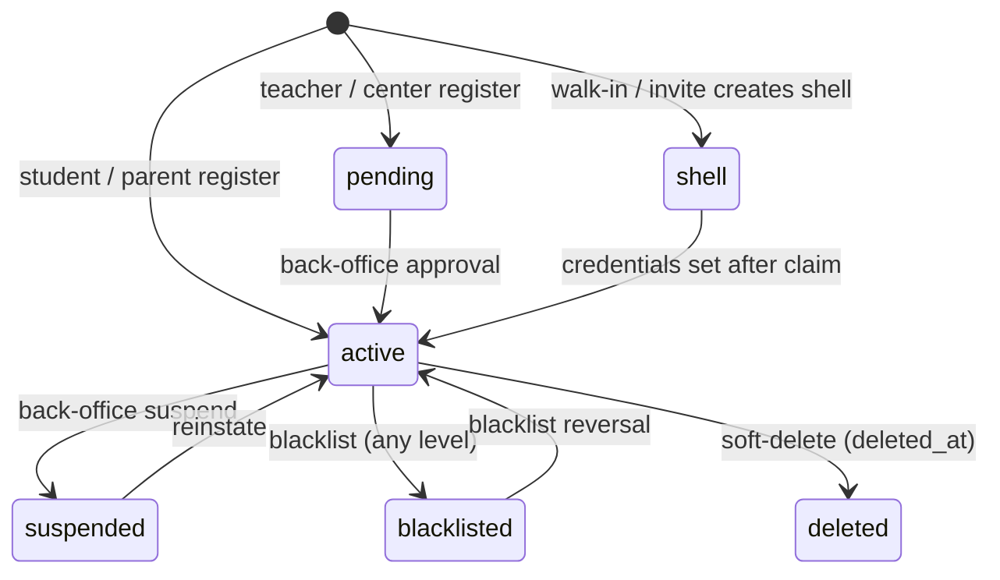

##### WF-003 — Forgot / reset password
- **Starting point:** `/[locale]/forgot-password`.
- **Actors:** visitor; mail provider.
- **Steps:** 1. Enter e-mail → `POST /api/v1/auth/password/forgot`. 2. Always "Check your email" screen. 3. If eligible, mail with `/[locale]/reset-password?token=`. 4. User sets new password (+ confirm) → `POST /api/v1/auth/password/reset`. 5. `token_version` bumped → all sessions deleted → "Password reset" → "Back to sign in".
- **Required conditions:** token unused and < 1 h old.
- **Decisions / alternative paths:** missing token → "Invalid reset link" → "Request new link"; expired → error + request new.
- **Successful completion:** sign-in works with the new password only.
- **Failure scenarios:** 429 per IP (5/min) — UI still shows generic error; per-e-mail 3/h silently drops the mail.
- **Status transitions:** `password_reset_tokens.used_at` set; `users.token_version + 1`.
- **Evidence:** `apps/erp/src/app/[locale]/forgot-password/page.tsx`; `apps/erp/src/app/[locale]/reset-password/page.tsx:86-102`; `packages/server-core/src/services/auth/password-reset.ts`.

##### WF-004 — Invite claim → first credentials → onboarding (walk-in student, assistant, staff, teacher)
- **Starting point:** tokenized link `/[locale]/claim?token=` (WhatsApp for walk-ins; e-mail for invites).
- **Actors:** invited person; center staff / teacher who issued the invite (other modules).
- **Steps:** 1. Page posts `/api/auth/invite-token/claim`. 2. Session minted for the token owner; token marked used. 3. `GET /api/v1/me`: `hasPassword` → go to `LANDING[role]`; else credentials form (e-mail fixed if present). 4. `POST /api/v1/me/credentials {email?, password}`. 5. Student → `/onboarding` (WF-005); others → portal.
- **Required conditions:** purpose ∈ CLAIMABLE (BR-022); token < TTL (BR-019).
- **Decisions / alternative paths:** invalid/used/expired → phase `invalid`; signed-in with another account → `/onboarding` keeps the token through `/login?next=`.
- **Successful completion:** account has credentials and reaches its portal.
- **Failure scenarios:** 429 on claim; 422 when a password already exists.
- **Status transitions:** `invite_tokens.used_at`; `users.status shell → active`; `password_hash` set.
- **Evidence:** `apps/erp/src/app/[locale]/claim/page.tsx:30-90`; `packages/server-core/src/erp-auth/invite-token-plugin.ts`; `packages/server-core/src/services/account/credentials.ts`.

```mermaid
flowchart TD
  A[Open /claim?token] --> B[POST /invite-token/claim]
  B -- invalid/used/expired --> X[Invalid link screen]
  B -- ok --> C[GET /api/v1/me]
  C -- hasPassword --> L[LANDING by role]
  C -- no password --> D[Credentials form]
  D --> E[POST /api/v1/me/credentials]
  E -- 422/409 --> D
  E -- ok --> F{role student?}
  F -- yes --> O[/onboarding]
  F -- no --> L
```

##### WF-005 — Student onboarding wizard
- **Starting point:** `/[locale]/onboarding` (after registration, claim or `?edit=1`; optional `?token=` from the welcome mail).
- **Actors:** student.
- **Steps:** 1. SSR loads catalog tree + onboarding state; if `?token`, `GET /api/v1/me/onboarding-email?token=` → banner on `expired|invalid|mismatch`. 2. Steps: education system → stage → grade → track (if any) → second language (if stage asks). 3. Each step `PATCH /api/v1/me/onboarding {draft}`. 4. Finish → `POST /api/v1/me/onboarding`. 5. Profile `onboardingCompleted = true`, student code finalised → `/dashboard/student`.
- **Required conditions:** signed-in student; active catalog chain.
- **Decisions / alternative paths:** signed out → `/login?next=` with the token preserved; non-wizard role → portal; already complete without `?edit=1` → portal; resend welcome mail (3 then 1 per 10 min).
- **Successful completion:** portal shows track subjects (derived, Catalog module).
- **Failure scenarios:** 404 "Grade level not found"; 400 chain / track / language messages (FR-026).
- **Status transitions:** `student_profiles.onboarding_completed false → true`; `onboarding_draft` cleared.
- **Evidence:** `apps/erp/src/app/[locale]/onboarding/page.tsx:13-77`; `apps/erp/src/app/[locale]/onboarding/onboarding-client.tsx`; `packages/server-core/src/services/catalog/onboarding.ts:134-205`.

```mermaid
flowchart TD
  A[Open /onboarding] --> B{Signed in?}
  B -- no --> L[/login?next=…token kept/]
  B -- yes --> C{Wizard role?}
  C -- no --> P[Own portal]
  C -- yes --> D{Complete and no ?edit=1?}
  D -- yes --> P
  D -- no --> E[System → Stage → Grade]
  E --> F{Grade has tracks?}
  F -- yes --> G[Pick track]
  F -- no --> H
  G --> H{Stage asks second language?}
  H -- yes --> I[Pick language]
  H -- no --> J
  I --> J[POST /api/v1/me/onboarding]
  J -- 400/404 --> E
  J -- ok --> K[/dashboard/student]
```

##### WF-006 — Change own password / change login e-mail
- **Starting point:** Settings → Security (password) or Account (e-mail).
- **Actors:** signed-in user.
- **Steps (password):** current + new + confirm → `POST /api/v1/me/password` → all sessions revoked → "Password changed — please sign in again" → `/login`.
- **Steps (e-mail):** new e-mail (+ current password) → `POST /api/v1/me/email` → mail to the NEW address → `/[locale]/confirm-email?token=` → `POST /api/v1/me/email/confirm` → all sessions revoked → "Your login email has been changed. For your safety every session was signed out…" → sign in with the new e-mail.
- **Required conditions:** password known; new e-mail free.
- **Decisions / alternative paths:** no password yet → "This account has no password yet — use your invite link to set one."; wrong current → "Current password is incorrect"; confirm token expired → error state.
- **Successful completion:** credential changed, every device signed out.
- **Failure scenarios:** 409 e-mail taken (at request or at confirm); 429.
- **Status transitions:** `token_version + 1`; `email_change_requests.used_at`.
- **Evidence:** `apps/api/src/routes/v1/me/password/route.ts:12-27`; `apps/api/src/routes/v1/me/email/route.ts:13-30`; `apps/api/src/routes/v1/me/email/confirm/route.ts:8-22`; `apps/erp/src/app/[locale]/confirm-email/page.tsx`.

##### WF-007 — View-as (back-office → ERP as the target) and stop
- **Starting point:** back-office user directory "view as" (Superadmin Operations mints the token).
- **Actors:** super_admin; ERP.
- **Steps:** 1. Back-office signs a 60-second token (target user, jti). 2. Browser posts it to `/api/v1/auth/view-as/claim`. 3. Plugin verifies signature + TTL, records `audit_logs user.view_as_claimed` (unique jti), mints an ERP session flagged view-as. 4. Redirect into the target's portal; `ViewAsBanner` visible. 5. Banner "stop" → `POST /api/v1/auth/view-as/stop` → session deleted.
- **Required conditions:** `VIEW_AS_SECRET` shared; target an ERP role.
- **Decisions / alternative paths:** expired token → claim refused; replay → refused by unique index; 1 hour from `created_at` → session invalid (BR-024).
- **Successful completion:** super admin sees exactly what the target sees; money actions run under the target's own ERP session.
- **Failure scenarios:** 429 `view-as:${ip}`; `/stop` from an ordinary session → 403.
- **Status transitions:** `auth_sessions` row created/deleted; audit rows.
- **Evidence:** `packages/server-core/src/erp-auth/view-as-plugin.ts`; `apps/api/src/routes/v1/auth/view-as/claim/route.ts:6`; `apps/api/src/routes/v1/auth/view-as/stop/route.ts:9`; `docs/decisions/superadmin-view-as.md`.

##### WF-008 — Guardian contact and e-mail verification (child-safety gate)
- **Starting point:** a minor student (BR-020) without a guardian channel opens the portal; banner `guardian.*` explains "Until it is added, messaging with teachers and center staff is turned off…".
- **Actors:** student; parent (approved link); guardian (mailbox owner); cron reminders; center admins (notification).
- **Steps:** 1. `GET /api/v1/me/guardian-contact` → `required: true`, `messagingLocked: true`, `dueAt`. 2. Student/parent submits e-mail and/or phone → `POST /api/v1/me/guardian-contact`. 3. E-mail present → "Guardian email saved — messaging is now available."; lock lifts (channel exists). Phone only → still locked, `guardianContactDueAt = now + 14 d`. 4. Student (`POST /api/v1/me/guardian-verification`) sends the verification link; guardian opens `/[locale]/guardian/verify?token=` → `POST /api/v1/guardian/verify` → `verified`. 5. Cron reminders every 3 days until an e-mail exists.
- **Required conditions:** guardian e-mail ≠ student e-mail; at least one contact.
- **Decisions / alternative paths:** parent must pass `studentId` (404 "studentId is required") and be approved (403); every verify failure → 422 "This link is not valid or has expired"; changing the e-mail resets verification.
- **Successful completion:** `messagingLocked:false`; optionally `verified:true`.
- **Failure scenarios:** 422 validation messages (FR-037); 429.
- **Status transitions:** `student_profiles.guardian_email`, `guardian_email_verified_at/value`, `guardian_contact_due_at`; audit `student.guardian_email_set / phone_set / verified`.
- **Evidence:** `packages/server-core/src/services/invites/guardian-contact.ts:18-238`; `guardian-verification.ts:30-127`; `packages/database/src/queries/chat-guardian.ts:63-68`; `apps/erp/src/features/student/guardian-verify-screen.tsx`.

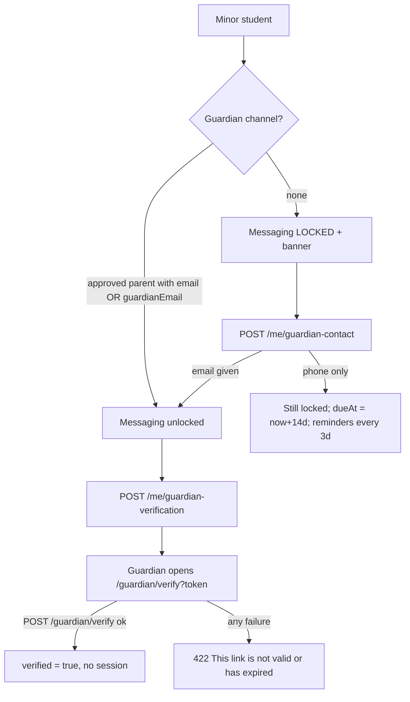

##### WF-009 — Back-office sign-in with mandatory 2FA
- **Starting point:** superadmin host `/[locale]/login`.
- **Actors:** super_admin, accountant.
- **Steps:** 1. E-mail + password → `POST /api/auth/sign-in/email` (back-office instance). 2. Failure of any kind → "Invalid credentials or unauthorized account." 3. 2FA enabled → `/[locale]/two-factor`. 4. Dashboard layout: `!twoFactorEnabled && !impersonated` → `/[locale]/two-factor-setup` with `TwoFactorSetup required` + "Sign out" escape. 5. Enabled → dashboard.
- **Required conditions:** role ∈ {super_admin, accountant}, status active.
- **Decisions / alternative paths:** impersonated session skips forced setup; `?reason=session_conflict|expired` notices.
- **Successful completion:** dashboard usable; API calls pass `requireSession`.
- **Failure scenarios:** 429 (`LOGIN_EMAIL` refill 1/min); API 403 `two_factor_required` until 2FA is on.
- **Status transitions:** `users.two_factor_enabled false → true`.
- **Evidence:** `apps/superadmin/src/app/[locale]/login/page.tsx:28-46`; `apps/superadmin/src/app/[locale]/dashboard/layout.tsx:19-22`; `apps/superadmin/src/app/[locale]/two-factor-setup/page.tsx:9-40`.

```mermaid
flowchart TD
  A[Back-office login] --> B{Eligible + password OK?}
  B -- no --> G[Invalid credentials or unauthorized account.]
  B -- yes --> C{2FA enabled?}
  C -- yes --> D[/two-factor]
  D -- valid --> E[Dashboard]
  C -- no --> F[/two-factor-setup — forced]
  F -- enabled --> E
  F -- sign out --> A
```

##### WF-010 — Session revocation (suspension, blacklist, deletion, credential change)
- **Starting point:** any write that sets `users.status` to a non-active value, sets `deleted_at`, or bumps `token_version`.
- **Actors:** back-office (suspend/blacklist/delete), the user (credential change), system trigger.
- **Steps:** 1. Row updated. 2. Trigger `users_revoke_sessions` deletes all `auth_sessions` for the user. 3. Next request → 401 → UI `/login?reason=session_expired`.
- **Required conditions:** trigger present in the DB (migration `20260801170000_better_auth`).
- **Decisions / alternative paths:** reinstating does not restore sessions; the user signs in again.
- **Successful completion:** no live session for the affected user.
- **Failure scenarios:** none in code; `UNKNOWN` whether the trigger exists in every environment — verify with `packages/database/scripts/verify-db.ts`.
- **Status transitions:** see WF-002 diagram.
- **Evidence:** `packages/database/prisma/migrations/20260801170000_better_auth/migration.sql:159-173`; `packages/server-core/src/services/blacklist/blacklist.ts:270-290`.

### 6.2. Catalog, Discovery, Search & Public Site

Each workflow lists actor, preconditions, steps (numbered) with expected result, and failure branches. Accounts: role plus e-mail only; password: see docs/guides/test-credentials.md.

##### WF-011 — Anonymous visitor discovers and opens a course
Actor: anonymous visitor. Precondition: at least one active course with an active centre or teacher, with demo data seeded (`is_demo = true`).
1. Call `GET /api/v1/search/courses?q=<term>`: only active courses return, array plus `meta {page, limit}` (FR-049).
2. Open `/ar/courses/<id>`: course page renders; `onlineUrl` is null for a visitor, `hasOnlineUrl` tells whether a link exists (FR-057).
3. Press request enrollment while signed out: outcome UNKNOWN — NEEDS PRODUCT OWNER CONFIRMATION (Q-013).
Failure branches: unknown course id gives 404 "Course not found"; rate limit above 60 requests per minute from one IP gives 429.

##### WF-012 — Student browses the catalog (own track, then all subjects)
Actor: student. Precondition: onboarding finished (grade and track set).
1. Open the subjects page: only subjects of the student's own grade/track show (FR-044).
2. Switch to browse-all search (`scope=all`): other subjects appear (FR-044).
3. Second-language stage: only the chosen second language is offered (FR-045).
Failure branches: signed-out call to `/api/v1/catalog/subjects` returns 401.

##### WF-013 — Parent browses on behalf of a child
Actor: parent with approved link. 1. Call `/api/v1/search/courses?studentId=<child>` and `/api/v1/catalog/subjects?...`: scope is the child's grade/track (FR-050, FR-047). 2. Repeat with a child who has no approved link: refused (response code UNKNOWN, Q-011).

##### WF-014 — Centre staff use global search
Actor: center_admin, receptionist, manager, center_accountant.
1. Type two or more characters in the header palette (Cmd/Ctrl+K) (FR-079).
2. Expect groups only for the kinds the role holds: owner sees seven kinds, receptionist students only, manager students and rooms, center_accountant payments only (FR-069).
3. Open a hit: portal-aware link opens inside `/dashboard/admin` or `/dashboard/staff` (FR-075).
4. Search a student code that exists at another centre: hit is masked and links to `/checkin?code=...` (FR-075).
Failure branches: one character returns no groups; palette API failure currently displays "nothing found" (GAP-021).

##### WF-015 — Teacher or assistant uses global search
Actor: teacher, assistant. 1. Search a student name that is on one of the teacher's courses: found, link to `/dashboard/<portal>/classes?courseId=`. 2. Search a student of another teacher: not found. 3. Search a centre: group present only if the teacher has centre affiliations (FR-070, FR-071).

##### WF-016 — Parent and student use global search
Actors: parent, student. Parent finds only approved children (FR-072); student finds only their own enrolled courses (FR-073). Searching another family's child or an unenrolled course returns nothing.

##### WF-017 — Back-office search
Actor: super_admin or accountant in the superadmin app. 1. Open palette, type a query. 2. Results come from back-office providers (FR-078, FR-080). 3. Failure shows an error state (the superadmin shell wires errors, unlike the ERP).

##### WF-018 — Visit a public profile by handle
Actor: anonymous visitor.
1. Open `/ar/p/<handle>` of an active centre or teacher: profile renders (FR-059).
2. Suspend the owner (back-office action, owned by another module) and reload after at most 60 s: 404 plus `noindex` (FR-060, FR-062).
3. The owner, signed in, sees the fresh profile at once after an edit (FR-062).
4. Open a reserved or malformed handle: 404.

##### WF-019 — Send a contact message
Actor: anonymous visitor. Variants: ERP `/ar/contact` and www `/ar/contact`.
1. Fill name, e-mail, subject, message (10+ characters) and submit.
2. Expect 201 and a success state; a row exists in `contact_submissions` with `source = website_contact` (FR-082, FR-083).
3. Submit six times within one minute from one IP: the sixth is refused with 429 (FR-082); www shows its "limited" state (FR-094).
4. Submit invalid input: field errors; API returns the validation envelope.

##### WF-020 — Search engine crawl
Actor: crawler. 1. Fetch the ERP `/sitemap.xml`: marketing pages, help articles, auth pages and public handles (FR-064). 2. Fetch the www `/sitemap.xml` and `/robots.txt` (FR-096). 3. Check each page head for canonical and hreflang ar/en (FR-090, FR-096). 4. Open a handle from the sitemap: must be 200, never 404 (FR-063).

##### WF-021 — Teacher opens an affiliation invite link
Actor: teacher. 1. Open `/ar/<inviteId>` signed in as teacher: invite shown with actions (FR-066). 2. Open as a parent or student: role-mismatch message. 3. Unknown id: not-found card.

##### WF-022 — www locale and 404 behaviour
Actor: visitor. 1. Open `/` on www: 307 to `/ar` (FR-095). 2. Switch to English: direction changes to LTR (FR-099). 3. Open `/ar/does-not-exist`: localised 404 (FR-097).

##### WF-023 — Read public pricing
Actor: anonymous visitor. 1. Open `/ar/pricing` (ERP) and `/ar/pricing` (www): both show pricing information; the ERP version shows worked examples from the global commission settings (FR-085). 2. With the commission row missing, code-default rates are shown silently (GAP-025).

### 6.3. Center Administration

Path prefixes as in fr.md. Every step cites the FR that defines it. The evidence is in fr.md.

##### WF-024 — Staff onboarding and lifecycle
- **Starting point:** the admin staff page (`dashboard/admin/staff`, ui.md).
- **Actors:** center_admin, a new staff member.
- **Steps:**
  1. The admin enters the email, name and sub-role, which calls `POST /center/staff` (FR-111).
  2. The system creates or reuses the user and creates the `center_staff` row. It emails a claim link.
  3. The staff member opens the link and sets a password ("Auth & Accounts").
  4. The staff member signs in. `GET /center/staff/me` shows the sub-role (FR-115).
  5. Later, the admin changes the role, title or active flag (FR-113), or removes the staff member (FR-114).
- **Required conditions:**
  - The email is not another role's account.
  - The person is not active staff at another center (BR-091).
- **Decisions:**
  - Existing user with the same email and role → reuse.
  - Existing user with a different role → 409.
  - Password already set → resend refused (BR-093).
- **Successful completion:** the staff member can reach the routes for their sub-role (FR-100).
- **Failure scenarios:**
  - 409 or 422 on create.
  - 429 on resend (FR-112).
  - A removed staff member gets 403 on the next request.
- **Status transitions:**
  - user: shell → active (on claim).
  - center_staff: active → inactive (PATCH isActive false) → removed (`removed_at` set).

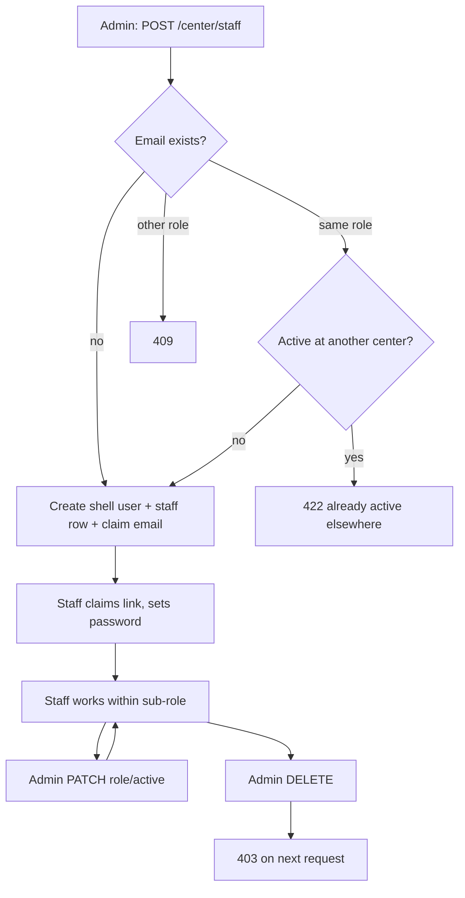

##### WF-025 — Walk-in registration at the counter
- **Starting point:** the counter walk-in panel (`admin/counter/walk-in-panel.tsx`).
- **Actors:**
  - receptionist, manager or center_admin;
  - the parent or student (WhatsApp recipient).
- **Steps:**
  1. Staff enter the name, phone and grade, which calls `POST /center/walk-in` (FR-127).
  2. The system normalises the phone (BR-098) and looks for an active, non-shell user with that phone (BR-099).
  3. The outcome depends on the match:
     - No match → a temp student is created, the guardian contact is stored, a `walk_in_onboarding` invite is created, and a `walk_in_welcome` WhatsApp is sent. The student code is returned.
     - Match on our roster → a `student_code_reminder` is sent.
     - Match not on our roster → a masked name, no code, and nothing is sent.
  4. If the message is lost, staff resend it with `POST /center/walk-in/resend` (FR-128).
- **Required conditions:**
  - The phone belongs to a student, not to a non-student account.
  - The rate limit is 30 per window.
- **Decisions:** the three outcomes in step 3.
- **Successful completion:** the code is shown at the counter and the message is queued, or `guardianContactDueAt` is set when there is no recipient.
- **Failure scenarios:**
  - 422 "This phone belongs to a non-student account".
  - 429.
  - Resend 404 / 422 (BR-100).
  - Phone-only de-duplication (GAP-035).
- **Status transitions:** new user shell (temp student) → active on claim ("Auth & Accounts").

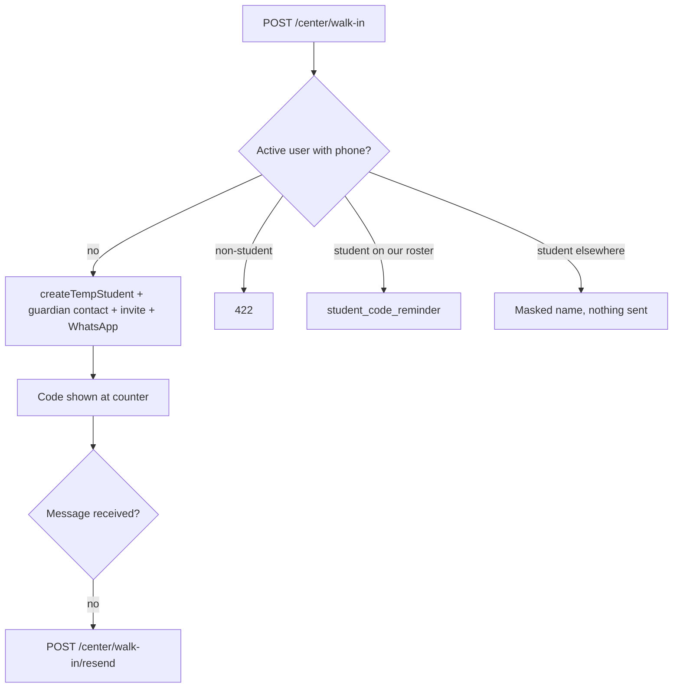

##### WF-026 — Bulk student import (CSV)
- **Starting point:** the import dialog (`admin/student-import-dialog.tsx`).
- **Actors:** manager or center_admin.
- **Steps:**
  1. Upload the CSV. The file is parsed (FR-133).
  2. Run a dry run, which returns per-row outcomes, with foreign matches masked (FR-134, BR-104).
  3. Commit in chunks. Each row is created or matched with `findStudentByKeys` (BR-101), and one audit row is written per call (BR-105).
  4. Download the results.
- **Required conditions:**
  - The file is not empty and within the size limit.
  - The rows are within MAX_IMPORT_ROWS (BR-103).
  - A name column is recognised.
- **Decisions:**
  - The row is valid or carries a row error.
  - The match is on the roster or not.
  - The row duplicates another row in the same file (BR-107).
- **Successful completion:** the students are on the roster and the import is audited. It is not a financial event (BR-108).
- **Failure scenarios:**
  - 400 on an empty or too-large file.
  - 422 when there are no rows or too many rows.
  - Row errors.
  - A foreign match is attached on commit (GAP-038).
- **Status transitions:**
  - roster: none → active (`leftAt` null);
  - user: new shell.

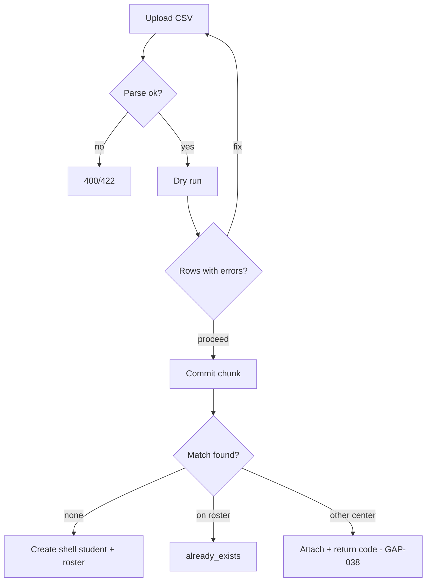

##### WF-027 — Temporary student claim
- **Starting point:** the center or teacher creates a temp student (FR-129 / FR-130).
- **Actors:**
  - center_admin, receptionist or manager (center route);
  - teacher or assistant (shared route);
  - the student.
- **Steps:**
  1. Create the temp student with name, phone and grade.
  2. Send the invite code (FR-131).
  3. The student signs in to their own account and posts the code to `POST /temp-students/claim` (FR-132).
  4. The history is merged into the claiming profile (BR-125).
- **Required conditions:**
  - The phone is not a registered user.
  - The code is claimable.
  - The claimer has a student profile.
- **Decisions:**
  - Same phone again → the shell is reused and overwritten (GAP-041).
- **Successful completion:** the temp record merges and the shell is retired.
- **Failure scenarios:**
  - 409 registered phone.
  - 404 code not found.
  - 422 not claimable or no profile.
  - 429.
- **Status transitions:** temp shell (invited) → claimed / merged.

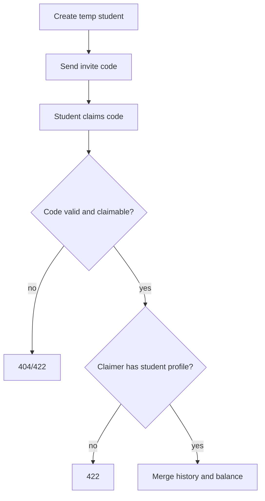

##### WF-028 — Center blacklist add and lift
- **Starting point:** the student detail page (UI uses the roster flag) or `POST /center/blacklist`.
- **Actors:** center_admin; manager (roster flag only).
- **Steps:**
  1. **Path A (entry):** `POST /center/blacklist` with a reason (FR-138). This creates the entry, the cascade and the notification.
  2. **Path B (flag):** `PATCH /roster/students/[id]` `{blacklisted:true}` (FR-119). This sets the flag only.
  3. Enforcement on enrollment paths (BR-112).
  4. Lift through `DELETE /center/blacklist/[id]` (FR-139), or by PATCH `{blacklisted:false}`.
- **Required conditions:**
  - The student is on this roster.
  - A reason is given (path A).
- **Decisions:**
  - Path A or path B (GAP-034).
  - A platform entry can only be lifted by super_admin.
- **Successful completion:** enrollment at the center is refused while the block is active.
- **Failure scenarios:**
  - 409 already blacklisted.
  - 404 not on roster.
  - 403 platform entry.
  - A flag set by path B is invisible to the path A list.
- **Status transitions:**
  - entry: active → lifted (`liftedAt`);
  - flag: false ↔ true.

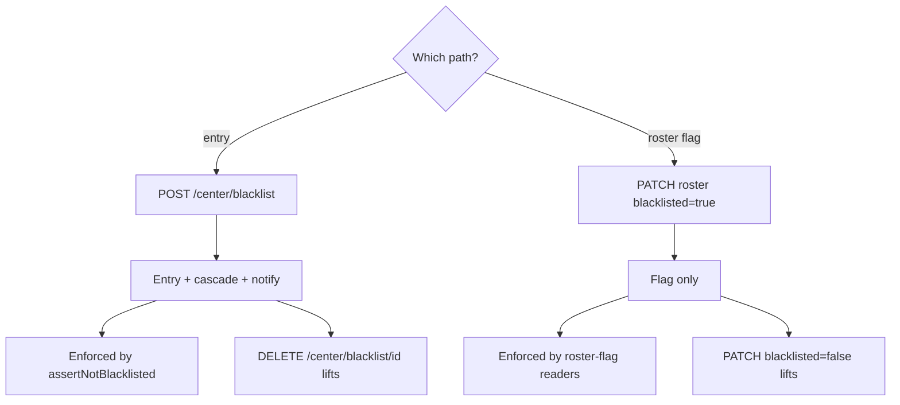

##### WF-029 — Off-system teacher lifecycle
- **Starting point:** `admin/external-teachers`.
- **Actors:**
  - center_admin;
  - manager (read);
  - receptionist (students and grades);
  - accountant (money reads).
- **Steps:**
  1. Create the teacher (FR-155).
  2. Add or link students (FR-164..067) and record grades (FR-168, FR-169).
  3. Statement and balances (FR-170), then settle (FR-171).
  4. Convert to enrolled (FR-161) and resend the invite (FR-163). Alternatively, remove (FR-159) and restore (FR-160).
- **Required conditions:**
  - The phone or email is not another role's account and not already on the platform.
  - Removal requires that no active groups remain.
- **Decisions:**
  - Another center already keeps records → 409.
  - Convert requires an email.
  - Convert back to external is refused when other centers are active.
- **Successful completion:** the teacher is either converted and logs in, or removed with history kept.
- **Failure scenarios:**
  - 409 / 422 per FR.
  - A suspended user is reactivated on convert (GAP-048).
  - A balance is ignored on removal (GAP-049).
- **Status transitions:**
  - user: shell (external) → active/shell (enrolled) → shell (external);
  - affiliation: active → removed → active (restore).

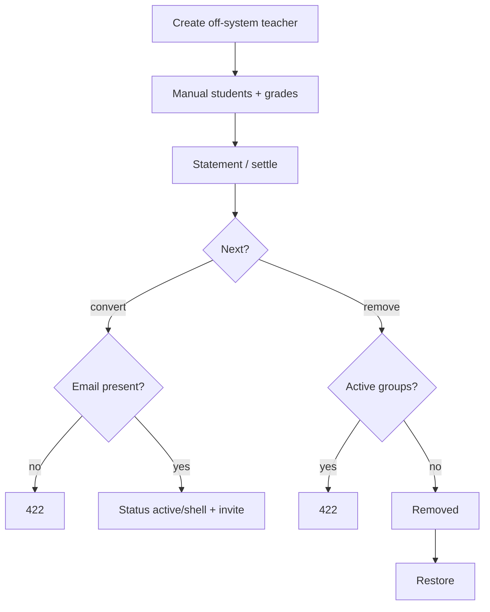

##### WF-030 — Team note handover
- **Starting point:** `admin/notes` or `staff/notes`.
- **Actors:**
  - receptionist, manager or center_admin (write);
  - accountant (read).
- **Steps:**
  1. Create the note (FR-150).
  2. Others read the board (FR-149).
  3. The author edits the text, and the author or a team lead pins it or changes its status (FR-151).
  4. The author or a team lead removes it (FR-152).
- **Required conditions:**
  - The actor belongs to the center.
  - Only the author edits the text (BR-117).
- **Decisions:** whether the actor is the author or a team lead.
- **Successful completion:** the note is visible to the team and its status is updated.
- **Failure scenarios:**
  - 403 not the author or lead.
  - 404 note not found.
  - Accountant write 403.
- **Status transitions:** note `open` → `done` or `declined` (enum TeamNoteStatus, packages/database/prisma/schema.prisma:965-971) → soft-removed.

##### WF-031 — Room setup and deactivation
- **Starting point:** `admin/rooms` or `staff/rooms`.
- **Actors:** manager or center_admin; teacher (browse).
- **Steps:**
  1. Create the room (FR-143).
  2. Upload photos (FR-146).
  3. Edit the room (FR-144).
  4. Teachers see it when requesting collaboration (FR-148).
  5. Deactivate it (FR-145).
- **Required conditions:**
  - At most 12 photos.
  - Image upload is configured.
  - Deactivation requires no future sessions in the room.
- **Decisions:** whether future sessions reference the room.
- **Successful completion:** the room is hidden from lists and from teacher browse.
- **Failure scenarios:**
  - 422 future sessions.
  - 422 photo limit.
  - PATCH on an inactive room is accepted (GAP-052).
- **Status transitions:** room `isActive` true → false. There is no reactivate path: `roomPatchSchema` has no `isActive` (SV/rooms/rooms.ts:44-53; BR-115).

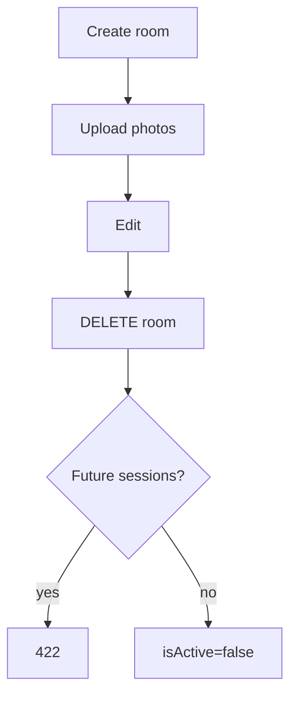

##### WF-032 — Co-admin invite and removal
- **Starting point:** no UI (ui.md). API only: `centers/me/admins*`.
- **Actors:** center_admin, the invited person.
- **Steps:**
  1. `POST /centers/me/admins/invite` (FR-108).
  2. The invited person cannot accept: `admin_invite` is not claimable (GAP-033).
  3. List the admins (FR-107).
  4. Remove a co-admin (FR-109).
- **Required conditions:**
  - The actor cannot remove themselves.
  - The last admin cannot be removed (BR-094).
- **Decisions:** self or last admin → refused.
- **Successful completion:** UNKNOWN — NEEDS PRODUCT OWNER CONFIRMATION (Q-023).
- **Failure scenarios:**
  - 409 already admin.
  - 403 self.
  - 422 last admin.
  - The removed admin's session still carries the center (GAP-032).
- **Status transitions:** `center_admin_profiles` row deleted (hard delete).

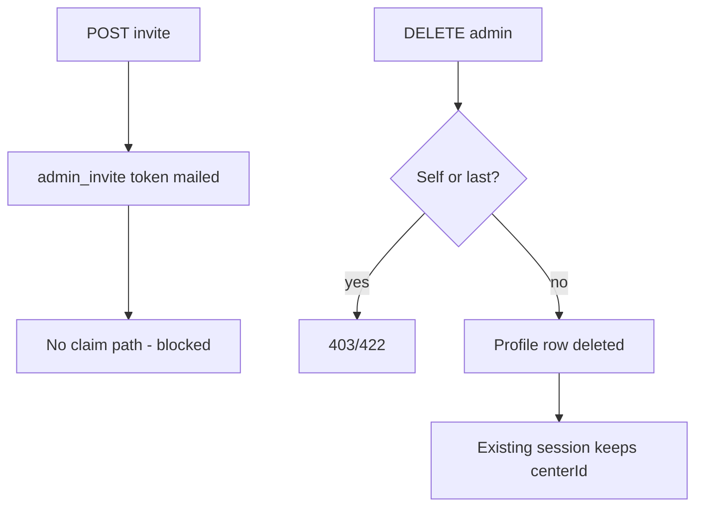

### 6.4. Courses, Sessions, Enrollment & Attendance

##### WF-033 — Create a center course and its sessions
- **Starting point:** `/[locale]/dashboard/admin/classes`, create-course form.
- **Actors:** center_admin.
- **Steps:**
  1. Admin enters teacher, title, subject, capacity, pricing, delivery, hall, weekdays and times.
  2. `POST /courses`.
  3. Server validates the schema, the affiliation and the hall.
  4. The course is created.
  5. `generateSessionsTx` builds sessions.
  6. `checkConflicts` checks each session.
  7. Commit.
- **Required conditions:** teacher actively affiliated; hall at this center; link shape valid (FR-176, FR-178).
- **Decisions / alternative paths:** a clash → whole transaction rolled back (atomic, `course-create-atomicity.test.ts`).
- **Successful completion:** 201; sessions appear in the week grid (WF-034).
- **Failure scenarios:** 409 "Schedule conflicts detected"; 422 affiliation; 404 hall; 400 validation.
- **Status transitions:** course → active; sessions → scheduled.

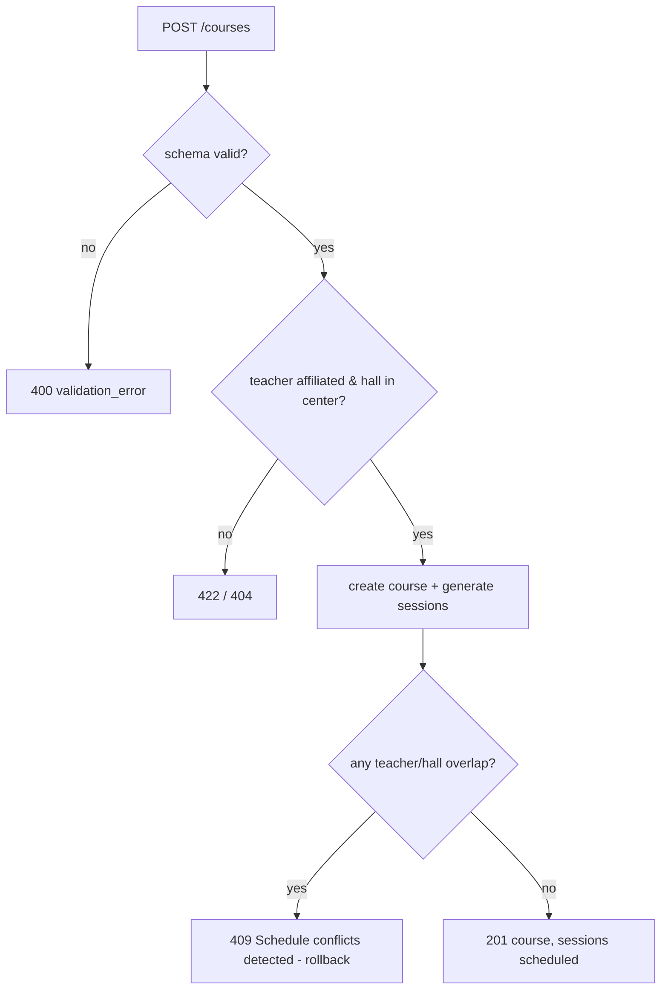

##### WF-034 — Session lifecycle (state machine)
- **Starting point:** a generated session (scheduled).
- **Actors:** teacher/assistant (cancel, postpone), teacher/assistant/center_admin/staff R-M (complete), center_admin (course cancel).
- **Steps:** a session is generated → optionally postponed or cancelled → attendance taken → completed (settlement).
- **Required conditions:** see FR-186, FR-187, FR-188.
- **Decisions / alternative paths:**
  - Cancel and postpone are refused once completed or distributed.
  - Complete is refused when cancelled or unpriced.
  - No guard stops postponing or re-cancelling a cancelled session (GAP-055).
- **Successful completion:** status completed, `distributedAt` set (priced lesson with present students).
- **Failure scenarios:** 403 non-assigned teacher; 409 postpone clash; 422 unpriced.
- **Status transitions:** in the diagram below. `ongoing` exists in the enum; no writer found (UNCLEAR).

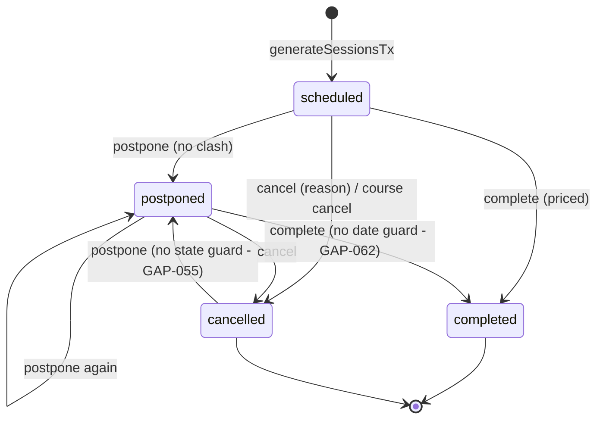

##### WF-035 — Enrollment request lifecycle
- **Starting point:** student browses a center course.
- **Actors:** student, center_admin.
- **Steps:**
  1. Student `POST /enrollment-requests`.
  2. Center admins are notified.
  3. Admin opens `/dashboard/admin/enrollment-requests`.
  4. Admin approves (two-step) or declines (optional reason).
  5. The student is notified.
- **Required conditions:** center course; not blacklisted; no pending duplicate; not already enrolled.
- **Decisions / alternative paths:**
  - The student cancels while pending.
  - After 14 days the request is lazily expired on the next list.
  - Approve on a full course → 422 course_full.
- **Successful completion:** approved request + active enrollment.
- **Failure scenarios:** 410 expired; 409 duplicate; 422 full.
- **Status transitions:**

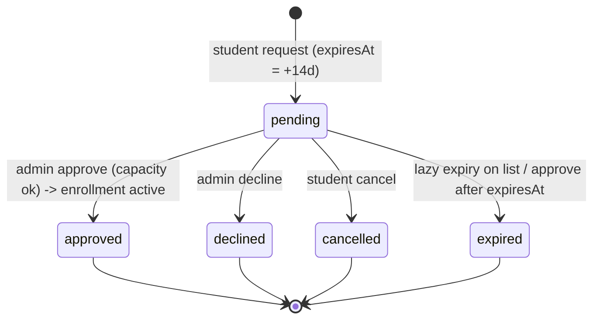

Direct path: center_admin `POST /enrollments` → enrollment active (no capacity check); `DELETE /enrollments/{id}` → unenrolled.

##### WF-036 — Counter check-in, mode A vs mode B, and door check-in
- **Starting point:** counter board (`/dashboard/admin/counter` or the staff home) or `/checkin`.
- **Actors:** center_admin / receptionist / manager (counter); teacher / assistant (door).
- **Steps:**
  1. Desk picks a teacher, then a lesson (or searches a student).
  2. `POST /center/checkin`.
  3. If not covered → 402 `needs_payment`.
  4. The desk collects the fee (`POST /center/subscriptions` per_session; payment module), then checks in again.
  5. Mode A → present.
  6. Mode B → counter_only; the student goes to the door; the teacher/assistant scans → `POST /door-checkin` → present.
- **Required conditions:** session at this center, not cancelled/closed; coverage.
- **Decisions / alternative paths:**
  - Mode set per teacher (FR-195).
  - Door without counter → 422.
  - Repeat door scan → already_present.
  - A student on another center's roster → "Choose your center" notification.
- **Successful completion:** attendance record present (A) or present after door (B).
- **Failure scenarios:** 402, 422 session_closed, 403 other center; door 422 no counter.
- **Status transitions:**

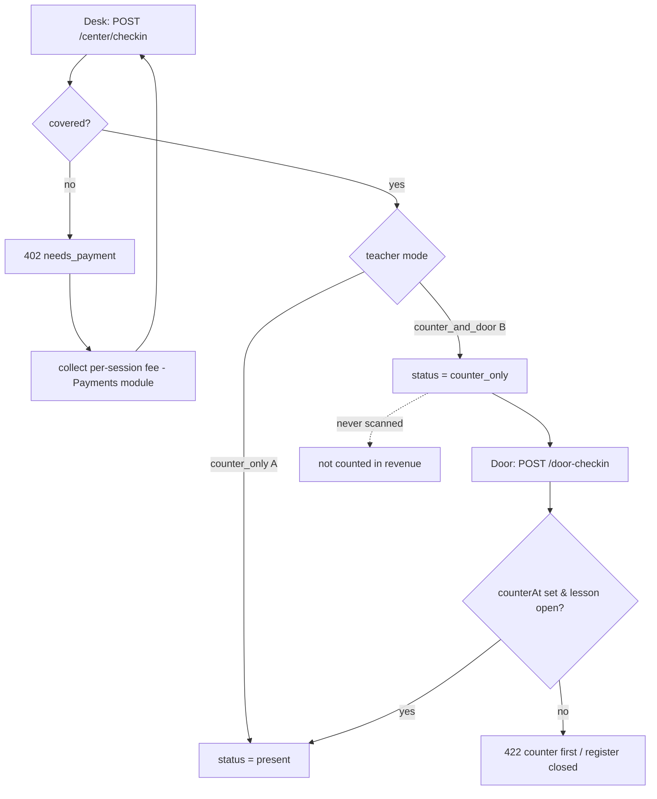

##### WF-037 — Take attendance, close the lesson, reopen
- **Starting point:** `/dashboard/teacher/attendance` (or assistant), or the admin schedule dialog.
- **Actors:** teacher, assistant, center_admin, staff R/M (close), staff M (reopen).
- **Steps:**
  1. `GET /sessions/{id}/attendance`.
  2. Mark present/absent/excused.
  3. `PUT /sessions/{id}/attendance`.
  4. `GET /settlement-preview`.
  5. "Complete lesson — EGP {amount}".
  6. Final confirmation.
  7. `POST /complete` → `distributeSessionRevenue`.
- **Required conditions:** register not locked; lesson priced; not cancelled.
- **Decisions / alternative paths:**
  - More than 7 days passed or completed-without-distribution → locked → `POST /attendance/reopen` (audited) → edit → close.
  - Distributed → frozen forever.
  - No one present → `no_present_students` (nothing distributed).
- **Successful completion:** "Lesson closed and its revenue distributed".
- **Failure scenarios:** 422 unpriced; 422 fee exceeds price; 403 lock messages.
- **Status transitions:**

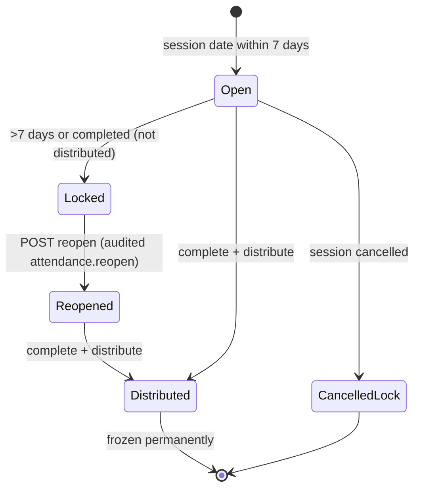

##### WF-038 — Offline attendance and sync
- **Starting point:** teacher attendance or door screen without a connection.
- **Actors:** teacher, assistant.
- **Steps:**
  1. Records are saved to the PWA outbox ("Saved offline…").
  2. On reconnect: `POST /teacher/attendance/sync` (≤ 500).
  3. Per-record results are returned.
  4. Refused records stay on the device.
- **Required conditions:** own sessions; students enrolled; door records need the counter.
- **Decisions / alternative paths:**
  - An existing server record wins (`server_record_kept`).
  - Cancelled/settled → conflict.
  - Door stage routes through `doorTransitionTx`.
- **Successful completion:** `synced` count = total.
- **Failure scenarios:** errors `session_not_found`, `not_your_session`, `student_not_enrolled`, `no_counter_checkin`.
- **Status transitions:** none on the session; attendance records created.

```mermaid
flowchart TD
  R[offline record] --> A{session exists & yours?}
  A -- no --> E1[error]
  A -- yes --> B{cancelled or settled?}
  B -- yes --> C1[conflict]
  B -- no --> D{stage = door?}
  D -- yes --> DT[doorTransitionTx]
  D -- no --> F{enrolled?}
  F -- no --> E2[error student_not_enrolled]
  F -- yes --> G{server record exists?}
  G -- yes --> C2[conflict server_record_kept]
  G -- no --> S[synced]
```

### 6.5. Payments, Subscriptions, Wallets & Settlement

##### WF-039 — Counter payment, receipt and refund
- **Starting point:** `/[locale]/dashboard/admin/fees` with an open shift (FR-244).
- **Actors:** center_admin (record, refund, confirm); student/parent (view receipt).
- **Steps:**
  1. Admin opens "Record payment", picks student, optional class, amount, method → `POST /api/v1/payments` → 201, receipt number returned (FR-216).
  2. System writes `payments` + `transactions`, stamps `shiftId`, awards points (FR-252), queues receipt e-mail (FR-255).
  3. Student/parent opens `/[locale]/receipts/[paymentId]` (FR-220).
  4. Admin arms a refund → `POST /api/v1/payments/[id]/refund` {amount, reason, refundChannel} → 201 negative row, coverage cancelled, points clawed back if within window (FR-221).
  5. Refund appears in `GET /api/v1/payments/refunds/unconfirmed` (FR-223).
  6. Admin confirms with slip/transfer ref → `POST …/refund/confirm` → ledger row `completed` (FR-222).
- **Required conditions:** student on roster; enrolled if class given; original positive and unsettled.
- **Decisions / alternative paths:** channel `cash_drawer` vs `bank_transfer`; a settled lesson under the receipt → refuse, hand to back-office refund; a wallet-funded original → debit payer wallet (BR-179).
- **Successful completion:** refund confirmed, `payments.refunded_amount` = Σ refunds ≤ original.
- **Failure scenarios:** 422 "Refund exceeds the original payment"; 422 "This refund is already confirmed"; 403 for accountant.
- **Status transitions:** refund ledger row `pending → completed`.

```mermaid
flowchart TD
  A[Record payment] -->|201| B[Receipt RCP-…]
  B --> C{Refund requested?}
  C -->|lesson settled| D[422 refund the lesson instead]
  C -->|exceeds original| E[422 Refund exceeds the original payment]
  C -->|ok| F[Refund armed: negative row, pending ledger]
  F --> G[Confirm with externalRef]
  G -->|first| H[Ledger completed]
  G -->|again| I[422 already confirmed]
```

##### WF-040 — Online course/subscription checkout (gateway)
- **Starting point:** `/[locale]/dashboard/student/subscriptions` (or parent `/pay`).
- **Actors:** student or parent; system; gateway (mock in dev).
- **Steps:**
  1. Client checks `GET /api/v1/payments/availability` (FR-224).
  2. `POST /api/v1/subscriptions/checkout` {courseId, plan, sessionId?, payFrom: gateway, idempotencyKey} → 201 pending subscription + intent (FR-232/018).
  3. Client polls `GET /api/v1/payments/intents/[id]` (FR-226); in dev it calls `POST …/mock-complete` {outcome} (FR-227).
  4. Gateway posts the webhook → HMAC verified (FR-228) → `processWebhookEvent` (FR-229).
  5. On success the subscription becomes `active`, receipt/payment/ledger rows are written, teacher-direct split applied, points awarded.
- **Required conditions:** plan enabled on course; no duplicate active; no checkout in flight.
- **Decisions / alternative paths:** failure event → intent `failed`, subscription stays pending until the 24-h sweep cancels it (FR-217); user cancels pending (FR-234); intent expires after 1 h; a late capture → `paid_late` and the three-branch settlement (BR-194): activate / reactivate / credit payer wallet; mismatch → `needs_review` (back-office resolves).
- **Successful completion:** `payment_intents.status = paid`, `subscriptions.status = active`, `periodEnd = Cairo day start + 30 d − 1 ms`.
- **Failure scenarios:** 422 in-progress; 401 invalid hmac; 429 rate limit (30 / 30 s).
- **Status transitions:** see diagram.

```mermaid
stateDiagram-v2
  [*] --> pending: initiate
  pending --> paid: capture ok (match)
  pending --> failed: failure / void / refund event
  pending --> expired: sweep after expiresAt
  pending --> needs_review: capture mismatch
  expired --> paid: late capture (paid_late)
  paid --> [*]
  failed --> [*]
  needs_review --> [*]
```

##### WF-041 — Pay from wallet (student) or parent wallet
- **Starting point:** same pages as WF-040 with "Pay from wallet".
- **Actors:** student / parent.
- **Steps:**
  1. Student tops up wallet online (FR-230) or at the counter (FR-238); parent tops up parent wallet (FR-231).
  2. `POST /api/v1/subscriptions/checkout` {payFrom: wallet | parent_wallet}.
  3. System locks the profile, runs the conditional decrement (FR-262), then `settleSubscriptionMoney` synchronously; returns `{walletPaid:true, subscriptionId, receiptNumber}`.
- **Required conditions:** balance ≥ price; parent only for approved child.
- **Decisions / alternative paths:** insufficient → 422 message; student may not use `parent_wallet`; parent may not use student `wallet`.
- **Successful completion:** subscription `active` immediately; wallet ledger `debit` row; payments row `paymentMethod: wallet`, `payerUserId` = payer.
- **Failure scenarios:** two concurrent wallet checkouts → one 422 insufficient (BR-195).
- **Status transitions:** subscription `[*] → active` in one transaction.

##### WF-042 — Walk-in subscription and attendance at the counter
- **Starting point:** counter board / fees page; receptionist shift open.
- **Actors:** receptionist/manager/center_admin; student (notified).
- **Steps:**
  1. Staff selects student + course + plan (+ session for a pass) + method → `POST /api/v1/center/subscriptions` {markAttendance:true} (FR-236).
  2. System activates subscription (creates roster entry if missing), writes receipt/payment/ledger stamped with shift, moves center credit by the platform share (`center_held`, FR-261), marks attendance `present` or `counter_only` per teacher mode (owned by "Courses, Sessions & Attendance").
  3. Student gets notification "Your subscription was recorded at the center. Receipt X."
- **Required conditions:** course at this center; no duplicate active; student not blacklisted (checked by "Students & Walk-in").
- **Decisions / alternative paths:** `paymentMethod` instapay/pos_card/mobile_wallet (non-cash does not enter `cashNet`); per_session vs monthly.
- **Successful completion:** 201 with receipt number; shift totals updated.
- **Failure scenarios:** 403 accountant; 404 "Course not found at this center"; 422 duplicate.
- **Status transitions:** subscription `[*] → active`.

##### WF-043 — Cash shift lifecycle
- **Starting point:** `/[locale]/dashboard/admin/shifts`.
- **Actors:** cashier (receptionist/manager/center_admin).
- **Steps:** 1. `POST /api/v1/center/shifts` {openingFloat} (FR-244). 2. Record payments / walk-ins / cash top-ups (WF-039, 04, FR-238). 3. `GET /api/v1/center/shifts/current` shows `expectedCashNow`. 4. `POST /api/v1/center/shifts/[id]/close` {countedCash, note} (FR-245). 5. Reconciliation via `GET /api/v1/center/shifts?from&to` (FR-246).
- **Required conditions:** one open shift per cashier.
- **Decisions / alternative paths:** variance ≠ 0 recorded with note; refunds by `cash_drawer` reduce `cashNet`.
- **Successful completion:** shift closed with `variance`.
- **Failure scenarios:** open twice → 422; close twice → 422.
- **Status transitions:** shift `open → closed`.

##### WF-044 — Session settlement (money leg of completing a lesson)
- **Starting point:** teacher/center completes a session ("Courses, Sessions & Attendance" owns the state change).
- **Actors:** system; teacher and center (wallets credited).
- **Steps:**
  1. Optional preview `GET /api/v1/sessions/[id]/settlement-preview` (FR-260).
  2. On completion `distributeSessionRevenue(sessionId)` (FR-259): for each present student resolve the lesson price (FR-258), pick rates at `economicsAt` (BR-208), apply the teacher agreement (FR-247), write three ledger rows, credit wallets, move center credit by funding leg (FR-261).
- **Required conditions:** every present student priced (BR-215).
- **Decisions / alternative paths:** teacher-direct (no center) vs teacher-at-center vs no-room; `center_held` vs `platform_held`.
- **Successful completion:** balances increase by teacherNet / centerNet; second run is a no-op.
- **Failure scenarios:** unpriced student → completion refused with BusinessRuleError.
- **Status transitions:** none in PAY (session state owned elsewhere).

```mermaid
flowchart LR
  S[Session completed] --> P{All present students priced?}
  P -->|no| R[Refuse: unpriced lesson]
  P -->|yes| Q[Resolve rates at economicsAt]
  Q --> T{Agreement?}
  T -->|percent_of_net| U[take = floor(net*bp/10000)]
  T -->|fixed_per_student| V[take = rateFlat*present]
  T -->|none| W[default split]
  U --> X[3 ledger rows per student + wallet credits + creditMove]
  V --> X
  W --> X
```

##### WF-045 — Payout request (center or teacher)
- **Starting point:** `/[locale]/dashboard/admin/wallet` or `/[locale]/dashboard/teacher/wallet`.
- **Actors:** center_admin / teacher; back-office accountant (approve/pay — "Finance & Accounting (Back-office)").
- **Steps:** 1. Read balance + available (FR-241/033). 2. `POST …/payout-request` {amount?, clientRequestId} → 201 pending (FR-242/034). 3. Optionally `POST …/payouts/[id]/cancel` while pending (FR-243). 4. Back-office approves/pays/rejects.
- **Required conditions:** available ≥ amount.
- **Decisions / alternative paths:** omitted amount = full available; duplicate `clientRequestId` → same row.
- **Successful completion:** `payout_requests.status = pending`, available reduced.
- **Failure scenarios:** 422 over available; 422 cancelling a non-pending request.
- **Status transitions:** `pending → cancelled` (requester) | `approved → paid` | `rejected` (back-office).

##### WF-046 — Center credit top-up and reconciliation
- **Starting point:** `/[locale]/dashboard/admin/credit`.
- **Actors:** center_admin; system.
- **Steps:** 1. View balance/ledger (FR-239). 2. `POST /api/v1/center/credit/topup` {amount 1,000–5,000,000, method, idempotencyKey} → intent (30-min TTL) (FR-240). 3. Capture (WF-040 steps 3–4) → `creditMove(+amount)`.
- **Required conditions:** online payments available.
- **Decisions / alternative paths:** cash wallet top-ups and cash subscriptions decrease credit automatically (BR-198).
- **Successful completion:** ledger row `topup`, balance up.
- **Failure scenarios:** 422 bounds; expired intent → late capture still credits.
- **Status transitions:** intent as WF-040.

##### WF-047 — Scheduled expiry sweeps
- **Starting point:** scheduler calls `POST /api/v1/cron/expire-payment-intents` and `POST /api/v1/cron/expire-subscriptions` with `CRON_SECRET` (FR-217).
- **Actors:** system.
- **Steps:** 1. Authenticate secret (401 otherwise). 2. Intents `pending` past `expiresAt` → `expired`. 3. Monthly past `periodEnd` → `expired`; passes with session day passed (UTC) → `expired`; pending > 24 h without live intent → `cancelled`.
- **Required conditions:** secret configured.
- **Decisions / alternative paths:** none.
- **Successful completion:** `{data:{expired:n}}`.
- **Failure scenarios:** unknown job → 422 "Unknown cron job: …".
- **Status transitions:** as BR-196.

### 6.6. Teacher Portal, Assistants, Collaboration & Academic Content

##### WF-048 — Add, invite and activate an assistant
- Starting point: Teacher opens /[locale]/dashboard/teacher/team.
- Actors: teacher; assistant (new); Authentication module (claim page).
- Steps: 1) Teacher presses "Add assistant" and enters name, email, optional title. 2) POST /api/v1/teacher/assistants creates a shell user (role assistant, no password) and the team link. 3) System emails a claim link (also returned in the response as claimLink). 4) Assistant opens the link and sets a password (Authentication module). 5) Assistant logs in and lands on /dashboard/assistant with the "Acting on behalf of" strip.
- Required conditions: email not used by another role; assistant not on another team.
- Decisions: existing assistant account with a password gets no invite (existingAccount=true). Resend via POST .../invite while the password is unset (10/min limit).
- Successful completion: assistant listed without the pending-claim marker; delegated calls succeed.
- Failure scenarios: 409 role clash; 409 already on team; 409 generic (assistant on another team); 422 inactive account; invite email delivery failure (invite.delivery shows state; exact values UNKNOWN).
- Status transitions: link (none) to active; user shell to active after claim.
```mermaid
flowchart TD
A[Teacher: Add assistant] --> B{Email exists?}
B -- other role --> X1[409 role clash]
B -- no --> C[Create shell user + link]
B -- assistant, on this team --> X2[409 already on team]
B -- assistant, other team --> X3[409 generic]
B -- assistant, no link --> D[Create or revive link]
C --> E[Send invite]
D --> F{Has password?}
F -- no --> E
F -- yes --> G[No invite]
E --> H[Assistant sets password]
H --> I[Assistant can act as teacher]
```

##### WF-049 — Revoke an assistant
- Starting point: teacher/team remove icon.
- Actors: teacher, assistant.
- Steps: 1) Confirm "Remove assistant?". 2) DELETE sets removedAt. 3) Assistant's next delegated call returns 403 "Assistant is not linked to a teacher".
- Required conditions: link belongs to teacher.
- Successful completion: no access; conversations kept.
- Failure scenarios: 404 wrong link; assistant session cookie remains valid for non-delegated pages (Q-057).
- Status transitions: link active to removed (soft). The assistant can be re-added later (link revived).

##### WF-050 — Teacher applies to a centre (teacher-initiated collaboration)
- Starting point: teacher/centers "Apply to teach at a center" (or assistant/collaborations).
- Actors: teacher or assistant; centre admin or manager; Sessions module.
- Steps: 1) Fill party, subject, grade/track, optional hall, days, times, dates, expected students, message. 2) POST creates pending request (30-day expiry) and notifies centre admins. 3) Centre admin opens admin/collaborations and sees "Incoming - your decision". 4) Accept: system creates affiliation, unpriced course and the full session schedule. 5) Teacher is notified "Collaboration accepted". 6) Teacher or centre sets prices (Payments / Center administration).
- Required conditions: see FR-278, FR-280.
- Decisions: centre may reject (reason optional), teacher may cancel before decision; request expires after 30 days.
- Successful completion: course active with sessions.
- Failure scenarios: duplicate open request 409; subject not offered 422; request expired 422; already decided 422; hall method choice.
- Status transitions: pending to accepted / rejected / cancelled / expired.
```mermaid
stateDiagram-v2
[*] --> pending: create
pending --> accepted: responder accepts (course + sessions)
pending --> rejected: responder declines
pending --> cancelled: initiator cancels
pending --> expired: 30 days or cron
accepted --> [*]
rejected --> [*]
cancelled --> [*]
expired --> [*]
```

##### WF-051 — Centre invites a teacher (centre-initiated collaboration)
- Starting point: admin/collaborations "Invite a teacher".
- Actors: centre admin or manager; teacher or assistant.
- Steps: as WF-050 with roles mirrored. If the hall offers two pricing methods the centre may not propose one; the teacher picks "Choose the pricing method" when accepting, else 422 method_choice_required.
- Status transitions: same state machine.

##### WF-052 — Centre affiliation invitation
- Starting point: teacher/centers lists a pending affiliation.
- Actors: teacher/assistant; centre (creates invitation: Center administration).
- Steps: 1) Teacher presses Accept or Decline and confirms. 2) Accept sets active (if not past expiry) / Decline sets declined. 3) Later teacher may leave (DELETE) unless active courses exist.
- Failure scenarios: expired invitation; already decided; leaving with active courses 422.
- Status transitions: pending to active / declined / expired; active to removed.
```mermaid
stateDiagram-v2
[*] --> pending
pending --> active: accept
pending --> declined: decline
pending --> expired: lazy expiry
active --> removed: leave (no active courses)
```

##### WF-053 — Create assessment and enter grades
- Starting point: teacher/grades or assistant/grades.
- Actors: teacher/assistant; students and parents (consumers).
- Steps: 1) Pick a course. 2) "Create Assignment": name, Numeric or Grade band, max score, date. 3) Type scores in the grid. 4) "Save Grades" sends PUT scores for the column; "Discard" clears unsaved edits without confirmation. 5) Students/parents are notified; student sees it in student/grades with bands.
- Decisions: letter grades accept integers 0..4 only.
- Failure scenarios: score out of range, student not enrolled, teacher-direct course.
- Status transitions: none (grade has no status).

##### WF-054 — Publish a study material
- Starting point: teacher/materials "Upload Material".
- Steps: 1) Choose course, title, type, PDF or link. 2) POST multipart. 3) Server validates, stores, notifies students. 4) Student opens student/materials and downloads via signed URL. 5) Teacher may replace or delete.
- Failure scenarios: wrong type, oversize, storage not configured, spoofed PDF.
- Status transitions: none.

##### WF-055 — Student reviews a teacher
- Starting point: student/reviews.
- Steps: 1) GET eligible lists teachers with present attendance and no review. 2) POST review rating 1-5 (+text). 3) Rating aggregate recomputed, points awarded, public profile updated. 4) Within 24 h PATCH to edit. After that read-only; no deletion.
- Failure scenarios: not attended; duplicate; edit after 24 h.
```mermaid
flowchart TD
S[Student] --> E{Present attendance with teacher or lesson?}
E -- no --> X[422]
E -- yes --> D{Already reviewed?}
D -- yes --> C[409]
D -- no --> R[Create review, recompute average, award points if overall]
R --> W{Within 24h?}
W -- yes --> P[Edit allowed]
W -- no --> L[Locked]
```

##### WF-056 — Teacher blacklists and lifts a student
- Starting point: API only (UI entry UNKNOWN).
- Steps: POST blacklist with reason: entry created, student unenrolled from that teacher's active courses with a journal. DELETE with reason: enrollments restored where safe, summary returned.
- Status transitions: entry active to inactive.

### 6.7. Student & Parent Portals

##### WF-057 — Parent-student link lifecycle (state machine)
- **Starting point:** parent children page or student Family page, or a direct `POST /api/v1/parent-links`.
- **Actors:** parent, student.
- **Steps:**
  1. Initiator creates a link: parent with family code (instant `approved`), parent with student email/phone (`pending`), or student with parent email/phone (`pending`).
  2. For `pending`, the counterparty is notified (`parent_link_requested`) and sees it in the link list.
  3. Counterparty approves (`approved`) or rejects (`rejected`).
  4. Either party can later revoke (`revoked`, `revokedBy` set).
- **Required conditions:** target account exists with the right role; the student has no approved parent; no live link for the same pair; caller is the counterparty to approve/reject, a party to revoke.
- **Decisions / alternative paths:** student supplying `code` is refused; initiator cannot approve own request (403); a second approval for a student who already has an approved parent returns 409; rejected and revoked pairs may request again (the unique index covers only pending/approved).
- **Successful completion:** link `approved`; parent sees the child in `GET me/children` and gains card, oversight and child-scoped catalog access.
- **Failure scenarios:** 404 "Invalid or expired family code" / "Student not found" / "Parent not found" / "Link not found"; 409 "Student already has an active parent link" / "A pending link already exists"; 403 "Not authorized to approve this link" / "Not authorized to reject this link" / "Not a party to this link"; 422 "Link is not pending" / "Link already revoked".
- **Status transitions:** none -> pending -> approved | rejected; none -> approved (family code); pending | approved | rejected -> revoked (revoke has no status guard other than already revoked). Evidence: `parent-links.ts:38-200`.

```mermaid
stateDiagram-v2
  [*] --> pending: parent email/phone or student email/phone
  [*] --> approved: parent family code
  pending --> approved: counterparty approves
  pending --> rejected: counterparty rejects
  approved --> revoked: either party revokes
  pending --> revoked: either party revokes
  rejected --> revoked: either party revokes
  revoked --> [*]
```

##### WF-058 — Instant link with a family code
- **Starting point:** student opens `/dashboard/student/family` and reads the code; parent opens `/dashboard/parent/children`.
- **Actors:** student (shares code out of band), parent.
- **Steps:** 1. Student copies code ("Copy code"). 2. Parent opens tab "By Family Code", pastes the code, presses "Link Instantly". 3. Server finds the profile by exact code, checks no approved link and no pending link exist, creates `approved`. 4. Toast "Linked successfully."; child appears in the list.
- **Required conditions:** code current (not rotated); student has no approved parent.
- **Decisions / alternative paths:** wrong or rotated code -> 404; student already linked -> 409; parent types a lower-case or space-padded code -> 404 because there is no normalisation.
- **Successful completion:** link `approved`, `initiatedBy=parent`.
- **Failure scenarios:** see WF-057.
- **Status transitions:** none -> approved.

##### WF-059 — Family code rotation
- **Starting point:** student Family page, "Rotate Code".
- **Actors:** student, parent holding the old code.
- **Steps:** 1. Student presses "Rotate Code" (no confirmation). 2. A new 12-character code replaces the old. 3. The page shows the new code, toast "Family code rotated".
- **Required conditions:** student role.
- **Decisions / alternative paths:** parent who already linked stays linked; pending requests stay pending; a parent using the old code gets 404 "Invalid or expired family code".
- **Successful completion:** old code unusable, new code usable.
- **Failure scenarios:** toast "Failed to rotate code" on error; 403 for non-students.
- **Status transitions:** none on links; only `family_link_code` changes.

##### WF-060 — Student ID card issue and view
- **Starting point:** `/dashboard/student/id`.
- **Actors:** student, parent (own children), super_admin (reissue/revoke, other module UI).
- **Steps:** 1. Page loads the profile checklist. 2. While incomplete, items missing are listed (guardian email, academic year/track, name, phone) and no card is shown. 3. When complete and a permanent code exists, the card is fetched with the signed QR. 4. Student or parent can open the print sheet.
- **Required conditions:** completed onboarding (grade), guardian email, name, phone; code not pending.
- **Decisions / alternative paths:** parent views via `/dashboard/parent/children/{studentId}/id` (no checklist section); unapproved parent gets "This card is not available to you. The link to this student is not approved."; incomplete -> "Your details are not complete yet, so no card has been issued."
- **Successful completion:** card with QR visible; print sheet available.
- **Failure scenarios:** 422 `PROFILE_INCOMPLETE`; 403; print route shows a 404 page on any failure.
- **Status transitions:** code `X...` pending -> permanent (once); credential version increments on reissue; revoke sets revoked.

```mermaid
flowchart TD
  A[Open ID page] --> B[Load checklist]
  B -->|complete and code issued| C[Fetch card + signed QR]
  B -->|incomplete| D[Show missing items]
  C --> E[Print sheet]
  C --> F[Reissue by super_admin: version+1]
  C --> G[Revoke by super_admin]
  F --> H[Old QR reads superseded]
  G --> I[QR reads revoked]
```

##### WF-061 — Scan a card QR
- **Starting point:** camera opens `/[locale]/c/{payload}` or counter/teacher tool calls `GET /api/v1/students/scan/{payload}`.
- **Actors:** anonymous, signed-in user, teacher/assistant, counter staff.
- **Steps:** 1. Parse the payload. 2. Unreadable -> `unreadable`. 3. Forged signature -> `invalid`; bare code from anonymous -> `invalid`. 4. Look up profile by code. 5. Revoked -> `revoked`; older version -> `superseded`; else `valid`. 6. Return identity per viewer tier.
- **Required conditions:** none (public route).
- **Decisions / alternative paths:** tier chosen from the viewer (counter > teacher > signed_in > public).
- **Successful completion:** `valid` with masked or full identity.
- **Failure scenarios:** tampered code or signature; unknown code (outcome per `student-scan.ts:99-108`).
- **Status transitions:** none (read only; no session minted).

```mermaid
flowchart TD
  S[Payload] --> P{Parse}
  P -->|no match| U[unreadable]
  P -->|bad signature| I[invalid]
  P -->|bare code, anonymous| I
  P -->|ok| L{Credential}
  L -->|revoked| R[revoked]
  L -->|version older| X[superseded]
  L -->|current| V[valid + tiered identity]
```

##### WF-062 — Parent oversight of a minor's conversations
- **Starting point:** `/dashboard/parent/oversight`.
- **Actors:** parent.
- **Steps:** 1. Page lists approved children with "Under 18" badge. 2. Choose a child. 3. List conversations with adult partners. 4. Open a thread (paged with `beforeSeq`, `limit` 1..100, default 50).
- **Required conditions:** approved link; child is a minor under the default-minor rule.
- **Decisions / alternative paths:** adult (verified, 18+) child -> refused; partner not adult-role -> not visible/refused; revoke removes access at once.
- **Successful completion:** thread shown read-only; child's read state unchanged.
- **Failure scenarios:** 403 for unlinked or adult child; 404 for unknown conversation or recipient; possible 500 on non-numeric `beforeSeq` (GAP-127).
- **Status transitions:** none.

##### WF-063 — Track-scoped discovery vs browse-all
- **Starting point:** `/dashboard/student/subjects` and `/dashboard/student/teachers`.
- **Actors:** student; parent for a selected child.
- **Steps:** 1. Page requests `catalog/subjects?mine=1` and `search/courses` (default scoped). 2. Student switches to "All" -> `scope=all`, scope bypassed. 3. Parent passes `studentId`; server verifies the approved link then applies the child's scope.
- **Required conditions:** student finished onboarding with grade (and track).
- **Decisions / alternative paths:** onboarding incomplete -> no scope applied; courses with null track match every track of the grade.
- **Successful completion:** only track subjects in My; all subjects in All.
- **Failure scenarios:** 403 for an unlinked `studentId`; 429 over 60 requests / 60 s.
- **Status transitions:** none.

##### WF-064 — Roster choice
- **Starting point:** `POST /api/v1/me/roster/choice` (no UI caller found).
- **Actors:** student.
- **Steps:** 1. Student submits `centerId`. 2. System confirms active roster membership. 3. All other active roster rows get `leftAt = now`. 4. Response returns kept center and number left.
- **Required conditions:** student role; active roster row at that center.
- **Decisions / alternative paths:** not on that roster -> 404.
- **Successful completion:** exactly one active roster row remains.
- **Failure scenarios:** 404 "You are not on this center's roster"; body with extra keys rejected.
- **Status transitions:** roster rows active -> left.

### 6.8. Messaging, Notifications & Communication Integrations

##### WF-065 — Start a conversation and send a message
| Item | Description |
|---|---|
| Starting point | User opens `/[locale]/dashboard/<role>/messages` and presses 'New conversation' (or types into an open thread). |
| Actors | Any messaging role (student, parent, teacher, assistant, center_admin, center_staff); recipient; realtime server. |
| Steps | 1. UI loads contacts (`GET /messages/contacts`, FR-349). 2. User picks a contact; `POST /messages/conversations` consumes the new-conversation token then runs matrix, relationship, guardian lock, block (FR-350). 3. User types and sends. UI sends `message:send` over the socket with a clientId; 8 s ack timeout then REST `POST /messages`. 4. Service trims, validates, rate-limits, inserts with next seq (idempotent on clientId). 5. Realtime emits `message:new` to both rooms; recipient online -> `message:delivered`. 6. Recipient offline -> `chat-notify` creates an in-app + push notification. 7. Recipient opens thread, `conversation:read` -> sender sees read. |
| Required conditions | Allowed role pair, relationship, no block, sender not guardian-locked, under rate limits. |
| Decisions / alternatives | Socket vs REST; online vs offline recipient; terminal socket codes (rate_limited, blocked, policy_denied, no_relationship, not_participant, invalid_body) are not retried over REST; other codes (including guardian_required) fall back to REST. |
| Successful completion | Message stored once, delivered, notification or live event shown. |
| Failure scenarios | 429 rate limited; 403 no relationship/blocked/policy; locked minor -> socket code guardian_required, REST 500; 422 empty body; realtime down -> REST path and offline notification; ack timeout -> possible duplicate prevented by clientId. |
| Status transitions | message: sent -> delivered -> read. |

```mermaid
flowchart TD
  A[Pick contact] --> B{Rate limit new-conv}
  B -- over --> X1[429 rate_limited]
  B -- ok --> C{Matrix + relationship}
  C -- no --> X2[403 forbidden]
  C -- yes --> D{Guardian lock}
  D -- locked --> X3[guardian_required / REST 500]
  D -- ok --> E{Blocked pair}
  E -- yes --> X2
  E -- no --> F[Conversation ready]
  F --> G[Send message]
  G --> H{Recipient online}
  H -- yes --> I[message:new + delivered]
  H -- no --> J[chat-notify in-app + push]
  I --> K[read receipt]
  J --> K
```

##### WF-066 — Guardian lock lifecycle
| Item | Description |
|---|---|
| Starting point | A minor student without a guardian email (new account, walk-in registration, or guardian email removed). |
| Actors | Student, parent, center admin/manager, system cron, teacher. |
| Steps | 1. Gate evaluates locked = minor && !hasGuardianChannel; adult contacts hidden; new adult conversations refused. 2. Student sees notice (Student & Parent module) and receives `guardian_contact_required` reminders every 3 days via cron `guardian-contact-reminders`. 3. Student or approved parent calls `POST /me/guardian-contact` with a guardian email (not equal to student's own email). 4. System resets verification, writes AuditLog, notifies center admins/managers if the student supplied it. 5. Lock clears immediately (verification not needed). 6. Optional: student requests verification (`POST /me/guardian-verification`); guardian confirms via emailed link (`POST /guardian/verify`). 7. After 14 days without an email the case is overdue and escalated to center admins; lock stays the same (dueAt/overdue do not change locked). |
| Required conditions | Student is minor (default-minor). A guardian phone alone does not clear the lock. |
| Decisions / alternatives | Parent with approved link and email also counts as channel; student turning 18 with verified DOB leaves the lock rule altogether. |
| Successful completion | Adults can message the student; student directory shows adults. |
| Failure scenarios | Guardian email equals student email (rejected); parent not linked (403); rate limit 10/10; cron not configured (UNKNOWN). |
| Status transitions | locked -> unlocked (guardian email set); verification: none -> requested -> verified (reset to none if email changes). |

```mermaid
stateDiagram-v2
  [*] --> Locked: minor, no guardian email
  Locked --> Unlocked: guardian email set (or approved parent with email)
  Unlocked --> Locked: guardian email removed and no parent email
  Locked --> Locked: guardian phone only
  Unlocked --> Adult: age>=18 and DOB verified
  Locked --> Adult: age>=18 and DOB verified
```

##### WF-067 — Block and report
| Item | Description |
|---|---|
| Starting point | User opens a thread and chooses Block or Report. |
| Actors | Reporter/blocker, counterpart, super_admin. |
| Steps | 1. Block: confirm dialog; `POST /messages/blocks` (idempotent). 2. If an adult blocks a minor student, a safety_concern report is auto-filed. 3. Both directions are refused for new messages; history kept and visible to staff. 4. Report: choose category, optional details (2000); `POST /messages/reports`; involvesMinor computed; all active super_admins get `chat_report_filed`. 5. Unblock via `DELETE /messages/blocks`. |
| Required conditions | Participant for conversation reports; target exists for block. |
| Decisions / alternatives | Block only, report only, or both; report on a group message. |
| Successful completion | 'Report sent. Platform staff will review it.' / block row exists. |
| Failure scenarios | Self block 403; unknown user 404; 'The block did not go through. This person is NOT blocked — please try again.'; 'The report was not sent. Please try again.' |
| Status transitions | block: none -> active -> removed. Report: filed (review is Super Admin module). |

```mermaid
flowchart TD
  A[Open thread] --> B{Action}
  B -- Block --> C[Confirm] --> D[POST blocks]
  D --> E{Adult blocks minor student}
  E -- yes --> F[Auto safety_concern report]
  E -- no --> G[Done]
  F --> G
  B -- Report --> H[Choose category + details] --> I[POST reports] --> J[Notify super_admins]
```

##### WF-068 — Group channel lifecycle
| Item | Description |
|---|---|
| Starting point | Teacher/assistant/manager/center admin presses 'New channel'. |
| Actors | Creator, members (students, parents, teaching side), system sync. |
| Steps | 1. `POST /messages/groups` (authority check, title <= 200, postPolicy owner_only default). 2. Members derived from roster. 3. Members list channels (`GET /messages/groups`), open a thread, read. 4. Owner side posts (`POST /messages/groups/{id}`); group rate limit; unread increments for all but the sender; unmuted members notified (`chat_group_message`). 5. Member mutes/unmutes; marks read. 6. Roster changes re-sync membership. 7. Archived channel becomes read-only. |
| Required conditions | Creator authority; members only; guardian-locked students cannot post even if postPolicy is members. |
| Decisions / alternatives | postPolicy owner_only vs members; mute. |
| Successful completion | Posts visible to all members. |
| Failure scenarios | 'Only the teacher and their team can post in this channel'; 'This channel is archived'; 429; non member 403/404. |
| Status transitions | group: active -> archived. member: unmuted <-> muted. |

##### WF-069 — Parent oversight of a minor's conversations
| Item | Description |
|---|---|
| Starting point | Parent opens the oversight pages (Student & Parent module). |
| Actors | Parent, minor child, adult counterpart. |
| Steps | 1. `GET /parent/oversight/children`. 2. Select child -> `GET .../conversations` (adult-role conversations only). 3. Open thread -> `GET .../conversations/{id}` read-only. 4. Participants meanwhile see the banner 'A parent can view this conversation.' / 'Your parent can view this conversation.' |
| Required conditions | Approved parentStudentLink; child is a minor (default-minor). |
| Decisions / alternatives | Child verified adult -> 403 'This student is a verified adult; their conversations are private'. |
| Successful completion | Parent reads the thread. |
| Failure scenarios | 'You are not the approved parent of this student'. |
| Status transitions | none (read only). |

##### WF-070 — Notification fan-out and push lifecycle
| Item | Description |
|---|---|
| Starting point | A domain event calls `notify()` / `notifyAfterCommit()`. |
| Actors | System, recipient, browser/mobile push services. |
| Steps | 1. Look up CHANNEL_MATRIX flags. 2. Insert in-app rows (read=false). 3. Email via `sendMail`; SMS via console driver; push via web push and FCM. 4. Browser registered earlier through `POST /me/push-subscription` (or `/me/device-tokens`). 5. 404/410 -> subscription deleted; invalid FCM token deleted. 6. User opens inbox (`GET /notifications`), clicks a row (mark read + deep link), or 'Mark all read'. |
| Required conditions | Type exists in matrix; recipient has address for the channel. |
| Decisions / alternatives | Mock push mode (PUSH_MODE=mock) sends nothing. |
| Successful completion | Row visible; push displayed. |
| Failure scenarios | Channel errors swallowed (no retry); inbox shows only 20 newest in the UI. |
| Status transitions | notification: unread -> read. |

```mermaid
flowchart LR
  E[Event] --> N[notify]
  N --> I[in-app row]
  N --> M[email sendMail]
  N --> S[SMS console]
  N --> P[push]
  P --> W[web push]
  P --> F[FCM]
  W -- 404/410 --> D[delete subscription]
  F -- invalid token --> D2[delete token]
```

##### WF-071 — Invite and WhatsApp/email delivery
| Item | Description |
|---|---|
| Starting point | Walk-in registration or a staff/teacher/assistant invite is issued (flows belong to Auth and Student modules). |
| Actors | Center staff, invitee, guardian, system. |
| Steps | 1. Resolve recipient: parent account email, guardianEmail, verified-adult student email, none. 2. Email leg through `sendMail` using template (studentClaim, assistantInvite, teacherInvite, staffInvite). 3. WhatsApp leg only if INVITE_CHANNELS includes whatsapp: normalise phone, send template `edura_walk_in_welcome` or `edura_student_code_reminder`, log to whatsAppMessage. 4. Link `/{locale}/claim?token=` is redacted in logs. |
| Required conditions | A recipient exists; provider configured. |
| Decisions / alternatives | WHATSAPP_MODE mock (default) vs live; MAIL_PROVIDER console (no delivery; production returns sent:false) vs smtp. |
| Successful completion | Message sent, log row 'sent'. |
| Failure scenarios | No recipient; invalid Egyptian phone; provider failure logged 'failed'; mock mode reports success without delivery. |
| Status transitions | whatsAppMessage: queued -> sent / failed. |

##### WF-072 — Weekly center digest
| Item | Description |
|---|---|
| Starting point | GitHub cron Sunday 02:00 UTC calls `/cron/weekly-center-digest` with the CRON_SECRET. |
| Actors | System, center owner. |
| Steps | 1. For each active center (up to 5000), check AuditLog marker for the period. 2. Owner must be active with email. 3. Compute net profit and gap report for last week. 4. Send `weekly_digest` email. 5. Write marker. Concurrency 4. |
| Required conditions | Cron secret valid; owner has email. |
| Decisions / alternatives | Already sent for period -> skip. |
| Successful completion | One email per center per week. |
| Failure scenarios | 401 bad secret; per-center failure does not stop others (UNKNOWN exact handling); cron secrets unset (UNKNOWN). |
| Status transitions | marker: absent -> written. |

##### WF-073 — Realtime connection and reconnection
| Item | Description |
|---|---|
| Starting point | Chat screen mounts. |
| Actors | Browser, API, realtime server. |
| Steps | 1. `GET /realtime/token` (60 s JWT). 2. socket.io connect with `auth.token`. 3. Server marks presence, marks undelivered messages delivered. 4. On disconnect UI shows 'Connection lost — reconnecting, messages will be sent once back online'; a new token is required for reconnect. 5. Queued sends use clientId so no duplicates. |
| Required conditions | Valid session and REALTIME_JWT_SECRET. |
| Decisions / alternatives | Token refused -> UI stays on REST. |
| Successful completion | Live updates. |
| Failure scenarios | Token expired before connect; realtime server down; CORS origin mismatch. |
| Status transitions | connection: connecting -> connected -> disconnected -> reconnecting. |

### 6.9. Reports, Dashboards & Exports

##### WF-074 — Owner reviews financial reports for a period
- Starting point: owner opens `/[locale]/dashboard/admin/reports`.
- Actors: center_admin.
- Steps: 1. Page loads `reports/net-profit` (no range = all-time totals, last-6-month chart). 2. Owner picks a date range; the screen refetches with from/to/granularity. 3. Net card shows revenue, expenses, net, margin. 4. Scrolling a panel into view triggers its on-demand request (cashflow, fill rates, funnel). 5. Owner toggles month/week for the cashflow bars. 6. Reset clears the range.
- Required conditions: owner session; centre has data (else zeros).
- Decisions / alternatives: error -> loadFailed + retry; empty period -> zeros and empty panels.
- Successful completion: all panels render, figures reconcile (net = revenue - expenses).
- Failure scenarios: 401 redirect to login; API 500 for garbage dates (not reachable from the picker).
- Status transitions: none (read only).
```mermaid
flowchart TD
A[Open reports] --> B[GET net-profit]
B -->|ok| C[Render net card]
B -->|error| E[loadFailed + Retry]
C --> D[Panels visible -> on-demand GETs]
D --> F[Pick range -> refetch]
```

##### WF-075 — Export a report to CSV
- Starting point: Export menu on reports (or finance) screen.
- Actors: center_admin, center_accountant (money), manager (ops).
- Steps: 1. User chooses a CSV item. 2. Toast exportPreparing. 3. `GET reports/export?report&from&to&locale` (120000 ms timeout). 4. Server checks tier, runs the same service, builds CSV. 5. Browser downloads `<key>-<date>.csv`; toast exportReady.
- Required conditions: valid key, tier ok.
- Decisions: wrong tier -> 422 forbidden_report -> exportFailed; unknown key -> 422.
- Successful completion: file opens in Excel with Arabic text (BOM) and totals equal the screen.
- Failure scenarios: timeout, 403, 422.
- Status transitions: none.
```mermaid
flowchart TD
A[Choose CSV] --> B[GET export]
B --> C{role allowed on route?}
C -->|no| X[403]
C -->|yes| D{report key known?}
D -->|no| Y[422 Unknown report]
D -->|yes| E{tier ok or owner?}
E -->|no| Z[422 forbidden_report]
E -->|yes| F[service -> rows -> CSV]
F --> G[download + exportReady]
```

##### WF-076 — Print a report
- Starting point: Export menu, Print section.
- Actors: as WF-075.
- Steps: 1. New window opens `/[locale]/reports/print?report&locale&print=1&from&to`. 2. Page calls `reports/print`. 3. 401 -> login redirect (query lost). 4. Renders table; AutoPrint triggers `window.print()` after 400 ms.
- Decisions: popup blocked -> toast exportPopupBlocked; any server error -> 404 page.
- Successful completion: printed/PDF page with title, range label, rows, total.
- Failure scenarios: 404 for out-of-tier or unknown key.
- Status transitions: none.

##### WF-077 — Weekly center digest
- Starting point: cron tick Sunday 02:00 UTC (`0 2 * * 0`) calls `POST /api/v1/cron/weekly-center-digest` with `x-cron-secret`.
- Actors: system; recipient center_admin.
- Steps: 1. Compute the finished week. 2. Load active centres and existing audit rows for periodStart. 3. Per centre (4 at a time) find the active owner; skip if absent. 4. getNetProfitReport + session count + gaps. 5. sendNotification weekly_digest. 6. If any channel result is `sent`, write audit row.
- Decisions: skipped (deliberate non-send) and failed leave the week owed (no row).
- Successful completion: owner receives one email per week.
- Failure scenarios: secrets unset (inert), mail provider fails, report throws -> failed.
- Status transitions: centre-week: owed -> sent (audit row).
```mermaid
stateDiagram-v2
[*] --> Owed
Owed --> Sent: channel status sent, audit row written
Owed --> Owed: skipped or failed, no row
Sent --> Sent: re-run skipped (alreadySent)
```

##### WF-078 — Role lands on home after login
- Starting point: successful login.
- Actors: each ERP role.
- Steps: 1. Shell routes to the role's home. 2. Home calls its dashboard API(s). 3. Guided tour may open once.
- Decisions: admin -> dashboards/admin; staff -> counter or notice; teacher -> dashboards/teacher + wallet; student -> dashboards/student + sessions; parent -> grades/payments/attendance per child; assistant -> messages.
- Successful completion: home renders its KPIs.
- Failure scenarios: StaffMe 403 -> login; child list fails -> parentPay.childrenUnavailable.
- Status transitions: none.

##### WF-079 — Manager checks operations without financials
- Starting point: manager opens `/dashboard/staff/reports`.
- Steps: 1. Screen calls `dashboards/admin`. 2. Server strips financial fields for staffRole manager. 3. Screen shows counts and fill-rate table.
- Failure scenarios: receptionist/accountant opening the URL gets 403 shown as load failed.
- Status transitions: none.

### 6.10. Super Admin Platform Operations

Paths: `svc/` = `packages/server-core/src/`; routes under `apps/admin-api/src/routes/`.

##### WF-080 — Back-office access (sign-in → 2FA → role)
- **Starting point:** `/[locale]/login` of the superadmin app.
- **Actors:** super_admin, accountant, any ERP user attempting entry.
- **Steps:** 1. User signs in with email + password. 2. Login policy checks `canSignIn("superadmin", role)` — only super_admin and accountant. 3. Dashboard layout checks 2FA; without it the user is redirected to `/[locale]/two-factor-setup`. 4. On every API call `requireSession` re-checks status and 2FA; `requireRole` checks tier.
- **Required conditions:** `users.status = active`; `twoFactorEnabled = true`.
- **Decisions/alternative paths:** ERP role → refused at sign-in; accountant → finance portal, every `v1/admin/**` route here → 403; impersonated session → 2FA check skipped.
- **Successful completion:** dashboard renders.
- **Failure scenarios:** 401 `unauthenticated` / `session_conflict`; 403 `two_factor_required`; 403 `forbidden`.
- **Status transitions:** none.
- **Evidence:** `svc/auth/login-policy.ts:8-17,38-40`; `svc/backoffice-auth/session.ts`; `svc/backoffice-auth/require-role.ts`; `apps/superadmin/src/app/[locale]/dashboard/layout.tsx`.

```mermaid
flowchart TD
  A[Sign in] --> B{canSignIn superadmin?}
  B -- no --> X[Refused]
  B -- yes --> C{2FA enabled?}
  C -- no --> D[two-factor-setup] --> C
  C -- yes --> E{role}
  E -- super_admin --> F[Platform dashboard]
  E -- accountant --> G[Finance portal; v1/admin → 403]
```

##### WF-081 — Centre registration lifecycle
- **Starting point:** Registrations page (pending tab) or centre detail.
- **Actors:** super_admin; centre admin (receives notification).
- **Steps:** 1. Centre self-registers (status `pending`, admins `pending`). 2. Super admin opens the queue (FR-450). 3. Approve (FR-451) or reject with reason (FR-452). 4. Later: deactivate with reason / activate (FR-454).
- **Required conditions:** approve/reject only from `pending`; activate/deactivate only from `active`/`suspended`.
- **Decisions/alternative paths:** approve → centre `active`, pending admins `active`; reject → centre `rejected`, all admins `suspended`; deactivate → centre and all admins `suspended`; activate → centre and all admins `active`.
- **Successful completion:** audit row + notification to admins.
- **Failure scenarios:** 422 "Center is already <status>"; 422 "Cannot <action> a center in status '<s>' — use the registration flow"; 409 same status; 404.
- **Status transitions:** see diagram. Legacy `blacklisted` cannot be set from here.
- **Evidence:** `svc/backoffice/admin/platform.ts:152-218`; `svc/backoffice/admin/center-control.ts:30-110`.

```mermaid
stateDiagram-v2
  [*] --> pending
  pending --> active: approve
  pending --> rejected: reject (reason)
  active --> suspended: deactivate (reason)
  suspended --> active: activate
  rejected --> [*]
```

##### WF-082 — Teacher registration decision
- **Starting point:** Registrations page (teachers half).
- **Actors:** super_admin; teacher.
- **Steps:** 1. Teacher self-registers (`users.status = pending`). 2. Approve → `active`, audit `teacher.approved`, notify "Registration approved". 3. Or reject with reason → `suspended`, audit `teacher.rejected`, notify "Registration not approved".
- **Required conditions:** status `pending`.
- **Decisions/alternative paths:** a rejected teacher is `suspended`, so it later appears under suspension controls, not under the "rejected" registrations tab.
- **Successful completion:** teacher can (or cannot) sign in to ERP.
- **Failure scenarios:** 404 "Teacher not found"; 422 "Teacher is already <status>"; 422 "Reason is required".
- **Status transitions:** `pending → active`; `pending → suspended`.
- **Evidence:** `svc/backoffice/admin/platform.ts:317-366`.

##### WF-083 — Platform blacklist and lift (with enrolment cascade)
- **Starting point:** user, student or teacher row → Blacklist; Blacklist ledger → Lift.
- **Actors:** super_admin; affected user (notified).
- **Steps:** 1. Super admin enters a reason. 2. `platformBlacklistUser`: user `blacklisted`, active entry level `platform`, matching enrolments `unenrolled`, each journalled with `prevStatus`. 3. User notified "Account suspended". 4. Later, lift with reason via `POST blacklist/[id]/remove`. 5. `removeBlacklistEntryTx`: entry inactive, user `active`, journal reversed — enrolments restored unless the course is full (`overCapacity`) or otherwise skipped. 6. User notified "Block lifted" with restored count.
- **Required conditions:** not already platform-blacklisted; entry active for lift.
- **Decisions/alternative paths:** centre-level and teacher-level entries follow the same lift path; centre lift also clears roster blacklisted fields.
- **Successful completion:** `{restored, skipped, overCapacity}` returned on lift.
- **Failure scenarios:** 422 "Reason is required"; 404 "User not found"; 409 "User is already platform-blacklisted"; 404 "Active blacklist entry not found".
- **Status transitions:** user `active|suspended → blacklisted → active`; enrolment `active → unenrolled → (restored prevStatus | stays unenrolled)`.
- **Evidence:** `svc/services/blacklist/blacklist.ts` (`platformBlacklistUser`, `applyEnrollmentCascade`, `removeBlacklistEntryTx`, `reverseEnrollmentCascade`).

```mermaid
flowchart TD
  A[Blacklist with reason] --> B[user.status=blacklisted]
  B --> C[Enrolments → unenrolled + journal]
  C --> D[Notify user]
  D --> E[Lift with reason]
  E --> F[user.status=active]
  F --> G{Course has room?}
  G -- yes --> H[Restore enrolment]
  G -- no --> I[Skip; report overCapacity]
```

##### WF-084 — Remove / restore a student at one centre
- **Starting point:** centre detail → Students tab.
- **Actors:** super_admin (acting as the centre via `superadminAsCenter`).
- **Steps:** 1. Remove with reason → centre-level blacklist + cascade for that centre's enrolments; audit `center.student_removed`. 2. Restore → lift the active centre entry; audit `center.student_restored`.
- **Required conditions:** student on the centre roster.
- **Decisions/alternative paths:** student already blacklisted at centre → 409.
- **Successful completion:** roster flags updated; enrolments unenrolled / restored.
- **Failure scenarios:** 422 reason missing; 404 "Student is not in this center's roster"; 404 "This student is not blocked at this center".
- **Status transitions:** as WF-083 at centre scope.
- **Evidence:** `svc/backoffice/admin/center-control.ts:197-277`.

##### WF-085 — "View as" an ERP user
- **Starting point:** user detail → "View as".
- **Actors:** super_admin; ERP app.
- **Steps:** 1. `assertViewAsTarget` (active, ERP role, not self). 2. `mintViewAsToken` (60 s, signed, jti). 3. Audit `user.view_as_requested`. 4. Browser posts token to ERP `/api/v1/auth/view-as/claim`. 5. ERP verifies signature/expiry, checks replay by jti, re-checks actor is an active super_admin and target is active/not deleted/ERP role, writes a claim audit row (unique per jti), mints its own session. 6. ERP ends the view-as session one hour after `auth_sessions.created_at`.
- **Required conditions:** as above.
- **Decisions/alternative paths:** back-office target → impersonation instead (WF-086).
- **Successful completion:** ERP opens as the target.
- **Failure scenarios:** 403/422 at mint (FR-492); 401 `INVALID_TOKEN` at claim; 429 `RATE_LIMITED` (10 per 10 s per IP).
- **Status transitions:** token `minted → claimed` (single use) or `expired`.
- **Evidence:** `svc/auth/view-as-token.ts`; `svc/backoffice/admin/admin-users.ts` (`assertViewAsTarget`, `startViewAs`); `svc/erp-auth/view-as-plugin.ts:21-120`; `docs/decisions/superadmin-view-as.md`.

```mermaid
sequenceDiagram
  participant SA as Super admin (back-office)
  participant API as admin-api
  participant ERP as ERP auth
  SA->>API: POST users/[id]/view-as
  API-->>SA: token (60 s), claimUrl
  SA->>ERP: POST view-as/claim {token}
  ERP->>ERP: verify sig/exp, jti replay, actor+target checks
  ERP-->>SA: ERP session (≤ 1 h from created_at)
```

##### WF-086 — Impersonate an accountant
- **Starting point:** user detail of an accountant → "Impersonate".
- **Actors:** super_admin.
- **Steps:** 1. `assertImpersonatable` (only `accountant`, active, not self). 2. Session minted. 3. Audit `user.impersonation_started`. 4. Stop via `POST impersonation/stop` → audit `user.impersonation_stopped {endedBy}`.
- **Required conditions:** target active accountant.
- **Decisions/alternative paths:** super_admin target → 422; ERP target → 422 (use view-as).
- **Successful completion:** super admin sees the accountant's portal.
- **Failure scenarios:** 403 / 422 messages in FR-491.
- **Status transitions:** session `own → impersonated → own`.
- **Evidence:** `svc/backoffice/admin/admin-users.ts` (`IMPERSONATABLE`, `assertImpersonatable`); `apps/admin-api/src/routes/v1/admin/impersonation/stop/route.ts`.

##### WF-087 — Platform account-deletion decision
- **Starting point:** Deletion requests page.
- **Actors:** super_admin; requesting user.
- **Steps:** 1. User files a deletion request (Accounts module). 2. Super admin approves with a note → personal data scrubbed immediately, request `approved` + `anonymizedAt`, audit `account_deletion.executed`. 3. Or rejects with reason → audit `account_deletion.rejected`. 4. "Anonymize" decision only valid for approved and not yet anonymised.
- **Required conditions:** request `pending`.
- **Decisions/alternative paths:** see diagram; the anonymize branch is unreachable after the current approve (GAP-188).
- **Successful completion:** user `deleted`, cannot sign in; ledger retained.
- **Failure scenarios:** 422 note/reason missing; 422 "Request already <status>"; 422 "Already anonymized".
- **Status transitions:** `pending → approved (anonymized)`; `pending → rejected`.
- **Evidence:** `svc/services/data-rights/account-deletion.ts`; route `v1/admin/deletion-requests/[id]/route.ts:13-14`.

```mermaid
stateDiagram-v2
  [*] --> pending
  pending --> approved: approve (note) — scrub now
  pending --> rejected: reject (reason)
  approved --> approved: anonymize → 422 Already anonymized
```

##### WF-088 — Centre-path deletion decision (acting as centre)
- **Starting point:** centre detail → Deletions tab.
- **Actors:** super_admin acting as `center_admin` (real actor id kept).
- **Steps:** 1. List the centre's requests (default pending). 2. Decide approve/reject with optional note → centre's `approveDeletionRequestTx` / `rejectDeletionRequestTx`; audit `center.deletion_request_approved|rejected`.
- **Required conditions:** centre exists.
- **Decisions/alternative paths:** approve here soft-deletes the user and preserves history, unlike WF-087.
- **Successful completion:** request decided.
- **Failure scenarios:** 404 "Center not found"; service refusals.
- **Status transitions:** `pending → approved | rejected`.
- **Evidence:** `svc/backoffice/admin/center-operations.ts:319-365`.

##### WF-089 — Catalog setup (track → subject mapping)
- **Starting point:** Catalog page, Structure and Offerings tabs.
- **Actors:** super_admin.
- **Steps:** 1. Create system → stage → grade level → track. 2. Link track to grade level (same stage only). 3. Create subjects. 4. Create offerings (grade/track → subject). 5. Deactivate entities via `isActive`; unlink link / delete offering (hard delete).
- **Required conditions:** parents exist; codes unique.
- **Decisions/alternative paths:** duplicate code/link/offering → 409.
- **Successful completion:** onboarding auto-assigns the subjects for that track.
- **Failure scenarios:** 404 parent; 400 "Track and grade level belong to different stages"; 409.
- **Status transitions:** `isActive true ↔ false`.
- **Evidence:** `svc/services/catalog/catalog-admin.ts`.

```mermaid
flowchart LR
  S[System] --> St[Stage] --> G[Grade level]
  St --> T[Track]
  G -- grade-track link --> T
  T --> O[Offering] --> Sub[Subject]
```

##### WF-090 — Subject request review
- **Starting point:** Catalog → Requests tab.
- **Actors:** teacher (requests), super_admin.
- **Steps:** 1. Teacher requests a missing subject. 2. Approve by mapping to an existing `subjectId` or creating `newSubject`; or reject.
- **Required conditions:** request pending.
- **Decisions/alternative paths:** neither subjectId nor newSubject → 400.
- **Successful completion:** request `approved` with `createdSubjectId`, or `rejected`; audited.
- **Failure scenarios:** 409 "Request already reviewed".
- **Status transitions:** `pending → approved | rejected`.
- **Evidence:** `svc/services/catalog/catalog-admin.ts`.

##### WF-091 — Account suspension and session control
- **Starting point:** user detail / teacher detail.
- **Actors:** super_admin.
- **Steps:** 1. Suspend with reason (`PATCH users/[id]/status {suspended:true}`) → status `suspended`; guard refuses the next request. 2. Optionally revoke all sessions (tokenVersion+1) or one session. 3. Reinstate with reason.
- **Required conditions:** not self; not blacklisted.
- **Decisions/alternative paths:** blacklisted account → lift blacklist first (WF-083).
- **Successful completion:** audit `user.suspended` / `user.reinstated`.
- **Failure scenarios:** 422 messages in FR-486.
- **Status transitions:** `active ↔ suspended`.
- **Evidence:** `svc/backoffice/admin/admin-users.ts` (`setUserSuspended`, `revokeAllSessions`, `revokeOneSession`).

### 6.11. Finance & Accounting (Back-office)

##### WF-092 — Payout lifecycle: generate → approve → pay (maker-checker)

- **Starting point:** Teachers/centres hold positive `walletBalance` from settled lessons; a back-office user opens "Payouts & disbursement".
- **Actors:** Accountant A (generator), Accountant B (approver), Accountant C or Super Admin (payer); beneficiary receives notifications.
- **Steps:**
  1. A presses "Generate month-end payouts" → `POST finance/payouts` → `generatePayouts` creates `pending` payouts with `generatedBy = A` (`payouts.ts:83-93`).
  2. B opens a pending payout, presses "Approve" twice (armed button) → `POST …/approve` → `approvePayout` checks `generatedBy ≠ B`, `pending → approved`, `approvedBy = B`, audit `payout.approved`, notification `payout_approved` (`:258-300`).
  3. C enters "Transfer reference" and presses "Mark paid" → `POST …/pay {externalRef}` → `payPayout` checks `approvedBy ≠ C`, ref unused, wallet ≥ net; decrements wallet, writes ledger row type `payout`, `paid`, audit `payout.paid`, notification `payout_paid` (`:305-385`).
  4. Anyone opens `GET …/receipt` → receipt (only when `paid`).
- **Required conditions:** 2FA back-office session; three distinct people for the three acts (A ≠ B, B ≠ C; A = C is NOT prevented by code — see EC-568); unique `externalRef` (3–120 chars).
- **Decisions / alternative paths:** B or C may instead "Reject" with a reason from `pending` or `approved` (WF-093). A beneficiary may cancel a `pending` request ERP-side (`payout-cancel.ts`, "Payments, Subscriptions, Wallets & Settlement"); the back-office then sees nothing of it (GAP-214).
- **Successful completion:** Payout `paid`; `walletBalance −= netPayable`; one `TXN-…` row; three audit rows (`payout.generated`, `payout.approved`, `payout.paid`).
- **Failure scenarios:** 422 "You generated this payout — a different person must approve it"; 422 "The person who approved a payout cannot also mark it paid"; 422 "This transfer reference was already used for another payout"; 422 "Insufficient wallet balance to settle this payout" (a refund clawback drained the wallet after approval); 422 "Payout is already <status>" on a double submit.
- **Status transitions:**

```mermaid
stateDiagram-v2
    [*] --> pending : generatePayouts / requestCenterPayoutTx (ERP or FR-545)
    pending --> approved : approvePayout (approver ≠ generatedBy)
    pending --> rejected : rejectPayout (reason)
    pending --> cancelled : cancelOwnPayoutRequest (ERP side only)
    approved --> paid : payPayout (payer ≠ approvedBy, externalRef unique, wallet ≥ net)
    approved --> rejected : rejectPayout (reason)
    paid --> [*]
    rejected --> [*]
    cancelled --> [*]
```

Evidence: `packages/server-core/src/backoffice/finance/payouts.ts`; `schema.prisma:338` `PayoutStatus`; `apps/superadmin/src/features/payouts/payouts-screen.tsx` (`approvable = status==="pending"`, `payable = status==="approved"`); test `apps/superadmin/tests/db/m03-payout-maker-checker.test.ts`.

##### WF-093 — Reject a payout

- **Starting point:** A payout is `pending` or `approved`.
- **Actors:** Accountant or Super Admin.
- **Steps:** 1. Open payout → "Reject" → reason dialog (required). 2. `POST …/reject {reason}` → `rejectPayout` claims the row with `updateMany where status in (pending, approved)`; 3. sets `rejectionReason`, clears `receiptUrl`, sets `approvedBy = rejecter` (`payouts.ts:393-416`); auto-audit `payout.decided`.
- **Required conditions:** reason 1–500 chars (UI: "A reason is required — a rejection with no reason cannot be explained to anyone.").
- **Decisions / alternative paths:** none; the beneficiary's wallet is untouched so a later generation re-offers the same balance.
- **Successful completion:** status `rejected`; toast `payouts.rejectOk`.
- **Failure scenarios:** 422 "Payout is already paid|rejected|cancelled"; 404 "Payout not found"; empty reason → 400 `validation_error`.
- **Status transitions:** see WF-092 diagram.

##### WF-094 — Refund a lesson to the payer (super_admin)

- **Starting point:** A student (or their parent) paid for one session that is to be reversed.
- **Actors:** Super Admin only.
- **Steps:**
  1. `POST finance/refunds {sessionId, studentId, reason}`.
  2. Locate the completed charge for `(sessionId, studentId)`; refuse if already reversed (`refunds.ts:45-55`).
  3. Load session/course; refuse teacher-direct courses (`:58-73`).
  4. Compute `centerShare` by pricing method (BR-409 – BR-411), `teacherFee`/`centerFee` from the actually-charged commission rows (fallback to `resolveCommission`) (`:78-121`).
  5. `teacherNet = price − teacherFee − centerShare`; `centerNet = centerShare − centerFee` (`:124-125`).
  6. Write three ledger rows: `refund` (centre → student, `reversalOfId`), `adjustment` teacher fee back, `adjustment` centre fee back (`:129-163`).
  7. Claw back `teacherNet` from the teacher wallet (conditional decrement) (`:166-172`); claw back `centerNet` from the centre wallet, or write `refund_reversal` on the centre credit ledger when `funding = center_held` (`:173-190`).
  8. `resolveRefundTarget` → parent wallet if the parent paid and the link is approved, else student (`:195-210`; `docs/decisions/refund-credits-the-payer.md`).
  9. Audit `refund.issued` with `creditedTo`, `creditedUserId` (`:212-234`); notification `payment_refunded`.
- **Required conditions:** `reason` non-blank; wallets still hold the nets.
- **Decisions / alternative paths:** `center_held` funding → no centre wallet decrement, a credit-ledger reversal instead; parent-paid → parent wallet credited while the ledger still says centre → student (BR-406).
- **Successful completion:** payer wallet `+price`; teacher `−teacherNet`; centre `−centerNet`; platform fees returned; alert `large_refunds` if `> 5,000,000` piasters.
- **Failure scenarios:** 404 "No completed charge found for this student and lesson"; 422 already refunded (incl. P2002 race, `:250`); 422 "Teacher-direct sessions have no lesson charge to refund"; 422 "The teacher|center wallet no longer holds this lesson's share — it was already paid out. Recover the amount from the next payout, then refund."; everything rolls back (single `platformDb` transaction).

```mermaid
flowchart TD
    A[POST finance/refunds] --> B{completed charge?}
    B -- no --> E404[404 No completed charge]
    B -- yes --> C{already refunded?}
    C -- yes --> E422a[422 already refunded]
    C -- no --> D{teacher-direct?}
    D -- yes --> E422b[422 no lesson charge to refund]
    D -- no --> F[compute split + fees]
    F --> G[3 ledger rows]
    G --> H{teacher wallet >= teacherNet?}
    H -- no --> E422c[422 clawback short - rollback]
    H -- yes --> I{funding center_held?}
    I -- yes --> J[credit ledger refund_reversal]
    I -- no --> K{center wallet >= centerNet?}
    K -- no --> E422c
    K -- yes --> L[credit payer wallet]
    J --> L
    L --> M[audit refund.issued + notify]
```

##### WF-095 — Super admin acts as a centre counter (record payment / top-up / walk-in / payout request)

- **Starting point:** Centre oversight page, "Counter actions" (`oversight.ma_*`).
- **Actors:** Super Admin.
- **Steps:** 1. Choose action (Record cash payment / Top up a wallet / Walk-in subscription / Request payout). 2. Fill the form (student id, course, amount or plan). 3. `POST admin/centers/[id]/money/*`. 4. `superadminAsCenter(actor, centerId)` shapes `{id: actor.id, role: "center_admin", centerId}` (`backoffice/center-actor.ts`). 5. `scopedDb(acting)` runs the SAME `*Tx` the ERP counter runs. 6. `writeAdminAudit` in the same transaction (`center.payment_recorded`, `center.wallet_topped_up`, `center.walk_in_subscription_created`, `center.payout_requested`). 7. 201 + toast.
- **Required conditions:** centre exists; positive amount; for walk-in, the plan is priced.
- **Decisions / alternative paths:** payout request with blank amount → full available; with `clientRequestId` → idempotent replay returns the existing payout.
- **Successful completion:** Payment/wallet/subscription rows identical in shape to counter-created ones, with `recordedBy`/`createdBy` = the super admin's id, plus an audit row.
- **Failure scenarios:** 404 "Center not found"; 422 "Amount must be positive — use the refund flow to return money, not a negative payment"; 422 "No available balance to pay out"; 422 "Amount exceeds available balance (X.XX EGP available)"; accountant → 403.
- **Status transitions:** payout request → `pending` (then WF-092).

Evidence: `backoffice/admin/center-money.ts`; `services/finance/center-wallet.ts:59-114`; `docs/decisions/superadmin-center-oversight.md`; test `apps/superadmin/tests/db/center-money.test.ts`.

##### WF-096 — Generate and deliver an invoice

- **Starting point:** Invoices screen or a statement that needs a formal document.
- **Actors:** Accountant or Super Admin.
- **Steps:** 1. `POST finance/invoices {type, …}` → `generateInvoice` validates period and target, allocates `INV-<year>-NNNNN`, stores `issued`, audit `finance.invoice_generated`. 2. "Download PDF" → `GET …/[id]/pdf` renders inline. 3. "Send by email" → confirm "Email this invoice?" → `POST …/[id]/send-email` → "Invoice sent".
- **Required conditions:** type-specific ids present; recipient with email for step 3.
- **Decisions / alternative paths:** `student_invoice` is refused (422) although the API schema admits it (GAP-213).
- **Successful completion:** invoice row, PDF, email.
- **Failure scenarios:** 422 "periodEnd cannot be before periodStart"; 404 "Payment not found"; 422 "Invoice has no recipient to email"; 422 "Recipient has no email on file".
- **Status transitions:** `issued` → (`paid` | `void`): no back-office route changes an invoice status — UNKNOWN — NEEDS PRODUCT OWNER CONFIRMATION how `paid`/`void` are reached.

##### WF-097 — Change platform pricing (commission, revenue split, M2 rate, wallet policy)

- **Starting point:** Super Admin on "Platform commission", centre/room split editors, or "Student wallet policy".
- **Actors:** Super Admin (accountant reads commission only).
- **Steps:** 1. Edit values. 2. `PUT` the matching route (strict zod). 3. Service validates business shape (`assertSplit`, `assertM2RateShape`, max ≥ min). 4. Upsert the settings row; audit (`commission.global.updated`, `revenue_split.*`, `m2_rate.*`). 5. Toast "Commission settings saved — new charges use the new rates immediately" / "Save policy" ok.
- **Required conditions:** SA role.
- **Decisions / alternative paths:** DELETE routes clear an override and fall back to the parent scope (room → centre → global).
- **Successful completion:** next settlement/charge resolves the new values; past settlements unchanged ("forwardOnly").
- **Failure scenarios:** 400 `validation_error` with `fields`; 422 shape messages; 404 "Center not found" / "Room not found at this center".

##### WF-098 — Approve a teacher–centre agreement

- **Starting point:** An ERP-side proposal (`status proposed`) appears in `AgreementProposalsPanel`.
- **Actors:** Super Admin.
- **Steps:** 1. Review basis (`percent_of_net` rateBp | `fixed_per_student` rateFlat) and residual. 2. Approve with optional `effectiveFrom`. 3. `approveAgreementTx`: ends the current active (`endedAt = effectiveFrom`), activates the proposal; or Reject; or later Terminate an active one.
- **Required conditions:** `effectiveFrom` after the current agreement's own start.
- **Decisions / alternative paths:** concurrent approval → 409 "Another agreement for this teacher was activated at the same time; reload and try again".
- **Successful completion:** exactly one active agreement per (teacher, centre); audit `teacher_agreement.approved`.
- **Failure scenarios:** 422 "Only a pending proposal can be approved" / "…rejected"; 422 "Only an active agreement can be ended".

```mermaid
stateDiagram-v2
    [*] --> proposed
    proposed --> active : approve (effectiveFrom)
    proposed --> rejected : reject
    active --> ended : terminate, or superseded by a newer approve
```

### 6.12. Platform, Infrastructure & Non-Functional

##### WF-099 — Health check and degradation
- Starting point: Monitor, load balancer or tester calls `GET /api/health` on api or admin-api.
- Actors: Uptime monitor (machine), operator
- Steps:
  1. Request arrives; for api GET the limiter takes a token for `health:<ip>`.
  2. Handler runs the database probe with an 8 000 ms limit.
  3. Probe passes: 200 `status:ok`. Probe fails or times out: 503 `degraded` with `retry-after: 30`.
  4. Response is `no-store`.
- Required conditions: Service running; database reachable for the success path.
- Decisions / alternative paths: Limiter empty: 429 with `retry-after: 60`. Redis unavailable: limiter falls back to memory and body shows `rateLimiter:"local"`. `?deep=mail` with the cron secret adds the mail check.
- Successful completion: 200 with `db:"up"`.
- Failure scenarios: DB down: 503. Rate limit: 429. admin-api has no limiter.
- Status transitions: None persisted.
- Related FRs: FR-548, FR-549, FR-550, FR-551

```mermaid
flowchart TD
  A[GET /api/health] --> B{token available?}
  B -- no --> C[429 retry-after 60]
  B -- yes --> D{DB probe within 8s?}
  D -- yes --> E[200 ok]
  D -- no --> F[503 degraded retry-after 30]
```

##### WF-100 — Scheduler tick runs a cron job
- Starting point: GitHub Actions schedule fires (`cron.yml`: hourly, daily 01:30 UTC, Sunday 02:00 UTC, monthly 03:00 UTC on the 1st).
- Actors: Scheduler (machine)
- Steps:
  1. Workflow resolves the job list for the tick.
  2. For each job it POSTs `/api/v1/cron/<job>` with the cron secret.
  3. The API checks the secret in constant time.
  4. The job runs and returns counts.
  5. The workflow records success or failure.
- Required conditions: `CRON_SECRET` and `CRON_BASE_URL` configured in the repository; API reachable.
- Decisions / alternative paths: Wrong secret: 401. Unknown name: 422. Job error: 500 and a red run.
- Successful completion: Every job answers 200 with a result.
- Failure scenarios: 401, 422, 500, network failure.
- Status transitions: None directly; each job changes its own entities.
- Related FRs: FR-552, FR-562

```mermaid
sequenceDiagram
  participant GH as Scheduler
  participant API as api
  GH->>API: POST /cron/job + secret
  API->>API: constant-time compare
  alt secret ok
    API-->>GH: 200 result
  else secret bad
    API-->>GH: 401
  end
```

##### WF-101 — Expiry sweeps
- Starting point: Daily or hourly tick calls `expire-payment-intents`, `expire-subscriptions` or `expire-collaboration-requests`.
- Actors: Scheduler
- Steps:
  1. Intents: pending past `expiresAt` become expired.
  2. Subscriptions: lapsed active become expired in pages of 2 000; stale pending ones are cancelled after 24 h unless the intent is still live.
  3. Collaboration requests: pending past `expiresAt` become expired.
  4. Counts are returned.
- Required conditions: Rows exist with deadlines in the past.
- Decisions / alternative paths: A pending subscription whose intent is live is kept; accepted or rejected requests are untouched.
- Successful completion: Overdue rows change state; second run changes nothing.
- Failure scenarios: Database error: 500; re-run is safe.
- Status transitions: PaymentIntent pending -> expired; Subscription active -> expired, pending -> cancelled; CollaborationRequest pending -> expired.
- Related FRs: FR-553, FR-556, FR-558

```mermaid
stateDiagram-v2
  [*] --> pending
  pending --> expired: past deadline
  pending --> paid
  pending --> cancelled: stale subscription
  active --> expired: periodEnd passed
```

##### WF-102 — Reminder and digest sweeps
- Starting point: Tick calls `lesson-reminders` (hourly), `subscription-renewal-reminders`, `guardian-contact-reminders` (daily) or `weekly-center-digest` (weekly).
- Actors: Scheduler
- Steps:
  1. Job selects candidates (sessions within 120 minutes, subscriptions at 5, 2 and 0 days, students due for guardian contact, active centers).
  2. Dedupe prevents repeat notices.
  3. Notices are sent through the notification service.
  4. Counts, including `failed` for the digest, are returned.
- Required conditions: Notification channels configured (names in testenv.md).
- Decisions / alternative paths: Candidate list above its cap is truncated (GAP-248).
- Successful completion: One notice per recipient per event.
- Failure scenarios: One recipient failing does not stop others (digest); channel outage: notice not delivered.
- Status transitions: Notification rows created; further state changes belong to the owning modules.
- Related FRs: FR-555, FR-557, FR-559, FR-560

##### WF-103 — Month-end statements
- Starting point: Monthly tick calls `month-end-statements`.
- Actors: Scheduler
- Steps:
  1. Job lists teachers and centers with activity in the previous UTC month.
  2. For each, computes net profit and generates then emails one invoice.
  3. Per-item errors are swallowed.
  4. Returns counts of successes.
- Required conditions: Mail provider configured.
- Decisions / alternative paths: An already-invoiced owner is skipped.
- Successful completion: Each eligible owner has exactly one statement.
- Failure scenarios: Mail failure leaves no statement and no signal (GAP-238).
- Status transitions: Invoice created per owner per period.
- Related FRs: FR-561

##### WF-104 — Data export lifecycle
- Starting point: Daily tick calls `data-exports`; users request exports through the data-rights module.
- Actors: Scheduler; requesting user
- Steps:
  1. Pending requests are built into a payload.
  2. Request becomes ready.
  3. After 7 days the request becomes expired and the payload is removed.
  4. A build error marks only that request failed.
- Required conditions: At least one pending request.
- Decisions / alternative paths: Failure does not block other requests.
- Successful completion: Ready then expired.
- Failure scenarios: Build error: failed.
- Status transitions: pending -> ready -> expired; pending -> failed.
- Related FRs: FR-554

```mermaid
stateDiagram-v2
  [*] --> pending
  pending --> ready: build ok
  pending --> failed: build error
  ready --> expired: after 7 days
```

##### WF-105 — Public data revalidation
- Starting point: A back-office write changes catalog, discovery or public-profile data.
- Actors: Back-office service (machine)
- Steps:
  1. Back-office commits its write.
  2. It posts the dataset names to `/api/v1/internal/revalidate` with the internal secret (bulk actions coalesced into one post).
  3. The API bumps the tag generations.
  4. The next public read reloads from the database.
- Required conditions: `INTERNAL_API_SECRET` equal on both sides.
- Decisions / alternative paths: Post failure never fails the write; the cache then goes stale until its TTL (value UNKNOWN).
- Successful completion: `{revalidated:[...]}` returned.
- Failure scenarios: 403 wrong secret; validation error for a bad dataset.
- Status transitions: Cache generation counters.
- Related FRs: FR-563, FR-571

##### WF-106 — Request rate limiting
- Starting point: Any rate-limited route receives a request.
- Actors: Any caller
- Steps:
  1. Resolve the trusted client IP.
  2. Take a token from the bucket in Redis (1 500 ms deadline).
  3. If Redis fails 3 times the breaker opens for 30 s and memory is used.
  4. No token: 429 with `retry-after`.
- Required conditions: `REDIS_URL` set in production unless `ALLOW_UNSHARED_RATE_LIMIT` is set.
- Decisions / alternative paths: Breaker open: per-instance limits.
- Successful completion: Request passes.
- Failure scenarios: 429; production boot refuses to start without a shared store.
- Status transitions: Bucket state in Redis or memory.
- Related FRs: FR-568, FR-570

```mermaid
flowchart TD
  A[request] --> B[resolve IP]
  B --> C{Redis breaker open?}
  C -- yes --> D[memory bucket]
  C -- no --> E[Redis Lua bucket]
  E -- error --> D
  D --> F{token?}
  E --> F
  F -- yes --> G[handler]
  F -- no --> H[429]
```

##### WF-107 — Service boot assertions
- Starting point: A service or the ERP starts in production.
- Actors: Operator (deploy)
- Steps:
  1. Boot checks the shared rate-limit store, client-IP trust configuration, `EDURA_PROXY_SECRET`, an https `NEXTAUTH_URL` and the signing secret (BR-455).
  2. Any violation stops the process with an error naming the variable.
- Required conditions: Production environment variables set.
- Decisions / alternative paths: Non-production environments skip some checks.
- Successful completion: Service listens.
- Failure scenarios: Process exits at boot; the deploy goes red.
- Status transitions: None.
- Related FRs: FR-569, FR-588

##### WF-108 — Offline attendance sync
- Starting point: Teacher marks attendance without network.
- Actors: Teacher
- Steps:
  1. Rows are queued in IndexedDB `edura-offline`.
  2. A hook polls every 60 s and on reconnect.
  3. Rows are sent in chunks of 500, filtered by `teacherId`.
  4. Failed chunks back off 5 minutes.
  5. Accepted rows leave the queue.
- Required conditions: Service worker installed; teacher signed in.
- Decisions / alternative paths: Rows the server refused are kept (BR-466).
- Successful completion: Queue empty and server holds attendance.
- Failure scenarios: Network down: rows stay; logout does not clear them (GAP-239).
- Status transitions: Outbox row queued -> synced.
- Related FRs: FR-579, FR-581

##### WF-109 — Install and push subscription
- Starting point: User opens the ERP in a supporting browser.
- Actors: Any signed-in ERP user
- Steps:
  1. Browser fires an install event; the app shows its prompt.
  2. Dismissal is remembered for 14 days.
  3. Push subscription registers only if `NEXT_PUBLIC_VAPID_PUBLIC_KEY` is present and permission is granted.
- Required conditions: HTTPS, supporting browser.
- Decisions / alternative paths: Permission denied: no subscription. Missing VAPID key: nothing happens, silently (GAP-250).
- Successful completion: Installed app; subscribed device.
- Failure scenarios: Icons are SVG only (GAP-240).
- Status transitions: None.
- Related FRs: FR-577, FR-578, FR-580

##### WF-110 — Logout cache purge
- Starting point: User signs out.
- Actors: Any signed-in ERP user
- Steps:
  1. App deletes Cache Storage entries and clears `edura_state`.
  2. Session ends.
  3. IndexedDB outbox remains.
- Required conditions: Browser supports Cache Storage.
- Decisions / alternative paths: None.
- Successful completion: Offline reads of the previous user's data fail.
- Failure scenarios: Purge error: leftover cache; IndexedDB never purged.
- Status transitions: Client caches cleared.
- Related FRs: FR-581

##### WF-111 — Locale routing and not-found
- Starting point: User opens any URL.
- Actors: Any visitor
- Steps:
  1. Proxy applies the locale prefix (always shown); default ar.
  2. Proxy applies page CSP nonce and tenant host rules.
  3. Unknown paths reach the catch-all and render the localized 404.
  4. Missing English strings fall back to the base copy; `dir` follows the locale.
- Required conditions: None.
- Decisions / alternative paths: Behaviour for an unknown locale segment: UNKNOWN.
- Successful completion: Page renders in the right language and direction.
- Failure scenarios: 404 or error boundary.
- Status transitions: None.
- Related FRs: FR-567, FR-582, FR-583, FR-584, FR-575

```mermaid
flowchart TD
  A[URL] --> B{locale prefix?}
  B -- no --> C[locale added, default ar]
  B -- yes --> D{route exists?}
  D -- yes --> E[page]
  D -- no --> F[localized 404]
```

##### WF-112 — Delivery pipeline
- Starting point: Developer pushes or a release is cut.
- Actors: Developer, maintainer
- Steps:
  1. CI builds, lints, typechecks, tests (Postgres 17 with the app role).
  2. Deploy workflow runs `check-pending-migrations`; it fails when a migration is unapplied.
  3. Vercel deploys erp, www, superadmin; Railway deploys services.
  4. `deploy-drift` runs every 3 hours to detect drift.
  5. Production migrations only through the manual, guarded `migrate-production`.
- Required conditions: Repository secrets set.
- Decisions / alternative paths: Pending migration blocks deploy.
- Successful completion: Deployments healthy; health returns 200.
- Failure scenarios: CI red; deploy blocked; drift alert.
- Status transitions: None.
- Related FRs: FR-587, FR-589, FR-590

##### WF-113 — Backup and restore test
- Starting point: Nightly 02:30 UTC and Monday 04:00 UTC schedules.
- Actors: Scheduler
- Steps:
  1. Dump the database, encrypt with age, upload to object storage.
  2. Prune per `BACKUP_KEEP_DAILY` and `BACKUP_KEEP_WEEKLY` (docs state 7 and 4).
  3. Weekly: download latest, decrypt, restore into a scratch database, verify.
  4. Alert address comes from `BACKUP_ALERT_EMAIL` (delivery path UNKNOWN).
- Required conditions: Backup secrets set (names in testenv.md).
- Decisions / alternative paths: Restore fails: alert, red run.
- Successful completion: Latest dump restorable.
- Failure scenarios: Dump, upload or restore error.
- Status transitions: None.
- Related FRs: FR-591, FR-592, FR-593

##### WF-114 — Client IP trust and proxy stamp
- Starting point: Request reaches the ERP or a service.
- Actors: Any caller
- Steps:
  1. ERP proxy stamps a signed client IP with `EDURA_PROXY_SECRET` for forwarding.
  2. Service verifies the stamp, else reads `TRUSTED_CLIENT_IP_HEADER` or counts `TRUSTED_PROXY_HOPS` from the right.
  3. The result keys rate limits and audit rows.
- Required conditions: One trust mode configured.
- Decisions / alternative paths: Mis-set hops let a client choose its key (GAP-242).
- Successful completion: Correct per-client limiting.
- Failure scenarios: Behaviour for an unverifiable stamp: see FR-570 (exact fallback UNKNOWN).
- Status transitions: None.
- Related FRs: FR-570

##### WF-115 — CSP violation reporting
- Starting point: Browser blocks or reports a resource.
- Actors: Browser
- Steps:
  1. Page sends a report to `/api/v1/security/csp-report`.
  2. Service rate limits, caps the body, parses, filters extension schemes.
  3. Forwards to Sentry; answers 204.
- Required conditions: CSP header with report target.
- Decisions / alternative paths: `CSP_MODE=report-only` sends reports but blocks nothing.
- Successful completion: 204 and an event.
- Failure scenarios: Garbage body: 204, no event.
- Status transitions: None.
- Related FRs: FR-565, FR-572, FR-573

### 6.13. Data Model & Data Integrity

All DB steps below are described for the LOCAL test database `edura_test` (`edura-env:test`). Nothing here is run against dev or production by a tester.

##### WF-116 — Prepare a test database from empty

| Item | Value |
|---|---|
| Starting point | Empty local Postgres database `edura_test` (UTC cluster) |
| Actors | Operator / QA engineer |
| Steps | 1. Label the DB `edura-env:test` (`packages/database/scripts/label-db.ts`). 2. Create the app role `edura_app` (bootstrap-app-role). 3. `prisma migrate deploy` with `EDURA_ENV=test` (82 migrations). 4. Run `seed.ts`. 5. Run `verify-db.ts` (read-only). |
| Required conditions | ADMIN_URL/DIRECT_URL point at the owner role; `edura_app` exists BEFORE step 3, otherwise the conditional REVOKEs are skipped (GAP-262) |
| Decisions | Label missing → seed refuses. Label = production → seed writes catalog + points rules + staff only. |
| Successful completion | verify-db: app role NOBYPASSRLS, grant map matches, 84 tables / 6 sequences / 41 RLS tables / 62 policies / 82 migrations |
| Failure scenarios | Unlabelled DB: seed refuses. Role created after migrate: verify-db reports grant drift. |
| Status transitions | none |
| Evidence | `.claude/rules/db-and-migrations.md`; packages/database/scripts/label-db.ts; packages/database/prisma/seed.ts:12-34; packages/database/scripts/verify-db.ts:14-30; packages/database/scripts/expected-db-shape.json |

```mermaid
flowchart LR
  A[label-db edura-env:test] --> B[bootstrap edura_app]
  B --> C[migrate deploy EDURA_ENV=test]
  C --> D{label present?}
  D -- no --> X[seed refuses]
  D -- yes --> E[seed.ts]
  E --> F[verify-db read-only]
  F --> G{shape + grants match?}
  G -- yes --> OK[ready]
  G -- no --> R[report drift]
```

##### WF-117 — Demo seed and purge

| Item | Value |
|---|---|
| Starting point | Labelled dev or test DB with base seed |
| Actors | Operator / QA engineer |
| Steps | 1. Run a demo seed (e.g. `packages/database/prisma/*-demo-seed.ts`). 2. Rows created with `is_demo=true` and deterministic `seedId()` UUIDs. 3. Run the same seed with `--purge`. 4. Money rows (wallet_ledger, parent_wallet_ledger, payments by center) removed through `ownerPurgeMoneyRows` on ADMIN_URL. 5. Re-run verify-db census. |
| Required conditions | ADMIN_URL set for seeds that write money rows |
| Decisions | Seed writes money? → needs owner purge. HTTP money seeds (settled-lessons, showcase-payments, showcase-live) → `assertNotProduction` first. |
| Successful completion | Census back to pre-seed counts |
| Failure scenarios | No ADMIN_URL: owner-purge throws. center_wallet_ledger, transactions, session_settlements, teacher-direct payments are not purged (GAP-269). |
| Status transitions | none |
| Evidence | packages/database/prisma/owner-purge.ts:15-54; packages/database/scripts/db-guard.ts:127 |

```mermaid
flowchart LR
  S[demo seed] --> F[rows is_demo=true, seedId UUIDs]
  F --> P[--purge]
  P --> Q{ADMIN_URL?}
  Q -- no --> E[throw]
  Q -- yes --> O[ownerPurgeMoneyRows]
  O --> C[census]
```

##### WF-118 — User deactivation and soft delete

| Item | Value |
|---|---|
| Starting point | User with status `active` and live sessions |
| Actors | super_admin / accountant (status), center_admin (deletion request), system |
| Steps | 1. Service updates `users.status` (suspended, blacklisted, deleted) or sets `deleted_at`. 2. ORM extension adds `token_version + 1`. 3. Trigger `users_revoke_sessions` deletes the user's `auth_sessions`. 4. List queries now hide the user if `deleted_at` set. |
| Required conditions | Write through the Prisma client (extension) or plain SQL (trigger still fires) |
| Decisions | delete call → converted to soft delete |
| Successful completion | 0 auth_sessions for the user; token_version incremented |
| Failure scenarios | Hard DELETE as edura_app → permission denied |
| Status transitions | active → suspended / blacklisted / deleted; shell → deleted; suspended → active |
| Evidence | packages/database/src/extensions/index.ts:39-123; packages/database/prisma/migrations/20260801170000_better_auth/migration.sql:159-175; packages/server-core/src/services/center/deletion-requests.ts:40-55 |

```mermaid
stateDiagram-v2
  [*] --> active
  shell --> active
  shell --> deleted
  active --> suspended
  active --> blacklisted
  active --> deleted
  suspended --> active
  blacklisted --> active: platform lift
```

##### WF-119 — Lesson settlement exactly once

| Item | Value |
|---|---|
| Starting point | Session scheduled, attendance taken |
| Actors | Teacher / center (complete lesson), system |
| Steps | 1. `distributeSessionRevenue` resolves the price (`resolveLessonPrice`). 2. Inserts one `session_settlements` row (UNIQUE session_id, conservation CHECK). 3. Writes ledger rows (append-only). 4. Sets session `completed`. |
| Required conditions | Lesson priced (an unpriced lesson refuses to complete) |
| Decisions | present_count > 0 required by CHECK |
| Successful completion | One settlement; totals conserve |
| Failure scenarios | Second completion → unique violation; mis-split → check violation |
| Status transitions | Session scheduled → completed |
| Evidence | packages/server-core/src/services/finance/distribution.ts:647; packages/database/prisma/migrations/20260722100100_session_settlements/migration.sql:9-34 |

```mermaid
flowchart LR
  A[complete lesson] --> B[resolveLessonPrice]
  B --> C{priced?}
  C -- no --> R[refuse]
  C -- yes --> D[INSERT session_settlements]
  D --> E{unique + conserve ok?}
  E -- no --> F[rollback]
  E -- yes --> G[ledger rows + status completed]
```

##### WF-120 — Refund as reversal rows

| Item | Value |
|---|---|
| Starting point | Paid payment row |
| Actors | center staff, super_admin |
| Steps | 1. Insert reversal payment (`reversal_of_id`, negative amount, channel). 2. Increase original `refunded_total`. 3. Insert refund transaction (append-only). |
| Required conditions | refunded_total stays ≤ amount |
| Decisions | Channel `cash_drawer` vs external (external ref unique) |
| Successful completion | Original unchanged except refunded_total; reversal row linked |
| Failure scenarios | Over-refund, positive reversal, duplicate external ref → constraint error |
| Status transitions | Subscription → cancelled when refunded (packages/server-core/src/services/payments/refund-payment.ts:377) |
| Evidence | packages/database/prisma/migrations/20260906120000_refund_foundation/migration.sql:28-56; packages/database/prisma/migrations/20260907120000_refund_channel/migration.sql:35-55 |

```mermaid
flowchart LR
  P[payment paid] --> R[INSERT reversal amount<0]
  R --> U[UPDATE refunded_total]
  U --> C{0 <= refunded_total <= amount}
  C -- no --> X[check violation]
  C -- yes --> T[INSERT refund transaction]
```

##### WF-121 — Subscription lifecycle

| Item | Value |
|---|---|
| Starting point | New subscription |
| Actors | student, parent, center staff, system (expiry jobs) |
| Steps | 1. Created `pending_payment` (online) or active (walk-in). 2. Activated on payment. 3. Monthly expires after period end. 4. Stale pending cancelled. 5. Refund cancels. |
| Required conditions | One active monthly per (student, course); one active pass per (student, session) |
| Decisions | plan monthly / per_session |
| Successful completion | Correct status, no duplicates |
| Failure scenarios | Duplicate active → 23505 |
| Status transitions | pending_payment → active (subscriptions.ts:166); active → cancelled (:977; refund-payment.ts:377); active → expired (:984-1016); pending_payment → cancelled (:1059) |
| Evidence | packages/server-core/src/services/subscriptions/subscriptions.ts:166,977,984-1059; packages/database/prisma/migrations/20260719120000_subscriptions/migration.sql:58-74 |

```mermaid
stateDiagram-v2
  [*] --> pending_payment
  [*] --> active: walk-in
  pending_payment --> active
  pending_payment --> cancelled: stale
  active --> expired: periodEnd passed
  active --> cancelled: cancel / refund
```

##### WF-122 — Production cleanup before launch

| Item | Value |
|---|---|
| Starting point | Production DB with residue (`edura-env:production`) — operator only, never by QA |
| Actors | Operator (Ali) |
| Steps | 1. `production-cleanup census`. 2. `cleanup --confirm=wipe-<N>-users`. 3. Script keeps PRESERVE tables (migrations + catalog) and 1–2 staff accounts; deletes the rest and non-global commission rows. |
| Required conditions | N matches the census; 1–2 staff; staff own no residue |
| Decisions | Any mismatch → refuse |
| Successful completion | Only catalog + staff remain |
| Failure scenarios | Wrong N or staff count → refusal |
| Status transitions | none |
| Evidence | packages/database/scripts/production-cleanup.ts |

```mermaid
flowchart LR
  A[census] --> B[cleanup --confirm=wipe-N-users]
  B --> C{N and staff ok?}
  C -- no --> X[refuse]
  C -- yes --> D[delete non-preserved rows]
```

## 7. Business Rules & Calculations

Rules are extracted from code. A rule that could not be verified is marked UNKNOWN. Amounts, rounding and
day boundaries are stated as implemented.

### 7.1. Authentication, Accounts & Onboarding

Only rules backed by code. Paths repo-relative to `/Users/ali/edura`. Status: IMPLEMENTED unless stated.

| ID | Rule | Category | Evidence | Status |
|---|---|---|---|---|
| BR-001 | Login policy by app: `super_admin` and `accountant` may sign in only to the superadmin app; every other role only to the ERP (`www`). `canSignIn(app, role)` is the single derivation. | permission | `packages/server-core/src/auth/login-policy.ts`; `packages/shared/src/portal-segments.ts:26-35` | IMPLEMENTED |
| BR-002 | Sign-in eligibility = `canSignIn` AND `users.status = 'active'` AND `password_hash` not NULL. `pending`, `shell`, `suspended`, `blacklisted`, `deleted` cannot sign in. | status-transition | `packages/server-core/src/erp-auth/create-auth.ts` (sign-in before-hook); `packages/database/prisma/schema.prisma:32-41` | IMPLEMENTED |
| BR-003 | The ERP reveals `ACCOUNT_PENDING` / `ACCOUNT_INACTIVE` ONLY after the supplied password matched; a wrong password always yields "Invalid email or password". A `DUMMY_HASH` compare equalises timing for unknown emails. | other (security) | `packages/server-core/src/erp-auth/create-auth.ts`; `packages/server-core/src/services/auth/password-hash.ts` (`DUMMY_HASH`) | IMPLEMENTED |
| BR-004 | ERP login limiters: per IP `login-ip` capacity 20, refill 20/min; per e-mail `login-email` capacity 5, refill 5/min; better-auth `/sign-in/email` 20 per 60 s window. Exhausted → `RATE_LIMITED`. | limit | `packages/server-core/src/erp-auth/create-auth.ts` (limiter constants + `rateLimit.customRules`) | IMPLEMENTED |
| BR-005 | 2FA verification limiters: ERP `2fa-ip` capacity 10 refill 5/min and better-auth `/two-factor/*` 15 per 60 s; back-office 10 cap / 5 refill and 10 per 60 s. Failed codes increment `two_factor.failed_verification_count`; `locked_until` may be set. | limit | `packages/server-core/src/erp-auth/create-auth.ts`; `packages/server-core/src/backoffice-auth/create-auth.ts`; `packages/database/prisma/schema.prisma:744-758` | IMPLEMENTED |
| BR-006 | Enabling or disabling 2FA requires the current password; backup codes are single-use; TOTP issuer is "Edura"; "trust this device" lasts 60 days. | other (security) | `packages/server-core/src/erp-auth/create-auth.ts` (twoFactor plugin options); `apps/erp/src/messages/en.json` `security.trustDevice` | IMPLEMENTED |
| BR-007 | More than one session cookie under the app prefix is ambiguous: the session resolves to null / `SessionConflictError` (401 `session_conflict` "Multiple sessions present") and sign-out deletes EVERY presented token. Cookie prefixes: ERP `edura`, back-office `edura-superadmin`, dev adds a port suffix. | other (security) | `packages/server-core/src/erp-auth/session.ts`; `packages/server-core/src/erp-auth/cookies.ts`; `apps/api/src/routes/auth/[...all]/route.ts`; `apps/admin-api/src/routes/auth/[...all]/route.ts:15-36` | IMPLEMENTED |
| BR-008 | Password rule (`passwordSchema`): minimum 8 characters, at least one letter and one digit; hashed with bcryptjs cost 10. better-auth `minPasswordLength: 8`. | other (validation) | `packages/server-core/src/services/auth/password-schema.ts`; `packages/server-core/src/services/auth/password-hash.ts`; `packages/server-core/src/erp-auth/create-auth.ts` | IMPLEMENTED |
| BR-009 | `users.email` and `users.phone` are unique among live users; a duplicate on registration → 409 "This email or phone number is already registered." | ownership | `packages/database/prisma/schema.prisma:427-466`; `packages/server-core/src/services/auth/register.ts`; `apps/erp/src/messages/en.json` `auth.emailOrPhoneTaken` | IMPLEMENTED |
| BR-010 | Phone numbers must be Egyptian mobiles (`EGYPT_PHONE_RE` client-side, `phoneSchema` server-side). | other (validation) | `apps/erp/src/app/[locale]/register/page.tsx:125-156`; `apps/api/src/routes/v1/me/route.ts` (PATCH schema); `apps/admin-api/src/routes/v1/me/route.ts` | IMPLEMENTED |
| BR-011 | Teacher and center self-registration create the user with `status = 'pending'`; student and parent self-registration create `active` users. Approval is a back-office action. | approval | `apps/api/src/routes/v1/auth/register/teacher/route.ts:26`; `apps/api/src/routes/v1/auth/register/center/route.ts:42-94`; `apps/api/src/routes/v1/auth/register/student/route.ts:19` | IMPLEMENTED |
| BR-012 | Human-facing random identifiers use an alphabet without 0/O/1/I: family code 12 chars, center `shortId` 6, invite code 8; opaque tokens are 32 random bytes hex, stored as SHA-256. | other | `packages/server-core/src/utils/random.ts` | IMPLEMENTED |
| BR-013 | ONE suspension mechanism: accounts are disabled through `users.status` (+ the 3-level blacklist, which writes `status='blacklisted'`). better-auth `banned` / `ban_reason` / `ban_expires` are never written and `auth.api.banUser` is never called. | status-transition | `packages/server-core/src/services/blacklist/blacklist.ts:270-290`; `docs/decisions/admin-user-directory.md`; `packages/database/prisma/schema.prisma:427-466` | IMPLEMENTED |
| BR-014 | ERP sessions expire after 30 days and are refreshed when older than 1 day (`updateAge`). Back-office sessions use the same values (30 days, refresh after 1 day). | limit | `packages/server-core/src/erp-auth/create-auth.ts` (`session.expiresIn`, `updateAge`); `packages/server-core/src/backoffice-auth/create-auth.ts:19,92-93` | IMPLEMENTED |
| BR-015 | Forgot-password never reveals whether an account exists: always 200 and "If an account exists for {email}…"; per e-mail at most 3 reset mails per hour, per IP 5 requests per minute. | limit | `apps/api/src/routes/v1/auth/password/forgot/route.ts:22-32`; `packages/server-core/src/services/auth/reset-throttle.ts`; `packages/server-core/src/services/auth/password-reset.ts` | IMPLEMENTED |
| BR-016 | Password-reset tokens live 1 hour, are stored hashed, and are single use. | limit | `packages/server-core/src/services/auth/password-reset.ts`; `packages/database/prisma/schema.prisma:760-773` | IMPLEMENTED |
| BR-017 | `sendResetPassword` is deliberately NOT configured in either better-auth instance (it would bypass the `token_version` bump); reset stays on the custom route. | other (security) | `packages/server-core/src/erp-auth/create-auth.ts`; `packages/server-core/src/backoffice-auth/create-auth.ts`; `docs/decisions/operational-layer.md` | IMPLEMENTED |
| BR-018 | Any credential change (password reset, password change, e-mail-change confirmation) bumps `users.token_version`; the DB trigger `users_revoke_sessions` then deletes every `auth_sessions` row of that user. The same trigger fires when `status` leaves `active` or `deleted_at` is set. | other (security) | `packages/database/prisma/migrations/20260801170000_better_auth/migration.sql:159-173`; `packages/server-core/src/services/account/password.ts`; `packages/server-core/src/services/account/email-change.ts` | IMPLEMENTED |
| BR-019 | Invite / guardian / onboarding-link TTL = `INVITE_TOKEN_TTL_HOURS` ?? `WALKIN_TOKEN_TTL_HOURS` ?? 168 hours (7 days). | limit | `packages/server-core/src/services/invites/ttl.ts` (`inviteTtlMs`); `packages/server-core/src/services/onboarding/welcome-email.ts` | IMPLEMENTED |
| BR-020 | DEFAULT-MINOR: a student is an adult ONLY if `dateOfBirth` AND `dateOfBirthVerifiedAt` are set AND age ≥ 18 (`ADULT_AGE`, UTC day arithmetic). Missing, unverified or under 18 → minor. | other (child safety) | `packages/database/src/queries/chat-minors.ts:4-37` | IMPLEMENTED |
| BR-021 | CHILD-SAFETY GATE: a minor with no guardian CHANNEL (approved parent link to a non-deleted parent with an e-mail, OR `guardianEmail` on the profile) has adult-facing messaging LOCKED. A guardian PHONE does not unlock it. The account is never suspended by this rule. | permission | `packages/database/src/queries/chat-guardian.ts:32-68,121-122`; `packages/server-core/src/services/invites/guardian-contact.ts:18-32` | IMPLEMENTED |
| BR-022 | Only `walk_in_onboarding`, `assistant_invite`, `center_staff_invite`, `teacher_invite` are CLAIMABLE for a session; `guardian_email_verification` and the student-card credential are deliberately absent — confirming a guardian e-mail or scanning a card QR mints no session. | permission | `packages/server-core/src/erp-auth/invite-token-plugin.ts` (`CLAIMABLE`); `packages/database/prisma/schema.prisma:268-279`; `docs/decisions/student-card-qr.md` | IMPLEMENTED |
| BR-023 | VIEW-AS is a second door: a signed HMAC token (TTL 60 s, single `jti`, single target) crosses from the back-office; the ERP mints its OWN session; no back-office cookie is ever sent to the ERP and `login-policy.ts` is untouched. Replay is blocked by the unique `audit_logs` `user.view_as_claimed` jti index. | permission | `packages/server-core/src/erp-auth/view-as-plugin.ts`; `apps/api/src/routes/v1/auth/view-as/claim/route.ts:6`; `docs/decisions/superadmin-view-as.md` | IMPLEMENTED |
| BR-024 | A view-as session is valid for 1 hour measured from `auth_sessions.created_at`, NOT `expires_at`. | limit | `packages/server-core/src/erp-auth/view-as-plugin.ts`; `docs/decisions/superadmin-view-as.md` | IMPLEMENTED |
| BR-025 | E-mail change: the confirmation link (1 hour) is sent to the NEW address; a new request supersedes earlier pending ones; confirmation re-checks uniqueness and revokes all sessions. | other | `packages/server-core/src/services/account/email-change.ts`; `packages/database/prisma/schema.prisma:775-787` | IMPLEMENTED |
| BR-026 | Public handle: lower-case, 3..40 chars, `^[a-z0-9][a-z0-9-]{1,38}[a-z0-9]$`, not in `RESERVED_HANDLES`, not starting with `edura`, `paymob`, `official`, `support`; unique across owners (409 on collision); only a teacher (own profile) or a center admin (own center) owns one. | ownership | `packages/shared/src/handle-rules.ts:9-54`; `packages/server-core/src/services/public-handles/public-handles.ts:21-138` | IMPLEMENTED |
| BR-027 | Onboarding is considered complete (no gate) for non-wizard roles, for a center admin without a center, and when the profile row is missing — "missing profile = do not gate". | other | `packages/server-core/src/services/catalog/onboarding.ts:8-36`; `docs/decisions/server-side-portal-gate.md` | IMPLEMENTED |
| BR-028 | Student onboarding chain: grade must be active and belong to the given stage and system; a track is required iff the grade has tracks and must be offered at that grade; a second language is accepted only when the stage asks for one and the subject is offered. Teacher: ≥ 1 grade, ≥ 1 subject, each subject offered in a chosen grade. Center: ≥ 1 existing stage, caller must be the center's admin. Subjects are derived from the track at read time, never written at completion. | other | `packages/server-core/src/services/catalog/onboarding.ts:134-288` | IMPLEMENTED |
| BR-029 | The student code is finalised at onboarding completion from a SHA-256 of the profile id with a check character; it carries no initials, birth date or phone. | other (child safety) | `packages/server-core/src/services/catalog/onboarding.ts:199` (`finalizeStudentCode`); `packages/server-core/src/services/students/student-code.ts`; `docs/decisions/student-id-card.md` | IMPLEMENTED |
| BR-030 | One welcome e-mail per student (`onboardingEmailSentAt`) unless `force`; resend limiter per user capacity 3, refill 0.1/min (≈ 1 per 10 min); the link is an HS256 JWT bound to the user id. | limit | `packages/server-core/src/services/onboarding/welcome-email.ts`; `apps/api/src/routes/v1/me/onboarding-email/route.ts:22-40` | IMPLEMENTED |
| BR-031 | Security events are appended to `audit_logs` (view-as claim, handle set/cleared, guardian e-mail/phone set, guardian e-mail verified); the ledgers and audit are append-only for the `edura_app` DB role. | other | `packages/server-core/src/erp-auth/view-as-plugin.ts`; `packages/server-core/src/services/public-handles/public-handles.ts:94-161`; `packages/server-core/src/services/invites/guardian-contact.ts:87-96`; `docs/decisions/superadmin-center-oversight.md` | IMPLEMENTED |
| BR-032 | Portal gate order is identity → role → onboarding, enforced server-side in `requirePortal`; the portal segment per role comes from the single map `PORTAL_SEGMENT_BY_ROLE` (center_admin → `admin`, center_staff → `staff`, others → own name). The middleware does not gate. | permission | `apps/erp/src/lib/auth/portal-gate.ts:6-22`; `packages/shared/src/portal-segments.ts:15-35`; `apps/erp/src/proxy.ts:103-105` | IMPLEMENTED |
| BR-033 | A parent reaches a child's data (checklist, guardian contact, data rights) only through an APPROVED `parent_student_links` row; a student reaches only self. | ownership | `packages/server-core/src/services/students/student-card.ts:304-334`; `packages/server-core/src/services/invites/guardian-contact-target.ts:4-21`; `packages/database/prisma/schema.prisma:1015` | IMPLEMENTED |
| BR-034 | Account deletion is a request (`deletion_requests`) reviewed by another party; execution is a soft-delete (`deleted_at`), which the trigger turns into immediate session revocation. | status-transition | `apps/api/src/routes/v1/me/delete-request/route.ts:8-13`; `packages/database/prisma/schema.prisma:1579-1601`; `packages/database/prisma/migrations/20260801170000_better_auth/migration.sql:159-173` | IMPLEMENTED |
| BR-035 | Guardian e-mail verification is tied to the exact address: `verified = verifiedAt AND lower(verifiedValue) == lower(current guardianEmail)`; changing the e-mail resets verification; confirming a link whose address no longer matches fails. | other (child safety) | `packages/server-core/src/services/invites/guardian-verification.ts:20-28,104-108`; `guardian-contact.ts:71-78` | IMPLEMENTED |
| BR-036 | Guardian contact grace: `guardianContactDueAt = now + GUARDIAN_EMAIL_GRACE_DAYS (default 14)` days, set when a minor arrives with phone-only contact; reminders every `GUARDIAN_REMINDER_EVERY_DAYS` (default 3); the banner is dismissable until overdue. | limit | `packages/server-core/src/services/invites/recipient.ts:55-56`; `guardian-contact.ts:18-32,81-83,149-238` | IMPLEMENTED |
| BR-037 | The guardian e-mail must differ from the student's own login e-mail; at least one of e-mail / phone must be given. | other (validation) | `packages/server-core/src/services/invites/guardian-contact.ts:43,56-60` | IMPLEMENTED |
| BR-038 | The back-office sign-in never hints at account state: wrong password, unknown user, ERP role and inactive account all return the same generic failure ("Invalid credentials or unauthorized account."). Limiters: `LOGIN_IP` 10/10, `LOGIN_EMAIL` capacity 5 refill 1/min, better-auth sign-in 10 per 60 s. | other (security) | `packages/server-core/src/backoffice-auth/create-auth.ts`; `apps/superadmin/src/messages/en.json` `auth.invalidCredentialsBackoffice` | IMPLEMENTED |
| BR-039 | better-auth admin-plugin routes under `/api/auth/admin/*` are sealed (404) in the back-office; `adminRoles = ["super_admin"]`. | permission | `packages/server-core/src/backoffice-auth/create-auth.ts` | IMPLEMENTED |
| BR-040 | 2FA is mandatory in the back-office: a signed-in user without `twoFactorEnabled` is redirected to `/two-factor-setup` (unless impersonated) and API `requireSession` fails closed with 403 `two_factor_required`. | permission | `apps/superadmin/src/app/[locale]/dashboard/layout.tsx:19-22`; `packages/server-core/src/backoffice-auth/session.ts` | IMPLEMENTED |

### 7.2. Catalog, Discovery, Search & Public Site

Each rule is a table row; the first cell is the ID. "Enforced at" says where the code applies it.

| ID | Rule | Enforced at (evidence) | Related FR |
|---|---|---|---|
| BR-041 | Global search adds no reach: each provider reads only what the caller's role already reads, under the same tier and tenancy. | services/search/global-search.ts; docs/decisions/global-search.md | FR-077 |
| BR-042 | A query shorter than 2 normalised characters returns empty groups without touching the database. | `MIN_QUERY_LENGTH`, global-search.ts:706 | FR-068 |
| BR-043 | At most 5 hits per kind; `truncated` is true when any group is full. | `PER_KIND`, global-search.ts:733 | FR-068 |
| BR-044 | Each provider scans at most 120 candidate rows before ranking. | `SEARCH_SCAN_LIMIT` | FR-068 |
| BR-045 | Centre search runs under RLS (`scopedDb`); a centre sub-role sees only the kinds whose tier it holds: owner (all), reception (students), manager (students, rooms), accountant (payments). | `centerHolds`, `CENTER_PROVIDERS` global-search.ts:108-116, 420-434 | FR-069 |
| BR-046 | Portals filter kinds: `course`, `teacher`, `external_teacher`, `staff` are admin-portal only. | `portals` column global-search.ts:420-426 | FR-069 |
| BR-047 | A teacher or assistant finds only students of their own courses, their own courses and their own centres. | global-search.ts:444-594 | FR-070 |
| BR-048 | A parent finds only children with `ParentStudentLink.status = approved`. | global-search.ts:598-649 | FR-072 |
| BR-049 | A student finds only courses they are enrolled in. | global-search.ts:653-691 | FR-073 |
| BR-050 | A centre student hit not on the centre roster is masked and links to `/checkin?code=`. | global-search.ts:123-141 | FR-075 |
| BR-051 | Ranking order inside a group: exact identifier match, then title prefix, then others. | `rankHits` | FR-074 |
| BR-052 | Search text is normalised before matching: hamza forms to alef, ة to ه, ى to ي, tashkeel and tatweel stripped, bidi controls stripped, Arabic-Indic and Persian digits to ASCII, punctuation collapsed. | packages/shared/src/search-text.ts | FR-076 |
| BR-053 | Every term of a multi-word query must match (AND of fragments). | `exactQuery` | FR-076 |
| BR-054 | Roles outside the search switch (accountant, super_admin on the ERP API) get empty groups, not an error. | search/route.ts default branch | FR-081 |
| BR-055 | Back-office search is limited to super_admin and accountant. | `withRole(["super_admin","accountant"])` admin-api search route | FR-078 |
| BR-056 | Public discovery returns only `status = active` courses, centres, and teacher users. | discovery.ts:98, 134, 314, 372 | FR-049, FR-052, FR-053 |
| BR-057 | A course of a non-active centre is excluded from discovery. | discovery.ts:134 (`centerFilter` status active, course search) and :447 (centre active or no centre, teacher-days) | FR-049 |
| BR-058 | A centre appears in centre search only if it has an active course, unless `includeEmpty`. | discovery.ts:315 | FR-052 |
| BR-059 | `limit` defaults to 20 and is clamped to 1..100; `page` is at least 1. | `parsePageLimit` validation/common.ts | FR-054 |
| BR-060 | Student discovery is scoped to the student's grade and track unless `scope=all`; a parent scopes to a child via `studentId`. | `resolveStudentCatalogScope` | FR-050 |
| BR-061 | Remaining seats and enrolment counts are always read live, never from the shared cache. | discovery-cache.ts | FR-055 |
| BR-062 | The online meeting link is a paid credential: shown only to the owning teacher, users of the owning centre, and students or approved parents whose active subscription covers today (monthly window or an upcoming per-session pass). | `canSeeMeetingLink` discovery/meeting-link.ts; SECURITY_AUDIT DIFF-02 | FR-057 |
| BR-063 | `courses.online_url` is never selected for public profiles. | public-profiles.ts | FR-060 |
| BR-064 | A public profile exists only while its owner is active: centre `active`, or teacher user `active` with role `teacher`; otherwise 404. | public-profiles.ts, sitemap-handles.ts | FR-060, FR-063 |
| BR-065 | The sitemap advertises only handles that pass the same gate as the page; maximum 5000, ordered by handle. | `listSitemapHandles` | FR-063 |
| BR-066 | A handle is unique across centres and teachers, matches `HANDLE_RE` and is not reserved. | packages/shared/src/handle-rules.ts; docs/decisions/public-handles.md | FR-061 |
| BR-067 | Anonymous visitors are served profiles from the shared cache (about 60 s); an editor is served fresh. | `publicProfileForRequest` | FR-062 |
| BR-068 | A missing profile page is `noindex`. | p/[handle]/page.tsx:30 | FR-059 |
| BR-069 | Tenant sub-domain routing is inactive until `PUBLIC_ROOT_DOMAIN` is set. | apps/erp/src/proxy.ts | FR-065 |
| BR-070 | Contact body is strict: unknown keys rejected; name 2..120; email valid, max 200, lower-cased; phone max 40; subject in {demo, pricing, support, partnership, other}; message 10..4000; locale in {ar, en}. | contact/route.ts | FR-082 |
| BR-071 | Contact endpoint allows a burst of 5 and refills 3 per minute per IP and path. | `withRateLimit(handler, 5, 3)` | FR-082 |
| BR-072 | The stored IP must be a valid IPv4 or IPv6 literal, otherwise it is stored as null. | `asInet` marketing/contact.ts | FR-083 |
| BR-073 | Discovery search endpoints allow 60 requests per minute per IP and path. | `withRateLimit(..., 60, 60)` | FR-055 |
| BR-074 | Discovery centre and teacher responses may be CDN-cached 60 s (+60 s stale); responses that read the session are never CDN-cached. | `withPublicCache`, public-cache.ts | FR-055 |
| BR-075 | Money, wallets, subscriptions, attendance, messaging, auth and per-user data are never cached by the shared public store. | CLAUDE.md "Post-launch only"; discovery-cache.ts | FR-055 |
| BR-076 | The catalog tree exposes only active systems, stages, grades and tracks, in `sortOrder`. | `readCatalogTree` | FR-042 |
| BR-077 | A subject offering with no track applies to every track of the grade; a track offering applies to its track only. | `getSubjectsForSelection` | FR-043 |
| BR-078 | Only the student's chosen second language is shown for stages with a second language. | second-language.ts | FR-045 |
| BR-079 | A parent may read a child's subjects only through an approved link. | `assertParentOfApprovedChild` | FR-047 |
| BR-080 | Pricing examples come from the global commission row; if it is missing or unreadable, code-default rates are used and `live` is false. | public-rates.ts `readRates` | FR-085 |
| BR-081 | `/help/[slug]` serves only slugs in the fixed article list; unknown slug is 404. | help/[slug]/page.tsx (`dynamicParams = false`) | FR-087 |
| BR-082 | Any path with no matching ERP page returns the localised 404. | `[...rest]/page.tsx` | FR-067 |
| BR-083 | www: a request without a locale prefix is redirected (307) to `/ar` or `/en`; default locale is ar. | apps/www/src/proxy.ts | FR-095 |
| BR-084 | www sitemap includes every public route x locale with ar, en and x-default (ar) alternates. | apps/www/src/app/sitemap.ts | FR-096 |
| BR-085 | `app.edura.eg` is not in use and must not appear in public output. | CLAUDE.md "Databases & production procedure" | FR-065 |
| BR-086 | Out of scope and must not appear in the public site or search: AI bot / chatbot, scholarships, bookstore, video lessons, debt / pay-later. | CLAUDE.md "Scope limits" | FR-091 |

### 7.3. Center Administration

Paths: `SC/` = `packages/server-core/src/`, `SV/` = `packages/server-core/src/services/`, `R/` = `apps/api/src/routes/v1/`.

| ID | Rule | Category | Evidence | Status |
|---|---|---|---|---|
| BR-087 | The acting center is taken from the session (center_admin, fixed at login) or from the live, non-removed `center_staff` link (center_staff). It is never read from the URL or body. No center → 403 "Center admin has no center" / "Staff account is not linked to a center". | Tenancy | SC/authz/center-actor.ts:22-47; SC/erp-auth/create-auth.ts:192-203 | IMPLEMENTED |
| BR-088 | Staff sub-role groups: RECEPTION = receptionist + manager; MANAGER = manager; ACCOUNTANT = center_accountant. A sub-role outside the route's `allow` → 403 "Center staff role '<role>' is not allowed on this route". center_admin always passes. | Authorization | SC/authz/center-actor.ts:14-20,49-75 | IMPLEMENTED |
| BR-089 | A center_accountant is read-only: any POST/PUT/PATCH/DELETE → 403 "Center accountant is read-only". | Authorization | SC/authz/center-actor.ts:77-84 | IMPLEMENTED |
| BR-090 | Every successful mutating request by center_staff writes an audit row `center_staff.<method>` (target center, afterState path/method/staffRole, onBehalfOf = center). A failure to write it is logged and swallowed. center_admin requests get no wrapper audit. | Audit | SC/authz/center-actor.ts:86-109,124-141 | PARTIALLY IMPLEMENTED |
| BR-091 | One staff account belongs to one active center. An email of another role → 409 "This email belongs to an existing account with a different role"; active elsewhere → 422 "This staff account is already active at another center"; already on the team → 409 "This staff member is already on your team"; deleted / not active or shell → 422 "This staff account is not active". | Data integrity | SV/center/staff.ts (createStaffTx, updateStaffTx) | IMPLEMENTED |
| BR-092 | A new staff email creates a `center_staff` user with status `shell` and no password, then a `center_staff_invite` invite (TTL `INVITE_TOKEN_TTL_HOURS` → `WALKIN_TOKEN_TTL_HOURS` → 168 h) sent after commit and audited `center_staff.invited`. | Account lifecycle | SV/center/staff.ts; SV/invites/invite-token.ts:18-35 | IMPLEMENTED |
| BR-093 | A staff invite cannot be re-sent once the member has a password: 422 "This staff member has already set a password — ask them to use 'forgot password'". | Account lifecycle | SV/center/staff.ts (resendStaffInviteTx) | IMPLEMENTED |
| BR-094 | A center admin cannot remove themselves (403 "You cannot remove yourself as admin") or the last admin (422 "Cannot remove the last admin of a center"). | Authorization | SV/center/admins.ts (removeCenterAdmin) | IMPLEMENTED |
| BR-095 | A roster student's login email/phone can be changed by the center only while the student has no password: otherwise 422 "This student has set a password — login email and phone can only be changed by the student". Each change writes `center.roster_student_identity_changed`. Email must be unused: 409 "Email already in use". | Account security | SV/center/roster.ts:226-277 | IMPLEMENTED |
| BR-096 | Adding an existing student to the roster refuses unknown/deleted students (404 "Student not found"), duplicates (409 "Student already in roster") and shells (422 "Use invite for shell accounts"). The student is notified. | Data integrity | SV/center/roster.ts:117-162 | IMPLEMENTED |
| BR-097 | Removing a student from the roster is a soft delete (`left_at` set); none active → 404 "Student not in roster". | Data retention | SV/center/roster.ts:318-330 | IMPLEMENTED |
| BR-098 | Walk-in phone and guardian phone must match `^(?:\+20\|0)1[0125]\d{8}$`; message "Invalid Egyptian phone number (expected 01XXXXXXXXX or +201XXXXXXXXX)". | Validation | packages/shared/src/phone.ts:1; R/center/walk-in/route.ts | IMPLEMENTED |
| BR-099 | Walk-in on a phone that already belongs to: a non-student → 422 "This phone belongs to a non-student account"; a student not on this roster → masked name, no code, nothing sent, not attached; a student on this roster → WhatsApp `student_code_reminder`. | Data integrity / privacy | SV/walk-in/walk-in.ts (registerWalkIn) | IMPLEMENTED |
| BR-100 | Walk-in resend answers 404 "Student not found" alike for a missing student and for a student this center does not hold. | Privacy | SV/walk-in/walk-in.ts (resendWalkIn) | IMPLEMENTED |
| BR-101 | ONE DEFINITION OF "THE SAME CHILD": `findStudentByKeys` + `normalizeNationalId`, used by the importer and manual entry, with no "create anyway" flag. Walk-in and temp-student creation do not use it. | Data integrity (binding) | SV/external-teachers/manual-students.ts:120-194; SV/center/bulk-import-students.ts:224; docs/decisions/bulk-student-import.md:8-13 | CONFLICTING |
| BR-102 | National ID: Arabic digits converted; exactly 14 digits else "National ID must be 14 digits"; scientific notation refused with the Excel-specific message. | Validation | SV/external-teachers/manual-students.ts:21-34 | IMPLEMENTED |
| BR-103 | Import limits: CSV text 1..1,000,000 characters ("The file is empty" / "File is too large — split it"); at most 1000 rows per call (`MAX_IMPORT_ROWS`), refused before any write; a header row with a recognised name column is required; blank rows are skipped. The UI uploads in chunks of 20 rows. | Validation | R/center/students/import/route.ts; SV/center/bulk-import-students.ts:14,119-127; SV/center/student-csv.ts:169-217; docs/decisions/bulk-student-import.md:26-41 | IMPLEMENTED |
| BR-104 | A dry run writes nothing (no audit row) and, for a match this center does not hold, returns only `would_reuse` with `onOurRoster:false` — no code, no matched key. | Privacy | SV/center/bulk-import-students.ts:226-247 | IMPLEMENTED |
| BR-105 | A committed import writes exactly one audit row `center.students_imported` with totals. | Audit | SV/center/bulk-import-students.ts:188-202 | IMPLEMENTED |
| BR-106 | Imported phones are stored as `+201XXXXXXXXX`; an invalid phone or guardian phone fails that row only ("Invalid Egyptian mobile number: …" / "Invalid guardian mobile number: …"). | Validation | SV/center/bulk-import-students.ts:79-87,144-145 | IMPLEMENTED |
| BR-107 | Rows repeating a national ID or phone seen earlier in the file are reported `duplicate_in_file` with `duplicateOfLine`, not merged. | Data integrity | SV/center/bulk-import-students.ts:130-162 | IMPLEMENTED |
| BR-108 | Importing a name is not a financial event: no subscription, payment, enrolment or ledger row. | Money boundary | docs/decisions/bulk-student-import.md:14-16; apps/erp/tests/db/bulk-import-students.test.ts ([7]) | IMPLEMENTED |
| BR-109 | Guardian contact is readable/settable only for a student on this center's active roster; every read writes `student.guardian_contact_viewed`; a student not held → 404 "Student not found". | Child safety / privacy | SV/students/guardian-contact-access.ts:4-25; SV/center/roster-membership.ts:29-40 | IMPLEMENTED |
| BR-110 | Center blacklist: reason required (route: trimmed 1–500), student must be on this roster ("Student is not in this center's roster"), one active entry per center ("Student is already blacklisted at this center"); active enrolments at this center are unenrolled and journalled; the student is notified. | Business rule | R/center/blacklist/route.ts; SV/blacklist/blacklist.ts:317-368,38-60 | IMPLEMENTED |
| BR-111 | Lifting an entry: platform level only by super_admin; center level only by that center; the cascade is reversed (journal-driven) and the student notified when enrolments are restored. | Authorization | SV/blacklist/blacklist.ts:404-465 | IMPLEMENTED |
| BR-112 | Enforcement reads `blacklist_entries` (`assertNotBlacklisted`) in some paths and the roster flag `center_student_roster.blacklisted` in others; the roster PATCH sets only the flag. | Data integrity | SV/blacklist/blacklist.ts:245-268; SV/enrollments/requests.ts:108; SV/center/enrollments.ts:104; SV/center/roster.ts:284-295 | CONFLICTING |
| BR-113 | Center audit log: own center only; page size default 50, max 100; `action` is a prefix filter; a `to` of YYYY-MM-DD means the end of that UTC day; actor/action pick lists cap at 200. | Audit | SV/center/center-audit.ts; SC/validation/common.ts:64 | IMPLEMENTED |
| BR-114 | Room fields: name trimmed min 1; capacity positive integer (optional, no maximum); facilities (amenities) ≤ 30 non-empty strings; photos ≤ 12 URLs; description ≤ 2000; price non-negative integer piasters; pricing methods 1–2 distinct of `whole_room_percent`, `per_attending_student`; per-student fee ≤ 99,999,900, bp 0–10,000. | Validation | SV/rooms/rooms.ts:16-50 | IMPLEMENTED |
| BR-115 | Deleting a room deactivates it (`is_active=false`) and is refused while scheduled/postponed future sessions use it: 422 "Cannot delete room referenced by future sessions". | Data retention | SV/rooms/manage-rooms.ts:81-99 | IMPLEMENTED |
| BR-116 | Room reads and writes are limited to the actor's center (`requireCenterScope`: "Resource belongs to a different center"). | Tenancy | SV/rooms/manage-rooms.ts:22,53,85; SC/authz/center-scope.ts | IMPLEMENTED |
| BR-117 | Team notes: body 1–2000 chars; list capped at 500, pinned first; body edit by author only; pin and delete by author or lead (center_admin, manager; receptionist is a member); delete is soft; the author is notified when someone else changes status. | Collaboration | R/team-notes/route.ts; SV/team-notes/team-notes.ts:36-42,61,172-252; docs/decisions/team-notes.md:24-34 | IMPLEMENTED |
| BR-118 | Student code: 8 characters = education-system letter + 6-char body from SHA-256 of `edura:student-code:v1:<profileId>:<attempt>` + a check character (position-weighted sum mod 31 over alphabet `0123456789ABCDEFGHJKMNPQRSTVWXY`). Letter `X` marks a pending code. Input normalisation drops spaces/dashes and maps I/L→1, O→0. | Identity (binding) | packages/shared/src/student-code.ts; packages/database/src/queries/student-code-issue.ts; docs/decisions/student-id-card.md:7-19 | IMPLEMENTED |
| BR-119 | A scan discloses the full identity only to a counter role whose center holds the student or to a teacher who teaches them; everyone else sees a masked name and no student id. Forged or (anonymous) typed codes → `invalid`; revoked → `revoked`; old QR version → `superseded`. | Privacy | SV/students/student-scan.ts:42-135 | IMPLEMENTED |
| BR-120 | An off-system teacher is a `users` row with role teacher, status `shell`, no password, managed by exactly one center; no invite is sent at creation and the shell cannot log in. | Identity (binding) | SV/external-teachers/external-teachers.ts:188-302; SC/erp-auth/session.ts:55-73 | IMPLEMENTED |
| BR-121 | Removing an off-system teacher needs a reason and no active groups ("This teacher still has active groups — end or reassign them first"); it is soft and can be restored. | Data retention | SV/external-teachers/external-teachers.ts:572-660 | IMPLEMENTED |
| BR-122 | Rate limits are per `pathname + IP`: walk-in 30/30, walk-in resend 30/30, guardian contact 20/20, student lookup 20/20, teacher lookup 20/20, staff invite resend 10/10, import 120/120, temp-student claim 10/10; over limit → 429 "Too many requests, please slow down." with Retry-After 60. | Abuse control | SC/rate-limit/middleware.ts; route files in inventory.md | IMPLEMENTED |
| BR-123 | Invite lifetimes: roster student/teacher invite 30 days; co-admin invite 7 days; staff and walk-in claim invites `INVITE_TOKEN_TTL_HOURS` → `WALKIN_TOKEN_TTL_HOURS` → 168 h. | Account lifecycle | SV/center/roster.ts:22; SV/center/admins.ts:15; SV/invites/invite-token.ts | IMPLEMENTED |
| BR-124 | Only invite purposes walk_in_onboarding, assistant_invite, center_staff_invite and teacher_invite can be claimed. `admin_invite`, `student_activation` and `teacher_activation` (issued by this module) have no consumer in the ERP. | Account lifecycle | SV/invites/invite-token.ts:18-35; SV/center/admins.ts:111,127; SV/center/roster.ts:389,416,640 | CONFLICTING |
| BR-125 | A temp-student invite code claimed by a student merges the shell's records into the claimant; wallet balance moves through the ledger (maths: "Payments, Subscriptions, Wallets & Settlement"). | Data integrity | SV/temp-students/temp-students.ts (claimTempStudent) | IMPLEMENTED |

### 7.4. Courses, Sessions, Enrollment & Attendance

| ID | Rule | Category | Evidence | Status |
|---|---|---|---|---|
| BR-126 | Anonymous course browse is rate-limited to 60 requests (capacity 60, refill 60/min) per path + client IP; over the limit → 429 with `Retry-After: 60`. | limit | courses/route.ts:22; rate-limit/middleware.ts:6 | IMPLEMENTED |
| BR-127 | Public browse never returns a meeting link (`onlineUrl` null) and returns at most 500 courses. | permission | services/courses/list-courses.ts:26 | IMPLEMENTED |
| BR-128 | A logged-in course list is scoped per role (center, own teacher courses, student enrollments, linked children). | ownership | services/courses/list-courses.ts | IMPLEMENTED |
| BR-129 | The meeting link is returned only when `canSeeMeetingLink` passes; otherwise `onlineUrl: null` with `hasOnlineUrl`. | permission | services/courses/get-course.ts:32-56 | IMPLEMENTED |
| BR-130 | A course can be assigned (create or reassign) only to a teacher with an ACTIVE affiliation to the center. | approval | services/center/courses.ts:102-105,473-476 | IMPLEMENTED |
| BR-131 | Online and hybrid courses need a meeting link starting with http:// or https:// (max 500); the DB CHECK `courses_delivery_mode_shape` backs this. | other | services/center/courses.ts:54-65; docs/decisions/course-delivery-and-teacher-day.md | IMPLEMENTED |
| BR-132 | A course's default hall must belong to the course's center. | ownership | services/center/courses.ts:122 | IMPLEMENTED |
| BR-133 | `maxStudents` is a positive integer ≤ 10000. | limit | courses/route.ts:70-82; courses/[id]/route.ts:46-55 | IMPLEMENTED |
| BR-134 | Changing the schedule pattern regenerates FUTURE scheduled sessions only. | status-transition | sessions/session-generator.ts:193-205 | IMPLEMENTED |
| BR-135 | On update: the hall is immutable once set, a per-student price floor applies, and `startDate` cannot move into the past. | pricing | services/center/courses.ts:284-312 | IMPLEMENTED |
| BR-136 | Cancelling a course cancels its future sessions with the reason; a cancelled course cannot be cancelled again. | status-transition | services/center/courses.ts:405-421 | IMPLEMENTED |
| BR-137 | Two sessions clash when they share the teacher OR the hall, overlap in time on the same date, and the existing one is scheduled or postponed. A clash refuses the write with 409. | limit | sessions/conflict-detector.ts:29-48; packages/shared/src/schedule-clash.ts:4 | IMPLEMENTED |
| BR-138 | Pattern days are integers 0..6 (at least one); times match `HH:MM`. No start-before-end or hour/minute range check exists. | other | courses/route.ts:50-54 | PARTIALLY IMPLEMENTED |
| BR-139 | Session list/detail visibility: center → own center; teacher → own; student → enrolled; parent → linked child enrolled; staff → R/M/A of own center. | permission | services/sessions/sessions.ts:34-160 | IMPLEMENTED |
| BR-140 | Only the session's assigned teacher (or their assistant) may cancel or postpone it, and a reason is required. | permission | session-actions/session-actions.ts:53-55,130-132 | CONFLICTING (guard admits center_admin; service refuses — GAP-054) |
| BR-141 | A completed or distributed session cannot be cancelled or postponed. | status-transition | session-actions/session-actions.ts:57,133-136 | IMPLEMENTED |
| BR-142 | A postponed session's new date may not be in the past (Cairo date). | status-transition | sessions/[id]/postpone/route.ts:10-26 (`isNotPastDate`) | IMPLEMENTED |
| BR-143 | A cancelled session cannot be completed. | status-transition | finance/distribution.ts:631-655 | IMPLEMENTED |
| BR-144 | AN UNPRICED LESSON REFUSES TO COMPLETE (422), and so does a lesson whose hall per-student fee exceeds the price. | pricing | finance/distribution.ts:228-292; docs/decisions/lesson-settlement.md #3 | IMPLEMENTED |
| BR-145 | Only `present` attendance counts toward revenue; `counter_only` is NOT counted. | fees | finance/distribution.ts:228-292; approved-decisions #4 | IMPLEMENTED |
| BR-146 | A lesson's revenue is distributed at most once (`distributedAt` claim); the distribution permanently locks attendance. | status-transition | finance/distribution.ts:228-292; attendance.ts:24-29 | IMPLEMENTED |
| BR-147 | Teacher-direct courses settle at payment time; completing their lesson distributes nothing (`teacher_direct_settled_at_payment`). | commission | finance/distribution.ts:228 | IMPLEMENTED |
| BR-148 | The attendance register is readable by the assigned teacher/assistant, the center admin and staff R/M/A of that center. | permission | services/attendance/session-scope.ts:6-23 | IMPLEMENTED |
| BR-149 | Bulk attendance accepts only actively enrolled students; a duplicate student in one payload → the last status wins. | other | attendance.ts:139-154 | IMPLEMENTED |
| BR-150 | Bulk attendance statuses are present / absent / excused only. | other | sessions/[id]/attendance/route.ts:47-49 | IMPLEMENTED |
| BR-151 | Lock order: cancelled or distributed → locked; reopened → open; completed → locked; more than 7 days after `session.date` → locked. | status-transition | attendance.ts:10-29 | IMPLEMENTED |
| BR-152 | Reopen only when locked AND not distributed AND not already reopened; it is audited `attendance.reopen`. Allowed: teacher, assistant, center admin, manager staff. | approval | attendance.ts:250-300; docs/decisions/attendance-reopen-settlement.md | IMPLEMENTED |
| BR-153 | Attendance mode is per teacher; default counter_only (A). In A a counter check-in = present; in B it is counter_only until a door scan. | status-transition | checkin.ts:313-320; approved-decisions #4 | IMPLEMENTED |
| BR-154 | A counter check-in needs subscription coverage; otherwise 402 `needs_payment` with the per-session price. | fees | checkin.ts:302-311; center/checkin/route.ts:22 | IMPLEMENTED |
| BR-155 | No counter check-in on a cancelled or closed (completed/distributed) lesson, or on another center's session. | status-transition | checkin.ts:284-299 | IMPLEMENTED |
| BR-156 | THE COUNTER BOARD WRITES NOTHING OF ITS OWN — three reads; commits go through `counterCheckin` and the per-session subscription. | other | docs/decisions/counter-board.md #1; services/attendance/counter.ts | IMPLEMENTED |
| BR-157 | Counter "today" is the Cairo day (`todayKey`); center_accountant has no counter access. | permission | counter.ts:11,25-26; counter-board.md #3, #4 | IMPLEMENTED |
| BR-158 | A door check-in requires a prior counter check-in, on an open lesson of the acting teacher. | status-transition | checkin.ts:411-497 | IMPLEMENTED |
| BR-159 | A repeat door scan is idempotent (`already_present`, no error). | other | checkin.ts:411-450 | IMPLEMENTED |
| BR-160 | Offline sync: max 500 records; the server record wins on conflict; cancelled/settled sessions refused; the 7-day window is NOT applied. | other | teacher/attendance/sync/route.ts:19-21; sync.ts:23-140 | CONFLICTING (GAP-058) |
| BR-161 | Counter lookup: minimum 2 characters; cross-center matches only by exact code/phone, with masked name and phone. | permission | checkin.ts:43-150 | IMPLEMENTED |
| BR-162 | Check-in suggestions include only today's `scheduled` sessions at the center. | other | checkin.ts:155-165 | PARTIALLY IMPLEMENTED (UTC day; postponed excluded — GAP-057, GAP-071) |
| BR-163 | `/me/attendance`: a parent needs an approved link; an admin needs the student on the roster; other roles are refused. | permission | services/me/attendance.ts:6-34 | IMPLEMENTED |
| BR-164 | Teacher coverage uses a 30-day default period on the Cairo calendar. | other | services/subscriptions/teacher-coverage.ts (DEFAULT_PERIOD_DAYS) | IMPLEMENTED |
| BR-165 | Enrollment requests only for center courses; one pending request per student+course; a blacklisted student is refused. | approval | services/enrollments/requests.ts | IMPLEMENTED |
| BR-166 | A request expires 14 days after creation; expired requests cannot be approved (410). | limit | services/enrollments/requests.ts (EXPIRY_DAYS = 14); center/enrollments.ts:211-284 | IMPLEMENTED |
| BR-167 | Only pending requests can be cancelled (by the student) or declined (by the center). | status-transition | services/enrollments/requests.ts; center/enrollments.ts:298-348 | IMPLEMENTED |
| BR-168 | Approve refuses when active enrollments ≥ `maxStudents` (422 course_full). Direct enroll has NO capacity check. | limit | center/enrollments.ts:211-284, 81-148 | PARTIALLY IMPLEMENTED (GAP-059) |
| BR-169 | One active enrollment per student+course (app-checked only; no DB unique). | other | center/enrollments.ts:81-148 | PARTIALLY IMPLEMENTED |
| BR-170 | Enrollment lists are scoped per role; staff and others → 403. | permission | services/enrollments/list.ts:36-66 | IMPLEMENTED |
| BR-171 | An assistant serves exactly one active teacher (partial unique index) and acts as that teacher. | ownership | authz/acting-teacher.ts:5-17; migration 20260720150000_assistant_delegation:5 | IMPLEMENTED |
| BR-172 | Staff sub-role gates: RECEPTION (receptionist, manager) for counter/complete/preview; MANAGER for reopen; center_accountant read-only. | permission | inventory guard table; packages/server-core/src/authz/* | IMPLEMENTED |
| BR-173 | Lesson times are Cairo wall-clock `HH:MM`, displayed in 12-hour format with an Arabic day-period word. | other | docs/decisions/lesson-times-12h.md; @repo/ui/lib/format | IMPLEMENTED |

### 7.5. Payments, Subscriptions, Wallets & Settlement

All amounts are integer piasters unless stated. `bp` = basis points (10000 bp = 100%). Service paths relative to `packages/server-core/src/services/`.

| ID | Rule | Category | Evidence | Status |
|---|---|---|---|---|
| BR-174 | Money is stored and transmitted as integer piasters; a wire amount passes `moneySchema` (integer, ≤ `MAX_MONEY_PIASTERS` = 99,999,900). UI formats EGP = piasters / 100. | limit | `packages/server-core/src/validation/common.ts`; `apps/api/src/routes/v1/payments/route.ts:25-33` | IMPLEMENTED |
| BR-175 | A counter payment amount must be > 0 ("Amount must be positive"); negative rows exist only as refunds created through the refund door. | limit | `apps/api/src/routes/v1/payments/route.ts:28`; `payments/refund-payment.ts:26` | IMPLEMENTED |
| BR-176 | Money direction is unchanged by who paid: `transactions.fromEntityId = studentId`, `toEntityId = center/teacher`; the payer is recorded on `payments.payer_user_id` and `Subscription.createdBy`. | ownership | `docs/decisions/parent-pays-lesson.md`; `subscriptions/subscriptions.ts:190-268` | IMPLEMENTED |
| BR-177 | Cumulative refunds never exceed the original: conditional `UPDATE payments SET refunded_amount = refunded_amount + X WHERE refunded_amount + X <= amount`; 0 rows → "Refund exceeds the original payment". | limit | `payments/refund-payment.ts:242` | IMPLEMENTED |
| BR-178 | A counter refund is two-phase: phase 1 arms it (negative `payments` row, `pending` ledger row, channel `cash_drawer` or `bank_transfer`); phase 2 confirms with an `externalRef` (1–200 chars) and completes the ledger row. DB constraint `payments_refund_confirmation_complete` forbids confirmation without a reference. A confirmed refund cannot be re-confirmed. | status-transition | `payments/refund-payment.ts:118-146,471-562`; migration constraint | IMPLEMENTED |
| BR-179 | A refund credits the payer, not necessarily the student: a wallet-funded leg is debited from the wallet that was funded; a parent-wallet top-up cannot be refunded at the counter. | ownership | `docs/decisions/refund-credits-the-payer.md`; `payments/refund-payment.ts:193-227` | IMPLEMENTED |
| BR-180 | A receipt under which any lesson has already settled cannot be refunded at the counter ("refund the lesson instead" — back-office `refundLessonForStudent`). | approval | `payments/refund-payment.ts:187-191` | IMPLEMENTED |
| BR-181 | Online checkout exists only when `PAYMENTS_MODE` ∈ {mock, sandbox, live}; production requires an explicit value and forbids `mock`; `mock-complete` exists only outside production and only in mock mode. | permission | `payments/gateway/types.ts:93-104`; `payments/gateway/index.ts:28`; `apps/api/src/routes/v1/payments/intents/[id]/mock-complete/route.ts:12-27` | IMPLEMENTED |
| BR-182 | An `idempotencyKey` (8–128 chars) is unique platform-wide (`@unique`); reuse by its owner returns the same intent; reuse by another user → 403 "Idempotency key belongs to another user / payer"; reuse for a different course → "Idempotency key belongs to a different checkout". | other | `packages/database/prisma/schema.prisma:2163`; `payments/payment-intents.ts:54`; `subscriptions/subscriptions.ts:516-554` | IMPLEMENTED |
| BR-183 | A payment intent expires 1 hour after creation (`expiresAt = now + 60 min`); a center credit top-up intent after 30 minutes. The sweep sets `pending` with `expiresAt < now` → `expired`. A success capture may still claim an `expired` intent (`paid_late`). | status-transition | `payments/payment-intents.ts:27,443-454,614-622`; `wallet/center-credit-topup.ts` | IMPLEMENTED |
| BR-184 | Webhook processing is idempotent: the status claim (`WHERE status IN ('pending','expired')` for success; `WHERE status = 'pending'` for failure) and the settlement run in one transaction; a replayed event finds no claimable row and settles nothing. | other | `payments/payment-intents.ts:376-547` | IMPLEMENTED |
| BR-185 | A webhook is accepted only with a valid HMAC: Paymob = sha512 over 20 ordered fields with `PAYMOB_HMAC_SECRET`, compared with `timingSafeEqual`; missing → "Missing hmac", mismatch → "Invalid hmac" (401 `invalid_signature`). The secret has no fallback in production. | permission | `payments/gateway/paymob-driver.ts:55,111-117`; `payments/gateway/mock-driver.ts:17` | IMPLEMENTED |
| BR-186 | A capture whose `amount`, `currency` or `integrationId` (must be in `PAYMOB_INTEGRATION_IDS`) does not match the intent parks it as `needs_review`; no money moves. `PAYMOB_INTEGRATION_IDS` unset outside mock → every capture `needs_review`. | approval | `payments/payment-intents.ts:264-316`; `.claude/rules/prod-env-vars.md:18-19` | IMPLEMENTED |
| BR-187 | Monthly window: `periodStart` = start of the Cairo day of purchase; `periodEnd = periodStart + 30 days − 1 ms`. | other | `subscriptions/subscriptions.ts:32,43-46`; `docs/decisions/money-day-boundary.md` | IMPLEMENTED |
| BR-188 | A `pending` subscription older than `PENDING_TTL_MS` = 24 h whose intent is no longer pending/unexpired is swept to `cancelled`. | status-transition | `subscriptions/subscriptions.ts:47,1040-1074` | IMPLEMENTED |
| BR-189 | Online student wallet top-up must satisfy `wallet_settings` bounds: default min 1,000 (10 EGP), max 500,000 (5,000 EGP); messages "Minimum top-up is X EGP" / "Maximum top-up is X EGP". Bounds are editable only in the back-office. Parent top-ups: UNKNOWN whether the same bounds apply. | limit | `wallet/wallet-facade.ts:62-91`; `wallet/wallet.ts:92-117` | IMPLEMENTED / UNKNOWN (parent) |
| BR-190 | A wallet credit is a positive integer; a ledger row (`wallet_ledger`) accompanies every balance change. | other | `wallet/wallet.ts:92-117` | IMPLEMENTED |
| BR-191 | One active monthly subscription per student per course and one active pass per student per session ("… already exists"). | limit | `subscriptions/subscriptions.ts:58-75` | IMPLEMENTED |
| BR-192 | One gateway checkout in flight per student per course: a pending subscription with a live intent blocks a new checkout ("A checkout for this course is already in progress — finish it or cancel it first"); a pending subscription with no intent attached within 10 minutes is ignored by the guard. | limit | `subscriptions/subscriptions.ts:516-554` | IMPLEMENTED |
| BR-193 | Teacher-direct subscription split at payment time: `commission = floor(amount × commissionBp / 10000)`, `teacherNet = amount − commission`. Example 50,000 @ 1500 bp → 7,500 / 42,500. Precedence teacher-specific > center > global; fallback 1500 bp. | commission | `finance/commission.ts:11-36`; `subscriptions/subscriptions.ts:190-268` | IMPLEMENTED |
| BR-194 | Capture of a `subscription` intent settles in three branches: subscription `pending` → `active`; `cancelled` but still sellable → `active` (audit `subscription.reactivated_by_capture`); otherwise the money is credited to the payer's wallet (audit `payment.orphan_capture_credited`, notification "Payment credited to wallet"). | status-transition | `subscriptions/subscriptions.ts:689-796` | IMPLEMENTED |
| BR-195 | A wallet debit is a conditional decrement `WHERE wallet_balance >= X`; 0 rows → "Insufficient wallet balance — top up or pay another way" (student) / "— top up or pay by card" (parent). Balances never go negative. | limit | `wallet/wallet.ts:72-79`; `wallet/parent-wallet.ts:67-74` | IMPLEMENTED |
| BR-196 | Status machines: payment_intents `pending → paid | failed | expired | needs_review`, `expired → paid (paid_late)`; subscriptions `pending → active | cancelled`, `active → expired | cancelled`, `cancelled → active (reactivated by capture)`; payout_requests `pending → cancelled (requester) | approved | rejected`, `approved → paid` (back-office). Only `pending` subscriptions may be cancelled by the owner. | status-transition | `payments/payment-intents.ts`; `subscriptions/subscriptions.ts:961-984`; `wallet/payout-cancel.ts` | IMPLEMENTED |
| BR-197 | Counter money methods are `cash`, `instapay`, `pos_card`, `mobile_wallet` (default cash); counter-collected money is `center_held`, gateway money `platform_held`. | other | `apps/api/src/routes/v1/payments/route.ts:31`; `subscriptions/subscriptions.ts:128,137-178` | IMPLEMENTED |
| BR-198 | Center credit (`centers.credit_balance`) = what the center owes/is owed by the platform: cash collected on the platform's behalf (wallet top-ups, platform share of cash subscriptions) decreases it; online top-ups and center shares of gateway money increase it. | fees | `finance/center-credit.ts:63-89`; `wallet/cash-topup.ts:29-100` | IMPLEMENTED |
| BR-199 | `creditMove` rejects a zero or non-integer amount and writes the ledger row and balance update atomically. | other | `finance/center-credit.ts:63-89` | IMPLEMENTED |
| BR-200 | Every counter payment is stamped with the cashier's open shift (`shiftId`) or null when none is open; one open shift per cashier. | other | `payments/payments.ts:31-134`; `center/shifts.ts:20-110` | IMPLEMENTED |
| BR-201 | Every payment row has a receipt number `RCP-<shortId>-<year>-<5 digits>` generated at insert; a refund renders as a refund receipt (`amount < 0`). | other | `payments/ref-numbers.ts`; `payments/receipt-document.ts:53-71` | IMPLEMENTED |
| BR-202 | Available for payout = `wallet_balance − Σ netPayable of payout requests in (pending, approved)`; a request may not exceed it; the entity row is locked `FOR UPDATE` during the computation. | limit | `wallet/center-wallet.ts:80-170`; `wallet/teacher-wallet.ts` | IMPLEMENTED |
| BR-203 | Payout request idempotency: same `clientRequestId` (8–64 chars) returns the existing request; teacher replay window 120 s. | other | `wallet/center-wallet.ts`; `wallet/teacher-wallet.ts` | IMPLEMENTED |
| BR-204 | Shift close: `cashNet = Σ cash payments − Σ cash refunds` in the shift; `expectedCash = openingFloat + cashNet`; `variance = countedCash − expectedCash`. | other | `center/shifts.ts:106,112-160` | IMPLEMENTED |
| BR-205 | Center accountant sub-role is read-only on every money write (403 "Center accountant is read-only"). | permission | `apps/api/src/lib/center-staff.ts` (`centerStaff` ACCOUNTANT allow-list) | IMPLEMENTED |
| BR-206 | Day boundaries for money reports and windows are the Cairo platform day (`PLATFORM_TIME_ZONE = "Africa/Cairo"`, `dayRange`). Exceptions found: per-session pass expiry (`setUTCHours`, `subscriptions.ts:994`) and shift list `to` bound (`T23:59:59.999Z`, `shifts.ts:173`). | other | `packages/server-core/src/lib/day-range.ts:10-25`; `docs/decisions/money-day-boundary.md` | CONFLICTING |
| BR-207 | Teacher agreement split of a lesson's net (after platform fees): `percent_of_net` → `take = floor(net × rateBp / 10000)`; `fixed_per_student` → `take = rateFlat × presentStudents`; the `residual` party keeps `net − take`. Example 6,000 lesson, fees 200+200, 3000 bp residual teacher → net 5,600, take 1,680 → center 1,480 after its 200 fee, teacher 4,120. | commission | `finance/agreements.ts`; `finance/distribution.ts` | IMPLEMENTED |
| BR-208 | Rates in force are those at `economicsAt` (session start): teacher-specific agreement > center default agreement; teacher commission override > center override > global. | commission | `finance/distribution.ts`; `finance/commission.ts:11-36` | IMPLEMENTED |
| BR-209 | Assistants have no access to teacher wallet, payouts or financial settings; they act only on scheduling/attendance on the teacher's behalf. | permission | `.claude/rules/domain-decisions.md:66-69`; `apps/api/src/routes/v1/teacher/wallet/route.ts` | IMPLEMENTED |
| BR-210 | Points are awarded on a settled payment; `clawBackPaymentPoints` reverses them only within 10 s of the award. | other | `gamification/points.ts` | IMPLEMENTED (intent UNKNOWN) |
| BR-211 | Tenancy: every center read/write is scoped by the session's `centerId`; student/parent reads by `studentId`/approved link ("Not linked to this student"). | ownership | `payments/payments.ts:136-230`; `subscriptions/subscriptions.ts:929-959` | IMPLEMENTED |
| BR-212 | Coverage: a session is covered when an `active` monthly subscription window contains `session.startsAt` or an `active` pass names the session; a refund cancels coverage but keeps the roster seat. | other | `subscriptions/coverage.ts`; `payments/refund-payment.ts` | IMPLEMENTED |
| BR-213 | Platform per-lesson fees fall back to 200 piasters (teacher) and 200 piasters (center) when no `commission_settings` row provides them; the global commission falls back to 1500 bp (`live:false` on the public page). | fees | `finance/commission.ts:11-36`; `finance/fees.ts`; `pricing/public-rates.ts:38-46` | IMPLEMENTED |
| BR-214 | Lesson price: per-session pass → pass price; monthly → `floor(monthlyPrice / lessonsInWindow)` per lesson with the remainder added to the LAST lesson. Example 50,000 / 13 → 12 × 3,846 + 3,848. | pricing | `finance/lesson-price.ts`; `docs/decisions/lesson-settlement.md` | IMPLEMENTED |
| BR-215 | An unpriced lesson refuses to settle (BusinessRuleError) rather than settling zero. | approval | `finance/lesson-price.ts`; `docs/decisions/lesson-settlement.md` | IMPLEMENTED |
| BR-216 | Per present student the settlement writes three `transactions` rows: student → platform (commission + fees), student → teacher (teacherNet), student → center (centerNet); no-room lesson (teacher without center hall) gives center 0. Example 6,000 @1000 bp + center fee 1,500 → 600 / 3,900 / 1,500. | commission | `finance/distribution.ts`; `pricing/public-rates.ts` (`computeLessonSplit`, `computeNoRoomLessonSplit`) | IMPLEMENTED |
| BR-217 | Funding legs: `center_held` money → `creditMove(−platformShare)` on the center; `platform_held` money → `creditMove(+centerShare)`; teacher and center wallets are credited their nets in the same transaction. | fees | `finance/distribution.ts`; `finance/center-credit.ts:63-89` | IMPLEMENTED |

### 7.6. Teacher Portal, Assistants, Collaboration & Academic Content

| ID | Rule | Category | Evidence | Status |
|---|---|---|---|---|
| BR-218 | An assistant belongs to exactly one teacher at a time; a second active link is blocked by a partial unique index on assistant_id where removed_at is null. Application code has no friendly message (generic 409). | ownership | migration 20260720150000_assistant_delegation; assistants.ts:createAssistant | IMPLEMENTED (message gap GAP-097) |
| BR-219 | A new assistant is a users row with role assistant, status shell, no password; email is stored lower-case. | other | assistants.ts:createAssistant | IMPLEMENTED |
| BR-220 | An email already used by an account of a different role cannot become an assistant. | permission | assistants.ts ("different role") | IMPLEMENTED |
| BR-221 | The same assistant cannot be added twice to one team; a soft-removed link is revived instead. | other | assistants.ts | IMPLEMENTED |
| BR-222 | Revoking an assistant is a soft delete (removedAt) and takes effect on the next request because every delegated call re-resolves the link. | status-transition | assistants.ts:removeAssistant; acting-teacher.ts | IMPLEMENTED |
| BR-223 | An assistant may do everything a teacher can via delegated endpoints except manage assistants and wallet/payout/financial settings. | permission | teacher-actor.ts; docs/claude/approved-decisions.md item 9 | IMPLEMENTED (UI text omits collaborations, GAP-098) |
| BR-224 | A successful mutating assistant call writes an audit row (assistant.<method>, onBehalfOf, path+method). | other | teacher-actor.ts:delegated | IMPLEMENTED |
| BR-225 | An invite is sent only while the assistant has no password; resend is refused afterwards. | status-transition | assistants.ts:sendAssistantInvite,resendAssistantInvite | IMPLEMENTED |
| BR-226 | Request initiator is derived from the caller role; a teacher may apply only as themselves and a centre only to its own centre. | permission | collaboration.ts:createCollaborationRequestTx | IMPLEMENTED |
| BR-227 | Only one pending request per (teacher, centre, subject); grade and hall are not part of the key. | limit | collab_one_open index; collaboration.ts l.147 | IMPLEMENTED |
| BR-228 | A pending request expires 30 days after creation (PENDING_TTL_DAYS=30). | limit | collaboration.ts l.19,169 | IMPLEMENTED |
| BR-229 | The subject must be offered (active subjectOffering) for the chosen grade/track. | other | collaboration.ts | IMPLEMENTED |
| BR-230 | A hall must belong to the centre and be active, and the pricing method must be one the hall allows. | other | collaboration.ts | IMPLEMENTED |
| BR-231 | For a hall with two methods the teacher chooses; a centre cannot propose one; a teacher accepting must send pricingMethod (code method_choice_required). | approval | collaboration.ts l.425-440 | IMPLEMENTED |
| BR-232 | Responder rules: a teacher-initiated request is answered only by the centre admin of that centre; a centre-initiated request only by the addressed teacher. platform_override mode exists for super_admin (Superadmin module). | permission | collaboration.ts:assertResponder | IMPLEMENTED |
| BR-233 | Accept is an atomic claim (pending to accepted) then creates affiliation, course (price 0) and sessions in one transaction. | status-transition | collaboration.ts:acceptCollaborationRequestTx | IMPLEMENTED |
| BR-234 | Accepted course: maxStudents = expectedStudents or 30 (DEFAULT_MAX_STUDENTS); endDate = startDate + 3 months (DEFAULT_COURSE_MONTHS) clamped to month end, UTC; affiliation centerShare 0, expiresAt +1 year. | pricing | collaboration.ts l.19-22 | IMPLEMENTED |
| BR-235 | Reject and cancel are atomic claims on pending; neither checks expiry; cancel sends no notification. | status-transition | collaboration.ts l.540,583 | IMPLEMENTED |
| BR-236 | proposedCenterShare is accepted by the route but ignored; stored as 0. The share is set by the platform. | pricing | collaboration.ts (hardcoded 0); route schema | CONFLICTING (GAP-099) |
| BR-237 | A teacher cannot leave a centre while having an active course there. | status-transition | affiliation-membership.ts l.10 | IMPLEMENTED |
| BR-238 | An affiliation can be accepted only when pending and not expired. | status-transition | affiliation-membership.ts l.36 | IMPLEMENTED |
| BR-239 | An affiliation can be acted on only by its own teacher. | ownership | affiliation-membership.ts | IMPLEMENTED |
| BR-240 | Grades and materials exist only for centre courses; teacher-direct courses are refused. | other | grades.ts l.46; materials.ts | IMPLEMENTED |
| BR-241 | Only the assigned teacher (or assistant for that teacher) manages grades of a course; centre admins cannot edit. | ownership | grades.ts:getCourseAndVerifyTeacher | IMPLEMENTED |
| BR-242 | Letter grades: maxScore forced to 4; stored values integers 0..4 mapped A=4,B=3,C=2,D=1,F=0. | other | grades.ts l.12-24,237 | IMPLEMENTED |
| BR-243 | Numeric score must satisfy 0 <= score <= maxScore (both bounds inclusive). | limit | grades.ts l.245 | IMPLEMENTED |
| BR-244 | Only students with an active enrollment in the course can receive a score. | other | grades.ts l.229 | IMPLEMENTED |
| BR-245 | Read scoping: student sees only own scores in enrolled courses; parent only approved linked child; teacher own; centre admin own centre. Other roles are not scoped on the list endpoint. | permission | grades.ts:listGrades | PARTIALLY IMPLEMENTED (GAP-093) |
| BR-246 | Grade bands: percent = round(score/max*100); excellent >= 85, very_good >= 75, good >= 65, pass >= 50, weak below; pass mark 50. | other | packages/shared/src/grading-scale.ts | IMPLEMENTED |
| BR-247 | Material file must be application/pdf with %PDF- magic bytes and at most 10 MB (server). | limit | materials.ts l.12-14,112 | IMPLEMENTED (UI says 20 MB, GAP-094) |
| BR-248 | A material may be an http/https link; when both a link and a file are sent the link wins on create. | other | materials.ts parseExternalPdfUrl | IMPLEMENTED |
| BR-249 | Uploads require configured media storage. | other | materials.ts l.105 | IMPLEMENTED |
| BR-250 | Material read/download access: student active enrollment, parent linked child's course, teacher owner, centre admin own centre; centre staff refused. | permission | materials.ts | IMPLEMENTED |
| BR-251 | On file replacement the old asset is destroyed before the new one is uploaded. | other | materials.ts:updateMaterial | PARTIALLY IMPLEMENTED (data-loss risk GAP-102) |
| BR-252 | Review eligibility: lesson review needs a present attendance record for that lesson taught by that teacher; overall review needs at least one present attendance with the teacher. | other | reviews.ts:checkEligibility | IMPLEMENTED |
| BR-253 | One overall review per (student, teacher) and one per (student, lesson) enforced by unique indexes. | limit | migration 20260818120000_review_per_lesson_unique; reviews_one_overall_per_teacher | IMPLEMENTED |
| BR-254 | A review can be edited only by its author within 24 hours; reviews cannot be deleted. | limit | reviews.ts l.162-176 | IMPLEMENTED |
| BR-255 | ratingAvg = mean of overall ratings rounded to 2 decimals; ratingCount = number of overall reviews. | other | reviews.ts:recomputeRating | IMPLEMENTED |
| BR-256 | Points are awarded (teacher_rating) only for overall reviews, not lesson reviews. | other | reviews.ts:createReview | IMPLEMENTED (points value owned elsewhere: UNKNOWN) |
| BR-257 | Teacher blacklist: reason required (1..500), one active entry per student per teacher, cascade unenrols the student from that teacher's active courses with a journal. | status-transition | blacklist.ts l.371-390 | IMPLEMENTED |
| BR-258 | A teacher-level entry can be lifted only by its imposing teacher or super_admin; reversal restores enrollments unless already active, duplicate, course ended, still blocked by another entry (over-capacity restores are flagged). | permission | blacklist.ts l.404-430, 110-170 | IMPLEMENTED |
| BR-259 | A temp student cannot reuse a phone belonging to a registered (non-shell, non-deleted) user. | other | temp-students.ts l.28 | IMPLEMENTED |
| BR-260 | Teacher photo: image types JPEG/PNG/WebP/GIF/AVIF by magic bytes, max 4 MB, fitted to 1024x1024. | limit | media/images.ts | IMPLEMENTED |
| BR-261 | Saving scores notifies student and approved parents; uploading a material notifies active enrolled students. | other | grades.ts, materials.ts | IMPLEMENTED |
| BR-262 | If the delegation audit insert fails, the action stays committed and only a console error is logged. | other | teacher-actor.ts:delegated | IMPLEMENTED (see GAP-096) |
| BR-263 | The public teacher profile is returned only for active teachers. | permission | reviews.ts:getTeacherPublicProfile | IMPLEMENTED |

### 7.7. Student & Parent Portals

Each rule is a first-cell ID. Evidence paths are relative to the repo root `/Users/ali/edura`; `parent-links.ts` = `packages/server-core/src/services/parent-links/parent-links.ts`.

| ID | Rule | Category | Evidence | Status |
|---|---|---|---|---|
| BR-264 | A family code is 12 characters drawn from `ABCDEFGHJKLMNPQRSTUVWXYZ23456789` (no I, O, 0, 1); stored in `student_profiles.family_link_code`, which is unique. | Data / identity | `packages/server-core/src/utils/random.ts:3,15-17`; `packages/database/prisma/schema.prisma:475` | IMPLEMENTED |
| BR-265 | A parent who enters a valid family code gets an immediately `approved` link (no student approval step). The code is matched exactly as typed — no trimming, case folding or normalisation. | Workflow / authorization | `parent-links.ts:44-53,92` | IMPLEMENTED |
| BR-266 | A student may not link with a family code; students must use a parent's email or phone. | Authorization | `apps/api/src/routes/v1/parent-links/route.ts:23-25` | IMPLEMENTED |
| BR-267 | A link created from an email or phone is `pending`. Email lookups are lower-cased; a parent request only finds users with role `student`, a student request only finds users with role `parent`. Phone is matched exactly as sent. | Workflow / data | `parent-links.ts:54-76,92` | IMPLEMENTED |
| BR-268 | A student can have at most one `approved` parent link at a time. Enforced by application checks at creation and again at approval; no DB constraint covers it. | Validation / integrity | `parent-links.ts:78-81,152-155`; migration `20260902120000_dedupe_guards` | PARTIALLY IMPLEMENTED |
| BR-269 | The same parent and student cannot have two live (pending or approved) links; creating another returns 409 "A pending link already exists" or "Student already has an active parent link". The DB partial unique index `parent_student_link_one_live` backs the pair rule. | Validation / integrity | `parent-links.ts:78-86`; `packages/database/prisma/migrations/20260902120000_dedupe_guards/migration.sql:26-29` | IMPLEMENTED |
| BR-270 | Only the counterparty to the initiator may approve or reject a pending link (student if the parent initiated, parent if the student initiated). A pending link notifies the counterparty (`parent_link_requested`). Instant family-code links and approve/reject/revoke send no notification. | Authorization / notification | `parent-links.ts:97-111,142-181`; `services/notifications/notify.ts:45` | PARTIALLY IMPLEMENTED |
| BR-271 | Either party to a link (parent or student) may revoke it; `revokedBy` records which side. A link already revoked returns 422 "Link already revoked". | Authorization / audit | `parent-links.ts:183-200` | IMPLEMENTED |
| BR-272 | Rotating the family code replaces the stored value only; existing approved and pending links are unchanged. The old code stops working for new family-code links. | Workflow | `parent-links.ts:20-31`; UI hint `studentFamilyCode` "Parents already linked stay linked — rotating only stops the old code being used to link again." | IMPLEMENTED |
| BR-273 | A parent's access to a child's data (card, checklist, child-scoped catalog, oversight, children list, wallet read) exists only while the link status is `approved`; revoke, reject and pending all remove or withhold it. | Authorization | `parent-links.ts:202-239`; `wallet/parent-wallet.ts:107-119`; `students/student-card.ts:39-56`; `chat-oversight.ts:28-48` | IMPLEMENTED |
| BR-274 | A student code is 8 characters: system letter, 6-character body derived from a SHA-256 of the student's profile id, and 1 check character. It contains no personal data. | Data / privacy | `packages/shared/src/student-code.ts:32-40`; `packages/database/src/queries/student-code-issue.ts:12-67` | IMPLEMENTED |
| BR-275 | The check character (weighted mod-31 over alphabet `0123456789ABCDEFGHJKMNPQRSTVWXY`, weights 1..7) detects any single-character substitution and any adjacent transposition. | Validation | `packages/shared/src/student-code.ts:19-30`; `apps/erp/tests/unit/student-code.test.ts` | IMPLEMENTED |
| BR-276 | Typed codes are normalised before checking: upper-case, I and L become 1, O becomes 0, and spaces, `-`, `_`, RLM and LRM marks are removed. | Validation / usability | `packages/shared/src/student-code.ts:42-52` | IMPLEMENTED |
| BR-277 | A permanent student code is issued once (pending letter `X` until then) and never changes; collisions retried up to 8 times. | Data integrity | `packages/database/src/queries/student-code-issue.ts:12-67` | IMPLEMENTED |
| BR-278 | The ID card is available only for a complete profile and a non-pending code; otherwise 422 `PROFILE_INCOMPLETE`. Completeness requires every checklist item (`name`, `phone`, `guardianEmail`, `academic`) even though `name` and `phone` are flagged `blocking:false`. | Validation | `students/student-card.ts:84-96,271-353` | CONFLICTING |
| BR-279 | A card may be read by the student (self), by a parent with an approved link to that student, or by a super_admin (audited). Anyone else gets forbidden. | Authorization | `students/student-card.ts:39-56` | IMPLEMENTED |
| BR-280 | The card QR is `/c/{CODE}-{version}-{signature}`; the signature is the first 16 characters of HMAC-SHA256 over `edura.student-card.v1|code|version` using `STUDENT_QR_SECRET` (80 bits), compared in constant time. | Security | `students/student-qr.ts:42-55,92-96` | IMPLEMENTED |
| BR-281 | In production a missing `STUDENT_QR_SECRET` throws; outside production a development fallback secret is used. | Security / configuration | `students/student-qr.ts:15-24` | IMPLEMENTED |
| BR-282 | Reissuing a card bumps the version so earlier cards read `superseded`; revoking sets `revoked`. Both are super_admin only, require a reason of at least 3 characters, and revoke fails if already revoked ("This card is already revoked"). | Authorization / security | `students/student-card.ts:141-246`; `students/student-scan.ts:110-126` | IMPLEMENTED |
| BR-283 | A scan yields exactly one outcome: unreadable, invalid, revoked, superseded or valid. A forged signature, or a bare code from an anonymous viewer, is `invalid`. | Security | `students/student-scan.ts:42-135` | IMPLEMENTED |
| BR-284 | Identity detail returned by a scan depends on the viewer tier (counter, teacher, signed_in, public); lower tiers receive masked names/phones. Revoked and superseded outcomes return no identity. | Privacy | `students/student-scan.ts:74-117`; `students/disclosure.ts:1-13` | IMPLEMENTED |
| BR-285 | A card QR scan mints no session and grants no permission; the signed URL grants nobody anything. | Security (project invariant) | `students/student-scan.ts`; `CLAUDE.md` invariant "THE CARD QR MINTS NO SESSION" | IMPLEMENTED |
| BR-286 | Default-minor: a student is a minor unless a date of birth AND a verified-at timestamp exist AND the UTC age is 18 or more. | Child safety | `packages/database/src/queries/chat-minors.ts:4-65` | IMPLEMENTED |
| BR-287 | Parent oversight is read-only and covers only a minor with an approved link, and only conversations whose partner is an adult-role user (teacher, assistant, center_admin, center_staff). | Child safety / authorization | `packages/database/src/queries/chat-oversight.ts:28-80,135,185-250` | IMPLEMENTED |
| BR-288 | Opening an oversight thread does not mark anything read for the child. | Child safety | UI text in `apps/erp/src/messages/en/parent.json` (~257-258); `chat-oversight.ts:185-250` | IMPLEMENTED |
| BR-289 | "My subjects" are the subjects of the student's academic year and track, with second-language filtering; the page shows these by default. | Domain | `catalog/catalog-read.ts:118-129`; `apps/erp/src/messages/en/student.json` studentSubjects.* | IMPLEMENTED |
| BR-290 | Course search for a student shows grade-level matches whose track is null or the student's own; `scope=all` is the explicit browse-all bypass. The scope applies only when the student finished onboarding and has a grade level. | Domain | `discovery/discovery.ts:68-78`; `discovery/student-scope.ts:21-37`; `search/courses/route.ts:8-43` | IMPLEMENTED |
| BR-291 | A parent may pass `studentId` to child-scoped catalog calls only for an approved child (403 "Not an approved child of this parent"); `mine=1` as a parent requires `studentId`. | Authorization | `discovery/student-scope.ts:6-9`; `wallet/parent-wallet.ts:107-119`; `catalog/subjects/route.ts:18-60` | IMPLEMENTED |
| BR-292 | Roster choice keeps one active center roster row and closes all others (`leftAt = now`); a student not on the chosen center's roster gets 404 "You are not on this center's roster". | Domain | `services/me/roster-choice.ts:5-22` | IMPLEMENTED |
| BR-293 | The approved-children list returns each child's wallet balance (default 0) to the parent; this module only displays it. | Privacy / data exposure | `parent-links.ts:202-238` | IMPLEMENTED |
| BR-294 | Student pages require role `student`, parent pages require role `parent`; mismatches are redirected. API guards are the real boundary. | Authorization | `apps/erp/src/lib/auth/portal-gate.ts:6-13` | IMPLEMENTED |

### 7.8. Messaging, Notifications & Communication Integrations

Evidence paths are relative to packages/server-core/src/services/ or the repo root as written. No pricing, fee or money calculation exists in this module.

| ID | Rule | Category (pricing/fees/commission/discount/status-transition/approval/permission/limit/ownership/other) | Evidence | Status |
|---|---|---|---|---|
| BR-295 | Initiation matrix: student/parent -> teacher, assistant, center_admin, center_staff; teacher -> assistant, center_admin, center_staff, student, parent; assistant -> teacher, student, parent, center_admin, center_staff; center_admin and center_staff -> student, parent, teacher, assistant; super_admin and accountant -> none | permission | packages/server-core/src/services/messages/chat-policy.ts (CONVERSATION_INITIATION) | IMPLEMENTED |
| BR-296 | A matrix-allowed pair also needs a relationship: active enrollment (teacher-student), approved parentStudentLink, teacherAssistant link, center via enrollments / centerStudentRoster / centerTeacherAffiliation; center_staff: receptionist or manager reach families, manager also teaching side, center_accountant nobody | permission | chat-scope.ts (EDGES, assertCanReach) | IMPLEMENTED |
| BR-297 | Gate order for a NEW conversation: new-conversation rate limit is consumed first, then assertCanReach (matrix, relationship, guardian lock, block). The decision doc describes a different order (see GAP) | other | chat.ts getOrCreateConversation; chat-scope.ts ~799 | CONFLICTING |
| BR-298 | locked = minor AND NOT hasGuardianChannel; locked blocks adult-facing messaging in both directions | permission | chat-guardian.ts | IMPLEMENTED |
| BR-299 | hasGuardianChannel = approved link whose parent has a non-null email and is not deleted, OR profile.guardianEmail non-empty. A guardian PHONE never counts. Verification is NOT required (decision 2026-08-09). Missing or unknown profile resolves to locked | permission | chat-guardian.ts; docs/decisions/email-invites-guardian.md | IMPLEMENTED |
| BR-300 | Default-minor: adult only if dateOfBirth AND dateOfBirthVerifiedAt AND age >= 18 (ADULT_AGE 18, age computed in UTC). Adult roles (teacher, assistant, center_admin, center_staff) are never minors | permission | chat-minors.ts | IMPLEMENTED |
| BR-301 | The lock applies only to adult-facing messaging; the account is never suspended; dueAt/overdue do not change locked | other | chat-guardian.ts; CLAUDE.md invariant | IMPLEMENTED |
| BR-302 | Directory filtering: guardianFilter removes locked students from adults' directories and adult roles from a locked student's directory; only active non-deleted users | permission | chat-scope.ts ~695 | IMPLEMENTED |
| BR-303 | Group posts: the lock check applies only when role is student and is recomputed on every post | permission | chat-groups.ts assertGroupAccess | IMPLEMENTED |
| BR-304 | Posting to an EXISTING conversation (conversationId) and re-opening an existing pair run only the block check; matrix, relationship and guardian lock are not re-checked | permission | chat.ts appendMessage, getOrCreateConversation | CONFLICTING |
| BR-305 | Message body is trimmed; empty rejected (invalid_body, 422 business_rule); maximum 4000 characters (zod and service) | limit | chat.ts MAX_MESSAGE_LENGTH; apps/api/src/routes/v1/messages/route.ts | IMPLEMENTED |
| BR-306 | clientId (max 64 chars) makes sending idempotent: unique (conversationId, clientId), P2002 returns the existing message | other | chat.ts; schema ChatMessage | IMPLEMENTED |
| BR-307 | Send limiter: capacity 30, refill 20 per minute, key chat:send:<uid> | limit | chat.ts RATE_LIMITS | IMPLEMENTED |
| BR-308 | New-conversation limiter: capacity 10, refill 3 per minute, key chat:new-conv:<uid> | limit | chat.ts RATE_LIMITS | IMPLEMENTED |
| BR-309 | Group send limiter: capacity 10, refill 5 per minute, key chat:group-send:<groupId>:<uid>; consumed after access check, before idempotency check | limit | chat-groups.ts | IMPLEMENTED |
| BR-310 | Conversation preview is the last message cut to 140 characters (PREVIEW_LENGTH) | other | chat.ts | IMPLEMENTED |
| BR-311 | Block: self-block forbidden; target must exist and not be deleted; idempotent; reason cut to 500; block is symmetric for sending; list returns up to 200 | permission | chat-safety.ts blockUser, isBlockedPair, listMyBlocks | IMPLEMENTED |
| BR-312 | An adult role blocking a minor student auto-files a safety_concern report with involvesMinor=true and reportedUserId = the blocking adult; response flag flaggedAdultBlockingMinor | other | chat-safety.ts | IMPLEMENTED |
| BR-313 | Report: conversation reporter must be participant; group reporter must be member; client reportedUserId overrides the derived counterpart (no existence check for a bare id); involvesMinor via eitherIsMinor; details cut to 2000; list of own reports 100 | permission | chat-safety.ts fileReport, listMyReports | PARTIALLY IMPLEMENTED |
| BR-314 | Offline notification: title 'New message from <name>'; body cut to 117 characters plus an ellipsis when longer than 120 | other | services/messages chat-notify | IMPLEMENTED |
| BR-315 | Channel matrix per notification type (inapp/fcm/email/sms): password_reset_requested and shell_activation_invite email only; invite_code_sent sms only; session_cancelled and course_cancelled sms true; chat types, guardian_contact_required, admin_broadcast inapp+fcm; recipient status is not checked | other | services/notifications/notify.ts | IMPLEMENTED |
| BR-316 | Notifications are always scoped to the caller's own rows; marking someone else's returns 404 | ownership | services/notifications listNotifications, markNotificationRead | IMPLEMENTED |
| BR-317 | Broadcast: center_admin only; scope center uses user.centerId and reaches students and parents with ACTIVE enrollments only; scope course needs courseId; title and body min 1, no maximum, no rate limit | other | notifications/broadcast/route.ts:15 | PARTIALLY IMPLEMENTED |
| BR-318 | Push/device token registration is delete-then-create: the last registrant owns the endpoint/token; unregister throws NotFound when nothing was deleted | ownership | services webpush/fcm registration; apps/erp/tests/db/push-registration-ownership.test.ts | IMPLEMENTED |
| BR-319 | Stale cleanup: web push 404/410 deletes the subscription; FCM invalid token deletes the row and nulls user.fcmToken | other | services push/webpush/fcm | IMPLEMENTED |
| BR-320 | SMS: only the console driver exists; other providers are 'unsupported' | other | services/sms | PARTIALLY IMPLEMENTED |
| BR-321 | WhatsApp: mode mock (default) or live (Meta Cloud API, graph default v20.0, 15 s timeout); templates edura_walk_in_welcome and edura_student_code_reminder; every attempt logged queued -> sent/failed; mock returns ok with wamid.MOCK-…; phone regex ^1[0125]\d{8}$ -> +20…, Arabic-Indic digits converted | other | services/whatsapp; docs/guides/whatsapp-templates.md | IMPLEMENTED |
| BR-322 | INVITE_CHANNELS (default email) controls the WhatsApp leg; result 'skipped' when off; recipient order: parent account email, guardianEmail, verified-adult student's own email, none | other | invite services | IMPLEMENTED |
| BR-323 | Guardian verification token: 32 random bytes base64url, only SHA-256 stored, earlier unused tokens invalidated, TTL INVITE_TOKEN_TTL_HOURS or WALKIN_TOKEN_TTL_HOURS default 168 h; confirm returns one generic error for every failure; stamps guardianEmailVerifiedAt and guardianEmailVerifiedValue; audit student.guardian_email_verified | other | guardian verification service; docs/decisions/guardian-email-verification.md | IMPLEMENTED |
| BR-324 | Changing the guardian email resets verification; guardian email must differ from the student's own email; AuditLog written; center admins and managers notified when the student supplied it | other | setGuardianContact | IMPLEMENTED |
| BR-325 | Guardian email grace GUARDIAN_EMAIL_GRACE_DAYS default 14; reminder every GUARDIAN_REMINDER_EVERY_DAYS default 3; escalate to centers when overdue; scan up to 2000 profiles; cron daily 01:30 UTC | limit | guardian contact service; .github/workflows/cron.yml | IMPLEMENTED |
| BR-326 | Realtime token: HS256, aud edura-realtime, iss edura, 60 s expiry, sub = user id, claims role, centerId, name; secret REALTIME_JWT_SECRET, no fallback to the app secret in production (dev falls back) | permission | realtime/token/route.ts:7 | IMPLEMENTED |
| BR-327 | Internal endpoints require x-internal-secret (secretEquals) else 401; non POST 405 | permission | apps/realtime/src/internal.ts; internal/chat-notify/route.ts:15 | IMPLEMENTED |
| BR-328 | Oversight: approved link and minor child required; only conversations with adult roles; errors 'You are not the approved parent of this student' / 'This student is a verified adult; their conversations are private' | permission | chat-oversight.ts | IMPLEMENTED |
| BR-329 | Weekly digest: previous week, active centers (take 5000), owner active with email, idempotent per center and period via AuditLog marker, concurrency 4 | other | services/cron/jobs.ts:191; docs/decisions/weekly-center-digest.md | IMPLEMENTED |
| BR-330 | Email locale default ar; NOTIFICATION_CHANNELS default email; NOTIFICATIONS_PREVIEW=1 writes files and is ignored in production | other | packages/notifications | IMPLEMENTED |
| BR-331 | Mail: provider console or smtp; console in production returns sent:false with an error; single MAIL_FROM (default no-reply@edura.local) and MAIL_REPLY_TO. Differs from the Resend description in memory/brief | other | packages/server-core/src/mail | CONFLICTING |
| BR-332 | Mute only suppresses notifications; unread still increments; mute and read keyed by the member row | other | chat-groups.ts | IMPLEMENTED |
| BR-333 | canPost = NOT archived AND NOT guardianLocked AND (owner side OR postPolicy = members); default postPolicy owner_only | permission | chat-groups.ts assertGroupAccess | IMPLEMENTED |
| BR-334 | Group creation authority: teaching side of the course; center_staff must be manager; center group needs center admin or manager; title cut to 200; members derived from roster | permission | chat-groups.ts createGroup, deriveMembers | IMPLEMENTED |
| BR-335 | Contacts directory: default 20, max 50, roster scan cap ROSTER_CAP 2000, name search | limit | chat-scope.ts | IMPLEMENTED |
| BR-336 | Unread semantics: chat unread counted per conversation/member row; sender is excluded; notification unread counted by readAt null while mark-read sets read=true only | other | chat.ts; getUnreadCounts | PARTIALLY IMPLEMENTED |
| BR-337 | Payload and event limits: socket maxHttpBufferSize 64 KiB, internal body 256 KiB, read events 120 cap / 120 per min, typing 120 cap / 240 per min, bridge timeout 3 s, chat-notify timeout 5 s | limit | apps/realtime/src/server.ts, internal.ts, realtime-bridge.ts | IMPLEMENTED |
| BR-338 | Pagination: messages and conversations default 50, clamp 1..100 (PAGE_LIMIT_MAX 100); notifications default 20 via parsePageLimit, max 100; groups default 50 | limit | chat.ts; notifications service; chat-groups.ts | IMPLEMENTED |
| BR-339 | Soft-deleted messages (deletedAt, deletedBy) are shown as 'Message removed' | other | chat.ts softDeleteMessage; chat-screen.tsx:695 | PARTIALLY IMPLEMENTED |

### 7.9. Reports, Dashboards & Exports

Unit convention: money = integer piastres (`Payment.amount Int`); `piastersToEgp` prints sign + whole.pp using trunc; UI divides by 100. Day boundary = Africa/Cairo (packages/shared/src/date-key.ts). Percentages = `Math.round(part/total*100)`, total 0 gives 0.

| ID | Rule | Category | Evidence | Status |
|---|---|---|---|---|
| BR-340 | Revenue = sum of `Payment.amount` where status NOT IN (failed, pending), in range. Refunds are separate negative rows (`reversalOfId`), so revenue is net of refunds. Provenance filter applies. | other (calculation) | services/reports/reports.ts:207 | IMPLEMENTED |
| BR-341 | netProfit = revenue - expenses (integer subtraction, can be negative). | other (calculation) | reports.ts:749 | IMPLEMENTED |
| BR-342 | Date ranges are inclusive Cairo days: gte = start of Cairo day(from), lte = 23:59:59.999 Cairo of (to). Today window is half-open [today 00:00, tomorrow 00:00). DST days are 23h/25h. `sessions.date` is anchored midnight UTC and is selected correctly because Cairo is east of UTC. | other (day boundary) | lib/day-range.ts; shared/date-key.ts; docs/decisions/money-day-boundary.md | IMPLEMENTED (student dashboard violates, BR-362) |
| BR-343 | Fill rate = round(active enrolments / course.max_students * 100) for ACTIVE courses; null max gives 0; not capped at 100; sort fillRatePct desc then enrolled desc; no date range. | other (calculation) | reports.ts:362 | IMPLEMENTED |
| BR-344 | Attendance by course counts only present/absent/excused; total = sum; rate = round(present/total*100); sorted by total desc; range applies to the session's date; title fallback "Unknown course". late, removed, counter_only ignored. | other (calculation) | reports.ts:396 | IMPLEMENTED |
| BR-345 | Enrollment funnel = groupBy status for pending, approved, declined, expired filtered by submittedAt in range; cancelled omitted. A status count, not a cumulative conversion funnel. | other (calculation) | reports.ts:447 | IMPLEMENTED |
| BR-346 | Dashboard attendanceRate = present / ALL attendance records (includes late/removed/counter_only in the denominator). Teacher: lifetime unless a period is given. Student: lifetime. Differs from BR-344. | other (calculation) | reports.ts:845, 1003; services/dashboards/student.ts | IMPLEMENTED (inconsistent) |
| BR-347 | Dashboard totals.students = count of ACTIVE ENROLMENTS (not distinct students); totals.teachers = distinct teacher_id over active courses; activeCourses = active course count. Teacher activeStudents likewise counts enrolments. | other (calculation) | reports.ts:845, 1003 | IMPLEMENTED |
| BR-348 | With no from/to, revenue/expenses/netProfit on net-profit and dashboards/admin are ALL-TIME while the trend/monthly series is the last 6 months; payload reports its timeframe explicitly (period or lifetime). | other | reports.ts:749, 845; tests/unit/dashboards-admin-period.test.ts | IMPLEMENTED (see GAP-162/05) |
| BR-349 | feeDefaulters = count of students where sum(price of courses they are actively enrolled in) - sum(all non-failed/pending payments for the student at this centre, net of refunds) > 0. Not course-matched; ignores the period. | fees | reports.ts:845 | IMPLEMENTED |
| BR-350 | For staffRole "manager" the admin dashboard payload strips totals.revenue, totals.expenses, totals.netProfit, analytics.revenueVsExpenses and feeDefaulters. The owner gets everything. | permission | dashboards/admin/route.ts | IMPLEMENTED |
| BR-351 | Tiers: ACCOUNTANT (center_accountant + owner) for revenue, expenses, net-profit, both timeseries; MANAGER (manager + owner) for enrollment-funnel, attendance-by-course, course-fill-rates, dashboards/admin, checklist. Export registry per report: money keys net-profit, revenue-by-course, revenue-timeseries, expenses-timeseries, expenses, shift-reconciliation = accountant; ops keys course-fill-rates, attendance-by-course, enrollment-funnel = manager. Owner (staffRole null) bypasses the per-report check. | permission | authz/center-actor.ts; report-export.ts | IMPLEMENTED |
| BR-352 | An export runs the same service function the screen runs. CSV: UTF-8 BOM, CRLF line endings plus trailing CRLF, header block (title, Period/الفترة raw `from -> to` or "—", Exported/تاريخ التصدير UTC ISO slice), text cells starting with = + - @ TAB CR get an apostrophe prefix. Filename `<key>-<YYYY-MM-DD UTC>.csv`. | other | report-export.ts; docs/decisions/report-export.md | IMPLEMENTED |
| BR-353 | Export money columns use `piastersToEgp`; percent/number columns print as plain numbers; revenue-by-course total row has pct hard-coded 100; series use month granularity always. | other | report-export.ts | IMPLEMENTED |
| BR-354 | Timeseries default `to` = today (Cairo); default `from` = 1st of month 5 months back (month, 6 buckets) or to - 55 days (week, 8 ISO weeks). Keys: month `YYYY-MM`-style, week `YYYY-Www` ISO. Empty buckets zero-filled. Labels English ("Jan 26"). | other | reports.ts:255-360; tests/unit/reports-period-buckets.test.ts | IMPLEMENTED |
| BR-355 | Print route: unknown key gives 404 (NotFoundError); every AppError (including forbidden_report) is converted to 404; 401 on the page redirects to login with callbackUrl lacking the query. Provenance is not passed. | permission | reports/print/route.ts; reports/print/page.tsx | IMPLEMENTED |
| BR-356 | Digest reports the finished week before the run: Sunday 00:00 UTC to Saturday 23:59:59.999 UTC. Idempotent via append-only audit_logs `center.weekly_digest_sent` keyed on periodStart. Outcomes sent/skipped/failed; only `sent` writes the row. No owner, no email or non-active owner = skipped. buildGapReport failure yields 0 gaps. Centres `take: 5000`, concurrency 4. | status-transition | jobs.ts:178-290 | IMPLEMENTED |
| BR-357 | Digest figures (revenue, expenses, net, attendanceRate) all come from `getNetProfitReport`; sessionsCount is a count of Session rows in the UTC window for the centre. | other | jobs.ts | IMPLEMENTED |
| BR-358 | Provenance filter: `systemStatus` enrolled/external, `dataSource` system/manual via `parseProvenance`; applied to revenue, attendance-by-course, fill-rates, admin dashboard; not to print; net-profit's fill rates are unfiltered. | other | reports.ts | PARTIALLY IMPLEMENTED |
| BR-359 | The centre accountant is read-only for mutating methods (assertCenterActorMethodAllowed); all RPT routes are GET. | permission | authz/center-actor.ts | IMPLEMENTED |
| BR-360 | percentage(part,total) = total ? Math.round(part/total*100) : 0; revenue-by-course pct = percentage(revenue, total || 1); "Unknown" title when course missing. | other | reports.ts | IMPLEMENTED |
| BR-361 | Teacher dashboard: todaySessions = scheduled/postponed; pendingGradeEntries = grades with zero scores; counterOnlyToday = count of today's non-cancelled counter-only sessions; scoreDistribution buckets 0-49, 50-59, 60-69, 70-79, 80-89, 90-100; attendanceTrend weekly 8 weeks. | other | reports.ts:1003 | IMPLEMENTED |
| BR-362 | Student dashboard windows use UTC midnight (`setUTCHours(0,0,0,0)`), week = +7 days, upcoming limit 5. Contradicts the Cairo-day decision. | other (day boundary) | services/dashboards/student.ts | CONFLICTING |
| BR-363 | On-demand reads: reports screen loads net-profit eagerly, the rest via useOnDemand / useVisibilityTrigger; student wallet on visibility; teacher courses/affiliations only when a next session exists. Admin home API runs all 7 analytics queries regardless. | limit | admin-reports-screen.tsx; student-dashboard.tsx; teacher-dashboard.tsx | PARTIALLY IMPLEMENTED |
| BR-364 | UI net margin = revenue > 0 ? net/revenue*100 : 0, shown to 1 decimal. | other | admin-reports-screen.tsx | IMPLEMENTED |
| BR-365 | Checklist: 5 steps profile, teacher, group, student, payment; teacher = group = an active course exists; student = an active enrolment exists; payment = any payment row; profile = address and phone and (governorate or area) non-blank. | other | services/activation/center-checklist.ts | IMPLEMENTED |
| BR-366 | Today's takings (client) = sum of receipts minus refunds over the payments list (from = to = today) with no status filter; zero/unusable amounts ignored. | other | admin-dashboard.tsx; tests/unit/center-takings.test.ts | IMPLEMENTED (differs from BR-340) |
| BR-367 | Parent home: average grade = mean over courses of (sum score / sum max * 100) rounded; fees paid = sum of payments with amount > 0 (refunds not subtracted). | other | parent-dashboard.tsx | IMPLEMENTED |
| BR-368 | Navigation per role (counts: receptionist 6, manager 9, accountant 5); doc sidebar-ia.md says max 8. | other | portal-chrome.tsx; sidebar-ia.md | CONFLICTING |
| BR-369 | Staff home: receptionist and manager see the embedded counter; accountant sees the noMessaging notice; a 403 from StaffMe redirects to login. | permission | dashboard/staff/page.tsx | IMPLEMENTED |

### 7.10. Super Admin Platform Operations

`svc/` = `packages/server-core/src/`. Routes under `apps/admin-api/src/routes/`.

| ID | Rule | Category | Evidence | Status |
|---|---|---|---|---|
| BR-370 | Every `v1/admin/**` route in this module is `withRole("super_admin")`; `super_admin` passes every tier, any other role gets 403 `forbidden`. Only `impersonation/stop` is session-only. | Authorization | `svc/backoffice-auth/require-role.ts`; `apps/admin-api/tests/unit/route-admin-guard.test.ts` | IMPLEMENTED |
| BR-371 | 2FA is mandatory for back-office access (403 `two_factor_required`), except for an impersonated session. Resetting a back-office user's 2FA forces re-enrolment. | Authentication | `svc/backoffice-auth/session.ts`; `svc/backoffice/admin/admin-users.ts` (`resetTwoFactor`) | IMPLEMENTED |
| BR-372 | Only `super_admin` and `accountant` may sign in to the superadmin app; ERP roles sign in only to ERP. | Authentication | `svc/auth/login-policy.ts:8-17,38-40`; `apps/superadmin/tests/db/c04-login-boundary.test.ts` | IMPLEMENTED |
| BR-373 | List endpoints cap `limit` at 100 (`parsePageLimit`); oversight/dashboard endpoints are read-only. | Data access | `apps/admin-api/tests/unit/m12-parse-page-limit.test.ts`; `svc/backoffice/admin/center-oversight.ts` | IMPLEMENTED |
| BR-374 | Registrations queue status ∈ pending / active / rejected (anything else = pending). A rejected teacher is stored as `suspended`, so the rejected tab lists centres only. | Workflow | `svc/backoffice/admin/platform.ts:14-60,342-366` | IMPLEMENTED |
| BR-375 | Only a `pending` centre or teacher can be approved or rejected; reject needs a reason. | Workflow | `svc/backoffice/admin/platform.ts:152-218,317-366` | IMPLEMENTED |
| BR-376 | Rejecting a centre suspends every admin account of that centre. | Workflow | `svc/backoffice/admin/platform.ts:185-218` | IMPLEMENTED |
| BR-377 | One suspension mechanism: `users.status` (+ 3-level blacklist). better-auth `banned` fields are never written. | Authorization | `CLAUDE.md` "ONE SUSPENSION MECHANISM"; `apps/admin-api/tests/unit/m15-one-suspension-path.test.ts`, `teacher-one-suspension-path.test.ts` | IMPLEMENTED |
| BR-378 | Activating / deactivating a centre sets every centre admin's `users.status` to `active` / `suspended`; deactivate requires a reason; only `active`/`suspended` centres. | Workflow | `svc/backoffice/admin/center-control.ts:30-110` | IMPLEMENTED |
| BR-379 | Centre profile edits are limited to a whitelist; logo must be on platform media storage. | Validation | `svc/backoffice/admin/center-control.ts` (`CENTER_PROFILE_FIELDS`, `updateCenterProfile`); `apps/admin-api/src/routes/v1/admin/centers/[id]/route.ts` | IMPLEMENTED |
| BR-380 | Centre-scoped member activate/deactivate changes the user's global status; refused for a blacklisted account and for a user who is not a member of that centre. | Authorization | `svc/backoffice/admin/center-control.ts:120-196` | CONFLICTING |
| BR-381 | Blacklist has three levels: platform, center, teacher. | Data integrity | `svc/services/blacklist/blacklist.ts` | IMPLEMENTED |
| BR-382 | Blacklisting unenrols matching enrolments and journals each (`BlacklistCascadeAction.prevStatus`); lifting reverses the journal, skipping over-capacity courses and reporting them. | Data integrity | `svc/services/blacklist/blacklist.ts` (`applyEnrollmentCascade`, `reverseEnrollmentCascade`); `apps/erp/tests/**/h04-blacklist-cascade-reversal.test.ts` | IMPLEMENTED |
| BR-383 | Teacher email and phone are unique across accounts (create and edit). | Validation | `svc/backoffice/admin/teacher-control.ts` (`createTeacher`, `updateTeacherProfile`) | IMPLEMENTED |
| BR-384 | Attendance mode per teacher ∈ `counter_only` / `counter_and_door`. | Configuration | `apps/admin-api/src/routes/v1/admin/teachers/[id]/attendance-mode/route.ts:7`; `svc/backoffice/admin/platform.ts:293` | IMPLEMENTED |
| BR-385 | Platform blacklist sets `users.status = blacklisted`; lifting a platform entry sets it back to `active`. A blacklisted account cannot be suspended/reinstated until lifted. | Authorization | `svc/services/blacklist/blacklist.ts`; `svc/backoffice/admin/admin-users.ts` (`setUserSuspended` "Lift the blacklist first") | IMPLEMENTED |
| BR-386 | Lifting a platform-level blacklist entry requires `super_admin`. | Authorization | `svc/services/blacklist/blacklist.ts` (`removeBlacklistEntryTx`) | IMPLEMENTED |
| BR-387 | Moving a student between centres needs a reason, two different centres, an active destination, membership at the source and none at the destination. | Workflow | `svc/backoffice/admin/center-platform.ts` (`moveStudentBetweenCenters`); route `v1/admin/platform/students/[studentId]/move/route.ts:9-11` | IMPLEMENTED |
| BR-388 | Date-of-birth verification needs a reason (evidence), a valid date not in the future, and super_admin; adult status requires DOB + verification + age ≥ 18 (default-minor). | Child safety | `svc/backoffice/admin/center-platform.ts` (`verifyStudentDateOfBirth`); `docs/decisions/messaging.md` | IMPLEMENTED |
| BR-389 | Revoking all sessions / force-logout bumps `users.token_version`, invalidating every existing session. | Authentication | `svc/backoffice/admin/admin-users.ts` (`revokeAllSessions`); `svc/backoffice/admin/center-platform.ts` (`forceLogoutUser`) | IMPLEMENTED |
| BR-390 | Destructive account actions require a reason (422 "A reason is required to <what>"); self-protection ("You cannot <what> your own account") applies only to suspend, impersonate and view-as. | Validation | `svc/backoffice/admin/admin-users.ts` (`requireReason`, `refuseSelf`) | PARTIALLY IMPLEMENTED |
| BR-391 | A password reset link is sent only to an active account with an email, to the app its role signs in to; `sendResetPassword` is deliberately not configured. | Authentication | `svc/backoffice/admin/admin-users.ts` (`sendPasswordReset`); `docs/decisions/operational-layer.md` | IMPLEMENTED |
| BR-392 | Card reissue/revoke needs a reason (3..500) and super_admin; reissue increments `StudentProfile.qrVersion`; every view is audited. | Child safety | `svc/services/students/student-card.ts:46,186,233`; route `v1/admin/users/[id]/card/route.ts:16-18` | IMPLEMENTED |
| BR-393 | In-app impersonation targets only an active `accountant`; never another super_admin; never an ERP role. | Authorization | `svc/backoffice/admin/admin-users.ts` (`IMPERSONATABLE`, `assertImpersonatable`) | IMPLEMENTED |
| BR-394 | A view-as token lives 60 s, is HMAC-signed, names one target and can be claimed once (jti). | Authentication | `svc/auth/view-as-token.ts` (`VIEW_AS_TOKEN_TTL_SECONDS = 60`); `svc/erp-auth/view-as-plugin.ts:36-107` | IMPLEMENTED |
| BR-395 | A view-as ERP session ends one hour after `auth_sessions.created_at`; only active, non-deleted ERP roles can be targeted; actor must still be an active super_admin at claim. | Authentication | `svc/auth/view-as-token.ts` (`VIEW_AS_SESSION_TTL_SECONDS = 3600`, `isViewAsExpired`); `svc/erp-auth/view-as-plugin.ts:44-64` | IMPLEMENTED |
| BR-396 | Catalog codes are unique; parents must exist; a track links only to grade levels of its own stage; catalog entities are deactivated via `isActive`, except grade-track links and offerings, which are hard-deleted. | Data integrity | `svc/services/catalog/catalog-admin.ts` (`unlinkGradeTrack`, `deleteOffering`) | CONFLICTING |
| BR-397 | Invite responses echo `meta.inviteToken` only when `NODE_ENV ≠ production` or `E2E=1`. | Security | `apps/admin-api/src/routes/v1/admin/centers/[id]/roster/students/invite/route.ts`; `.../roster/teachers/invite/route.ts` | IMPLEMENTED |
| BR-398 | Platform deletion approval needs a note and scrubs personal data at once (ledger kept); rejection needs a reason; decided requests cannot be re-decided. | Data integrity | `svc/services/data-rights/account-deletion.ts` | CONFLICTING |
| BR-399 | Every super-admin write records an audit row (actor, action, target, centre, before/after, IP) in the same transaction. | Audit | `svc/audit/admin-audit.ts:38`; `apps/superadmin/tests/db/h3-audit-atomicity.test.ts` | PARTIALLY IMPLEMENTED |
| BR-400 | Global search, notifications and `v1/me` add no reach: results are limited to what the caller's role already reads (search: min 2 chars, 5 per kind; accountant sees payment intents only). | Authorization | `svc/services/search/global-search.ts:62-63`; `docs/decisions/global-search.md` | IMPLEMENTED |
| BR-401 | Rate limits in this module: staff invite resend 10/min per path+IP; CSP report 60/min; ERP view-as claim 10 per 10 s per IP; 429 `rate_limited`. Other writes have none. | Security | `svc/rate-limit/middleware.ts`; `apps/admin-api/src/routes/v1/security/csp-report/route.ts`; `svc/erp-auth/view-as-plugin.ts:29-31` | PARTIALLY IMPLEMENTED |

### 7.11. Finance & Accounting (Back-office)

All amounts are integer piasters; bp = basis points (1 bp = 0.01 %). Rounding is `Math.round` (half away from zero for positives in JS) unless stated; `resolveLessonPrice` uses `Math.floor`.

| ID | Rule | Category | Evidence | Status |
|---|---|---|---|---|
| BR-402 | The `transactions` ledger is the single source of every finance figure; dashboard, reports, statements and oversight read it, never a parallel total. | Data integrity | `backoffice/finance/accountant.ts` `financeDashboard`; `finance-reports.ts`; `docs/decisions/report-export.md` | IMPLEMENTED |
| BR-403 | Every back-office money write leaves an `audit_logs` row in the same transaction (`writeAdminAudit(tx, …)`), carrying actor, action, target, before/after state and IP. | Audit | `audit/admin-audit.ts`; `center-money.ts:53,83,122,251`; `payouts.ts:279,370`; `refunds.ts:212`; test `h3-audit-atomicity.test.ts`, `admin02-back-office-audit.test.ts` | IMPLEMENTED (exception: points writes — GAP-218) |
| BR-404 | `transactions`, `points_ledger`, `audit_logs`, `session_settlements` are append-only for the app role: `REVOKE UPDATE, DELETE … FROM edura_app`. | Data integrity | `packages/database/prisma/migrations/00000000000003_integrity_sequences_indexes/migration.sql:83-88`; `20260722100100_session_settlements/migration.sql:50`; `20260909120100_money_tables_revoke` | IMPLEMENTED |
| BR-405 | `payments` and `invoices` can never be deleted (`REVOKE DELETE`); a payment reversal is a new negative row (`payments_reversal_is_negative`) bounded by the original (`payments_refunded_within_amount`). | Data integrity | same migration :86-88; CHECK constraints in `.claude/rules/db-and-migrations.md` list | IMPLEMENTED |
| BR-406 | Money direction is unchanged by who paid: a refund ledger row is centre → student (`fromEntityId = centerId, toEntityId = studentId`) even when the parent's wallet is credited. | Money | `refunds.ts:131-142`; `docs/decisions/parent-pays-lesson.md` | IMPLEMENTED |
| BR-407 | A refund credits the wallet of whoever paid: the parent only when (role parent) AND (parent_profiles row) AND (approved parent–student link); otherwise the student. Failures fall back to the student, never throw. | Money | `refunds.ts:195-210`; `docs/decisions/refund-credits-the-payer.md` | IMPLEMENTED |
| BR-408 | A refund either completes fully or is refused: teacher/centre nets are clawed back with a conditional decrement (`walletBalance >= net`); a shortfall → 422 and rollback; never a partial refund. | Money | `refunds.ts:166-190`; `CLAWBACK_SHORT` `:23-25` | IMPLEMENTED |
| BR-409 | **No-room (default) split.** `teacherFee = min(platformTeacherFee, price)`; `centerShare = min(affiliation.centerShare, price − teacherFee)`; `centerFee = min(platformCenterFee, centerShare)`; `teacherNet = price − teacherFee − centerShare`; `centerNet = centerShare − centerFee`; `platformNet = teacherFee + centerFee`. Worked example: price 10000, fees 200/200, centerShare 3000 → teacherNet 6800, centerNet 2800, platform 400 (sum 10000). Clamp example: price 150, fees 200/200, share 3000 → teacherFee 150, centerShare 0, centerFee 0, teacherNet 0 (`clamped = true`). | Money formula | `services/finance/fees.ts:13-37` `computeNoRoomLessonSplit`; `refunds.ts:93-97` | IMPLEMENTED |
| BR-410 | **Whole-room / per-student splits.** Whole-room: `centerShare = round(price × splitCenterBp / 10000)`; e.g. 10000 × 2000 bp → 2000. Per-attending-student (M2): `centerShare = m2CenterFee` if set, else `round(price × m2CenterBp / 10000)`; e.g. fee 1500 → 1500 per student regardless of price; bp 1250 on 9999 → round(1249.875) = 1250. | Money formula | `refunds.ts:80-86`; `services/finance/commission.ts:106` `resolveMethod2Rate`; `rooms-split.ts` | IMPLEMENTED |
| BR-411 | **Agreement split.** `net = price − teacherFee − centerFee`; `rawTake = percent_of_net ? round(net × rateBp / 10000) : max(0, rateFlat)`; `take = min(rawTake, net)`; residual `center` → `centerShare = price − teacherFee − take` (teacher takes `take`); residual `teacher` → no-room split with `centerShare = take`. Example: price 10000, fees 200/200, percent_of_net 3000 bp, residual teacher → net 9600, take 2880 → centerShare 2880, teacherNet 6920, centerNet 2680. | Money formula | `fees.ts:70-112` `computeAgreementSplit`; `refunds.ts:109-121` | IMPLEMENTED |
| BR-412 | Payout lifecycle: `pending → approved → paid`; `pending|approved → rejected`; `pending → cancelled` (ERP only). `paid`, `rejected`, `cancelled` are terminal. | Lifecycle | `payouts.ts:268-272, 316-338, 399-407`; `schema.prisma:338`; `services/finance/payout-cancel.ts` | IMPLEMENTED |
| BR-413 | Available for payout = `walletBalance − Σ netPayable of open (pending + approved) payouts`; generation skips `available ≤ 0`; a centre request above available is refused with the available amount in EGP (2 dp). | Money formula | `payouts.ts:70-81`; `center-wallet.ts:59-114`; tests `c04-dedupe-guards`, `h2-payout-floor` | IMPLEMENTED |
| BR-414 | Payout generation runs in chunks (`GENERATION_CHUNK_SIZE`), each its own transaction with `FOR UPDATE` row locks ordered by id; a failed chunk stops the run with "Payout generation stopped after N payout(s)…" and re-running is safe. | Concurrency | `payouts.ts:43-57, 140-158`; test `l03-payout-generation-race` | IMPLEMENTED |
| BR-415 | Maker-checker: the approver must differ from `generatedBy`; the payer must differ from `approvedBy`. Enforced per user id, independent of role (a super_admin is bound too). | Authorization | `payouts.ts:264-266, 320-322`; test `m03-payout-maker-checker` [1][2] | IMPLEMENTED |
| BR-416 | Marking paid requires an `externalRef` (3–120 chars, trimmed) that is unique across payouts (`payouts_external_ref_unique` partial index + pre-check). | Validation | `finance/payouts/[id]/pay/route.ts`; `payouts.ts:308-334`; migration `20260909120200…:15-20` | IMPLEMENTED |
| BR-417 | Wallet decrements are conditional (`where walletBalance >= net`); 0 rows → 422 "Insufficient wallet balance to settle this payout" and nothing is written (H2 floor). | Money | `payouts.ts:342-354`; test `h2-payout-floor` | IMPLEMENTED |
| BR-418 | Commission/split/rate changes are forward-only: they affect charges and settlements created after the save; stored `session_settlements` are immutable. | Money | `commissionSettings.forwardOnly` (`en.json`); BR-404 | IMPLEMENTED |
| BR-419 | Wallet policy: `minTopup ≥ 1`, `maxTopup ≥ minTopup`, `maxTopup ≤ 100_000_000` piasters; defaults 1000 / 500000. | Validation | `admin/wallet-settings/route.ts`; `wallet-settings-admin.ts` `ABSOLUTE_MAX`; `schema.prisma:2221` | IMPLEMENTED |
| BR-420 | A revenue split's three shares are whole bp in 0–10000 and sum to exactly 10000, at every scope. | Validation | `rooms-split.ts:14-24` `assertSplit`; `admin/revenue-split/route.ts` refine | IMPLEMENTED |
| BR-421 | A refund is a `large_refunds` alert when its amount exceeds 5,000,000 piasters (50,000 EGP); the threshold is a code constant. | Monitoring | `finance-reports.ts` `financeAlerts` | IMPLEMENTED |
| BR-422 | An export or report runs the same service function as the screen (`buildSettlementExport` → `listSessionSettlements`; oversight statement → `centerStatement`; oversight transactions → `listTransactions`). A report that re-derives totals is a second set of books. | Data integrity | `settlement-export.ts`; `center-oversight.ts:892-905`; `docs/decisions/report-export.md` | IMPLEMENTED |
| BR-423 | Reference numbers: `TXN-<year>-NNNNN` and `INV-<year>-NNNNN`, zero-padded to 5, one sequence per kind per year. | Numbering | `services/finance/ref-numbers.ts:8-24` | IMPLEMENTED |
| BR-424 | An M2 per-student rate is exactly one of `fee` (0–99_999_900 piasters) or `bp` (0–10000), never both, never neither. | Validation | `admin/revenue-split/per-student-rate/route.ts` refine; `services/rooms/room-rate.ts` `assertM2RateShape` | IMPLEMENTED |
| BR-425 | At most one `active` and one `proposed` agreement per (teacher, centre); approving ends the current active at `effectiveFrom`, which must be after the current one's own start. | Lifecycle | `agreements.ts:166-212`; partial uniques `teacher_agreements_one_active_per_pair`, `…one_proposed_per_pair` | IMPLEMENTED |
| BR-426 | Points are not money: `points_ledger` rows never touch wallets or `transactions`; `pointsValue` ∈ −100000..100000. | Scope | `points-admin.ts`; `admin/points/rules/route.ts`; `docs/architecture/fee-points-engine.md` | IMPLEMENTED |
| BR-427 | Back-office counter actions run the SAME `*Tx` functions the ERP counter runs, under an acting `center_admin` identity attributed to the super admin's own id (`superadminAsCenter`); no second money engine. | Money | `backoffice/center-actor.ts`; `center-money.ts`; CLAUDE.md "NO SECOND MONEY ENGINE" | IMPLEMENTED |
| BR-428 | Idempotency keys: payments `@@unique([centerId, clientRequestId])`; payouts `@@unique([beneficiaryId, clientRequestId])`; a replay with the same key returns the existing row. Without a key a double submit creates a second row. | Idempotency | `schema.prisma:1290, 1423`; `center-wallet.ts:66-75` | PARTIALLY IMPLEMENTED (key optional) |
| BR-429 | A refund of a `center_held` charge reverses the centre's credit ledger (`refund_reversal`, `−centerNet`) instead of decrementing the centre wallet. | Money | `refunds.ts:173-184`; test `center-held-refund` | IMPLEMENTED |
| BR-430 | Teacher-direct sessions carry no refundable lesson charge via this route (commission = `round(price × teacherDirectCommissionBp / 10000)`, default 1500 bp → 10000 × 0.15 = 1500). | Money formula | `refunds.ts:72-74`; `fees.ts:39-42`; `commission.ts:12` | IMPLEMENTED |
| BR-431 | Rejecting a payout from `approved` is allowed — the checker's refusal is the purpose of the second step; the beneficiary balance stays reserved until then. | Lifecycle | `payouts.ts:393-401` comment and `updateMany` | IMPLEMENTED |

### 7.12. Platform, Infrastructure & Non-Functional

All rules are backed by code unless marked UNKNOWN. Times are UTC unless stated. The ID is the first cell of each row.

| ID | Rule | Category | Evidence | Status |
|---|---|---|---|---|
| BR-432 | Health returns 200 with `status:"ok"` when `SELECT 1` succeeds within 8 000 ms; otherwise 503 `status:"degraded"` `db:"down"` with `retry-after: 30`. | limit | packages/server-core/src/http/health.ts:5,44-56 | IMPLEMENTED |
| BR-433 | Service health GET (api only) is limited to 60 requests per minute per client IP (bucket `health:<ip>`, capacity 60, refill 60/min); beyond that 429 with `retry-after: 60`. HEAD is not limited. | limit | packages/server-core/src/http/health-route.ts:19-22 | IMPLEMENTED |
| BR-434 | `?deep=mail` is honoured only when the caller supplies the value of `CRON_SECRET` (`x-cron-secret` or Bearer); otherwise it is downgraded to a shallow check without error. | permission | packages/server-core/src/http/health-route.ts:8-26; apps/api/tests/unit/m10-health-deep-mail.test.ts | IMPLEMENTED |
| BR-435 | Health responses are never cacheable: `cache-control: no-store, no-cache, must-revalidate`. | other | packages/server-core/src/http/health.ts:55 | IMPLEMENTED |
| BR-436 | The cron endpoint fails closed: if `CRON_SECRET` is unset every call is refused (401 `unauthenticated`), in every environment. | permission | apps/api/src/routes/v1/cron/[job]/route.ts:17-27; apps/api/tests/unit/m7-cron-auth.test.ts | IMPLEMENTED |
| BR-437 | The cron secret is accepted as `x-cron-secret` or `Authorization: Bearer`, compared in constant time. | permission | apps/api/src/routes/v1/cron/[job]/route.ts:21-22; packages/server-core/src/auth/secret-compare.ts | IMPLEMENTED |
| BR-438 | An unknown cron job name is a business-rule error: 422 `business_rule` "Unknown cron job: <job>". | other | apps/api/src/routes/v1/cron/[job]/route.ts:49-50 | IMPLEMENTED |
| BR-439 | A payment intent in `pending` whose `expiresAt` is before now becomes `expired`. | status-transition | packages/server-core/src/services/payments/payment-intents.ts:614 | IMPLEMENTED |
| BR-440 | A monthly `active` subscription whose `periodEnd` is before now becomes `expired` (sweep runs daily at 01:30 UTC). | status-transition | packages/server-core/src/services/subscriptions/subscriptions.ts:986 | IMPLEMENTED |
| BR-441 | A per-session pass expires when its session date is before the start of the current UTC day; the sweep pages 2 000 rows at a time. | status-transition | packages/server-core/src/services/subscriptions/subscriptions.ts:986 (L-09 paging) | IMPLEMENTED |
| BR-442 | A `pending_payment` subscription older than 24 hours (`PENDING_TTL_MS`) is cancelled unless its payment intent is still live (pending and unexpired); cancelled in batches of 500. | status-transition | packages/server-core/src/services/subscriptions/subscriptions.ts:47,986 | IMPLEMENTED |
| BR-443 | A `pending` collaboration request whose `expiresAt` is before now becomes `expired`. | status-transition | packages/server-core/src/services/collaboration/collaboration.ts:607 | IMPLEMENTED |
| BR-444 | Guardian email reminders repeat at most every `GUARDIAN_REMINDER_EVERY_DAYS` (default 3) days; when `guardianContactDueAt` is in the past center admins and managers are also notified. At most 2 000 students per run. | other | packages/server-core/src/services/invites/guardian-contact.ts:149 | IMPLEMENTED |
| BR-445 | A ready data export expires 7 days after it was built (`EXPIRY_DAYS`) and its payload is cleared; a failed build keeps the error message cut to 500 characters. | limit | packages/server-core/src/services/data-rights/data-export.ts:7,274-344 | IMPLEMENTED |
| BR-446 | A lesson reminder is sent for sessions starting within 120 minutes on the platform clock (`PLATFORM_TIME_ZONE`); at most one reminder per session (deduped on `data.sessionId`); at most 500 sessions per run. | limit | packages/server-core/src/services/cron/jobs.ts:88-97 | IMPLEMENTED |
| BR-447 | Renewal reminders go out 5, 2 and 0 days before `periodEnd` of a monthly active subscription, once per bucket (deduped on `daysLeft`); at most 1 000 per bucket. | limit | packages/server-core/src/services/cron/jobs.ts:311-316 | IMPLEMENTED |
| BR-448 | The weekly digest covers the previous Sunday-to-Saturday UTC week and is sent once per center per week (audit action `center.weekly_digest_sent` with the same `periodStart`); at most 5 000 centers, concurrency 4. | other | packages/server-core/src/services/cron/jobs.ts:188-250 | IMPLEMENTED |
| BR-449 | Month-end statements cover the previous UTC month; one `teacher_statement` per teacher profile and one `center_statement` per active center per `periodStart`; existing invoices are skipped; per-item errors are swallowed. | other | packages/server-core/src/services/cron/jobs.ts:27-86 | PARTIALLY IMPLEMENTED |
| BR-450 | Internal endpoints require header `x-internal-secret` equal to `INTERNAL_API_SECRET`; otherwise 403 "Invalid internal secret". | permission | packages/server-core/src/config/secrets.ts; apps/api/src/routes/v1/internal/revalidate/route.ts:22-30 | IMPLEMENTED |
| BR-451 | Revalidate accepts 1 to 8 datasets, each one of `catalog`, `discovery`, `public-profile`. | limit | apps/api/src/routes/v1/internal/revalidate/route.ts; packages/server-core/src/cache/public-data.ts:12-20 | IMPLEMENTED |
| BR-452 | The CSP report endpoint always answers 204, cuts the body to 16 KiB, drops browser-extension schemes, and is limited to 60 requests per minute per `pathname:ip`. | limit | apps/api/src/routes/v1/security/csp-report/route.ts:4-19; packages/server-core/src/observability/csp-report.ts | IMPLEMENTED |
| BR-453 | Rate-limit buckets are token buckets in Redis (Lua), keyed `rl:<env>:<key>`; Redis calls have a 1 500 ms deadline; 3 consecutive failures open a breaker for 30 000 ms during which per-process memory is used; bucket TTL is `max(60 000, ceil(capacity/refillPerMs)*2)` ms. | limit | packages/server-core/src/rate-limit/token-bucket.ts:12-85 | IMPLEMENTED |
| BR-454 | A rate-limited request gets 429 `{error:{code:"rate_limited",message:"Too many requests, please slow down."}}` and `Retry-After: 60`. | limit | packages/server-core/src/rate-limit/middleware.ts:18-19 | IMPLEMENTED |
| BR-455 | In production a service refuses to boot without a shared rate-limit store (`REDIS_URL` as `redis://`/`rediss://`, unless `ALLOW_UNSHARED_RATE_LIMIT=1`), without `TRUSTED_CLIENT_IP_HEADER` or `TRUSTED_PROXY_HOPS` on Vercel, without `EDURA_PROXY_SECRET`, with a non-https `NEXTAUTH_URL`, or without its signing secret. | permission | packages/service-kit/src/boot.ts:7-27; packages/server-core/src/rate-limit/require-shared-store.ts:34-60 | IMPLEMENTED |
| BR-456 | The client IP comes from `TRUSTED_CLIENT_IP_HEADER`, else `x-vercel-forwarded-for` on Vercel, else the Nth-from-right X-Forwarded-For entry (`TRUSTED_PROXY_HOPS`); a browser-set `x-edura-client-ip` is never trusted and the proxy stamp is believed only with the shared secret. | permission | apps/api/tests/unit/client-ip.test.ts; apps/api/tests/unit/m3-rate-limit.test.ts | IMPLEMENTED |
| BR-457 | An inbound `x-request-id` is kept only if it matches `^[A-Za-z0-9._-]{8,128}$`; otherwise a UUID is generated; it is echoed on the response. | other | packages/service-kit/src/middleware/request-id.ts:4-12 | IMPLEMENTED |
| BR-458 | Errors map to the envelope: `BusinessRuleError` 422 `business_rule`; Prisma P2025 404 `not_found` "Resource not found"; P2002 409 `conflict` "A record with these unique values already exists"; other 5xx logged and sent to Sentry. | other | packages/server-core/src/errors; apps/api/tests/unit/errors-http-mapping.test.ts | IMPLEMENTED |
| BR-459 | An unmatched service route answers the NotFoundError envelope; HEAD runs GET; OPTIONS answers 204 with a sorted `Allow`; any other unexported method is 405. | other | packages/service-kit/src/create-app.ts:59; packages/service-kit/src/mount.ts; apps/api/tests/unit/routes-mount.test.ts | IMPLEMENTED |
| BR-460 | Page CSP uses a per-request nonce with `strict-dynamic`, never `unsafe-eval` in production, and enforces unless `CSP_MODE=report-only`; API CSP is `default-src 'none'; frame-ancestors 'none'`. | other | apps/erp/src/lib/security/csp.ts; apps/erp/tests/unit/csp-policy.test.ts | IMPLEMENTED |
| BR-461 | ERP responses carry HSTS (2 years, includeSubDomains, preload), `nosniff`, strict-origin-when-cross-origin referrer policy, a restrictive Permissions-Policy and `X-Frame-Options: SAMEORIGIN`. | other | apps/erp/next.config.ts:23-27,82-85 | IMPLEMENTED |
| BR-462 | On a tenant host only `/` (rewritten to the public profile) is served; other paths redirect 307 to the canonical host; `/api` and `/ingest` are 404. | permission | apps/erp/src/proxy.ts:65-105; apps/erp/tests/unit/tenant-host-proxy.test.ts | IMPLEMENTED |
| BR-463 | Monitoring carries identifiers only; request bodies, cookies and headers are stripped; tokens, emails and Egyptian phone numbers are redacted; an event whose scrubbing throws is dropped; replay and autocapture are off. | permission | packages/observability/src; docs/runbooks/observability.md | IMPLEMENTED |
| BR-464 | The service worker caches only same-origin GET `/api/v1/*`, network-first with a 10 s timeout, 150 entries, 24 h from last use. | limit | apps/erp/src/app/sw.ts:32-36 | IMPLEMENTED |
| BR-465 | A dismissed install prompt stays hidden for 14 days (localStorage `edura-pwa-install-dismissed-at`). | limit | apps/erp/src/lib/pwa/use-install-prompt.ts:10-29 | IMPLEMENTED |
| BR-466 | Offline attendance syncs in chunks of 500, polls every 60 s, waits 5 minutes after a failed sync, and keeps rows the server refused. | limit | apps/erp/src/lib/pwa/attendance-outbox.ts:116; apps/erp/src/lib/pwa/use-attendance-sync.ts:36-37 | IMPLEMENTED |
| BR-467 | Push subscription requires `NEXT_PUBLIC_VAPID_PUBLIC_KEY`; without it subscribing silently returns false. | permission | apps/erp/src/lib/pwa/use-push-subscription.ts | IMPLEMENTED |
| BR-468 | Logout deletes non-static Cache Storage entries and localStorage `edura_state`; the IndexedDB outbox is not deleted. | permission | apps/erp/src/lib/pwa/purge-caches.ts; apps/erp/src/lib/refine/auth-provider.ts:84 | PARTIALLY IMPLEMENTED |
| BR-469 | Locales are `ar` (default, RTL) and `en`, always prefixed in the URL; English fills any missing Arabic key. | other | apps/erp/src/i18n/routing.ts:5-7; apps/erp/src/i18n/request.ts | IMPLEMENTED |
| BR-470 | `/[locale]/ui-preview` is a 404 when `NODE_ENV` is `production`. | permission | apps/erp/src/app/[locale]/ui-preview/page.tsx:4-6 | IMPLEMENTED |
| BR-471 | Nightly backup at 02:30 UTC, weekly restore test Monday 04:00 UTC; retention `BACKUP_KEEP_DAILY` (default 7) and `BACKUP_KEEP_WEEKLY` (default 4); remote retention is a bucket lifecycle rule (not verifiable). | limit | .github/workflows/backup.yml; packages/database/scripts/backup-db.ts:12-13 | IMPLEMENTED |
| BR-472 | Deployment runs only after CI succeeds on main and only when no migration is pending; production migrations are manual and guarded by `db-guard production`. | approval | .github/workflows/deploy.yml; .github/workflows/migrate-production.yml | IMPLEMENTED |
| BR-473 | The production cleanup mode requires a typed confirmation input. | approval | .github/workflows/migrate-production.yml | IMPLEMENTED |
| BR-474 | Scheduled cron runs of one schedule never cancel each other, and one failed job does not skip the others (the run is red at the end). | other | .github/workflows/cron.yml | IMPLEMENTED |
| BR-475 | Public-data cache invalidation happens after the write commits and never fails the committed write; a loader error is not cached; cookie-setting and non-200 responses are never shared-cacheable. | other | apps/api/tests/unit/public-data-invalidation.test.ts; apps/api/tests/unit/public-cache.test.ts | IMPLEMENTED |
| BR-476 | Liveness and session endpoints never fail on missing state: ping answers 200 with `db:"unreachable"` when the DB is down; ssr-session answers 200 with `user:null` when signed out; both are `no-store`. | other | apps/api/src/routes/v1/_ping/route.ts:5-13; apps/api/src/routes/v1/me/ssr-session/route.ts:12-17 | IMPLEMENTED |
| BR-477 | Tour pages carry no role check in the page file; whether the dashboard layout restricts them is UNKNOWN — NEEDS PRODUCT OWNER CONFIRMATION. | permission | apps/erp/src/app/[locale]/dashboard/teacher/tour/page.tsx:1-5 | UNCLEAR |

### 7.13. Data Model & Data Integrity

Paths are relative to the repo root. `packages/database/prisma/migrations/<name>` means `packages/database/prisma/migrations/<name>/migration.sql`.

| ID | Rule | Category | Evidence | Status |
|---|---|---|---|---|
| BR-478 | Money is stored as integer piasters (1 EGP = 100). Bounds: `payments.amount` −99,999,900..99,999,900 (negative allowed for reversals); `transactions.amount`, `courses.price`, `expenses.amount` 0..99,999,900 (999,999 EGP max); invoice and payout amounts ≥ 0. | limit | packages/database/prisma/migrations/00000000000001_rls_and_constraints:29-35; packages/database/prisma/migrations/00000000000002_relax_invoice_net:6 | IMPLEMENTED |
| BR-479 | Wallet balances can never go negative: `student_profiles`, `parent_profiles`, `teacher_profiles`, `centers.wallet_balance` ≥ 0. The centers CHECK was created NOT VALID and validated later. | limit | packages/database/prisma/migrations/20260720160000_wallet_nonneg_check:7,17; packages/database/prisma/migrations/20260722000100_student_wallet:11-12; packages/database/prisma/migrations/20260727110100_parent_wallet:21-22; packages/database/prisma/migrations/20260818130000_validate_centers_wallet_check | IMPLEMENTED |
| BR-480 | Every wallet ledger row carries `balance_after` ≥ 0, taken from the decrementing statement (UPDATE … RETURNING). | limit | packages/database/prisma/migrations/20260722000100_student_wallet:24; packages/database/prisma/migrations/20260727110100_parent_wallet:36; apps/erp/tests/db/l01-wallet-balance-after.test.ts:1-3 | IMPLEMENTED |
| BR-481 | Subscription target shape: `target='center'` ⇒ `center_id` NOT NULL; `target='teacher'` ⇒ `center_id` NULL. | other | packages/database/prisma/migrations/20260719120000_subscriptions:58 | IMPLEMENTED |
| BR-482 | Subscription plan shape: `per_session` ⇒ `session_id` NOT NULL; `monthly` ⇒ `session_id` NULL. Price > 0. An `active` row must carry its activation data. | other | packages/database/prisma/migrations/20260719120000_subscriptions:62,66,67 | IMPLEMENTED |
| BR-483 | At most one active monthly subscription per (student, course) and one active per-session pass per (student, session). | limit | packages/database/prisma/migrations/20260719120000_subscriptions:72,74 | IMPLEMENTED |
| BR-484 | A refund (reversal) payment row has `reversal_of_id` set and `amount` < 0. | other | packages/database/prisma/migrations/20260906120000_refund_foundation:28-29 | IMPLEMENTED |
| BR-485 | Over-refund bound on the same row: 0 ≤ `refunded_total` ≤ GREATEST(`amount`, 0). | limit | packages/database/prisma/migrations/20260906120000_refund_foundation:48-49 | IMPLEMENTED |
| BR-486 | Refund channel shape: a non-reversal row has no `refund_channel`. `refund_confirmed_at` and `refund_confirmed_by` are set together or both NULL. | other | packages/database/prisma/migrations/20260907120000_refund_channel:35-45 | IMPLEMENTED |
| BR-487 | External refund reference unique per (channel, ref) except `cash_drawer`. One lesson-refund transaction per original (`reversal_of_id`) WHERE `type='refund' AND payment_id IS NULL`. Counter receipts may carry several partial refunds (`payments_one_refund_per_payment` was dropped). | limit | packages/database/prisma/migrations/20260907120000_refund_channel:55; packages/database/prisma/migrations/20260908120000_refund_multiple_partials:31 | IMPLEMENTED |
| BR-488 | Settlement conservation: `platform_total + center_total + teacher_total = per_session_price × present_count`; `present_count` > 0; totals ≥ 0; one row per `session_id` (exactly-once witness beside `sessions.distributed_at`). | fees | packages/database/prisma/migrations/20260722100100_session_settlements:9-34 | IMPLEMENTED |
| BR-489 | Payment intent: amount > 0; `status='paid'` ⇒ `paid_at` set; `student_id` required unless purpose is `parent_wallet_topup` (later also `center_credit_topup`); `idempotency_key` and `gateway_order_id` unique. | other | packages/database/prisma/migrations/20260719020000_payment_intents:31; packages/database/prisma/migrations/20260727110100_parent_wallet:77-78; packages/database/prisma/schema.prisma:2150-2190 | IMPLEMENTED |
| BR-490 | Append-only for `edura_app` (INSERT+SELECT only): transactions, points_ledger, audit_logs, session_settlements, teacher_system_status_changes, external_teacher_settlements, wallet_ledger, parent_wallet_ledger, center_wallet_ledger. The ORM also refuses update/updateMany/delete/deleteMany/upsert on the eight ledger models. | other | packages/database/scripts/verify-db.ts:14-30; packages/database/src/extensions/index.ts:6-15,125-145 | IMPLEMENTED |
| BR-491 | Payments, invoices and payouts are never hard-deleted (DB: no DELETE grant; ORM: delete/deleteMany throw). UPDATE stays for refund and decision columns. | other | packages/database/src/extensions/index.ts:17-19,146-151; packages/database/scripts/verify-db.ts:20-27 | IMPLEMENTED |
| BR-492 | Users are soft-deleted only (`status='deleted'` and/or `deleted_at`). DELETE is revoked from `edura_app`; ORM `user.delete*` becomes an update of `deletedAt`. | other | packages/database/prisma/migrations/20260912120000_users_revoke_delete; packages/database/src/extensions/index.ts:98-110 | IMPLEMENTED |
| BR-493 | Deactivating a user revokes sessions twice over: (1) the ORM adds `tokenVersion +1` when an update sets status ≠ `active` or sets `deletedAt` (unless the caller sets tokenVersion itself); (2) the DB trigger `users_revoke_sessions` deletes the user's `auth_sessions` after an UPDATE OF status/deleted_at/token_version. | status-transition | packages/database/src/extensions/index.ts:39-79; packages/database/prisma/migrations/20260801170000_better_auth:159-175 | IMPLEMENTED |
| BR-494 | Tenant predicate on 41 FORCE-RLS tables: `rls_bypass() OR center_id = current_center_id()` (centers: on its own id). Catalog tables: read `USING(true)`, write only under bypass. GUCs are transaction-local (`set_config(..., true)`). | permission | packages/database/prisma/migrations/00000000000001_rls_and_constraints:14-21,52-78; packages/database/prisma/migrations/20260714142944_education_catalog:346-351; apps/erp/tests/db/rls-table-set.test.ts:15-25 | IMPLEMENTED |
| BR-495 | `scopedDb`: a `center_admin` with a centerId runs under `withTenant`; every other role (and `center_admin` without a centerId) runs under `withPlatformContext` (bypass). Staff routes become `center_admin` through `authorizeCenterActor`. | permission | packages/server-core/src/db/scope.ts:13-35; packages/server-core/src/authz/center-actor.ts:49-75 | IMPLEMENTED |
| BR-496 | The runtime refuses every query when the connected role is SUPERUSER or BYPASSRLS. The check is primed at client creation. | permission | packages/database/src/extensions/index.ts:254-324; packages/database/src/client.ts:55 | IMPLEMENTED |
| BR-497 | Student code is generated by the DB (`gen_student_code()`) from a SHA-256 of the profile id, with a check character (`student_code_check_char`). It carries no personal data and is unique; a shape CHECK guards it. | other | packages/database/prisma/schema.prisma:477; packages/database/prisma/migrations/20260803110000_student_code_v2:63,94,119,136 | IMPLEMENTED |
| BR-498 | Live-relationship uniqueness: one live affiliation per teacher–center pair (pending/active); one live parent–student link (pending/approved); an assistant has one active teacher; a staff member has one active center; one active enrollment per (student, course). | limit | packages/database/prisma/migrations/20260902120000_dedupe_guards:22,27; packages/database/prisma/migrations/20260720150000_assistant_delegation:5; packages/database/prisma/migrations/20260722010100_center_staff:31; packages/database/prisma/migrations/00000000000003_integrity_sequences_indexes:48 | IMPLEMENTED |
| BR-499 | One open (pending) collaboration request per (teacher, center, subject). One active and one proposed teacher agreement per pair. | limit | packages/database/prisma/migrations/20260719200000_collaboration_requests:42; packages/database/prisma/migrations/20260825200000_teacher_agreements:62; packages/database/prisma/migrations/20260905120000_dedupe_guards_c5:35 | IMPLEMENTED |
| BR-500 | One active blacklist per (level, target[, center/teacher]); one open shift per staff member; one pending deletion request per user; one pending/processing data export per user. | limit | packages/database/prisma/migrations/20260905120000_dedupe_guards_c5:18-29; packages/database/prisma/migrations/20260825140000_center_shifts:51; packages/database/prisma/migrations/20260802100100_maturity_layer:142,177 | IMPLEMENTED |
| BR-501 | Commission settings: one `global` row, one per center, per teacher, per room. `wallet_settings` is a singleton (unique on `(true)`) with defaults min top-up 1000 and max top-up 500000 piasters. | commission | packages/database/prisma/migrations/20260719160000_commission_settings:27-29; packages/database/prisma/migrations/20260721000100_room_pricing_and_revenue_split:49; packages/database/prisma/migrations/20260902120000_dedupe_guards:32; packages/database/prisma/schema.prisma:2221-2231 | IMPLEMENTED |
| BR-502 | Course shape: `delivery_mode='onsite'` ⇒ `online_url` NULL; `price_per_month` and `price_per_session` > 0 when set; split and pricing shapes per room pricing method. | pricing | packages/database/prisma/migrations/20260910120000_course_delivery_mode:21; packages/database/prisma/migrations/20260721000100_room_pricing_and_revenue_split:67; packages/database/prisma/migrations/20260722100000_room_pricing_methods:67 | IMPLEMENTED |
| BR-503 | External teachers: `system_status='external'` ⇒ `managed_by_center_id` set; a status-change row must actually change (from ≠ to); a settlement has `period_end` > `period_start` and `amount_paid` > 0. | other | packages/database/prisma/migrations/20260803100100_external_teachers:47-48,130,169,175 | IMPLEMENTED |
| BR-504 | Messaging shape: conversation pair canonical (`user_a_id < user_b_id`) and unique; a block cannot target oneself; a group's source columns match its kind; a team note has exactly one of center_id / teacher_id. | other | packages/database/prisma/migrations/20260716000000_realtime_chat:70-71; packages/database/prisma/migrations/20260722200000_messaging_scope_groups_safety:73,163,167; packages/database/prisma/migrations/20260727100100_team_notes:32-33 | IMPLEMENTED |
| BR-505 | Public handle: `^[a-z0-9][a-z0-9-]{1,38}[a-z0-9]$` and no `--` (3–40 chars); exactly one owner (center or teacher), matching `kind`. | other | packages/database/prisma/migrations/20260911120000_public_handles:28-41 | IMPLEMENTED |
| BR-506 | Demo flag `is_demo` (default false) on users, centers, courses (root entities), plus subscriptions, conversations and conversation_groups. | other | packages/database/prisma/migrations/20260718000000_is_demo_flag:8-10; packages/database/prisma/schema.prisma:446,674,1110,1678,1745,2312 | IMPLEMENTED |
| BR-507 | `seed.ts` refuses an unlabelled DB. On a `production` label (or NODE_ENV=production) it writes only catalog + points rules + the two staff accounts, and refuses without `SEED_SUPERADMIN_*` and `SEED_ACCOUNTANT_*`. Elsewhere, missing staff env falls back to built-in emails flagged `is_demo`. | other | packages/database/prisma/seed.ts:12-34,70-90,121-127 | IMPLEMENTED |
| BR-508 | Destructive scripts: `wipe-data` only for `dev`/`test`, needs `--yes`, ADMIN_URL and a matching `edura-env:` label. `test-cleanup` asserts dev/test. `owner-purge` refuses without ADMIN_URL. | other | packages/database/scripts/wipe-data.ts:3-33; scripts/test-cleanup.ts:170; prisma/owner-purge.ts:20-27 | IMPLEMENTED |
| BR-509 | Auto-audit: 13 model operations write an audit row (e.g. `Center.update` → `center.updated`, `Payout.update` → `payout.decided`) inside a savepoint of the open transaction. A failed audit insert is logged and rolled back to the savepoint; the business write still commits. | approval | packages/database/src/extensions/index.ts:21-35,158-195 | IMPLEMENTED |
| BR-510 | Reviews: one overall review per (student, teacher) WHERE `lesson_id` IS NULL, one per lesson WHERE set; rating 1–5. | limit | packages/database/prisma/migrations/20260818120000_review_per_lesson_unique:36,40 | IMPLEMENTED |
| BR-511 | Status changes are conditional updates on the current status (e.g. collaboration `pending` → accepted/rejected/cancelled/expired; payout `pending` → approved → paid). A lost race updates 0 rows. | status-transition | packages/server-core/src/services/collaboration/collaboration.ts:327-609; packages/server-core/src/backoffice/finance/payouts.ts:267,326,399 | IMPLEMENTED |
| BR-512 | Default points rules seeded once each (attendance 10, online_payment 20, cash_payment 20, first_booking 50, lesson_booking 5, teacher_rating 15, streak_bonus 25). | other | packages/database/prisma/seed.ts:107-124 | IMPLEMENTED |
| BR-513 | Catalog rows referenced by student profiles and courses cannot be deleted (FK `onDelete: Restrict`); retirement is by `is_active`. | other | packages/database/prisma/schema.prisma:513-517,1116-1118,2031 | IMPLEMENTED |
| BR-514 | Credential mirror: `users.password_hash` is copied to the `auth_accounts` credential row and back by triggers. A NULL hash removes the credential row. The hash is omitted from every ORM read unless opted in. | other | packages/database/prisma/migrations/20260801170000_better_auth:112-153; packages/database/src/client.ts:51-54 | IMPLEMENTED |

## 8. Data Requirements

Source: `packages/database/prisma/schema.prisma` (84 models, 63 enums) and `packages/database/prisma/migrations/`. Line numbers `:N` refer to schema.prisma unless a migration is named. Environment: describes the schema as migrated; checks run only on the LOCAL test DB `edura_test` (`edura-env:test`).

Tenancy legend: **FORCE RLS** = `tenant_isolation` policy `rls_bypass() OR center_id = current_center_id()` (packages/database/prisma/migrations/00000000000001_rls_and_constraints/migration.sql:14-21,52-78; list pinned by apps/erp/tests/db/rls-table-set.test.ts:15-25). **Catalog RLS** = read `USING(true)`, write needs bypass (packages/database/prisma/migrations/20260714142944_education_catalog/migration.sql:340-370). **App-layer** = no RLS; scoping only by service WHERE clauses.
Grant legend (packages/database/scripts/verify-db.ts:14-30): **append-only** = INSERT+SELECT; **no DELETE** = INSERT+SELECT+UPDATE; otherwise full CRUD for `edura_app`.

#### Identity and auth

#### User (`users`, :427)

| Aspect | Value |
|---|---|
| Purpose | Every account (all roles); status, contact, wallet-free identity |
| Required fields | role, name, locale, theme, status, emailVerified, tokenVersion, twoFactorEnabled, banned, isDemo |
| Optional fields | email, phone, passwordHash, searchText, image, banReason, banExpires, fcmToken, deletedAt |
| Defaults | locale=ar; theme=system; status=active; emailVerified=false; tokenVersion=0; twoFactorEnabled=false; banned=false; isDemo=false |
| Unique | id; email (:429); phone (:430) |
| Relations (onDelete) | — |
| Soft delete / is_demo | deletedAt :449 / isDemo :446 |
| Tenancy / grants | App-layer / no DELETE |
| Enum fields | role ∈ {super_admin, accountant, center_admin, center_staff, teacher, assistant, parent, student}; locale ∈ {ar, en}; theme ∈ {light, dark, system}; status ∈ {active, shell, pending, suspended, blacklisted, deleted} |

#### StudentProfile (`student_profiles`, :468)

| Aspect | Value |
|---|---|
| Purpose | Student: catalog placement, student code, wallet, guardian contact |
| Required fields | fullName, familyLinkCode, studentCode, entityType, qrVersion, pointsBalance, walletBalance, onboardingCompleted |
| Optional fields | userId, searchText, phone, grade, onboardingEmailSentAt, inviteCode, nationalId, dateOfBirth, dateOfBirthVerifiedAt, dateOfBirthVerifiedBy, guardianEmail, guardianPhone, guardianEmailAddedAt, guardianEmailAddedBy, guardianEmailVerifiedAt, guardianEmailVerifiedValue, guardianContactDueAt, qrIssuedAt, qrRevokedAt, qrRevokedReason, savedAreaCity, savedAreaLat, savedAreaLng, invitationSentAt, claimedAt, educationSystemId, stageId, gradeLevelId, trackId, secondLanguageSubjectId, onboardingDraft |
| Defaults | studentCode=dbgenerated("gen_student_code()"); entityType=registered; qrVersion=1; pointsBalance=0; walletBalance=0; onboardingCompleted=false |
| Unique | id; userId (:470); familyLinkCode (:475); studentCode (:477); inviteCode (:479); nationalId (:480) |
| Relations (onDelete) | user→User (default) :512; educationSystem→EducationSystem (Restrict) :513; stage→Stage (Restrict) :514; gradeLevel→GradeLevel (Restrict) :515; track→Track (Restrict) :516; secondLanguageSubject→Subject (Restrict) :517 |
| Soft delete / is_demo | none / no |
| Tenancy / grants | App-layer / full CRUD |
| Enum fields | entityType ∈ {registered, invited, external, shadow} |

#### ParentProfile (`parent_profiles`, :524)

| Aspect | Value |
|---|---|
| Purpose | Parent: wallet |
| Required fields | userId, walletBalance |
| Optional fields | — |
| Defaults | walletBalance=0 |
| Unique | id; userId (:526) |
| Relations (onDelete) | user→User (default) :531 |
| Soft delete / is_demo | none / no |
| Tenancy / grants | App-layer / full CRUD |
| Enum fields | — |

#### TeacherProfile (`teacher_profiles`, :536)

| Aspect | Value |
|---|---|
| Purpose | Teacher: wallet, system status (external), access level |
| Required fields | userId, experienceYears, ratingAvg, ratingCount, walletBalance, onboardingCompleted, attendanceMode, systemStatus, accessLevel, dataSource |
| Optional fields | bio, qualifications, photoUrl, lessonPrice, certificates, onboardingDraft, managedByCenterId |
| Defaults | experienceYears=0; ratingAvg=0; ratingCount=0; walletBalance=0; onboardingCompleted=false; attendanceMode=counter_only; systemStatus=enrolled; accessLevel=full; dataSource=system |
| Unique | id; userId (:538) |
| Relations (onDelete) | user→User (default) :559; managedByCenter→Center (Restrict) :560 |
| Soft delete / is_demo | none / no |
| Tenancy / grants | App-layer / full CRUD |
| Enum fields | attendanceMode ∈ {counter_only, counter_and_door}; systemStatus ∈ {enrolled, external}; accessLevel ∈ {full, read_only}; dataSource ∈ {system, manual} |

#### AuthSession (`auth_sessions`, :692)

| Aspect | Value |
|---|---|
| Purpose | better-auth session row |
| Required fields | token, userId, expiresAt |
| Optional fields | ipAddress, userAgent, impersonatedBy, centerId |
| Defaults | — |
| Unique | id; token (:694) |
| Relations (onDelete) | user→User (Cascade) :704 |
| Soft delete / is_demo | none / no |
| Tenancy / grants | App-layer / full CRUD |
| Enum fields | — |

#### AuthAccount (`auth_accounts`, :710)

| Aspect | Value |
|---|---|
| Purpose | better-auth account; credential row mirrors password_hash |
| Required fields | accountId, providerId, userId |
| Optional fields | password, accessToken, refreshToken, idToken, accessTokenExpiresAt, refreshTokenExpiresAt, scope |
| Defaults | — |
| Unique | id; [providerId, accountId] (:727) |
| Relations (onDelete) | user→User (Cascade) :725 |
| Soft delete / is_demo | none / no |
| Tenancy / grants | App-layer / full CRUD |
| Enum fields | — |

#### AuthVerification (`auth_verifications`, :732)

| Aspect | Value |
|---|---|
| Purpose | better-auth verification values |
| Required fields | identifier, value, expiresAt |
| Optional fields | — |
| Defaults | — |
| Unique | id |
| Relations (onDelete) | — |
| Soft delete / is_demo | none / no |
| Tenancy / grants | App-layer / full CRUD |
| Enum fields | — |

#### TwoFactor (`two_factors`, :744)

| Aspect | Value |
|---|---|
| Purpose | 2FA secret per user |
| Required fields | userId, secret, backupCodes, verified, failedVerificationCount |
| Optional fields | lockedUntil |
| Defaults | verified=true; failedVerificationCount=0 |
| Unique | id |
| Relations (onDelete) | user→User (Cascade) :753 |
| Soft delete / is_demo | none / no |
| Tenancy / grants | App-layer / full CRUD |
| Enum fields | — |

#### PasswordResetToken (`password_reset_tokens`, :760)

| Aspect | Value |
|---|---|
| Purpose | Password reset token |
| Required fields | userId, tokenHash, expiresAt |
| Optional fields | usedAt |
| Defaults | — |
| Unique | id; tokenHash (:763) |
| Relations (onDelete) | — |
| Soft delete / is_demo | none / no |
| Tenancy / grants | App-layer / full CRUD |
| Enum fields | — |

#### EmailChangeRequest (`email_change_requests`, :775)

| Aspect | Value |
|---|---|
| Purpose | Pending email change |
| Required fields | userId, newEmail, tokenHash, expiresAt |
| Optional fields | oldEmail, confirmedAt |
| Defaults | — |
| Unique | id; tokenHash (:780) |
| Relations (onDelete) | — |
| Soft delete / is_demo | none / no |
| Tenancy / grants | App-layer / full CRUD |
| Enum fields | — |

#### InviteToken (`invite_tokens`, :789)

| Aspect | Value |
|---|---|
| Purpose | Tokenised invite / onboarding / guardian links (purpose enum) |
| Required fields | tokenHash, purpose, expiresAt |
| Optional fields | email, userId, centerId, usedAt |
| Defaults | — |
| Unique | id; tokenHash (:793) |
| Relations (onDelete) | — |
| Soft delete / is_demo | none / no |
| Tenancy / grants | App-layer / full CRUD |
| Enum fields | purpose ∈ {student_activation, teacher_activation, admin_invite, walk_in_onboarding, assistant_invite, center_staff_invite, teacher_invite, guardian_email_verification} |

#### UserPrefs (`user_prefs`, :871)

| Aspect | Value |
|---|---|
| Purpose | Locale/theme preferences |
| Required fields | userId, tourCompleted |
| Optional fields | — |
| Defaults | tourCompleted=false |
| Unique | id; userId (:873) |
| Relations (onDelete) | user→User (default) :878 |
| Soft delete / is_demo | none / no |
| Tenancy / grants | App-layer / full CRUD |
| Enum fields | — |

#### ParentStudentLink (`parent_student_links`, :1015)

| Aspect | Value |
|---|---|
| Purpose | Parent ↔ student link with approval status |
| Required fields | parentId, studentId, status, initiatedBy |
| Optional fields | revokedBy |
| Defaults | status=pending |
| Unique | id |
| Relations (onDelete) | — |
| Soft delete / is_demo | none / no |
| Tenancy / grants | App-layer / full CRUD |
| Enum fields | status ∈ {pending, approved, rejected, revoked}; initiatedBy ∈ {parent, student}; revokedBy ∈ {parent, student} |

#### Catalog

#### EducationSystem (`education_systems`, :1900)

| Aspect | Value |
|---|---|
| Purpose | Catalog: education system |
| Required fields | code, nameAr, isActive, sortOrder |
| Optional fields | codeLetter, nameEn, iconKey |
| Defaults | isActive=true; sortOrder=0 |
| Unique | id; code (:1902); codeLetter (:1903) |
| Relations (onDelete) | — |
| Soft delete / is_demo | none / no |
| Tenancy / grants | Catalog RLS / full CRUD |
| Enum fields | — |

#### Stage (`stages`, :1919)

| Aspect | Value |
|---|---|
| Purpose | Catalog: stage |
| Required fields | educationSystemId, code, nameAr, hasSecondLanguage, isActive, sortOrder |
| Optional fields | nameEn |
| Defaults | hasSecondLanguage=false; isActive=true; sortOrder=0 |
| Unique | id; code (:1922) |
| Relations (onDelete) | system→EducationSystem (default) :1931 |
| Soft delete / is_demo | none / no |
| Tenancy / grants | Catalog RLS / full CRUD |
| Enum fields | — |

#### GradeLevel (`grade_levels`, :1941)

| Aspect | Value |
|---|---|
| Purpose | Catalog: grade level |
| Required fields | stageId, code, nameAr, level, isActive, sortOrder |
| Optional fields | nameEn |
| Defaults | isActive=true; sortOrder=0 |
| Unique | id; code (:1944) |
| Relations (onDelete) | stage→Stage (default) :1953 |
| Soft delete / is_demo | none / no |
| Tenancy / grants | Catalog RLS / full CRUD |
| Enum fields | — |

#### Track (`tracks`, :1964)

| Aspect | Value |
|---|---|
| Purpose | Catalog: track (شعبة) |
| Required fields | stageId, code, nameAr, isActive, sortOrder |
| Optional fields | nameEn |
| Defaults | isActive=true; sortOrder=0 |
| Unique | id; code (:1967) |
| Relations (onDelete) | stage→Stage (default) :1975 |
| Soft delete / is_demo | none / no |
| Tenancy / grants | Catalog RLS / full CRUD |
| Enum fields | — |

#### GradeLevelTrack (`grade_level_tracks`, :1985)

| Aspect | Value |
|---|---|
| Purpose | Catalog: grade-level × track |
| Required fields | gradeLevelId, trackId |
| Optional fields | — |
| Defaults | — |
| Unique | id; [gradeLevelId, trackId] (:1993) |
| Relations (onDelete) | gradeLevel→GradeLevel (default) :1990; track→Track (default) :1991 |
| Soft delete / is_demo | none / no |
| Tenancy / grants | Catalog RLS / full CRUD |
| Enum fields | — |

#### Subject (`subjects`, :1998)

| Aspect | Value |
|---|---|
| Purpose | Catalog: subject |
| Required fields | code, nameAr, language, isAzhari, isSecondLanguage, isActive, sortOrder |
| Optional fields | nameEn |
| Defaults | language=ar; isAzhari=false; isSecondLanguage=false; isActive=true; sortOrder=0 |
| Unique | id; code (:2000) |
| Relations (onDelete) | — |
| Soft delete / is_demo | none / no |
| Tenancy / grants | Catalog RLS / full CRUD |
| Enum fields | language ∈ {ar, en} |

#### SubjectOffering (`subject_offerings`, :2020)

| Aspect | Value |
|---|---|
| Purpose | Catalog: subject offered per grade/track (track-to-subject mapping) |
| Required fields | subjectId, gradeLevelId, isActive |
| Optional fields | trackId |
| Defaults | isActive=true |
| Unique | id |
| Relations (onDelete) | subject→Subject (default) :2029; gradeLevel→GradeLevel (default) :2030; track→Track (Restrict) :2031 |
| Soft delete / is_demo | none / no |
| Tenancy / grants | Catalog RLS / full CRUD |
| Enum fields | — |

#### TeacherGradeLevel (`teacher_grade_levels`, :2038)

| Aspect | Value |
|---|---|
| Purpose | Grades a teacher teaches |
| Required fields | teacherId, gradeLevelId |
| Optional fields | — |
| Defaults | — |
| Unique | id; [teacherId, gradeLevelId] (:2046) |
| Relations (onDelete) | teacherProfile→TeacherProfile (default) :2043; gradeLevel→GradeLevel (default) :2044 |
| Soft delete / is_demo | none / no |
| Tenancy / grants | App-layer / full CRUD |
| Enum fields | — |

#### TeacherSubject (`teacher_subjects`, :2051)

| Aspect | Value |
|---|---|
| Purpose | Subjects a teacher teaches |
| Required fields | teacherId, subjectId |
| Optional fields | — |
| Defaults | — |
| Unique | id; [teacherId, subjectId] (:2059) |
| Relations (onDelete) | teacherProfile→TeacherProfile (default) :2056; subject→Subject (default) :2057 |
| Soft delete / is_demo | none / no |
| Tenancy / grants | App-layer / full CRUD |
| Enum fields | — |

#### CenterStage (`center_stages`, :2064)

| Aspect | Value |
|---|---|
| Purpose | Stages a center serves |
| Required fields | centerId, stageId |
| Optional fields | — |
| Defaults | — |
| Unique | id; [centerId, stageId] (:2072) |
| Relations (onDelete) | center→Center (default) :2069; stage→Stage (default) :2070 |
| Soft delete / is_demo | none / no |
| Tenancy / grants | FORCE RLS / full CRUD |
| Enum fields | — |

#### SubjectRequest (`subject_requests`, :2077)

| Aspect | Value |
|---|---|
| Purpose | Request to add a catalog subject |
| Required fields | requestedById, suggestedName, status |
| Optional fields | gradeLevelId, notes, reviewedBy, reviewedAt, reviewNote, createdSubjectId |
| Defaults | status=pending |
| Unique | id |
| Relations (onDelete) | — |
| Soft delete / is_demo | none / no |
| Tenancy / grants | App-layer / full CRUD |
| Enum fields | status ∈ {pending, approved, rejected} |

#### Center and roster

#### PublicHandle (`public_handles`, :576)

| Aspect | Value |
|---|---|
| Purpose | Public slug for a center or teacher page |
| Required fields | handle, kind |
| Optional fields | centerId, teacherProfileId |
| Defaults | — |
| Unique | id; handle (:578); centerId (:580); teacherProfileId (:581) |
| Relations (onDelete) | center→Center (Cascade) :585; teacherProfile→TeacherProfile (Cascade) :586 |
| Soft delete / is_demo | none / no |
| Tenancy / grants | App-layer / full CRUD |
| Enum fields | kind ∈ {center, teacher} |

#### TeacherSystemStatusChange (`teacher_system_status_changes`, :591)

| Aspect | Value |
|---|---|
| Purpose | Journal of teacher system-status changes (append-only) |
| Required fields | teacherId, centerId, fromStatus, toStatus, reason, recordsBefore, actorId |
| Optional fields | — |
| Defaults | — |
| Unique | id |
| Relations (onDelete) | teacher→User (Restrict) :602; center→Center (Restrict) :603 |
| Soft delete / is_demo | none / no |
| Tenancy / grants | FORCE RLS / append-only |
| Enum fields | fromStatus ∈ {enrolled, external}; toStatus ∈ {enrolled, external} |

#### CenterAdminProfile (`center_admin_profiles`, :635)

| Aspect | Value |
|---|---|
| Purpose | Links a center_admin user to a center |
| Required fields | userId, centerId |
| Optional fields | — |
| Defaults | — |
| Unique | id; userId (:637) |
| Relations (onDelete) | user→User (default) :642; center→Center (default) :643 |
| Soft delete / is_demo | none / no |
| Tenancy / grants | FORCE RLS / full CRUD |
| Enum fields | — |

#### Center (`centers`, :649)

| Aspect | Value |
|---|---|
| Purpose | Teaching center (tenant root); status, wallet |
| Required fields | name, shortId, classroomCount, entityType, status, walletBalance, creditBalance, receiptSeq, onboardingCompleted, isDemo |
| Optional fields | ownerUserId, description, address, area, searchText, lat, lng, phone, whatsapp, email, logoUrl, governorate, onboardingDraft |
| Defaults | classroomCount=0; entityType=registered; status=pending; walletBalance=0; creditBalance=0; receiptSeq=0; onboardingCompleted=false; isDemo=false |
| Unique | id; shortId (:653) |
| Relations (onDelete) | — |
| Soft delete / is_demo | none / isDemo :674 |
| Tenancy / grants | FORCE RLS / full CRUD |
| Enum fields | entityType ∈ {registered, invited, external, shadow}; status ∈ {pending, active, suspended, rejected, blacklisted} |

#### CenterStudentRoster (`center_student_rosters`, :883)

| Aspect | Value |
|---|---|
| Purpose | Student membership of a center |
| Required fields | centerId, studentId, addedAt, blacklisted, dataSource |
| Optional fields | operationalParentName, operationalParentPhone, leftAt, blacklistReason, blacklistedAt, blacklistedBy |
| Defaults | addedAt=now(); blacklisted=false; dataSource=system |
| Unique | id; [centerId, studentId] (:899) |
| Relations (onDelete) | — |
| Soft delete / is_demo | leftAt :890 / no |
| Tenancy / grants | FORCE RLS / full CRUD |
| Enum fields | dataSource ∈ {system, manual} |

#### CenterTeacherAffiliation (`center_teacher_affiliations`, :915)

| Aspect | Value |
|---|---|
| Purpose | Teacher ↔ center affiliation |
| Required fields | centerId, teacherId, status, dataSource, invitedAt, expiresAt |
| Optional fields | centerShare, respondedAt, removedAt |
| Defaults | status=pending; dataSource=system; invitedAt=now() |
| Unique | id |
| Relations (onDelete) | — |
| Soft delete / is_demo | removedAt :924 / no |
| Tenancy / grants | FORCE RLS / full CRUD |
| Enum fields | status ∈ {pending, active, declined, expired, removed}; dataSource ∈ {system, manual} |

#### TeacherAssistant (`teacher_assistants`, :935)

| Aspect | Value |
|---|---|
| Purpose | Assistant acting for a teacher |
| Required fields | teacherId, assistantId |
| Optional fields | title, removedAt |
| Defaults | — |
| Unique | id; [teacherId, assistantId] (:944) |
| Relations (onDelete) | — |
| Soft delete / is_demo | removedAt :940 / no |
| Tenancy / grants | App-layer / full CRUD |
| Enum fields | — |

#### CenterStaff (`center_staff`, :949)

| Aspect | Value |
|---|---|
| Purpose | Center staff member (receptionist, manager, center_accountant …) |
| Required fields | centerId, staffUserId, role |
| Optional fields | title, removedAt |
| Defaults | role=receptionist |
| Unique | id; [centerId, staffUserId] (:959) |
| Relations (onDelete) | — |
| Soft delete / is_demo | removedAt :955 / no |
| Tenancy / grants | FORCE RLS / full CRUD |
| Enum fields | role ∈ {receptionist, manager, center_accountant} |

#### Room (`rooms`, :1053)

| Aspect | Value |
|---|---|
| Purpose | Center room / hall with pricing method |
| Required fields | centerId, name, isActive |
| Optional fields | searchText, capacity, price, description |
| Defaults | isActive=true |
| Unique | id |
| Relations (onDelete) | center→Center (default) :1068 |
| Soft delete / is_demo | none / no |
| Tenancy / grants | FORCE RLS / full CRUD |
| Enum fields | — |

#### CollaborationRequest (`collaboration_requests`, :2375)

| Aspect | Value |
|---|---|
| Purpose | Teacher ↔ center collaboration request |
| Required fields | initiator, teacherId, centerId, subjectId, gradeLevelId, startTime, endTime, startDate, proposedCenterShare, status, expiresAt, createdBy |
| Optional fields | trackId, roomId, endDate, expectedStudents, proposedPricingMethod, message, respondedAt, respondedBy, responseNote, courseId, affiliationId |
| Defaults | status=pending |
| Unique | id |
| Relations (onDelete) | — |
| Soft delete / is_demo | none / no |
| Tenancy / grants | FORCE RLS / full CRUD |
| Enum fields | initiator ∈ {teacher, center}; proposedPricingMethod ∈ {whole_room_percent, per_attending_student}; status ∈ {pending, accepted, rejected, cancelled, expired} |

#### TeacherAgreement (`teacher_agreements`, :2468)

| Aspect | Value |
|---|---|
| Purpose | Teacher ↔ center commercial agreement |
| Required fields | centerId, teacherId, basis, residual, status, proposedBy |
| Optional fields | rateBp, rateFlat, approvedBy, effectiveFrom, endedAt, note |
| Defaults | residual=teacher; status=proposed |
| Unique | id |
| Relations (onDelete) | — |
| Soft delete / is_demo | none / no |
| Tenancy / grants | FORCE RLS / full CRUD |
| Enum fields | basis ∈ {percent_of_net, fixed_per_student}; residual ∈ {teacher, center}; status ∈ {proposed, active, rejected, ended} |

#### Courses, sessions, attendance

#### Course (`courses`, :1076)

| Aspect | Value |
|---|---|
| Purpose | Class offered by a center/teacher; price, delivery mode |
| Required fields | teacherId, title, subject, startTime, endTime, startDate, price, settlementBasis, deliveryMode, maxStudents, status, dataSource, isDemo |
| Optional fields | centerId, defaultRoomId, description, searchText, gradeTag, subjectId, gradeLevelId, trackId, endDate, pricePerMonth, pricePerSession, splitPlatformBp, splitTeacherBp, splitCenterBp, pricingMethod, m2CenterFee, m2CenterBp, onlineUrl, location |
| Defaults | settlementBasis=course_price; deliveryMode=onsite; status=active; dataSource=system; isDemo=false |
| Unique | id |
| Relations (onDelete) | center→Center (default) :1114; room→Room (default) :1115; subjectRef→Subject (Restrict) :1116; gradeLevelRef→GradeLevel (Restrict) :1117; trackRef→Track (Restrict) :1118 |
| Soft delete / is_demo | none / isDemo :1110 |
| Tenancy / grants | FORCE RLS / full CRUD |
| Enum fields | pricingMethod ∈ {whole_room_percent, per_attending_student}; settlementBasis ∈ {course_price, session_price, subscription}; deliveryMode ∈ {onsite, online, hybrid}; status ∈ {active, ended, cancelled}; dataSource ∈ {system, manual} |

#### Session (`sessions`, :1132)

| Aspect | Value |
|---|---|
| Purpose | One live lesson (money/attendance engine) |
| Required fields | courseId, teacherId, originalDate, date, startTime, endTime, status, dataSource |
| Optional fields | roomId, cancellationReason, postponedFromDate, editedAt, distributedAt, attendanceReopenedAt, attendanceReopenedBy |
| Defaults | status=scheduled; dataSource=system |
| Unique | id |
| Relations (onDelete) | course→Course (default) :1152; room→Room (default) :1153 |
| Soft delete / is_demo | none / no |
| Tenancy / grants | App-layer / full CRUD |
| Enum fields | status ∈ {scheduled, ongoing, cancelled, postponed, completed}; dataSource ∈ {system, manual} |

#### Enrollment (`enrollments`, :1163)

| Aspect | Value |
|---|---|
| Purpose | Student in a course |
| Required fields | studentId, courseId, status, enrolledAt, enrolledBy, dataSource |
| Optional fields | centerId, unenrolledAt |
| Defaults | status=active; enrolledAt=now(); dataSource=system |
| Unique | id |
| Relations (onDelete) | course→Course (default) :1176 |
| Soft delete / is_demo | none / no |
| Tenancy / grants | FORCE RLS / full CRUD |
| Enum fields | status ∈ {active, unenrolled}; dataSource ∈ {system, manual} |

#### EnrollmentRequest (`enrollment_requests`, :1184)

| Aspect | Value |
|---|---|
| Purpose | Student request to join a course |
| Required fields | studentId, courseId, centerId, status, submittedAt, expiresAt |
| Optional fields | respondedAt, respondedBy, declineReason |
| Defaults | status=pending; submittedAt=now() |
| Unique | id |
| Relations (onDelete) | — |
| Soft delete / is_demo | none / no |
| Tenancy / grants | FORCE RLS / full CRUD |
| Enum fields | status ∈ {pending, approved, declined, cancelled, expired} |

#### AttendanceRecord (`attendance_records`, :1204)

| Aspect | Value |
|---|---|
| Purpose | Per-student attendance for a session |
| Required fields | sessionId, studentId, courseId, status, markedBy, synced, dataSource |
| Optional fields | centerId, counterAt, counterBy, doorAt, doorBy, editedAt, localTimestamp, notes |
| Defaults | synced=true; dataSource=system |
| Unique | id; [sessionId, studentId] (:1226) |
| Relations (onDelete) | session→Session (default) :1224 |
| Soft delete / is_demo | none / no |
| Tenancy / grants | FORCE RLS / full CRUD |
| Enum fields | status ∈ {present, absent, late, excused, removed, counter_only}; dataSource ∈ {system, manual} |

#### Grade (`grades`, :1236)

| Aspect | Value |
|---|---|
| Purpose | Assessment |
| Required fields | courseId, centerId, teacherId, name, gradeType, maxScore, date, dataSource |
| Optional fields | — |
| Defaults | gradeType=numeric; dataSource=system |
| Unique | id |
| Relations (onDelete) | — |
| Soft delete / is_demo | none / no |
| Tenancy / grants | FORCE RLS / full CRUD |
| Enum fields | gradeType ∈ {numeric, letter}; dataSource ∈ {system, manual} |

#### GradeScore (`grade_scores`, :1257)

| Aspect | Value |
|---|---|
| Purpose | Student score in a grade |
| Required fields | gradeId, studentId, score |
| Optional fields | — |
| Defaults | — |
| Unique | id; [gradeId, studentId] (:1265) |
| Relations (onDelete) | grade→Grade (Cascade) :1263 |
| Soft delete / is_demo | none / no |
| Tenancy / grants | App-layer / full CRUD |
| Enum fields | — |

#### Material (`materials`, :1270)

| Aspect | Value |
|---|---|
| Purpose | Course material file/link |
| Required fields | courseId, centerId, teacherId, title, type, storageProvider |
| Optional fields | cloudinaryPublicId, cloudinaryUrl, externalUrl, fileSizeBytes |
| Defaults | storageProvider=cloudinary |
| Unique | id |
| Relations (onDelete) | — |
| Soft delete / is_demo | none / no |
| Tenancy / grants | FORCE RLS / full CRUD |
| Enum fields | type ∈ {lecture, homework, exam, other}; storageProvider ∈ {cloudinary, external} |

#### Review (`reviews`, :1638)

| Aspect | Value |
|---|---|
| Purpose | Student review of a teacher/lesson |
| Required fields | studentId, teacherId, rating |
| Optional fields | centerId, lessonId, text |
| Defaults | — |
| Unique | id |
| Relations (onDelete) | — |
| Soft delete / is_demo | none / no |
| Tenancy / grants | FORCE RLS / full CRUD |
| Enum fields | — |

#### Money and ledgers

#### ExternalTeacherSettlement (`external_teacher_settlements`, :610)

| Aspect | Value |
|---|---|
| Purpose | Cash settlement with an external teacher (append-only) |
| Required fields | centerId, teacherId, periodStart, periodEnd, grossCollected, centerShareTotal, platformFeeTotal, teacherAccrued, amountPaid, paymentMethod, settledBy |
| Optional fields | txnRef, note |
| Defaults | paymentMethod=cash |
| Unique | id |
| Relations (onDelete) | teacher→User (Restrict) :627; center→Center (Restrict) :628 |
| Soft delete / is_demo | none / no |
| Tenancy / grants | FORCE RLS / append-only |
| Enum fields | paymentMethod ∈ {cash, online_paymob, online_fawry, wallet, instapay, pos_card, mobile_wallet, unknown} |

#### Payment (`payments`, :1290)

| Aspect | Value |
|---|---|
| Purpose | Money received (or reversal); refunds tracked |
| Required fields | status, amount, currency, paymentMethod, receiptNumber, refundedTotal, dataSource, recordedBy, paidAt |
| Optional fields | centerId, studentId, payerUserId, courseId, shiftId, note, reversalOfId, clientRequestId, refundChannel, refundExternalRef, refundConfirmedAt, refundConfirmedBy |
| Defaults | status=paid; currency="EGP"; paymentMethod=unknown; refundedTotal=0; dataSource=system; paidAt=now() |
| Unique | id; receiptNumber (:1302); [centerId, clientRequestId], map: "payments_client_request_unique" (:1342) |
| Relations (onDelete) | — |
| Soft delete / is_demo | none / no |
| Tenancy / grants | FORCE RLS / no DELETE |
| Enum fields | status ∈ {pending, paid, failed, refunded}; paymentMethod ∈ {cash, online_paymob, online_fawry, wallet, instapay, pos_card, mobile_wallet, unknown}; refundChannel ∈ {cash_drawer, bank_transfer, gateway, wallet}; dataSource ∈ {system, manual} |

#### Expense (`expenses`, :1350)

| Aspect | Value |
|---|---|
| Purpose | Center expense |
| Required fields | centerId, amount, currency, category, recordedBy, expenseDate |
| Optional fields | description |
| Defaults | currency="EGP" |
| Unique | id |
| Relations (onDelete) | — |
| Soft delete / is_demo | none / no |
| Tenancy / grants | FORCE RLS / full CRUD |
| Enum fields | category ∈ {rent, utilities, salaries, supplies, marketing, maintenance, other} |

#### Transaction (`transactions`, :1366)

| Aspect | Value |
|---|---|
| Purpose | Money movement journal (append-only) |
| Required fields | refNumber, type, amount, status, dataSource |
| Optional fields | fromEntityId, toEntityId, centerId, lessonId, paymentMethod, gatewayRef, reversalOfId, paymentId, funding, notes |
| Defaults | status=pending; dataSource=system |
| Unique | id; refNumber (:1368) |
| Relations (onDelete) | — |
| Soft delete / is_demo | none / no |
| Tenancy / grants | FORCE RLS / append-only |
| Enum fields | type ∈ {payment, commission, payout, refund, adjustment}; status ∈ {pending, completed, failed, reversed}; paymentMethod ∈ {cash, online_paymob, online_fawry, wallet, instapay, pos_card, mobile_wallet, unknown}; funding ∈ {platform_held, center_held}; dataSource ∈ {system, manual} |

#### Invoice (`invoices`, :1400)

| Aspect | Value |
|---|---|
| Purpose | Invoice |
| Required fields | invoiceNumber, type, status |
| Optional fields | centerId, issuedToId, periodStart, periodEnd, subtotal, commission, netAmount, pdfUrl, qrCode |
| Defaults | status=issued |
| Unique | id; invoiceNumber (:1402) |
| Relations (onDelete) | — |
| Soft delete / is_demo | none / no |
| Tenancy / grants | FORCE RLS / no DELETE |
| Enum fields | type ∈ {payment_receipt, student_invoice, teacher_statement, center_statement}; status ∈ {issued, paid, void} |

#### Payout (`payouts`, :1423)

| Aspect | Value |
|---|---|
| Purpose | Payout to teacher/center (maker-checker) |
| Required fields | beneficiaryId, beneficiaryType, status |
| Optional fields | centerId, periodStart, periodEnd, lessonCount, grossAmount, commission, netPayable, approvedBy, rejectionReason, paidAt, cancelledAt, receiptUrl, clientRequestId, externalRef, paidBy, generatedBy |
| Defaults | status=pending |
| Unique | id; [beneficiaryId, clientRequestId], map: "payouts_client_request_unique" (:1450) |
| Relations (onDelete) | — |
| Soft delete / is_demo | none / no |
| Tenancy / grants | FORCE RLS / no DELETE |
| Enum fields | beneficiaryType ∈ {teacher, center}; status ∈ {pending, approved, paid, rejected, cancelled} |

#### PointsRule (`points_rules`, :1458)

| Aspect | Value |
|---|---|
| Purpose | Points per event |
| Required fields | eventName, pointsValue, isActive |
| Optional fields | createdBy |
| Defaults | isActive=true |
| Unique | id |
| Relations (onDelete) | — |
| Soft delete / is_demo | none / no |
| Tenancy / grants | App-layer / full CRUD |
| Enum fields | — |

#### PointsLedger (`points_ledger`, :1473)

| Aspect | Value |
|---|---|
| Purpose | Points journal (append-only) |
| Required fields | studentId, delta, balanceAfter |
| Optional fields | eventName, ruleId, adjustedBy, reason, internalNote |
| Defaults | — |
| Unique | id |
| Relations (onDelete) | rule→PointsRule (default) :1485 |
| Soft delete / is_demo | none / no |
| Tenancy / grants | App-layer / append-only |
| Enum fields | — |

#### PaymentIntent (`payment_intents`, :2150)

| Aspect | Value |
|---|---|
| Purpose | Online/gateway payment attempt (Paymob/mock) |
| Required fields | purpose, amount, currency, method, gateway, status, idempotencyKey, expiresAt |
| Optional fields | studentId, payerUserId, courseId, subscriptionId, centerId, gatewayOrderId, gatewayRef, failureReason, webhookPayload, paymentId, transactionId, paidAt |
| Defaults | purpose=subscription; currency="EGP"; status=pending |
| Unique | id; idempotencyKey (:2163); gatewayOrderId (:2164) |
| Relations (onDelete) | — |
| Soft delete / is_demo | none / no |
| Tenancy / grants | App-layer / full CRUD |
| Enum fields | purpose ∈ {subscription, wallet_topup, parent_wallet_topup, center_credit_topup}; method ∈ {card, wallet}; gateway ∈ {mock, paymob}; status ∈ {pending, paid, failed, expired, needs_review} |

#### WalletLedger (`wallet_ledger`, :2191)

| Aspect | Value |
|---|---|
| Purpose | Student wallet journal |
| Required fields | studentId, type, delta, balanceAfter |
| Optional fields | method, refNumber, paymentId, paymentIntentId, subscriptionId, relatedTxnId, centerId, reason, recordedBy |
| Defaults | — |
| Unique | id |
| Relations (onDelete) | — |
| Soft delete / is_demo | none / no |
| Tenancy / grants | App-layer / append-only |
| Enum fields | type ∈ {topup, payment, refund, adjustment}; method ∈ {cash, online_paymob, online_fawry, wallet, instapay, pos_card, mobile_wallet, unknown} |

#### WalletSettings (`wallet_settings`, :2221)

| Aspect | Value |
|---|---|
| Purpose | Singleton wallet limits |
| Required fields | minTopup, maxTopup |
| Optional fields | maxBalance, updatedBy |
| Defaults | minTopup=1000; maxTopup=500000 |
| Unique | id |
| Relations (onDelete) | — |
| Soft delete / is_demo | none / no |
| Tenancy / grants | App-layer / full CRUD |
| Enum fields | — |

#### ParentWalletLedger (`parent_wallet_ledger`, :2232)

| Aspect | Value |
|---|---|
| Purpose | Parent wallet journal |
| Required fields | parentId, type, delta, balanceAfter |
| Optional fields | beneficiaryStudentId, method, refNumber, paymentId, paymentIntentId, subscriptionId, relatedTxnId, reason, recordedBy |
| Defaults | — |
| Unique | id |
| Relations (onDelete) | — |
| Soft delete / is_demo | none / no |
| Tenancy / grants | App-layer / append-only |
| Enum fields | type ∈ {topup, payment, refund, adjustment}; method ∈ {cash, online_paymob, online_fawry, wallet, instapay, pos_card, mobile_wallet, unknown} |

#### Subscription (`subscriptions`, :2286)

| Aspect | Value |
|---|---|
| Purpose | Student subscription to a teacher or center |
| Required fields | studentId, targetType, teacherId, courseId, plan, price, currency, status, source, dataSource, isDemo |
| Optional fields | centerId, sessionId, subjectId, gradeLevelId, trackId, paymentMethod, periodStart, periodEnd, enrollmentId, paymentIntentId, paymentId, createdBy, activatedAt, cancelledAt |
| Defaults | currency="EGP"; status=pending_payment; dataSource=system; isDemo=false |
| Unique | id |
| Relations (onDelete) | — |
| Soft delete / is_demo | none / isDemo :2312 |
| Tenancy / grants | FORCE RLS / full CRUD |
| Enum fields | targetType ∈ {teacher, center}; plan ∈ {monthly, per_session}; paymentMethod ∈ {cash, online_paymob, online_fawry, wallet, instapay, pos_card, mobile_wallet, unknown}; status ∈ {pending_payment, active, expired, cancelled}; source ∈ {online, walk_in}; dataSource ∈ {system, manual} |

#### CommissionSetting (`commission_settings`, :2336)

| Aspect | Value |
|---|---|
| Purpose | Platform commission per scope |
| Required fields | scope |
| Optional fields | centerId, teacherId, roomId, teacherDirectCommissionBp, platformTeacherFee, platformCenterFee, platformShareBp, teacherShareBp, centerShareBp, centerPerStudentFee, centerPerStudentBp, updatedBy |
| Defaults | scope=global |
| Unique | id |
| Relations (onDelete) | — |
| Soft delete / is_demo | none / no |
| Tenancy / grants | App-layer / full CRUD |
| Enum fields | scope ∈ {global, center, teacher, room} |

#### CenterShift (`center_shifts`, :2417)

| Aspect | Value |
|---|---|
| Purpose | Counter cash shift (opening float, close) |
| Required fields | centerId, staffUserId, status, openedAt, openedBy, openingFloat |
| Optional fields | closedAt, closedBy, countedCash, expectedCash, variance, note |
| Defaults | status=open; openedAt=now(); openingFloat=0 |
| Unique | id |
| Relations (onDelete) | — |
| Soft delete / is_demo | none / no |
| Tenancy / grants | FORCE RLS / full CRUD |
| Enum fields | status ∈ {open, closed} |

#### CenterWalletLedger (`center_wallet_ledger`, :2490)

| Aspect | Value |
|---|---|
| Purpose | Center wallet journal |
| Required fields | centerId, type, delta, balanceAfter |
| Optional fields | method, refNumber, paymentIntentId, sessionId, relatedTxnId, reason, recordedBy |
| Defaults | — |
| Unique | id |
| Relations (onDelete) | — |
| Soft delete / is_demo | none / no |
| Tenancy / grants | FORCE RLS / append-only |
| Enum fields | type ∈ {topup, teacher_debit, commission_debit, wallet_cash_collection, refund_reversal, adjustment}; method ∈ {cash, online_paymob, online_fawry, wallet, instapay, pos_card, mobile_wallet, unknown} |

#### SessionSettlement (`session_settlements`, :2509)

| Aspect | Value |
|---|---|
| Purpose | Exactly-once revenue split of a lesson |
| Required fields | sessionId, courseId, centerId, teacherId, presentCount, perSessionPrice, platformTotal, centerTotal, teacherTotal, settledBy |
| Optional fields | roomId, pricingMethod, platformHeldGross, centerHeldGross, m2CenterFee, m2CenterBp |
| Defaults | — |
| Unique | id; sessionId (:2511) |
| Relations (onDelete) | — |
| Soft delete / is_demo | none / no |
| Tenancy / grants | FORCE RLS / append-only |
| Enum fields | pricingMethod ∈ {whole_room_percent, per_attending_student} |

#### Messaging

#### TeamNote (`team_notes`, :973)

| Aspect | Value |
|---|---|
| Purpose | Internal note scoped to one center or one teacher |
| Required fields | authorUserId, body, pinned, status |
| Optional fields | centerId, teacherId, statusChangedById, statusChangedAt, deletedAt |
| Defaults | pinned=false; status=open |
| Unique | id |
| Relations (onDelete) | — |
| Soft delete / is_demo | deletedAt :983 / no |
| Tenancy / grants | FORCE RLS / full CRUD |
| Enum fields | status ∈ {open, done, declined} |

#### TeamNoteRead (`team_note_reads`, :994)

| Aspect | Value |
|---|---|
| Purpose | Read receipt for a team note |
| Required fields | noteId, userId, readAt |
| Optional fields | — |
| Defaults | readAt=now() |
| Unique | id; [noteId, userId] (:1002) |
| Relations (onDelete) | note→TeamNote (Cascade) :1000 |
| Soft delete / is_demo | none / no |
| Tenancy / grants | App-layer / full CRUD |
| Enum fields | — |

#### Conversation (`conversations`, :1663)

| Aspect | Value |
|---|---|
| Purpose | 1:1 chat between two users |
| Required fields | userAId, userBId, lastMessageAt, aUnreadCount, bUnreadCount, isDemo |
| Optional fields | centerId, lastMessagePreview, lastMessageSenderId, aLastReadAt, bLastReadAt |
| Defaults | lastMessageAt=now(); aUnreadCount=0; bUnreadCount=0; isDemo=false |
| Unique | id; [userAId, userBId] (:1685) |
| Relations (onDelete) | — |
| Soft delete / is_demo | none / isDemo :1678 |
| Tenancy / grants | FORCE RLS / full CRUD |
| Enum fields | — |

#### ConversationMessage (`conversation_messages`, :1692)

| Aspect | Value |
|---|---|
| Purpose | 1:1 chat message |
| Required fields | conversationId, senderId, seq, body, status |
| Optional fields | clientId, deliveredAt, readAt, deletedAt, deletedBy |
| Defaults | seq=autoincrement(); status=sent |
| Unique | id; [conversationId, clientId] (:1709) |
| Relations (onDelete) | conversation→Conversation (Cascade) :1707 |
| Soft delete / is_demo | deletedAt :1704 / no |
| Tenancy / grants | App-layer / full CRUD |
| Enum fields | status ∈ {sent, delivered, read} |

#### ConversationGroup (`conversation_groups`, :1730)

| Aspect | Value |
|---|---|
| Purpose | Group chat |
| Required fields | kind, ownerId, title, postPolicy, lastMessageAt, isDemo |
| Optional fields | courseId, sessionId, centerId, lastMessagePreview, lastMessageSenderId, archivedAt |
| Defaults | postPolicy=owner_only; lastMessageAt=now(); isDemo=false |
| Unique | id |
| Relations (onDelete) | — |
| Soft delete / is_demo | archivedAt :1746 / isDemo :1745 |
| Tenancy / grants | FORCE RLS / full CRUD |
| Enum fields | kind ∈ {course, session, center_announcement}; postPolicy ∈ {owner_only, members} |

#### GroupMember (`group_members`, :1760)

| Aspect | Value |
|---|---|
| Purpose | Group membership |
| Required fields | groupId, userId, role, joinedAt, unreadCount, muted |
| Optional fields | leftAt, lastReadAt |
| Defaults | joinedAt=now(); unreadCount=0; muted=false |
| Unique | id; [groupId, userId] (:1777) |
| Relations (onDelete) | group→ConversationGroup (Cascade) :1775 |
| Soft delete / is_demo | leftAt :1766 / no |
| Tenancy / grants | App-layer / full CRUD |
| Enum fields | role ∈ {super_admin, accountant, center_admin, center_staff, teacher, assistant, parent, student} |

#### GroupMessage (`group_messages`, :1782)

| Aspect | Value |
|---|---|
| Purpose | Group message |
| Required fields | groupId, senderId, seq, body |
| Optional fields | clientId, deletedAt, deletedBy |
| Defaults | seq=autoincrement() |
| Unique | id; [groupId, clientId] (:1796) |
| Relations (onDelete) | group→ConversationGroup (Cascade) :1794 |
| Soft delete / is_demo | deletedAt :1791 / no |
| Tenancy / grants | App-layer / full CRUD |
| Enum fields | — |

#### ConversationBlock (`conversation_blocks`, :1820)

| Aspect | Value |
|---|---|
| Purpose | User blocks user |
| Required fields | blockerId, blockedId |
| Optional fields | conversationId, reason, removedAt |
| Defaults | — |
| Unique | id |
| Relations (onDelete) | — |
| Soft delete / is_demo | removedAt :1827 / no |
| Tenancy / grants | App-layer / full CRUD |
| Enum fields | — |

#### ConversationReport (`conversation_reports`, :1834)

| Aspect | Value |
|---|---|
| Purpose | Abuse report |
| Required fields | reporterId, reportedUserId, category, status, involvesMinor |
| Optional fields | conversationId, groupId, messageId, details, reviewedBy, reviewedAt, resolutionNote |
| Defaults | status=open; involvesMinor=false |
| Unique | id |
| Relations (onDelete) | — |
| Soft delete / is_demo | none / no |
| Tenancy / grants | App-layer / full CRUD |
| Enum fields | category ∈ {harassment, spam, inappropriate, safety_concern, other}; status ∈ {open, reviewing, actioned, dismissed} |

#### Notifications

#### WhatsAppMessage (`whatsapp_messages`, :821)

| Aspect | Value |
|---|---|
| Purpose | Outbound WhatsApp log |
| Required fields | recipientPhone, template, locale, status, provider |
| Optional fields | params, providerMessageId, providerResponse, error, userId, centerId, createdBy |
| Defaults | locale="ar"; status=queued |
| Unique | id |
| Relations (onDelete) | — |
| Soft delete / is_demo | none / no |
| Tenancy / grants | App-layer / full CRUD |
| Enum fields | status ∈ {queued, sent, failed}; provider ∈ {mock, cloud_api} |

#### UserDeviceToken (`user_device_tokens`, :845)

| Aspect | Value |
|---|---|
| Purpose | Native push device token |
| Required fields | userId, token, platform |
| Optional fields | lastSeenAt |
| Defaults | — |
| Unique | id; token (:848) |
| Relations (onDelete) | — |
| Soft delete / is_demo | none / no |
| Tenancy / grants | App-layer / full CRUD |
| Enum fields | platform ∈ {ios, android, web} |

#### WebPushSubscription (`web_push_subscriptions`, :857)

| Aspect | Value |
|---|---|
| Purpose | Web Push endpoint per user |
| Required fields | userId, endpoint, p256dh, auth |
| Optional fields | userAgent, lastSeenAt |
| Defaults | — |
| Unique | id; endpoint (:860) |
| Relations (onDelete) | — |
| Soft delete / is_demo | none / no |
| Tenancy / grants | App-layer / full CRUD |
| Enum fields | — |

#### Notification (`notifications`, :1492)

| Aspect | Value |
|---|---|
| Purpose | In-app notification |
| Required fields | userId, type, title, body, data, status, read |
| Optional fields | fcmMessageId, readAt |
| Defaults | data="{}"; status=pending; read=false |
| Unique | id |
| Relations (onDelete) | — |
| Soft delete / is_demo | none / no |
| Tenancy / grants | App-layer / full CRUD |
| Enum fields | type ∈ {absence_marked, attendance_corrected, session_cancelled, session_postponed, course_cancelled, grade_entered, material_uploaded, payment_recorded, payment_refunded, enrollment_request_submitted, enrollment_request_approved, enrollment_request_declined, student_added_to_roster, teacher_invited, parent_link_requested, admin_broadcast, password_reset_requested, shell_activation_invite, registration_approved, registration_rejected, blacklist_action, enrollment_restored_over_capacity, payout_approved, payout_paid, classroom_request, classroom_request_decided, lesson_reminder, homework_deadline, invite_code_sent, guardian_contact_required, new_chat_message, chat_group_message, chat_report_filed, team_note_created, team_note_status_changed, subscription_expiring}; status ∈ {pending, sent, failed} |

#### Audit and compliance

#### BlacklistEntry (`blacklist_entries`, :1521)

| Aspect | Value |
|---|---|
| Purpose | Blacklist at platform/center/teacher level |
| Required fields | targetId, level, imposedById, reason, isActive |
| Optional fields | centerId, removedAt, removedBy |
| Defaults | isActive=true |
| Unique | id |
| Relations (onDelete) | — |
| Soft delete / is_demo | removedAt :1529 / no |
| Tenancy / grants | FORCE RLS / full CRUD |
| Enum fields | level ∈ {platform, center, teacher} |

#### BlacklistCascadeAction (`blacklist_cascade_actions`, :1539)

| Aspect | Value |
|---|---|
| Purpose | Journal of blacklist side-effects for reversal |
| Required fields | entryId, targetId, entityType, entityId, courseId, prevStatus, appliedAt |
| Optional fields | centerId, reversedAt, reversal, reversedBy |
| Defaults | appliedAt=now() |
| Unique | id; [entryId, entityType, entityId] (:1553) |
| Relations (onDelete) | — |
| Soft delete / is_demo | none / no |
| Tenancy / grants | FORCE RLS / no DELETE |
| Enum fields | — |

#### AuditLog (`audit_logs`, :1558)

| Aspect | Value |
|---|---|
| Purpose | Audit trail (append-only) |
| Required fields | action |
| Optional fields | actorId, targetType, targetId, centerId, beforeState, afterState, onBehalfOf, ipAddress |
| Defaults | — |
| Unique | id |
| Relations (onDelete) | — |
| Soft delete / is_demo | none / no |
| Tenancy / grants | FORCE RLS / append-only |
| Enum fields | — |

#### DeletionRequest (`deletion_requests`, :1579)

| Aspect | Value |
|---|---|
| Purpose | Account deletion request |
| Required fields | userId, reason, status, origin, requestedAt |
| Optional fields | centerId, requestedBy, requesterNote, reviewedBy, reviewedAt, reviewNote, anonymizedAt, anonymizedBy |
| Defaults | status=pending; origin=center; requestedAt=now() |
| Unique | id |
| Relations (onDelete) | — |
| Soft delete / is_demo | none / no |
| Tenancy / grants | FORCE RLS / full CRUD |
| Enum fields | status ∈ {pending, approved, rejected, cancelled}; origin ∈ {self, guardian, center} |

#### FeatureFlag (`feature_flags`, :1603)

| Aspect | Value |
|---|---|
| Purpose | Feature flag |
| Required fields | key, enabled |
| Optional fields | description, note, updatedBy |
| Defaults | enabled=false |
| Unique | id; key (:1605) |
| Relations (onDelete) | — |
| Soft delete / is_demo | none / no |
| Tenancy / grants | App-layer / full CRUD |
| Enum fields | — |

#### DataExportRequest (`data_export_requests`, :1616)

| Aspect | Value |
|---|---|
| Purpose | Personal data export request |
| Required fields | userId, requestedBy, status, requestedAt |
| Optional fields | startedAt, completedAt, expiresAt, payload, byteSize, error |
| Defaults | status=pending; requestedAt=now() |
| Unique | id |
| Relations (onDelete) | user→User (Cascade) :1631 |
| Soft delete / is_demo | none / no |
| Tenancy / grants | App-layer / full CRUD |
| Enum fields | status ∈ {pending, processing, ready, failed, expired} |

#### ContactSubmission (`contact_submissions`, :2542)

| Aspect | Value |
|---|---|
| Purpose | Public contact form submission |
| Required fields | name, message, locale, status |
| Optional fields | email, phone, subject, searchText, source, userId, ipAddress, userAgent, handledBy, handledAt, handledNote |
| Defaults | locale=ar; status=new |
| Unique | id |
| Relations (onDelete) | — |
| Soft delete / is_demo | none / no |
| Tenancy / grants | App-layer / full CRUD |
| Enum fields | locale ∈ {ar, en}; status ∈ {new, handled, spam} |

#### Out of scope (inert)

#### ChatbotConfig (`chatbot_config`, :1860)

| Aspect | Value |
|---|---|
| Purpose | OUT OF SCOPE — inert chatbot table |
| Required fields | supportBotEnabled, academicBotEnabled, monthlyTokenLimit, tokensUsedThisMonth |
| Optional fields | lastResetAt, updatedBy |
| Defaults | supportBotEnabled=true; academicBotEnabled=true; monthlyTokenLimit=1000000; tokensUsedThisMonth=0 |
| Unique | id |
| Relations (onDelete) | — |
| Soft delete / is_demo | none / no |
| Tenancy / grants | App-layer / full CRUD |
| Enum fields | — |

#### ChatbotFaq (`chatbot_faq`, :1873)

| Aspect | Value |
|---|---|
| Purpose | OUT OF SCOPE — inert chatbot table |
| Required fields | question, answer, isActive |
| Optional fields | category |
| Defaults | isActive=true |
| Unique | id |
| Relations (onDelete) | — |
| Soft delete / is_demo | none / no |
| Tenancy / grants | App-layer / full CRUD |
| Enum fields | — |

#### ChatbotConversation (`chatbot_conversations`, :1884)

| Aspect | Value |
|---|---|
| Purpose | OUT OF SCOPE — inert chatbot table |
| Required fields | handedOff |
| Optional fields | userId, sessionId, messages, botType, handoffTo, satisfaction |
| Defaults | handedOff=false |
| Unique | id |
| Relations (onDelete) | — |
| Soft delete / is_demo | none / no |
| Tenancy / grants | App-layer / full CRUD |
| Enum fields | botType ∈ {support, academic} |

## 9. API Requirements

All ERP endpoints are served by `apps/api` under `/api/v1/**`; all back-office endpoints by
`apps/admin-api` under `/api/v1/**` on the back-office host. Authentication is by session cookie unless
stated. Responses use the shared JSON envelope.

### 9.1. Authentication, Accounts & Onboarding

Envelope: success `{data, meta?}` + `Cache-Control: no-store`; error `{error:{code, message, messageAr?, fields?, details?}}` (`apps/erp/src/lib/http/envelope.ts`, `packages/server-core/src/errors`). Common errors on every guarded route: 401 `unauthenticated` "Not authenticated"; 401 `session_conflict` "Multiple sessions present"; 403 `forbidden`; 400 `validation_error` (with `fields`); 429 `rate_limited` "Too many requests, please slow down." + `Retry-After: 60`; 500 `internal`. better-auth routes return better-auth's own JSON (`{code, message}`), not the envelope. Rate limits: `capacity / refill-per-minute` per IP unless stated.

#### better-auth — ERP (`/api/auth/*`, `apps/api/src/routes/auth/[...all]/route.ts`, `packages/server-core/src/erp-auth/create-auth.ts`)

| Endpoint | Method | Purpose | Auth / permission | Request params & body (with validation) | Success response | Error responses |
|---|---|---|---|---|---|---|
| `/api/auth/sign-in/email` | POST | ERP sign-in | public; role must pass `canSignIn("www")` | `{email: string, password: string, rememberMe?}` | 200 `{token, user}` + `Set-Cookie edura*`; or `{twoFactorRedirect:true}` when 2FA on | 401 `INVALID_EMAIL_OR_PASSWORD`; 403 `ACCOUNT_PENDING` / `ACCOUNT_INACTIVE` (correct password only); 429 `RATE_LIMITED` (limiters 20/20 per IP, 5/5 per e-mail, better-auth 20 per 60 s) |
| `/api/auth/sign-out` | POST | Delete every presented session token | any (no-op when none) | none | 200 `{success:true}` + cookie cleared | — |
| `/api/auth/get-session` | GET | Current session for the client | cookie | none | 200 `{session, user}` or `null` | — |
| `/api/auth/two-factor/verify-totp` | POST | Complete 2FA with TOTP | pending-2FA cookie | `{code: string(6), trustDevice?: boolean}` | 200 + session cookie (+ trust cookie 60 d) | 401 invalid code; 429 (`2fa-ip` 10 cap / 5 refill, better-auth 15 per 60 s) |
| `/api/auth/two-factor/verify-backup-code` | POST | Complete 2FA with a backup code | pending-2FA cookie | `{code: string, trustDevice?}` | 200 + session | 401 invalid / used code; 429 |
| `/api/auth/two-factor/enable` | POST | Start 2FA enrolment | session | `{password: string}` | 200 `{totpURI, backupCodes[]}` | 400 `INVALID_PASSWORD` |
| `/api/auth/two-factor/disable` | POST | Turn 2FA off | session | `{password}` | 200 `{status:true}` | 400 `INVALID_PASSWORD` |
| `/api/auth/two-factor/generate-backup-codes` | POST | New backup codes | session | `{password}` | 200 `{backupCodes[]}` | 400 |
| `/api/auth/change-password` | POST | better-auth password change (UI uses `/api/v1/me/password` instead) | session | `{currentPassword, newPassword, revokeOtherSessions?}` | 200 | 400 `INVALID_PASSWORD`; `minPasswordLength 8` |
| `/api/auth/invite-token/claim` | POST | Exchange an invite token for a session | public (token) | `{token: string}`; purpose ∈ `CLAIMABLE` | 200 `{user, redirect}` + session cookie | 400/401 invalid, used, expired, non-claimable purpose; 429 (`invite-token:${ip}` 10/10; better-auth 10 per 60 s) |
| `/api/auth/view-as/claim` | POST | Mint an ERP session for a view-as target | public (signed token) | `{token}` HMAC, exp ≤ 60 s, unique `jti` | 200 + view-as session cookie | 401 bad signature / expired; 409 replayed jti; 429 (`view-as:${ip}` 10/10) |
| `/api/auth/*` (any other) | GET/POST | better-auth internals; `disableSignUp: true` | — | — | — | `/sign-up/email` → 404/disabled; other methods 405 |

#### Public auth routes (`apps/api/src/routes/v1/auth/**`)

| Endpoint | Method | Purpose | Auth / permission | Request params & body (with validation) | Success response | Error responses |
|---|---|---|---|---|---|---|
| `/api/v1/auth/register/student` | POST | Create an active student | public; 20/20 | `{name: string ≥1, email: email, phone?: phoneSchema, password: passwordSchema (≥8, letter, digit), inviteCode?: trim 1..20}` (`route.ts:10-16`) | 200 `{data:{id, role:"student", status:"active", …}}` | 400 `validation_error` (`fields`); 409 `conflict` "This email or phone number is already registered."; 429 |
| `/api/v1/auth/register/parent` | POST | Create an active parent | public; 20/20 | `{name, email, phone?, password}` | 200 `{data:{…status:"active"}}` | 400; 409; 429 |
| `/api/v1/auth/register/teacher` | POST | Create a PENDING teacher | public; 10/10 | `{name, email, phone?, password}` | 200 `{data:{…status:"pending"}}` | 400; 409; 429 |
| `/api/v1/auth/register/center` | POST | Create a center + PENDING center_admin | public; 10/10 | `{centerName: trim ≥1, name, email, phone?, password, address?: string, description?: string, subjects?: string[], location?: {type:"Point", coordinates:[number, number]}}` (`route.ts:22-40`) | 200 `{data:{center:{id, shortId}, user:{…status:"pending"}}}` | 400; 409; 429 |
| `/api/v1/auth/password/forgot` | POST | Request a reset link | public; 5/60 per IP + 3 per hour per e-mail | `{email: email, locale?: "ar"\|"en"}` (`route.ts:15-17`) | 200 `{data:{sent:true}}` ALWAYS | 400 invalid e-mail; 429 |
| `/api/v1/auth/password/reset` | POST | Set a new password by token | public; 10/60 | `{token: string ≥1, password: passwordSchema}` (`route.ts:9-12`) | 200 `{data:{ok:true}}` | 400 `validation_error`; 400/410 invalid, used or expired token; 429 |
| `/api/v1/auth/invite/accept` | POST | Legacy activation by token | public; 20/30 | `{token ≥1, password: passwordSchema}` (`route.ts:10-13`) | 200 `{data:{ok:true}}` | 400/410 invalid or expired; 409 already used; 429 |
| `/api/v1/auth/view-as/claim` | POST (form) | Server-side receiver that forwards the token to the plugin and redirects into the target portal | public (signed token) | form field `token` | 302 to `/[locale]/dashboard/<segment>` with cookie | 401 / 403 from the plugin; 429 |
| `/api/v1/auth/view-as/stop` | POST | End a view-as session | view-as session only | none | 200 `{data:{stopped:true}}` | 401; 403 `forbidden` (ordinary session) |

#### Own account (`apps/api/src/routes/v1/me/**`, ERP session)

| Endpoint | Method | Purpose | Auth / permission | Request params & body (with validation) | Success response | Error responses |
|---|---|---|---|---|---|---|
| `/api/v1/me` | GET | Session user | `requireSession` | none | 200 `{data:{id, email, phone, name, role, status, locale, centerId?, hasPassword, onboardingComplete, viewAs?}}` | 401 |
| `/api/v1/me` | PATCH | Edit name / phone / locale | `requireSession`; `invalidatesPublicData` | `{name?: 1..120, phone?: phoneSchema\|null, locale?: "ar"\|"en"}` | 200 updated user | 400; 409 phone taken |
| `/api/v1/me/ssr-session` | GET | SSR probe | none | none | 200 `{data:{user:{…}\|null}}` | — |
| `/api/v1/me/password` | POST | Change password (revokes all sessions) | `requireSession`; 10/10 | `{currentPassword: ≥1, newPassword: passwordSchema}` (`route.ts:12-14`) | 200 `{data:{ok:true}}` | 422 "Current password is incorrect"; 422 no password set; 400; 429 |
| `/api/v1/me/email` | POST | Request e-mail change | `requireSession`; 10/10 | `{newEmail: email (lowercased), currentPassword?: ≥1}` (`route.ts:13`) | 200 `{data:{sent:true}}` | 400 same e-mail; 409 taken; 422 wrong password; 429 |
| `/api/v1/me/email/confirm` | POST | Apply e-mail change | public (token); 10/60 | `{token: 1..512}` (`route.ts:8`) | 200 `{data:{ok:true}}` | 400 invalid; 410 expired; 409 taken meanwhile; 429 |
| `/api/v1/me/credentials` | POST | First password (and e-mail) after a claim | `requireSession`, only while `password_hash` NULL; 10/10 | `{email?: trim/lower/email, password: passwordSchema}` (`route.ts:12-14`) | 200 `{data:{ok:true}}` | 422 already has a password; 422 e-mail required; 409 e-mail taken; 400; 429 |
| `/api/v1/me/prefs` | GET | UI prefs | `requireSession` | none | 200 `{data:{tourCompleted:false}}` default | 401 |
| `/api/v1/me/prefs` | PATCH | Update prefs | `requireSession` | `{tourCompleted?: boolean}` strict | 200 `{data:{tourCompleted}}` | 400 unknown key |
| `/api/v1/me/public-handle` | GET | Own handle | `withRole(["center_admin","teacher"])` | none | 200 `{data:{handle: string\|null}}` | 403 "Only a center admin or a teacher owns a public handle"; 403 "No center on this session"; 404 "Teacher profile not found" |
| `/api/v1/me/public-handle` | PUT | Set handle | same; `invalidatesPublicData` | `{handle: string}` → `handle-rules` (3..40, regex, reserved) | 200 `{data:{handle}}` | 422 "Invalid public handle" `details:{reason, handle}`; 409 "This public handle is already taken" |
| `/api/v1/me/public-handle` | DELETE | Clear handle | same | none | 200 `{data:{handle:null}}` | 403/404 as GET |
| `/api/v1/me/public-handle/check` | GET | Availability | same | `?handle=` | 200 `{data:{available: boolean, reason?}}` | 422 invalid |
| `/api/v1/me/onboarding` | GET | Onboarding state | `requireSession` | none | 200 `{data:{complete, draft, role}}` | 401 |
| `/api/v1/me/onboarding` | PATCH | Save draft | session; role student/teacher/center_admin | `{draft: Record<string, unknown>}` (`route.ts:21`) | 200 | 403 "No onboarding flow for this role"; 400 |
| `/api/v1/me/onboarding` | POST | Complete onboarding | session; role-specific schema | student `{educationSystemId: uuid, stageId: uuid, gradeLevelId: uuid, trackId?: uuid\|null, secondLanguageSubjectId?: uuid\|null}`; teacher `{gradeLevelIds: uuid[] 1..100, subjectIds: uuid[] 1..100}`; center `{stageIds: uuid[]}` (`route.ts:30-45`) | 200 `{data:{complete:true}}` | 404 "Grade level not found" / "Subject not found" / "Stage not found" / "Center not found"; 400 "Selection chain mismatch (system/stage/grade)", "Track is required for this grade level", "Track is not offered at this grade level", "This grade level has no tracks", "This stage does not ask for a second language", "Second language is not offered for this selection", "Select at least one grade level" / "subject" / "stage", "Some subjects are not offered in the selected grade levels"; 403 "Center onboarding requires a center admin" |
| `/api/v1/me/onboarding-email` | GET | Welcome-link token status | `requireSession` | `?token=` JWT | 200 `{data:{status:"ok"\|"mismatch"\|"expired"\|"invalid"}}` | 401 |
| `/api/v1/me/onboarding-email` | POST | Resend welcome mail | session, role student; limiter `onboarding-resend:${userId}` cap 3 refill 0.1/min | none | 200 `{data:{sent: boolean, reason?: "already_sent"}}` | 403 non-student; 429 |
| `/api/v1/me/profile-checklist` | GET | Student profile checklist | session; student self / parent approved child | `?studentId=` (default session id) | 200 `{data:{items…}}` | 403 "Not your profile" / "Not allowed"; 404 "Student not found" / "Student profile not found" |
| `/api/v1/me/delete-request` | POST | Ask for account deletion | `requireSession` | `{reason: trim ≥1}` ("Reason is required") | 200/201 request | 400; 409 open request |
| `/api/v1/me/data-rights/deletion` | GET / POST | List / create deletion request | session; self or approved child | POST `{studentId?: uuid, reason?: ≤1000}` (`route.ts:24-25`) | 200 list / request | 403; 404; 409 |
| `/api/v1/me/data-rights/deletion/[id]` | DELETE | Cancel pending deletion request | requester | path `id` | 200 | 404; 409 not pending |
| `/api/v1/me/data-rights/exports` | GET / POST | List / request export | session; self or approved child | POST `{studentId?: uuid}` strict (`route.ts:14`) | 200 | 403; 400 |
| `/api/v1/me/data-rights/exports/[id]` | GET / DELETE | Download / cancel export | requester or subject | path `id` | 200 file stream / `{cancelled}` | 404; 409 not ready |
| `/api/v1/me/guardian-verification` | GET | Guardian e-mail verification status | `requireRole("student")` | none | 200 `{data:{hasGuardianEmail, guardianEmailHint, verified, verifiedAt}}` | 403; 404 "Student profile not found" |
| `/api/v1/me/guardian-verification` | POST | (Re)send verification link | `requireRole("student")`; 5/60 | none | 200 `{data:{sent:true, expiresInDays}}` | 422 "This student has no guardian email to verify"; 404; 429 |
| `/api/v1/me/guardian-contact` | GET | Guardian contact status | session; student self / parent approved child | `?studentId=` | 200 `{data:{required, guardianEmail, guardianPhone, messagingLocked, dueAt, overdue, dismissable}}` | 404 "studentId is required"; 403; 404 "Student not found" |
| `/api/v1/me/guardian-contact` | POST | Set guardian e-mail / phone | same; 10/10 | `{guardianEmail?: trim/lower/email, guardianPhone?: 6..20, studentId?: uuid}` (`route.ts:15-17`) | 200 status | 422 "Provide a guardian email or phone number"; 422 "The guardian email must be different from the student's own login email"; 403; 404 "Student profile not found"; 429 |

#### Public guardian route (`apps/api/src/routes/v1/guardian/**`)

| Endpoint | Method | Purpose | Auth / permission | Request params & body (with validation) | Success response | Error responses |
|---|---|---|---|---|---|---|
| `/api/v1/guardian/verify` | POST | Confirm a guardian e-mail by token — mints NO session | public; 10/60 | `{token: 1..512}` strict (`route.ts:8`) | 200 `{data:{verified:true, emailHint}}` | 422 "This link is not valid or has expired" (every failure); 400 strict-schema violation; 429 |

#### better-auth — back-office (`/api/auth/*` on the superadmin host, `apps/admin-api/src/routes/auth/[...all]/route.ts:15-36`, `packages/server-core/src/backoffice-auth/create-auth.ts`)

| Endpoint | Method | Purpose | Auth / permission | Request params & body (with validation) | Success response | Error responses |
|---|---|---|---|---|---|---|
| `/api/auth/sign-in/email` | POST | Back-office sign-in | public; role ∈ {super_admin, accountant} | `{email, password}` | 200 + `edura-superadmin*` cookie, or `{twoFactorRedirect:true}` | 401 generic (UI "Invalid credentials or unauthorized account."); 429 (`LOGIN_IP` 10/10, `LOGIN_EMAIL` 5 cap / 1 refill, better-auth 10 per 60 s) |
| `/api/auth/sign-out` | POST | Delete every presented back-office token | any | none | 200 | — |
| `/api/auth/two-factor/*` | POST | enable / verify-totp / verify-backup-code / disable | pending-2FA cookie or session | as ERP | 200 | 401; 429 (10 cap / 5 refill; 10 per 60 s) |
| `/api/auth/admin/*` | any | better-auth admin plugin — SEALED | — | — | — | 404 always |

#### Back-office own account (`apps/admin-api/src/routes/v1/me/**`, back-office session with 2FA)

| Endpoint | Method | Purpose | Auth / permission | Request params & body (with validation) | Success response | Error responses |
|---|---|---|---|---|---|---|
| `/api/v1/me` | GET | Own profile | `requireSession` (403 `two_factor_required` without 2FA) | none | 200 `{data:{id, email, role, status, name, locale, phone, emailVerified, centerId}}` | 401; 403 |
| `/api/v1/me` | PATCH | Edit name / phone / locale | same | `{name?: 1..120, phone?: phoneSchema, locale?: "ar"\|"en"}` | 200 `{data:{updated: boolean, …}}` (`{updated:false}` on empty patch) | 400; 401; 403 |
| `/api/v1/me/prefs` | GET / PATCH | UI prefs | same | PATCH `{tourCompleted?: boolean}` strict | 200 | 400 |
| `/api/v1/me/ssr-session` | GET | SSR probe | none | none | 200 `{data:{user:{id, twoFactorEnabled}\|null, impersonated}}` | — |

### 9.2. Catalog, Discovery, Search & Public Site

Base: `/api/v1` on apps/api (the ERP rewrites `/api` to it); back office on apps/admin-api. Success envelope: `{"data": ..., "meta"?: {...}}`; errors: `{"error": {"code","message","messageAr"?,"fields"?}}`. Error codes in use: `validation_error` 400, `unauthenticated` 401, `forbidden` 403, `not_found` 404, `rate_limited` 429. A malformed UUID path id is mapped to 404 `not_found` ("Resource not found") by `withErrors` (packages/server-core/src/errors/http.ts:8-21). All `ok()` responses carry `Cache-Control: no-store`, except where `withPublicCache` replaces it for a 200.

Rate limit: token bucket keyed `pathname:ip`; refusal is HTTP 429 `{"error":{"code":"rate_limited","message":"Too many requests, please slow down."}}` with `Retry-After: 60`. The client IP is read from the platform header first (`TRUSTED_CLIENT_IP_HEADER`, then `x-vercel-forwarded-for` on Vercel), then `x-forwarded-for` (packages/shared/src/client-ip.ts).

#### GET /api/v1/catalog/tree
Auth: any signed-in session; otherwise 401. Params: none. 200: array of systems `{id, code, nameAr, nameEn, iconKey, stages[{id, code, nameAr, nameEn, hasSecondLanguage, gradeLevels[{id, code, nameAr, nameEn, level, trackOptions[{id, code, nameAr, nameEn}]}]}]}`. Only active nodes. No rate limit, no cache header. Source: catalog/tree/route.ts, `readCatalogTree`. FR-042.

#### GET /api/v1/catalog/subjects
Auth: session (401 without). Modes, checked in this order:
1. `all=1`: all active subjects.
2. `mine=1`: a student gets their own subjects; a parent must add `studentId` (UUID, else 400 "studentId is required for a parent") and the link must be approved (`assertParentOfApprovedChild`; failure status UNKNOWN, Q-011); any other role gets 400 "mine=1 is for students and parents".
3. `gradeLevelIds=<uuid,uuid,...>`: 1 to 50 UUIDs, else 400 "gradeLevelIds must be 1-50 UUIDs".
4. `gradeLevelId` (required UUID, else 400 "gradeLevelId is required") with optional `secondLanguage=1` (second-language options) or optional `trackId` (UUID, else 400 "trackId must be a UUID") returning the subjects for that grade and track.
200: subjects with offering metadata. Source: catalog/subjects/route.ts. FR-043, FR-044, FR-045, FR-047.

#### GET /api/v1/subjects
Auth: none. Params: none (the handler ignores the query string). 200: all active subjects (`getAllActiveSubjects`); CDN cache 60 s + 60 s stale (catalog profile). FR-046.

#### GET /api/v1/search/courses
Auth: none; reads session optionally. Rate limit 60 burst, 60 per minute.
Query parameters (all strings, all optional): `subject`, `subjectId`, `priceMin`, `priceMax`, `daysOfWeek` (comma list of 0..6, values outside 0..6 dropped), `timeBucket` (known bucket name, unknown ignored), `distanceKm` + `nearLat` + `nearLng` (the geo filter applies only when all three are present), `minRating`, `q`, `page`, `limit` (1..100, default 20), `scope=all`, `studentId`.
200: `{"data":[course...],"meta":{"page":n,"limit":n}}`. Only `active` courses; centre must be active. No `onlineUrl`. Not CDN-cached. Note: there is no 400 for malformed numbers (FR-054, GAP-022). Source: search/courses/route.ts, discovery.ts:98-195. FR-049, FR-050.

#### GET /api/v1/search/teacher-days
As courses; returns scheduled day slots per teacher; teacher users `active` or `shell` are included. Rate limit 60/60. FR-051.

#### GET /api/v1/search/centers
Auth none. Params `q`, `nearLat`, `nearLng`, `distanceKm`, `includeEmpty`, `page`, `limit`. Active centres with at least one active course (unless `includeEmpty`), ordered by name. CDN cache 60 s + 60 s stale. Rate limit 60/60. FR-052.

#### GET /api/v1/search/teachers
Auth none. Params `q`, `minRating`, `page`, `limit`. Active teacher users only. CDN cache 60 s + 60 s stale. Rate limit 60/60. FR-053.

#### GET /api/v1/centers/[id]
Auth none. 200: centre public profile with live enrolment counts, served from the shared 60 s store (not the CDN). 404 for a malformed or unknown id. Behaviour for a non-active centre: UNKNOWN (Q-012). FR-056.

#### GET /api/v1/courses/[id]
Auth none; session optional (meeting link). 200: the full course row plus `schedulePattern`, `remainingSeats`, `enrolledCount`, `teacherName`, `centerName`, `teacherRating`, `teacherReviewCount`, `hasOnlineUrl`, `onlineUrl` (null unless entitled). 404 "Course not found" for unknown id. No status filter: draft, cancelled and archived courses are returned too. Fields exposed to anonymous callers include `splitPlatformBp`, `splitTeacherBp`, `splitCenterBp`, `pricingMethod`, `m2CenterFee`, `m2CenterBp`, `settlementBasis`, `status`, `dataSource`, `isDemo`, `searchText`, `teacherId`, `defaultRoomId` (GAP-017). PATCH on the same path is owned by the Center administration module. FR-057.

#### GET /api/v1/public/profiles/[handle]
Auth none; the route reads the session cookie to choose fresh or cached read; always `no-store` on the CDN. 200: public profile (centre or teacher). 404 when the handle is unknown or the owner is gated (centre not active, teacher user not active or not a teacher). FR-059 to FR-062.

#### GET /api/v1/public/sitemap-handles
Auth none. 200: `[{handle, updatedAt}]`, max 5000, ordered by handle; only gated-in owners. No rate limit, no cache header (the ERP sitemap calls it server side). FR-063.

#### GET /api/v1/public/pricing
Auth none. 200: pricing examples (direct teacher split, hall split when a global split is configured, no-room split) plus `live` flag. Never fails on a missing commission row: falls back to code defaults (`live:false`). FR-085.

#### GET /api/v1/search
Auth: session (401 without). Params: `q` (any length; empty or under 2 normalised characters returns empty groups), `locale` (`en` else `ar`). 200: `{"data":{"q":"...","groups":[{"kind":"student|course|teacher|external_teacher|room|staff|payment|center|child","hits":[{kind, id, title, subtitle?, badge?, amount?, href, masked?}]}],"truncated":bool}}`. Principal by role as in permissions.md. No rate limit and no maximum length on `q` (GAP-018). Source: search/route.ts, global-search.ts. FR-068 to FR-077, FR-081.

#### GET /admin-api/v1/search
Auth: `withRole(["super_admin","accountant"])`; 401 without back-office session, 403 for other back-office roles. Param `q` only (no locale). Under 2 characters returns empty groups. Providers: users of every role and centres (super_admin only), payment intents (super_admin and accountant). Hits link into `/dashboard/superadmin/...` (accountant portal `finance`). No rate limit. FR-078.

#### POST /api/v1/contact
Auth none. Rate limit: burst 5, refill 3/min per IP+path.
Body (strict JSON): `name` 2..120, `email` valid max 200, `phone` optional max 40 (empty string allowed), `subject` in `demo|pricing|support|partnership|other`, `message` 10..4000, `locale` in `ar|en`.
201 `{"data":{"received":true}}`. 400 `validation_error` with `fields` for any invalid or unknown field or non-JSON body ("Invalid JSON body"). 429 when limited. Side effect: one `contact_submissions` row (source `website_contact`, IP when valid, user agent first 500 characters). No e-mail is sent. FR-082, FR-083.

#### POST /api/contact (apps/www)
Same-origin proxy used by the www form. Body validated again; failure mapping: invalid body 400 `{"ok":false,"error":"INVALID"}`; API unreachable or timeout (10 s) 502 `UNREACHABLE`; API 429 gives 429 `RATE_LIMITED`; any other API failure 502 `FAILED`; success `{"ok":true}` with status 200 (the API's 201 is not forwarded). Forwards `x-forwarded-for` and `user-agent`. FR-094.

#### Static assets of the SEO contract (not JSON)
- ERP `/sitemap.xml` (apps/erp/src/app/sitemap.ts), no `robots.txt` route in the ERP app (GAP-024).
- www `/sitemap.xml`, `/robots.txt` (apps/www/src/app/sitemap.ts, robots.ts). FR-096.

### 9.3. Center Administration

Base path: `/api/v1/` (Hono routes under `apps/api/src/routes/v1/`). Guards and rate limits as in inventory.md. Every error uses `{error:{code,message}}`. The common codes are 400 validation_error / "Invalid JSON body", 401 unauthenticated, 403 forbidden, 404 not_found, 409 conflict, 422 business_rule, and 429 "Too many requests, please slow down." with Retry-After 60 (SC/errors/classes.ts; SC/rate-limit/middleware.ts). The 401 and wrong-role 403 apply to every authenticated row and are not repeated. Abbreviations: RECEPTION = center_admin + receptionist + manager; MANAGER = center_admin + manager; ACCOUNTANT = center_accountant; CA = `requireRole("center_admin")`. A center_accountant is refused on every non-GET method (BR-089). Evidence per row: the FR ID; file:line is in fr.md and inventory.md.

#### Center profile and co-admins

| Endpoint | Method | Purpose | Auth / permission | Request params & body | Success response | Error responses |
|---|---|---|---|---|---|---|
| centers/me | GET | Own center profile (FR-103) | CA | — | 200 `{data: center}` | 404 "Center not found" |
| centers/me | PATCH | Update own center (FR-104) | CA | name, description, address, phone, whatsapp, subjects[], email, governorate, area, location {type:"Point", coordinates:[lng,lat]} | 200 updated center | 400; 404 "Center not found" |
| centers/me/logo | GET, POST, DELETE | Logo read/upload/remove (FR-105) | MANAGER | POST multipart `file` | 200 logo info | 400 "Expected multipart/form-data with a file field"; 400 "A file is required" |
| centers/[id] | GET | Public center profile (FR-106) | Public | id (path) | 200 public profile | 404 "Resource not found" |
| centers/[id]/rooms | GET | Teacher browses a center's rooms (FR-148) | teacher, assistant | id (path) | 200 `{center, rooms}` | 404 "Center not found" |
| centers/me/admins | GET | List co-admins (FR-107) | CA | — | 200 list | 403 "Actor has no center scope" |
| centers/me/admins/invite | POST | Invite a co-admin (FR-108) | CA | email | 201 (new user) / 200 `{invited, existingUser}` | 400; 409 "User is already an admin of this center" |
| centers/me/admins/[userId] | DELETE | Remove a co-admin (FR-109) | CA | userId (path) | 200 | 403 "You cannot remove yourself as admin"; 404 "Admin not found in this center"; 422 "Cannot remove the last admin of a center" |

#### Staff

| Endpoint | Method | Purpose | Auth / permission | Request params & body | Success response | Error responses |
|---|---|---|---|---|---|---|
| center/staff | GET | List staff (FR-110) | CA | — | 200 list | 403 |
| center/staff | POST | Create staff and invite (FR-111) | CA | name, email, role (receptionist / manager / center_accountant), title?, locale? | 201 `{id, staffUserId, role, title, existingAccount, user{…}, invite{delivery, claimLink, expiresAt} \| null}` | 400; 409 different role; 409 "This staff member is already on your team"; 422 "This staff account is not active"; 422 already active at another center |
| center/staff/[id] | PATCH | Update role/title/active (FR-113) | CA | role?, title? (≤120, nullable), active? | 200 updated link | 400; 404 "Staff member not found on your team"; 422 already active at another center |
| center/staff/[id] | DELETE | Remove staff (FR-114) | CA | id (path) | 200 `{removed:true}` | 404 "Staff member not found on your team" |
| center/staff/[id]/invite | POST | Resend staff invite (FR-112) | CA; 10/10 | id (path), locale? | 200 `{delivery, claimLink, expiresAt}` | 404 "Staff member not found on your team"; 404 "Staff account not found"; 422 password already set; 429 |
| center/staff/me | GET | Staff self profile (FR-115) | center_staff | — | 200 `{role, title, centerId, centerName}` | 403 "Staff account is not linked to a center" |

#### Roster — students

| Endpoint | Method | Purpose | Auth / permission | Request params & body | Success response | Error responses |
|---|---|---|---|---|---|---|
| roster/students | GET | List roster (FR-116) | RECEPTION | query blacklisted, courseId, q | 200 list of roster rows | 403 "Actor has no center scope" |
| roster/students | POST | Add existing student (FR-117) | RECEPTION | studentId | 201 roster row | 404 "Student not found"; 409 "Student already in roster"; 422 "Use invite for shell accounts" |
| roster/students/[studentId] | GET | Student detail (FR-118) | RECEPTION | studentId (path) | 200 detail | 404 "Student not in roster" (removed students still returned, GAP-040) |
| roster/students/[studentId] | PATCH | Update identity/contact/blacklist flag (FR-119, FR-138) | MANAGER | name (1–120), email, phone (≤20), operationalParentName, operationalParentPhone, blacklisted, blacklistReason | 200 updated row | 400; 404 "Student not in roster"; 409 "Email already in use"; 422 identity rule |
| roster/students/[studentId] | DELETE | Remove from roster (FR-120) | CA | studentId (path) | 200 | 404 "Student not in roster" |
| roster/students/lookup | POST | Look up by email/phone (FR-121) | RECEPTION; 20/20 | email?, phone? | 200 lookup result | 400; 429 |
| roster/students/invite | POST | Invite by email (FR-122) | RECEPTION | email, name? | 201 invite info; `meta.inviteToken` when NODE_ENV ≠ production or E2E=1 (GAP-044) | 409 "Pending invite already exists for this email"; 422 "Active user with this email exists; use lookup instead" |

#### Roster — teachers

| Endpoint | Method | Purpose | Auth / permission | Request params & body | Success response | Error responses |
|---|---|---|---|---|---|---|
| roster/teachers | GET | List roster teachers (FR-123) | CA | — | 200 list | 403 |
| roster/teachers/lookup | POST | Look up teacher (FR-124) | CA; 20/20 | email | 200 | 400; 429 |
| roster/teachers/invite | POST | Invite teacher (FR-125) | CA | email, name?, createShell? | 201; `meta.inviteToken` outside production (GAP-044) | 409 "Email exists with a different role"; 409 already registered (collaboration request instead); 409 "Teacher already has an active or pending affiliation" |
| roster/teachers/[teacherId] | DELETE | Remove teacher (FR-126) | CA | teacherId (path) | 200 | 404 "Affiliation not found"; 422 "Cannot remove teacher with active courses" |

#### Walk-in and temporary students

| Endpoint | Method | Purpose | Auth / permission | Request params & body | Success response | Error responses |
|---|---|---|---|---|---|---|
| center/walk-in | POST | Counter registration (FR-127) | RECEPTION; 30/30 | fullName (2–120), phone, grade (≤60), locale ar/en, guardianEmail, guardianPhone | 200 `{existing, onOurRoster, studentId, studentCode, fullName, invite{…}, whatsapp}` | 400; 404 "Student not found"; 422 "This phone belongs to a non-student account"; 429 |
| center/walk-in/resend | POST | Resend claim (FR-128) | RECEPTION; 30/30 | studentId (uuid), locale | 200 invite result | 404 "Student not found"; 422 "Student has no phone number"; 429 |
| center/temp-students | POST | Temp student, center route (FR-129) | RECEPTION | fullName (1–120), phone, grade (≤50) | 201 `{id, studentProfileId, fullName, phone, inviteCode, entityType, studentCode}` | 400; 409 "A registered user already has this phone — use lookup to link instead" |
| temp-students | POST | Temp student, shared route (FR-130) | teacher, assistant, center_admin (no center_staff) | fullName (2–120), phone, grade (≤60) | 201 as above | 400; 403 center_staff; 409 as above |
| temp-students/[id]/send-invite | POST | Send temp invite (FR-131) | teacher, assistant, center_admin | id (path) | 200 delivery info | 404 "Temp student not found"; 422 "This student is not an invited temp student"; 422 "Temp student has no invite code" |
| temp-students/claim | POST | Student claims temp record (FR-132) | student; 10/10 | inviteCode (1–20) | 200 claim result | 404 "Invite code not found"; 422 "This invite code is not claimable"; 422 no student profile; 429 |

#### Import and guardian contact

| Endpoint | Method | Purpose | Auth / permission | Request params & body | Success response | Error responses |
|---|---|---|---|---|---|---|
| center/students/import | POST | CSV import, dry run or commit (FR-133, FR-134) | MANAGER; 120/120 | csv (1–1,000,000 chars), dryRun, lineOffset (0–1,000,000) | 200 `{total, created, reused, duplicatesInFile, failed, rows[…]}` | 400 "The file is empty"; 400 "File is too large — split it"; 422 "The file has a header but no student rows"; 422 row limit; 422 parse error; 429 |
| center/students/[id]/guardian-contact | GET | Read guardian contact, audited (FR-135) | RECEPTION; 20/20 per path | id (path) | 200 guardian contact status | 404 "Student not found"; 429 |
| center/students/[id]/guardian-contact | POST | Set guardian contact (FR-136) | RECEPTION; 20/20 per path | guardianEmail, guardianPhone (6–20) | 200 | 400; 404 "Student not found"; 429 |

#### Blacklist and audit log

| Endpoint | Method | Purpose | Auth / permission | Request params & body | Success response | Error responses |
|---|---|---|---|---|---|---|
| center/blacklist | GET | List entries (FR-137) | CA | — | 200 list | 403 |
| center/blacklist | POST | Blacklist a student (FR-138) | CA | studentId, reason (1–500) | 201 entry | 403 "Not authorized to blacklist at another center"; 404 "Student is not in this center's roster"; 409 "Student is already blacklisted at this center"; 422 "Reason is required" |
| center/blacklist/[id] | DELETE | Lift entry (FR-139) | CA | id (path), reason? | 200 | 403 "Only super_admin can lift a platform blacklist"; 403 "Not authorized to lift this center blacklist"; 404 "Active blacklist entry not found" |
| center/audit-logs | GET | Browse audit (FR-140) | CA | query actorId, action, from, to, page, limit | 200 rows + meta | 403 "Actor has no center scope"; malformed actorId → 404, invalid date → 500 (GAP-046) |
| center/audit-logs/actors | GET | Filter options (FR-141) | CA | — | 200 lists | 403 |

#### Rooms

| Endpoint | Method | Purpose | Auth / permission | Request params & body | Success response | Error responses |
|---|---|---|---|---|---|---|
| rooms | GET | List active rooms (FR-142) | MANAGER | — | 200 list | 403 |
| rooms | POST | Create room (FR-143) | MANAGER | name, capacity (int >0, no max), facilities[] (≤30), photos[] (≤12 URLs), price (piasters), description (≤2000), allowedPricingMethods (1–2), perStudentRate {fee ≤ 99,999,900, bp 0–10,000} | 201 room | 400; 422 Method 2 not enablable |
| rooms/[id] | PATCH | Update room (FR-144) | MANAGER | as POST, all optional; capacity nullable | 200 room | 400; 403 other center; 404 "Room not found" |
| rooms/[id] | DELETE | Deactivate room (FR-145) | MANAGER | id (path) | 200 | 404 "Room not found"; 422 "Cannot delete room referenced by future sessions" |
| rooms/[id]/photos | POST | Upload photo (FR-146) | MANAGER | multipart file | 200 room photos | 404 "Room not found"; 422 "A room can have at most 12 photos"; 422 uploads not configured |
| rooms/per-student-availability | GET | Method-2 ceiling (FR-147) | MANAGER | — | 200 `{ceiling, rooms{roomId: rate}}` | 403 |

#### Team notes

| Endpoint | Method | Purpose | Auth / permission | Request params & body | Success response | Error responses |
|---|---|---|---|---|---|---|
| team-notes | GET | List board (FR-149) | center_admin, all center_staff; teacher, assistant | — | 200 list (≤500, pinned first) | 403 "Center actor has no center" |
| team-notes | POST | Create note (FR-150) | RECEPTION; teacher, assistant | body (1–2000) | 201 `{id}` | 400; 403 accountant |
| team-notes/[id] | PATCH | Edit/pin/status (FR-151) | RECEPTION; teacher, assistant | body?, pinned?, status? (open/done/declined) | 200 `{id, body, pinned, status}` | 403 "Only the author can edit a note's text"; 403 "Only the author or a team lead can pin a note"; 404 "Note not found" |
| team-notes/[id] | DELETE | Soft-remove (FR-152) | RECEPTION; teacher, assistant | id (path) | 200 `{deleted:true}` | 403 "Only the author or a team lead can remove a note"; 404 "Note not found" |

#### Student scan

| Endpoint | Method | Purpose | Auth / permission | Request params & body | Success response | Error responses |
|---|---|---|---|---|---|---|
| students/scan/[payload] | GET | Resolve a scanned or typed card (FR-153) | Session optional; disclosure tiered (BR-119) | payload (path) | 200 `{outcome, …identity by tier, counter?, door?}` | Forged / unknown → 200 `outcome: invalid`; `revoked`; `superseded` |

#### Off-system (external) teachers

| Endpoint | Method | Purpose | Auth / permission | Request params & body | Success response | Error responses |
|---|---|---|---|---|---|---|
| center/external-teachers | GET | List teachers (FR-156) | MANAGER | query systemStatus, q, includeRemoved | 200 list | 403 |
| center/external-teachers | POST | Create (FR-155) | CA | fullName (2–120), phone (6–20), email, bio (≤2000), subjects[] (≤20 × ≤80), qualifications (≤500), lessonPrice, centerShare (piasters ≥0) | 201 teacher | 422 "Teacher name is required"; 409 different role; 409 already on the platform; 409 duplicate off-system teacher; 409 "Another center already keeps records for this teacher" |
| center/external-teachers/[teacherId] | GET | Detail (FR-157) | MANAGER | teacherId | 200 detail | 404 "Teacher not found" |
| center/external-teachers/[teacherId] | PATCH | Update (FR-158) | CA | create fields (nullable) | 200 teacher | 404; 409 "Email already in use"; 409 "Phone already in use"; 422 "Teacher name cannot be empty"; 422 "Center share cannot be negative" |
| center/external-teachers/[teacherId] | DELETE | Remove (FR-159) | CA | reason (3–500) | 200 | 422 "A reason is required"; 422 still has active groups |
| …/[teacherId]/restore | POST | Restore (FR-160) | CA | — | 200 | 404; 422 "This teacher is not removed" |
| …/[teacherId]/convert | POST | Convert to enrolled / to off-system (FR-161, FR-162) | CA | email, reason (3–500), locale | 200 | 404 "Teacher not found"; 409 "Email already in use"; 422 email required; 422 already off-system; 422 works with another center |
| …/[teacherId]/invite | POST | Resend converted invite (FR-163) | CA | locale? | 200 delivery | 404; 422 not converted; 422 password set; 422 no email |
| …/[teacherId]/students/lookup | POST | Look up for manual entry (FR-164) | RECEPTION | phone (6–20), nationalId (14–20), studentCode (3–40) | 200 `{found, studentId?, onThisCenterRoster, name (masked), phone (masked), studentCode?}` | 422 no key; 422 "National ID must be 14 digits" |
| …/[teacherId]/students | GET | List students (FR-167) | RECEPTION | — | 200 list | 404 "Teacher not found" |
| …/[teacherId]/students | POST | Create or link student (FR-165) | RECEPTION | fullName (2–120), phone, nationalId, guardianName, guardianPhone, guardianEmail, gradeLevelId, courseId | 201 `{studentId, studentCode, name, created, reusedBecause, enrolledInCourseId}` | 409 concurrent create; 409 national ID exists; 422 "Student name is required"; 422 "Group is full" |
| …/[teacherId]/students/enroll | POST | Enroll a rostered student (FR-166) | RECEPTION | studentId (uuid), courseId (uuid) | 200 `{enrolled:true, courseId}` | 404 not on roster; 404 "Group not found for this teacher"; 422 "Student is blacklisted at this center"; 422 "Group is full" (course_full) |
| …/[teacherId]/grades | GET, POST | Assessments (FR-168) | RECEPTION | courseId (uuid), name (1–120), gradeType numeric/letter, maxScore (>0), date YYYY-MM-DD | 201 grade / 200 list | 404 group not found; 422 "Assessment name is required"; 422 "Max score must be positive" |
| …/[teacherId]/grades/[gradeId]/scores | PUT | Set scores (FR-169) | RECEPTION | [{studentId (uuid), score (≥0)}] | 200 | 404 "Assessment not found"; 422 not enrolled; 422 score out of range |
| …/balances, …/gaps, …/[teacherId]/statement, …/[teacherId]/settlements | GET | Money reads (FR-170, hand-off) | MANAGER + ACCOUNTANT | teacherId, from, to | 200 reports | 422 period |
| …/[teacherId]/settlements | POST | Settle (FR-171, hand-off) | CA | amount (int >0 piasters), from, to, paymentMethod, note (≤500), snapshot totals | 201 settlement | 422 amount; 422 period; 422 "This teacher is owed <x> EGP — you cannot settle more than that" |

### 9.4. Courses, Sessions, Enrollment & Attendance

Base: `/api/v1`.

Success envelope: `{data, meta?}` with `Cache-Control: no-store`.

Error envelope: `{error:{code, message, messageAr?, fields?, details?}}` (`packages/server-core/src/http/envelope.ts`).

Mapped database errors (`packages/server-core/src/errors/http.ts:4-24`):
- Prisma P2025 / P2023 and a malformed uuid → 404 "Resource not found".
- P2002 → 409 "A record with these unique values already exists".
- Anything else → 500 `internal`.

Every route except the anonymous `GET /courses` needs a session (401 `unauthenticated` otherwise).

#### Courses

| Endpoint | Method | Purpose | Auth / permission | Request params & body (with validation) | Success response | Error responses |
|---|---|---|---|---|---|---|
| /courses | GET | Public browse or role-scoped list | anonymous (rate-limited 60/60) or any session | query `centerId`, `status`, `deliveryMode` (invalid enum → empty list) | 200 `[course]` (public: `onlineUrl` null, ≤ 500) | 429 rate_limited |
| /courses | POST | Create center course (center_admin) or teacher-direct course (teacher/assistant) | `requireRole("center_admin")` or teacher path | center: `teacherId` min1; `title`, `subject` trim min1; `maxStudents` int 1..10000; `pricingMethod` whole_room_percent\|per_attending_student; `schedulePattern{daysOfWeek int 0..6 min1, startTime/endTime HH:MM}`; delivery `onlineUrl` url max500. teacher-direct: `teacherDirectSchema` incl. `location` max200 | 201 course | 400; 403 "Actor has no center scope" / "Teacher only"; 404 "Hall not found at this center"; 409 "Schedule conflicts detected" {conflicts}; 422 affiliation / meeting link |
| /courses/{id} | GET | Course detail | none (viewer optional) | path id | 200 course, `onlineUrl` gated, `hasOnlineUrl` | 404 "Course not found" |
| /courses/{id} | PATCH | Update course | center_admin or teacher | `patchSchema`: title, `maxStudents` ≤ 10000, `schedulePattern`, `defaultRoomId`, prices, `settlementBasis` course_price\|session_price\|subscription, delivery | 200 course | 400; 404 "Course not found"; 409 regeneration conflicts; 422 hall immutable / price floor / "startDate cannot be moved into the past" / "Nothing to update" |
| /courses/{id}/cancel | POST | Cancel course + future sessions | center_admin | `reason` | 200 | 404; 422 "Course already cancelled" |
| /courses/{id}/reassign-teacher | POST | Reassign teacher | center_admin | `teacherId` | 200 | 404 "Course not found"; 422 "Teacher does not have an active affiliation with this center" |

#### Sessions

| Endpoint | Method | Purpose | Auth / permission | Request params & body (with validation) | Success response | Error responses |
|---|---|---|---|---|---|---|
| /sessions | GET | List sessions in range | any session; staff R/M/A | `from`, `to`, `courseId` | 200 `[session]` | 403 "No linked children" / "This role has no session scope on this route" / "Course not in your center" |
| /sessions/{id} | GET | Session detail | as above | path id | 200 session | 404 "Session not found"; 403 "Session not in your center" / "Not your session" / "Not enrolled in this course" / "No linked child enrolled in this course" |
| /sessions/{id}/cancel | POST | Cancel one session | `delegatedWithCenter` (staff refused); service: assigned teacher only | `reason` (non-blank) | 200 | 403 "Only the assigned teacher can cancel this session"; 404; 422 "Reason is required" / "A completed session cannot be cancelled; its revenue is already distributed" |
| /sessions/{id}/postpone | POST | Move session | as cancel | `newDate` YYYY-MM-DD, not past (Cairo); `newStartTime`/`newEndTime` HH:mm; `reason` | 200 | 400; 403 "Only the assigned teacher can postpone this session"; 409 "New time slot conflicts with existing sessions" {conflicts}; 422 reason / completed |
| /sessions/{id}/complete | POST | Close lesson + distribute revenue | `delegatedWithCenter{receptionist, manager}`; `assertMaySettle` | path id | 200 `{distributed, reason?}` | 403 "Only the session's teacher can complete it" / "Session belongs to a different center"; 422 "A cancelled session cannot be completed" / "This lesson has no price — set the class pricing before completing sessions" / per-student fee exceeds price |
| /sessions/{id}/settlement-preview | GET | Preview distribution | as complete | path id | 200 preview (amounts or reason flag, counter-only count) | 403 as complete |

#### Attendance

| Endpoint | Method | Purpose | Auth / permission | Request params & body (with validation) | Success response | Error responses |
|---|---|---|---|---|---|---|
| /sessions/{id}/attendance | GET | Register | any session; staff R/M/A; `assertSessionAttendanceReadable` | path id | 200 register | 404 "Session not found"; 403 |
| /sessions/{id}/attendance | PUT | Bulk mark | `delegatedWithCenter` (staff refused) | `entries[{studentId, status present\|absent\|excused}]` | 200 | 400; 403 "This lesson has settled — attendance is frozen once revenue is distributed" / "This lesson was closed — reopen it to correct attendance" / "Attendance edit window has passed (locked=true)" / "Not the assigned teacher for this session"; 422 "Some students are not actively enrolled in this course" |
| /sessions/{id}/attendance/reopen | POST | Reopen locked register | `delegatedWithCenter{MANAGER}` | path id | 200 `{attendanceReopenedAt, attendanceReopenedBy}` | 404 "Session not found"; 422 "This lesson has already been closed — settled attendance never reopens" / "The register is still open for this lesson — no reopen needed" / "Already reopened — record the attendance and close the lesson" |
| /attendance/{id} | PATCH | Edit one record | center_admin | status | 200 | 404 "Attendance record not found"; 403 other center / "A cancelled lesson's attendance cannot be corrected" / lock messages |
| /teacher/attendance-mode | GET, PATCH | Read/set mode A/B | `delegated` | PATCH `mode` counter_only\|counter_and_door | 200 `{mode}` | 404 "Teacher profile not found"; 403 |
| /teacher/attendance/sync | POST | Offline sync | `requireRole("teacher","assistant")` | `records[{sessionId, studentId, status present\|absent\|late\|excused, stage? "door", localTimestamp}]`, arrays max 500 | 200 `{synced, conflicts, errors, total, results[]}` | 400 "No offline records provided"; 403 |
| /teacher/coverage | GET | Coverage per student | `delegated` | `courseId` | 200 list (covered/per_session/lapsed/none) | 404 "Course not found" |
| /me/attendance | GET | Attendance summary | student; parent/center_admin with `studentId` | `studentId` | 200 summary | 403 "studentId required for parent" / "Not linked to this student" / "studentId required for admin" / "Student is not in this center's roster" / "Role not allowed" |

#### Counter and door

| Endpoint | Method | Purpose | Auth / permission | Request params & body (with validation) | Success response | Error responses |
|---|---|---|---|---|---|---|
| /center/checkin | POST | Counter check-in | `centerStaff{RECEPTION}` | strict `{studentId uuid, sessionId uuid}` | 200 `{status present\|counter_only, mode, needsDoorCheckin}` | 402 `needs_payment` {pricePerSession, courseTitle}; 403 "Session is not at your center"; 404 "Session not found"; 422 "Session is cancelled" / "This lesson has ended — the counter register is closed" (session_closed) |
| /center/checkin/lookup | GET | Find student | `centerStaff{RECEPTION}` | `q` (< 2 chars → []) | 200 list (masked off-roster) | 403 |
| /center/checkin/suggest | GET | Today's sessions for a student | `centerStaff{RECEPTION}` | `studentId` | 200 `{suggested, today}` | 403 |
| /center/counter/teachers | GET | Today's teachers | `centerStaff{RECEPTION}` | none | 200 list + `defaultTeacherId` | 403 "Actor has no center scope" |
| /center/counter/sessions | GET | Teacher's lessons today | `centerStaff{RECEPTION}` | `teacherId` | 200 list | 403 |
| /center/counter/roster | GET | Lesson roster | `centerStaff{RECEPTION}` | `sessionId` | 200 roster | 404 "Session not found"; 403 "Session is not at your center" |
| /door-checkin | POST | Door check-in | teacher, assistant | `sessionId` (required), `studentId` or `studentCode` | 200 `{studentId, sessionId, result present\|already_present}` | 400 "sessionId is required"; 404 "Student code not found"; 422 "studentId or studentCode is required" / counter-first / "This lesson has ended — the door register is closed" / not_your_session |
| /door-checkin | GET | Door state | teacher, assistant | `sessionId` | 200 state | 404; 403 "Not your session" |

#### Enrollment

| Endpoint | Method | Purpose | Auth / permission | Request params & body (with validation) | Success response | Error responses |
|---|---|---|---|---|---|---|
| /enrollment-requests | GET | List (+ lazy expiry) | center_admin, student | optional `studentId` | 200 list | 403 |
| /enrollment-requests | POST | Request to join | student | `courseId` | 201 request | 403 "Course not found" / "You cannot request enrollment in this course"; 409 "Enrollment request already pending" / "Already enrolled in this course"; 422 "This course is joined by subscription, not enrollment request" |
| /enrollment-requests/{id} | DELETE | Cancel own request | student | path id | 200 | 404; 403; 422 "Only pending requests can be cancelled" |
| /enrollment-requests/{id}/approve | POST | Approve | center_admin | path id | 200 | 404 "Request not found"; 409 "Student already enrolled"; 410 "Enrollment request has expired"; 422 "Course is full" (course_full) / "Request is already {status}" |
| /enrollment-requests/{id}/decline | POST | Decline | center_admin | `declineReason?` | 200 | 404; 422 not pending |
| /enrollments | GET | List | center_admin, student, parent, teacher, assistant | `studentId?`, `courseId?` | 200 list | 403 "Not linked to this student" / role |
| /enrollments | POST | Direct enroll | center_admin | `studentId`, `courseId` | 201 enrollment | 404 "Course not found"; 409 "Student already enrolled in this course"; 422 "Student is blacklisted at this center" |
| /enrollments/{id} | DELETE | Unenroll | center_admin | path id | 200 | 404 "Enrollment not found" |

### 9.5. Payments, Subscriptions, Wallets & Settlement

Common: success envelope `{data, meta?}`; error `{error:{code, message, messageAr?, fields?}}` (`apps/erp/src/lib/http/envelope.ts`, `packages/server-core/src/http`). Shared error responses unless stated: 401 `unauthenticated` (no session); 403 `forbidden`; 400 `validation_error` "Validation failed" with `fields` or "Invalid JSON body"; 404 "Resource not found" (missing / malformed id); 409 "A record with these unique values already exists"; 422 `business_rule` (message as quoted); 429 `rate_limited` "Too many requests, please slow down." (`packages/server-core/src/rate-limit/middleware.ts:6-18`); 500 "Internal error". Amounts are integer piasters. Center-staff routes use `centerStaff(handler,{allow})`: `RECEPTION = receptionist, manager`; `center_accountant` → 403 "Center accountant is read-only" on writes.

#### Payments (counter)
| Endpoint | Method | Purpose | Auth / permission | Request params & body (with validation) | Success response | Error responses |
|---|---|---|---|---|---|---|
| `/payments` | GET | List payments in caller scope | session: center_admin, student, parent | query `studentId?, courseId?, from?, to?` (YYYY-MM-DD, Cairo day) | 200 `{data: Payment[]}` | 403 "Not linked to this student" |
| `/payments` | POST | Record counter payment | center_admin | `{studentId: string≥1, courseId?: string, amount: int 1..99,999,900 ("Amount must be positive"), note?: string, paymentMethod?: cash\|instapay\|pos_card\|mobile_wallet}` | 201 `{data: Payment}` | 422 "Student is not in this center roster", 404 "Class not found", 422 "Student is not enrolled in this class" |
| `/payments/[id]` | GET | One payment | scope as GET list | path uuid | 200 | 404 "Payment not found", 403 |
| `/payments/[id]/receipt` | GET | Receipt JSON | same | — | 200 | 403 / 404 |
| `/payments/[id]/receipt-document` | GET | Printable receipt document | same | — | 200 document | any AppError → 404 |
| `/payments/[id]/refund` | POST | Arm a refund | center_admin | `{amount: moneySchema, reason: trim min1, refundChannel: cash_drawer\|bank_transfer, clientRequestId?: 1..200}` | 201 negative Payment | 422 "This refund request was already recorded"; "Refund exceeds the original payment"; "A refund cannot reverse another refund"; "This receipt names no student"; "A lesson under this receipt has already been settled — refund the lesson instead"; "A parent-wallet top-up cannot be refunded at the counter"; "This refund channel is not available yet"; 404 "Original payment not found" |
| `/payments/[id]/refund/confirm` | POST | Confirm a refund | center_admin | `{externalRef: trim 1..200}` | 200 Payment | 404 "Refund not found"; 422 "This receipt is not a refund"; "This refund is already confirmed"; "A reference is required to confirm a refund" |
| `/payments/refunds/unconfirmed` | GET | Unconfirmed refunds of center | center_admin | — | 200 `{data: Payment[]}` | 403 |

#### Online payments and gateway
| Endpoint | Method | Purpose | Auth / permission | Request params & body (with validation) | Success response | Error responses |
|---|---|---|---|---|---|---|
| `/payments/availability` | GET | Is online checkout available | public (public cache) | — | 200 `{data:{onlineCheckoutAvailable…}}` | — |
| `/payments/initiate` | POST | Course payment intent | student; rate 30 / 30 s | `{courseId: uuid, method: card\|wallet, idempotencyKey: 8..128}` | 201 intent | 403 "Students only"; 422 "Online payments are not available yet"; 403 "Idempotency key belongs to another user"; 404 "Course not found or not active"; 422 "Course has no payable price"; 429 |
| `/payments/intents/[id]` | GET | Poll intent | owner (student/parent/center owner) | path uuid | 200 intent | 404 "Payment intent not found"; 403 |
| `/payments/intents/[id]/mock-complete` | POST | Fabricate signed mock webhook | owner; non-production; `PAYMENTS_MODE=mock` | `{outcome: success\|failure}` strict | 200 `{data:{handled, intentId, result}}` | 404 "Not found" (production); 422 "mock-complete is only available when PAYMENTS_MODE=mock"; 422 "Intent has no gateway order yet"; 422 "Mock signature failed: …" |
| `/payments/paymob/webhook` | POST | Provider callback | public, HMAC; rate 120 / 120 s | raw body (JSON or `{raw}`), query `hmac` | 200 `{data:{intentId, result}}` or `{data:{ignored:true, reason}}` | 401 `invalid_signature` "Missing hmac" / "Invalid hmac"; 429 |
| `/payments/wallet-topup/initiate` | POST | Student wallet top-up intent | student; rate 30 / 30 s | `{amount: int>0, method?: card\|wallet (card), idempotencyKey: 8..128}` | 201 intent | 422 "Top-up amount must be a positive amount" / "Minimum top-up is X EGP" / "Maximum top-up is X EGP"; 403 "Students only" |
| `/payments/parent-wallet-topup/initiate` | POST | Parent wallet top-up intent | parent; rate 30 / 30 s | same body | 201 intent | 403 "Parents only"; 404 "Parent profile not found"; 403 "Idempotency key belongs to another payer" |

#### Subscriptions
| Endpoint | Method | Purpose | Auth / permission | Request params & body (with validation) | Success response | Error responses |
|---|---|---|---|---|---|---|
| `/subscriptions/checkout` | POST | Buy monthly / per-session (gateway or wallet) | student, parent; rate 30 / 30 s | `{courseId: uuid, studentId?: uuid, plan: monthly\|per_session, sessionId?: uuid, method?: card\|wallet (card), payFrom?: gateway\|wallet\|parent_wallet (gateway), idempotencyKey: 8..128}` | 201 `{data: intent+subscription}` or `{data:{walletPaid:true, subscriptionId, receiptNumber, status}}` | 422 "Monthly plan is not enabled for this course" / "Per-session plan is not enabled for this course" / "sessionId is required for a per-session pass" / "Session not found on this course" / "This session can no longer be booked" / "An active monthly subscription for this course already exists" / "An active pass for this session already exists" / "A checkout for this course is already in progress — finish it or cancel it first" / "Insufficient wallet balance — top up or pay another way" / "Insufficient wallet balance — top up or pay by card" / "studentId is required — choose which child"; 403 "Not an approved child of this parent" / "Only a student can pay from their own wallet balance" / "Only a parent can pay from a parent wallet" / "Idempotency key belongs to another user" / "Idempotency key belongs to a different checkout" |
| `/subscriptions/[id]/cancel` | POST | Cancel pending subscription | student / creating parent | path uuid | 200 subscription | 422 "Only unpaid subscriptions can be cancelled here"; 403/404 |
| `/me/subscriptions` | GET | My / child's subscriptions | student, parent | `studentId?` (required for parent) | 200 ≤100 rows | 403 "A student can only list their own subscriptions"; 422 missing studentId |
| `/center/subscriptions` | GET | Center subscriptions (200 newest) | center_admin, receptionist, manager | — | 200 | 403 |
| `/center/subscriptions` | POST | Walk-in subscription + optional check-in | center_admin, receptionist, manager | `{studentId: uuid, courseId: uuid, plan, sessionId?: uuid, markAttendance?: boolean, paymentMethod?: cash\|instapay\|pos_card\|mobile_wallet}` | 201 `{data:{subscription, receiptNumber}}` | 404 "Course not found at this center"; 422 duplicates as above; 403 accountant |

#### Wallets
| Endpoint | Method | Purpose | Auth / permission | Request params & body (with validation) | Success response | Error responses |
|---|---|---|---|---|---|---|
| `/me/wallet` | GET | Student wallet balance + bounds | student, parent (child) | `studentId?` | 200 `{balance, minTopup, maxTopup}` | 403 |
| `/me/wallet/transactions` | GET | Student wallet ledger | same | `page?, limit? ≤100` | 200 `{data, meta}` | 400 limit >100 |
| `/me/parent-wallet` | GET | Parent wallet | parent | — | 200 | 403 "Parents only" |
| `/me/parent-wallet/transactions` | GET | Parent ledger | parent | `page?, limit? ≤100` | 200 | 403 |
| `/me/points` | GET | Points balance | student | — | 200 | 403 |
| `/center/wallet-topup` | POST | Cash wallet top-up at counter | center_admin, receptionist, manager | `{studentId: uuid, amount: int>0}` | 201 | 422 "Student is not on this center's roster"; 403 accountant |
| `/center/credit` | GET | Center credit balance + ledger | center_admin | — | 200 | 404 "Center not found" |
| `/center/credit/topup` | POST | Center credit online top-up | center_admin | `{amount: int>0 (service 1,000..5,000,000), method: card\|wallet, idempotencyKey: 8..128}` | 201 intent (30-min TTL) | 403 "Center owners only"; 422 "Online payments are not available yet"; 422 bounds; 403 "Idempotency key belongs to another payer" |
| `/center/wallet` | GET | Center wallet balance / available | center_admin, center_accountant | — | 200 | 403 |
| `/center/wallet/transactions` | GET | Center ledger | same | `page?, limit? ≤100` | 200 | — |
| `/center/wallet/payout-request` | POST | Request payout | center_admin | `{amount?: int>0, clientRequestId?: 8..64}` | 201 pending request | 422 over available / nothing available |
| `/center/wallet/payouts` | GET | Center payout requests | center_admin, center_accountant | — | 200 | — |
| `/center/wallet/payouts/[id]/cancel` | POST | Cancel own pending payout | center_admin | path | 200 | 422 not pending; 404 |
| `/teacher/wallet` | GET | Teacher wallet | teacher | — | 200 | 403 (assistant) |
| `/teacher/wallet/transactions` | GET | Teacher ledger | teacher | `page?, limit?` | 200 | — |
| `/teacher/wallet/payout-request` | POST | Teacher payout | teacher | `{amount?: int>0, clientRequestId?: 8..64}` (replay 120 s) | 201 | 422 |
| `/teacher/wallet/payouts` | GET | Teacher payout requests | teacher | — | 200 | — |
| `/teacher/wallet/payouts/[id]/cancel` | POST | Cancel own pending payout | teacher | path | 200 | 422 / 404 |

#### Shifts, agreements, expenses, settlement, pricing, cron
| Endpoint | Method | Purpose | Auth / permission | Request params & body (with validation) | Success response | Error responses |
|---|---|---|---|---|---|---|
| `/center/shifts` | GET | Shift list / reconciliation | center_admin, center_accountant | `from?, to?` (UTC bounds) | 200 | 403 |
| `/center/shifts` | POST | Open shift | center_admin, receptionist, manager | `{openingFloat?: int≥0}` | 201 shift | 422 shift already open |
| `/center/shifts/current` | GET | Current open shift | same | — | 200 `{data: shift\|null}` | — |
| `/center/shifts/[id]/close` | POST | Close shift | owner / center_admin | `{countedCash: int≥0, note?: ≤500}` | 200 shift with variance | 422 already closed; 404 |
| `/center/teacher-agreements` | GET | List agreements | center_admin | — | 200 | 403 |
| `/center/teacher-agreements` | POST | Create agreement | center_admin | `{teacherId?: uuid, basis: percent_of_net\|fixed_per_student, rateBp?: int 0..10000, rateFlat?: int>0, residual?: teacher\|center, note?: ≤500}` | 201 | 422 basis/rate mismatch |
| `/expenses` | GET | List expenses | center_admin, center_accountant | `from?, to?, category?` | 200 | — |
| `/expenses` | POST | Create expense | center_admin | `{amount: int 1..99,999,900, category: EXPENSE_CATEGORIES, description?, expenseDate: /^\d{4}-\d{2}-\d{2}$/}` | 201 | 400 |
| `/expenses/[id]` | PATCH | Update expense | center_admin | same, all optional | 200 | 404 |
| `/expenses/[id]` | DELETE | Hard-delete expense | center_admin | path | 200/204 | 404 |
| `/sessions/[id]/settlement-preview` | GET | Dry-run distribution | center_admin, teacher (own session) | path | 200 preview | 403/404 |
| `/public/pricing` | GET | Public rates + examples | public | — | 200 `{rates, examples, live}` | — |
| `/cron/[job]` | POST | `expire-payment-intents`, `expire-subscriptions` (+ other jobs owned elsewhere) | `Authorization: Bearer CRON_SECRET` or `x-cron-secret` | path `job` | 200 `{data:{expired:n}}` | 401 `unauthenticated` "Invalid or missing cron secret"; 422 "Unknown cron job: X" |

Evidence: route files under `apps/api/src/routes/v1/**` as named in `inventory.md`; messages in `packages/server-core/src/services/{payments,subscriptions,wallet,finance,center}/**` (line references in `fr.md`).

### 9.6. Teacher Portal, Assistants, Collaboration & Academic Content

Envelope: success `ok(data)` => JSON with data (see `packages/server-core/src/http/envelope.ts`); errors `{error:{code,message}}`. Error classes map: ValidationError 400 (validation_error), ForbiddenError 403, NotFoundError 404, ConflictError 409, BusinessRuleError 422, ExpiredError (status per errors/http.ts, UNKNOWN exact), unique violation 409 "A record with these unique values already exists", malformed uuid and missing record 404, other 500 "internal". Auth failure 401. Every row below also returns 401 without a session. Prefix `/api/v1`. `delegated` = teacher, or assistant acting as the teacher.

#### Assistants (team)
| Endpoint | Method | Purpose | Auth / permission | Request params & body (with validation) | Success response | Error responses |
|---|---|---|---|---|---|---|
| /teacher/assistants | GET | List active assistants | teacher only | none | 200 list (pendingClaim flag) | 403 |
| /teacher/assistants | POST | Create/link assistant and invite | teacher only | name 2..120, email, title max 120, locale ar/en | 201 {id, assistantId, title, existingAccount, user, invite} | 400, 403, 409 (role clash, already on team, other team generic), 422 inactive |
| /teacher/assistants/[id] | DELETE | Revoke (soft) | teacher only | path id | 200 {removed:true} | 403, 404 |
| /teacher/assistants/[id]/invite | POST | Resend invite | teacher only, rate limit 10 burst / 10 per minute per path+IP | body strict {locale?}; invalid body silently defaults to ar | 200 {delivery, claimLink, expiresAt} | 404, 422 already has password, 429 rate_limited Retry-After 60 |

#### Teacher tools
| Endpoint | Method | Purpose | Auth / permission | Request params & body (with validation) | Success response | Error responses |
|---|---|---|---|---|---|---|
| /teacher/blacklist | GET | List own entries | delegated | none | 200 list | 403 |
| /teacher/blacklist | POST | Blacklist student | delegated | studentId min 1; reason trimmed 1..500 | 201 entry | 400, 409 "You have already blacklisted this student", 422 reason |
| /teacher/blacklist/[id] | DELETE | Lift entry | delegated | reason trimmed 1..500 | 200 reversal summary | 403, 404 "Active blacklist entry not found" |
| /teacher/temp-students | POST | Create invited shell student | delegated | fullName 1..120; phone (phoneSchema); grade max 50 | 201 | 400, 409 phone registered |
| /teachers/[teacherId] | GET | Public profile | public, cached | path id | 200 profile | 404 |
| /teachers/me/photo | GET, POST, DELETE | Photo | teacher only | POST multipart file <= 4 MB image | 200/201 {photoUrl} | 422 too large / type, 404 |

#### Collaboration and affiliations
| Endpoint | Method | Purpose | Auth / permission | Request params & body (with validation) | Success response | Error responses |
|---|---|---|---|---|---|---|
| /collaboration-requests | POST | Create | delegated + centre admin / manager | strict body (see FR-278) | 201 | 400, 403, 404, 409 duplicate, 422 offering/hall |
| /collaboration-requests | GET | List | same | ?status= pending/accepted/rejected/cancelled/expired (invalid ignored) | 200 up to 100 | 403 |
| /collaboration-requests/[id]/accept | POST | Accept | responder only | optional {pricingMethod} | 200 {request, course} | 403, 404, 422 expired / decided / method_choice_required |
| /collaboration-requests/[id]/reject | POST | Reject | responder only | optional strict {reason max 500} | 200 | 403, 404, 422 |
| /collaboration-requests/[id]/cancel | POST | Cancel | initiator only | none | 200 | 403, 404, 422 |
| /me/affiliations | GET | List affiliations | delegated | none | 200 | 403 |
| /affiliations/[id]/accept | POST | Accept | owner teacher | none | 200 {accepted:true,...} | 403, 404, 422, expired |
| /affiliations/[id]/decline | POST | Decline | owner teacher | none | 200 {declined:true} | 403, 404, 422 |
| /affiliations/[id] | DELETE | Leave | owner teacher | none | 200 | 422 active courses, 403, 404 |

#### Grades
| Endpoint | Method | Purpose | Auth / permission | Request params & body (with validation) | Success response | Error responses |
|---|---|---|---|---|---|---|
| /grades | GET | List | any session (scoping in service; staff/super_admin/accountant unscoped, GAP-093) | ?courseId, ?studentId (parent required) | 200 list | 403, 422 |
| /grades | POST | Create | delegated | courseId, name, gradeType, maxScore > 0, date YYYY-MM-DD | 201 | 400, 403, 404, 422 |
| /grades/[id] | GET | Detail | any session, scoped | path id | 200 | 403, 404 |
| /grades/[id] | PATCH | Update | delegated owner | name, maxScore, date optional | 200 | 400, 403, 404 |
| /grades/[id] | DELETE | Delete | delegated owner | none | 200 | 403, 404 |
| /grades/[id]/scores | PUT | Bulk scores | delegated owner | array min 1 of {studentId, score >= 0} | 200 | 400, 403, 404, 422 |

#### Materials
| Endpoint | Method | Purpose | Auth / permission | Request params & body (with validation) | Success response | Error responses |
|---|---|---|---|---|---|---|
| /materials | GET | List | session; teacher, assistant, student, parent, centre admin | ?courseId | 200 | 403 |
| /materials | POST | Upload | delegated | multipart courseId, title, type, file PDF <= 10 MB or externalUrl | 201 | 403, 422 (see FR-297) |
| /materials/[id] | PATCH | Update | delegated owner | multipart title, type, file or link | 200 | 403, 404, 422 |
| /materials/[id] | DELETE | Delete | delegated owner | none | 200 | 403, 404 |
| /materials/[id]/download | GET | Signed URL | session, scoped | none | 200 {url} | 403, 404 |

#### Reviews
| Endpoint | Method | Purpose | Auth / permission | Request params & body (with validation) | Success response | Error responses |
|---|---|---|---|---|---|---|
| /reviews | GET | List | any session (weakly scoped, GAP-095) | teacherId, studentId, centerId, page, limit | 200 paged | 401 |
| /reviews | POST | Create | student | teacherId, rating 1..5, text <= 2000, lessonId uuid | 201 | 400, 403, 404, 409, 422 |
| /reviews/[id] | PATCH | Edit within 24 h | student author | rating 1..5, text <= 2000 | 200 | 403 "Not your review", 422 window |
| /reviews/eligible | GET | Reviewable teachers | student | none | 200 | 403 |

### 9.7. Student & Parent Portals

Base path `/api/v1`. Success envelope: `{ "data": <payload> }` (optionally `meta`), HTTP 200 unless stated (`ok()` in `packages/server-core/src/http/envelope.ts:22-30`). Error envelope: `{ "error": { "code", "message", "messageAr"?, "fields"?, "details"? } }` (`envelope.ts:33-46`). Codes: validation_error 400, unauthenticated 401, session_conflict 401, forbidden 403, not_found 404, conflict 409, expired 410, business_rule 422, rate_limited 429, internal 500 (`errors/classes.ts`, `errors/http.ts`). A malformed UUID that reaches Postgres is mapped to 404 `not_found` "Resource not found". Role guards listed here are enforced in route files under `apps/api/src/routes/v1/`.

| Endpoint | Method | Purpose | Auth / permission | Request params & body | Success response | Error responses |
|---|---|---|---|---|---|---|
| `/me/family-code` | GET | Read own family code (FR-311) | `requireRole("student")` (`me/family-code/route.ts:7`) | none | 200 `{data:{code, familyLinkCode}}` | 401; 403 non-student; 404 "Student profile not found" |
| `/me/family-code/rotate` | POST | Replace own family code (FR-312) | `requireRole("student")` (`rotate/route.ts:7`) | empty body | 200 `{data:{code, familyLinkCode}}` (new code) | 401; 403; 404 no profile; 409 only if the unique constraint collides (no retry) |
| `/parent-links` | POST | Create link by code, email or phone (FR-313..006, 012, 013) | `requireRole("parent","student")` (`parent-links/route.ts:19`) | body `{code?: string, email?: email, phone?: string}`; at least one required; student + `code` refused | 201 `{data:{id, parentId, studentId, status, initiatedBy, path:"family_code"\|"email"\|"phone", ...}}` | 400 "Provide one of: code, email, phone"; 400 "Students cannot use a family code to link; use email or phone"; 404 "Invalid or expired family code" / "Student not found" / "Parent not found"; 409 "Student already has an active parent link" / "A pending link already exists"; 401; 403 |
| `/parent-links` | GET | List caller's links, all statuses (FR-320) | `requireRole("parent","student")` (`route.ts:37-41`) | none | 200 `{data:[{id, status, initiatedBy, parent:{id,name,email}, student:{id,name,email}, ...}]}` | 401; 403 other roles |
| `/parent-links/{id}` | DELETE | Revoke link (FR-319) | `requireRole("parent","student")`; caller must be a party (`[id]/route.ts:6-7`) | path `id` | 200 `{data:<link status revoked>}` | 404 "Link not found"; 403 "Not a party to this link"; 422 "Link already revoked"; 401 |
| `/parent-links/{id}/approve` | POST | Counterparty approves pending link (FR-317) | `requireRole("parent","student")`; counterparty only | path `id` | 200 `{data:<link status approved>}` | 404 "Link not found"; 422 "Link is not pending"; 403 "Not authorized to approve this link"; 409 "Student already has an active parent link" |
| `/parent-links/{id}/reject` | POST | Counterparty rejects pending link (FR-318) | `requireRole("parent","student")`; counterparty only | path `id` | 200 `{data:<link status rejected>}` | 404 "Link not found"; 422 "Link is not pending"; 403 "Not authorized to reject this link" |
| `/me/children` | GET | List approved children with grade level and wallet balance (FR-321) | `requireRole("parent")` (`me/children/route.ts:7`) | none | 200 `{data:[{id, name, email, phone, gradeLevelId, gradeLevel:{id,nameAr,nameEn}, walletBalance}]}` | 401; 403 |
| `/me/student-card` | GET | Student card with signed QR (FR-324, 015) | `requireSession()`; service allows student self / approved parent / super_admin (`me/student-card/route.ts:7-9`) | query `studentId` (uuid, optional; defaults to caller) | 200 `{data:<card>}` | 401; 403 (not owner / link not approved); 422 `PROFILE_INCOMPLETE`; 404 |
| `/me/profile-checklist` | GET | Completeness checklist (FR-326) | `requireSession()`; student self / approved parent | query `studentId` (optional) | 200 `{data:{items[], complete, cardAvailable}}` | 401; 403 |
| `/students/scan/{payload}` | GET | Resolve a card QR or bare code (FR-330) | Public; session optional (`students/scan/[payload]/route.ts:8-11`); no rate limit | path `payload` (URL-decoded) | 200 `{data:{outcome:"unreadable"\|"invalid"\|"revoked"\|"superseded"\|"valid", tier?, student?}}` | 500 only on unexpected failure; no 4xx for bad payloads (outcome reports it) |
| `/catalog/subjects` | GET | Subjects; student part is `mine=1` (FR-334, 025) | `requireSession()` (`catalog/subjects/route.ts:18-60`) | query `mine=1`, `studentId` (parent), `all=1`, `gradeLevelIds` (1-50 UUIDs), `gradeLevelId`, `secondLanguage=1`, `trackId` (uuid) | 200 `{data:[subjects]}` | 400 "studentId is required for a parent" / "mine=1 is for students and parents" / "gradeLevelIds must be 1-50 UUIDs" / "gradeLevelId is required" / "trackId must be a UUID"; 403 "Not an approved child of this parent" |
| `/search/courses` | GET | Course search with student scope (FR-333) | Public, optional session; `withRateLimit(…, 60, 60)` (`search/courses/route.ts:8-43`) | query `scope=all`, `studentId` (uuid) + other filters (Catalog module) | 200 `{data:[courses]}` | 403 "Not an approved child of this parent"; 429 `rate_limited` "Too many requests, please slow down." + `Retry-After: 60` |
| `/search/teacher-days` | GET | Teacher availability search used by Find a teacher (FR-337) | UNKNOWN — NEEDS PRODUCT OWNER CONFIRMATION (not inspected) | UNKNOWN | UNKNOWN | UNKNOWN |
| `/me/roster/choice` | POST | Keep one center roster (FR-338) | `requireRole("student")` (`me/roster/choice/route.ts:8-12`) | body `{centerId: uuid}` strict | 200 `{data:{keptCenterId, leftCenters}}` | 404 "You are not on this center's roster"; 400/422 invalid body; 403 |
| `/me/subjects` | GET | Teacher's own subjects (FR-342 scope note) | `requireRole("teacher","assistant")` — not a student route (`me/subjects/route.ts:9`) | none | 200 `{data:[...]}` | 401; 403 for students |
| `/me/subject-requests` | POST | Teacher requests a missing subject (FR-342) | `requireRole("teacher")` (`me/subject-requests/route.ts:8-16`) | body `{suggestedName: string 2..200 trimmed, gradeLevelId?: uuid, notes?: string <=1000 trimmed}` | 201 `{data:{id, duplicate?: true}}` (`me/subject-requests/route.ts:19`) | 400 validation; 403 non-teacher |
| `/parent/oversight/children` | GET | Approved children + minor flag (FR-339) | `requireRole("parent")` (`parent/oversight/children/route.ts:7`) | none | 200 `{data:[...]}` | 401; 403 |
| `/parent/oversight/children/{studentId}/conversations` | GET | Child's conversations with adult partners (FR-340) | `requireRole("parent")`; approved link + minor enforced in DB layer (`.../conversations/route.ts:8-10`) | path `studentId` | 200 `{data:[...]}` | 403 (`policy_denied`/`no_relationship`/not minor/not approved); 404 recipient_not_found |
| `/parent/oversight/children/{studentId}/conversations/{id}` | GET | Read-only thread (FR-341) | `requireRole("parent")` as above (`.../conversations/[id]/route.ts:8-18`) | path `studentId`, `id`; query `beforeSeq` (number), `limit` (1..100, default 50; clamped) | 200 `{data:{messages[], ...}}` | 403; 404 `conversation_not_found`; 422 `invalid_body`; non-numeric query behaviour UNKNOWN — NEEDS PRODUCT OWNER CONFIRMATION |

#### Page routes (for completeness; see `ui.md`)
`/{locale}/c/{payload}` (public scan landing) and `/{locale}/student-id/print` (session required) are Next.js pages, not API routes.

#### Rate limiting
`withRateLimit(handler, capacity, perMinute)` is a token bucket (capacity 60, refill 60 per minute for `search/courses`) and returns 429 `rate_limited` with header `Retry-After: 60`; key is path + client IP (`packages/server-core/src/rate-limit/middleware.ts`). In this module only `search/courses` is wrapped. All other routes above have no limiter (GAP-120).

### 9.8. Messaging, Notifications & Communication Integrations

All paths are under `/api/v1`. Success envelope `{data, meta?}`. Error envelope `{error:{code,message,messageAr?}}`. Codes: 400 `validation_error`, 401 `unauthenticated`, 403 `forbidden`, 404 `not_found`, 409 `conflict`, 410 `expired`, 422 `business_rule`, 429 `rate_limited`, 500 `internal`. A plain `Error` becomes 500. `ChatError` mapping (`services/messages/messages.ts:21-40`): recipient_not_found / conversation_not_found / group_not_found -> 404; policy_denied / no_relationship / not_participant / blocked -> 403; rate_limited -> 429; invalid_body -> 422; anything else including `guardian_required` -> 500 `internal`. "session" = `requireSession`.

#### Messages: conversations and contacts
| Endpoint | Method | Purpose | Auth / permission | Request params & body (with validation) | Success response | Error responses |
|---|---|---|---|---|---|---|
| /messages/contacts | GET | Directory of reachable people | session | q (string), role (enum), limit (default 20, max 50) | 200 array of contacts | 401 |
| /messages/conversations | GET | List own conversations | session | limit (1..100, default 50, unvalidated garbage), before (date) | 200 array | 401; garbage params unspecified |
| /messages/conversations | POST | Start or get a conversation | session; matrix + relationship + lock + block | body `{recipientId: uuid}` (zod) | 200/201 conversation | 401; 404 recipient; 403 policy/relationship/blocked; 429; locked -> 500 |
| /messages/conversations/{id} | GET | Thread | participant | path id uuid; limit 1..100 default 50; beforeSeq int | 200 `{messages, notice}` | 401; 403 not_participant; 404 |
| /messages/conversations/{id}/read | POST | Mark read | participant | none | 200 | 401; 403; 404 |
| /messages | POST | Send a message | session | body `{conversationId? uuid, recipientId? uuid, body: string min 1 max 4000, clientId?: string max 64}` | 200 message | 400 validation; 422 invalid_body; 429; 403; 404; locked -> 500 |

#### Messages: blocks and reports
| Endpoint | Method | Purpose | Auth / permission | Request params & body (with validation) | Success response | Error responses |
|---|---|---|---|---|---|---|
| /messages/blocks | GET | Own blocks (max 200) | session | none | 200 array | 401 |
| /messages/blocks | POST | Block a user | session | `{blockedUserId: uuid, reason?: string}` (reason cut to 500) | 201 `{block, flaggedAdultBlockingMinor}` | 400; 403 self-block; 404 |
| /messages/blocks | DELETE | Unblock | session | `{blockedUserId: uuid}` | 200 | 400; unknown block behaviour not verified |
| /messages/reports | POST | File a report | session; participant/member | `{conversationId? | groupId? | reportedUserId?, messageId?, category: harassment|spam|inappropriate|safety_concern|other, details?: string (cut to 2000)}` | 201 report | 400; 403 non participant; 404 |

#### Messages: groups
| Endpoint | Method | Purpose | Auth / permission | Request params & body (with validation) | Success response | Error responses |
|---|---|---|---|---|---|---|
| /messages/groups | GET | Own groups | session | limit 1..100 default 50 | 200 array | 401 |
| /messages/groups | POST | Create group | creation authority in service | `{kind: course|session|center_announcement, courseId?, sessionId?, centerId?, title (cut to 200), postPolicy?: owner_only|members}` | 201 group | 400; 403 |
| /messages/groups/{id} | GET | Group thread | member | limit, beforeSeq | 200 messages | 403 not_participant; 404 |
| /messages/groups/{id} | POST | Post to group | member; not archived; not locked; owner side or postPolicy members | `{body 1..4000, clientId? max 64}` | 200 message | 403 'Only the teacher and their team can post in this channel' / 'This channel is archived'; 429; locked -> 500; 404 |
| /messages/groups/{id}/mute | POST | Mute/unmute | member | `{muted: boolean}` | 200 | 403; 404 |
| /messages/groups/{id}/read | POST | Mark read | member | none | 200 | 403; 404 |

#### Parent oversight
| Endpoint | Method | Purpose | Auth / permission | Request params & body (with validation) | Success response | Error responses |
|---|---|---|---|---|---|---|
| /parent/oversight/children | GET | Children with approved link | requireRole parent | none | 200 array | 401; 403 |
| /parent/oversight/children/{studentId}/conversations | GET | Child's adult conversations | parent; approved link; minor | studentId uuid | 200 array | 403 'You are not the approved parent of this student' / 'This student is a verified adult; their conversations are private' |
| /parent/oversight/children/{studentId}/conversations/{id} | GET | Read-only thread | same | ids uuid | 200 messages | 403; 404 |

#### Notifications
| Endpoint | Method | Purpose | Auth / permission | Request params & body (with validation) | Success response | Error responses |
|---|---|---|---|---|---|---|
| /notifications | GET | Own inbox | session | type, read (boolean), page, limit (default 20, max 100) | 200 `{data, meta}` | 401 |
| /notifications/{id}/read | POST | Mark one read | session; own row | id uuid | 200 | 404 not_found |
| /notifications/read-all | POST | Mark all read | session | none | 200 `{updated}` | 401 |
| /notifications/broadcast | POST | Announcement | requireRole center_admin | `{scope: center|course, courseId?, title min 1, body min 1}` | 200 summary | 400; 403; missing courseId -> 500 (plain Error) |

#### Realtime and internal
| Endpoint | Method | Purpose | Auth / permission | Request params & body (with validation) | Success response | Error responses |
|---|---|---|---|---|---|---|
| /realtime/token | GET | 60 s socket JWT | session | none | 200 `{token, url}` | 401 |
| /internal/chat-notify | POST | Offline message notification | header x-internal-secret | `{message, recipient, sender}` | 200 ok | 401 |
| realtime `GET /healthz` | GET | Health | none | none | `{ok, online}` | n/a |
| realtime `POST /internal/message` | POST | Emit message events | x-internal-secret | `{message, recipientId, sender}` zod, body max 256 KiB | `{ok, recipientOnline}` | 401; 400; 404; 405; 500 |
| realtime `POST /internal/read` | POST | Emit read fan-out | x-internal-secret | zod payload | `{ok}` | 401; 400; 405; 500 |

Socket events: client -> server `message:send` (ack `{ok, message}` or `{ok:false, code, message}`), `conversation:read`, `typing`; server -> client `message:new`, `message:delivered`, `conversation:read`, `typing`, `presence:state`, `presence:update`.

#### Device, push, counters
| Endpoint | Method | Purpose | Auth / permission | Request params & body (with validation) | Success response | Error responses |
|---|---|---|---|---|---|---|
| /me/push-subscription | POST | Register web push | session | `{endpoint: url, keys:{p256dh, auth}}` | 200 | 400 |
| /me/push-subscription | DELETE | Remove | session | `{endpoint: url}` | 200 | 404 |
| /me/device-tokens | POST | Register FCM token | session | `{token: string, platform?}` | 200 | 400 |
| /me/device-tokens/{token} | DELETE | Remove | session | path token | 200 | 404 |
| /me/unread-counts | GET | Counters | session | none | 200 counts | 401 |

#### Guardian
| Endpoint | Method | Purpose | Auth / permission | Request params & body (with validation) | Success response | Error responses |
|---|---|---|---|---|---|---|
| /me/guardian-contact | GET | Status `{required, guardianEmail, guardianPhone, messagingLocked, dueAt, overdue, dismissable}` | student self; parent approved link | studentId (parent) | 200 | 403 |
| /me/guardian-contact | POST | Set contact | same; `withRateLimit` 10/10 | strict `{guardianEmail?: email, guardianPhone?: string 6..20, studentId?: uuid}`; at least one; email differs from student email | 200 status | 400; 403; 429 |
| /me/guardian-verification | GET | Status `{hasGuardianEmail, guardianEmailHint, verified, verifiedAt}` | requireRole student | none | 200 | 403 |
| /me/guardian-verification | POST | Send verification email | student; `withRateLimit` 5/60 | none | 200 | 429; 403 |
| /guardian/verify | POST | Confirm token | public; `withRateLimit` 10/60 | strict `{token: string 1..512}` | 200 | generic error; 429 |
| /cron/guardian-contact-reminders, /cron/weekly-center-digest | POST | Scheduled jobs | `CRON_SECRET` bearer or `x-cron-secret` | none | 200 summary | 401 |

### 9.9. Reports, Dashboards & Exports

Envelope: success `ok(data)` (apps/erp/src/lib/http/envelope.ts); errors: ForbiddenError 403, NotFoundError 404 `not_found`, BusinessRuleError 422 `business_rule`, unauthenticated 401. Base path `/api/v1`. All routes are GET. Dates are `YYYY-MM-DD` strings (Cairo days). Rate limit: none seen.

#### Reports
| Endpoint | Method | Purpose | Auth / permission | Request params & body (with validation) | Success response | Error responses |
|---|---|---|---|---|---|---|
| /reports/revenue | GET | Revenue total and count | centerStaff ACCOUNTANT (owner, center_accountant) | from?, to?, systemStatus?, dataSource? (no zod) | `{total,count,from,to}` piastres | 401; 403 other sub-roles; likely 500 for unparseable date |
| /reports/expenses | GET | Expenses total + per category | ACCOUNTANT | from?, to? | `{total,byCategory[{category,subtotal,count}]}` | 401/403 |
| /reports/net-profit | GET | Composite report | ACCOUNTANT | from?, to? (granularity ignored) | `{revenue,expenses,netProfit,monthly[],byCourse[],enrollmentRates,attendanceRate,...}` | 401/403 |
| /reports/revenue-timeseries | GET | Revenue per bucket | ACCOUNTANT | zod: from?, to?, granularity? in {week,month} default month | `[{period,label,value}]` | 400/422 invalid granularity; 401/403 |
| /reports/expenses-timeseries | GET | Expenses per bucket | ACCOUNTANT | same zod | `[{period,label,value}]` | same |
| /reports/enrollment-funnel | GET | Requests by status | MANAGER | zod: from?, to? | stage counts/rates | 401/403 |
| /reports/attendance-by-course | GET | Attendance rate per course | MANAGER | from?, to?, provenance | `[{courseId,title,present,absent,excused,total,rate}]` | 401/403 |
| /reports/course-fill-rates | GET | Seat utilisation snapshot | MANAGER | provenance only | `[{courseId,title,enrolled,maxStudents,fillRatePct}]` | 401/403 |
| /reports/export | GET | CSV download | ACCOUNTANT + MANAGER union; per-report tier in service | report (required key), from?, to?, locale? ("en" else "ar"), provenance | 200 `text/csv; charset=utf-8`, `content-disposition: attachment; filename="<key>-<YYYY-MM-DD>.csv"`, `cache-control: no-store` | 422 "Unknown report"; 422 "This staff role cannot export this report" (code forbidden_report); 401/403 |
| /reports/print | GET | Print data for the print page | ACCOUNTANT + MANAGER union | key (required), from?, to?, locale? (no provenance) | `ok(report data: title, columns, rows, totalRow, range)` | 404 for unknown key and for ANY AppError; 401/403 |

#### Dashboards
| Endpoint | Method | Purpose | Auth / permission | Request params & body (with validation) | Success response | Error responses |
|---|---|---|---|---|---|---|
| /dashboards/admin | GET | Centre KPIs | centerStaff MANAGER; manager gets stripped payload | from?, to?, systemStatus?, dataSource? | totals, external, analytics, feeDefaulters, attendanceRate, todaySessionCount, timeframe | 401; 403 receptionist/accountant |
| /dashboards/admin/checklist | GET | Setup checklist | MANAGER | none | `{steps[{step,done}],done,total,complete}` | 401/403; 404 "Center not found" |
| /dashboards/teacher | GET | Teacher KPIs | delegated() teacher/assistant | from?, to? | activeCourses, activeStudents, todaySessions, avgAttendanceRate, pendingGradeEntries, counterOnlyToday, analytics | 401/403 |
| /dashboards/student | GET | Student dashboard | requireRole("student") | none | upcoming/today sessions, attendanceRate, subjectPerformance, averagePercent | 401/403 |

Export report keys (9): net-profit, revenue-by-course, revenue-timeseries, expenses-timeseries, expenses, shift-reconciliation (accountant); course-fill-rates, attendance-by-course, enrollment-funnel (manager).

### 9.10. Super Admin Platform Operations

admin-api (Hono/Bun, `apps/admin-api/src/routes/**/route.ts`), reached through the superadmin proxy at `/api/**`. Envelope: success `{data, meta?}`; error `{error:{code,message,messageAr?}}` (`packages/server-core/src/http/envelope.ts`). Common errors on every guarded route: 401 `unauthenticated` / `session_conflict`, 403 `two_factor_required`, 403 `forbidden` (non-super_admin), 400 `validation_error` "Invalid JSON body" / "Validation failed" where a body is parsed, Prisma P2002 → 409, P2025 → 404, unexpected → 500. Request column: the route's zod schema lines verbatim (`.strict()` = unknown keys → 400). Money routes of these groups are excluded (Finance & Accounting (Back-office)).

#### /api/v1/admin/accountants

| Endpoint | Method | Purpose | Auth / permission | Request params & body (with validation) | Success response | Error responses |
|---|---|---|---|---|---|---|
| `/api/v1/admin/accountants` | POST | FR-493 Create an accountant account | super_admin + 2FA | path: —; const createSchema = z.object({; email: emailSchema, | 201 `{data}` | 409 duplicate |

#### /api/v1/admin/audit-logs

| Endpoint | Method | Purpose | Auth / permission | Request params & body (with validation) | Success response | Error responses |
|---|---|---|---|---|---|---|
| `/api/v1/admin/audit-logs/actions` | GET | FR-501 Audit log viewer | super_admin + 2FA | path: —; — | 200 `{data}` | guard errors only |
| `/api/v1/admin/audit-logs` | GET | FR-501 Audit log viewer | super_admin + 2FA | path: —; — | 200 `{data}` | guard errors only |

#### /api/v1/admin/blacklist

| Endpoint | Method | Purpose | Auth / permission | Request params & body (with validation) | Success response | Error responses |
|---|---|---|---|---|---|---|
| `/api/v1/admin/blacklist/[id]/remove` | POST | FR-481 Blacklist ledger and lift | super_admin + 2FA | path: id; const bodySchema = z.object({ reason: z.string().trim().min(1).max(500) }); | 200 `{data}` | 404 "Active blacklist entry not found" |
| `/api/v1/admin/blacklist` | GET | FR-481 Blacklist ledger and lift | super_admin + 2FA | path: —; — | 200 `{data}` | 404 "Active blacklist entry not found" |

#### /api/v1/admin/catalog/grade-levels

| Endpoint | Method | Purpose | Auth / permission | Request params & body (with validation) | Success response | Error responses |
|---|---|---|---|---|---|---|
| `/api/v1/admin/catalog/grade-levels/[id]` | PATCH | FR-494 Catalog hierarchy (systems, stages, grade levels, tracks) | super_admin + 2FA | path: id; const patchSchema = z.object({; nameAr: z.string().trim().min(1).max(200).optional(),; nameEn: z.string().trim().min(1).max(200).optional(),; level: z.number().int().min(1).max(12).optional(),; isActive: z.boolean().optional(),; sortOrder: z.number().int().min(0).max(10000).optional(), | 200 `{data}` | 409 "code '<code>' already exists"; 404 "System not found" / "Stage not found" / "Grade level not found" / "Track not found" |
| `/api/v1/admin/catalog/grade-levels` | GET, POST | FR-494 Catalog hierarchy (systems, stages, grade levels, tracks) | super_admin + 2FA | path: —; const createSchema = z.object({; code: z.string().trim().regex(/^[a-z0-9][a-z0-9-]*$/).max(64),; stageId: z.string().uuid(),; nameAr: z.string().trim().min(1).max(200),; nameEn: z.string().trim().min(1).max(200).optional(),; level: z.number().int().min(1).max(12),; isActive: z.boolean().optional(),; sortOrder: z.number().int().min(0).max(10000).optional(), | 201 `{data}` | 409 "code '<code>' already exists"; 404 "System not found" / "Stage not found" / "Grade level not found" / "Track not found" |

#### /api/v1/admin/catalog/grade-tracks

| Endpoint | Method | Purpose | Auth / permission | Request params & body (with validation) | Success response | Error responses |
|---|---|---|---|---|---|---|
| `/api/v1/admin/catalog/grade-tracks/[id]` | DELETE | FR-495 Grade level ↔ track links | super_admin + 2FA | path: id; — | 200 `{data}` | 400 "Track and grade level belong to different stages"; 409 "Track already linked to this grade level" |
| `/api/v1/admin/catalog/grade-tracks` | POST | FR-495 Grade level ↔ track links | super_admin + 2FA | path: —; const createSchema = z.object({; gradeLevelId: z.string().uuid(),; trackId: z.string().uuid(), | 201 `{data}` | 400 "Track and grade level belong to different stages"; 409 "Track already linked to this grade level" |

#### /api/v1/admin/catalog/offerings

| Endpoint | Method | Purpose | Auth / permission | Request params & body (with validation) | Success response | Error responses |
|---|---|---|---|---|---|---|
| `/api/v1/admin/catalog/offerings/[id]` | DELETE, PATCH | FR-497 Subject offerings (track → subject mapping) | super_admin + 2FA | path: id; const patchSchema = z.object({ isActive: z.boolean() }); | 200 `{data}` | 409 "Offering already exists"; 404 parents |
| `/api/v1/admin/catalog/offerings` | GET, POST | FR-497 Subject offerings (track → subject mapping) | super_admin + 2FA | path: —; const createSchema = z.object({; subjectId: z.string().uuid(),; gradeLevelId: z.string().uuid(),; trackId: z.string().uuid().nullish(), | 201 `{data}` | 409 "Offering already exists"; 404 parents |

#### /api/v1/admin/catalog/stages

| Endpoint | Method | Purpose | Auth / permission | Request params & body (with validation) | Success response | Error responses |
|---|---|---|---|---|---|---|
| `/api/v1/admin/catalog/stages/[id]` | PATCH | FR-494 Catalog hierarchy (systems, stages, grade levels, tracks) | super_admin + 2FA | path: id; const patchSchema = z.object({; nameAr: z.string().trim().min(1).max(200).optional(),; nameEn: z.string().trim().min(1).max(200).optional(),; hasSecondLanguage: z.boolean().optional(),; isActive: z.boolean().optional(),; sortOrder: z.number().int().min(0).max(10000).optional(), | 200 `{data}` | 409 "code '<code>' already exists"; 404 "System not found" / "Stage not found" / "Grade level not found" / "Track not found" |
| `/api/v1/admin/catalog/stages` | GET, POST | FR-494 Catalog hierarchy (systems, stages, grade levels, tracks) | super_admin + 2FA | path: —; const createSchema = z.object({; code: z.string().trim().regex(/^[a-z0-9][a-z0-9-]*$/).max(64),; educationSystemId: z.string().uuid(),; nameAr: z.string().trim().min(1).max(200),; nameEn: z.string().trim().min(1).max(200).optional(),; hasSecondLanguage: z.boolean().optional(),; isActive: z.boolean().optional(),; sortOrder: z.number().int().min(0).max(10000).optional(), | 201 `{data}` | 409 "code '<code>' already exists"; 404 "System not found" / "Stage not found" / "Grade level not found" / "Track not found" |

#### /api/v1/admin/catalog/subject-requests

| Endpoint | Method | Purpose | Auth / permission | Request params & body (with validation) | Success response | Error responses |
|---|---|---|---|---|---|---|
| `/api/v1/admin/catalog/subject-requests/[id]/approve` | POST | FR-498 Subject requests (approve / reject) | super_admin + 2FA | path: id; const bodySchema = z.object({; subjectId: z.string().uuid().optional(),; code: z.string().trim().regex(/^[a-z0-9][a-z0-9-]*$/).max(64),; nameAr: z.string().trim().min(1).max(200),; nameEn: z.string().trim().min(1).max(200).optional(),; isAzhari: z.boolean().optional(), | 200 `{data}` | 409 "Request already reviewed"; 400 "Provide subjectId or newSubject" |
| `/api/v1/admin/catalog/subject-requests/[id]/reject` | POST | FR-498 Subject requests (approve / reject) | super_admin + 2FA | path: id; const bodySchema = z.object({ reviewNote: z.string().trim().max(1000).optional() }); | 200 `{data}` | 409 "Request already reviewed"; 400 "Provide subjectId or newSubject" |
| `/api/v1/admin/catalog/subject-requests` | GET | FR-498 Subject requests (approve / reject) | super_admin + 2FA | path: —; — | 200 `{data}` | 409 "Request already reviewed"; 400 "Provide subjectId or newSubject" |

#### /api/v1/admin/catalog/subjects

| Endpoint | Method | Purpose | Auth / permission | Request params & body (with validation) | Success response | Error responses |
|---|---|---|---|---|---|---|
| `/api/v1/admin/catalog/subjects/[id]` | PATCH | FR-496 Subjects | super_admin + 2FA | path: id; const patchSchema = z.object({; nameAr: z.string().trim().min(1).max(200).optional(),; nameEn: z.string().trim().min(1).max(200).optional(),; language: z.enum(["ar", "en"]).optional(),; isAzhari: z.boolean().optional(),; isSecondLanguage: z.boolean().optional(),; isActive: z.boolean().optional(),; sortOrder: z.number().int().min(0).max(10000).optional(), | 200 `{data}` | 409 duplicate code; 404 "Subject not found" |
| `/api/v1/admin/catalog/subjects` | GET, POST | FR-496 Subjects | super_admin + 2FA | path: —; const createSchema = z.object({; code: z.string().trim().regex(/^[a-z0-9][a-z0-9-]*$/).max(64),; nameAr: z.string().trim().min(1).max(200),; nameEn: z.string().trim().min(1).max(200).optional(),; language: z.enum(["ar", "en"]).optional(),; isAzhari: z.boolean().optional(),; isSecondLanguage: z.boolean().optional(),; isActive: z.boolean().optional(),; sortOrder: z.number().int().min(0).max(10000).optional(), | 201 `{data}` | 409 duplicate code; 404 "Subject not found" |

#### /api/v1/admin/catalog/systems

| Endpoint | Method | Purpose | Auth / permission | Request params & body (with validation) | Success response | Error responses |
|---|---|---|---|---|---|---|
| `/api/v1/admin/catalog/systems/[id]` | PATCH | FR-494 Catalog hierarchy (systems, stages, grade levels, tracks) | super_admin + 2FA | path: id; const patchSchema = z.object({; nameAr: z.string().trim().min(1).max(200).optional(),; nameEn: z.string().trim().min(1).max(200).optional(),; iconKey: z.string().trim().max(64).optional(),; isActive: z.boolean().optional(),; sortOrder: z.number().int().min(0).max(10000).optional(), | 200 `{data}` | 409 "code '<code>' already exists"; 404 "System not found" / "Stage not found" / "Grade level not found" / "Track not found" |
| `/api/v1/admin/catalog/systems` | GET, POST | FR-494 Catalog hierarchy (systems, stages, grade levels, tracks) | super_admin + 2FA | path: —; const createSchema = z.object({; code: z.string().trim().regex(/^[a-z0-9][a-z0-9-]*$/).max(64),; nameAr: z.string().trim().min(1).max(200),; nameEn: z.string().trim().min(1).max(200).optional(),; iconKey: z.string().trim().max(64).optional(),; isActive: z.boolean().optional(),; sortOrder: z.number().int().min(0).max(10000).optional(), | 201 `{data}` | 409 "code '<code>' already exists"; 404 "System not found" / "Stage not found" / "Grade level not found" / "Track not found" |

#### /api/v1/admin/catalog/tracks

| Endpoint | Method | Purpose | Auth / permission | Request params & body (with validation) | Success response | Error responses |
|---|---|---|---|---|---|---|
| `/api/v1/admin/catalog/tracks/[id]` | PATCH | FR-494 Catalog hierarchy (systems, stages, grade levels, tracks) | super_admin + 2FA | path: id; const patchSchema = z.object({; nameAr: z.string().trim().min(1).max(200).optional(),; nameEn: z.string().trim().min(1).max(200).optional(),; isActive: z.boolean().optional(),; sortOrder: z.number().int().min(0).max(10000).optional(), | 200 `{data}` | 409 "code '<code>' already exists"; 404 "System not found" / "Stage not found" / "Grade level not found" / "Track not found" |
| `/api/v1/admin/catalog/tracks` | GET, POST | FR-494 Catalog hierarchy (systems, stages, grade levels, tracks) | super_admin + 2FA | path: —; const createSchema = z.object({; code: z.string().trim().regex(/^[a-z0-9][a-z0-9-]*$/).max(64),; stageId: z.string().uuid(),; nameAr: z.string().trim().min(1).max(200),; nameEn: z.string().trim().min(1).max(200).optional(),; isActive: z.boolean().optional(),; sortOrder: z.number().int().min(0).max(10000).optional(), | 201 `{data}` | 409 "code '<code>' already exists"; 404 "System not found" / "Stage not found" / "Grade level not found" / "Track not found" |

#### /api/v1/admin/centers

| Endpoint | Method | Purpose | Auth / permission | Request params & body (with validation) | Success response | Error responses |
|---|---|---|---|---|---|---|
| `/api/v1/admin/centers/[id]/admins/[userId]` | DELETE | FR-456 Centre admins (list, invite, remove) | super_admin + 2FA | path: id, userId; — | 200 `{data}` | guard errors only |
| `/api/v1/admin/centers/[id]/admins/invite` | POST | FR-456 Centre admins (list, invite, remove) | super_admin + 2FA | path: id; const bodySchema = z.object({ email: z.email().toLowerCase().trim() }).strict(); | 201 `{data}` | 400 validation |
| `/api/v1/admin/centers/[id]/admins` | GET | FR-456 Centre admins (list, invite, remove) | super_admin + 2FA | path: id; — | 200 `{data}` | guard errors only |
| `/api/v1/admin/centers/[id]/affiliations/[affiliationId]` | PUT | FR-460 Centre teacher roster and affiliations | super_admin + 2FA | path: id, affiliationId; .object({ centerShare: z.number().int().min(0).max(99_999_900) }) | 200 `{data}` | 400 validation |
| `/api/v1/admin/centers/[id]/affiliations` | GET | FR-460 Centre teacher roster and affiliations | super_admin + 2FA | path: id; — | 200 `{data}` | guard errors only |
| `/api/v1/admin/centers/[id]/approve` | POST | FR-451 Approve a centre registration | super_admin + 2FA | path: id; — | 200 `{data}` | 404 "Center not found"; 422 "Center is already <status>" |
| `/api/v1/admin/centers/[id]/attendance/[attendanceId]` | PATCH | FR-466 Centre session operations and attendance edits | super_admin + 2FA | path: id, attendanceId; const patchSchema = z.object({ status: z.enum(["present", "absent", "excused"]) }).strict(); | 200 `{data}` | 400 validation |
| `/api/v1/admin/centers/[id]/blacklist/[entryId]` | DELETE | FR-463 Centre blacklist (list, add, lift) | super_admin + 2FA | path: id, entryId; const bodySchema = z.object({ reason: z.string().trim().min(1).max(500) }).strict(); | 200 `{data}` | 400 "Invalid JSON body" (DELETE without body); 404; 409 |
| `/api/v1/admin/centers/[id]/blacklist` | GET, POST | FR-463 Centre blacklist (list, add, lift) | super_admin + 2FA | path: id; .object({ studentId: z.uuid(), reason: z.string().trim().min(1).max(500) }) | 201 `{data}` | 400 "Invalid JSON body" (DELETE without body); 404; 409 |
| `/api/v1/admin/centers/[id]/broadcast` | POST | FR-467 Centre broadcast | super_admin + 2FA | path: id; scope: z.enum(["center", "course"]),; courseId: z.uuid().optional(),; title: z.string().trim().min(1).max(200),; body: z.string().trim().min(1).max(2000), | 200 `{data}` | 400 validation |
| `/api/v1/admin/centers/[id]/collaboration-requests` | POST | FR-468 Create a collaboration request on behalf of a centre | super_admin + 2FA | path: id; teacherId: z.string().uuid(),; subjectId: z.string().uuid(),; gradeLevelId: z.string().uuid(),; trackId: z.string().uuid().nullish(),; roomId: z.string().uuid().nullish(),; daysOfWeek: z.array(z.number().int().min(0).max(6)).min(1).max(7),; startTime: z.string().regex(/^\d{2}:\d{2}$/),; endTime: z.string().regex(/^\d{2}:\d{2}$/),; startDate: z.coerce.date(),; endDate: z.coerce.date().nullish(),; expectedStudents: … | 201 `{data}` | 400 validation |
| `/api/v1/admin/centers/[id]/courses/[courseId]/cancel` | POST | FR-464 Centre courses (create, view, edit, cancel, reassign teacher) | super_admin + 2FA | path: id, courseId; const bodySchema = z.object({ reason: z.string().trim().min(1).max(500) }).strict(); | 200 `{data}` | 400 validation |
| `/api/v1/admin/centers/[id]/courses/[courseId]/reassign-teacher` | POST | FR-464 Centre courses (create, view, edit, cancel, reassign teacher) | super_admin + 2FA | path: id, courseId; const bodySchema = z.object({ teacherId: z.uuid() }).strict(); | 200 `{data}` | 400 validation |
| `/api/v1/admin/centers/[id]/courses/[courseId]` | GET, PATCH | FR-464 Centre courses (create, view, edit, cancel, reassign teacher) | super_admin + 2FA | path: id, courseId; daysOfWeek: z.array(z.number().int().min(0).max(6)).min(1),; startTime: z.string().regex(/^\d{2}:\d{2}$/),; endTime: z.string().regex(/^\d{2}:\d{2}$/),; startDate: z.coerce.date(),; endDate: z.coerce.date(),; .refine((p) => isNotPastDate(toDateKey(p.startDate)), {; .refine((p) => p.endDate >= p.startDate, {; title: z.string().trim().min(1).optional(),; description: z.string().optional(),; gradeTag: z.string().opti… | 200 `{data}` | 400 validation |
| `/api/v1/admin/centers/[id]/courses` | POST | FR-464 Centre courses (create, view, edit, cancel, reassign teacher) | super_admin + 2FA | path: id; daysOfWeek: z.array(z.number().int().min(0).max(6)).min(1),; startTime: z.string().regex(/^\d{2}:\d{2}$/),; endTime: z.string().regex(/^\d{2}:\d{2}$/),; startDate: z.coerce.date(),; endDate: z.coerce.date(),; .refine((p) => isNotPastDate(toDateKey(p.startDate)), {; .refine((p) => p.endDate >= p.startDate, {; teacherId: z.uuid(),; defaultRoomId: z.uuid().optional(),; title: z.string().trim().min(1),; subject: z.str… | 201 `{data}` | 400 validation |
| `/api/v1/admin/centers/[id]/dashboard` | GET | FR-469 Centre oversight (non-money tabs), centre dashboard, reports | super_admin + 2FA | path: id; — | 200 `{data}` | 404 "Unknown report '<report>'" |
| `/api/v1/admin/centers/[id]/deletion-requests/[requestId]/decide` | POST | FR-470 Centre-scoped deletion requests (on behalf of a centre) | super_admin + 2FA | path: id, requestId; decision: z.enum(["approve", "reject"]),; note: z.string().trim().max(500).optional(), | 200 `{data}` | 400 validation |
| `/api/v1/admin/centers/[id]/deletion-requests` | GET | FR-470 Centre-scoped deletion requests (on behalf of a centre) | super_admin + 2FA | path: id; — | 200 `{data}` | guard errors only |
| `/api/v1/admin/centers/[id]/enrollment-requests/[requestId]/decide` | POST | FR-465 Centre enrolments and enrolment requests | super_admin + 2FA | path: id, requestId; decision: z.enum(["approve", "decline"]),; reason: z.string().trim().max(500).optional(), | 200 `{data}` | 400 validation |
| `/api/v1/admin/centers/[id]/enrollment-requests` | GET | FR-465 Centre enrolments and enrolment requests | super_admin + 2FA | path: id; — | 200 `{data}` | guard errors only |
| `/api/v1/admin/centers/[id]/enrollments/[enrollmentId]` | DELETE | FR-465 Centre enrolments and enrolment requests | super_admin + 2FA | path: id, enrollmentId; — | 200 `{data}` | guard errors only |
| `/api/v1/admin/centers/[id]/enrollments` | GET, POST | FR-465 Centre enrolments and enrolment requests | super_admin + 2FA | path: id; const createSchema = z.object({ studentId: z.uuid(), courseId: z.uuid() }).strict(); | 201 `{data}` | 400 validation |
| `/api/v1/admin/centers/[id]/members/[userId]/status` | POST | FR-461 Activate / deactivate a centre member account | super_admin + 2FA | path: id, userId; kind: z.enum(["teacher", "student"]),; action: z.enum(["activate", "deactivate"]),; reason: z.string().trim().max(500).optional(), | 200 `{data}` | 404; 422 "User is a '<role>', not a <kind>"; 422 "This account is blacklisted — lift the blacklist first"; 409 "Account is already <status>" |
| `/api/v1/admin/centers/[id]/oversight/attendance` | GET | FR-469 Centre oversight (non-money tabs), centre dashboard, reports | super_admin + 2FA | path: id; — | 200 `{data}` | 404 "Unknown report '<report>'" |
| `/api/v1/admin/centers/[id]/oversight/courses` | GET | FR-469 Centre oversight (non-money tabs), centre dashboard, reports | super_admin + 2FA | path: id; — | 200 `{data}` | 404 "Unknown report '<report>'" |
| `/api/v1/admin/centers/[id]/oversight/enrollments` | GET | FR-469 Centre oversight (non-money tabs), centre dashboard, reports | super_admin + 2FA | path: id; — | 200 `{data}` | 404 "Unknown report '<report>'" |
| `/api/v1/admin/centers/[id]/oversight/overview` | GET | FR-469 Centre oversight (non-money tabs), centre dashboard, reports | super_admin + 2FA | path: id; — | 200 `{data}` | 404 "Unknown report '<report>'" |
| `/api/v1/admin/centers/[id]/oversight/pending` | GET | FR-469 Centre oversight (non-money tabs), centre dashboard, reports | super_admin + 2FA | path: id; — | 200 `{data}` | 404 "Unknown report '<report>'" |
| `/api/v1/admin/centers/[id]/oversight/sessions` | GET | FR-469 Centre oversight (non-money tabs), centre dashboard, reports | super_admin + 2FA | path: id; — | 200 `{data}` | 404 "Unknown report '<report>'" |
| `/api/v1/admin/centers/[id]/oversight/staff` | GET | FR-469 Centre oversight (non-money tabs), centre dashboard, reports | super_admin + 2FA | path: id; — | 200 `{data}` | 404 "Unknown report '<report>'" |
| `/api/v1/admin/centers/[id]/oversight/students` | GET | FR-469 Centre oversight (non-money tabs), centre dashboard, reports | super_admin + 2FA | path: id; — | 200 `{data}` | 404 "Unknown report '<report>'" |
| `/api/v1/admin/centers/[id]/reject` | POST | FR-452 Reject a centre registration | super_admin + 2FA | path: id; const schema = z.object({ reason: z.string().trim().min(1).max(500) }); | 200 `{data}` | 404 "Center not found"; 422 "Center is already <status>" |
| `/api/v1/admin/centers/[id]/reports/[report]` | GET | FR-469 Centre oversight (non-money tabs), centre dashboard, reports | super_admin + 2FA | path: id, report; — | 200 `{data}` | 404 "Unknown report '<report>'" |
| `/api/v1/admin/centers/[id]/rooms/[roomId]` | PATCH | FR-458 Centre rooms (non-money fields) | super_admin + 2FA | path: id, roomId; name: z.string().trim().min(1).optional(),; capacity: z.number().int().positive().nullable().optional(),; price: z.number().int().nonnegative().nullable().optional(),; facilities: z.array(z.string().trim().min(1)).max(30).optional(),; photos: z.array(z.string().url()).max(12).optional(),; description: z.string().trim().max(2000).nullable().optional(),; .array(z.enum(["whole_room_percent", "per_attending_student"])… | 200 `{data}` | 404 "Room not found at this center" |
| `/api/v1/admin/centers/[id]/rooms/[roomId]/status` | POST | FR-458 Centre rooms (non-money fields) | super_admin + 2FA | path: id, roomId; const schema = z.object({ isActive: z.boolean() }).strict(); | 200 `{data}` | 404 "Room not found at this center" |
| `/api/v1/admin/centers/[id]/rooms/create` | POST | FR-458 Centre rooms (non-money fields) | super_admin + 2FA | path: id; name: z.string().trim().min(1).max(200),; capacity: z.number().int().positive().nullable().optional(),; price: z.number().int().nonnegative().nullable().optional(),; description: z.string().trim().max(2000).nullable().optional(), | 201 `{data}` | 404 "Room not found at this center" |
| `/api/v1/admin/centers/[id]/rooms` | GET | FR-458 Centre rooms (non-money fields) | super_admin + 2FA | path: id; — | 200 `{data}` | 404 "Room not found at this center" |
| `/api/v1/admin/centers/[id]/roster/students/[studentId]` | DELETE, GET, PATCH | FR-459 Centre student roster | super_admin + 2FA | path: id, studentId; name: z.string().trim().min(1).max(120).optional(),; email: z.email().optional(),; phone: z.string().trim().max(20).optional(),; operationalParentName: z.string().trim().max(120).optional(),; operationalParentPhone: z.string().trim().max(20).optional(),; blacklisted: z.boolean().optional(),; blacklistReason: z.string().trim().max(500).optional(), | 200 `{data}` | 400 validation |
| `/api/v1/admin/centers/[id]/roster/students/invite` | POST | FR-459 Centre student roster | super_admin + 2FA | path: id; email: z.email().toLowerCase().trim(),; name: z.string().trim().min(1).optional(), | 201 `{data}` | 400 validation |
| `/api/v1/admin/centers/[id]/roster/students` | GET, POST | FR-459 Centre student roster | super_admin + 2FA | path: id; const addSchema = z.object({ studentId: z.uuid() }).strict(); | 201 `{data}` | 400 validation |
| `/api/v1/admin/centers/[id]/roster/teachers/[teacherId]` | DELETE | FR-460 Centre teacher roster and affiliations | super_admin + 2FA | path: id, teacherId; — | 200 `{data}` | guard errors only |
| `/api/v1/admin/centers/[id]/roster/teachers/invite` | POST | FR-460 Centre teacher roster and affiliations | super_admin + 2FA | path: id; email: z.email().toLowerCase().trim(),; name: z.string().trim().min(1).optional(), | 201 `{data}` | 400 validation |
| `/api/v1/admin/centers/[id]/roster/teachers` | GET | FR-460 Centre teacher roster and affiliations | super_admin + 2FA | path: id; — | 200 `{data}` | guard errors only |
| `/api/v1/admin/centers/[id]` | GET, PATCH | FR-453 Centre directory and centre detail; FR-455 Edit centre profile | super_admin + 2FA | path: id; name: z.string().trim().min(1).max(200).optional(),; description: z.string().trim().max(2000).nullable().optional(),; address: z.string().trim().max(500).nullable().optional(),; area: z.string().trim().max(200).nullable().optional(),; governorate: z.string().trim().max(200).nullable().optional(),; phone: z.string().trim().max(40).nullable().optional(),; whatsapp: z.string().trim().max(40).nullable().optional(),; e… | 200 `{data}` | 403 "These fields are not editable here: …"; 422 "Nothing to update"; 400 "Image must be hosted on the platform media storage" |
| `/api/v1/admin/centers/[id]/sessions/[sessionId]/attendance` | GET, PUT | FR-466 Centre session operations and attendance edits | super_admin + 2FA | path: id, sessionId; z.object({; studentId: z.uuid(),; status: z.enum(["present", "absent", "late", "excused", "removed", "counter_only"]),; notes: z.string().trim().max(500).optional(), | 200 `{data}` | 400 validation |
| `/api/v1/admin/centers/[id]/sessions/[sessionId]/cancel` | POST | FR-466 Centre session operations and attendance edits | super_admin + 2FA | path: id, sessionId; const bodySchema = z.object({ reason: z.string().trim().min(1).max(500) }).strict(); | 200 `{data}` | 400 validation |
| `/api/v1/admin/centers/[id]/sessions/[sessionId]/complete` | POST | FR-466 Centre session operations and attendance edits | super_admin + 2FA | path: id, sessionId; — | 200 `{data}` | guard errors only |
| `/api/v1/admin/centers/[id]/sessions/[sessionId]/postpone` | POST | FR-466 Centre session operations and attendance edits | super_admin + 2FA | path: id, sessionId; newDate: z.string().regex(/^\d{4}-\d{2}-\d{2}$/),; newStartTime: z.string().regex(/^\d{2}:\d{2}$/),; newEndTime: z.string().regex(/^\d{2}:\d{2}$/),; reason: z.string().trim().min(1).max(500), | 200 `{data}` | 400 validation |
| `/api/v1/admin/centers/[id]/staff/[linkId]/invite` | POST | FR-457 Centre staff (list, create, edit, remove, resend invite) | super_admin + 2FA; rate limit 10/min | path: id, linkId; const bodySchema = z.object({ locale: z.enum(["ar", "en"]).optional() }).strict(); | 200 `{data}` | 429 `rate_limited` "Too many requests, please slow down." on invite resend > 10/min; 400 "No fields to update" (PATCH) |
| `/api/v1/admin/centers/[id]/staff/[linkId]` | DELETE, PATCH | FR-457 Centre staff (list, create, edit, remove, resend invite) | super_admin + 2FA | path: id, linkId; role: z.enum(["receptionist", "manager", "center_accountant"]).optional(),; title: z.string().trim().max(120).nullish(),; active: z.boolean().optional(),; .refine((b) => Object.keys(b).length > 0, { message: "No fields to update" }); | 200 `{data}` | 429 `rate_limited` "Too many requests, please slow down." on invite resend > 10/min; 400 "No fields to update" (PATCH) |
| `/api/v1/admin/centers/[id]/staff` | GET, POST | FR-457 Centre staff (list, create, edit, remove, resend invite) | super_admin + 2FA | path: id; name: z.string().trim().min(2).max(120),; email: z.email(),; role: z.enum(["receptionist", "manager", "center_accountant"]),; title: z.string().trim().max(120).optional(),; locale: z.enum(["ar", "en"]).optional(), | 201 `{data}` | 429 `rate_limited` "Too many requests, please slow down." on invite resend > 10/min; 400 "No fields to update" (PATCH) |
| `/api/v1/admin/centers/[id]/status` | POST | FR-454 Activate / deactivate a centre | super_admin + 2FA | path: id; action: z.enum(["activate", "deactivate"]),; reason: z.string().trim().max(500).optional(), | 200 `{data}` | 404; 422 "A reason is required to deactivate a center"; 422 "Cannot <action> a center in status '<s>' — use the registration flow"; 409 "Center is already <status>" |
| `/api/v1/admin/centers/[id]/students/[studentId]/membership` | POST | FR-462 Remove / restore a student's centre membership | super_admin + 2FA | path: id, studentId; action: z.enum(["remove", "restore"]),; reason: z.string().trim().max(500).optional(), | 200 `{data}` | 422 reason missing; 404 "Student is not in this center's roster"; 409 "Student is already blacklisted at this center"; 404 "This student is not blocked at this center" |
| `/api/v1/admin/centers` | GET | FR-453 Centre directory and centre detail | super_admin + 2FA | path: —; — | 200 `{data}` | guard errors only |

#### /api/v1/admin/collaboration-requests

| Endpoint | Method | Purpose | Auth / permission | Request params & body (with validation) | Success response | Error responses |
|---|---|---|---|---|---|---|
| `/api/v1/admin/collaboration-requests/[id]/decide` | POST | FR-502 Collaboration requests oversight and decision | super_admin + 2FA | path: id; decision: z.enum(["approve", "reject"]),; reason: z.string().trim().max(500).optional(),; pricingMethod: z.enum(["whole_room_percent", "per_attending_student"]).nullable().optional(), | 200 `{data}` | 403 non-super-admin; 422 "This request has expired" |
| `/api/v1/admin/collaboration-requests/[id]` | GET | FR-502 Collaboration requests oversight and decision | super_admin + 2FA | path: id; — | 200 `{data}` | 403 non-super-admin; 422 "This request has expired" |
| `/api/v1/admin/collaboration-requests` | GET | FR-502 Collaboration requests oversight and decision | super_admin + 2FA | path: —; — | 200 `{data}` | 403 non-super-admin; 422 "This request has expired" |

#### /api/v1/admin/contact-submissions

| Endpoint | Method | Purpose | Auth / permission | Request params & body (with validation) | Success response | Error responses |
|---|---|---|---|---|---|---|
| `/api/v1/admin/contact-submissions/[id]/status` | POST | FR-506 Contact form submissions | super_admin + 2FA | path: id; status: z.enum(["new", "handled", "spam"]),; note: z.string().max(1000).optional(), | 200 `{data}` | 400 validation |
| `/api/v1/admin/contact-submissions` | GET | FR-506 Contact form submissions | super_admin + 2FA | path: —; — | 200 `{data}` | guard errors only |

#### /api/v1/admin/dashboard

| Endpoint | Method | Purpose | Auth / permission | Request params & body (with validation) | Success response | Error responses |
|---|---|---|---|---|---|---|
| `/api/v1/admin/dashboard/decision-queue` | GET | FR-449 Platform dashboard (KPIs, decision queue, charts) | super_admin + 2FA | path: —; — | 200 `{data}` | guard errors only |
| `/api/v1/admin/dashboard/kpis` | GET | FR-449 Platform dashboard (KPIs, decision queue, charts) | super_admin + 2FA | path: —; — | 200 `{data}` | guard errors only |
| `/api/v1/admin/dashboard/revenue-chart` | GET | FR-449 Platform dashboard (KPIs, decision queue, charts) | super_admin + 2FA | path: —; — | 200 `{data}` | guard errors only |
| `/api/v1/admin/dashboard/user-growth-chart` | GET | FR-449 Platform dashboard (KPIs, decision queue, charts) | super_admin + 2FA | path: —; — | 200 `{data}` | guard errors only |

#### /api/v1/admin/deletion-requests

| Endpoint | Method | Purpose | Auth / permission | Request params & body (with validation) | Success response | Error responses |
|---|---|---|---|---|---|---|
| `/api/v1/admin/deletion-requests/[id]` | POST | FR-499 Platform account-deletion queue | super_admin + 2FA | path: id; decision: z.enum(["approve", "reject", "anonymize"]),; note: z.string().max(1000).optional(),; locale: z.enum(["ar", "en"]).optional(), | 200 `{data}` | 422 "A review note is required to approve a deletion"; 422 "A reason is required to reject a deletion request"; 422 "Request already <status>"; 422 "Only an approved request can be anonymized" / "Already anonymized" |
| `/api/v1/admin/deletion-requests` | GET | FR-499 Platform account-deletion queue | super_admin + 2FA | path: —; — | 200 `{data}` | 422 "A review note is required to approve a deletion"; 422 "A reason is required to reject a deletion request"; 422 "Request already <status>"; 422 "Only an approved request can be anonymized" / "Already anonymized" |

#### /api/v1/admin/feature-flags

| Endpoint | Method | Purpose | Auth / permission | Request params & body (with validation) | Success response | Error responses |
|---|---|---|---|---|---|---|
| `/api/v1/admin/feature-flags` | GET, PUT | FR-500 Feature flags | super_admin + 2FA | path: —; key: z.string().min(1).max(120),; enabled: z.boolean(),; note: z.string().max(500).optional(), | 200 `{data}` | 422 "A feature-flag key must be lowercase, dotted, and free of spaces (e.g. receipts.pdf)" |

#### /api/v1/admin/impersonation

| Endpoint | Method | Purpose | Auth / permission | Request params & body (with validation) | Success response | Error responses |
|---|---|---|---|---|---|---|
| `/api/v1/admin/impersonation/stop` | POST | FR-491 Impersonate a back-office account (start / stop) | any session (no role guard) | path: —; — | 200 `{data}` | 403 "Only a super admin can impersonate"; 422 "Only an active account can be impersonated"; 422 "A super admin cannot impersonate another super admin"; 422 "Only back-office accounts can be impersonated — a session minted here is not valid in the main app" |

#### /api/v1/admin/messaging

| Endpoint | Method | Purpose | Auth / permission | Request params & body (with validation) | Success response | Error responses |
|---|---|---|---|---|---|---|
| `/api/v1/admin/messaging/blocks` | GET | FR-503 Messaging moderation | super_admin + 2FA | path: —; — | 200 `{data}` | 400 "Invalid JSON body" (DELETE without body); 404 |
| `/api/v1/admin/messaging/conversations/[id]` | GET | FR-503 Messaging moderation | super_admin + 2FA | path: id; — | 200 `{data}` | 400 "Invalid JSON body" (DELETE without body); 404 |
| `/api/v1/admin/messaging/conversations` | GET | FR-503 Messaging moderation | super_admin + 2FA | path: —; — | 200 `{data}` | 400 "Invalid JSON body" (DELETE without body); 404 |
| `/api/v1/admin/messaging/messages/[id]` | DELETE | FR-503 Messaging moderation | super_admin + 2FA | path: id; z.object({ scope: z.enum(["direct", "group"]).default("direct") }), | 200 `{data}` | 400 "Invalid JSON body" (DELETE without body); 404 |
| `/api/v1/admin/messaging/reports/[id]` | PATCH | FR-503 Messaging moderation | super_admin + 2FA | path: id; const schema = z.object({; status: z.enum(["open", "reviewing", "actioned", "dismissed"]),; resolutionNote: z.string().max(2000).optional(), | 200 `{data}` | 400 "Invalid JSON body" (DELETE without body); 404 |
| `/api/v1/admin/messaging/reports` | GET | FR-503 Messaging moderation | super_admin + 2FA | path: —; — | 200 `{data}` | 400 "Invalid JSON body" (DELETE without body); 404 |

#### /api/v1/admin/notifications

| Endpoint | Method | Purpose | Auth / permission | Request params & body (with validation) | Success response | Error responses |
|---|---|---|---|---|---|---|
| `/api/v1/admin/notifications/history` | GET | FR-505 Notification history | super_admin + 2FA | path: —; — | 200 `{data}` | guard errors only |

#### /api/v1/admin/platform

| Endpoint | Method | Purpose | Auth / permission | Request params & body (with validation) | Success response | Error responses |
|---|---|---|---|---|---|---|
| `/api/v1/admin/platform/students/[studentId]/move` | POST | FR-482 Move a student between centres | super_admin + 2FA | path: studentId; fromCenterId: z.uuid(),; toCenterId: z.uuid(),; reason: z.string().trim().min(1).max(500), | 200 `{data}` | 422 reason / same-centre / inactive destination; 404 not on source; 409 already on destination |
| `/api/v1/admin/platform/students/[studentId]/verify-dob` | POST | FR-483 Verify a student's date of birth | super_admin + 2FA | path: studentId; dateOfBirth: z.string().regex(/^\d{4}-\d{2}-\d{2}$/),; reason: z.string().trim().min(1).max(500),; centerId: z.uuid().optional(), | 200 `{data}` | 422 "A reason is required — what evidence was seen?"; 422 "Invalid date of birth"; 422 "Date of birth cannot be in the future" |
| `/api/v1/admin/platform/users/[userId]/force-logout` | POST | FR-484 Force logout a user | super_admin + 2FA | path: userId; reason: z.string().trim().min(1).max(500),; centerId: z.uuid().optional(), | 200 `{data}` | 422 reason; 404 user |

#### /api/v1/admin/registrations

| Endpoint | Method | Purpose | Auth / permission | Request params & body (with validation) | Success response | Error responses |
|---|---|---|---|---|---|---|
| `/api/v1/admin/registrations/count` | GET | FR-450 Registrations queue (centres and teachers) | super_admin + 2FA | path: —; — | 200 `{data}` | guard errors only |
| `/api/v1/admin/registrations` | GET | FR-450 Registrations queue (centres and teachers) | super_admin + 2FA | path: —; — | 200 `{data}` | guard errors only |

#### /api/v1/admin/students

| Endpoint | Method | Purpose | Auth / permission | Request params & body (with validation) | Success response | Error responses |
|---|---|---|---|---|---|---|
| `/api/v1/admin/students/[id]/blacklist` | POST | FR-480 Platform blacklist (users / students / teachers doors) | super_admin + 2FA | path: id; const schema = z.object({ reason: z.string().trim().min(1).max(500) }); | 200 `{data}` | 422 "Reason is required"; 404 "User not found"; 409 "User is already platform-blacklisted" |
| `/api/v1/admin/students/[id]/link-parent` | POST | FR-479 Link / unlink a parent to a student | super_admin + 2FA | path: id; const schema = z.object({ parentId: z.string().uuid() }); | 201 `{data}` | 404 "Student not found" / "Parent not found"; 409 "Parent is already linked to this student"; 404 "Active parent link not found" |
| `/api/v1/admin/students/[id]` | GET | FR-478 Student directory and student detail | super_admin + 2FA | path: id; — | 200 `{data}` | guard errors only |
| `/api/v1/admin/students/[id]/unlink-parent` | DELETE | FR-479 Link / unlink a parent to a student | super_admin + 2FA | path: id; — | 200 `{data}` | 404 "Student not found" / "Parent not found"; 409 "Parent is already linked to this student"; 404 "Active parent link not found" |
| `/api/v1/admin/students` | GET | FR-478 Student directory and student detail | super_admin + 2FA | path: —; — | 200 `{data}` | guard errors only |

#### /api/v1/admin/teachers

| Endpoint | Method | Purpose | Auth / permission | Request params & body (with validation) | Success response | Error responses |
|---|---|---|---|---|---|---|
| `/api/v1/admin/teachers/[id]/approve` | POST | FR-473 Approve / reject a teacher registration | super_admin + 2FA | path: id; — | 200 `{data}` | 404 "Teacher not found"; 422 "Teacher is already <status>"; 422 "Reason is required" |
| `/api/v1/admin/teachers/[id]/attendance-mode` | PATCH | FR-475 Teacher attendance mode | super_admin + 2FA | path: id; const schema = z.object({ mode: z.enum(["counter_only", "counter_and_door"]) }); | 200 `{data}` | 404 "Teacher not found" |
| `/api/v1/admin/teachers/[id]/blacklist` | POST | FR-480 Platform blacklist (users / students / teachers doors) | super_admin + 2FA | path: id; const schema = z.object({ reason: z.string().trim().min(1).max(500) }); | 200 `{data}` | 422 "Reason is required"; 404 "User not found"; 409 "User is already platform-blacklisted" |
| `/api/v1/admin/teachers/[id]/link-center` | POST | FR-476 Link / unlink a teacher to a centre | super_admin + 2FA | path: id; const schema = z.object({ centerId: z.string().uuid() }); | 201 `{data}` | 404 "Teacher not found" / "Center not found"; 409 "Teacher is already linked to this center"; 404 "Active affiliation not found" |
| `/api/v1/admin/teachers/[id]/oversight/assistants` | GET | FR-477 Teacher oversight (read-only) | super_admin + 2FA | path: id; — | 200 `{data}` | guard errors only |
| `/api/v1/admin/teachers/[id]/oversight/attendance` | GET | FR-477 Teacher oversight (read-only) | super_admin + 2FA | path: id; — | 200 `{data}` | guard errors only |
| `/api/v1/admin/teachers/[id]/oversight/audit` | GET | FR-477 Teacher oversight (read-only) | super_admin + 2FA | path: id; — | 200 `{data}` | guard errors only |
| `/api/v1/admin/teachers/[id]/oversight/centers` | GET | FR-477 Teacher oversight (read-only) | super_admin + 2FA | path: id; — | 200 `{data}` | guard errors only |
| `/api/v1/admin/teachers/[id]/oversight/courses` | GET | FR-477 Teacher oversight (read-only) | super_admin + 2FA | path: id; — | 200 `{data}` | guard errors only |
| `/api/v1/admin/teachers/[id]/oversight/enrollments` | GET | FR-477 Teacher oversight (read-only) | super_admin + 2FA | path: id; — | 200 `{data}` | guard errors only |
| `/api/v1/admin/teachers/[id]/oversight/overview` | GET | FR-477 Teacher oversight (read-only) | super_admin + 2FA | path: id; — | 200 `{data}` | guard errors only |
| `/api/v1/admin/teachers/[id]/oversight/pending` | GET | FR-477 Teacher oversight (read-only) | super_admin + 2FA | path: id; — | 200 `{data}` | guard errors only |
| `/api/v1/admin/teachers/[id]/oversight/sessions` | GET | FR-477 Teacher oversight (read-only) | super_admin + 2FA | path: id; — | 200 `{data}` | guard errors only |
| `/api/v1/admin/teachers/[id]/oversight/students` | GET | FR-477 Teacher oversight (read-only) | super_admin + 2FA | path: id; — | 200 `{data}` | guard errors only |
| `/api/v1/admin/teachers/[id]/reject` | POST | FR-473 Approve / reject a teacher registration | super_admin + 2FA | path: id; const schema = z.object({ reason: z.string().trim().min(1).max(500) }); | 200 `{data}` | 404 "Teacher not found"; 422 "Teacher is already <status>"; 422 "Reason is required" |
| `/api/v1/admin/teachers/[id]` | GET, PATCH | FR-472 Teacher detail and profile edit | super_admin + 2FA | path: id; name: z.string().trim().min(1).max(120).optional(),; phone: z.string().trim().max(40).nullable().optional(),; email: emailSchema.optional(), // DIFF-06: lowercased like create; users.email is case-sensitive unique; locale: z.enum(["ar", "en"]).optional(),; bio: z.string().trim().max(2000).nullable().optional(),; subjects: z.array(z.string().trim().min(1).max(120)).max(40).optional(),; qualifications: z.string().tr… | 200 `{data}` | 404 "Teacher not found"; 409 "Another account already uses this email" / "…this phone number" |
| `/api/v1/admin/teachers/[id]/status` | POST | FR-474 Teacher account status (suspend / reinstate) | super_admin + 2FA | path: id; action: z.enum(["activate", "deactivate"]),; reason: z.string().trim().min(1).max(500), | 200 `{data}` | as users/[id]/status (422 "Lift the blacklist first", "Account is already <status>", self) |
| `/api/v1/admin/teachers/[id]/unlink-center` | DELETE | FR-476 Link / unlink a teacher to a centre | super_admin + 2FA | path: id; — | 200 `{data}` | 404 "Teacher not found" / "Center not found"; 409 "Teacher is already linked to this center"; 404 "Active affiliation not found" |
| `/api/v1/admin/teachers` | GET, POST | FR-471 Teacher directory and create teacher | super_admin + 2FA | path: —; email: emailSchema,; bio: z.string().trim().max(2000).nullable().optional(),; subjects: z.array(z.string().trim().min(1).max(120)).max(40).optional(),; qualifications: z.string().trim().max(2000).nullable().optional(),; experienceYears: z.number().int().min(0).max(80).optional(),; lessonPrice: z.number().int().min(0).max(99_999_900).nullable().optional(),; attendanceMode: z.enum(["counter_only", "counter_and_door"… | 201 `{data}` | 409 "An account with this email or phone already exists" |

#### /api/v1/admin/users

| Endpoint | Method | Purpose | Auth / permission | Request params & body (with validation) | Success response | Error responses |
|---|---|---|---|---|---|---|
| `/api/v1/admin/users/[id]/blacklist` | POST | FR-480 Platform blacklist (users / students / teachers doors) | super_admin + 2FA | path: id; const bodySchema = z.object({ reason: z.string().trim().min(1).max(500) }); | 201 `{data}` | 422 "Reason is required"; 404 "User not found"; 409 "User is already platform-blacklisted" |
| `/api/v1/admin/users/[id]/card` | GET, POST | FR-490 Student card (view, reissue) | super_admin + 2FA | path: id; const bodySchema = z.object({; action: z.enum(["reissue", "revoke"]),; reason: z.string().trim().min(3).max(500), | 200 `{data}` | 400 validation |
| `/api/v1/admin/users/[id]/impersonate` | POST | FR-491 Impersonate a back-office account (start / stop) | super_admin + 2FA | path: id; — | 200 `{data}` | 403 "Only a super admin can impersonate"; 422 "Only an active account can be impersonated"; 422 "A super admin cannot impersonate another super admin"; 422 "Only back-office accounts can be impersonated — a session minted here is not valid in the main app" |
| `/api/v1/admin/users/[id]/password-reset` | POST | FR-489 Send a password reset link | super_admin + 2FA | path: id; const bodySchema = z.object({; reason: z.string().trim().min(1).max(500), | 201 `{data}` | 422 "This account has no email address to send a reset to"; 422 "Only an active account can be sent a reset link" |
| `/api/v1/admin/users/[id]/reset-2fa` | POST | FR-488 Reset a user's 2FA | super_admin + 2FA | path: id; const bodySchema = z.object({ reason: z.string().trim().min(1).max(500) }); | 200 `{data}` | 422 "This account does not have 2FA enabled" |
| `/api/v1/admin/users/[id]/revoke-sessions` | POST | FR-487 Revoke sessions (all, or one) | super_admin + 2FA | path: id; const bodySchema = z.object({ reason: z.string().trim().min(1).max(500) }); | 200 `{data}` | 422 reason (all); 404 "Session not found" |
| `/api/v1/admin/users/[id]` | GET | FR-485 User directory and user detail | super_admin + 2FA | path: id; — | 200 `{data}` | guard errors only |
| `/api/v1/admin/users/[id]/sessions/[sessionId]` | DELETE | FR-487 Revoke sessions (all, or one) | super_admin + 2FA | path: id, sessionId; — | 200 `{data}` | 422 reason (all); 404 "Session not found" |
| `/api/v1/admin/users/[id]/status` | PATCH | FR-486 Suspend / reinstate an account | super_admin + 2FA | path: id; const bodySchema = z.object({; suspended: z.boolean(),; reason: z.string().trim().min(1).max(500), | 200 `{data}` | 422 "A reason is required to <what>"; 422 "You cannot <what> your own account"; 422 "Lift the blacklist first"; 422 "Account is already <status>" |
| `/api/v1/admin/users/[id]/view-as` | POST | FR-492 "View as" an ERP user | super_admin + 2FA | path: id; — | 200 `{data}` | 403 "Only a super admin can view the app as another user"; 422 "Only an active account can be viewed as"; 422 "Only an ERP account can be viewed as — a back-office account is impersonated in this app instead"; 422 self |
| `/api/v1/admin/users` | GET | FR-485 User directory and user detail | super_admin + 2FA | path: —; — | 200 `{data}` | guard errors only |

#### /api/v1/admin/whatsapp-messages

| Endpoint | Method | Purpose | Auth / permission | Request params & body (with validation) | Success response | Error responses |
|---|---|---|---|---|---|---|
| `/api/v1/admin/whatsapp-messages` | GET | FR-504 WhatsApp message log | super_admin + 2FA | path: —; — | 200 `{data}` | guard errors only |

#### /api/v1/me

| Endpoint | Method | Purpose | Auth / permission | Request params & body (with validation) | Success response | Error responses |
|---|---|---|---|---|---|---|
| `/api/v1/me/prefs` | GET, PATCH | FR-509 Own profile, preferences, SSR session | any back-office session + 2FA | path: —; const patchSchema = z.object({ tourCompleted: z.boolean().optional() }).strict(); | 200 `{data}` | 400 validation |
| `/api/v1/me` | GET, PATCH | FR-509 Own profile, preferences, SSR session | any back-office session + 2FA | path: —; const patchSchema = z.object({; name: z.string().min(1).max(120).optional(),; locale: z.enum(["ar", "en"]).optional(), | 200 `{data}` | 400 validation |
| `/api/v1/me/ssr-session` | GET | FR-509 Own profile, preferences, SSR session | public (returns session or `user:null`) | path: —; — | 200 `{data}` | guard errors only |

#### /api/v1/notifications

| Endpoint | Method | Purpose | Auth / permission | Request params & body (with validation) | Success response | Error responses |
|---|---|---|---|---|---|---|
| `/api/v1/notifications/[id]/read` | POST | FR-508 Own notifications inbox | any back-office session + 2FA | path: id; — | 200 `{data}` | guard errors only |
| `/api/v1/notifications/read-all` | POST | FR-508 Own notifications inbox | any back-office session + 2FA | path: —; — | 200 `{data}` | guard errors only |
| `/api/v1/notifications` | GET | FR-508 Own notifications inbox | any back-office session + 2FA | path: —; — | 200 `{data}` | guard errors only |

#### /api/v1/search

| Endpoint | Method | Purpose | Auth / permission | Request params & body (with validation) | Success response | Error responses |
|---|---|---|---|---|---|---|
| `/api/v1/search` | GET | FR-507 Global search (back-office) | super_admin, accountant + 2FA | path: —; — | 200 `{data}` | guard errors only |

#### /api/v1/security

| Endpoint | Method | Purpose | Auth / permission | Request params & body (with validation) | Success response | Error responses |
|---|---|---|---|---|---|---|
| `/api/v1/security/csp-report` | POST | FR-510 CSP violation report sink | public; rate limit 60/min | path: —; — | 200 `{data}` | 429 `rate_limited` after 60/min |

### 9.11. Finance & Accounting (Back-office)

Base: `/api/v1/` served by `apps/admin-api` (Bun + Hono, file routes under `apps/admin-api/src/routes/v1/`). Common behaviour (`packages/server-core/src/backoffice/http/envelope.ts`, `backoffice-auth/require-role.ts`):
- Success `200|201 {data, meta?}` with `Cache-Control: no-store`.
- Errors `{error:{code, message, messageAr?, fields?, details?}}`: 400 `validation_error` ("Validation failed" + `fields`, or "Invalid JSON body"); 401 `unauthenticated`; 401 `session_conflict`; 403 `two_factor_required` ("Two-factor authentication is required for back-office access"); 403 `forbidden` ("Role '<role>' is not allowed (need one of: …)"); 404 `not_found` ("Resource not found" for bad uuid / P2025); 409 `conflict` ("A record with these unique values already exists" on P2002); 422 `business_rule`; 500 `internal`.
- `parsePageLimit(query, default)` clamps `page ≥ 1`, `1 ≤ limit ≤ PAGE_LIMIT_MAX`. `moneySchema` = int ≥ 0 ≤ 99_999_900 ("Amount exceeds the maximum (999,999 EGP)").
- Rate limit: none on any route below.
- Roles column: ACC = accountant, SA = super_admin (SA always passes).

#### Finance — dashboard, ledger, lists

| Endpoint | Method | Purpose | Auth / permission | Request params & body (with validation) | Success response | Error responses |
|---|---|---|---|---|---|---|
| `/finance/dashboard` | GET | Finance overview totals | ACC, SA | — | 200 `{data:{gross, refunds, expenses, net, openPayouts…}}` | 401/403 |
| `/finance/alerts` | GET | Finance anomaly alerts | ACC, SA | — | 200 `{data:{alerts:[{kind:"large_refunds",…}]}}` | 401/403 |
| `/finance/transactions` | GET | Ledger listing | ACC, SA | `type` TransactionType, `status`, `centerId` uuid, `from`, `to` ISO, `page`, `limit` (default 50) | 200 `{data:[Transaction], meta:{total,page,limit}}` | 401/403 |
| `/finance/subscriptions` | GET | Subscriptions list | ACC, SA | `q`, `status`, `plan`, `source`, `targetType`, `from`, `to`, `page`, `limit|pageSize` | 200 `{data, meta}` | 401/403 |
| `/admin/subscriptions` | GET | Same list, SA portal | SA | same | same | 403 for ACC |
| `/admin/payment-intents` | GET | Paymob intents | SA | `status`, `purpose`, `page`, `limit` | 200 `{data, meta}` | 403 for ACC |

#### Finance — reports

| Endpoint | Method | Purpose | Auth / permission | Request params & body (with validation) | Success response | Error responses |
|---|---|---|---|---|---|---|
| `/finance/reports/revenue` | GET | Revenue by period | ACC, SA | `period` = `daily` \| `yearly` \| anything else → monthly; raw SQL `LIMIT 300` | 200 `{data:[{period, gross, refunds, net}]}` | 401/403 |
| `/finance/reports/trial-balance` | GET | Debit/credit per type | ACC, SA | `from`, `to` | 200 `{data:{rows:[{type,debit,credit}], platformNet}}` | 401/403 |
| `/finance/reports/refunds` | GET | Refund rows | ACC, SA | `from`, `to`; `take 500` | 200 `{data:[Transaction type refund]}` | 401/403 |
| `/finance/reports/teacher-statement/:teacherId` | GET | Teacher statement | ACC, SA | path uuid | 200 `{data:{rows, totals, walletBalance, payouts, net}}` | 404 not_found |
| `/finance/reports/center-statement/:centerId` | GET | Centre statement | ACC, SA | path uuid; `from`, `to` | 200 `{data:{rows, totals,…}}` | 404 |

#### Finance — invoices

| Endpoint | Method | Purpose | Auth / permission | Request params & body (with validation) | Success response | Error responses |
|---|---|---|---|---|---|---|
| `/finance/invoices` | GET | List invoices | ACC, SA | `type` InvoiceType, `issued_to_id` \| `student_id` \| `teacher_id`, `center_id`, `page`, `limit` | 200 `{data:[Invoice], meta}` | 401/403 |
| `/finance/invoices` | POST | Generate invoice | ACC, SA | JSON `{type: "payment_receipt"\|"student_invoice"\|"teacher_statement"\|"center_statement", issuedToId?: uuid, centerId?: uuid, paymentId?: uuid, periodStart?: string, periodEnd?: string}` | 201 `{data: Invoice}` | 400; 422 "periodStart is not a valid date" / "periodEnd is not a valid date" / "periodEnd cannot be before periodStart" / "paymentId is required for a payment receipt" / "issuedToId (teacher) is required" / "centerId is required" / "Unsupported invoice type: student_invoice"; 404 "Payment not found" |
| `/finance/invoices/:id` | GET | One invoice | ACC, SA | path uuid | 200 `{data: Invoice}` | 404 "Invoice not found" |
| `/finance/invoices/:id/pdf` | GET | PDF render | ACC, SA | path uuid | 200 `application/pdf`, `content-disposition: inline; filename="<invoiceNumber>.pdf"` | 404 |
| `/finance/invoices/:id/send-email` | POST | Email invoice | ACC, SA | — | 200 `{data:…}` | 404; 422 "Invoice has no recipient to email" / "Recipient has no email on file" |

#### Finance — payouts

| Endpoint | Method | Purpose | Auth / permission | Request params & body (with validation) | Success response | Error responses |
|---|---|---|---|---|---|---|
| `/finance/payouts` | GET | List payouts (≤ 200) | ACC, SA | `status` PayoutStatus, `type` `teacher`\|`center` | 200 `{data:[Payout]}` | 401/403 |
| `/finance/payouts` | POST | Generate month-end payouts | ACC, SA | — | 201 `{data:{generated, beneficiaries:[{beneficiaryType, beneficiaryId, netPayable}]}}` | 500 `internal` "Payout generation stopped after N payout(s). Nothing partial was written — …" `details.generated` |
| `/finance/payouts/counts` | GET | Counts per status | ACC, SA | — | 200 `{data:{pending, approved, paid, rejected}}` | 401/403 |
| `/finance/payouts/:id/approve` | POST | pending → approved | ACC, SA; user ≠ generatedBy | — | 200 `{data: Payout}` | 404 "Payout not found"; 422 "You generated this payout — a different person must approve it"; 422 "Payout is already <status>" |
| `/finance/payouts/:id/pay` | POST | approved → paid (money moves) | ACC, SA; user ≠ approvedBy | JSON `{externalRef: string trim 3–120}` | 200 `{data: Payout{paidBy, paidAt, externalRef}}` | 400; 422 "A transfer reference is required to mark a payout paid" / "A payout must be approved before it can be marked paid" / "The person who approved a payout cannot also mark it paid" / "This transfer reference was already used for another payout" / "Payout is already <status>" / "Insufficient wallet balance to settle this payout"; 409 if the partial unique index races |
| `/finance/payouts/:id/reject` | POST | pending\|approved → rejected | ACC, SA | JSON `{reason: string trim 1–500}` | 200 `{data: Payout{rejectionReason}}` | 400; 404; 422 "Payout is already <status>" |
| `/finance/payouts/:id/receipt` | GET | Receipt of a paid payout | ACC, SA | path uuid | 200 `{data:{payoutId, beneficiaryType, beneficiaryId, lessonCount, grossAmount, commission, netPayable, externalRef, paidAt,…}}` | 404; 422 "Payout has no receipt until paid" |

#### Finance — refunds

| Endpoint | Method | Purpose | Auth / permission | Request params & body (with validation) | Success response | Error responses |
|---|---|---|---|---|---|---|
| `/finance/refunds` | POST | Refund one lesson charge | **SA only** | JSON `{sessionId: uuid, studentId: uuid, reason: string trim 1–500}` | 200 `{data:{studentId, centerId, teacherId, refunded, teacherNet, centerNet, walletBalanceAfter, creditedTo, creditedUserId}}` | 400; 403 for ACC; 404 "No completed charge found for this student and lesson" / "Session not found" / "Course not found"; 422 "A refund reason is required" / already-refunded / "Teacher-direct sessions have no lesson charge to refund" / "The teacher|center wallet no longer holds this lesson's share — it was already paid out. Recover the amount from the next payout, then refund." |

#### Settings — commission, wallet policy, revenue split, M2 rates

| Endpoint | Method | Purpose | Auth / permission | Request params & body (with validation) | Success response | Error responses |
|---|---|---|---|---|---|---|
| `/finance/commission-settings` | GET | Read global commission | ACC, SA | — | 200 `{data:{teacherDirectCommissionBp, platformTeacherFee, platformCenterFee}}` (defaults 1500/200/200) | 401/403 |
| `/admin/commission-settings` | GET | Read global commission | SA | — | same | 403 |
| `/admin/commission-settings` | PUT | Update | SA | JSON strict `{teacherDirectCommissionBp: int 0–10000, platformTeacherFee: int ≥0, platformCenterFee: int ≥0}` | 200 `{data}` | 400 |
| `/admin/wallet-settings` | GET | Read wallet policy | SA | — | 200 `{data:{minTopup, maxTopup, maxBalance?}}` | 403 |
| `/admin/wallet-settings` | PUT | Update | SA | JSON strict `{minTopup: int ≥1, maxTopup: int ≥1}` | 200 | 400; 422 max < min; 422 max > 100_000_000 |
| `/admin/revenue-split` | GET | Global split | SA | — | 200 `{data:{platformShareBp, teacherShareBp, centerShareBp}}` | 403 |
| `/admin/revenue-split` | PUT | Update global split | SA | JSON strict three `*ShareBp: int 0–10000`, refine sum === 10000 | 200 | 400; 422 "Each share must be a whole number of basis points between 0 and 10000" / "The three shares must sum to exactly 100% (10000 basis points)" |
| `/admin/revenue-split/per-student-rate` | PUT | Global M2 rate | SA | JSON `{fee: int 0–99_999_900 \| null, bp: int 0–10000 \| null}` exactly one set ("Set exactly one of fee (piasters/student) or bp (basis points/student)") | 200 | 400 |
| `/admin/revenue-split/per-student-rate` | DELETE | Clear global M2 rate | SA | — | 200 | — |
| `/admin/centers/:id/split` | GET | Centre split view | SA | path uuid | 200 `{data:{override, global, resolved, m2Rate}}` | 404 "Center not found" |
| `/admin/centers/:id/split` | PUT / DELETE | Upsert / clear centre override | SA | PUT body as global split | 200 | 404; 422 as global |
| `/admin/centers/:id/per-student-rate` | PUT / DELETE | Centre M2 rate | SA | as global M2 | 200 | 404 |
| `/admin/centers/:id/rooms/:roomId/split` | PUT / DELETE | Room split override | SA | as global split | 200 | 404 "Room not found at this center" |
| `/admin/centers/:id/rooms/:roomId/per-student-rate` | PUT / DELETE | Room M2 rate | SA | as global M2 | 200 | 404 |

#### Settlements

| Endpoint | Method | Purpose | Auth / permission | Request params & body (with validation) | Success response | Error responses |
|---|---|---|---|---|---|---|
| `/admin/session-settlements` | GET | Settlement rows | SA | `centerId` uuid, `pricingMethod`, `from`, `to`, `page` `/^\d+$/`, `limit` `/^\d+$/` | 200 `{data:[SessionSettlement + courseTitle/teacherName], meta}` | 400 on non-numeric page/limit; 403 ACC |
| `/admin/session-settlements/export` | GET | Same rows as xlsx | ACC, SA | same filters + `locale` en\|ar; `MAX_ROWS 5000` | 200 xlsx, headers `x-edura-rows`, `x-edura-truncated` | 403 |

#### Teacher agreements

| Endpoint | Method | Purpose | Auth / permission | Request params & body (with validation) | Success response | Error responses |
|---|---|---|---|---|---|---|
| `/admin/teacher-agreements` | GET | List (default `status=proposed`, `take 200`) | SA | `status` AgreementStatus | 200 `{data:[TeacherAgreement]}` | 403 |
| `/admin/teacher-agreements/:id/approve` | POST | proposed → active | SA | optional JSON strict `{effectiveFrom?: ISO datetime}` | 200 `{data}` | 404 "Agreement proposal not found"; 422 "Only a pending proposal can be approved" / "effectiveFrom must be after the current agreement's own start"; 409 "Another agreement for this teacher was activated at the same time; reload and try again" |
| `/admin/teacher-agreements/:id/reject` | POST | proposed → rejected | SA | — | 200 | 404; 422 "Only a pending proposal can be rejected" |
| `/admin/teacher-agreements/:id/terminate` | POST | active → ended | SA | — | 200 | 404 "Agreement not found"; 422 "Only an active agreement can be ended" |

#### Points

| Endpoint | Method | Purpose | Auth / permission | Request params & body (with validation) | Success response | Error responses |
|---|---|---|---|---|---|---|
| `/admin/points/rules` | GET | List rules | SA | — | 200 `{data:[PointsRule]}` | 403 |
| `/admin/points/rules` | POST | Create rule | SA | JSON `{eventName: trim 1–100, pointsValue: int −100000..100000, isActive?: bool}` | 201 | 400; 409 duplicate eventName (P2002) |
| `/admin/points/rules/:id` | PATCH / DELETE | Update / delete | SA | PATCH partial of the above | 200 | 404 |
| `/admin/points/students/:id/adjust` | POST | Manual adjustment | SA | JSON `{delta: int, reason: trim 1–500, internalNote?: ≤500}` | 200 `{data:{balanceAfter,…}}` | 400; 404 |
| `/admin/points/students/:id/ledger` | GET | Points ledger | SA | `limit` | 200 `{data:[PointsLedger]}` | 404 |

#### Centre money (super admin acting as the centre)

| Endpoint | Method | Purpose | Auth / permission | Request params & body (with validation) | Success response | Error responses |
|---|---|---|---|---|---|---|
| `/admin/centers/:id/money/payments` | GET | List centre payments | SA | `page`, `limit` | 200 `{data, meta}` | 404 "Center not found" |
| `/admin/centers/:id/money/payments` | POST | Record cash payment | SA | JSON strict `{studentId: uuid, courseId?: uuid, amount: moneySchema.positive(), note?: ≤500}` | 201 `{data: Payment}` | 400; 404; 422 "Amount must be positive — use the refund flow to return money, not a negative payment" |
| `/admin/centers/:id/money/payments/:paymentId` | GET | One payment | SA | — | 200 | 404 |
| `/admin/centers/:id/money/wallet-topup` | POST | Credit student wallet | SA | JSON strict `{studentId: uuid, amount: int positive}` | 201 | 400; 404 |
| `/admin/centers/:id/money/subscriptions` | POST | Walk-in subscription | SA | JSON strict `{studentId: uuid, courseId: uuid, plan: "monthly"\|"per_session", sessionId?: uuid, markAttendance?: bool}` | 201 `{data: Subscription}` | 400; 404; 422 from the engine |
| `/admin/centers/:id/money/payout-request` | GET | Wallet + payouts (≤100) | SA | — | 200 `{data:{wallet:{balance, pending, available}, payouts}}` | 404 |
| `/admin/centers/:id/money/payout-request` | POST | Raise pending payout | SA | JSON strict `{amount?: moneySchema.positive(), clientRequestId?: string 8–64}` | 201 `{data: Payout}` (200 same row on replay with same `clientRequestId`: UNKNOWN whether status is 201 or 200) | 400; 404; 422 "No available balance to pay out" / "Amount must be a positive whole number of piasters" / "Amount exceeds available balance (X.XX EGP available)" |
| `/admin/centers/:id/money/expenses` | GET / POST | List / create expense | SA | POST JSON strict `{amount: positive, category: rent\|salaries\|utilities\|supplies\|marketing\|other, description?: ≤500, expenseDate: /^\d{4}-\d{2}-\d{2}$/}` | 200 / 201 | 400 (incl. `category=maintenance`) |
| `/admin/centers/:id/money/expenses/:expenseId` | PATCH / DELETE | Update / delete | SA | PATCH partial | 200 | 404 "Expense not found" |

#### Oversight (read-only)

| Endpoint | Method | Purpose | Auth / permission | Request params & body (with validation) | Success response | Error responses |
|---|---|---|---|---|---|---|
| `/admin/centers/:id/oversight/finance` | GET | Finance summary | SA | `from`, `to` | 200 `{data:{walletBalance, creditBalance, transactions[], payments:{count, amount, refundCount, refundAmount}, payouts[], settlements:{count, platformTotal, centerTotal, teacherTotal}, invoices[], walletMovements:{count, netDelta}}}` | 404 "Center not found" |
| `/admin/centers/:id/oversight/statement` | GET | Statement | SA | `from`, `to` | 200 (same as `centerStatement`) | 404 |
| `/admin/centers/:id/oversight/transactions` | GET | Ledger for centre | SA | as `/finance/transactions` | 200 `{data, meta}` | 404 |
| `/admin/centers/:id/oversight/payments` | GET | Payments + names | SA | `page`, `limit` | 200 | 404 |
| `/admin/centers/:id/oversight/payouts` | GET | Payouts + beneficiaryName | SA | — | 200 | 404 |
| `/admin/centers/:id/oversight/settlements` | GET | Settlements + courseTitle/teacherName | SA | `page`, `limit` | 200 | 404 |
| `/admin/centers/:id/oversight/invoices` | GET | Invoices | SA | `page`, `limit` | 200 | 404 |
| `/admin/centers/:id/oversight/wallet` | GET | Wallet movements | SA | `scope` `roster`\|`center` (default roster), `page`, `limit` | 200 `{data, meta}` | 404 |
| `/admin/centers/:id/oversight/subscriptions` | GET | Centre subscriptions | SA | `page`, `limit`, `status` | 200 | 404 |
| `/admin/teachers/:id/oversight/subscriptions` | GET | Teacher subscriptions + status totals | SA | `page`, `limit` | 200 `{data, meta:{totals}}` | 404 |

### 9.12. Platform, Infrastructure & Non-Functional

Scope: platform endpoints of the two Hono services (`apps/api`, `apps/admin-api`) and the realtime server. Business endpoints are documented by their owning modules. Responses use the success/error envelope from `packages/server-core/src/http/envelope.ts`; the exact envelope key names are owned by the API-conventions part of FR-567 and are not restated here (UNKNOWN beyond `ok()` / `fail(status, code, message)`).

Common behaviour of every route (FR-567, `packages/service-kit/src/create-app.ts:33-59`): request id added; client IP resolved (FR-570); unexported methods answer 405; `HEAD` runs the `GET` handler; `OPTIONS` answers 204 with a sorted `Allow` header; unknown `/api/**` paths answer the not-found envelope.

#### Group 1 — Health and liveness

| Endpoint | Method | Purpose | Auth / permission | Request params & body (with validation) | Success response | Error responses |
|---|---|---|---|---|---|---|
| `/api/health` (api) | GET | Liveness plus database probe (FR-548) | Public | Query `deep=mail` is honoured only with the cron secret (`x-cron-secret` or `Authorization: Bearer`); any other value or missing secret is ignored | 200 `{status:"ok", db:"up", rateLimiter:"shared"\|"local", time:<ISO>}`; `no-store` | 503 `status:"degraded", db:"down"` with `retry-after: 30` (probe fails or exceeds 8 000 ms); 429 `rate_limited` with `retry-after: 60` from the 61st GET per minute per IP |
| `/api/health` (api) | HEAD | Cheap probe for monitors | Public | none | Same status code as GET, no body; not rate limited | 503 as above |
| `/api/health?deep=mail` (api) | GET | Adds mail transport check (FR-549) | Cron secret | `deep=mail` only | 200 body with extra `mail` field (shape UNKNOWN, GAP-249) | Wrong or absent secret: normal shallow response, no `mail` field |
| `/api/health` (admin-api) | GET, HEAD | Same probe for the back-office service (FR-550) | Public | none | 200 `status:"ok"` when the database is up | 503 `degraded` with `retry-after: 30`; no rate limit (GAP-241) |
| `/api/v1/_ping` (api) | GET | Cheapest "is the process up" check (FR-551) | Public | none | 200 with `{ok:true, now:<ISO>, db:"ok"}` | Database down still answers 200 with `db:"unreachable"` |
| `/healthz` (realtime) | GET | Realtime server liveness (FR-594) | Public | none | 200 (body UNKNOWN beyond what `apps/realtime/src/server.ts:20` returns) | UNKNOWN |

#### Group 2 — Scheduled jobs

| Endpoint | Method | Purpose | Auth / permission | Request params & body (with validation) | Success response | Error responses |
|---|---|---|---|---|---|---|
| `/api/v1/cron/[job]` | POST | Run one background job (FR-552 to FR-561) | Cron secret in `x-cron-secret` or `Authorization: Bearer <secret>`; compared in constant time; unset secret rejects every call | Path `job` is exactly one of `month-end-statements`, `lesson-reminders`, `expire-payment-intents`, `expire-subscriptions`, `subscription-renewal-reminders`, `expire-collaboration-requests`, `guardian-contact-reminders`, `data-exports`, `weekly-center-digest`; no body | 200 with the job's own result object (count fields; per-job shape in the FR) | 401 `unauthenticated` "Invalid or missing cron secret"; 422 `business_rule` "Unknown cron job: <job>"; 405 for GET, PUT, DELETE; 500 envelope on unexpected error |

#### Group 3 — Internal server-to-server

| Endpoint | Method | Purpose | Auth / permission | Request params & body (with validation) | Success response | Error responses |
|---|---|---|---|---|---|---|
| `/api/v1/internal/revalidate` | POST | Invalidate cached public datasets (FR-563) | Header `x-internal-secret` equal to `INTERNAL_API_SECRET` | Body `{datasets: [...]}`: array, 1 to 8 items, each `catalog`, `discovery` or `public-profile` | 200 `{revalidated:[unique datasets]}` | 403 "Invalid internal secret" (missing, wrong or unset); validation error for a bad body (exact status UNKNOWN, GAP-250) |
| `/api/v1/internal/chat-notify` | POST | Realtime asks the API to notify the other chat participant (FR-564) | Same internal secret | Body `{conversationId: uuid, messageId: uuid}` | 200 with the result of `notifyChatMessage` (`notified:false` for an unknown message) | 403 "Invalid internal secret"; validation error for non-UUID ids |

#### Group 4 — Security reporting

| Endpoint | Method | Purpose | Auth / permission | Request params & body (with validation) | Success response | Error responses |
|---|---|---|---|---|---|---|
| `/api/v1/security/csp-report` (api and admin-api) | POST | Receive browser CSP violation reports (FR-565) | Public | Body JSON in legacy `csp-report` or Reporting-API `csp-violation` format; cut at 16 KiB; extension schemes dropped | 204 no body, always | 429 `rate_limited` beyond 60 per minute per `pathname:ip`; an unparseable body is still 204 (GAP-252) |

#### Group 5 — Session reads for server rendering

| Endpoint | Method | Purpose | Auth / permission | Request params & body (with validation) | Success response | Error responses |
|---|---|---|---|---|---|---|
| `/api/v1/me/ssr-session` (api) | GET | Who is calling, for server-rendered ERP pages (FR-566) | Session cookie optional | none | 200 `{user, onboardingComplete, viewAs}`; signed out gives `user: null`; `no-store` | Invalid or expired cookie behaves as signed out |
| `/api/v1/me/ssr-session` (admin-api) | GET | Same for the back office | Back-office session cookie optional | none | 200 `{user:{id, twoFactorEnabled}\|null, impersonated:boolean}`; `no-store` | Invalid cookie behaves as signed out |

#### Group 6 — Gateway behaviour (not routes)

| Endpoint | Method | Purpose | Auth / permission | Request params & body (with validation) | Success response | Error responses |
|---|---|---|---|---|---|---|
| Any unmatched `/api/**` | any | Not-found envelope (FR-567) | n/a | n/a | n/a | 404 envelope |
| Any route, wrong verb | any non-exported | Method guard (FR-567) | n/a | n/a | n/a | 405 with `Allow` |
| Any route | OPTIONS | Method discovery (FR-567) | Public | none | 204 with a sorted `Allow` header | none. No CORS headers are added (GAP-256) |
| ERP rewrite prefixes | all | The ERP forwards listed prefixes to the api service (FR-587) | Per target route | See `apps/erp/src/lib/http/service-routes.ts` | Target response | Target errors; a missing `API_SERVICE_URL` is a deployment error (FR-588) |

#### Rate-limit and security header summary

| Route | Limit | Key | On exceed |
|---|---|---|---|
| api `GET /api/health` | 60 tokens, refill 60 per minute | `health:<ip>` | 429, `retry-after: 60` |
| both `POST /api/v1/security/csp-report` | 60 tokens, refill 60 per minute | `pathname:ip` | 429 |
| admin-api health, `_ping`, internal, cron | none | n/a | n/a (GAP-241) |

Evidence: `packages/server-core/src/http/health-route.ts`, `apps/api/src/routes/v1/cron/[job]/route.ts:17-52`, `apps/api/src/routes/v1/internal/revalidate/route.ts:22-30`, `apps/api/src/routes/v1/security/csp-report/route.ts:6-19`, `apps/api/src/routes/v1/_ping/route.ts:5-13`, `apps/api/src/routes/v1/me/ssr-session/route.ts:12-17`, `apps/admin-api/src/routes/v1/me/ssr-session/route.ts:13-21`.

## 10. Non-Functional Requirements

Each line says whether it is **VERIFIED** in code (with evidence) or a **RECOMMENDATION** (no target is
specified in the project). No performance number in this section is a contractual SLA unless it says
VERIFIED.

### 10.1. Authentication, Accounts & Onboarding

| ID | Category | Requirement | Basis (VERIFIED in code: path:line / RECOMMENDATION — not specified) |
|---|---|---|---|
| NFR-001 | Security — credential storage | Passwords are stored as bcrypt hashes (cost 10); a constant `DUMMY_HASH` is compared when the user does not exist so timing does not reveal existence. | VERIFIED: `packages/server-core/src/auth/passwords.ts` (bcryptjs cost 10, `DUMMY_HASH`) |
| NFR-002 | Security — brute force | Sign-in is throttled per IP (ERP 20/min, back-office 10/min) and per e-mail (ERP 5/min; back-office cap 5, refill 1/min); 2FA verification per IP (cap 10, refill 5/min); every throttled response is 429 `rate_limited` with `Retry-After: 60`. | VERIFIED: `packages/server-core/src/erp-auth/create-auth.ts` sign-in hook; `packages/server-core/src/backoffice-auth/create-auth.ts` (`LOGIN_IP`, `LOGIN_EMAIL`); `packages/server-core/src/rate-limit/middleware.ts:6` (`withRateLimit`) |
| NFR-003 | Security — enumeration | Sign-in, forgot-password and back-office sign-in never disclose whether an e-mail exists; ERP account-state hints appear only after a password match. | VERIFIED: `packages/server-core/src/auth/login-policy.ts`; `apps/api/src/app/api/v1/auth/password/forgot/route.ts` (uniform 200) |
| NFR-004 | Security — session lifecycle | ERP sessions expire after 30 days with a 1-day sliding refresh; any `users.status` change away from `active`, soft-delete, or `token_version` bump deletes every session of the user atomically in the database. | VERIFIED: `packages/server-core/src/erp-auth/create-auth.ts` (`expiresIn`, `updateAge`); `packages/database/prisma/migrations/20260801170000_better_auth/migration.sql:159-173` (`users_revoke_sessions`) |
| NFR-005 | Security — cookie isolation | ERP and back-office cookies use distinct prefixes (`edura`, `edura-superadmin`), so neither app can read the other's session; more than one session cookie on a request is a hard 401 `session_conflict`. | VERIFIED: `packages/server-core/src/erp-auth/create-auth.ts` / `backoffice-auth/create-auth.ts` cookie prefix; `apps/api/tests/unit/session-cookies.test.ts`; `apps/erp/tests/unit/session-cookie-prefix.test.ts` |
| NFR-006 | Security — 2FA | Back-office accounts cannot reach any dashboard route without TOTP enrolment; ERP 2FA is optional, requires the password to enable/disable, backup codes are single-use, device trust lasts 60 days. | VERIFIED: `apps/superadmin/src/app/[locale]/dashboard/layout.tsx:19-22`; twoFactor plugin options in both `create-auth.ts` files (issuer "Edura", trust 60 d) |
| NFR-007 | Security — token hygiene | Reset and e-mail-change tokens live 1 hour; invite / onboarding / guardian tokens live `INVITE_TOKEN_TTL_HOURS` (default 168 h); view-as handoff tokens live 60 s, are single-use (jti recorded in `audit_logs`), and the resulting session is valid for 1 h from `auth_sessions.created_at`. | VERIFIED: `packages/server-core/src/services/auth/password-reset.ts`; `packages/server-core/src/services/auth/email-change.ts`; `packages/server-core/src/services/invites/invite-token.ts`; `packages/server-core/src/auth/view-as-token.ts`; `packages/server-core/src/erp-auth/view-as-plugin.ts` |
| NFR-008 | Security — transport & headers | Every API envelope carries `Cache-Control: no-store`; the back-office better-auth `/admin/*` surface is sealed (404); `sendResetPassword` is deliberately not configured in either auth instance. | VERIFIED: `packages/server-core/src/http/envelope.ts:20` (`Cache-Control: no-store`); `packages/server-core/src/backoffice-auth/create-auth.ts` (`/admin/` → 404); both `create-auth.ts` (no `sendResetPassword`) |
| NFR-009 | Security — edge / proxy | The ERP proxy refuses or redirects unmapped tenant hosts, stamps the client IP from the platform header before `X-Forwarded-For`, and issues a per-request CSP nonce; it performs no auth gating (gating is SSR). | VERIFIED: `apps/erp/src/proxy.ts:41-48` (host table), `:78` (`stampProxyClientIp`), `:82-98` (CSP nonce), `:103-105` (matcher); `apps/erp/src/lib/auth/portal-gate.ts:6-22` |
| NFR-010 | Privacy — child safety | Minor status defaults to "minor" when date of birth is missing or unverified; a minor without a guardian e-mail has adult-facing messaging locked; the student code carries no personal data. | VERIFIED: `packages/database/src/queries/chat-minors.ts:31-37`; `packages/database/src/queries/chat-guardian.ts:63-68, 121-122`; `docs/decisions/student-id-card.md` |
| NFR-011 | Auditability | Every auth-sensitive event (sign-in, sign-out, password change, e-mail change, 2FA toggle, invite claim, view-as mint/claim/stop, deletion request) writes an append-only `audit_logs` row; `edura_app` cannot update or delete audit rows. | VERIFIED: `packages/server-core/src/services/auth/auth-audit.ts`, `view-as-audit.ts`; `packages/database/prisma/migrations/*` grants for `edura_app` (append-only ledgers) — exact event list per FR-029 |
| NFR-012 | Internationalisation | All auth screens render in Arabic (default, RTL) and English with no hard-coded user-facing English outside the message catalogs; the guardian-verify screen is the one documented exception (inline bilingual strings). | VERIFIED: `apps/erp/src/messages/{ar,en}.json` (`auth.*`, `security.*`, `guardian.*`); `apps/erp/src/features/student/guardian-verify-screen.tsx:10-37`; `apps/erp/tests/unit/i18n-portal-scope.test.ts` |
| NFR-013 | Usability — operator audience | Sign-in and registration forms are plain single-column forms with show/hide password, Caps Lock warning and inline field errors, suited to counter staff and parents on phones. | VERIFIED: `apps/erp/src/app/[locale]/login/page.tsx:65-70`; `register/page.tsx:125-156` |
| NFR-014 | Performance | Sign-in, 2FA verify and `GET /api/v1/me` should answer in under 500 ms p95 at nominal load; the rate limiter is in-memory per instance and must not add measurable latency. | RECOMMENDATION — not specified in code; the load-test note (`docs/claude/` memory, 2026-09-20) measured pool deadlocks but set no auth SLO |
| NFR-015 | Availability — limiter semantics | Rate limits are shared across instances through Redis (`REDIS_URL`); production refuses to boot without a shared store unless `ALLOW_UNSHARED_RATE_LIMIT=1` is set deliberately; without Redis each process holds its own bucket, so documented caps hold only on a single instance. On Vercel the trusted client-IP header must be configured (`TRUSTED_CLIENT_IP_HEADER` / `TRUSTED_PROXY_HOPS`). | VERIFIED: `packages/server-core/src/rate-limit/require-shared-store.ts:1-25`; `token-bucket.ts:15-58` (Redis store with circuit breaker); `client-ip.ts` |
| NFR-016 | Compliance — data rights | Students and parents can request export and deletion of their data; deletion is soft (`users.status='deleted'`) and parent requests are limited to approved child links. | VERIFIED: `apps/api/src/app/api/v1/me/data-rights/exports/route.ts:14`; `.../deletion/route.ts:24-25`; `apps/erp/tests/db/data-rights.test.ts` |
| NFR-017 | Observability | 429 responses, session conflicts and view-as events are distinguishable in logs/audit so a tester can confirm a limiter fired rather than a generic failure. | PARTIALLY VERIFIED: `packages/server-core/src/rate-limit/token-bucket.ts:38,47` logs Redis outages; no per-429 log line was found — RECOMMENDATION: add one |
| NFR-018 | Secrets handling | No credential, key or token is rendered to a production page; `VIEW_AS_SECRET` must be set in production (the dev fallback must not be reachable). | PARTIALLY VERIFIED: `apps/erp/src/app/[locale]/login/page.tsx:30` (`SHOW_QUICK_LOGINS = NODE_ENV !== "production"`); `packages/server-core/src/erp-auth/view-as-plugin.ts` dev fallback — see GAP-005 / GAP-006 |

### 10.2. Catalog, Discovery, Search & Public Site

Numeric targets exist only where the code states them. Where none is stated the target is `UNKNOWN — NEEDS PRODUCT OWNER CONFIRMATION` and the tester records the observed value.

| ID | Category | Requirement | Target or observed rule | Evidence |
|---|---|---|---|---|
| NFR-019 | Security: data exposure | Search must add no reach beyond the caller's role | Zero cross-tenant, cross-family or cross-teacher hits | docs/decisions/global-search.md; tests apps/erp/tests/db/global-search |
| NFR-020 | Security: tenancy | Centre global search reads under row-level security | `scopedDb` for centre providers; teacher, parent and student providers use `platformDb` bounded in code | global-search.ts |
| NFR-021 | Security: credentials | The paid meeting link must not leak to unentitled viewers or via lists | `onlineUrl` null for anyone without paid coverage; never in search or profiles | meeting-link.ts, public-profiles.ts, list-courses.ts:108 |
| NFR-022 | Security: injection | No SQL, script or template injection through any query parameter or body field | All inputs parameterised or escaped; no 500 | Prisma; one raw SQL path (`getCourseDetail`) uses a bound parameter cast to uuid |
| NFR-023 | Security: abuse | Per-IP throttling on public endpoints | Discovery 60 per minute (burst 60); contact burst 5 refill 3 per minute; global search and pricing have none | withRateLimit usages |
| NFR-024 | Security: client IP | The IP used by the limiter and stored on submissions comes from a platform header first | `TRUSTED_CLIENT_IP_HEADER`, then `x-vercel-forwarded-for`, then XFF; invalid values stored as null | packages/shared/src/client-ip.ts; Vercel XFF behaviour still unproven (memory note "Client IP trust") |
| NFR-025 | Security: output | Public responses must not carry internal money configuration | Currently violated on `GET /courses/[id]` | GAP-017 |
| NFR-026 | Privacy | Student code carries no personal data; off-roster students are masked | Masked hit shows no private fields | decisions: student-id-card; global-search.ts |
| NFR-027 | Privacy | Contact submissions hold personal data (name, e-mail, phone, IP); retention and access | Retention period UNKNOWN — NEEDS PRODUCT OWNER CONFIRMATION | marketing/contact.ts |
| NFR-028 | Performance: public cache | Public listings cached at the CDN and in the shared store | 60 s fresh plus 60 s stale for centres, teachers, subjects; about 60 s shared store for catalog, discovery rows, profiles | public-cache.ts, discovery-cache.ts |
| NFR-029 | Performance: freshness | Seat counts and sessions always live | No caching of enrolment counts | discovery-cache.ts |
| NFR-030 | Performance: scan limits | Search work per request is bounded | 5 hits per kind; 120 rows scanned per provider; sitemap 5000; course detail unbounded single row; public browse cap constant for centre course lists | global-search.ts, sitemap-handles.ts, list-courses.ts `PUBLIC_BROWSE_CAP` |
| NFR-031 | Performance: latency | Search palette feels instant | Client debounce 220 ms; response time target UNKNOWN — record p50/p95 on dev and staging | use-global-search.ts |
| NFR-032 | Performance: palette cache | Client cache of results | 30 s stale time, no retry | use-global-search.ts |
| NFR-033 | Caching policy | Money, wallets, subscriptions, attendance, messaging, auth, per-user data are never cached | Route allowlist enforced by tests/unit/route-conventions for `withPublicCache` | public-cache.ts comment; CLAUDE.md |
| NFR-034 | Reliability | Failures of optional dependencies degrade gracefully | Sitemap omits handles when the API fails; pricing falls back to defaults; www proxy returns 502 on timeout (10 s) | sitemap.ts, public-rates.ts, www/api/contact |
| NFR-035 | Reliability | Errors are not shown as empty results | Violated in the ERP palette | GAP-021 |
| NFR-036 | Availability | Marketing site independent of the ERP database | www pages are static; only the contact form needs the API | apps/www structure |
| NFR-037 | Localisation | Arabic and English parity on every public page and error | Every page and message in both languages; Arabic message (`messageAr`) alongside English for API errors | messages-ar, apps/*/messages |
| NFR-038 | Accessibility | Palette, forms and navigation usable by keyboard and screen reader | Palette has live regions; form errors visible text; focus visible; WCAG level target UNKNOWN | nav-command-palette.tsx; contact-form.tsx |
| NFR-039 | RTL | Arabic pages render right-to-left without layout breaks | `dir=rtl` on html; logical CSS; bidi-safe identifiers | www layout.tsx |
| NFR-040 | SEO | Each public page has unique title and description, canonical, hreflang ar/en | www adds x-default ar | page metadata |
| NFR-041 | SEO | Sitemap lists only reachable, indexable public URLs | Handles only if gate passes; ERP also lists auth pages (GAP-024) | sitemap files |
| NFR-042 | Responsive | Pages work from 320 px phone width up | No horizontal scroll; mobile nav drawer | UI rule |
| NFR-043 | Compatibility | Latest Chrome, Safari (iOS), Firefox and Edge | Browser matrix UNKNOWN — NEEDS PRODUCT OWNER CONFIRMATION | not stated in repo |
| NFR-044 | Maintainability | One definition of text normalisation and of handle rules | Shared package used by API and UI | packages/shared/src/search-text.ts, handle-rules.ts |
| NFR-045 | Observability | Errors on public routes are logged | Pricing logs on fallback; others rely on the shared `withErrors` logger | public-rates.ts |
| NFR-046 | Data hygiene | Demo data flagged and purgeable; never in finance tables | Public surfaces currently show demo rows | CLAUDE.md "Conventions"; GAP-029 |

### 10.3. Center Administration

"VERIFIED in code" rows cite path:line. "RECOMMENDATION" rows are not current behaviour. They are proposals for the product owner, and the numbers in them come from the code or are left UNKNOWN; none are invented.

| ID | Category | Requirement | Basis (VERIFIED in code / RECOMMENDATION) |
|---|---|---|---|
| NFR-047 | Security — authorization | Every center route is gated by `centerStaff({allow})`, `requireRole` or `delegatedWithCenter`. A center_staff member's center and sub-role are read live from `center_staff` (`removed_at IS NULL`) on every request. | VERIFIED — packages/server-core/src/authz/center-actor.ts:22-75 |
| NFR-048 | Security — authorization | A center_accountant cannot send POST/PUT/PATCH/DELETE on any `centerStaff()` route. | VERIFIED — center-actor.ts:77-84 |
| NFR-049 | Security — session freshness | A center_admin's center comes from the session, fixed at creation. Removal of the admin profile must take effect on the next request. | VERIFIED (current: fixed at creation) — packages/server-core/src/erp-auth/create-auth.ts:192-203. RECOMMENDATION — revoke on removal (GAP-032) |
| NFR-050 | Data isolation (tenancy) | center_admin service calls run inside `withTenant(centerId)`. Every other role runs in platform context, and isolation then relies on explicit `centerId` filters in each service. | VERIFIED — packages/server-core/src/db/scope.ts:13-28; e.g. SV/center/roster.ts:29-107 |
| NFR-051 | Data isolation | A student held by another center is shown masked (name and phone) and without code or id in walk-in, manual lookup and scan. | VERIFIED — SV/walk-in/walk-in.ts:175-196; MS:47-118; SV/students/student-scan.ts:42-135 |
| NFR-052 | Abuse control | Rate limits per `pathname + client IP`: walk-in 30/30, walk-in resend 30/30, guardian contact 20/20, student lookup 20/20, teacher lookup 20/20, staff invite resend 10/10, import 120/120, temp claim 10/10. Over the limit → 429 "Too many requests, please slow down.", Retry-After 60. | VERIFIED — packages/server-core/src/rate-limit/middleware.ts:6-25; route files (BR-122) |
| NFR-053 | Abuse control | In production the limiter requires a shared Redis store (`rediss://`), and the process refuses to start otherwise. The in-memory store is a fallback outside production. | VERIFIED — packages/server-core/src/rate-limit/require-shared-store.ts:2-66; token-bucket.ts:3 |
| NFR-054 | Abuse control | Limits on PII reads (guardian contact) should be keyed per actor, not per path. | RECOMMENDATION — GAP-043 |
| NFR-055 | Auditability | Staff mutations write `center_staff.<method>`; imports write `center.students_imported`; guardian-contact reads write `student.guardian_contact_viewed`; off-system teacher and manual-student actions write `external_teacher.*`. | VERIFIED — center-actor.ts:86-141; SV/center/bulk-import-students.ts:188-202; SV/students/guardian-contact-access.ts:4-25; MS:238-363 |
| NFR-056 | Auditability | center_admin mutations (staff, rooms, roster remove, co-admin remove, centers/me) should be audited, and a failed audit write should not be silently swallowed. | RECOMMENDATION — GAP-037 |
| NFR-057 | Data retention | Soft delete is used: roster removal sets `left_at`; room delete sets `is_active=false`; team notes soft-delete; off-system teacher removal keeps history; staff removal sets `removed_at`. The exception is the co-admin profile, which is hard-deleted. | VERIFIED — SV/center/roster.ts:318-330; SV/rooms/manage-rooms.ts:81-99; SV/team-notes/team-notes.ts:233-250; ET:572-621; SV/center/admins.ts:37-73 |
| NFR-058 | Capacity — file size | CSV body 1..1,000,000 characters; at most 1000 rows per import call (`MAX_IMPORT_ROWS`). The UI sends 20-row chunks. | VERIFIED — apps/api/src/routes/v1/center/students/import/route.ts:13-15; SV/center/bulk-import-students.ts:14,124-127; BR-103 |
| NFR-059 | Capacity — images | Server image limit 4 MB (`MAX_IMAGE_BYTES`); platform body limit 4.5 MB; at most 12 photos per room. | VERIFIED — packages/server-core/src/media/images.ts:4-6; SV/rooms/rooms.ts:16,37,48 |
| NFR-060 | Capacity — list sizes | Team-note list ≤ 500, pinned first; audit page default 50, max 100; audit pick lists ≤ 200. | VERIFIED — SV/team-notes/team-notes.ts:61; SV/center/center-audit.ts; SC/validation/common.ts:64 (BR-113, BR-117) |
| NFR-061 | Performance — caching | The public center profile is served from a shared public-data store for 60 s, with live enrollment counts. No money or per-user data is cached. | VERIFIED — apps/api/src/routes/v1/centers/[id]/route.ts:5-8 |
| NFR-062 | Performance — response time | Response-time targets for counter screens (walk-in, scan, roster search). | UNKNOWN — NEEDS PRODUCT OWNER CONFIRMATION |
| NFR-063 | Concurrency | Group capacity should be enforced atomically (conditional decrement or locked count). Today it is count-then-insert. | VERIFIED (current) — MS:426-440. RECOMMENDATION — GAP-050 |
| NFR-064 | Idempotency | Bulk import is safe to re-run: rows are matched by `findStudentByKeys`, and a second run reports `already_exists`. Settlement has no idempotency key. | VERIFIED — SV/center/bulk-import-students.ts:215-325; SV/external-teachers/reconciliation.ts:180-280 (GAP-049) |
| NFR-065 | Privacy — identifiers | The student code carries no personal data: SHA-256 of the profile id, plus a check character that rejects a single mistype or an adjacent transposition. | VERIFIED — packages/shared/src/student-code.ts; docs/decisions/student-id-card.md:7-19 (BR-118) |
| NFR-066 | Privacy — secrets | Invite tokens must not be returned in API bodies in any shared environment. Today `meta.inviteToken` is returned when `NODE_ENV !== "production"` or `E2E=1`. | VERIFIED (current) — apps/api/src/routes/v1/roster/students/invite/route.ts:12,20; roster/teachers/invite/route.ts:14,22. RECOMMENDATION — GAP-044 |
| NFR-067 | Error contract | Errors use `{error:{code,message}}` with fixed status-code mapping. Malformed query parameters should yield 400, not 404/500. | VERIFIED — SC/errors/classes.ts. RECOMMENDATION — GAP-046 |
| NFR-068 | Localisation | Invite and walk-in messages take `locale` ar/en, and UI strings come from the en + ar catalogs. Some UI labels are hardcoded in English. | VERIFIED — R/center/walk-in/route.ts:9-20; ui.md (GAP-051) |
| NFR-069 | Usability — RTL / operator | Counter forms must be usable by Egyptian counter staff in Arabic (RTL). | UNKNOWN — NEEDS PRODUCT OWNER CONFIRMATION for measurable criteria |
| NFR-070 | Availability / delivery | WhatsApp and email delivery go through mockable drivers. A missing recipient sets `guardianContactDueAt`, and the walk-in still succeeds. | VERIFIED — SV/walk-in/walk-in.ts:46-130 |

### 10.4. Courses, Sessions, Enrollment & Attendance

| ID | Category | Requirement | Basis |
|---|---|---|---|
| NFR-071 | Security / rate limiting | Anonymous course browse limited to capacity 60, 60/min per path+IP, 429 with Retry-After 60 | VERIFIED in code: courses/route.ts:22; rate-limit/middleware.ts:6 |
| NFR-072 | Security / rate limiting | Authenticated SES routes (check-in, lookup, sync) have no route-level limiter | VERIFIED in code: apps/api/src/middleware has no global limiter; RECOMMENDATION — add a limit to lookup (enumeration by phone) |
| NFR-073 | Privacy | Off-roster students in counter lookup have masked name and phone | VERIFIED in code: checkin.ts:97-102 |
| NFR-074 | Privacy | Public browse never exposes a meeting link | VERIFIED in code: list-courses.ts publicBrowse; get-course.ts:32-56 |
| NFR-075 | Data integrity | Course + sessions created atomically in one transaction | VERIFIED in code: center/courses.ts:92-149; test course-create-atomicity.test.ts |
| NFR-076 | Data integrity | One attendance record per (session, student) | VERIFIED in code: AttendanceRecord unique (sessionId, studentId) in schema.prisma |
| NFR-077 | Data integrity | Enrollment uniqueness per (student, course) | RECOMMENDATION — not specified; app-checked only, no DB unique |
| NFR-078 | Concurrency | Lesson distribution runs once under concurrency (`distributedAt` claim) and offline sync locks session rows | VERIFIED in code: distribution.ts:228-292; sync.ts (lockSessionRow) |
| NFR-079 | Concurrency | Enrollment capacity check is race-free | RECOMMENDATION — not specified; current count is unlocked (center/enrollments.ts:211-284) |
| NFR-080 | Auditability | Reopen audited (`attendance.reopen`, onBehalfOf); staff completion audited; assistant mutations audited | VERIFIED in code: attendance.ts:285-300; complete/route.ts (auditStaffSessionCompleted); authz delegated |
| NFR-081 | Tenancy | Sessions table has no RLS; tenancy is enforced in the app layer through the course | VERIFIED in code: inventory entities; RECOMMENDATION — keep IDOR tests (poc-m01) in CI |
| NFR-082 | Time | Business day is the Cairo day | VERIFIED in code for the counter board (counter.ts:11,25) and postpone (`isNotPastDate`); NOT for suggest (checkin.ts:23-29 UTC) |
| NFR-083 | Offline | Teacher attendance and door scans work offline and sync later, server record wins | VERIFIED in code: lib/pwa/attendance-outbox.ts; sync.ts |
| NFR-084 | Performance | Bulk attendance is batched (updateMany per status) | VERIFIED in code: attendance.ts:200-215; test attendance-batch-writes.test.ts |
| NFR-085 | Performance | Payload caps: sync ≤ 500 records; public browse ≤ 500; center request list ≤ 200 | VERIFIED in code: sync/route.ts:19-21; list-courses.ts:26; center/enrollments.ts |
| NFR-086 | i18n | Every SES screen is bilingual (Arabic RTL default, English); server errors may carry `messageAr` | VERIFIED in code: apps/erp/src/messages/{en,ar}*.json; envelope.ts |
| NFR-087 | Usability | Times in 12-hour form with Arabic day-period | VERIFIED in code: docs/decisions/lesson-times-12h.md |
| NFR-088 | Responsiveness | Admin week grid usable on phones | RECOMMENDATION — not specified; grid has min-w-[900px] and scrolls horizontally |
| NFR-089 | Caching | Responses are `no-store`; public data invalidated after course create | VERIFIED in code: envelope.ts; courses/route.ts:128 |

### 10.5. Payments, Subscriptions, Wallets & Settlement

| ID | Category | Requirement | Basis |
|---|---|---|---|
| NFR-090 | Security | Every webhook is authenticated by HMAC-sha512 with constant-time comparison; `PAYMOB_HMAC_SECRET` has no fallback in production. | VERIFIED in code: `packages/server-core/src/services/payments/gateway/paymob-driver.ts:55,111-117`; `mock-driver.ts:17` |
| NFR-091 | Security | Online-payment entry points are rate limited: checkout / initiate / wallet top-ups 30 requests per 30 s per `pathname:ip`; webhook 120 per 120 s; response 429 `rate_limited`. | VERIFIED in code: route files `apps/api/src/routes/v1/{subscriptions/checkout,payments/initiate,payments/wallet-topup/initiate,payments/parent-wallet-topup/initiate,payments/paymob/webhook}/route.ts`; `packages/server-core/src/rate-limit/middleware.ts:6-18` |
| NFR-092 | Security | Test-only doors (`mock-complete`, `PAYMENTS_MODE=mock`) are unreachable in production (404 / boot refusal). | VERIFIED in code: `apps/api/src/routes/v1/payments/intents/[id]/mock-complete/route.ts:12-27`; `payments/gateway/index.ts:28` |
| NFR-093 | Security | Cron endpoints require `CRON_SECRET` in every environment. | VERIFIED in code: `apps/api/src/routes/v1/cron/[job]/route.ts:17-38`; `.claude/rules/prod-env-vars.md:22` |
| NFR-094 | Data integrity | `payments` cannot be deleted by the application role; the money ledgers are append-only for `edura_app`. | VERIFIED in code: `packages/database/prisma/migrations/20260909120100_money_tables_revoke/migration.sql:24` |
| NFR-095 | Data integrity | Wallet balances never go negative (conditional decrement) and refund totals never exceed the original (conditional increment), under concurrency. | VERIFIED in code: `wallet/wallet.ts:72-79`; `wallet/parent-wallet.ts:67-74`; `payments/refund-payment.ts:242` |
| NFR-096 | Data integrity | A provider event settles at most once: status claim + settlement in a single transaction. | VERIFIED in code: `payments/payment-intents.ts:376-547` |
| NFR-097 | Data integrity | Every amount is an integer piaster; no floating-point money anywhere in services; all splits use `Math.floor` with remainder assignment. | VERIFIED in code: `finance/commission.ts`, `finance/lesson-price.ts`, `finance/distribution.ts` |
| NFR-098 | Data integrity | A refund confirmation must carry an external reference (DB CHECK `payments_refund_confirmation_complete`). | VERIFIED in code: migration constraint referenced in `payments/refund-payment.ts:471-562` |
| NFR-099 | Reliability | Money-moving transactions run inside Prisma interactive transactions; the tx callback must finish within the configured 20 s limit (DB traps memory). | VERIFIED in code: Prisma `$transaction` usage in `subscriptions/subscriptions.ts`, `finance/distribution.ts`; limit from project memory |
| NFR-100 | Reliability | Fail-closed configuration: missing `PAYMENTS_MODE`, `PAYMOB_HMAC_SECRET`, `PAYMOB_INTEGRATION_IDS`, `CRON_SECRET` degrade to refusal or `needs_review`, never to silent settlement. | VERIFIED in code: `.claude/rules/prod-env-vars.md:15-22`; `payments/gateway/types.ts:93-104` |
| NFR-101 | Auditability | Unsolicited provider void/refund, late captures, reactivations and orphan credits write audit rows (`payment.unsolicited_void`, `payment.unsolicited_refund`, `subscription.reactivated_by_capture`, `payment.orphan_capture_credited`). | VERIFIED in code: `payments/payment-intents.ts:335-369,443-463`; `subscriptions/subscriptions.ts:689-796` |
| NFR-102 | Time correctness | Money day boundaries use the Cairo platform day (`PLATFORM_TIME_ZONE`). Two code paths use UTC (see GAP-079/05). | VERIFIED in code: `packages/server-core/src/lib/day-range.ts:10-25`; `docs/decisions/money-day-boundary.md` |
| NFR-103 | Performance | List endpoints are paginated with `limit ≤ PAGE_LIMIT_MAX = 100`; `me/subscriptions` capped at 100 rows; center subscriptions at 200. | VERIFIED in code: `packages/server-core/src/validation/common.ts`; `subscriptions/subscriptions.ts:929-959`; `subscriptions/center-list.ts` |
| NFR-104 | Performance | Webhook processing latency and checkout p95 — no target in code. | RECOMMENDATION — not specified: measure p95 of `POST /subscriptions/checkout` and webhook handling under the load-test harness; propose < 1 s p95. |
| NFR-105 | Caching | Money, wallet, subscription and per-user data are never cached; only `/payments/availability` and `/public/pricing` are public-cacheable. | VERIFIED in code: `withPublicCache` on those two routes only; `CLAUDE.md` post-launch caching rule |
| NFR-106 | Accessibility / i18n | Money UI is Arabic-first RTL with English catalogue strings; amounts rendered via shared formatters; ui.md found inconsistent decimal rounding across pages. | VERIFIED in code: `apps/erp/src/messages/*`; ui.md "formatEGP" finding |
| NFR-107 | Responsiveness | Fees, wallet and shift pages render on phone width without horizontal scroll. | RECOMMENDATION — not specified: verify at 375 px (BRIEF requires responsive notes; no code assertion exists). |
| NFR-108 | Observability | Settlement and webhook failures surface in server logs / finance notifications; no metric or alert threshold is defined. | RECOMMENDATION — not specified: alert on any `needs_review` intent older than 24 h. |

### 10.6. Teacher Portal, Assistants, Collaboration & Academic Content

| ID | Category | Requirement | Basis (VERIFIED in code: path:line / RECOMMENDATION — not specified) |
|---|---|---|---|
| NFR-109 | Security (authorization) | Every teacher-level write must resolve to exactly one acting teacher and refuse every other role. | VERIFIED: authz/teacher-actor.ts requireTeacherActor; apps/api/tests/unit/authz-teacher-actor.test.ts |
| NFR-110 | Security (revocation) | Revoking an assistant must take effect on the next request. | VERIFIED: authz/acting-teacher.ts (link looked up per call, removedAt null) |
| NFR-111 | Security (horizontal access) | A teacher or assistant must not read or change another teacher's grades or materials. | VERIFIED for by-id access: grades.ts, materials.ts ownership checks. NOT satisfied for list endpoints and reviews (GAP-093, GAP-095) |
| NFR-112 | Security (tenancy) | Only center_admin queries run under row-level security; teacher, student, parent and staff run in platform context, so isolation depends on application code. | VERIFIED: packages/server-core/src/db/scope.ts l.24 |
| NFR-113 | Security (file upload) | Material files are validated by declared type AND magic bytes, size-limited, stored as authenticated assets and served only by signed URL. | VERIFIED: services/materials/materials.ts l.12-14,112; m6-materials-magic-bytes.test.ts |
| NFR-114 | Security (abuse) | Assistant invite endpoint limited to 10 burst and 10 per minute per path+IP. Other write endpoints in scope declare no limit in their route file. | VERIFIED: invite/route.ts; rate-limit/middleware.ts. Global limiter UNKNOWN; RECOMMENDATION: confirm (GAP-107) |
| NFR-115 | Auditability | Delegated mutations are attributable to the assistant and the teacher. | VERIFIED: teacher-actor.ts (assistant.<method>, onBehalfOf). RECOMMENDATION: fail the request if the audit write fails and record the changed values |
| NFR-116 | Data integrity | Duplicate open requests, duplicate reviews and double assistant links are blocked by database unique indexes, not only by application checks. | VERIFIED: collab_one_open, reviews_one_overall_per_teacher, reviews_one_per_lesson, teacher_assistants_one_active_teacher_per_assistant, GradeScore unique (gradeId, studentId) |
| NFR-117 | Data integrity | Bulk score save is all-or-nothing. | VERIFIED: grades.ts:bulkUpsertScores (single transaction) |
| NFR-118 | Data integrity | Accepting a request creates affiliation, course and sessions atomically. | VERIFIED: collaboration.ts:acceptCollaborationRequestTx (one transaction; atomic claim) |
| NFR-119 | Reliability | Request expiry depends on a scheduled job in addition to lazy checks. | VERIFIED: cron/[job]/route.ts calls expireCollaborationRequests; schedule frequency UNKNOWN |
| NFR-120 | Performance | Request list capped at 100 rows; reviews paged (default 20). | VERIFIED: collaboration.ts l.209; reviews.ts parsePageLimit. No response-time targets are specified. RECOMMENDATION: define them. |
| NFR-121 | Usability / i18n | All screens in Arabic (RTL) and English from message catalogs. | VERIFIED: apps/erp/src/messages/{en,ar}; RECOMMENDATION: verify RTL layout of the collaboration table and gradebook grid |
| NFR-122 | Accessibility | Confirmations use ConfirmDialog; no accessibility target (WCAG level) is specified. | RECOMMENDATION — not specified |
| NFR-123 | Privacy | Review listing and the eligible-teacher list must not expose personal data beyond need (student names, teacher emails). | RECOMMENDATION — current behaviour in GAP-095 and GAP-105 |
| NFR-124 | Child safety | Grades and materials of minors are readable by parents only when the parent link is approved. | VERIFIED: grades.ts assertParentLink; materials.ts parent branch |

### 10.7. Student & Parent Portals

| ID | Category | Requirement | Basis (VERIFIED in code: path:line / RECOMMENDATION — not specified) |
|---|---|---|---|
| NFR-125 | Security — authorization | Parent access to any child's data must be gated on an `approved` link checked on every request, not cached in the client or session. | VERIFIED in code: `packages/server-core/src/services/wallet/parent-wallet.ts:107-119`, `students/student-card.ts:39-56`, `packages/database/src/queries/chat-oversight.ts:28-48` |
| NFR-126 | Security — tenancy | Parent and student queries run with `scopedDb` as platform context (no row-level security), so isolation relies on application checks only; a missed check is a data leak. | VERIFIED in code: `packages/server-core/src/db/scope.ts:13-28` (only a center_admin with a center gets a tenant context; everyone else runs `withPlatformContext`); `parent-links.ts` uses `scopedDb`; RECOMMENDATION — add DB-level policy or test every route with a foreign id (GAP-116) |
| NFR-127 | Security — QR integrity | Card QR signatures must be 80-bit HMAC-SHA256 compared in constant time; the secret must be mandatory in production. | VERIFIED in code: `students/student-qr.ts:15-24,42-46,92-96` |
| NFR-128 | Security — session | A card scan must never create a session or grant access. | VERIFIED in code: `students/student-scan.ts` (no session API used); `CLAUDE.md` invariant on card QR |
| NFR-129 | Privacy — disclosure | Anonymous scanners must see no personal identity beyond confirming the card is genuine; lower tiers must see masked name/phone. | VERIFIED in code: `students/student-scan.ts:74-117`, `students/disclosure.ts:1-13`; UI text `studentCardScan.publicNotice` |
| NFR-130 | Privacy — identifiers | The student code must carry no personal data (derived from a hash of the profile id). | VERIFIED in code: `packages/database/src/queries/student-code-issue.ts:12-67` |
| NFR-131 | Child safety | Default-minor: missing or unverified date of birth means minor, with parent oversight active. | VERIFIED in code: `packages/database/src/queries/chat-minors.ts:4-65` |
| NFR-132 | Child safety — oversight | Oversight views are read-only and must not alter the child's read state. | VERIFIED in code: `chat-oversight.ts:185-250`; UI text in `parent.json` |
| NFR-133 | Anti-abuse — rate limiting | Link creation, approve/reject/revoke, family-code rotate, card read, scan and oversight routes have no rate limit; only `search/courses` is limited (token bucket 60, 60/min, per path + IP). | VERIFIED in code: `apps/api/src/routes/v1/search/courses/route.ts:8-43`, `packages/server-core/src/rate-limit/middleware.ts`; RECOMMENDATION — specify limits for the others (GAP-120) |
| NFR-134 | Anti-abuse — enumeration | Account lookups by email or phone return distinguishable errors ("Student not found", "Parent not found"). | VERIFIED in code: `parent-links.ts:54-76`; RECOMMENDATION — decide an acceptable disclosure level (GAP-117) |
| NFR-135 | Caching | API responses carry `Cache-Control: no-store`. Per project rules, money, subscriptions, attendance, messaging, auth and per-user data must not be cached. | VERIFIED in code: `packages/server-core/src/http/envelope.ts:20,28-30,44` |
| NFR-136 | Integrity — concurrency | Link creation and approval must not allow two approved parents for one student under concurrent requests. | RECOMMENDATION — not specified; current code checks in application only (`parent-links.ts:78-86,152-155`) (GAP-118) |
| NFR-137 | Integrity — uniqueness | Family code and student code are unique columns; the same parent/student pair cannot have two live links. | VERIFIED in code: `schema.prisma:475`; migration `20260902120000_dedupe_guards/migration.sql:26-29` |
| NFR-138 | Localisation | All user-facing strings exist in English and Arabic; API errors carry canonical English plus `messageAr` where a translation exists. | VERIFIED in code: `packages/server-core/src/http/envelope.ts:39-45`; catalogs `apps/erp/src/messages/{en,ar}/*.json` |
| NFR-139 | RTL | Screens render right-to-left in Arabic; numeric/code values remain readable. | RECOMMENDATION — not specified for these screens; tester to verify by locale |
| NFR-140 | Accessibility | Screens should be usable by keyboard and screen reader (labels on inputs, dialog focus handling for the revoke ConfirmDialog). | RECOMMENDATION — not specified; no accessibility requirement found in these files |
| NFR-141 | Usability — operators | Entry of codes must tolerate common mistypes (I/L/O, separators, case) for student codes; family codes currently do not. | VERIFIED in code: `packages/shared/src/student-code.ts:42-52` (student code); `parent-links.ts:44-53` (family code exact match) |
| NFR-142 | Performance | Child-scoped lists are unpaginated (`GET parent-links`, `GET me/children`); oversight threads are paged with `limit` 1..100 default 50. | VERIFIED in code: `parent-links.ts:116-140,202-239`; `chat-oversight.ts` limit clamp. Targets (response time, volume) RECOMMENDATION — not specified |
| NFR-143 | On-demand data | Screens must not query data the reader has not asked for; the ID card is fetched only when the checklist says it is available and, per project rule, shown on demand ("Show my card"). | VERIFIED in code: `student/student-id-screen.tsx` (card fetched when `cardAvailable`); `CLAUDE.md` on-demand reads |
| NFR-144 | Auditability | Link actions record `initiatedBy` and `revokedBy`; super_admin card reissue/revoke are audited with a reason. | VERIFIED in code: `parent-links.ts:183-200`; `students/student-card.ts:155-246`. Whether approve/reject are audit-logged beyond status: UNKNOWN — NEEDS PRODUCT OWNER CONFIRMATION |
| NFR-145 | Availability — configuration | `STUDENT_QR_SECRET` must be set in every production environment, else cards and scans fail. | VERIFIED in code: `students/student-qr.ts:15-24` |
| NFR-146 | Compatibility — browsers | Card image sharing uses the Web Share API when files are supported, otherwise downloads a PNG. | VERIFIED in code: `student/student-id-screen.tsx:93-122` |

### 10.8. Messaging, Notifications & Communication Integrations

| ID | Category | Requirement | Basis (VERIFIED in code: path:line / RECOMMENDATION — not specified) |
|---|---|---|---|
| NFR-147 | Security | Message bodies must be treated as untrusted; the UI renders them as text so scripts cannot run | VERIFIED in code: apps/erp/src/features/chat/chat-screen.tsx:695; email templates escape via esc (mail/templates.ts) |
| NFR-148 | Security | Socket handshake requires a valid HS256 JWT (aud edura-realtime, iss edura, 60 s); production has no fallback secret | VERIFIED in code: realtime/token/route.ts:7; apps/realtime/src/server.ts |
| NFR-149 | Security | Server-to-server endpoints (chat-notify, realtime internal) require x-internal-secret compared with secretEquals | VERIFIED in code: internal/chat-notify/route.ts:15; apps/realtime/src/internal.ts |
| NFR-150 | Security | Cron endpoints require CRON_SECRET | VERIFIED in code: cron/[job]/route.ts:26-50 |
| NFR-151 | Security | Child-safety gate must hold on every entry point: REST, socket, group post, directory | VERIFIED in code for new conversations and groups; NOT for existing threads (GAP) |
| NFR-152 | Security | Push subscription endpoints should be limited to known push-service hosts | RECOMMENDATION — not specified (code accepts any URL) |
| NFR-153 | Security | Sockets should be re-validated after suspension or token_version change | RECOMMENDATION — not specified |
| NFR-154 | Security | Guardian verification tokens are random, hashed at rest and give one generic error | VERIFIED in code: guardian verification service; guardian/verify route |
| NFR-155 | Security | Logged invite URLs have the token redacted | VERIFIED in code: redactToken |
| NFR-156 | Security | Secrets (VAPID_PRIVATE_KEY, FIREBASE_SERVICE_ACCOUNT_JSON, WHATSAPP token, SMTP credentials) only come from environment variables | VERIFIED in code: env usage in services; CLAUDE.md convention |
| NFR-157 | Performance | Rate limits protect sending: 30 cap / 20 per minute; new conversation 10 / 3; group 10 / 5 | VERIFIED in code: chat.ts RATE_LIMITS |
| NFR-158 | Performance | Payload caps: socket 64 KiB, internal 256 KiB; contacts roster scan 2000; list page max 100 | VERIFIED in code: server.ts, internal.ts, chat-scope.ts, PAGE_LIMIT_MAX |
| NFR-159 | Performance | Message send latency and delivery latency targets | RECOMMENDATION — not specified |
| NFR-160 | Performance | Realtime concurrent connection capacity (one instance = one process, in-memory presence) | RECOMMENDATION — not specified |
| NFR-161 | Reliability | Message sending is idempotent on clientId so retries and REST fallback do not duplicate | VERIFIED in code: chat.ts, unique (conversationId, clientId) |
| NFR-162 | Reliability | Bridge and notification failures never fail the send: bridge 3 s timeout, chat-notify 5 s timeout, notifyAfterCommit swallows errors | VERIFIED in code: realtime-bridge.ts, notify.ts |
| NFR-163 | Reliability | Notification and email failures are swallowed, so users get no signal; monitoring/retry should exist | RECOMMENDATION — not specified |
| NFR-164 | Reliability | Cron jobs must actually run (daily 01:30 UTC, weekly Sunday 02:00 UTC) | VERIFIED in code: .github/workflows/cron.yml; secrets configured: UNKNOWN |
| NFR-165 | Reliability | Weekly digest is idempotent per center and period | VERIFIED in code: services/cron/jobs.ts:191 |
| NFR-166 | Data integrity | Unique block per pair, unique clientId per conversation, message seq monotonic per conversation | VERIFIED in code: schema ChatMessage/ChatBlock (exact constraint names not inspected) |
| NFR-167 | Data integrity | Report and block history is retained when a user blocks; messages are soft-deleted | VERIFIED in code: chat.ts softDeleteMessage; block confirm text |
| NFR-168 | Data integrity | Guardian changes are audited (AuditLog) and verification reset | VERIFIED in code: setGuardianContact |
| NFR-169 | Privacy | Student code and notification content carry no unnecessary personal data; guardian email is masked in verification status | VERIFIED in code: guardianEmailHint |
| NFR-170 | Accessibility | Chat and inbox must be keyboard operable and screen-reader labelled; live updates should use aria-live | RECOMMENDATION — not specified (not inspected) |
| NFR-171 | Responsiveness | Chat two-pane layout must work at 375 px width and in RTL (Arabic default locale) | RECOMMENDATION — not specified (not inspected) |
| NFR-172 | Localisation | Emails default to Arabic (ar); UI strings exist in English and Arabic; chat error messages should be localised | VERIFIED in code: packages/notifications locale default ar |
| NFR-173 | Observability | Mock modes (WHATSAPP_MODE, PUSH_MODE, SMS console, MAIL console) should be visible to operators | RECOMMENDATION — not specified |

### 10.9. Reports, Dashboards & Exports

| ID | Category | Requirement | Basis |
|---|---|---|---|
| NFR-174 | Security (authz) | Every report/dashboard route is behind `centerStaff` or `requireRole`/`delegated`; centre comes from the session, never from a parameter. | VERIFIED: apps/api/src/routes/v1/reports/*/route.ts; dashboards |
| NFR-175 | Security (tenancy) | Aggregations run under `scopedDb`/RLS so one centre cannot read another's figures. | VERIFIED: services/reports/reports.ts (scopedDb) ; digest uses platformDb per centre with explicit centerId |
| NFR-176 | Security (CSV injection) | Text cells beginning with `= + - @ TAB CR` are neutralised in CSV. | VERIFIED: report-export.ts; tests/unit/report-export-csv.test.ts |
| NFR-177 | Security (cache) | Export responses are `cache-control: no-store`; print page is force-dynamic and noindex. | VERIFIED: reports/export/route.ts; reports/print/page.tsx |
| NFR-178 | Data integrity | A figure shown on screen, exported to CSV and mailed in the digest comes from one service function. | VERIFIED: report-export.ts, jobs.ts; tests/db/report-export.test.ts, weekly-digest.test.ts |
| NFR-179 | Data integrity | Money is integer piastres end to end; formatting only at the edge. | VERIFIED: Payment.amount Int; piastersToEgp |
| NFR-180 | Timezone | All day boundaries use Africa/Cairo; the student dashboard is an exception. | VERIFIED: date-key.ts; CONFLICT services/dashboards/student.ts |
| NFR-181 | Performance | Export client timeout is 120000 ms. | VERIFIED: report-export-menu.tsx |
| NFR-182 | Performance | Reports screen defers non-primary panels until visible. | VERIFIED: admin-reports-screen.tsx (useOnDemand / useVisibilityTrigger) |
| NFR-183 | Performance | Target response times for reports on large centres. | RECOMMENDATION — not specified; GAP-176 |
| NFR-184 | Scalability | Expenses-timeseries loads all rows in range into memory; revenue-timeseries aggregates in SQL. | VERIFIED: reports.ts:312, 255 |
| NFR-185 | Scalability | Digest processes at most 5000 active centres per run, 4 concurrent. | VERIFIED: jobs.ts |
| NFR-186 | Reliability | Digest never records an undelivered week as sent; retries are safe. | VERIFIED: jobs.ts; tests/db/weekly-digest.test.ts |
| NFR-187 | Reliability | Failed API calls show an error state with retry rather than an empty state. | VERIFIED: LoadError/QuerySection in screens |
| NFR-188 | Rate limiting | Report routes have no per-route rate limit visible. | RECOMMENDATION — not specified |
| NFR-189 | Accessibility | Parent record cards are links with aria-label ("openRecord"), keyboard focus outline; charts need text alternatives. | VERIFIED (cards): parent-dashboard.tsx; charts UNKNOWN |
| NFR-190 | Localization | UI Arabic-first RTL; print uses ar-EG/en-EG number formats and `dir`; month labels and enums not localized. | VERIFIED: print/page.tsx; GAP-171 |
| NFR-191 | Responsiveness | Dashboards have phone layouts (3-column record cards, bottom nav). | VERIFIED (code): parent-dashboard.tsx; RECOMMENDATION: tester checks 375 px |
| NFR-192 | Print | A4-friendly with @page margin 14mm. | VERIFIED: print/page.tsx |
| NFR-193 | Observability | Failures in the digest are swallowed into "failed" with no log in the job body. | VERIFIED: jobs.ts (catch returns "failed"); RECOMMENDATION: log |

### 10.10. Super Admin Platform Operations

| ID | Category | Requirement | Basis (VERIFIED in code: path:line / RECOMMENDATION — not specified) |
|---|---|---|---|
| NFR-194 | Security — authentication | Every back-office route needs a back-office session; 2FA is mandatory except on an impersonated session | VERIFIED: `svc/backoffice-auth/require-role.ts`, `session.ts`; test `apps/admin-api/tests/unit/route-admin-guard.test.ts` |
| NFR-195 | Security — authorization | All `v1/admin/**` routes in this module are super_admin only; `v1/search` admits accountant | VERIFIED: `withRole("super_admin", …)` in 136 route files; `R/v1/search/route.ts` |
| NFR-196 | Security — separation | No superadmin functionality in the erp app; back-office cookies never reach the ERP | VERIFIED: CLAUDE.md "Apps & Roles"; `docs/decisions/superadmin-view-as.md`; test `apps/erp/tests/db/view-as.test.ts` section 5 |
| NFR-197 | Security — handoff credential | View-as token: signed, 60 s TTL, single use (jti), session capped at one hour | VERIFIED: `svc/erp-auth/view-as-plugin.ts:21-135` |
| NFR-198 | Security — rate limiting | Staff invite resend 10/min; CSP sink 60/min; view-as claim 10/10 s per IP | VERIFIED: `R/v1/admin/centers/[id]/staff/[linkId]/invite/route.ts:10`; `R/v1/security/csp-report/route.ts:19`; `view-as-plugin.ts` |
| NFR-199 | Security — rate limiting | Per-actor limits on view-as mint, password reset, 2FA reset and blacklist | RECOMMENDATION — not specified (GAP-197) |
| NFR-200 | Auditability | Every super-admin write writes an audit row in the same transaction (actor, action, target, before/after, reason, IP) | VERIFIED: `svc/audit/admin-audit.ts:38`; test `apps/superadmin/tests/db/h3-audit-atomicity.test.ts`; exceptions GAP-184, GAP-192 |
| NFR-201 | Data protection | Destructive operations use soft-delete | VERIFIED as convention (CLAUDE.md); exceptions `catalog-admin.ts:239,374` (GAP-200) |
| NFR-202 | Data protection | Account deletion keeps ledger rows while removing personal data | VERIFIED: `account-deletion.ts` audit `{personalDataRetained:false, ledgerRetained:true}` |
| NFR-203 | Consistency | One suspension mechanism (`users.status`); better-auth ban columns never written | VERIFIED: tests `m15-one-suspension-path.test.ts`, `teacher-one-suspension-path.test.ts` |
| NFR-204 | API contract | Envelope `{data, meta?}` / `{error:{code,message,messageAr?}}`; P2002 → 409, P2025 → 404 | VERIFIED: `packages/server-core/src/http/envelope.ts`; test `apps/admin-api/tests/unit/http-envelope.test.ts` |
| NFR-205 | Performance — paging | List endpoints cap page size (`parsePageLimit`, limit ≤ 100) | VERIFIED: `svc/validation/common.ts`; test `m12-parse-page-limit.test.ts` |
| NFR-206 | Performance — search | Global search min query 2, at most 5 results per kind | VERIFIED: `svc/backoffice/admin/global-search.ts` |
| NFR-207 | Performance — response time | Target p95 for list and detail routes | RECOMMENDATION — not specified (`UNKNOWN — NEEDS PRODUCT OWNER CONFIRMATION`) |
| NFR-208 | Localization | All UI text in English and Arabic catalogs; RTL for Arabic | VERIFIED as pattern (`apps/superadmin` catalogs); gaps GAP-210 |
| NFR-209 | Usability | Destructive and irreversible actions require a confirm step | RECOMMENDATION — not specified (GAP-203, GAP-206) |
| NFR-210 | Reliability — error display | A failed request shows an error state, never empty or zero data | RECOMMENDATION — not specified (GAP-207; memory "error ≠ empty") |
| NFR-211 | Security — CSP | Browser CSP violations are collected by a public, rate-limited sink | VERIFIED: `R/v1/security/csp-report/route.ts` |
| NFR-212 | Security — client IP | Proxy stamps client IP; admin-api trusts it only with `EDURA_PROXY_SECRET` | VERIFIED: test `apps/superadmin/tests/unit/api-proxy-client-ip.test.ts` |
| NFR-213 | Freshness | ERP caches revalidated after super-admin writes | VERIFIED: test `apps/admin-api/tests/unit/erp-revalidate.test.ts` (FR-511) |
| NFR-214 | Accessibility | Icon-only buttons carry accessible names | RECOMMENDATION — not specified (`structure-tab.tsx:220-229`, `offerings-tab.tsx:153-163` lack aria-labels) |
| NFR-215 | Secrets | `VIEW_AS_SECRET` identical in both apps; boot refuses missing secrets | VERIFIED: `.claude/rules/prod-env-vars.md` |

### 10.11. Finance & Accounting (Back-office)

| ID | Category | Requirement | Basis (VERIFIED in code: path:line / RECOMMENDATION — not specified) |
|---|---|---|---|
| NFR-216 | Security / auth | Every finance route requires a back-office session with completed 2FA; ERP sessions are a different door and never reach `apps/admin-api`. | VERIFIED: `packages/server-core/src/backoffice-auth/require-session.ts` (403 `two_factor_required`); `docs/decisions/superadmin-view-as.md` |
| NFR-217 | Authorization | Role gating is per route via `withRole`; `super_admin` passes every tier; money-moving writes beyond the four sanctioned centre functions and `refundLessonForStudent` do not exist in the back office. | VERIFIED: `require-role.ts`; `center-money.ts`; `refunds.ts`; CLAUDE.md "Money" invariants |
| NFR-218 | Auditability | Each money write produces an `audit_logs` row atomically with the mutation (same `tx`); `audit_logs` is append-only for `edura_app`. | VERIFIED: `audit/admin-audit.ts` `writeAdminAudit`; migration `00000000000003…/migration.sql:83-88`; test `h3-audit-atomicity.test.ts` |
| NFR-219 | Data integrity | Ledger (`transactions`), `points_ledger`, `session_settlements` are `REVOKE UPDATE, DELETE`; `payments`, `invoices`, `payouts` are `REVOKE DELETE`; payment reversal/refund shape enforced by DB CHECKs. | VERIFIED: migrations `00000000000003`, `20260722100100`, `20260909120100`, `20260907120000_refund_channel` |
| NFR-220 | Concurrency | Payout generation locks beneficiary rows `FOR UPDATE` ordered by id; approve/pay/reject use conditional `updateMany` claims; refund double-submit is caught by a unique index (P2002 → 422). | VERIFIED: `payouts.ts:43-57, 268, 328-338, 399`; `refunds.ts:250`; tests `l03-payout-generation-race`, `h3-refund-race` |
| NFR-221 | Idempotency | Payments and payout requests accept a `clientRequestId` unique per centre / beneficiary; replays return the existing row. Keys are optional. | VERIFIED: `schema.prisma:1290, 1423`; `center-wallet.ts:66-75`. RECOMMENDATION — not specified: make the UI always send a key |
| NFR-222 | Precision | All money is integer piasters; shares use `Math.round` on bp, `Math.floor` for per-session price derivation; no floating storage. | VERIFIED: `services/finance/fees.ts`; `refunds.ts:80-86`; `resolveLessonPrice` (`fees.ts:44-68`) |
| NFR-223 | Caching | Every response carries `Cache-Control: no-store`; no finance data is cached (money data must never be cached). | VERIFIED: `backoffice/http/envelope.ts` `ok()`; CLAUDE.md "Post-launch only … never cache money" |
| NFR-224 | Rate limiting | No in-scope route is rate limited. | VERIFIED absence: only `security/csp-report` and `centers/[id]/staff/[linkId]/invite` use `withRateLimit` in `apps/admin-api`. RECOMMENDATION — not specified: per-user limit on `POST finance/payouts`, `POST finance/refunds`, `…/pay` |
| NFR-225 | Scalability / limits | `listPayouts` ≤ 200 rows; `listAgreementProposals` ≤ 200; `refundsReport` ≤ 500; `revenueReport` ≤ 300 buckets; settlement export ≤ 5000 rows (truncation header); `listCenterPayouts` ≤ 100; `listTransactions` paged (default 50, max `PAGE_LIMIT_MAX`). | VERIFIED: `payouts.ts`; `agreements.ts:240-247`; `finance-reports.ts`; `settlement-export.ts` `MAX_ROWS`; `center-wallet.ts` |
| NFR-226 | Transaction duration | Payout generation is chunked (`GENERATION_CHUNK_SIZE`) so each DB transaction stays short; a failed chunk is reported with a resumable message. | VERIFIED: `payouts.ts:138-158`. Chunk size value: see constant in file (not restated here) |
| NFR-227 | Observability | Chunk failures log `[payouts] generation chunk failed`; errors map to the envelope with `code`; audit listeners are best-effort. | VERIFIED: `payouts.ts:149`; `admin-audit.ts` `onAdminAudit`. RECOMMENDATION — not specified: metrics on 422 maker-checker rejections |
| NFR-228 | Localisation | UI strings exist in `en.json` and `ar.json`; export honours `locale=en|ar`; error envelopes may carry `messageAr`. | VERIFIED: `apps/superadmin/src/messages/en.json`; `settlement-export.ts` locale param; `envelope.ts` `messageAr` |
| NFR-229 | Secrets | No secrets in code; mail/Paymob credentials via env vars only. | VERIFIED: `.claude/rules/prod-env-vars.md`; CLAUDE.md "Secrets only via env vars" |
| NFR-230 | Performance | Oversight wallet movements use a raw SQL id page then Prisma hydrate to avoid N+1; listings are paged. Response-time targets: RECOMMENDATION — not specified. | VERIFIED pattern: `center-oversight.ts:1011-1060` |
| NFR-231 | Reporting consistency | Exports and oversight reads call the same service function as the screen; no second derivation of totals. | VERIFIED: `settlement-export.ts` → `listSessionSettlements`; `center-oversight.ts:892-905` → `listTransactions`; `docs/decisions/report-export.md` |
| NFR-232 | Notifications | Payout approve/pay and refunds emit `payout_approved`, `payout_paid`, `payment_refunded` after commit (`notifyAfterCommit`), never inside the money transaction. | VERIFIED: `payouts.ts:292-299, 377-384`; delivery owned by "Messaging & Notifications" |
| NFR-233 | Test coverage | DB-suite tests exist for payouts (generation, race, floor, maker-checker), refunds (race, zero wallet, centre-held, payer wallet), centre money, oversight, splits, invoices, statements, wallet settings, audit atomicity. No automated test found for invoice PDF rendering, send-email, points admin, finance alerts, trial balance, or the settlement export headers. | VERIFIED: `apps/superadmin/tests/db/*.test.ts` listing; absences by file-name grep (GAP-227) |

### 10.12. Platform, Infrastructure & Non-Functional

| ID | Category | Requirement | Basis (VERIFIED in code: path:line / RECOMMENDATION — not specified) |
|---|---|---|---|
| NFR-234 | Availability | Health probe fails closed: a database outage returns 503 `degraded` with `retry-after: 30` within 8 000 ms. | VERIFIED in code: packages/server-core/src/http/health.ts (DB_TIMEOUT_MS), health-route.ts |
| NFR-235 | Availability | The liveness ping never depends on the database being up (200 with `db:"unreachable"`). | VERIFIED in code: apps/api/src/routes/v1/_ping/route.ts:5-13 |
| NFR-236 | Availability | Redis failure must not take the API down: after 3 failures the limiter uses memory for 30 s. | VERIFIED in code: packages/server-core/src/rate-limit/token-bucket.ts (breaker); BR-453 |
| NFR-237 | Availability | Numeric uptime target (for example monthly availability). | RECOMMENDATION — not specified: no target in repository; ask the product owner (Q-134) |
| NFR-238 | Performance | Redis calls from the limiter have a 1 500 ms deadline. | VERIFIED in code: packages/server-core/src/rate-limit/token-bucket.ts; BR-453 |
| NFR-239 | Performance | API GET responses cached by the service worker use a 10 s network timeout before falling back to cache. | VERIFIED in code: apps/erp/src/app/sw.ts:32-36 |
| NFR-240 | Performance | Page response-time targets (for example 95th percentile per page). | RECOMMENDATION — not specified: no budget in repository; the 2026-09-20 report gives measurements only (docs/reports/load-test-2026-09-20.md); confirm targets in Q-134 |
| NFR-241 | Scalability | Rate limits must be shared across instances in production (Redis) or the service refuses to boot. | VERIFIED in code: packages/server-core/src/rate-limit/require-shared-store.ts:34-60 |
| NFR-242 | Scalability | One service instance serves requests on one JavaScript thread; scale horizontally. | VERIFIED in code: docs/reports/load-test-2026-09-20.md (finding recorded in project notes) |
| NFR-243 | Scalability | Cron sweeps process fixed batches (500 to 5 000) and may need multiple runs at scale. | VERIFIED in code: packages/server-core/src/services/cron/jobs.ts; GAP-248 |
| NFR-244 | Scalability | Database connection pool size is configurable and small by default in tests (`DATABASE_POOL_MAX`; the load report cites a pool of 10). | VERIFIED in code: docs/reports/load-test-2026-09-20.md |
| NFR-245 | Security | Secrets compared in constant time (cron and internal). | VERIFIED in code: packages/server-core/src/auth/secret-compare.ts |
| NFR-246 | Security | Unset secrets reject all calls (fail-closed). | VERIFIED in code: apps/api/src/routes/v1/cron/[job]/route.ts:17-24 |
| NFR-247 | Security | Strict page CSP with nonce and `strict-dynamic`; no `unsafe-eval` in production. | VERIFIED in code: apps/erp/src/lib/security/csp.ts; BR-460 |
| NFR-248 | Security | API responses carry `default-src 'none'; frame-ancestors` CSP. | VERIFIED in code: BR-460; apps/superadmin/src/lib/security/csp.ts |
| NFR-249 | Security | HSTS 2 years with includeSubDomains and preload, nosniff, referrer policy, Permissions-Policy, frame protection on ERP responses. | VERIFIED in code: apps/erp/next.config.ts; BR-461 |
| NFR-250 | Security | Client IP must not be spoofable by request headers when trust is configured. | VERIFIED in code: packages/shared/src/client-ip.ts; apps/api/tests/unit/client-ip.test.ts |
| NFR-251 | Security | Brute-force and abuse limits per IP on sensitive routes (owning modules). | VERIFIED in code: packages/server-core/src/rate-limit/middleware.ts |
| NFR-252 | Security | Unauthenticated platform endpoints should be rate limited. | RECOMMENDATION — not specified: admin-api health, `_ping`, internal and cron routes have no limiter (GAP-241) |
| NFR-253 | Privacy | Monitoring events contain identifiers only: no bodies, cookies or headers; tokens, emails and Egyptian phone numbers redacted. | VERIFIED in code: packages/observability/src; BR-463 |
| NFR-254 | Privacy | Student code carries no personal data; QR mints no session (owning modules, noted for the system test). | VERIFIED in code: CLAUDE.md invariants (project instructions) |
| NFR-255 | Privacy | Per-user API data cached on the device must be removed at logout. | VERIFIED in code: apps/erp/src/lib/pwa/purge-caches.ts; offline queue not purged (GAP-239) |
| NFR-256 | Reliability | Cron jobs are idempotent: a re-run must not duplicate notices, invoices or digests. | VERIFIED in code: dedupe in jobs.ts; BR-446 to BR-449 |
| NFR-257 | Reliability | One failing cron job must not skip the others in the scheduler run. | VERIFIED in code: .github/workflows/cron.yml; BR-474 |
| NFR-258 | Reliability | Public-data invalidation never fails the committed write. | VERIFIED in code: BR-475; apps/api/tests/unit/public-data-invalidation.test.ts |
| NFR-259 | Reliability | A failure inside a batch should be visible to operators. | RECOMMENDATION — not specified: month-end swallows errors (GAP-238) |
| NFR-260 | Observability | Every request has a request id echoed in the response; inbound ids are accepted only in the pattern `[A-Za-z0-9._-]{8,128}`. | VERIFIED in code: packages/service-kit/src/middleware/request-id.ts; BR-457 |
| NFR-261 | Observability | Errors from the ERP route boundary and the global boundary are sent to Sentry. | VERIFIED in code: apps/erp/src/app/[locale]/error.tsx; apps/erp/src/app/global-error.tsx |
| NFR-262 | Observability | CSP violations are forwarded to Sentry with fingerprints. | VERIFIED in code: BR-452 |
| NFR-263 | Observability | Alert recipients and routes for failed health, cron or backup runs. | RECOMMENDATION — not specified: not visible in repository (Q-138) |
| NFR-264 | Recoverability | Nightly encrypted dump and weekly restore test. | VERIFIED in code: .github/workflows/backup.yml; BR-471 |
| NFR-265 | Recoverability | Recovery point and time objectives. | RECOMMENDATION — not specified: not specified; PITR and bucket lifecycle unverifiable (GAP-254, Q-127) |
| NFR-266 | Recoverability | Production migrations are manual and guarded. | VERIFIED in code: .github/workflows/migrate-production.yml; BR-472, BR-473 |
| NFR-267 | Deployability | A deploy is blocked while a migration is pending. | VERIFIED in code: .github/workflows/deploy.yml (check-pending-migrations) |
| NFR-268 | Deployability | Configuration drift between deployments is checked every 3 hours. | VERIFIED in code: .github/workflows/deploy-drift.yml |
| NFR-269 | Deployability | Production boot fails fast on missing or unsafe configuration. | VERIFIED in code: packages/service-kit/src/boot.ts:7-27; BR-455 |
| NFR-270 | Localization | Arabic is the default locale and RTL; English supported; URLs always carry the prefix; `lang` and `dir` follow the locale. | VERIFIED in code: apps/erp/src/i18n/routing.ts:5-7; apps/erp/src/app/[locale]/layout.tsx:139-140 |
| NFR-271 | Localization | New translation keys exist in both languages (parity test). | VERIFIED in code: apps/erp/tests/unit/i18n-parity.test.ts |
| NFR-272 | Compatibility | Supported browsers, operating systems and devices. | RECOMMENDATION — not specified: no support matrix found (Q-137); E2E uses Chromium and Chrome |
| NFR-273 | Offline / PWA | The app shows an offline page on failed navigation and keeps recently used API reads for up to 24 hours. | VERIFIED in code: apps/erp/src/app/sw.ts:32-46; apps/erp/public/offline.html |
| NFR-274 | Offline / PWA | Offline attendance syncs in chunks of 500, polling every 60 s with a 5 minute back-off. | VERIFIED in code: apps/erp/src/lib/pwa/attendance-outbox.ts; BR-466 |
| NFR-275 | Offline / PWA | Installable on Android and desktop browsers. | RECOMMENDATION — not specified: manifest has SVG icons only (GAP-240) |
| NFR-276 | Accessibility | Pages in this module should meet an accessibility level such as WCAG 2.1 AA. | RECOMMENDATION — not specified: no accessibility target in repository; error pages use headings and labelled icon buttons (the install prompt's close button has an accessible name) |
| NFR-277 | Data retention | Data exports expire after 7 days and their payload is removed. | VERIFIED in code: packages/server-core/src/services/data-rights/data-export.ts:7 |
| NFR-278 | Data retention | Backup retention 7 daily and 4 weekly copies. | VERIFIED in code: packages/database/scripts/backup-db.ts:12-13 |
| NFR-279 | Maintainability | Route tables are generated from the route files. | VERIFIED in code: scripts/gen-routes.ts; apps/api/src/routes/index.ts |
| NFR-280 | Time handling | Money day boundary is Cairo; platform reminders use the platform time zone; some jobs use UTC. | VERIFIED in code: docs/decisions/money-day-boundary.md; GAP-246 for the UTC jobs |

### 10.13. Data Model & Data Integrity

| ID | Category | Requirement | Basis |
|---|---|---|---|
| NFR-281 | Security | The runtime DB role must be NOSUPERUSER and NOBYPASSRLS; the app refuses otherwise | packages/database/src/extensions/index.ts:250-324; packages/database/scripts/verify-db.ts |
| NFR-282 | Security | Tenant isolation enforced in the database for 41 tables (FORCE RLS), not only in application code | apps/erp/tests/db/rls-table-set.test.ts:15-25 |
| NFR-283 | Integrity | Financial history is immutable: corrections are new rows | packages/database/src/extensions/index.ts:6-19,125-151 |
| NFR-284 | Integrity | All money is integer piasters; no floating point | packages/database/prisma/migrations/00000000000001_rls_and_constraints/migration.sql:29-35 |
| NFR-285 | Concurrency | Uniqueness under concurrency is guaranteed by DB indexes, not read-then-write checks | packages/database/prisma/migrations/20260902120000_dedupe_guards; packages/database/prisma/migrations/20260905120000_dedupe_guards_c5 |
| NFR-286 | Auditability | 13 model operations are auto-audited; audit_logs is append-only | packages/database/src/extensions/index.ts:21-35 |
| NFR-287 | Privacy | Student code is derived from a hash of the profile id and carries no personal data | packages/database/prisma/migrations/20260803110000_student_code_v2/migration.sql:63-136; CLAUDE.md "THE STUDENT CODE CARRIES NO PERSONAL DATA" |
| NFR-288 | Privacy | Password hash never returned by default reads | packages/database/src/client.ts:51-55 |
| NFR-289 | Operability | Every database carries an `edura-env:<env>` label; destructive scripts refuse on a wrong/missing label | packages/database/scripts/db-guard.ts:32-127 |
| NFR-290 | Operability | Schema drift detectable: verify-db compares with expected-db-shape.json (84 tables, 6 sequences, 41 RLS tables, 62 policies, 82 migrations) | packages/database/scripts/expected-db-shape.json |
| NFR-291 | Operability | Demo data is flagged `is_demo` and seeded with deterministic UUIDs so it can be purged before launch | CLAUDE.md Conventions; packages/database/prisma/seed-ids.ts |
| NFR-292 | Maintainability | Schema changes are incremental, migration-safe; migration order in the repo is the contract | CLAUDE.md "Databases & production procedure" |
| NFR-293 | Time | Test cluster must run in UTC | .claude/rules/db-and-migrations.md |
| NFR-294 | Performance | Hot queries indexed (performance_indexes migration) | packages/database/prisma/migrations/20260927120000_performance_indexes/migration.sql |

## 11. UI/UX Requirements

### 11.1. Authentication, Accounts & Onboarding

Strings quoted from `apps/erp/src/messages/en.json` (ERP) and `apps/superadmin/src/messages/en.json` (back-office); Arabic variants exist in the `ar.json` twins. Both apps are RTL-aware through next-intl locales `ar` / `en`. Responsive notes: every auth page is a single centred card (`max-w-md`) that fills the viewport width on phones; no horizontal scroll was observed in code (tables are absent). Loading states use the shared `Button` pending label unless stated.

#### `/[locale]/login` (ERP)
- **Purpose:** ERP sign-in for the six ERP roles.
- **Layout:** centred card: title, optional notice banner (`?reason`), form, "Forgot password?" link, "Don't have an account? Sign up" link. In non-production builds a "quick logins" block lists demo accounts (`SHOW_QUICK_LOGINS = NODE_ENV !== "production"`, `login/page.tsx:30`).
- **Navigation entry:** direct; every portal gate redirect; `?next=` return URL preserved (`:49`).
- **Form:** email (`z.string().email()`), password (`min(1)`, show/hide toggle "Show password"/"Hide password", "Caps Lock is on" hint) (`:65-70`).
- **Buttons:** "Sign in" → pending label "Signing in…".
- **Notices:** `?reason=session_expired` → "Your session timed out. Sign in again."; `session_conflict` → "You were signed out to keep your account safe: this browser was holding more than one session…"; `session_mismatch` → `auth.sessionMismatchNotice` (`:51, 204-207`).
- **Errors:** "Invalid email or password" with a "not registered?" CTA linking `/register?email=`; "Your account is still under review by the Edura team…"; "Your account is currently inactive. Contact support or your center to reactivate it."; "Too many attempts — please wait a moment and try again." (`:78-133`).
- **Success:** `twoFactorRedirect` → `/[locale]/two-factor`; else `window.location.href = next || /dashboard`.
- **Confirmation dialogs:** none.
- **Note:** the message catalog key `auth.demoPasswordHint` embeds the shared demo password (rendered only with quick logins) — see GAP-006.

#### `/[locale]/two-factor` (ERP)
- **Purpose:** 2FA challenge after password.
- **Layout:** card with code input, "Trust this device for 60 days" checkbox, "Verify", toggle "Use a backup code instead" / "Use TOTP code".
- **Form:** code (TOTP 6 digits or backup code; placeholders `security.codePlaceholder` / `security.backupPlaceholder`).
- **Errors:** "Invalid code — try again"; "This sign-in step expired. Start again from the sign-in page."; "Too many attempts — please wait a moment and try again."
- **Success:** → `/dashboard`.
- **Evidence:** `apps/erp/src/app/[locale]/two-factor/page.tsx`.

#### `/[locale]/register` (ERP)
- **Purpose:** self-registration for student / parent / teacher / center.
- **Layout:** role selector ("I am a": student "I want to enroll in courses", parent "I want to track my child's progress", center "I want to register my tutoring center", teacher), then the form; `?role=` preselects, `?email=` prefills (`register/page.tsx:110,161`).
- **Form (client validation `:125-156`):** "Full name" (required, "Name is required"); "Email" ("Please enter a valid email"); "Phone (optional)" placeholder `01xxxxxxxxx` (`EGYPT_PHONE_RE`); "Password" ("Password must be at least 8 characters" + letter + digit; "At least 8 characters, including a letter and a digit."); "Confirm password" ("Passwords do not match"); center only: "Center name" (required, "Center name is required", placeholder "e.g. Nile Educational Academy"), "Address (optional)".
- **Buttons:** "Create account"; pending state on submit.
- **Errors:** server `fields` anchored to inputs; "This email or phone number is already registered."; "Registration failed. Please try again."; `auth.accountCreatedSignInFailed` when auto sign-in fails.
- **Success:** student/parent → auto sign-in → `/dashboard`; teacher/center → screen "Account created — awaiting review" (`:206-209`).
- **Confirmation dialogs:** none.

#### `/[locale]/forgot-password` (ERP only — the back-office has no forgot-password page; see GAP-011)
- **Purpose:** request a reset link.
- **Form:** email (required, "Please enter your email address").
- **Buttons:** "Send reset link"; "Back to sign in".
- **Success screen:** "Check your email" / "If an account exists for {email}, we've sent a password reset link. It expires in 1 hour."
- **Errors:** "Failed to send reset link" (network / 429).
- **Evidence:** `apps/erp/src/app/[locale]/forgot-password/page.tsx`.

#### `/[locale]/reset-password?token=` (ERP)
- **Purpose:** set a new password.
- **Layout:** no token → "Invalid reset link" / "This password reset link is missing or invalid. Please request a new one." → "Request new link" (→ `/forgot-password`). With token → "Set new password" form.
- **Form (client `:86-102`):** "New password" (≥ 8, letter, digit), "Confirm password" ("Re-enter password"; mismatch "Passwords do not match").
- **Buttons:** "Reset password".
- **Success:** "Password reset" / "Your password has been changed successfully." → "Back to sign in".
- **Errors:** "Failed to reset password" (expired / used token).

#### `/[locale]/confirm-email?token=` (ERP)
- **Purpose:** apply a pending e-mail change.
- **Layout:** three states: working (spinner), done ("Your login email has been changed. For your safety every session was signed out…" → sign in), error (invalid/expired).
- **Form:** none (auto `POST /api/v1/me/email/confirm`).
- **Evidence:** `apps/erp/src/app/[locale]/confirm-email/page.tsx`.

#### `/[locale]/invite/accept?token=` (ERP, legacy)
- **Purpose:** activate an account by setting a password.
- **Layout:** missing token → "Invalid invite link" / "This invite link is missing or invalid. Please contact your center administrator…" → "Go to sign in"; else "Activate your account" / "Set your password to get started."
- **Form:** password + confirm (rules as register).
- **Buttons:** "Activate account".
- **Success:** "Account activated!" / "Your account has been set up. You can now sign in."
- **Errors:** "Failed to activate account".

#### `/[locale]/claim?token=` (ERP)
- **Purpose:** redeem a modern invite token and, if needed, set first credentials.
- **Layout:** phases `authenticating` (spinner), `credentials` (form), `invalid` (message + sign-in link) (`claim/page.tsx:30-90`).
- **Form:** email (read-only when the account already has one — `claim.staffBody` explains), password + confirm; client checks a digit (`claim/page.tsx:74`) and disables submit below 8 characters (`:92`).
- **Buttons:** continue → `POST /api/v1/me/credentials`.
- **Success:** `LANDING[role]` (student → `/onboarding`).
- **Errors:** `claim.*` strings for invalid/expired link; server 422/409 messages shown inline.

#### `/[locale]/onboarding` (ERP wizard)
- **Purpose:** student / teacher / center onboarding.
- **Layout:** `onboarding/layout.tsx` wraps with `ViewAsBanner` + `RefineProvider`; client wizard with step indicator; banner for welcome-link problems (`auth.onboardingLinkExpired*`, `auth.onboardingLinkInvalid*`, resend button → `POST /api/v1/me/onboarding-email`).
- **Navigation entry:** portal gate when `onboardingComplete=false`; `?edit=1` to revisit; `?token=` from the welcome mail (`onboarding/page.tsx:13-77`).
- **Form (student):** education system → stage → grade level → track (شعبة, when offered) → second language (when the stage asks). Teacher: grade levels (multi) + subjects (multi). Center: stages (multi).
- **Buttons:** Next / Back / Finish; draft auto-saved via `PATCH`.
- **Loading state:** SSR-loaded catalog tree; skeleton while fetching state.
- **Errors:** server messages shown inline (e.g. "Track is required for this grade level").
- **Success:** redirect to the role portal.
- **Evidence:** `apps/erp/src/app/[locale]/onboarding/onboarding-client.tsx`; `apps/erp/src/app/[locale]/onboarding/layout.tsx`.

#### `/[locale]/guardian/verify?token=` (ERP, public)
- **Purpose:** guardian confirms their e-mail; explicitly does not sign anyone in.
- **Layout:** single card with inline bilingual strings (`apps/erp/src/features/student/guardian-verify-screen.tsx:10-37`): e.g. en "Confirming does not sign you in and grants you no access — all it does is prove the address reaches you."
- **Form:** none; auto `POST /api/v1/guardian/verify {token}` on load.
- **States:** working / confirmed (shows `emailHint`) / bad link (4xx) / transient error (retry) (`:62-69`).

#### Settings → Account / Security (ERP, all portals)
- **Purpose:** edit name / phone / locale; change password; manage 2FA; request e-mail change; delete account.
- **Forms:** Account: name, phone, locale. Security "Password": "Current password", "New password", "Confirm new password", helper "At least 8 characters, including a letter and a digit.", note "Change your password. You will be signed out of every device — this one included — and sig…"; 2FA: "Enable 2FA" (→ "Confirm your password to continue" → QR → code → "Backup codes": "Store these codes somewhere safe. Each one can be used once if you lose access to your aut…") / "Disable 2FA".
- **Toasts:** "Password changed — please sign in again"; "Two-factor authentication enabled"; "Two-factor authentication disabled".
- **Errors:** "The two passwords do not match"; "Current password is incorrect"; "This account has no password yet — use your invite link to set one."
- **Danger zone:** account deletion request with a required reason (`POST /api/v1/me/delete-request`); data-rights export/deletion (Student & Parent settings UI — the API is covered here).
- **Confirmation dialogs:** password confirmation modal for 2FA toggles; `UNKNOWN — NEEDS PRODUCT OWNER CONFIRMATION` whether the deletion request has a confirm dialog (component not read).
- **Evidence:** `apps/erp/src/features/security/security-screen.tsx`; `apps/erp/src/messages/en.json` `security.*`.

#### Guardian banner (student portal)
- **Purpose:** prompt a minor without a guardian channel.
- **Strings:** "Until it is added, messaging with teachers and center staff is turned off…"; success "Guardian email saved — messaging is now available."; dismissable until `overdue`.
- **Form:** guardian email and/or phone → `POST /api/v1/me/guardian-contact`.
- **Errors:** "Provide a guardian email or phone number"; "The guardian email must be different from the student's own login email".
- **Evidence:** `apps/erp/src/messages/en.json` `guardian.*`; `packages/server-core/src/services/invites/guardian-contact.ts`.

#### `/[locale]/login` (back-office)
- **Purpose:** staff sign-in. Title "Edura Back-office", subtitle "Staff sign-in — super admin & finance only".
- **Form:** email, password (show/hide, Caps Lock hint).
- **Buttons:** "Sign in" → "Signing in…".
- **Notices:** "Your session timed out. Sign in again." / "You were signed out to keep your account safe: this browser was holding more tha…" (`login/page.tsx:25-28, 92-93`).
- **Errors:** "Invalid credentials or unauthorized account." for every auth failure; `common.genericError` on network error (`:39-43`).
- **No registration link; "Forgot password?" exists in the catalog — `UNKNOWN` whether rendered/wired.

#### `/[locale]/two-factor` and `/[locale]/two-factor-setup` (back-office)
- **two-factor:** `security.totpTitle` / `totpSubtitle`, code input, "Trust this device for 60 days", "Verify", toggle backup/TOTP; error "Invalid code — try again"; success → `/dashboard` (`two-factor/page.tsx:16-31`).
- **two-factor-setup:** `security.setupTitle`, `TwoFactorSetup required`, ghost button `security.signOut` → `authClient.signOut()` → `/login` (`two-factor-setup/page.tsx:9-40`). Forced by `dashboard/layout.tsx:19-22`.

### 11.2. Catalog, Discovery, Search & Public Site

Languages: Arabic (default, RTL) and English (LTR) on both apps. ERP URLs are `/{ar|en}/...`; www URLs are `/{ar|en}/...`. Every page below should be checked in both languages and in both directions (see TC-CAT cases). Hosts: ERP `edura-erp.vercel.app`, www `edura-www.vercel.app`; `app.edura.eg` is not in use.

#### 1. Global search palette (ERP and back office)

Component: `NavCommandPalette` (packages/ui/src/components/nav-command-palette.tsx) with trigger `nav-command-palette-trigger.tsx`; data hook `useGlobalSearch` (packages/client-core/src/hooks/use-global-search.ts).
- Open: header trigger button or Cmd/Ctrl+K. Close: Escape or selecting an item.
- Input: placeholder from `strings.placeholder`. Query is trimmed; the request fires 220 ms after typing stops, only when the trimmed query has 2 or more characters; results are cached client-side for 30 s; no retry.
- Contents: local navigation items (filtered on the client, always available) plus remote record groups with a heading per kind (student, course, teacher, external teacher, room, staff, payment, child, centre, back-office kinds).
- Row: title, optional subtitle, optional badge (exact identifier match shows a badge), optional amount for payments. A masked student row (off-roster) shows no private details and links to check-in.
- Status line (polite live region): "searching" while loading; "truncated" hint when any group has 5 hits; an error text when `error` is passed.
- Empty: `strings.empty` when there are no nav items and no records and not loading and no error.
- ERP shell: apps/erp/src/components/refine/dashboard-shell.tsx:193 does not pass an error, so a failed request shows the empty text (GAP-021). Superadmin shell: apps/superadmin/src/components/refine/dashboard-shell.tsx:167 passes the error.
- Selecting a hit navigates to its `href` (portal-aware).
- RTL: input and list must mirror; Latin identifiers (student code, payment reference) must stay left-to-right inside Arabic text.

#### 2. ERP `/[locale]/courses/[id]`
Public course detail. Shows title, subject, grade tag, description, schedule (days, start/end time, date range), price (course, per month, per session), delivery mode (onsite, online, hybrid), seats left, teacher name and rating, centre name, location, and a request-enrollment action. For online courses the meeting link is visible only to entitled viewers; others see that a link exists without the URL (`hasOnlineUrl`). Unknown id: not-found page. State to test: full course, no seats left (`remainingSeats` 0 or negative), course with no centre (independent teacher), course without end date.

#### 3. ERP `/[locale]/centers/[id]`
Public centre profile: name, description, location, courses with live enrolment counts. Unknown or non-public centre: not-found page (non-active behaviour UNKNOWN, Q-012).

#### 4. ERP `/[locale]/p/[handle]`
Public centre or teacher profile (features/public-profile). Metadata title and description from the profile; when the handle is unknown or gated: not-found plus robots `noindex, nofollow`. Cached profile for visitors (about 60 s), fresh for the owner. Must never show the online meeting link.

#### 5. ERP `/[locale]/[id]` (affiliation invite)
Card flow keyed on an invite id: teacher sees accept/decline actions; a non-teacher sees a role-mismatch message (`affiliationInvite` strings); unknown invite shows `affiliationInvite.notFoundTitle` and subtitle; signed-out visitor: UNKNOWN redirect (page reads `/me` to decide). Owned by Teacher and collaboration for the accept rules.

#### 6. ERP `/[locale]/contact`
`ContactScreen` (features/marketing/contact-screen.tsx). Form fields mirror the API: name, email, phone (optional), subject (demo, pricing, support, partnership, other), message, locale taken from the page. States: idle, submitting, success, error, rate limited. Metadata: localised title/description, canonical `/{locale}/contact`, hreflang alternates for each locale. The exact labels and error strings are in apps/erp/src/messages/{ar,en}/marketing.json.

#### 7. ERP `/[locale]/pricing`
`force-dynamic` page showing worked-example splits from `GET /api/v1/public/pricing` (direct teacher commission, hall split, no-room split). Must show consistent numbers in both languages. If the API fails the page behaviour is UNKNOWN (page code not traced beyond `force-dynamic`).

#### 8. ERP `/[locale]/faq`, `/help`, `/help/[slug]`, `/changelog`, `/privacy`, `/terms`
Static localised content inside the marketing shell (header with nav and login link, footer with columns product, resources, company, mobile nav drawer: features/marketing/marketing-header.tsx, marketing-footer.tsx, marketing-mobile-nav.tsx). Help articles come from `HELP_ARTICLES` (features/marketing/help/articles); each article page has canonical and hreflang. Legal pages use `legal-page.tsx`. Check: header login link goes to `/login`, mobile drawer opens and closes, footer links resolve.

#### 9. ERP 404
`/[locale]/[...rest]` and unknown help slugs render the localised `not-found.tsx`. Check both languages and that status is 404.

#### 10. www landing `/[locale]`
Sections from apps/www/src/sections/home/*. Brand "Linktich", Readex Pro font, `dir=rtl` for Arabic. Header (site-nav.tsx) with locale switch and links to pricing, faq, trust, contact; footer with legal links. Call-to-action links go to the ERP app origin (`appOrigin()`), so they must point to `edura-erp.vercel.app` and not to `app.edura.eg`.

#### 11. www `/[locale]/for/[role]`
Role pages (`RoleGroup`, `RoleShot` components). One page per slug in `ROLE_SLUGS`. Invalid slug: not-found.

#### 12. www `/[locale]/pricing`, `/faq`, `/trust`, `/privacy`, `/terms`
Static copy from `i18n/pages.ts`. Check that statements about the catalogue and prices are consistent with the product (GAP-027).

#### 13. www `/[locale]/contact`
`ContactForm` (apps/www/src/components/contact-form.tsx): subject radio group with pricing, support, other; fields name, email, optional phone, message; per-field errors (bad name, bad email, minimum message length); button states sending, sent (status region), limited (429) and failed. After success the form is replaced by a confirmation (role=status). The form never offers demo or partnership (GAP-020).

#### 14. www 404
Unknown locale-prefixed path: `[...missing]` triggers `not-found.tsx` in the current locale. Unprefixed path: 307 to the locale prefix first.

#### Cross-page checks
- Language switch keeps the same page.
- `<html lang>` and `dir` match the locale.
- Canonical and hreflang (ar, en; www also x-default ar) on every public page.
- Focus order and keyboard operation of the palette, drawer and forms.
- No emoji or placeholder text in public copy; no mention of descoped features (AI assistant, scholarships, bookstore, video lessons, pay-later).

### 11.3. Center Administration

Scope: 16 pages under `apps/erp/src/app/[locale]/dashboard/`. Path prefix `F/` = `apps/erp/src/features/`. API prefix `A/` = `apps/api/src/routes/v1/`.
Strings are quoted from the English catalog (Arabic in parentheses where useful). Evidence is `path:line`; where a line is marked `~` it is approximate.
Test accounts: password: see docs/guides/test-credentials.md. No secrets recorded here.
Status vocabulary: IMPLEMENTED / PARTIALLY IMPLEMENTED / NOT IMPLEMENTED / UNCLEAR / CONFLICTING.

#### 0. Cross-cutting facts

#### 0.1 Layout and gating
- `/[locale]/dashboard/admin/**` layout calls `requirePortal("center_admin")` (`app/[locale]/dashboard/admin/layout.tsx`). `/staff/**` calls `requirePortal("center_staff")` and fetches the staff role from `STAFF_ME_PATH` (`staff/layout.tsx`).
- There is NO per-page sub-role gate in either layout. A `center_accountant` who types `/dashboard/staff/students` renders the page; the API then returns 403, which shows as a load error. Only the nav hides entries.
- Locale `en` / `ar`; RTL-first (logical `inset-s/e`, `rtl:rotate-180`).
- Loading/error pattern: `QuerySection` (skeleton `PageSpinner`; default error "Couldn't load this data." with a "Try again" button) or `LoadError` + `retryLabel`. Source: `packages/ui/.../query-section.tsx:25-26`.

#### 0.2 Navigation entries
Admin nav (`app/[locale]/dashboard/admin/portal-chrome.tsx`; labels mapped in `components/refine/dashboard-shell.tsx`). No sub-role logic (the admin is the owner).
| Group | Entries |
|---|---|
| Counter | Counter, Students (tour id `nav-students`), Enrollment Requests |
| Operations | Teachers, Collaboration Requests, "Off-system teachers" (nav.externalTeachers), Classes, Schedule, Rooms |
| Money | Fees, Expenses, Reports |
| Team | Staff (`nav-staff`), Team Notes, Audit log (`nav-audit`) |
| Comms / Account | Messages, Notifications, Practice, Settings |

Staff nav (`staff/portal-chrome.tsx` `navForRole`):
| Entry | receptionist | manager | center_accountant |
|---|---|---|---|
| Overview, Team Notes, Notifications, Settings | yes | yes | yes |
| Students, Messages | yes | yes | no |
| Rooms, Collaboration Requests, Reports | no | yes | no |
| Finance | no | no | yes |

Audit log, Staff, Teachers, Off-system teachers and Notes-as-admin have NO staff-portal page. `staff/students`, `staff/rooms`, `staff/notes`, `staff/settings` exist.

#### 0.3 API guard map (what the UI must match)
`RECEPTION` = [receptionist, manager]; `MANAGER` = [manager]; `ACCOUNTANT` = [center_accountant] (`packages/server-core/src/authz/center-actor.ts:10-12`). `center_admin` always passes `centerStaff`. `requireRole("center_admin")` = admin only.
| Endpoint | Guard |
|---|---|
| GET `roster/students`, POST `roster/students/invite` | RECEPTION |
| PATCH `roster/students/[studentId]` (edit, blacklist) | MANAGER (`A/roster/students/[studentId]/route.ts:37`) |
| POST `center/students/import` | MANAGER (`A/center/students/import/route.ts:33`), rate limited |
| POST `center/wallet-topup` | RECEPTION (`A/center/wallet-topup/route.ts:19`) |
| POST `center/walk-in` | RECEPTION, rate limit 30/30 |
| GET/POST `center/students/[id]/guardian-contact` | RECEPTION, GET rate limit 20/20 |
| `center/staff` GET/POST/PATCH/DELETE, `center/staff/:id/invite` | center_admin |
| `roster/teachers` GET, invite POST, `[teacherId]` DELETE | center_admin |
| `center/external-teachers/**` | see section 8 (admin) |
| `rooms` GET/POST, `rooms/[id]` PATCH/DELETE, `rooms/[id]/photos` POST | MANAGER (`A/rooms/route.ts:13,22`, `A/rooms/[id]/route.ts:17,26`, `A/rooms/[id]/photos/route.ts:22`) |
| `centers/me` GET/PATCH | center_admin (`A/centers/me/route.ts:10,33`) |
| `centers/me/logo` GET/POST/DELETE | MANAGER (`A/centers/me/logo/route.ts:13,29,34`) |
| `centers/me/admins` GET, `/invite` POST, `/[userId]` DELETE | center_admin |
| `center/audit-logs`, `center/audit-logs/actors` | center_admin (`A/center/audit-logs/route.ts:7`, `.../actors/route.ts:10`) |
| `center/blacklist` GET/POST, `[id]` DELETE | center_admin (`A/center/blacklist/route.ts:10,21`, `.../[id]/route.ts:13`) |
| `team-notes` GET | RECEPTION + ACCOUNTANT (`A/team-notes/route.ts:11`) |
| `team-notes` POST, `[id]` PATCH/DELETE | RECEPTION only (`A/team-notes/route.ts:25`, `[id]/route.ts:27,38`) |

#### 0.4 Shared components
- `ConfirmDialog` (`components/kit/confirm-dialog` and `@repo/ui/components/confirm-dialog`): title, optional description, `confirmText`, `cancelText`, `destructive`.
- Toasts: `sonner` via `@repo/ui/components/sonner`.
- Money writes use `postMoney` / `readApiError` (`F/admin/ledger/money-write`), which has an "indeterminate" outcome (request may or may not have landed).

---

#### 1. `/[locale]/dashboard/admin/students` and `/staff/students`
Entry: `app/.../admin/students/page.tsx`, `app/.../staff/students/page.tsx` -> `AdminStudentsScreen` (`F/admin/admin-students-screen.tsx`, 418 lines). Same component for both portals. Status: IMPLEMENTED (one screen; role gating PARTIALLY IMPLEMENTED).

**Purpose and nav.** Center roster. Nav "Students" (admin: Counter group; staff: receptionist and manager only).

**Header.** Title "Students" (الطلاب). Actions: "Import from file" (opens `StudentImportDialog`, section 2) and "Add Student" (opens invite dialog, `admin-students-screen.tsx:59,363`).

**Metric cards (L287-301).** "Total Students", "Pending Requests" (href `/dashboard/admin/enrollment-requests`, hardcoded admin path), "Blacklisted". All hrefs hardcoded `/dashboard/admin/...` even on the staff portal.

**Filters.** FilterBar: search box (placeholder "Search by name or email") and status facet Active / Shell / Blacklisted. "Suspended" appears as a badge value but is not a filter option. Filtering is client-side over the full list (`GET roster/students` ignores pagination and returns `{items}`; Refine resource map `students -> roster/students`, `packages/client-core/src/refine/data-provider.ts`). No pagination.

**Table.** Columns: Student (RowIdentity + StudentLink to detail), Student code (CopyableText), Enrolled courses, Status badge, Joined (month/year, else "N/A"), actions. Badge precedence: Blacklisted > Active / Shell (حساب مبدئي) / Suspended.

**Row actions.**
- Active student: "Blacklist" opens a side `Sheet` containing `BlacklistCascadePanel` (section 1.2).
- Blacklisted student: "Un-blacklist" via `ConfirmDialog`, title "Un-blacklist <name>?" (`admin-students-screen.tsx:223`). PATCH `roster/students/:id` `{blacklisted:false}`. Toast "Student removed from the blacklist".
- Failure toast fallback "Failed to update the student".

**Invite dialog.** Title "Invite Student"; hint "Send an invitation email so the student can join and set their password." Fields: Email (zod `.min(1,"Email is required").email("Enter a valid email address")`), "Name (optional)". Button "Send invite", disabled while pending. POST `roster/students/invite`. Success "Invitation sent to <email>"; failure "Failed to send invitation". Server: email lowercased/trimmed, name trimmed min 1 optional (`A/roster/students/invite/route.ts:7-9`).

**States.** Loading: PageSpinner skeleton. Error: "Couldn't load this data." + "Try again". Empty: title "No students yet", hint "Register a student at the counter and they'll get a link to complete their details.", CTA "Register a student". The CTA only opens the invite dialog (`isInviteOpen`), it does NOT navigate to the counter walk-in (copy/behaviour mismatch).

**Sub-role matrix.**
| Control | receptionist | manager | accountant |
|---|---|---|---|
| Page reachable by URL | renders | renders | renders, then 403 -> error state |
| Invite | works | works | n/a |
| Blacklist / Un-blacklist | button shown, API 403 | works | n/a |
| Import | button shown, API 403 | works | n/a |

#### 1.2 Blacklist add/remove UI (`F/admin/ledger/cascade-panel.tsx`)
- Shown in a Sheet (list) or Dialog "Blacklist Student" (detail). Sections: eyebrow "Blacklist decision", title "Blacklist {name} from the center?", "What this does", loading "Working out the effect...", empty "No active enrolments - this only blocks future enrolment.", count line "The student will be withdrawn from {n} active enrolment(s) at your center:", per-row course name or "Unknown class".
- Notes: "Every withdrawal is journalled. Lifting the blacklist restores exactly these enrolments - no more, no fewer." and "A blacklist touches no payment, subscription or wallet. Nothing is refunded and no subscription is cancelled."
- Reason textarea `#blacklist-reason`, label "Reason (required)", placeholder "e.g. repeated unexcused absence, conduct in class...". Commit disabled when `!reason.trim() || rows === null` (`cascade-panel.tsx:144`).
- Two-step arm button: commit label "Blacklist and withdraw {n} enrolment(s)" / "Blacklist student"; armed label "Final confirm - apply the blacklist"; hint "Two steps: the first press arms the button, the second performs the withdrawal."
- Commit: PATCH `roster/students/:id` `{blacklisted:true, blacklistReason}`. Success "Student blacklisted".
- The UI does NOT call `center/blacklist` (POST: `studentId` min 1, `reason` trim min 1 max 500; DELETE `reason` min 1 max 500). The PATCH `blacklistReason` has no max, so the 500 limit is not applied on this path. Whether the `center/blacklist` routes are used by any UI: grep found no ERP caller -> NOT IMPLEMENTED in UI (API only).
- Remove blacklist: one-step PATCH with no reason (the DELETE route would require a reason). UI and API paths differ in rules: UNCLEAR which is canonical - NEEDS PRODUCT OWNER CONFIRMATION.

---

#### 2. Student CSV import dialog (opened from section 1)
Component `F/admin/student-import-dialog.tsx` (409 lines), helper `F/admin/student-import-result.ts`. Status: IMPLEMENTED.

- Title "Import students from a file". Note: "Importing only adds students to the center roster - no subscriptions, no payments, no group enrolment."
- File input `accept=".csv,.tsv,text/csv,text/tab-separated-values,text/plain"` (L207). No client file-size limit. Decoding: strict UTF-8, fallback windows-1256.
- Buttons: "Choose a file"; "Download template" (`edura-students-template.csv`, BOM + Arabic header + one sample row); "Preview" (dry run); "Confirm import" (disabled until a preview exists and not busy); "Download result" (JSON `<name>.preview.json` or `.import-result.json`).
- Chunking: `CHUNK_ROWS = 20` (L30), header repeated per chunk, `lineOffset` preserves file line numbers, 120 s timeout per call. Progress "n / total" in the footer. Cross-chunk duplicates are re-folded into `duplicate_in_file` (`mergeSummaries`).
- Server body (`A/center/students/import/route.ts`): `csv` min 1 ("The file is empty") max 1,000,000 chars ("File is too large - split it"); `dryRun` optional boolean; `lineOffset` int 0..1,000,000. MANAGER only.
- Result: tallies "Total rows / New students / Already known / Duplicated in file / Rejected rows"; "Columns read: ..."; "Columns that will not be imported: ..."; table Line / Name / Result limited to `MAX_VISIBLE_ROWS = 60` (L28) with "First {n} rows - the full totals are above".
- Row statuses: created "New student"; would_create "Will be created"; reused "Already known - linked"; would_reuse "Already known - will be linked"; duplicate_in_file "Duplicate of line {line}"; error "Rejected".
- Error texts: "Name is required"; "National ID must be 14 digits"; "Excel turned the national ID into scientific notation (e.g. 3.08E+13) - format the column as Text and export again"; "Invalid mobile - must be an 11-digit Egyptian mobile starting 010, 011, 012 or 015"; "Invalid guardian mobile - must be an 11-digit Egyptian mobile"; "This phone or national ID already exists - re-run the import to link them".
- Titles: preview "Preview - nothing has been saved yet"; after commit "Import complete". Download hint: "Saves every row's outcome with the student code it was given - the only record that can reconcile this migration later, and it cannot be recovered once this dialog closes."
- Toasts: "Imported {created} new students and linked {reused}"; "Import failed"; "Could not read the file".
- Defects: (1) no ConfirmDialog before "Confirm import" (Preview is the guard); (2) mid-run failure keeps partial results with an error toast and no resume; (3) closing while busy calls `reset()` (L188-190) but the chunk loop keeps running; (4) button visible to receptionist while API is MANAGER-only.

---

#### 3. `/[locale]/dashboard/admin/students/[studentId]` and `/staff/students/[studentId]`
Entry: `.../students/[studentId]/page.tsx` (both portals) -> `AdminStudentDetailScreen` (`F/admin/admin-student-detail-screen.tsx`, 740 lines). Status: IMPLEMENTED; guardian contact NOT IMPLEMENTED.

- Data: GET `roster/students/:id` (useCustom); enrollments and payments via `useList` with `pagination:{mode:"off"}` filtered by studentId.
- States: loading "Loading student..."; non-404 error -> `LoadError` + Retry; 404 / no record -> "Student not found" + "Back to Students".
- Header: student name (fallback "Unnamed Student") + Blacklisted badge. Summary sheet: Student code (falls back to user id), Active Classes, Paid Total. DescriptionList: Email, Phone, Roster ID, Added, Operational Parent, Operational Parent Phone, Blacklist Reason (only when blacklisted). "Student Record" table. Enrollments and Payments tables (page size 5; empty "No enrollments" / "No payments"; ReceiptLink per payment).
- Header buttons:
  - "Top up wallet" (shows balance when numeric). Dialog "Record a cash top-up to this student's wallet." Amount (EGP) number input min 0 step 0.01. Client check `Number.isFinite(egp) && egp > 0` else toast "Enter a valid amount" (L411). POST `center/wallet-topup` via `postMoney` with `amount: Math.round(egp*100)` (L419). Buttons Cancel / "Add to wallet". Success "Wallet topped up". Indeterminate toast (12 s): "The top-up may or may not have been recorded - check the wallet balance before trying again." No extra confirm beyond the modal. API RECEPTION: OK for receptionist.
  - "Edit": dialog "Edit Student". Name (required, "Name is required"), Email (required, "Enter a valid email address"), Phone (optional, no format check). PATCH `roster/students/:id` with trimmed values, lowercased email. Success "Student updated"; failure "Failed to update the student". Server: name min 1 max 120, phone max 20 - client enforces neither.
  - "Blacklist": dialog "Blacklist Student" with `BlacklistCascadePanel` (section 1.2).
  - "Un-blacklist": PATCH immediately, NO ConfirmDialog (handler ~L380-470), unlike the list page (`admin-students-screen.tsx:223`). Inconsistency.
- Edit, Blacklist, Un-blacklist are shown to the receptionist; API is MANAGER only -> 403 toast.
- Hardcoded English `CopyableText` labels (not i18n): "User ID" (L183), "Email" (L193, L345), "Phone" (L198, L349), "Enrollment ID" (L240), "Receipt number" (L268), "Roster ID" (L353), "Operational parent phone" (L365).
- Hardcoded `/dashboard/admin/students` back navigation (L330, L467) -> on the staff portal this sends a staff user into the admin portal path.

#### 3.1 Guardian contact view/edit
- API exists: `A/center/students/[id]/guardian-contact/route.ts`. GET (RECEPTION, rate limit 20/20, each unmasked view is audited). POST body strict `{guardianEmail?: email lowercase, guardianPhone?: string min 6 max 20}`.
- No ERP UI calls `center/students/*/guardian-contact` (only `me/guardian-contact` cards for student/parent in settings: `F/settings/guardian-contact-card.tsx`). Status: NOT IMPLEMENTED in the center/staff UI.
- Guardian email can be set indirectly through the walk-in form (section 3.2).

#### 3.2 Walk-in registration (lives in the Counter module, not on the student pages)
- Component `F/admin/counter/walk-in-panel.tsx`, opened from `F/admin/center-counter-screen.tsx` (~L829-870, "newWalkIn" button). Counter is a separate module; documented here only because the brief asks where it lives.
- Fields: Full name (placeholder "Full name"), Phone (placeholder "Phone (01XXXXXXXXX)", ltr), section "Guardian contact (optional)": Guardian email, Guardian phone. Hint: "Email is what we send the account link to and what enables messaging with teachers. If the guardian has no email, take their phone - we keep it on record."
- Client validation: name >= 2 chars and phone >= 8 chars, else toast "Enter name and phone". Guardian email has no format check. Server: `phoneSchema`, name min 2 max 120, `.strict()`; the client phone check is weaker than the server.
- Button "Create temp student" -> POST `center/walk-in` (RECEPTION).
- Messages: "Temp student created"; "Already registered - code {code} resent"; "Already registered at another centre - add them to your roster to continue"; "Invite emailed to the guardian"; "No guardian email - hand the link over in person"; failure "Could not create the walk-in student"; indeterminate "The student may or may not have been created - search for the phone number before trying again."

---

#### 4. `/[locale]/dashboard/admin/staff`
Entry: `admin/staff/page.tsx` -> `CenterStaffScreen` (`F/admin/center-staff-screen.tsx`, 496 lines). Admin only (`center/staff` is `requireRole("center_admin")`). Nav: Team > Staff. Status: IMPLEMENTED (edit title / hard delete: see below).

- Header: title "Staff"; subtitle "Create staff accounts with preset roles. Staff act on behalf of your center - every action is logged, and no one can touch the wallet, pricing, settings, or other staff."; button "Add staff member".
- Load: `api.get("center/staff")` into local state; null = spinner, "error" = `LoadError` + Retry (L113), empty = "No staff yet" / "Add receptionists, managers, or a center accountant to run your front desk and back office."
- Row: name, title Badge, "Invite pending" badge, email or phone, role Select, Active/Inactive badge, "Resend invite" (only when pending claim and active), Activate/Deactivate button.
- Role change: Select (disabled when inactive or busy) PATCHes `center/staff/:id {role}` immediately, no confirm (L85). Failure toast uses `queryStrings.loadFailed` = "Couldn't load this data." (L88) - wrong fallback text for a save error.
- Deactivate: ConfirmDialog "Deactivate staff member?" / "{name} will lose access on their next request. You can reactivate them later." (destructive). Activate: "Reactivate staff member?" / "{name} will regain access with their assigned role." PATCH `{active}`.
- "Remove": the UI offers deactivate only. The DELETE route exists in the API but the UI never calls it -> staff removal (hard) NOT IMPLEMENTED in UI; deactivation IMPLEMENTED. Editing name/title is not in the UI although the PATCH schema accepts `title`.
- Add dialog: Name, Email, Role (Select), Title (optional, placeholder "e.g. Front desk, Morning shift"). Note: "The staff member sets their own password from an emailed invite link - you never see it." Create disabled while empty or saving. No client format or min-length check. Server: name trim min 2 max 120, email, role enum, title max 120, optional locale (UI never sends locale). Error text from `err.data.error.message` or "Could not create staff member". On success with an invite, a one-time invite link panel ("One-time invite link") with a Done button.
- Resend invite dialog: "Send {name} a fresh invite link. The previous link stops working immediately." POST `center/staff/:id/invite`; error "Could not resend the invite".
- Right panel "Role permissions": toggles for 3 roles, description, capability list (hardcoded `CAN` map, L43, rendered L243), excluded warning, audit note.
  - Receptionist: "Counter check-in, walk-in registration, cash wallet top-ups, and student lookup."
  - Manager: "Everything a receptionist can do, plus room management, collaboration requests, and operational reports."
  - Accountant: "Read-only view of this center's financial reports and ledger. No changes."
  - Excluded: "Never allowed for any staff: wallet withdrawals, pricing & revenue split, center settings, and managing staff - those stay with you."
- Defects: `CAN` list omits Team Notes though catalog `centerStaff.can.notes` exists and every staff role sees the Notes nav; catalog key `centerStaff.password` is unused.

---

#### 5. `/[locale]/dashboard/admin/teachers`
Entry: `admin/teachers/page.tsx` -> `AdminTeachersScreen` (`F/admin/admin-teachers-screen.tsx`, 320 lines). Admin only. Nav: Operations > Teachers. Status: IMPLEMENTED (no search/pagination).

- Table: Teacher (RowIdentity), Subjects, Courses, Rating ("No reviews" if none), Status, actions. Status: "Off-system" badge for external teachers, "Pending Invite", or `status.<x>`.
- Row actions: "Agreement" (only when affiliation active; opens `AgreementProposeDialog`, collaboration module); "Re-invite" (pending or shell; prefilled invite dialog); "Remove" -> ConfirmDialog "Remove <name>?" (destructive) -> DELETE `roster/teachers/:id` via `useDelete` (L55). Toasts "Teacher removed" / "Failed to remove teacher".
- Invite dialog "Invite Teacher": Email (zod `.email("Enter a valid email address")`), "Name (optional)". POST `roster/teachers/invite` `{email, name || email.split("@")[0], createShell:true}`. Toasts "Invitation sent" / "Failed to send invitation". No claim link shown.
- States: PageSpinner; `LoadError` + Retry; empty "No teachers yet" / "Add your first teacher so you can create groups and build the schedule." CTA "Add a teacher".
- Defects: invite form reset only on success (L84), NOT on Cancel/close, so a cancelled draft or prefilled re-invite data reappears; no search, filter or pagination.

---

#### 6. `/[locale]/dashboard/admin/rooms` and `/staff/rooms`
Entry: `admin/rooms/page.tsx`, `staff/rooms/page.tsx` -> `AdminRoomsScreen` (`F/admin/admin-rooms-screen.tsx`, 952 lines). Nav: admin Operations > Rooms; staff: manager only. All room endpoints are MANAGER (section 0.3). Status: IMPLEMENTED.

- Header: title "Rooms"; subtitle "Rooms and their prices drive what teachers see when requesting a collaboration. Changing a price does not touch existing classes."; button "Add Room".
- Metric card "Total Rooms" ("Each room is bookable by teachers."), href hardcoded `/dashboard/admin/rooms` (L335) even on staff.
- Card grid (1/2/3 columns): cover photo (or Home icon), photo count badge, price chip, name, "{n} seats" or "-", pricing-method badges ("Whole-room percentage" / "Per attending student"), first 3 amenity badges + "+N", buttons "View details", "Edit", "Delete".
- States: `QuerySection` skeleton; error default; empty uses `activation.empty.rooms.*` with CTA that also fires analytics `EMPTY_STATE_CTA_CLICKED`.
- Details dialog (read-only): photos (first is "Cover"), "No photos yet", Capacity, Price, Created, features, description or "No description provided.", buttons Cancel / Edit.
- Create/Edit dialog ("Add Room" / "Edit Room"; `noValidate`; zod):
  - Room Name: required, "Room name is required"; placeholder "e.g. Room A". Capacity: number min 1, placeholder "e.g. 30" (zod `min(1)` has no integer check; server `int().positive()`, `A/..rooms.ts:35`). Hall price (EGP): min 0 step 0.01, sent as `Math.round(v*100)` piasters; hint "Shown to teachers when they book this room. This is not the revenue split." Description max 2000 (server trim max 2000).
  - Allowed pricing methods (checkboxes): "Whole-room percentage", "Per attending student". Hint "One method = teachers must use it. Both = the teacher chooses when booking. All rates and percentages are set by the platform." At least one required, toast "Choose at least one pricing method".
  - Per-student method is disabled with a tooltip if the platform has not set a rate: "Per-attending-student pricing is unavailable - the platform has not set its rate for this hall yet". If enabled but no longer allowed: "This method is enabled but the platform no longer sets a rate for it - the hall cannot be saved until you uncheck it".
  - Per-student rate input (when ceiling exists): label "This hall's share per attending student", unit "% of the lesson price" or "EGP per student", max shown "Platform maximum: {max}%/EGP", errors "Enter this hall's share per attending student". Client blocks values above the ceiling (L246-257). Read-only text if a fixed platform rate: "{value}% of the lesson price - set by the platform, not editable here".
  - Amenities: preset toggle buttons from `@repo/shared/room-amenities` (ac, whiteboard, smart_board, projector, speakers, wifi, seating, screen, microphone, ...) plus free-text extras ("Add anything extra..." + "Add", Enter key adds). Server max 30 facilities (client does not enforce).
  - Photos: only after the room exists ("Save the room first, then add photos by editing it."). Upload accepts `image/jpeg,image/png,image/webp,image/avif`, client-compresses to max edge 2048, 60 s timeout, POST `rooms/:id/photos` (persisted immediately). Reorder (left/right), remove (X), first is "Cover". Removal/reorder persist only on "Update". Error messages: "That image is too large (max {max} MB). Try a smaller one."; "Unsupported image format. Use JPEG, PNG, WebP, or AVIF."; "A room can have at most {max} photos."; "Image uploads are not enabled on this server. Contact support."; "Photo upload failed". Server limit 12 photos (`rooms.ts:16`), MAX_IMAGE_BYTES 4 MB (`server-core/src/media/images.ts:6`).
  - Buttons Cancel / "Create" or "Update"; success toasts "Room created" / "Room updated"; failures "Failed to create room" / "Failed to update room".
- Delete: ConfirmDialog "Delete this room?" / "This action can't be undone." (destructive). The API actually deactivates (`isActive=false`) and refuses when future scheduled/postponed sessions exist ("Cannot delete room referenced by future sessions", `manage-rooms.ts:94`). Toast "Room deleted" / "Failed to delete room". There is no "deactivate" wording and no way to reactivate in the UI; the "can't be undone" text is true for the UI only.
- Defects: fallback `maxMb ?? 5` (L202) differs from the server 4 MB; fallback `max ?? 12` matches. Receptionist cannot reach the page (nav hidden) but can by URL, then gets a load error (API MANAGER). Hardcoded admin href above.
- Not found in UI: capacity > some upper bound (none server side either); hall "active/inactive" state shown to the user - only removal.

---

#### 7. `/[locale]/dashboard/admin/settings` and `/staff/settings`
Entries: `admin/settings/page.tsx` -> `AdminSettingsScreen` (`F/settings/portal-settings/admin.tsx`, 19 lines); `staff/settings/page.tsx` -> `StaffSettingsScreen` (`.../staff.tsx`, 17 lines). Both wrap `SettingsScreen` (`F/settings/settings-screen.tsx`, 844 lines). Nav: Account > Settings (admin), Settings (all staff roles). Status: IMPLEMENTED.

Common (both portals): summary strip (Status, Language), left section navigation, then sections: Profile (onboarding profile card + profile form), Security (Email card, Password card, Sessions card; Two-factor card ONLY for `center_admin` and `teacher`, `settings-screen.tsx:~803-805`), Notifications (push), Privacy (data rights), footer note.

Admin extra profile cards (`admin.tsx`):
1. Logo (`ProfileImageCard variant="centerLogo"`): `ImageUploadField`, drop hint "Drag an image here, or click to choose - PNG, JPG, WebP, GIF or AVIF, up to 4 MB"; labels "Upload an image", "Replace image", "Remove image", "Uploading..."; toasts "Image uploaded", "Image removed"; errors "Image is too large", "Only PNG, JPG, WebP, GIF or AVIF images are accepted", "Failed to upload the image", "Failed to remove the image", "Image uploads are not enabled on this server". POST/DELETE `centers/me/logo` (60 s timeout; 413 mapped to too large). Upload client-compresses. Remove has no confirm.
2. Center details (`F/settings/center-profile-card.tsx`): Center name (required, "A center name is required"), Governorate and Area comboboxes (area disabled until governorate chosen), Phone, WhatsApp, Email, Address. Save "Save center details" -> PATCH `centers/me`. Success "Center details saved"; failure "Could not save the center details". Only non-empty email is sent (an email cannot be cleared). Server email `.email()`, name trim min 1; phone/whatsapp/address unvalidated both sides.
3. Public page address (`F/settings/public-handle-card.tsx`): "Public name", placeholder "e.g. nile-academy", live availability check debounced 350 ms (GET `me/public-handle/check`), rules via `@repo/shared/handle-rules`: "At least 3 characters", "At most 40 characters", "Only a-z, 0-9 and single hyphens; no hyphen at the start or end", "This name is reserved", "Already taken", "Available". Save "Save name" (PUT `me/public-handle`); "Open page", "Copy link"; "Remove public page" (DELETE) with NO confirm (`public-handle-card.tsx:120,265`), although it takes the public page offline.

Staff (`staff.tsx`): only the logo card, and only when `me.staffRole === "manager"` (L11). Receptionist and accountant see no logo card. Center details and public handle are admin only. Matches the API (logo MANAGER; `centers/me` admin).

Center-admin invite/remove: API exists (`A/centers/me/admins` GET, `/invite` POST, `/[userId]` DELETE, all center_admin). No ERP UI calls `centers/me/admins` (grep over `apps/erp/src` and `packages`: no caller). Status: NOT IMPLEMENTED in UI. Blacklist management screen: no dedicated page; see section 1.2.

Attendance-mode card: used by teacher and assistant settings only, not the center.

---

#### 8. External (off-system) teachers

#### 8.1 `/[locale]/dashboard/admin/external-teachers`
Entry: `admin/external-teachers/page.tsx` -> `ExternalTeachersScreen` (`F/admin/external-teachers-screen.tsx`, 358 lines). Admin only (no staff page). Nav: Operations > "Off-system teachers". Status: IMPLEMENTED.
- Header: title "Off-system teachers", long subtitle, button "Add an off-system teacher".
- Loads `GET center/external-teachers?systemStatus=external&includeRemoved=true`, `.../gaps` and `.../balances` (the last two errors swallowed -> blocking banner and balances silently missing).
- Blocking Sheet "Gaps that need attention" when `gaps.blocking > 0`, with "Review" link to `/gaps` and "{count} thing(s) is/are missing and is/are holding up money or attendance."
- Table: Teacher, Subjects, Classes, Owed (balances or walletBalance), Status ("Off-system" / "Removed"), "Open" link.
- Empty: "No off-system teachers" / "If a teacher refuses to use the platform or keeps their own system, add them here and keep their students and accounts yourself." + button.
- Add dialog: Full name (zod trim min 2, "A teacher name is required"), Phone, Email, Subjects (comma separated), "Center's share per lesson (EGP)" sent as `Math.round(Number(x)*100)` (L127). Phone, email, subjects get no client validation. A non-numeric share becomes NaN and serialises to null silently. Hints: "This teacher will have no account and no login..."; email "Optional for now - required only if they decide to join the platform later." Success "Teacher added"; error toast is the raw `(e as Error).message` (L137).
- Load error -> `LoadError` + Retry.
- Create / edit / restore / invite: create IMPLEMENTED here; "Convert" is on the detail page (8.3). Edit-in-place of teacher fields (name, phone, subjects, share) and "Restore" of a removed teacher: no control found in either screen file -> NOT IMPLEMENTED in UI (API has restore audit action `external_teacher_restored`; UNCLEAR whether a route exists - outside this file's evidence). "Invite" is covered by Convert (email + claim link).

#### 8.2 `/[locale]/dashboard/admin/external-teachers/gaps`
Entry: `.../gaps/page.tsx` -> `ExternalTeacherGapsScreen` (`F/admin/external-teacher-gaps-screen.tsx`, 163 lines). Loads GET `center/external-teachers/gaps`. Status: IMPLEMENTED.
- Title "Gaps that need attention". Columns: Finding, Teacher (link to detail), Classes (courseTitle), "Source" (renders the detail text, L75-77 - header is a misnomer), Date, Status (Blocking / Warning badge).
- Finding labels: "Lesson ran with no attendance", "Partial attendance", "Past lesson never completed", "Enrolled student has not paid", "Group has no schedule", "Group has no price", "Group has no students".
- Empty: "Nothing missing" / "Every lesson has attendance and is completed, and every enrolled student has paid." Error: `LoadError` + Retry. `describeDetail` (L135) falls back to concatenating raw detail values.

#### 8.3 `/[locale]/dashboard/admin/external-teachers/[teacherId]`
Entry: `.../[teacherId]/page.tsx` -> `ExternalTeacherDetailScreen` (`F/admin/external-teacher-detail-screen.tsx`, 696 lines). Status: IMPLEMENTED for students, statement, settle, convert, history; edit/restore NOT IMPLEMENTED (see 8.1).
- Loads in parallel: detail, `/students`, `/statement` and gaps (statement and gaps errors become an inline `LoadError` Sheet with Retry; detail error -> page error).
- Header: name, subjects (joined with Arabic comma), actions: "Convert" (only when `systemStatus === "external"`) and "Add student".
- Statement Sheet: figures Collected, Center cut, Platform fees, Owed (`formatEGP`). If `walletBalance > 0` a "Settle" button, else "settled_clear" text. Warnings: lessons awaiting completion; legacy split note.
- Gaps Sheet (first 12): gap label + course + date + Blocking/Warning badge.
- Students table: Student, Classes, Shared ("Also with another teacher"), Source ("Entered by hand" / "From the platform"), Coverage (Paid / Unpaid). Empty: `students_empty` with "Add student" button. Grades tab: NOT FOUND (there is no grades UI in this file) -> NOT IMPLEMENTED. Manual "tabs": only the Statement/Students/Gaps/History sections, not tabs.
- Status history Sheet: "Status history", line "from {from} to {to}" + reason + date.
- Add-student dialog: Student name, Phone (ltr; blur triggers lookup), National ID (ltr; blur triggers lookup; hint `form_nationalIdHint`), Guardian phone, Group `<select>` (only if groups exist). Save disabled until name >= 2 chars (L~620) or busy. Lookup `POST .../students/lookup` shows a match panel (title `match_title`, on-roster vs elsewhere text, existing groups). Save -> `POST .../students`. Toasts "Student registered" or "We already had this student - they were linked to the teacher instead of being duplicated."
- Settle dialog: hint with current owed amount, Amount (text input, default balance with 2 decimals), Note. The Settle button is wrapped in a `ConfirmDialog` (title `settle_confirmTitle`) (L584). Posts `.../settlements` through `postMoney`: `amount: Math.round(Number(settleAmount)*100)` (L212), from/to = current UTC month, `paymentMethod: "cash"`, note, statement snapshot. Indeterminate: "The settlement may or may not have been recorded - check the statement below before trying again." Client does not check that the amount is > 0, numeric, or <= balance (button only requires non-empty).
- Convert dialog: explanation with record count, Email (prefilled from teacher), Reason (Convert disabled until reason trim length >= 3, L637). POST `.../convert {to:"enrolled", email, reason}`; on success shows a read-only claim link input and "convert_done" text; button becomes "Dismiss". No ConfirmDialog for this irreversible-ish status change.
- Authority for the API sub-role split of `center/external-teachers/**`: not verified in this pass -> UNCLEAR (see 12).

---

#### 9. `/[locale]/dashboard/admin/audit`
Entry: `admin/audit/page.tsx` -> `AdminAuditScreen` (`F/admin/admin-audit-screen.tsx`, 305 lines). Admin only (`center/audit-logs*` are `requireRole("center_admin")`). Nav: Team > Audit log (`nav-audit`). No staff page. Status: IMPLEMENTED (read-only).

- Title "Audit log"; subtitle "Every sensitive action taken inside your center - who did it, to what, and when." Notice with lock icon: "This log cannot be edited or deleted - not from this screen and not from any other. It shows your center's actions only."
- Filters (page resets to 1 on change; query built L67-71): User (select, "All users", options loaded on demand from `center/audit-logs/actors` via `useOnDemand` on focus/pointerdown), Action type (free text with datalist from `actions`, placeholder "e.g. center."; server filter is `startsWith`), date range (`DateRangeField`, placeholder "From"), "Clear filters" (shown only when a filter is set).
- Pagination: `PAGE_SIZE = 50` (L40), buttons "Previous" / "Next" and "{total} actions", shown only when total > 50. Page size is fixed (server also defaults 50 via `parsePageLimit`).
- List grouped by day with sticky headers "Today" / "Yesterday" / long date. Row: action label (catalog `action_<key>` or humanised raw key), actor name or "System", "on behalf of <name>", target type label + id (code), time. Rows with before/after state expand to "Before" / "After" JSON `<pre>` blocks (ltr).
- Known labels include: Student imported ("Students imported"), "Added to the blacklist", "Blacklist entry changed", "Staff member added" / "Staff member removed", "Off-system teacher added/removed/restored/settled", "Refund issued", "Guardian email recorded", "Teacher moved on-platform", etc. Unknown actions fall back to the raw key with dots/underscores replaced by spaces (no i18n).
- States: loading "Loading the log"; error `LoadError` + Retry; empty "No actions" / "Nothing has been recorded that matches the current filters."
- Gaps: no export, no free-text search over targets, no actor filter for the "System" actor.

---

#### 10. `/[locale]/dashboard/admin/notes` and `/staff/notes`
Entry: `admin/notes/page.tsx`, `staff/notes/page.tsx` -> `TeamNotesBoard` (`F/team-notes/team-notes-board.tsx`, 472 lines). `compact` variant is reused on overview pages ("View all" link to `/dashboard/<portal>/notes`, portal derived from pathname). Nav: Team Notes (admin Team group; all staff roles). Status: IMPLEMENTED.

- Title "Team Notes"; subtitle "A shared to-do board for your team - add a note, mark it done or declined, and see who has read it."
- Data: GET `team-notes` -> `{board, me:{id, lead, canWrite}, members, notes}`. Re-fetches after every write.
- Composer (only when `me.canWrite`): textarea placeholder "Write a note for your team...", max 2000 chars (client `maxLength`, server trim min 1 max 2000), Ctrl/Cmd+Enter submits, button "Add" disabled when empty or busy.
- Note card: status icon, body (struck-through for done/declined), author + relative time, "{status} - by {name}" (statuses "Open" / "Done" / "Declined"), "Read by {n}/{total}" (tooltip "No one has read this yet").
- Actions (buttons, icon-only with `title`): Open -> "Mark done" (check), "Decline" (X); non-open -> "Reopen"; "Pin" / "Unpin" (author or lead only, `team-notes-board.tsx:237`); "Edit" (author only, inline textarea max 2000, Save/Cancel); "Delete" (author or lead only, L238) -> ConfirmDialog "Delete this note?" (destructive) (full board only; the compact variant has no delete, pin or edit).
- Pinned notes show a pin badge; the board order is server order (pinned sorting UNCLEAR - not in this file).
- Errors: write failures toast with the error message or "Couldn't load this data."; load failure shows `LoadError` + Retry (compact variant wraps it in a Card).
- Sub-roles: center_accountant can read (GET allows ACCOUNTANT) but all writes are RECEPTION only (receptionist, manager); `canWrite` from the server hides the composer and action buttons for the accountant. Also mismatch risk: if `canWrite` were true for the accountant the API would 403 - consistent today (UNCLEAR for the delegated-teacher/assistant boards, which this component also serves; outside scope).
- Defects: status-change, pin and edit have no per-button disabled/busy state; any status change sets `statusChangedBy` server side (not displayed on reopen).

---

#### 11. Responsive notes (summary)
- Metric grids: `sm:grid-cols-2 lg:grid-cols-3` (rooms), tables use DataTable (horizontal scroll inside the table container).
- Room cards 1 / 2 / 3 columns; dialogs `max-h-[90vh] overflow-y-auto sm:max-w-lg`.
- Audit expanded diff is 1 column on small screens, 2 columns from `sm`.
- Team notes board max width 760 px; read-by names hidden below `sm`.
- Settings: sidebar + content grid `lg:grid-cols-[240px_minmax(0,1fr)]`, stacked below `lg`.
- Responsive verification in a browser was not performed (read-only static analysis).

#### 12. UI vs API mismatches and defects (path:line)
| # | Severity | Defect | Evidence |
|---|---|---|---|
| 1 | High | Receptionist sees Blacklist / Un-blacklist / Edit / Import buttons on `staff/students` (same screen as admin); API is MANAGER only, so they get a 403 toast | `F/admin/admin-students-screen.tsx` (actions), `A/roster/students/[studentId]/route.ts:37`, `A/center/students/import/route.ts:33` |
| 2 | High | No per-page sub-role gate in staff layout; accountant can open `/staff/students` and `/staff/rooms` by URL, ending in an error state | `app/[locale]/dashboard/staff/layout.tsx`, `staff/portal-chrome.tsx` |
| 3 | Med | Guardian contact view/edit API has no center/staff UI | `A/center/students/[id]/guardian-contact/route.ts`; no caller in `apps/erp/src` |
| 4 | Med | Center-admin invite/remove API has no UI | `A/centers/me/admins/**`; no caller |
| 5 | Med | Un-blacklist has a confirm on the list but none on the detail page | `admin-students-screen.tsx:223` vs `admin-student-detail-screen.tsx` (~380-470) |
| 6 | Med | Public page address "Remove" takes the page offline with no confirm | `F/settings/public-handle-card.tsx:120,265` |
| 7 | Med | Staff-portal screens hardcode admin paths: metric cards, student detail "Back" | `admin-students-screen.tsx:287,294,301`; `admin-student-detail-screen.tsx:330,467`; `admin-rooms-screen.tsx:335` |
| 8 | Med | Empty-state CTA "Register a student" opens the invite dialog, not the walk-in | `admin-students-screen.tsx:59,363` |
| 9 | Med | Settlement amount not validated client-side (non-numeric / zero / above balance); button only needs non-empty | `external-teacher-detail-screen.tsx:212,584` |
| 10 | Med | Off-system teacher "Center's share" NaN becomes null silently; error toast shows raw `Error.message` | `external-teachers-screen.tsx:127,137` |
| 11 | Med | "Convert" has no ConfirmDialog; Convert enabled with reason >= 3 chars only | `external-teacher-detail-screen.tsx:637` |
| 12 | Med | Import dialog: no client file-size limit (server csv max 1,000,000 chars); no confirm before commit; closing while busy resets UI but the loop continues; no resume | `student-import-dialog.tsx:188-190,207`, `A/center/students/import/route.ts` |
| 13 | Low | Role-change failure toast uses "Couldn't load this data." | `center-staff-screen.tsx:88` |
| 14 | Low | Staff `CAN` list omits Team Notes; staff cannot be hard-deleted or renamed from the UI | `center-staff-screen.tsx:43,243` |
| 15 | Low | Room delete says "Delete ... can't be undone" but API only deactivates and refuses with future sessions | `admin-rooms-screen.tsx:475`, `server-core/.../manage-rooms.ts:81-100` |
| 16 | Low | Room photo "too large" fallback is 5 MB vs server 4 MB | `admin-rooms-screen.tsx:202`, `server-core/src/media/images.ts:6` |
| 17 | Low | Client does not enforce server limits: student name max 120 / phone max 20 (edit), blacklist reason (PATCH has no max; `center/blacklist` max 500), facilities max 30, capacity integer | `admin-student-detail-screen.tsx`, `cascade-panel.tsx:144`, `server-core/.../rooms.ts:35-36` |
| 18 | Low | Teacher invite form not reset on Cancel/close | `admin-teachers-screen.tsx:84,185` |
| 19 | Low | Hardcoded English `CopyableText` labels (not i18n) | `admin-student-detail-screen.tsx:183,193,198,240,268,345,349,353,365` |
| 20 | Low | Gaps table header "Source" actually shows the detail text | `external-teacher-gaps-screen.tsx:75-77` |
| 21 | Low | Two blacklist paths: UI uses PATCH `roster/students` (no remove reason), `center/blacklist` (reason required both ways) unused | `A/center/blacklist/**` |
| 22 | Info | Walk-in client validation weaker than server (name >= 2, phone >= 8; no guardian email format) | `F/admin/counter/walk-in-panel.tsx`, `A/center/walk-in/route.ts` |
| 23 | Info | Unknown audit action keys render as raw text with dots replaced (no i18n) | `admin-audit-screen.tsx` (`actionLabel`) |
| 24 | Info | Off-system teacher: edit and restore have no UI control; no grades UI on the detail screen | `external-teacher-detail-screen.tsx`, `external-teachers-screen.tsx` |
| 25 | Info | Soft-failed auxiliary loads on the off-system list (gaps, balances) hide errors | `external-teachers-screen.tsx` (load) |

#### 13. UNKNOWN - NEEDS PRODUCT OWNER CONFIRMATION
- Which blacklist path is canonical (PATCH `roster/students` vs `center/blacklist`), and whether lifting needs a reason.
- Whether a receptionist should see Blacklist / Edit / Import at all (API says manager only).
- Whether the accountant should have access to Students, Rooms, or direct URL access with a friendly 403 page.
- Whether staff hard-removal, staff title edit, and center-admin invite/remove are meant to ship in the UI.
- Whether a deactivated room can be reactivated, and whether the UI should say "Deactivate".
- Whether off-system teacher edit/restore and a grades view are in scope.
- Per-sub-role API guards for `center/external-teachers/**` were not re-verified in this pass.

### 11.4. Courses, Sessions, Enrollment & Attendance

All screens live in `apps/erp/src/features/**` and are mounted under `apps/erp/src/app/[locale]/dashboard/**`. The UI is bilingual (Arabic RTL default, English). Strings below are quoted from the English catalog (`apps/erp/src/messages/en*.json`), with the Arabic in parentheses where useful. All lesson times are rendered through `Num.ClockRange` / `formatClockRange` (`@repo/ui/lib/format`) in 12-hour form with an Arabic day-period word (decision `docs/decisions/lesson-times-12h.md`, FR-215).

Common state handling (from the shared UI-state layer): loading skeletons, an error panel distinct from the empty state (`QuerySection`), server `messageAr` shown in Arabic, money writes through `postMoney`. Where a screen-specific behavior is not listed below it was not inspected.

---

#### 1. Admin week schedule — `/[locale]/dashboard/admin/schedule`

- **Purpose:** week view of every session in the center, with clashes marked; entry point for closing a lesson (FR-184, FR-188, FR-189, FR-215).
- **Source:** `features/admin/admin-schedule-screen.tsx`.
- **Layout:** title "Session schedule" (جدول الحصص), subtitle "A full week: every session in its hall, clashes marked."; a 7-column week grid (`grid-cols-7 min-w-[900px]`), one card per session showing course, teacher, hall ("No hall" when none) and the 12-hour time range.
- **Nav entry:** center portal sidebar (`dashboard/admin/portal-chrome.tsx`).
- **Data:** `GET /sessions?from&to` (useCustom `sessions`) for the visible week.
- **Actions:** "Previous week" / "This week" / "Next week"; click a session → Dialog containing `SettleLessonCard` (see §11).
- **Clash markers:** computed client-side with `@repo/shared/schedule-clash` (`findScheduleClashes`): "Hall clash" (تعارض في القاعة) and "Teacher clash", with plural clash and session counts.
- **Status labels:** "Cancelled", "Completed", "Postponed".
- **Empty:** "No sessions this week" (لا توجد حصص في هذا الأسبوع).
- **Not present:** no cancel or postpone action for the center (see GAP-054).
- **Responsive:** the grid has a 900 px minimum width and scrolls horizontally on phones.

#### 2. Admin classes — `/[locale]/dashboard/admin/classes`

- **Purpose:** the center's course list; create course, edit, cancel, reassign teacher, enroll/unenroll (FR-176, FR-178, FR-179, FR-181, FR-182, FR-210, FR-211).
- **Source:** `features/admin/admin-classes-screen.tsx` (1,647 lines).
- **Verified:** cancel course → `POST courses/{id}/cancel` with a reason (line 349).
- **Not inspected line by line:** the create form, enroll dialog and reassign dialog layouts. Their API contracts are in api.md; UI-level validation is UNKNOWN — NEEDS PRODUCT OWNER CONFIRMATION.

#### 3. Counter board — `/[locale]/dashboard/admin/counter` and the staff home `/[locale]/dashboard/staff`

- **Purpose:** front-desk check-in board: pick the teacher, then today's lesson, then check students in (FR-196, FR-197, FR-199).
- **Source:** `features/admin/counter/center-counter-screen.tsx`, `use-checkin-commit.ts`. The staff home IS the board; `/dashboard/staff/counter` was deleted (`docs/decisions/counter-board.md:102`).
- **Description string:** "Pick the teacher — today's lessons and the roster come up ready to check in."
- **Reads:**
  - `GET center/counter/teachers` (line 238)
  - `GET center/counter/sessions` (lines 205, 265)
  - `GET center/counter/roster` (line 192)
  - `GET center/checkin/lookup` (line 295)
- **Writes:** none of its own. The commit hook posts `center/checkin` (`use-checkin-commit.ts:38`). On `needs_payment` it posts `center/subscriptions` with `plan: "per_session"` and the chosen `paymentMethod` (cash, instapay, pos_card, mobile_wallet) at line 108, then checks in again. The subscription itself belongs to "Payments, Subscriptions, Wallets & Settlement".
- **Tabs:** "Checked in" (سجّلوا الحضور) and "Not checked in" (لم يسجّلوا). They partition the roster (counter-board decision #6).
- **Badges:**
  - "Running now"
  - "Not on this lesson's roster"
  - "Not enrolled in the group"
  - "{count} awaiting door check-in"
- **Empty states:**
  - "No teachers"
  - "No lesson selected" + "Pick a teacher and a lesson above. Student search and walk-in registration work either way."
  - "No students in this lesson"
  - "Nobody has checked in yet"
  - "Everyone has checked in"
- **Guard toast:** "Pick the lesson first".
- **Success toasts:**
  - "Checked in — present" (mode A)
  - "Counter check-in done — door check-in still needed" (mode B)
  - "Payment recorded"
- **Error toasts:**
  - "The payment was not recorded — nothing was charged. Try again."
  - `shared.checkin.paidNotCheckedIn`, shown for 12 s when payment landed but the check-in did not.
- **Link out:** "Search a student's whole day" (ابحث بكل حصص طالب) → the check-in screen (§4).
- **Responsive:** not inspected.

#### 4. Counter check-in by student — `/[locale]/dashboard/admin/checkin`, `/[locale]/dashboard/staff/checkin`

- **Purpose:** search one student, then pick any of today's sessions (FR-196, FR-197, FR-198).
- **Source:** `features/admin/admin-checkin-screen.tsx`.
- **Nav:** no sidebar entry; reached from the board link (counter-board decision).
- **Header:** "Counter check-in"; "Search a student by code, phone, or name — then pick the session."; placeholder "G7K3M2QF, phone, or name…".
- **Reads:** `GET center/checkin/lookup?q` (line 113) and `GET center/checkin/suggest?studentId` (line 91).
- **Result list:**
  - "Registered at another centre" plus a cross-center note
  - Sections "Subscribed sessions" / "Today's sessions"
  - Badges "Covered", "Present today", "Passed the counter — door pending"
  - Price button "Collect {price} & check in", or "No per-session price set"
- **Empty and error states:**
  - "No students found — create a walk-in below"
  - "No sessions today"
  - "Search failed"
  - "Check-in failed"
- **Confirm dialog on 402:**
  - Title "This session is unpaid".
  - Body: "{course} is not covered for this student. Collect the session fee in cash now and attendance is recorded in the same step."
  - Label "Cash due"; button "Confirm — {price} received".

#### 5. Enrollment requests — `/[locale]/dashboard/admin/enrollment-requests`

- **Purpose:** approve or decline pending student requests (FR-207, FR-208, FR-209).
- **Source:** `features/admin/admin-enrollment-requests-screen.tsx`.
- **Nav:** `dashboard/admin/portal-chrome.tsx:66`.
- **Strings:** catalog namespace `adminManage.enroll.*`, which includes a two-step approve (approveArmed / approveCommit), a decline-reason input and an empty state for no pending requests. The exact English strings were not extracted.

#### 6. Teacher / assistant classes — `/[locale]/dashboard/teacher/classes`, `/[locale]/dashboard/assistant/classes`

- **Purpose:** the teacher's courses and sessions; create a teacher-direct course; cancel or postpone a session (FR-174, FR-177, FR-180, FR-184, FR-186, FR-187, FR-213).
- **Source:** `features/teacher/teacher-classes-screen.tsx`.
- **Session actions:** shown only when status is scheduled or postponed (line 151).
  - "Cancel the lesson" → `POST sessions/{id}/cancel` with a reason (line 161).
  - "Postpone the lesson" → `POST sessions/{id}/postpone` with date, start, end and reason (line 182).
- **Required-reason hint:** "The reason reaches students and parents, so write it clearly." The service does not notify parents (GAP-061).

#### 7. Teacher / assistant attendance — `/[locale]/dashboard/teacher/attendance`, `/[locale]/dashboard/assistant/attendance`

- **Purpose:** take the register for a session, then close the lesson (FR-190, FR-191, FR-192, FR-188, FR-189, FR-202, FR-213).
- **Source:** `features/teacher/teacher-attendance-screen.tsx`.
- **Data:** `GET` / `PUT sessions/{id}/attendance`; QR card scan; times via `formatClockRange` (line 75); offline save through `lib/pwa/attendance-outbox.ts`.
- **Per-student status:** present / absent / excused. A counter-only row is labelled "At the centre, not in the lesson" (في السنتر ومش في الحصة) with the hint "They paid and entered the centre but never reached the lesson. Not counted present until you decide."
- **Locked:** "Editing closed" (التعديل مغلق) / "Attendance for this session is locked and can no longer be edited."
- **Success / error:** "Attendance saved" / "Failed to save attendance".
- **Offline:**
  - "Saved offline — will sync when you're back online", plus a pending-sync count
  - "Sync was refused by the server — your records are still saved on this device"
  - A refused-records count telling the user to fix the cause (e.g. counter check-in first)
- **Empty:** "No students in this group."
- **Scan error:** "This card is not for a student enrolled in this group."
- **Missing:** no "reopen attendance" button exists in the ERP UI (grep for "reopen" in `apps/erp/src` finds none) — GAP-064.

#### 8. Door check-in — `/[locale]/dashboard/teacher/door`, `/[locale]/dashboard/assistant/door`

- **Purpose:** confirm counter-checked students at the classroom door in mode B (FR-200, FR-201, FR-202).
- **Source:** `features/attendance/door-checkin-screen.tsx`.
- **Data:** `GET teacher/attendance-mode` (line 71), `GET door-checkin?sessionId` (line 102), `POST door-checkin` (~line 207); offline queue.
- **Header:** "Door check-in" (تشيك-إن الباب) / "Confirm counter-checked students at the classroom door."
- **Mode A notice:** "Your attendance mode is “counter only” — the counter check-in alone marks attendance; this screen is used in “counter + door” mode."
- **Success:** "Door check-in confirmed — present".
- **Errors:**
  - "Door check-in failed"
  - "Student code not found"
  - "Student has not been checked in at the counter — door check-in requires the counter first"
- **Empty:** "No sessions today"; "Nobody has passed the counter yet".
- **Offline:** "Saved offline — {name} · will sync automatically"; "That student is not on this lesson's saved list. Finding them needs a connection."

#### 9. Student schedule — `/[locale]/dashboard/student/schedule`

- **Purpose:** the student's upcoming sessions with 12-hour times (FR-184, FR-215).
- **Source:** `features/student/schedule-screen.tsx`; catalog `studentClass.*`.
- **Detail:** layout not inspected line by line.

#### 10. Attendance history — `/[locale]/dashboard/student/attendance`, `/[locale]/dashboard/parent/attendance`

- **Purpose:** attendance summary and history (FR-203).
- **Source:** `features/attendance/attendance-screen.tsx` (catalog `attendanceView.*`; present/absent/late; heatmap).
- **Parent:** the parent page adds a child selector, `ParentRecentAttendance` and `ChildTodayLine`.

#### 11. Close-the-lesson card (shared component)

- **Used by:** admin schedule dialog (§1) and the teacher attendance screen (§7) — lesson-settlement decision #6.
- **Source:** `features/attendance/settle-lesson-card.tsx`.
- **Calls:** `GET sessions/{id}/settlement-preview` (line 47), `POST sessions/{id}/complete` (line 55).
- **Strings:** "Close the lesson" (إقفال الحصة); button "Complete lesson — EGP {amount}".
- **Two-step confirm:** "Final confirmation — press to distribute", with the hints "The distribution is written to the ledger once, and cannot be undone." and "Written to the ledger in your name, and credited to the teacher's and the center's wallets immediately."
- **Reasons rendered instead of the button:**
  - Already distributed: "This lesson was already closed and distributed on …"
  - Cancelled: "The lesson is cancelled, so there is nothing to distribute."
  - No one present: "No students are marked present, so there is nothing to distribute. Take attendance first."
  - Unpriced: "This class has no price, so the lesson would distribute nothing. Set the class pricing first."
  - Fee exceeds price: "The hall's per-student fee exceeds this lesson's price — fix the class pricing first."
  - Teacher-direct: "This class is teacher-direct; its revenue is distributed at payment time, not when the lesson closes."
- **Counter-only warning:** "{n} student(s) passed the counter but were never door-checked — they will NOT be counted in this lesson's money. Door-check them first if they actually attended."
- **Success / error:** "Lesson closed and its revenue distributed" / "Could not close the lesson".

#### 12. Attendance-mode setting card

- **Purpose:** the teacher or assistant chooses mode A (counter only) or B (counter + door) (FR-195).
- **Source:** `features/settings/attendance-mode-card.tsx`, on the teacher and assistant settings pages; `GET` / `PATCH teacher/attendance-mode`.

#### Not found in the UI

- `GET teacher/coverage` has no ERP caller (grep).
- `POST sessions/{id}/attendance/reopen` has no UI caller.
- `PATCH attendance/{id}` (center single-record edit) has no UI caller (not found by grep; UNCLEAR).

### 11.5. Payments, Subscriptions, Wallets & Settlement

Scope: payment, wallet and subscription pages of the ERP app (`apps/erp`). All paths are repo-relative. `S` = `apps/erp/src`. Pages live under `S/app/[locale]/`. Locales are `en` and `ar` (RTL). All money values travel as integer piastres (1 EGP = 100 piastres). Items that could not be verified from code are marked `UNKNOWN — NEEDS PRODUCT OWNER CONFIRMATION`.

#### /[locale]/dashboard/admin/fees

**Purpose.** Center admin's money page: payment log, net profit, center wallet and payouts, platform credit top-up, refunds, cash payment recording, cash subscription recording. Page shell renders `<AdminFeesScreen/>` (`S/app/[locale]/dashboard/admin/fees/page.tsx`), implemented in `S/features/admin/admin-fees-screen.tsx` (1527 lines).

**Navigation.** Sidebar group "@money" -> "Fees" (AR الرسوم), `/dashboard/admin/fees` (`S/app/[locale]/dashboard/admin/portal-chrome.tsx:30-35`). Also in the mobile bottom bar `BAR_ORDER` (same file, ~62-83).

**Layout.** `PageHead` title `nav.fees` ("Fees"), subtitle: "Every amount here is written into a ledger that cannot be edited. The only correction after recording is a new reversing entry." (`adminManage.fees.subtitle`). Date-range field (placeholder "Pick a date range", clear label "Reset"), seeded from URL query params `from` and `to`. Then cards: Net profit, Center wallet, Platform credit, Refunds awaiting handover, Payment Log (with chart).

**API calls.**

| Trigger | Call |
|---|---|
| Payment log | `GET /api/v1/payments?from&to` (Refine `useList`; table paginates client-side, 10 rows) |
| Net profit card | `GET /api/v1/reports/net-profit?from&to` |
| Wallet card | `GET /api/v1/center/wallet`, `GET /api/v1/center/wallet/payouts` |
| Credit card | `GET /api/v1/center/credit` |
| Refund queue | `GET /api/v1/payments/refunds/unconfirmed` |
| Student / course pickers (only while a dialog is open) | `GET /api/v1/roster/students`, `GET /api/v1/courses` (pagination off) |
| Chart | `GET /api/v1/enrollments?status=active` (on visibility) |
| Session picker (per-session plan only) | `GET /api/v1/sessions?courseId=` |
| Record Payment | `POST /api/v1/payments` |
| Record subscription (cash) | `POST /api/v1/center/subscriptions` |
| Withdraw | `POST /api/v1/center/wallet/payout-request` |
| Credit top-up | `POST /api/v1/center/credit/topup`, then `POST /api/v1/payments/intents/{id}/mock-complete` in mock mode |
| Refund | `POST /api/v1/payments/{id}/refund` |
| Confirm handover | `POST /api/v1/payments/{id}/refund/confirm` |

**Cards.**
- Net profit: "Total Revenue", "Total Expenses" (shown negative), "Net Profit".
- "Center wallet": "Wallet balance", "Reserved by open requests (n)", "Available to withdraw"; button "Withdraw earnings" disabled when available <= 0; "Recent payouts" lists the latest 5 with a status badge (paid = done, rejected = failed, others = pending).
- "Platform credit": "Current balance". A negative balance is shown in the destructive colour with the text "Your balance is negative — platform fees and teacher shares on cash-collected revenue are debited here. Top up to settle the arrears." "Recent moves" shows 6 ledger entries.

**Forms and validation.**

1. Credit top-up (inline, not a dialog). Input `#credit-topup`: `type=number`, `min=10`, `step=0.01`, `inputMode=decimal`, `dir=ltr`, placeholder "1000". Input and "Top up" button render only when `useOnlineCheckout()` is true. Client check: amount >= 10 EGP else toast "Enter at least 10 EGP". Payload `{amount: round(egp*100), method:"card", idempotencyKey}`. Server bounds: 10 EGP minimum, 50,000 EGP maximum (`packages/server-core/src/services/wallet/center-credit-topup.ts:30-44`). The client enforces only the minimum. Mock mode (checkout URL contains `mock-checkout`): inline text "Mock mode: confirm paying {amount}?" with "Confirm payment (mock)" and "Cancel"; success toast "Credit topped up". Failure toast "The top-up did not complete — try again." or the server message. Outside mock mode the browser is redirected to the gateway (`S/lib/payments/checkout-redirect.ts`, `window.location.assign`).
2. Withdraw dialog. Input `#withdraw-amount`: `type=number min=0 step=0.01 dir=ltr`, placeholder "Leave empty to withdraw everything". Client check: when non-empty it must be finite and > 0, else toast "Enter a valid amount". A computation block shows Wallet balance, Reserved, Requested. Finality notice: "A payout request reserves the amount from the center's balance immediately and is written to the ledger. It cannot be undone — only the platform can cancel it." Two-step commit: "Request {amount}" then "Final confirm — press to record the request". Payload `{amount?, clientRequestId}`.
3. Record Payment dialog (react-hook-form + zod, `noValidate`). Schema: `studentId` min 1 "Please select a student"; `courseId` min 1 "Please select a class"; `amount` `z.number({error:"Please enter an amount"})` with no min or max; `paymentMethod` enum cash | instapay | pos_card | mobile_wallet, default cash. Amount input `type=number min=0.01 step=0.01 inputMode=decimal`; because of `noValidate` the HTML `min` is not enforced. The submit handler re-checks the amount is finite and > 0, else toast "Please enter a valid amount". Method buttons: "Cash" (نقدًا), "InstaPay" (إنستاباي), "Card (POS)" (ماكينة كارت), "Mobile wallet" (محفظة موبايل). Payload `{studentId, courseId, amount, paymentMethod}`.
4. Record subscription (cash) dialog (not react-hook-form). Student combobox, course combobox, plan buttons "Monthly" / "Per-session". For per-session: a session `<select>` listing only sessions with status `scheduled`, and checkbox "Mark attendance for this session now (counter check-in)" (default checked). Hint: "Cash is collected at the counter. The plan price configured on the course is charged — it activates immediately and writes the receipt + ledger entry." Submit "Confirm cash subscription". Client toasts "Pick a student and a course", "Pick a session for the per-session pass". Success toast "Subscription recorded and active — {receiptNumber}".
5. Refund dialog "Refund against a receipt". Amount `#refund-amount` `type=number min=0 step=0.01`, prefilled with (abs(amount) - refundedTotal)/100 as `toFixed(2)`. Hint "Maximum {amount} — this receipt's own value." turning into "More than the receipt's value. You cannot refund more than was collected." when exceeded. Channel buttons "Cash from the drawer" and "Bank / InstaPay transfer"; the gateway channel is intentionally not offered (code comment: the Paymob webhook has no reversal handling yet). Reason `#refund-reason` is required (placeholder "e.g. collected in error, student withdrew before the group started…"; toast "Enter a reason for the refund"). Two-step commit "Refund {amount}" -> "Final confirm — press to record the refund", disabled when amount <= 0, above the remainder, or reason empty. Payload `{amount, reason, refundChannel, clientRequestId}`. Success toast "Refund recorded".
6. Confirm handover dialog "Confirm the money reached them": reference input `#refund-ref` (placeholder "Voucher number, or the bank transfer reference"), body "Confirm that {amount} has actually been handed over. Only do this after the money has left.", two-step "Confirm handover" -> "Yes — the money has been handed over". Missing reference toast "A reference is required"; success toast "Refund confirmed". Gateway rows instead show "Waiting for the provider".

**Payment Log table.** Title "Payment Log"; header buttons "Record subscription (cash)" and "Record Payment". Columns: Student (link), Student ID code (copyable), Course, Amount (teal for receipts, destructive for refunds), Date, Receipt # (copyable + "Download receipt" link), Recorded by, Type (badge "Receipt" / "Refund"), Actions. The Refund action is hidden for refund rows and for fully refunded rows. Client pagination `pageSize={10}`. No filters other than the date range. Chart "Paid vs Outstanding": line chart, last 8 months, empty text "Not enough history yet", computed client-side from payments and enrollment course prices.

**States.**
- Loading: `PageSpinner` through `QuerySection`; each card has its own query section.
- Error: `LoadError` ("Couldn't load this data." / "Try again"; AR "تعذر تحميل البيانات." / "إعادة المحاولة"). 403 shows "You don't have permission to view this." (`packages/ui/src/components/query-section.tsx`).
- Empty: "No payments yet" / "As soon as you record cash or a student pays online, it appears here with its receipt." / CTA "Record a payment" (opens the record form; fires analytics `EMPTY_STATE_CTA_CLICKED`).
- Success toasts: "Payment recorded", "Payout request submitted", "Refund recorded", "Refund confirmed", "Credit topped up", "Subscription recorded and active — {receiptNumber}".
- Error toasts: server message, else "Failed to record payment" (`adminManage.fees.recordFailed`), which is reused as the generic failure text for withdraw, refund and subscription failures.
- Indeterminate (connection dropped, no response): payment — "The connection dropped before a reply — the amount may already be recorded. Check the payment log before re-entering it; do not collect again."; payout — "The connection dropped before a reply — the request may already be recorded. Check “Recent payout requests” before retrying; do not press twice." (12 s toast).

**Confirmation dialogs.** Two-step commit (first press arms, second commits, Escape disarms, change of inputs disarms) on withdraw, refund and confirm handover; hints "The next press is final — the entry is written in your name and cannot be undone." and "Two steps: the first press arms the button, the second commits." (`S/features/admin/ledger/commit.tsx`). Record Payment and Record subscription have a single submit button.

**Responsive.** Bottom navigation bar on mobile; table via `DataTable`. UNKNOWN — NEEDS PRODUCT OWNER CONFIRMATION whether the 9-column table scrolls horizontally on small screens (not verified in code).

#### /[locale]/dashboard/admin/expenses

**Purpose.** Record, edit and delete center expenses; they are deducted from net profit in reports. Shell: `S/app/[locale]/dashboard/admin/expenses/page.tsx`; screen `S/features/admin/admin-expenses-screen.tsx` (449 lines).

**Navigation.** Sidebar "@money" -> "Expenses" (AR المصروفات), `/dashboard/admin/expenses` (`portal-chrome.tsx:30-35`); also in the mobile bottom bar.

**Layout.** Title "Expenses", subtitle "Expenses are deducted from the center's net profit in reports. Each entry is dated and counted once.", header button "Record Expense". One table, newest first (sorted client-side by `expenseDate` descending), footer row "Total" (negated sum of all rows, only shown when there are rows).

**API.** `GET /api/v1/expenses` (pagination off), `POST /api/v1/expenses`, `PATCH /api/v1/expenses/:id`, `DELETE /api/v1/expenses/:id`. Payload `{amount (piastres), category, description || undefined, expenseDate}`.

**Form (dialog "Record Expense" / "Edit Expense", react-hook-form + zod, lines ~102-113).**
- Amount: `z.number({error:"Amount is required"}).min(0.01,"Amount must be greater than 0")`; input `type=number min=0.01 step=0.01` with an "EGP" prefix in an LTR wrapper. Edit prefills `amount/100`.
- Category: enum rent, utilities, salaries, supplies, marketing, maintenance, other (default other); AR الإيجار, المرافق, الرواتب, المستلزمات, التسويق, الصيانة, أخرى.
- Description: optional textarea, `maxLength={300}`, 2 rows, placeholder "Optional details".
- Date: `z.string().min(1,"Date is required")`, `type=date dir=ltr`, default today.
- Submit label "Record" (create) or "Save" (edit).
- Client versus server: the server (`apps/api/src/routes/v1/expenses/route.ts:24-28`) caps the amount at `MAX_MONEY_PIASTERS` (999,999.00 EGP), which the client does not check; the 300-character description limit exists only in the client (server accepts any string).

**Table.** Columns Date, Category (badge), Description ("—" when empty), Amount (negative, destructive colour), and an sr-only Actions column with Edit and Delete. No pagination, no filters.

**States.** Loading `PageSpinner`. Error `LoadError` with retry. Empty: "No expenses recorded". Toasts: "Expense recorded", "Expense updated", "Expense deleted", "Something went wrong", "Failed to delete expense".

**Confirmation.** Delete uses `ConfirmDialog`: title "Delete this expense?", confirm "Delete", cancel "Cancel", destructive styling.

#### /[locale]/dashboard/staff/finance

**Purpose.** Read-only finance view for a center accountant. Shell `S/app/[locale]/dashboard/staff/finance/page.tsx`; screen `S/features/admin/center-staff-finance-screen.tsx` (350 lines). Uses raw `api.get` in effects with local load states (not Refine).

**Navigation.** Sidebar item "Finance" (`nav.finance`, AR الشؤون المالية), `${base}/finance`, added only when `role === "center_accountant"` (`S/app/[locale]/dashboard/staff/portal-chrome.tsx:26`). The layout gates only with `requirePortal("center_staff")`; the page has no role check, so any center staff member can open the URL directly. What the API then returns is UNKNOWN — NEEDS PRODUCT OWNER CONFIRMATION.

**Layout.** Title "Financial reports (read-only)" (AR التقارير المالية (قراءة فقط)), subtitle "Read-only view of this center's financial reports and ledger. No changes.", date-range field (placeholder "Pick a date range"), `ReportExportMenu only="money"`, badge "Center Accountant" (AR أمين صندوق).

**API.** `GET /api/v1/center/wallet`, `GET /api/v1/center/wallet/transactions`, `GET /api/v1/reports/net-profit[?from&to]`, `GET /api/v1/payments[?from&to]`. No mutations, no forms.

**Sections.** Cards "Net Profit" (Revenue, Expenses, Net Profit; red when negative) and "Wallet" (Wallet balance, "Available to withdraw"). Payment log: summary "Net" with "{n} receipts" and, if any, "Refunded" with "{n} refunds"; table Date, Student, Course, Receipt # (+ "Download receipt"), Amount (red when negative); empty "No payments in this period"; footnote "Total takings. A cash / online breakdown is not available yet." Transactions sheet: columns Type, Date, Amount; empty "Nothing here yet".

**Findings.** The Type cell prints the raw `tx.type` and raw `tx.paymentMethod` strings (English/database values, not translated). Neither the payment table nor the transactions table paginates; all rows render. Each section has its own `QuerySection` (skeleton rows while loading, `LoadError` with retry).

#### /[locale]/dashboard/teacher/wallet

**Purpose.** Teacher's earnings wallet and payout requests. Shell `S/app/[locale]/dashboard/teacher/wallet/page.tsx`; screen `S/features/teacher/teacher-wallet-screen.tsx` (344 lines).

**Navigation.** Sidebar "Wallet" (`nav.wallet`, AR المحفظة), `/dashboard/teacher/wallet` (`S/app/[locale]/dashboard/teacher/portal-chrome.tsx:30`).

**API.** `GET /api/v1/teacher/wallet`; `GET /api/v1/teacher/wallet/payouts`; `GET /api/v1/teacher/wallet/transactions?take={n}` (starts at 20; "Show more" adds 20 while the list is full); `POST /api/v1/teacher/wallet/payout-request` `{amount?, clientRequestId}` via `postMoney` (45 s timeout).

**Layout.** Header `nav.wallet`, "Your earnings, available balance, and payout requests." Wallet sheet: "Wallet balance" (large, 2 decimals), "Reserved by open requests", "Available to withdraw", a lineage line (number of open requests, or "No open payout requests, so the whole balance is available."). Button "Withdraw earnings" disabled when available <= 0, then the text "Nothing available — funds are reserved by open requests or the balance is empty." Loading: `PageSpinner` "Loading wallet…". Payout requests list (all, no pagination): amount (`netPayable`), "Requested: {date}", " · Paid: {date}", red rejection reason, status badge (paid success, rejected danger, pending warning, approved neutral); empty "No payout requests yet". Recent wallet transactions: type label from `teacher.teacherWallet.txType.{type}` (payment "Lesson earnings"/حصيلة حصة, commission "Commission"/عمولة, payout "Payout"/سحب, refund "Refund"/استرجاع, adjustment "Adjustment"/تسوية), reference number (LTR mono), date, signed amount; empty "No transactions yet". The translation lookup has no fallback for an unknown type.

**Withdraw dialog.** Shows "Available now: {amt}". Amount input (no `id`, no `dir=ltr`): `type=number min=0 step=0.01 inputMode=decimal`, placeholder "Leave empty to withdraw everything", help "Empty = withdraw the full available balance." Inline red error "Enter a valid amount" when non-empty and not a finite number > 0. There is no client comparison with the available balance; the server decides. Two-step commit (the `@repo/ui/components/confirm-dialog` variant with a `labels` prop): "Withdraw {amount}" -> "Final confirm — press to send"; hint "The request goes to the accountant, and the amount is held from your balance until it is actioned."; armed hint "A request cannot be cancelled once sent."

**Messages.** Success "Payout request submitted". Failure: server message or "Payout request failed". Indeterminate (12 s): "The request may or may not have been recorded — check your payout requests below before trying again."

#### /[locale]/dashboard/student/wallet

**Purpose.** Student's wallet: balance, ledger history, receipts, online top-up. Shell `S/app/[locale]/dashboard/student/wallet/page.tsx`; screen `S/features/student/student-wallet-screen.tsx` (401 lines).

**Navigation.** Sidebar group "@money" -> "Wallet" (`S/app/[locale]/dashboard/student/portal-chrome.tsx:21-30`).

**API.** `GET /api/v1/me/wallet`; `GET /api/v1/me/wallet/history?take=100`; `GET /api/v1/payments` (receipts tab); `GET /api/v1/payments/availability` (via `useOnlineCheckout`, fails open: assumes online is available if the probe errors); `POST /api/v1/payments/wallet-topup/initiate` `{amount: round(egp*100), method:"card", idempotencyKey}`; `POST /api/v1/payments/intents/{id}/mock-complete` `{outcome}` (mock mode).

**Layout and states.**
- Loading: whole page replaced by `PageSpinner` while the wallet query loads.
- There is no error state for the wallet query. On failure the balance reads "Unavailable" (AR غير متاح).
- Balance sheet; the balance is rendered with `Money` without decimals, so it rounds to whole pounds (for example 1050 piastres displays as "11 EGP"). Lineage: "Closing balance of the latest entry — {type} · {date}" or "No entries yet, so this balance has no recorded history behind it." If the latest ledger entry's `balanceAfter` differs from the wallet balance: "This balance does not match the latest ledger entry. Please check with your center." (sheet becomes `blocking`).
- Tabs "Transactions" and "Receipts".
- Transactions: mobile list (below `sm`) and desktop table (`sm` and up) with columns Date, Type, Ref (md and up), Amount, Balance. Type chips: Top-up (teal), Payment (amber), Refund (teal), Adjustment (neutral). Shows 15 rows with a toggle "Show all ({count})" / "Show fewer"; footer "Showing the latest {count} entries." when 100 entries returned; a "Closing balance" total row. Empty: "No wallet activity yet". All amounts are whole pounds (no decimals).
- Receipts tab: `GET /api/v1/payments` filtered to rows with a receipt number; columns Date, Receipt no., Amount, receipt link. Empty: "No receipts yet" / "Once you pay, the receipt shows up here for you to download."

**Top-up dialog.** Header button "Top up" renders only when online checkout is available; when it is not, no button and no explanation appear. Closing is blocked while the request is in flight. Amount input (no `id`, no `dir`): `type=number min=0 step=0.01 placeholder="0"`. Hints "Pay online by card to add to your wallet." and "You can also top up with cash at your center." Submit is disabled until amount > 0; label "Top up {amount}" or "Continue". The wallet response carries `minTopup` and `maxTopup` but the screen never uses them; the server enforces them (`packages/server-core/src/services/wallet/wallet.ts:101-120`: "Minimum top-up is X EGP" / "Maximum top-up is X EGP"; defaults 10 EGP and 5,000 EGP from `wallet-settings-admin.ts:7`). Mock mode: chip "Test mode", text "Mock gateway — add {amount} to your wallet?", buttons "Complete payment" and "Simulate failure". Toasts: "Wallet topped up", "Payment declined", "Top-up failed" (or server message). Real mode redirects to the gateway.

#### /[locale]/dashboard/student/subscriptions

**Purpose.** List of the student's subscriptions with state and renew links. Shell `S/app/[locale]/dashboard/student/subscriptions/page.tsx` passes props to the shared `SubscriptionsScreen` (`S/features/subscriptions/subscriptions-screen.tsx`, 180 lines): title `nav.subscriptions` ("Subscriptions", AR اشتراكاتي), subtitle `studentSubscriptions.subtitle`, empty title `studentSubscriptions.noneTitle`, hint `studentSubscriptions.noneHint`, empty CTA `studentDashboard.quickSubscribe`, `renewHref="/dashboard/student/subjects"`.

**Navigation.** Sidebar "@money" -> "Subscriptions" (`S/app/[locale]/dashboard/student/portal-chrome.tsx:21-30`).

**API.** `GET /api/v1/me/subscriptions`. No mutations on this page.

**Layout.** Sheet "Active" (live subscriptions with count; empty state with CTA to `renewHref`) and, only when there are past items, sheet "Past". Row: course title (or "to be decided" fallback `studentClass.tbd`), plan ("Monthly" / "Per session"), then "Ends on {date}", or no-window text for per-session, or not-started text; coverage words ("{n} days left", "Ends today", "Ends tomorrow", "Lapsed {n} days ago"); state chip; price (whole pounds, no decimals); a "Renew" button only for `expiring` or `lapsed` states. No pagination, no filters. Loading: `PageSpinner` (label common.loading); error: `QuerySection` `LoadError`.

**State logic** (`S/features/subscriptions/subscription-state.ts`): statuses `pending_payment | active | expired | cancelled`. `cancelled` -> cancelled; `pending_payment` -> pending; `expired` -> lapsed; active with no `periodEnd` -> active; days left < 0 -> lapsed; days left <= 7 (`EXPIRING_WITHIN_DAYS`) -> expiring; else active. Chips (`subscription-state-chip.tsx`): active teal, expiring amber, lapsed red, pending amber, cancelled neutral. Days are computed with `Math.ceil` against the browser's local clock.

#### /[locale]/dashboard/parent/subscriptions

**Purpose.** Same shared screen, for the selected child. Shell `S/app/[locale]/dashboard/parent/subscriptions/page.tsx` (66 lines).

**Navigation.** Sidebar "Child Subscriptions" (`nav.childSubscriptions`, EN label "Subscriptions", AR الاشتراكات) -> `/dashboard/parent/subscriptions` (`S/app/[locale]/dashboard/parent/portal-chrome.tsx:24-27`).

**Behaviour.** Uses `useChildSelector()`. While loading: header (eyebrow `roles.parent`, title `nav.childSubscriptions`) plus four skeleton rows. No linked child: empty state `parentLinking.noLinkedChildren` with a button `parentChild.link` to `/dashboard/parent/children`. Otherwise `SubscriptionsScreen` with `studentId=childId`, title `parentSubscriptions.titleFor {name}`, subtitle `parentSubscriptions.subtitle`, empty title/hint `parentSubscriptions.noneTitle/noneHint`, CTA `parentDashboard.payFor {name}`, `renewHref="/dashboard/parent/pay"`. API: `GET /api/v1/me/subscriptions?studentId={id}` (string-concatenated query). All other behaviour as in the student page.

#### /[locale]/dashboard/parent/fees

**Purpose.** Read-only payment history of the selected child with totals, a timeline chart and receipt links. Shell renders `<ParentFeesScreen/>`; screen `S/features/parent/parent-fees-screen.tsx` (293 lines).

**Navigation.** Sidebar "Fees" (`nav.fees`, AR الرسوم), `/dashboard/parent/fees` (`S/app/[locale]/dashboard/parent/portal-chrome.tsx:24-27`).

**API.** `GET /api/v1/payments?studentId={childId}` (Refine `useList`, enabled only when a child is selected). No mutations. The date range filter is applied client-side to the returned list (comparing `paidAt.slice(0,10)` to the chosen dates); the range is not sent to the API.

**Layout.** `PageHeader` eyebrow "Parent", title "{name}'s payments" (AR فلوس {name}) or "Fees" when no name. A note card "Paying": "You can pay for your child from the "Pay for a lesson" page — by card or from your wallet. Cash paid at the centre also appears here." Section "Payment History" with a date-range field (placeholder "From date") and a "Reset" button shown only while a range is active. Three metrics: "Paid (total)" ("across {count} entries"), "Refunds" ("Amounts returned"), "Net Paid" ("Paid minus refunds"). Card "Payment Timeline": line chart of cumulative paid and cumulative net (series labels "Cumulative Paid", "Cumulative Net"), forced `dir="ltr"`, empty text "No payment timeline yet." Table (client pagination `pageSize={10}`): Course (or "—"), Date, Receipt # (number plus "Download receipt" link), Status (badge "Paid" or "Refund"), Amount (right-aligned in the end column). Below the table, when rows exist, a total line "Net Paid".

**Child selection.** Uses `useChildSelector()`. Loading: four skeleton rows. Failure to load children: empty state "Could not load your children. Refresh and try again." (`parentPay.childrenUnavailable`). No child: "No children registered." (`parentFees.noChildren`). Payments query: `QuerySection` with skeleton rows and `LoadError` retry.

**Empty states.** "No payments recorded." or, when a range is active, "No payments in this period."

**Money display.** `Money` from `packages/ui/src/components/ledger.tsx:20-42` receives `formatEGP` from `useFormatters()` with no `decimals` option, so amounts show as whole pounds. Negative amounts are prefixed "−". Metric "Refunds" shows the absolute value.

**Forms, dialogs, confirmations.** None.

#### /[locale]/dashboard/parent/pay

**Purpose.** Parent pays for a child's monthly subscription or a single lesson, by card or from the parent wallet. Shell renders `<ParentPayScreen/>`; screen `S/features/parent/parent-pay-screen.tsx` (603 lines).

**Navigation.** Sidebar "Pay for a Lesson" (`nav.payForChild`, AR ادفع لدرس), `/dashboard/parent/pay`. It is also the Renew target of the parent subscriptions page and the empty-state CTA there.

**API.**

| Trigger | Call |
|---|---|
| Subject list | `GET /api/v1/catalog/subjects?mine=1&studentId={childId}` (tab "Child's subjects") or `?all=1` (tab "All subjects"), pagination off |
| Expand a subject | `GET /api/v1/search/courses?subjectId&studentId[&scope=all]` (`parent-pay-screen.tsx` `SubjectCourses`) |
| Subject state chips | `GET /api/v1/me/subscriptions?studentId={childId}` |
| Wallet balance (only while the confirm dialog is open) | `GET /api/v1/me/parent-wallet` |
| Pay (both methods) | `POST /api/v1/subscriptions/checkout` `{courseId, studentId, plan, sessionId?, method:"card", payFrom:"gateway"|"parent_wallet", idempotencyKey}` |
| Mock gateway | `POST /api/v1/payments/intents/{intentId}/mock-complete` `{outcome}` |
| Availability | `GET /api/v1/payments/availability` (fails open) |

**Layout.** Header "Pay for {name}" (AR ادفع لـ {name}) with subtitle "Activate and pay for a lesson for your child — from your card or your wallet." Tabs "Child's subjects" and "All subjects". On the first tab a hint: "The subjects of {child}'s academic track. Switch to "All subjects" to search the full catalog." On "All subjects" a search input (placeholder "Search subjects…") filters client-side by Arabic name, English name or code. Each subject is an expandable card (chevron, `aria-expanded`) with a subscription state chip when the child already has a subscription for it; on "All subjects" an extra row "Other classes" ("Classes not yet mapped to a catalog subject") is always appended. Expanded content lists classes: title, "Teacher: {name}", days and time range, center name or "No center", and buttons "Pay monthly · {price}" and, for per-session pricing, a session `<select>` ("Choose a lesson") plus "Pay for this lesson · {price}". A class with neither price shows "Not available for online payment". Prices use `formatEGP` (whole pounds).

**Client validation.** Per-session payment without a chosen session: toast "Choose which lesson first". No other form fields.

**Confirm dialog "Confirm payment".** Shows class title, plan ("Monthly subscription" / "Single lesson"), child name and amount. Buttons: "Pay by card" (rendered only when online checkout is available) and "Pay from my wallet · {balance}". The wallet button is disabled while busy, when balance < amount, or when the balance could not be loaded. Insufficient balance text: "Your wallet balance is not enough — top it up or pay by card." If the wallet fetch fails, a `LoadError` with retry appears inside the dialog. "Cancel" closes unless busy. This is a single-click commit, not a two-step commit.

**Outcomes.** Wallet payment: toast "Paid from your wallet. {child}'s lesson is active." and refetch. Card payment in mock mode: dialog switches to "Test mode: simulate paying {amount}." with buttons "Simulate a successful payment" and "Simulate a decline"; results "Payment received. {child}'s lesson is active." or "Payment declined". Real mode redirects to the gateway URL. Failure toast: server message or "Payment could not be completed". The idempotency key (`psub-{courseId}-{plan}-{stamp}-{noise}`) is generated on every click of a pay button, not once per dialog open, so a retry after an ambiguous failure mints a new key (UNKNOWN — NEEDS PRODUCT OWNER CONFIRMATION whether the server de-duplicates by another means). There is no dedicated "connection dropped" message on this page.

**States.** Children loading: `PageSpinner`. Children failed: "Could not load your children. Refresh and try again." No children: "No approved children linked to your account yet". Subjects loading: spinner "Loading subjects…"; error: `LoadError` retry; empty: "No subjects match your search" or "No subjects on this child's track yet". Classes loading: "Loading classes…"; none: "No classes available for this subject".

#### /[locale]/dashboard/parent/wallet

**Purpose.** Parent's own wallet: balance, card top-up, read-only child balances, wallet history. Shell renders `<ParentWalletScreen/>`; screen `S/features/parent/parent-wallet-screen.tsx` (392 lines).

**Navigation.** Sidebar "My Wallet" (`nav.parentWallet`, AR محفظتي).

**API.** `GET /api/v1/me/parent-wallet` (balance); `GET /api/v1/me/parent-wallet/history?take=50` (loaded only when the history card becomes visible, via `useVisibilityTrigger`); `GET /api/v1/me-children` (children and wallet balances); `GET /api/v1/me/wallet/history?studentId={id}&take=20` (when a child row is expanded); `POST /api/v1/payments/parent-wallet-topup/initiate` `{amount: round(egp*100), method:"card", idempotencyKey:"pwtop-..."}`; `POST /api/v1/payments/intents/{id}/mock-complete`.

**Layout.** Header `nav.parentWallet`, subtitle "Your own balance — top it up, then pay for your children's lessons from it." Header button "Top up" (AR شحن الرصيد) only when online checkout is available. Stat card "Wallet balance" (whole pounds). Card "Your children's balances" with hint "Money refunded to a child is held in their own balance and can be spent on their classes. It is separate from your wallet."; one expandable row per child (name or "—", balance); expanding loads the child's last 20 entries (date, type, reason, signed amount); empty "No wallet activity yet". The whole card is replaced by the empty/hidden state when the child list is empty (`isEmpty` with no custom empty element, UNKNOWN what is displayed). Card "Wallet history": table Date, Type (badge Top-up / Payment / Refund / Adjustment), Child (beneficiary or "—"), Amount (green "+" or red "−" with arrow icon), Balance; horizontal scroll wrapper; no pagination, no "show more", fixed at 50 entries; empty "No wallet activity yet".

**Top-up dialog.** Title "Top up". Amount input labelled "Amount (EGP)": `type=number min=0 step="0.01" placeholder="0"`, no `id`, no `dir`; hint "Top-ups are by card only." Buttons "Cancel" and "Continue". Client check: finite and > 0, else toast "Enter a valid amount". The wallet info carries `minTopup` and `maxTopup` but the screen never reads them; the server checks via `assertTopupAllowed` (`packages/server-core/src/services/wallet/parent-wallet-facade.ts:75`, `wallet.ts:100`). Closing is blocked while busy. Mock mode text: "Test mode: simulate paying {amount}." with "Simulate a successful payment" / "Simulate a decline". Toasts: "Your wallet has been topped up", "Top-up declined", "Top-up could not be completed" (or server message). After a mock outcome the dialog closes and data refetches.

**States.** Balance and child list: `QuerySection` with `PageSpinner` and `LoadError`; history: spinner, `LoadError`, empty state. Balance card shows 0 EGP when the response is missing (`wallet?.balance ?? 0`), so a missing wallet is indistinguishable from a zero balance only when the query succeeds without data.

**Money display.** `formatEGP` from `useFormatters()` without `decimals`: whole pounds everywhere on this page, including history rows.

#### /[locale]/receipts/[paymentId]

**Purpose.** Printable A4 receipt or refund document. Server component (`S/app/[locale]/receipts/[paymentId]/page.tsx`, 95 lines): `force-dynamic`, `robots: noindex`; `loading.tsx` renders `RouteSkeleton`.

**Data.** `GET /api/v1/payments/{paymentId}/receipt-document` through `serviceGet`. HTTP 401 redirects to `/{locale}/login?next=/{locale}/receipts/{paymentId}`; any other missing data calls `notFound()`.

**Entry points.** "Download receipt" link (`ReceiptLink`, `S/features/receipts/receipt-link.tsx`) opens `/{locale}/receipts/{paymentId}?print=1` in a new tab (`target=_blank rel=noopener`). With `?print=1` the page passes `autoPrint` to the print button.

**Content** (`S/features/receipts/receipt-sheet.tsx`): header with hard-coded brand "Edura"; title "Receipt" (AR إيصال) or "Refund" (AR استرداد); rows Receipt number, Date, Student, Student ID, Paid by, Class, Issued by, Recorded by, Payment method (shown only when a label exists for the method), Note, Total (or "Amount refunded"); seal "Paid" (receipts) or "Refund" (refunds, amount prefixed with "−"); footer "System-generated document — no signature required. Amounts in Egyptian pounds." Notes matching `Subscription (monthly|per_session, cash|online|instapay|pos_card|mobile_wallet[, paid by parent])` are localized; other notes print as stored. Date format dd/mm/yyyy computed with the runtime's local-time getters (possible one-day shift near midnight versus the center's timezone; UNKNOWN — NEEDS PRODUCT OWNER CONFIRMATION).

**Print.** `ReceiptPrintButton` (`S/features/receipts/receipt-print-button.tsx`): label "Print / Save as PDF" (AR طباعة / حفظ PDF), hidden in print (`print:hidden`). With `autoPrint` it waits for `document.fonts.ready` and calls `window.print()` once. CSS `@page { size: A4; margin: 14mm; }` in the sheet's inline style.

**States.** Loading skeleton; not found page; login redirect. No forms.

#### /[locale]/receipt-preview

Developer-only preview (`S/app/[locale]/receipt-preview/page.tsx`, 59 lines). Calls `notFound()` when `NODE_ENV === "production"`. Otherwise renders a hard-coded sample receipt (number NILE-000472, 45000 piastres = 450 EGP, cash, `autoPrint=false`); the methods map contains only `cash`. Not linked from any navigation. Testers should expect a 404 in production.

#### Mock checkout

There is no standalone mock-checkout page in `apps/erp`. Mock checkout is handled inline: when the intent's `checkout.url` contains `mock-checkout`, the dialog shows a mock confirm and calls `POST /api/v1/payments/intents/{id}/mock-complete` with `{outcome:"success"|"failure"}`. Files: `S/features/admin/admin-fees-screen.tsx`, `S/features/student/student-wallet-screen.tsx`, `S/features/parent/parent-wallet-screen.tsx`, `S/features/parent/parent-pay-screen.tsx`, `S/features/student/course-subscribe-actions.tsx`. Driver: `packages/server-core/src/services/payments/gateway/mock-driver.ts`.

#### Shared components

- **Money formatter (piastres to EGP).** `formatEGP(piasters, locale, {decimals})` in `packages/ui/src/lib/format.ts:8-20`: divides by 100, then `Intl.NumberFormat` with min = max fraction digits of 2 when `decimals` is true and 0 otherwise. Default is 0 decimals, i.e. rounds to whole pounds (half away from zero per Intl). `ar` uses `ar-EG-u-nu-latn` (Latin digits) and the suffix " ج.م"; `en` uses `en-US` and the suffix " EGP". `formatShortEGP` (lines 22-35) rounds to whole pounds and abbreviates 1000 and above as "{x}k EGP". `useFormatters()` (`packages/client-core/src/i18n/use-formatters.ts`) binds the locale.
- **`Amount`** (`S/features/admin/ledger/num.tsx:122-153`): hard-wired to `en-US`, 2 decimals by default, suffix "ج.م" or "EGP". **`Money`** (`S/components/ledger/index.tsx:133-169`): 0 decimals by default, optional signed prefix "+" or "−" (U+2212). **`Num.Total` / `NumMoney`** (`packages/ui/src/components/num.tsx:59-122`): 2 decimals by default. The same value can therefore display with or without decimals depending on the screen.
- **Input conversion.** EGP typed by the user is converted with `Math.round(egp * 100)`. Server maximum per amount is 99,999,900 piastres (999,999.00 EGP) (`packages/server-core/src/validation/common.ts:27`).
- **`postMoney`** (`S/features/admin/ledger/money-write.ts`): ky POST with a 45 s timeout; `readApiError` returns `{status, code, message, details, indeterminate}`, where `indeterminate` is true when no response arrived.
- **`TwoStepCommit`** (`S/features/admin/ledger/commit.tsx`): arm then commit; Escape or a change of `resetKey` disarms. The teacher wallet uses a different variant from `@repo/ui/components/confirm-dialog`.
- **Idempotency keys.** `newIdempotencyKey(prefix)` (`S/features/student/idempotency`), minted once per dialog open; the credit top-up builds its own `cctop-${Date.now()}-...` key.
- **`QuerySection`** (`packages/ui/src/components/query-section.tsx`): skeleton while pending, `LoadError` with retry on error, "denied" empty state on 403.
- **`useOnlineCheckout`** (`S/lib/payments/use-online-checkout.ts`): `GET /api/v1/payments/availability`, reads `online`, defaults to true and fails open on a probe error.
- **Receipt components**: `ReceiptLink`, `ReceiptSheet`, `ReceiptPrintButton` (see the receipts section).
- **Data provider** (`packages/client-core/src/refine/data-provider.ts`): `students` maps to `roster/students`; list URL `GET /api/v1/<resource>?page&pageSize&<filters>`, `pagination.mode "off"` omits paging.

#### Cross-page notes

- **RTL.** Arabic locale flips layout direction; numeric inputs that set `dir=ltr` (admin credit top-up, withdraw, expenses amount/date) keep digits left-to-right; the teacher withdraw input and the student top-up input set no `dir`. UNKNOWN — NEEDS PRODUCT OWNER CONFIRMATION how these render in RTL.
- **Money unit display.** Whole pounds on the student wallet, student/parent subscription rows and (by default) `Money`; two decimals on admin/teacher wallet figures and `Amount`. Arabic uses Latin digits with suffix "ج.م" via `formatEGP`; `Amount` uses `en-US` formatting in both locales.
- **Client versus server validation.** Record Payment: client requires a class, server treats `courseId` as optional; no client max (server max 999,999.00 EGP). Expenses: no client max, 300-character description limit client-only. Credit top-up: client minimum 10 EGP only. Student wallet top-up: no client min or max at all.
- **Error handling gaps.** Student wallet has no error state for the wallet query. The staff finance route has no role guard. The `adminManage.fees.recordFailed` message is reused for unrelated failures.
- **Indeterminate outcomes.** Every money write handles a dropped connection with a dedicated 12 s warning toast telling the user not to repeat the action.
- **Parent pages.** Fees, pay and wallet all show whole pounds (`formatEGP` without `decimals`). Fees filters by date range in the browser only. Pay mints a new idempotency key on every pay click; the admin and student wallets mint one per dialog open. The parent wallet and student wallet top-up dialogs never use the `minTopup`/`maxTopup` values the API returns.
- **Fail-open availability.** If `GET /api/v1/payments/availability` errors, the "Top up" and "Pay by card" controls still render (`S/lib/payments/use-online-checkout.ts`), and the failure surfaces only when the user submits.
- **Two `Money` components.** `packages/ui/src/components/ledger.tsx:20-42` (takes a `format` function, "−" prefix for negatives, used by parent fees) and `S/components/ledger/index.tsx:133-169` (used by student wallet and subscriptions) differ in API; both end in `formatEGP`.
- **Sample size.** Pages not found: none. Mock checkout has no page of its own (see "Mock checkout").

### 11.6. Teacher Portal, Assistants, Collaboration & Academic Content

Source of strings: `apps/erp/src/messages/en/{teacher,shared}.json`, `en.json` and `docs/guides/teacher-guide.en.md` (intent). Screens not opened line by line are marked (guide-based); verify on the running app. All pages are Arabic-first RTL with English.

##### /[locale]/dashboard/teacher/team (My team)
- Purpose: manage assistants. Nav: sidebar "My team". Component TeacherTeamScreen.
- Layout: list of assistants, "Add assistant" button, a panel "Exactly what an assistant can do" (lists attendance, door, close lesson, grades, materials, messages, notes; says never wallet or payout, group prices, adding or removing assistants).
- Form: name, email, optional title. Server limits name 2..120, email format, title <= 120.
- Notes: "The assistant sets their own password from an emailed invite link — you never see it." Remove dialog "Remove assistant?" / "{name} will lose team access. Existing conversations are kept, but they can no longer be contacted by your students."
- Empty: "No assistants yet". Error: "Could not create the assistant account".
- Not stated in panel: collaborations/affiliations access (GAP-098).

##### /[locale]/dashboard/teacher/centers and /assistant/collaborations (My centers)
- Component TeacherAffiliationsScreen + CollaborationPanel role=teacher.
- Affiliation list: accept / decline with ConfirmDialog; labels pending, expires, days left, expired, unknown centre; toasts invitationAccepted / invitationDeclined / actionFailed; empty text noAffiliations.
- Collaboration panel table columns: With / Class / Schedule / Center share / Status / Actions. Rows tagged "Incoming — your decision" or "Sent by you". "Set by platform" badge in the share column.
- Buttons: "Apply to teach at a center" (teacher) / "Invite a teacher" (centre), "Send request", "Decline", Accept, Cancel.
- Create dialog fields: other party (search), subject, grade/track, hall (optional), days, from, to, start date, expected students, message, pricing method. Client check message: "Pick the other party, subject, grade, at least one day, and a start date".
- Accept dialog: "Accept collaboration?" — "Accepting creates the affiliation, the class, and its full session schedule in one step." Method chooser: "Choose the pricing method".
- Toasts: "Accepted — class and schedule created. Set prices so students can subscribe.", "Request declined", "Request cancelled", "Collaboration request sent", "Action failed". Empty: "No collaboration requests yet".
- The Center share column is read-only (BR-236).

##### /[locale]/dashboard/admin/collaborations and /staff/collaborations
- Same CollaborationPanel with role=center. The staff page has no localized title; API refuses staff who are not managers (403), UI behaviour for non-managers UNKNOWN.

##### /[locale]/dashboard/teacher/grades and /assistant/grades (Gradebook) (guide-based)
- Course picker "Course" (nothing shown until chosen; "No classes assigned yet."). Grid: row per student, column per assessment, empty cell "Not graded", last column "Avg".
- Buttons: "Create Assignment", "Save Grades", "Discard" (no confirmation). Dialog fields: "Assignment name" (e.g. Midterm Exam), "Grade type" ("Numeric" / "Grade band"), "Max score" (min 1, default 100; hidden for band), "Date".
- Messages: "Assignment created: '{name}'", "Failed to create assignment", "Please enter a name", "Please select a date", "Please enter a max score". Empty: "No grade entries yet. Create an assignment to get started." Charts "Score Distribution", "Completion by Assignment", "No completion data yet.".
- Playwright coverage: apps/erp/tests/playwright/teacher-gradebook.spec.ts (save disabled until edit, discard, switching course clears edits).

##### /[locale]/dashboard/teacher/materials and /assistant/materials (guide-based, constants read)
- "Filter by course"; table Title / Type / Size / Uploaded / Source + "Download" and delete. "Upload Material" dialog: "Select course", "Title", "Type" (Lecture, Homework, Exam, Other), choose "Upload PDF" or "PDF Link". Label "File (PDF only, max 20MB)"; client constant MAX_UPLOAD_BYTES = 20 MB but server limit is 10 MB (GAP-094).
- Messages: "Material uploaded", "Material deleted", "Delete this material?", "Only PDF files are allowed", "(too large, max 20MB)", "Please enter a valid URL", "Failed to upload material", "Failed to download material", "Please select a course", empty "No materials found.".

##### /[locale]/dashboard/teacher/reviews (guide-based)
- Read-only. Cards "Average Rating", "Total Reviews", "5-Star Reviews". Table Student / Rating / Comment / Date; "No comment", "Anonymous"; empty "No reviews yet.". No delete or reply.

##### /[locale]/dashboard/teacher/settings and /assistant/settings
- Teacher: AttendanceModeCard (Sessions module), ProfileImageCard (photo upload, max 4 MB error key "photoTooLarge": "That image is too large (max {max} MB). Try a smaller one."), PublicHandleCard (behaviour UNKNOWN). Assistant: AttendanceModeCard only.

##### /[locale]/dashboard/teacher and /assistant
- Teacher dashboard (TeacherDashboard, not inspected in detail). Assistant landing: AssistantFirstRun guided tour + ChatScreen; AssistantDelegationStrip shows "Acting on behalf of" with the teacher's name.

##### /[locale]/dashboard/teacher/notes and /assistant/notes
- TeamNotesBoard (shared board, see docs/decisions/team-notes.md). Detailed strings not inspected.

##### /[locale]/dashboard/student/grades, /materials, /reviews, /teachers, /practice
- grades: GradesScreen (bands from grading-scale). materials: StudentMaterialsScreen (list + download). reviews: StudentReviewsScreen (eligible teachers, rating, edit within 24 h). teachers: FindTeacherScreen. practice: StudentEmulator. Not inspected line by line; verify against FR-290, 035, 036, 040, 042, 043, 047.

Responsive/accessibility: no module-specific responsive code was inspected; see NFR-117.

### 11.7. Student & Parent Portals

Source: English catalogs `apps/erp/src/messages/en/{student,parent}.json`; Arabic counterparts in `messages/ar/`. All screens render RTL in Arabic. Path prefix for components: `apps/erp/src/features/`. Screen element labels below are quoted from the catalogs; a tester should compare the Arabic strings on screen. Loading, error and empty states follow the project convention that an error is not shown as empty (QuerySection) — confirm per screen.

#### Student portal (role `student`, gate `requirePortal("student")`)

| Screen / route | Purpose | Elements and behaviour | Messages seen by the user | FR | Evidence |
|---|---|---|---|---|---|
| Dashboard `/{locale}/dashboard/student` | Landing shell | Next-up lesson card, KPI tiles, quick-action links to Subjects, Teachers, Family, ID, Schedule, etc. Data from other modules. | n/a | FR-343 | `student/student-dashboard.tsx` |
| Subjects `/dashboard/student/subjects` | Choose subjects and classes | Two tabs "My subjects" / "Browse all"; My tab hint "Subjects for your academic year and track. Tap a subject to see its available classes."; search box (placeholder "Search all subjects…") on the browse tab; subject opens its classes; subscribe/pay actions belong to the Payments module. | Empty: "No subjects are configured for your year/track yet" + "If your year or track is not set yet, ask your center — you can browse all subjects meanwhile."; search miss: "No subjects match your search"; "No classes available for this subject right now"; loading "Loading subjects…" | FR-335, FR-336 | `student/student-subjects-screen.tsx` (350 lines) |
| Courses `/dashboard/student/courses` | Legacy path | Redirects to Subjects. | n/a | FR-336 | `app/[locale]/dashboard/student/courses/page.tsx:6` |
| Find a teacher `/dashboard/student/teachers` | Teachers by day | Title "Find a teacher"; subtitle "Pick the days that suit you and see which teachers are teaching then."; filters Days ("Any day"), Time (Morning / Afternoon / Evening, "Any time"), Attendance mode, subject ("All subjects"), search "Search by teacher name…", "Clear filters". | "Loading teachers…"; "No teacher is teaching on the days you picked" + hint "Try other days, or switch to Browse all to look outside your track."; "{count} classes matching"; "No classes match these filters" | FR-337 | `student/find-teacher-screen.tsx` (283 lines); `studentDiscovery.*` |
| Family `/dashboard/student/family` | Family code and parent links | Card "Your code" with value, "Copy code", "Rotate Code" (immediate, no confirmation); form "Link a Parent" with field "Parent Email or Phone" (placeholder `parent@example.com or 01xxxxxxxxx`) and "Send Request"; table "Link Requests" with status labels and Approve / Reject buttons for requests where the student is the counterparty. No Revoke control. | Hint "Share this code with your parent to link instantly."; "Parents already linked stay linked — rotating only stops the old code being used to link again."; toasts "Family code rotated", "Link request sent", "Link approved", "Link rejected", failures "Failed to rotate code", "Failed to send request", "Failed to approve", "Failed to reject"; validation "Enter your parent's email or phone", "Not a valid email or phone number"; empty "No link requests." / "Share your code, or send a request above." | FR-311, 002, 005, 007, 008, 009, 010 | `student/student-family-code-screen.tsx:50,67-92,109-137,205-210` |
| My ID `/dashboard/student/id` | Show card | Title "My ID" / subtitle "Your card on the platform — you check in to a lesson or at the centre desk with it."; the card (title "Student ID", label "Student number") loads only when the checklist says it is available; buttons "Copy number", "Share card" (when Web Share with files is available) or "Save as image", "Print"; checklist section "Your details", "{done} of {total} complete…", rows: "Your full name", "Your phone number", "A guardian's email — without it you cannot message teachers", "Your stage and track", each with a "Complete" link when a fix link exists; link "Complete your details" to `/onboarding`; "Show my card" with "Your card is not loaded automatically — press to show it when you need it." | "Copied", "Could not copy the number", "Could not create the image", "Could not load the card. Refresh and try again.", "This card is not available to you. The link to this student is not approved." (403), "Your details are not complete yet, so no card has been issued." plus hint; "If the scanner will not read it, read {code} out to the desk."; "Print it and cut it out — it is wallet size." | FR-324, 016, 019 | `student/student-id-screen.tsx:39-231`; `studentIdCard.*` |
| Settings `/dashboard/student/settings` | Profile and ID-card settings | Shared settings wrapper plus ID-card settings card. Contents not inspected. | UNKNOWN — NEEDS PRODUCT OWNER CONFIRMATION | FR-348 | `features/settings/portal-settings/student.tsx` (15 lines); `student/student-id-settings-card.tsx` (70 lines) |

#### Parent portal (role `parent`, gate `requirePortal("parent")`)

| Screen / route | Purpose | Elements and behaviour | Messages seen by the user | FR | Evidence |
|---|---|---|---|---|---|
| Dashboard `/dashboard/parent` | Overview per child | Child selector (`useChildSelector`) over approved children; per-child tiles (next lesson, today, subscription alert, recent attendance). | "No linked children yet." when none | FR-344 | `parent/parent-dashboard.tsx` (226 lines) |
| Children `/dashboard/parent/children` | Link and manage children | Tabs "By Family Code" (field family code, button "Link Instantly") and "By Email or Phone" (field "Student Email or Phone", button "Send Request"); links table with status and Revoke (ConfirmDialog); Approve / Reject buttons appear only on rows with status `pending` and `initiatedBy = student`; Revoke appears only on rows with status `approved` (so a parent cannot cancel their own pending request from the UI although the API allows it: GAP-129) (`parent-linking-screen.tsx:233,256`). | "Please enter a family code."; "Invalid email address." (email tab; phone numbers fail this check); "Linked successfully."; "Link request sent."; "Link revoked."; dialog "Revoke this link?" / "The parent will no longer have access to this student's data."; failures "Failed to link."; "No linked children yet." | FR-313, 004, 007, 008, 009, 010, 011, 036 | `parent/parent-linking-screen.tsx:76-157,267` |
| Child's ID `/dashboard/parent/children/{studentId}/id` | View a child's card | Same screen as student My ID with `audience="parent"` and `showChecklist={false}`: title "Your child's ID", subtitle "Your child's card on the platform — they check in to a lesson or at the centre desk with it." | "This card is not available to you. The link to this student is not approved." | FR-325 | `student/student-id-screen.tsx`; `app/[locale]/dashboard/parent/children/[studentId]/id/page.tsx` |
| Oversight `/dashboard/parent/oversight` | Read-only view of a minor's conversations with adults | Child list with "Under 18" badge, conversation list, thread view with paging; eyebrow "Private". | "Read-only view. Opening this does not mark anything as read for your child."; errors "Couldn't load your children. Try again.", "Couldn't load the conversations. Try again.", "Couldn't load the messages. Try again."; button "Try again" | FR-339, 030, 031 | `parent/oversight-screen.tsx` (374 lines); `parentOversight.*` |
| Progress `/dashboard/parent/progress` | Child progress | Shows the selected child's progress; data from Sessions and Teacher modules. | n/a | FR-345 | `parent/parent-progress-screen.tsx` (234 lines) |
| Settings `/dashboard/parent/settings` | Profile settings | Shared settings wrapper (7 lines). | UNKNOWN — NEEDS PRODUCT OWNER CONFIRMATION | FR-348 | `features/settings/portal-settings/parent.tsx` |

#### Public and print pages

| Screen / route | Purpose | Elements and behaviour | Messages seen by the user | FR | Evidence |
|---|---|---|---|---|---|
| Scan landing `/{locale}/c/{payload}` | Verify a card | Outcome headline per result; labels "Student code", "Education system", "Grade", "Track"; public viewers see a notice; signed-in counter staff see "Continue to the counter"; door check-in link "Continue to door check-in" when a door context applies; revoked cards show "Reason:". | valid: "Valid card" / "This card was issued by Edura and has not been stopped."; revoked: "Card stopped" / "This card has been stopped and cannot be used to record attendance."; superseded: "Old card" / "A newer card has been issued to this student. This one is no longer valid."; invalid: "Not a valid card" / "This code was not issued by Edura."; unreadable: "Unreadable code" / "This link is not a student card code."; public notice: "Full student details are shown only to center staff who are signed in. This page confirms the card is genuine, nothing more."; "Sign in to see the full record"; "Door confirmation requires the student to pass the counter first."; "This student is not on your center's roster."; "Found this card? Please hand it in at the nearest branch." | FR-330 | `student/scan-result-view.tsx:151-229`; `studentCardScan.*` |
| Print sheet `/{locale}/student-id/print` | Print card | Server-rendered print layout; `?print=1` opens the print dialog automatically; not signed in -> redirect to `/{locale}/login?next=/{locale}/student-id/print`; any failure -> 404 page. | none (404) | FR-332 | `app/[locale]/student-id/print/page.tsx:36-75`; `student/student-id-print-sheet.tsx` |

#### Cross-cutting UI checks
- Arabic locale: every string above must appear in Arabic with RTL layout; codes and QR stay left-to-right. `messageAr` from the API is shown when the locale is Arabic (`envelope.ts:39-45`).
- Student code display uses `formatStudentCode` (grouped); copy button copies the number.
- Responsive: portal chrome at `app/[locale]/dashboard/student/portal-chrome.tsx`; layout behaviour on phone widths was not inspected — UNKNOWN — NEEDS PRODUCT OWNER CONFIRMATION.

### 11.8. Messaging, Notifications & Communication Integrations

Strings are the English i18n values (`chat.*`, notification keys); the Arabic locale uses the same keys with RTL layout (not verified visually). Navigation entries come from each portal's sidebar (exact sidebar labels not inspected: UNKNOWN). Components: `ChatScreen` (apps/erp/src/features/chat), `NotificationsScreen` (apps/erp/src/features/notifications).

#### Messages pages (shared `ChatScreen`)
Pages: `/[locale]/dashboard/admin/messages` (center_admin), `/[locale]/dashboard/staff/messages` (center_staff), `/[locale]/dashboard/teacher/messages`, `/[locale]/dashboard/student/messages`, `/[locale]/dashboard/parent/messages`. FR-411 to 066. Behaviour is identical across roles; only the directory, grouping headings and server-side permissions differ.

| Aspect | Description |
|---|---|
| Purpose | Direct messages (tab 'Direct') and class/center channels (tab 'Channels'). |
| Layout | Two panes: conversation list left, thread right; header with partner name, online/offline label, 'typing…', Block and Report actions, oversight banner; composer at the bottom. On narrow screens the list and thread swap (responsive details not verified). |
| Navigation entry | Portal sidebar 'Messages' (label UNKNOWN); notification deep link for `new_chat_message` and `chat_group_message`. |
| Forms | Composer: textarea placeholder 'Type a message…', maxLength 4000, Send button disabled when the draft is empty. New conversation dialog: search 'Search contacts…', role filter 'Filter by role' (option 'All'). Report dialog: 'Report this conversation', 'What is the problem?' categories (Harassment or bullying, Spam, Inappropriate content, Child-safety concern, Something else), 'Details (optional)' maxLength 2000, button 'Send report'. |
| Buttons / actions | 'New conversation', Send, 'Load older messages', Retry on failed message, Block, Report, channel Mute/Unmute, 'New channel'. |
| Tables / lists | Conversation list with last-message preview (max 140 chars) and unread badge; contact list grouped under headings Assistants, My team, Teachers, Centers, Students, Parents, Platform, Center staff; page size 50 for messages. |
| Loading state | UI skeleton/spinner (exact component not inspected). |
| Empty state | 'No conversations yet' plus hint; 'No contacts available'; 'Select a conversation' prompt (key selectConversation); channels: 'No channels yet' and 'A channel is created by your teacher or your center'. |
| Success messages | 'Report sent. Platform staff will review it.'; sent message shows delivered/read ticks. |
| Error messages | 'Couldn't load your conversations' / 'The server didn't answer. Nothing has been lost — try again.'; 'Failed to send' with Retry; 'You are sending messages too quickly. Please wait a moment.' (429); 'You can no longer send messages in this conversation.' (every REST 403, including policy_denied and no_relationship); 'The block did not go through. This person is NOT blocked — please try again.'; 'The report was not sent. Please try again.'; 'Connection lost — reconnecting, messages will be sent once back online'; 'Unknown user'; 'No messages yet'. There is no dedicated guardian-lock message in the chat UI. |
| Confirmation dialogs | Block: 'Block {name}? Neither of you will be able to send new messages. Your existing conversation is kept, and it stays visible to platform staff.' |
| Banners | 'A parent can view this conversation.' (adults) / 'Your parent can view this conversation.' (student); read-only channel note 'Only the teacher and their team can post here'; removed message 'Message removed'. |
| Responsive notes | UNKNOWN beyond the two-pane layout; tester should check 375 px width and RTL. |
| Security note | Message bodies are rendered as React text (chat-screen.tsx:695); XSS depends on that. |

#### Notifications pages (shared `NotificationsScreen`)
Pages: `/[locale]/dashboard/{admin,staff,teacher,assistant,student,parent}/notifications`. FR-415, 045.

| Aspect | Description |
|---|---|
| Purpose | Inbox of the user's notifications. |
| Layout | Header with unread count '{n} unread' and button 'Mark all read'; tabs 'All' / 'Unread'; rows grouped Today / Yesterday / Earlier; each row has a type label (for example 'New message', 'Group message', 'Report filed', 'Guardian email needed', 'Announcement'), title, body, time and unread marker. |
| Navigation entry | Notification bell (badge from a `read=false` query, pageSize 1, reading `total`) and sidebar entry. |
| Forms | None. |
| Buttons / actions | Row click marks it read and navigates through `notificationPath(type, portal)`; 'Mark all read'. |
| Tables / filters / pagination | Single list, no pagination control: `useList` with pagination off, server default 20, so only the 20 newest show; the Unread tab filters those 20 on the client. |
| Loading state | Loading indicator while the query runs (component not inspected). |
| Empty state | 'No notifications yet' (All) / 'No unread notifications' (Unread, text key notifAllCaughtUp). |
| Success messages | None (silent state change). |
| Error messages | Toast with the server message or the generic `common.requestFailed`. |
| Confirmation dialogs | None. |
| Responsive notes | UNKNOWN; tester to check mobile and RTL. |

#### Assistant messages page
`/[locale]/dashboard/assistant/messages` redirects to `/dashboard/assistant`. No chat UI for assistants although the API allows assistant messaging. FR-416.

#### Pages owned by Student & Parent (referenced only)
Guardian contact notice and cards: `features/student/guardian-contact-notice.tsx` (calls `me/guardian-contact`), `features/settings/guardian-contact-card.tsx`, `children-guardian-cards.tsx`, `student-id-screen.tsx`. They set the guardian email that lifts the lock (FR-406). Not inspected in detail here.

### 11.9. Reports, Dashboards & Exports

Strings are catalog keys with English text (messages in apps/erp/src/messages/en/*.json); Arabic equals the same keys in ar.

#### /[locale]/dashboard/admin/reports
- Purpose: owner's reports. Nav: admin @money group (fees, expenses, reports).
- Layout: header; DateRangeField + Reset + ReportExportMenu; net-profit card (revenue, -expenses, net, margin 1 decimal); attendance-rate card; cashflow bar chart with month/week toggle; expense-category donut; revenue-by-course top 8; fill-rate top 8; attendance by course; enrollment funnel (localized `status.*`); session-status donut.
- Forms: date range only (client picker, no validation message).
- Buttons: Export menu: "Export" -> "Excel file (CSV)" / "Print / PDF"; items "Profit and loss statement", "Revenue by group", "Expenses by category", "Shift & drawer reconciliation" (money), "Group fill rates", "Attendance by group", "Enrollment funnel" (ops).
- Loading: PageSpinner "Loading reports…". Panels load on-demand when visible.
- Empty: zeros / empty panels.
- Success messages: "Preparing your file…", "Your file has downloaded."
- Errors: "Failed to load reports." with retry; "The export did not go through — nothing was downloaded. Please try again."; "Your browser blocked the print tab. Allow pop-ups for this site, then try again."
- Confirmation dialogs: none.
- Responsive: not verified by reading; tester to check 375 px for chart overflow.
- Known defects: expense donut labels raw enum (GAP-171); fill-rate/funnel requests send ignored params.

#### /[locale]/reports/print
- Purpose: printable report; outside /dashboard; robots noindex; title "Edura — Report".
- Layout: title, range label ("All time" / "كل الفترات" when no range), table, tfoot total row; inline print CSS `@page` margin 14mm; RTL via dir.
- Behaviour: `print=1` opens the print dialog after 400 ms. 401 redirects to login (callbackUrl without query). Unknown/forbidden report: not-found page.
- Number format: money ar-EG / en-EG 2 decimals; percent `${v}%`; enums and month labels not localized.

#### /[locale]/dashboard/admin (home)
- Purpose: decisions queue. Title "{n} decisions waiting today" / "No decisions waiting today" / "Nothing is waiting on you. The record is up to date."
- Cards: requests, fee defaulters (blocking chip), today's sessions, unsettled, clashes; SetupChecklist; TodayTakingsCard ("Total takings. A cash / online breakdown is not available yet."); live-now sheet; ledger sheet (revenue with external share labelled "All time", attendance rate, students/teachers/courses).
- Loading: PageSkeleton. Error: LoadError with retry.

#### /[locale]/dashboard/staff (home) and /staff/reports
- Home: receptionist and manager see the counter; accountant sees a notice (noMessaging). Guided tour.
- Reports (manager nav only): students, teachers, courses, attendance cards; fill-rate table (title, enrolled/max, pct). Loading "Loading…" (centerStaff.loading); error LoadError retry; empty shared.ledger.empty. No date control.
- Nav counts: receptionist 6, manager 9, accountant 5.

#### /[locale]/dashboard/teacher (home)
- Cards: next lesson hero (NOW / Today badges), counter-only warning, unsettled-sessions banner, wallet (balance/available, retry), KPIs (pending grade entries, active students, attendance "lifetime"), weekly attendance line chart, grade-load stacked bar chart (top 8).

#### /[locale]/dashboard/student (home)
- Cards: Up next, subscription alert, guardian contact and verification notices, latest grade, record cards (attendance rate, average grade + band, wallet balance on visibility), quick actions (student ID card, subscribe), practice invite.

#### /[locale]/dashboard/parent (home)
- Title "Home". Child selector; today line, next lesson, subscription alert, latest grade; 3 record cards (attendance rate, average grade, fees paid) each linking to the record; primary button "pay for {name}" to /dashboard/parent/pay.
- Empty: "No children registered." with link; error: "Could not load your children. Refresh and try again."; loading SkeletonRows (4).

#### /[locale]/dashboard/assistant (home)
- First-run guidance plus chat; no KPIs.

#### Shell
- Role sidebar (desktop) and bottom bar (mobile); language/RTL switch; see FR-443.

### 11.10. Super Admin Platform Operations

Merged from two parts. Part A covers centres and teachers; Part B covers the shell and all other platform-operations pages. Money tabs, finance pages and `/dashboard/finance/**` belong to Finance & Accounting (Back-office). Each part's "Notes for the lead" feeds gaps.md.

#### Part A — Centres and Teachers


Evidence convention: every claim carries `path:line`. Path prefixes used below:
`S/` = `apps/superadmin/src/`; `F/` = `apps/superadmin/src/features/admin/`;
`CO/` = `apps/superadmin/src/features/admin/center-oversight/`;
`TO/` = `apps/superadmin/src/features/admin/teacher-oversight/`;
`EN` = `apps/superadmin/src/messages/en.json`. Strings quoted in "double quotes" are the English catalog values. All API paths are relative to `/api/v1/` (the hooks pass `admin/...`).
Money is held in piasters; the UI converts EGP x 100 before sending (e.g. `CO/academic-tabs.tsx:327`, `:419-420`, `:903`).

Shared building blocks (apply to all four pages):
- Access: every page sits under `RoleGuard allowedRole="super_admin"` (`S/app/[locale]/dashboard/superadmin/layout.tsx:129`). The nav group "@oversight" lists "Centers" and "Teachers" (`S/app/[locale]/dashboard/superadmin/layout.tsx:10`, `:19`, `:20`); the nav labels are literal strings in the layout, not catalog keys (UNKNOWN — NEEDS PRODUCT OWNER CONFIRMATION whether the sidebar translates them elsewhere).
- Lists (`useListScreen`, `S/lib/api/use-list-screen.ts:133-190`): page size defaults to 20 (`:135`); search is debounced (`:70-71`) and sent as filter `q` (`searchField = "q"`, `:136`); search/filter state is local React state, not in the URL (`:70-72`). Pagination bar renders only when more than one page and shows "from–to / total", Previous, "page / pageCount", Next (`S/components/kit/list-shell.tsx:152-188`, catalog `actions.previous`/`actions.next`, `EN:116-118`).
- Actions (`ControlAction`, `CO/control-actions.tsx:27-138`): a button opens a confirm dialog (title, description, a "Reason" textarea, Cancel, confirm). The reason is required only when `requireReason` is set; otherwise the label is "Reason (optional)" (`:71`, catalog `oversight.reason`/`reasonOptional`). Placeholder: "Recorded in the audit log alongside who, what and when." (`:75`). Default HTTP method is POST (`:33`). Success toast for every ControlAction: "Done — the action was recorded in the audit log" (`:62`, catalog `oversight.actionDone`). The dialog cannot be dismissed and Cancel/confirm are disabled while busy (`:102`, `:120`, `:126`). The reason field has no client max length (`:68-77`); the server caps reasons at 500 characters on the teacher routes (see Notes).
- Forms (`EntityDialog` / `useFieldForm` / `buildFieldSchema`, `F/catalog/entity-dialog.tsx`): required fields are validated per field; optional email fields get no format check (see Notes).

#### /[locale]/dashboard/superadmin/centers

##### Purpose, entry and layout
- Purpose: list every centre on the platform and open its oversight page or its "Rooms & split" configuration dialog. Subtitle: "Every center on the platform, with its revenue-split and hall-rate configuration." (`EN` `centersAdmin.subtitle`; screen `F/centers-screen.tsx:895-914`).
- Entry: sidebar "Centers" (`S/app/[locale]/dashboard/superadmin/layout.tsx:19`); route file renders `CentersScreen` (`S/app/[locale]/dashboard/superadmin/centers/page.tsx:7`).
- Layout: page title "Centers", a `GlobalSplitCard` shown as the list "notice" above the table (`F/centers-screen.tsx:900`, card at `:769-840`), then the table, then pagination.
- API: list `GET admin/centers` via `useListScreen` (`F/centers-screen.tsx:849-852`). No search box and no filters are passed (`F/centers-screen.tsx:896-902`).

##### Table
- Columns: Name (`:856`), Short ID (`:861`), Status badge using the `status.*` catalog (`:866-873`), and an unlabeled actions column with a screen-reader label "Actions" (`:875-891`).
- Row actions: "Oversight" link to `/dashboard/superadmin/centers/{id}` (`:880-884`); "Rooms & split" button opening `CenterDetailDialog` (`:885-889`, label `:888`).
- States: loading, error and denied are handled by `ListShell`; this screen passes only the empty title "No centers yet." (`:902`). It does not pass errorTitle/deniedTitle, although the catalog defines "Could not load centers" and "Not permitted" (`EN` `centersAdmin.loadError`, `deniedTitle`) — see Notes.
- Pagination: 20 rows per page (default).

##### Global default revenue split card (money configuration)
- One line: reads/writes the platform-wide default split and per-student rate — `GET/PUT admin/revenue-split` and `PUT/DELETE admin/revenue-split/per-student-rate` (`F/centers-screen.tsx:772`, `:779-780`, `:786-794`); covered by Finance & Accounting (Back-office).

##### "Rooms & split" dialog (`CenterDetailDialog`, `F/centers-screen.tsx:384`)
Every control in this dialog changes revenue-split, hall price or pricing-method configuration. One line each, all covered by Finance & Accounting (Back-office):
- Centre default split: `GET/PUT/DELETE admin/centers/{id}/split` (`:388-389`, `:444-453`; editor `SplitEditor` `:266`, client check that the three shares sum to exactly 100 at `:304`: `Math.round(sumOf(v)*100) !== 10000`; error catalog "The three shares must each be 0–100 and sum to exactly 100%").
- Centre per-student rate: `PUT/DELETE admin/centers/{id}/per-student-rate` (`:476-485`; `M2RateEditor` `:60`); toasts "Per-student rate saved" / "Per-student rate cleared".
- Per-room split override: `PUT/DELETE admin/centers/{id}/rooms/{roomId}/split` (`:460-469`); per-room per-student rate: `PUT/DELETE admin/centers/{id}/rooms/{roomId}/per-student-rate` (`:492-501`); toast "Override cleared — now inherits".
- Hall price: `PATCH admin/centers/{id}/rooms/{roomId}` (`:521-522`; `RoomPriceRow` `:746`); toast "Room price updated"; invalid input toast "Enter a valid price" (`:517`).
- Allowed pricing methods per room: `PATCH admin/centers/{id}/rooms/{roomId}` (`:508-511`; `RoomMethodsRow` `:188`); toast "Allowed methods saved".
- Teacher arrangement flat share: `PUT admin/centers/{id}/affiliations/{affId}` (`:435-436`; `AffiliationShareRow` `:684`); toast "Center share updated"; invalid input toast "Enter a valid amount" (`:431`).
- Hard-coded English inside this dialog (not in the catalogs): resolution Alert "Resolution: per-room override…" (`:545`), "{n} seats" (`:623`), "{n} photos" (`:626`), "no hall-free courses — inert" (`:710`), "{n} hall-free course(s)" (`:712`), button "Save share" (`:740`).
- Empty states: "This center has no active rooms." and "This center has no teacher arrangements yet." (`EN` `centersAdmin.noRooms`, `noArrangements`).

##### Responsive notes
- UNKNOWN — NEEDS PRODUCT OWNER CONFIRMATION: `ListShell` table behaviour on narrow viewports was not verified in this pass; the action cell uses `flex justify-end gap-2` without wrapping (`F/centers-screen.tsx:879`).

#### /[locale]/dashboard/superadmin/centers/[centerId]

##### Purpose, entry and layout
- Purpose: full read visibility across one centre plus a fixed set of audited control actions. Header description: "Full read visibility across this center, plus a fixed set of audited control actions. Financial records are visible but never editable here." (`EN` `oversight.headerDesc`; `CO/center-oversight-screen.tsx:134-135`). The catalog text for money is out of date with the code: money is writable through the Money tab actions (see "Money tab" below) — see Notes.
- Entry: "Oversight" link on the centres list (`F/centers-screen.tsx:880-884`); route renders `CenterOversightScreen centerId` (`S/app/[locale]/dashboard/superadmin/centers/[centerId]/page.tsx`).
- Data: `GET admin/centers/{id}/oversight/overview` (`CO/center-oversight-screen.tsx:107`). Loading: full-page spinner (`:110`). Non-404 error: `LoadError` with message `queryStrings.loadFailed` and a retry button (`:111-122`). 404 or no centre: "Center not found." (`:123`, `EN` `oversight.notFound`).
- Header (`:128-182`): eyebrow "Center oversight"; title = centre name + status badge (`status.*`) + short-ID badge + "demo" badge when `isDemo` (`:131-139`); actions: Broadcast button (`:143`), "All centers" back link (`:144-149`), status toggle (below).
- Footer line under the tabs: "Center wallet balance: {EGP} · registered {date}" (`:320-324`, `EN` `oversight.walletLine`, `registered`).
- Tabs: five groups as a `role="tablist"` row labelled "Sections" (`:184-209`, `TAB_GROUPS` `:89-95`): Overview {overview}; People {teachers, students, staff}; Academic {rooms, courses, sessions, enrollments, attendance}; Money {subscriptions, finance}; Platform {pending, deletions, reports, audit}. A second `TabsList` (wrapping) appears only when the group has more than one tab (`:213-221`). Labels from `oversight.grp_*` and `oversight.tab_*`. The active tab is local state (`:101`), not in the URL, and each tab fetches lazily via `enabled={tab === x}` (e.g. `:242-309`). On narrow screens both rows wrap (`flex-wrap`, `:188`, `:214`).

##### Header — status control
- Button label "Deactivate center" / "Activate center"; shown only when the status is `active` or `suspended` (`canToggle`, `:126`, `:150-152`). `POST admin/centers/{id}/status` with `{action: deactivate|activate, reason?}` (`:156-157`).
- Deactivate: destructive style, reason REQUIRED (`:154-155`); title "Deactivate this center?", confirm "Deactivate"; body: "{name} moves from {status} to suspended." then "Its center-admin accounts are suspended with it, and every live session is cut on the next request. Courses, enrollments, rosters and all financial history are left untouched — reac…" (`EN` `oversight.deactivateQ`, `deactivateBtn`, `deactivateBody`; text truncated in this dump, full value in the catalog).
- Activate: reason optional; title "Activate this center?", confirm "Activate"; body "Its center-admin accounts are reactivated with it and can sign in again." (`EN` `oversight.activateQ`, `activateBody`).
- Other statuses show a badge "{status} — use the registration / blacklist flow" instead (`:164-168`, `EN` `oversight.statusUseFlow`).
- Hard-coded in the dialog description: the literal words `suspended` / `active` rendered raw in a code chip (`:160-162`) — not translated (see Notes).

##### Overview tab (`:223-240`)
- Eight metric cards in a `grid gap-3 sm:grid-cols-2 lg:grid-cols-4` (`:224`): Teachers, Students, Courses, Rooms, Staff accounts, Active subscriptions, Sessions, Pending collaborations (`:225-232`; values default to 0 while loading).
- Centre profile card (`CenterProfileCard`, `:346`): `PATCH admin/centers/{id}` (`:355`). Alert "What is editable here" with the body "Identity and contact details only. The wallet balance, receipt sequence, short ID and account status are not editable from this form — and neither are the revenue split or commission percentages…" (`EN` `oversight.editableTitle`, `editableBody`).
  - Fields (`PROFILE_FIELDS`, `:336-345`; `fields` `:360-374`): Name (required), Phone, WhatsApp, Email, Governorate, Area, Address, Logo URL (all `type: "text"`, so there is no client email or URL format check), Classroom count (number, min 0), Description (textarea, 3 rows). Layout: two-column grid from `sm` (`:430`).
  - Only changed fields are sent; an emptied optional field is sent as `null`; classroom count is rounded (`:381-399`). If nothing changed: info toast "Nothing changed" and no request (`:401-404`, `EN` `oversight.nothingChanged`). Success toast "Profile updated — recorded in the audit log" (`:357`, `EN` `oversight.profileSaved`). Submit button "Save profile".
  - Server schema (`apps/admin-api/src/routes/v1/admin/centers/[id]/route.ts:16-33`): name 1-200; description <= 2000; address <= 500; area/governorate <= 200; phone/whatsapp <= 40 (no Egyptian-phone regex); email must be a valid email (`z.email().max(320)`, `:23`); classroomCount integer 0-1000; `.strict()`. The client has no max-length or email check, so a malformed email or an over-long value is only caught by the server's 422 (pinned to the field by `useAction`).
- Centre admins card (`CenterAdminsCard`, `CO/people-tabs.tsx:675-756`, rendered at `CO/center-oversight-screen.tsx:237`): `GET admin/centers/{id}/admins`; list of "name · email", status badge and a Remove action; empty "No center admin accounts."; footer "Loaded {time}". "Invite admin" opens an `EntityDialog` "Invite a center admin" with one required Email field (type email) and submit "Send invite" -> `POST admin/centers/{id}/admins/invite {email}`, toast "Invite sent" (`:740-756`). Remove: destructive `ControlAction` "Remove this center admin?", confirm "Remove", `DELETE admin/centers/{id}/admins/{adminId}`, reason optional, body "Refused if they are the last admin — a center can never be left without an owner." (`:718-731`).
- Platform actions card (`PlatformActionsCard`, `CO/platform-tabs.tsx:136-173`, rendered at `CO/center-oversight-screen.tsx:239`): title "Platform actions"; Alert "No center can do these" + body (`:147-152`); three buttons (`:155-165`):
  - "Move a student to another center" -> `MoveStudentDialog` (`:185`): `POST admin/platform/students/{studentId}/move` with `{fromCenterId, toCenterId, reason}` (`:251`). Fields: Student (select from this centre's roster, `GET admin/centers/{id}/roster/students`, `:178`), "Destination center" (searchable `CenterPicker`, placeholder "Pick a center", "Search centers by name…", empty "No center found"), Reason (textarea, required). Submit "Move student". Success shows a result panel "Student moved — roster only" / "The student is now on the destination center's roster." and "What stayed at this center" with counts of active enrollments, active subscriptions and payment records, and a Done button (`:277-300`). Note under the form: "Roster only." / "Enrollments, subscriptions, payments and wallet history stay at this center." (`EN` `oversight.pf_*`).
  - "Force logout" -> `ForceLogoutDialog` (`:326`): `POST admin/platform/users/{userId}/force-logout {reason, centerId}` (`:361`). Fields: "User id" (text, left-to-right, placeholder "uuid", required, free text — no UUID check on the client), Reason (required). Body: "Kills every live session on the account's next request. It changes no status and deletes nothing — the person can sign straight back in…". Toast "Every live session for that account is now dead".
  - "Verify a date of birth" -> `VerifyDobDialog` (`:371`): `POST admin/platform/students/{studentId}/verify-dob {dateOfBirth, reason, centerId}` (`:410`). Fields: Student (select), "Date of birth" (date, required), "Reason — what evidence was seen?" (required). A live age readout warns "This turns parent oversight OFF" with "{n} years old — verifying this makes them an adult, and their parent will no longer be able to see their conversations with staff and teachers." when the age is 18 or more, otherwise "{n} years old — still a minor, so parent oversight stays on." Submit "Verify"; toast "Date of birth verified — recorded in the audit log". (Child-safety rule: DEFAULT-MINOR in `CLAUDE.md`; there is no extra confirmation step before turning oversight off beyond the warning text.)

##### People group
##### Teachers tab (`CO/people-tabs.tsx:357-499`)
- `GET admin/centers/{id}/roster/teachers` (`:361`); no pagination. Columns: Teacher, Email, Affiliation (raw badge `affiliation.status`), Active courses, Actions (`:396-409`). Note: "Removing a teacher is refused while they still have active courses here — the same rule the center is held to." (`:381`).
- Row actions: when `status === "active"` -> Deactivate (`ControlAction`, title "Deactivate this teacher?", destructive, reason required, `POST admin/centers/{id}/members/{teacherId}/status {kind:"teacher", action:"deactivate"}`, `:414-424`; body "They lose access on their next request. Courses, schedules and all financial history are untouched."); otherwise -> Activate (`:430-437`, `action:"activate"`, title "Reactivate this teacher?"); plus "Remove from center" (destructive, reason optional, `DELETE admin/centers/{id}/roster/teachers/{teacherId}`, title "End this teacher's affiliation?", body "Their affiliation ends. Refused while they have active courses here — cancel or reassign those first.", `:440-452`).
- "Invite teacher" -> `EntityDialog` "Invite a teacher" with note "Shell-account onboarding only. A teacher who already has an account is refused here — send them a collaboration request instead.": fields Email (required, type email) and "Name (optional)"; submit "Send invite"; `POST admin/centers/{id}/roster/teachers/invite`; toast "Invite sent" (`:465-483`).
- Empty: "No teachers at this center." (`:390`).

##### Students tab (`CO/people-tabs.tsx:85-284`; blacklist card at `CO/center-oversight-screen.tsx:250-253`)
- `GET admin/centers/{id}/roster/students` (`:89-92`); no pagination. Columns: Student, Email, Phone, Account (raw status badge + a "Blacklisted" badge when `blacklisted`), Actions (`:118-132`). Note `pp_rosterNote` (`:114`). Empty "No students on this roster." (`:124`).
- Buttons above the table: "Add existing" -> dialog "Add an existing student" with one required Student user id (UUID) field (text, left-to-right, no UUID format check), submit "Add to roster", `POST admin/centers/{id}/roster/students {studentId}`, toast "Student added to the roster" (`:263-282`); "Invite student" -> "Invite a student": Email (required) + "Name (optional)", `POST admin/centers/{id}/roster/students/invite`, toast "Invite sent", note "Creates a shell account on this center's roster and emails an activation link. An already-registered email is refused." (`:242-261`).
- Row actions (`:151-215`):
  - Edit -> "Edit student" dialog (`StudentEditForm`, `:286-355`): fields Name, Email (type email), Phone — all optional (`:305-307`); `PATCH admin/centers/{id}/roster/students/{studentId}` (`:298-299`); toast "Student updated — recorded in the audit log"; "Nothing changed" when untouched.
  - Deactivate: destructive, reason required, title "Deactivate this student's account?", body "Access is cut on their next request. Enrollments are kept.", `POST admin/centers/{id}/members/{studentId}/status {kind:"student", action:"deactivate"}` (`:156-168`). Shown on every row, including already-suspended students; there is no matching Activate button on this tab (see Notes).
  - "Bar from centre" (when not blacklisted): destructive, reason required, title "Bar this student from the centre?", body "A centre blacklist is written and the student's active enrolments here are cancelled. It can be undone by readmitting them.", `POST admin/centers/{id}/students/{studentId}/membership {action:"remove"}` (`:183-193`). When blacklisted the button becomes "Readmit" (title "Readmit this student?", body "The centre blacklist is lifted and the enrolments it cancelled are restored.", reason required, `{action:"restore"}`, `:172-181`).
  - "Remove from roster": destructive, reason optional, confirm "Remove", `DELETE admin/centers/{id}/roster/students/{studentId}`, title "Remove this student from the roster?", body "They leave the center's roster. This is the center's own removal — it does not withdraw enrollments and refunds nothing." + "To withdraw enrollments reversibly, use “Remove from center” on the Students control row instead." (`:195-214`). The referenced label "Remove from center" does not exist on the students row (the row button is "Bar from centre"; "Remove from center" is the teachers-row label, `:442`) — see Notes.
- Centre blacklist card (below the table, `CO/operations-tabs.tsx:808-858`): title "Center blacklist"; `GET admin/centers/{id}/blacklist`; each entry shows the reason and date with a "Lift" `ControlAction` (reason required, `DELETE admin/centers/{id}/blacklist/{id}`, title "Lift this block?", body "The cascade journal is replayed: exactly the enrollments this block withdrew are restored, and nothing else.", `:842-855`); empty "Nobody is blocked at this center." Note: "A center-level block withdraws that student's enrollments at this center only, through the reversible cascade journal — lifting it restores exactly those rows."

##### Staff tab (`CO/people-tabs.tsx:502-655`)
- `GET admin/centers/{id}/staff` (`:505-507`); accepts either an array or `{items}` (`:526`). Alert "Staff never receive a password from anyone" + body "A new staff account is created as a shell and emailed a single-use claim link — the person sets their own credential. Re-sending is refused once they have." (`:530-536`). Columns: Name, Email, Sub-role (inline select), Title, Actions (`:546-553`). Empty "No staff accounts." (`:542`).
- Sub-role select: options Receptionist, Manager, Center accountant (`STAFF_ROLES`, `:500`); changing it fires `PATCH admin/centers/{id}/staff/{staffId} {role}` immediately with no confirmation, toast "Staff role updated" (`:561-571`).
- Row actions: "Resend invite" (`ControlAction`, title "Re-send the claim link?", confirm "Re-send", `POST admin/centers/{id}/staff/{id}/invite`, body "Mints a fresh single-use link. Refused if this person has already set a password — that is what the reset flow is for.", `:579-590`); Remove (destructive, `DELETE admin/centers/{id}/staff/{id}`, title "Remove this staff member?", body "Their link is soft-removed, so their access ends on the next request and the history of what they did is kept.", `:591-606`).
- "Add staff" -> dialog "Add a staff member": Name (required), Email (required, type email, lower-cased and trimmed on submit), Sub-role (select, required, default Receptionist), "Title (optional)"; note "{Center accountant} is read-only — it can view this center's financial reports and nothing else."; submit "Create & send claim link"; `POST admin/centers/{id}/staff`; toast "Staff member added — claim link emailed" (`:613-648`).

##### Academic group
##### Rooms tab (`CO/academic-tabs.tsx:767-910`)
- `GET admin/centers/{id}/rooms` -> `{rooms}` (`:771`). Alert "Hall price is not a revenue share" + body "The price here is what the center shows teachers when booking. The revenue split and the per-student rate are platform pricing configuration and live on their own screen." Cards in a `md:grid-cols-2` grid with a seats badge, hall price ("—" if none), Edit and Deactivate (`ControlAction`, destructive, reason optional, `POST admin/centers/{id}/rooms/{roomId}/status {isActive:false}`, `:832`; title "Deactivate this hall?"). Empty "No active halls." There is no reactivate action for a hall.
- "Add hall" / Edit -> `RoomDialog` (`:858-910`): Name (required), Capacity (number), Hall price EGP (number); `POST admin/centers/{id}/rooms/create` or `PATCH admin/centers/{id}/rooms/{roomId}` (`:896-898`); body `capacity > 0 ? capacity : null`, `price > 0 ? round(price*100) : null` (`:903`); toasts "Hall created" / "Hall updated". Number fields have no `min`, so zero or a negative number is silently stored as no value.

##### Courses tab (`CO/academic-tabs.tsx:69-214`)
- `GET admin/centers/{id}/oversight/courses?limit=100` (`:73-76`) and `GET admin/centers/{id}/affiliations` for the teacher pickers (`:77-79`); only affiliations with status `active` are offered (`:97`). Alert "The pricing snapshot is frozen and not editable" (`:99-105`). Columns: Course, Teacher, Hall, Status (raw badge), Enrolled ("{active} / {max}"), Monthly (money), Pricing method (raw badge), Actions (`:115-124`). Empty "No courses at this center." No pagination control (limit 100).
- Actions: "New course"; per row Edit, "Reassign teacher", and (when not `cancelled`) "Cancel course" (`ControlAction`, destructive, reason required, `POST admin/centers/{id}/courses/{id}/cancel`, title "Cancel this course?", body "Future sessions are cancelled and {n} enrolled student(s) notified with your reason." + "This refunds nothing and cancels no subscription. Sessions that already settled are untouched — use the refund flow for money.", `:155-181`).
- New course dialog (`CourseCreateDialog`, `:235-368`, `max-w-2xl`, scrollable): `POST admin/centers/{id}/courses` (`:250`). Fields (`:266-309`): Title (required), Subject (text, required), Teacher (select of active affiliations, required, placeholder "Pick an affiliated teacher"), "Hall (optional — frozen once set)" (select), "Price (EGP)" (number, min 0), "Max students" (number, min 1, required, default 30), Start time (default 16:00) and End time (default 18:00) (required, end must be after start: "The end time must be after the start time."), Start date and End date (required; the end-date check reuses the same "end time" message, `:305-307`), "Days of week" (custom day picker, required, `:311-323`). Body: price x 100 (`:327`), `schedulePattern {daysOfWeek, startTime, endTime, startDate, endDate}`. Note: "The teacher must already have an active affiliation with this center. Picking a hall freezes that hall's pricing method and rate onto the course — permanently." Submit "Create & generate schedule"; toast "Course created — schedule generated, recorded in the audit log".
- Edit course (`CourseEditDialog`, `:370`): `PATCH admin/centers/{id}/courses/{id}` (`:428`); fields Title (required), Max students (number, min 1), monthly and per-session plan prices in EGP (min 0; empty = unset, `:419-420`). Only changed fields are sent; unchanged -> info toast "Nothing changed". Note: "Plan prices set what a NEW subscription costs. Existing subscriptions keep the price they were bought at, and the course's frozen revenue split never changes." Toast "Course updated — recorded in the audit log".
- Reassign teacher (`ReassignDialog`, `:463`): `POST admin/centers/{id}/courses/{id}/reassign-teacher {teacherId}` (`:505`); select of active affiliated teachers excluding the current one; note "Only future sessions move to the new teacher…"; submit "Reassign"; toast for success from `ac_teacherReassigned`.

##### Sessions tab (`CO/operations-tabs.tsx:58-206`)
- `GET admin/centers/{id}/oversight/sessions?limit=100`. Alert "Settled sessions are locked" + body. Columns: Course, Teacher, Date, Time, Status (raw badge), Settled, Actions (`:105-111`). Empty "No sessions." Settled rows (`distributedAt` set, `:111`) show "locked — settled"; every other row shows the action buttons regardless of its status (no `status` condition in the row, `:111-165`).
- "Complete & settle" opens `CompleteSessionDialog` (`:208`): loads `GET .../sessions/{id}/settlement-preview` (`:227`) and `POST .../sessions/{id}/complete {}` (`:237`) — a ledger-writing action, covered by Finance & Accounting (Back-office). UI notes: Alert "This writes to the ledger"; shows students present, per-session price, pricing method, platform/teacher/centre split; the warning "No students are marked present — settling now distributes nothing. Check the attendance first." (`:287-288`) does not disable the confirm button; it is disabled only when busy, loading, errored, no preview or `alreadySettled` (`:297`). Toast "Session completed — revenue distributed and recorded in the audit log".
- "Attendance" opens `AttendanceSheetDialog` (`:328`): `GET .../sessions/{id}/attendance` (`:343`) then `PUT .../sessions/{id}/attendance` with `{entries:[{studentId,status}]}` (`:376`); one select per student with present/absent/late/excused/counter_only/removed; Save disabled when no rows (`:423`); toast "Attendance saved"; empty "No one is enrolled in this session."
- "Postpone" opens `PostponeDialog` (`:435`): `POST .../sessions/{id}/postpone {newDate,newStartTime,newEndTime,reason}` (`:472`); all four fields required; there is no client check that the end time is after the start time. Note: "Checked against the teacher's and the hall's other bookings. Refused if the session has already been settled." Toast "Session postponed — students notified, recorded in the audit log".
- "Cancel session": destructive `ControlAction`, reason required (`:148`), `POST .../sessions/{id}/cancel` (`:150`), title "Cancel this session?", confirm "Cancel session", body "Students are notified. Refused if the session has already been settled."

##### Enrollments tab (`CO/academic-tabs.tsx:525-684`)
- `GET admin/centers/{id}/enrollments` (`:529`). Columns: Student, Course, Status (raw badge), Enrolled, Actions. Empty "No enrollments." Note (three paragraphs): "Enrolling creates the roster link only — it does not create a subscription… Unenrolling refunds nothing."
- Unenrol (shown only when the status is active): destructive `ControlAction`, reason optional, `DELETE admin/centers/{id}/enrollments/{id}` (`:588`), title "Unenrol this student?", body "The record survives with an unenrolled date… Nothing is refunded."
- "Enrol a student" -> `EnrolDialog` (`:612`): `POST admin/centers/{id}/enrollments {studentId, courseId}` (`:625`); both are required selects (students from `GET .../roster/students`, `:629`, unpaginated; courses from `GET .../oversight/courses?limit=100`, `:633-636`); note "Refused if the student is blacklisted at platform, center or teacher level, or if the course is not this center's."; submit "Enrol"; toast `ac_studentEnrolled`.

##### Attendance tab (`CO/operations-tabs.tsx:490-601`)
- `GET admin/centers/{id}/oversight/attendance?limit=100`. Alert "Correcting a settled session does not move money" + body. Columns: Student, Course, Session, Status (raw badge), "Correct to" (Present / Absent / Excused buttons; the current status button is disabled, `:576`). Click fires `PATCH admin/centers/{id}/attendance/{id} {status}` (`:522`) immediately with no confirmation dialog. Toast "Attendance corrected — recorded in the audit log", or a warning toast "Corrected — but this session was already settled, so the attendance no longer matches the settled headcount. The settlement was NOT recomputed; the divergence is in the audit…" when the response reports divergence. Empty "No attendance records."

##### Money group (one line each; covered by Finance & Accounting (Back-office))
- Subscriptions tab: `GET admin/centers/{id}/oversight/subscriptions?limit=100`, read-only table (Student, Course, Plan, Price, Status, Method, Covers until) (`CO/center-oversight-screen.tsx:267-283`); covered by Finance & Accounting (Back-office).
- Finance tab (`CO/finance-tab.tsx`): `GET .../oversight/finance`, `/transactions`, `/payments`, `/payouts`, `/settlements`, `/invoices`, `/wallet`, `/statement` (`:60-87`) and payment detail `GET admin/centers/{id}/money/payments/{id}` (`:95`); covered by Finance & Accounting (Back-office).
- Record a cash payment: `POST admin/centers/{id}/money/payments` (`CO/money-actions.tsx:163`); covered by Finance & Accounting (Back-office).
- Top up a student wallet (cash): `POST admin/centers/{id}/money/wallet-topup` (`:222`); covered by Finance & Accounting (Back-office).
- Walk-in subscription (cash): `POST admin/centers/{id}/money/subscriptions` (`:279`); covered by Finance & Accounting (Back-office).
- Request a payout: `GET/POST admin/centers/{id}/money/payout-request` (`:414-418`); covered by Finance & Accounting (Back-office).
- Add an expense / delete an expense: `GET/POST admin/centers/{id}/money/expenses` (`:515-518`), `DELETE admin/centers/{id}/money/expenses/{id}` (`:581`); covered by Finance & Accounting (Back-office).
- Rooms & split / per-student rate configuration: see the centres list section above; covered by Finance & Accounting (Back-office).

##### Platform group
##### Pending tab (`CO/center-oversight-screen.tsx:552-696`, plus `EnrollmentRequestsCard` at `:292-294`)
- `GET admin/centers/{id}/oversight/pending` (`:556-570`). Card "Collaboration requests" with a "Collaboration request" button (header, `:595`) and a hard-coded English paragraph (`:599-603`: "Deciding here runs the same transaction the teacher or center would run — affiliation, course, schedule and the frozen pricing snapshot, all or nothing. No rate is entered: approving a hall that offers both pricing methods only picks which superadmin-configured rate applies."), not from the catalog. Each row: "{subject} · {teacher}", then "initiated by {initiator} · starts {date} · expires {date} · hall booked / no hall" (`:605-621`). Empty "Nothing pending."
- Approve (`:625`): `ControlAction`, title "Approve on behalf of the platform?", confirm "Approve", reason optional, `POST admin/collaboration-requests/{id}/decide {decision:"approve"}` (`:629`); when a hall is booked and no pricing method was chosen it also sends `pricingMethod: "whole_room_percent"` (`:630-634`), explained by the body line "This hall offers both pricing methods and the teacher never chose one. Approving here applies whole-room %." Body: "Creates the affiliation, the course, its sessions and the frozen pricing snapshot in one transaction. Both the teacher and the center are notified that the platform decided."
- Reject (`:650`): destructive, reason required (`:654`), title "Reject on behalf of the platform?", `POST admin/collaboration-requests/{id}/decide {decision:"reject"}` (`:656`); body "The request is closed and both sides are notified with the reason. No course or schedule is created."
- "Collaboration request" button -> `CollabRequestDialog` (`CO/collab-request-dialog.tsx`): "Send a collaboration request" for a teacher who already has an account; `POST admin/centers/{id}/collaboration-requests` (`:73`); lookups `GET admin/teachers` (`:83`), `GET admin/catalog/subjects` (`:89`), `GET admin/catalog/offerings` (`:214`), `GET admin/centers/{id}/rooms` (`:220`). Fields: Teacher (searchable, required), Subject (required), "Academic year / track" (required; disabled until a subject is picked; empty message "This subject is not offered for any year yet — add an offering in the catalog first."), "Hall (optional)", Days (required), From / To (required; end must be after start: "The end time must be after the start time."), Start date (required), expected students (number, min 1, optional), message (optional). Submit "Send request"; toast "Collaboration request sent — waiting for the teacher to accept."
- Card "Other pending items" -> "Pending teacher affiliations (n)": list of teacher name and invited date; empty "none" (`:668-695`).
- Enrollment requests card (`CO/academic-tabs.tsx:686-766`): `GET admin/centers/{id}/enrollment-requests?status=pending` (`:690`); rows "{student} -> {course}" with submitted and expires dates. Approve (`ControlAction`, title "Approve this enrollment request?", `POST admin/centers/{id}/enrollment-requests/{id}/decide {decision:"approve"}`, `:734`); Decline (destructive, reason required, title "Decline this enrollment request?", `{decision:"decline"}`, `:745`; body "The student is notified with your reason."). Empty "Nothing pending." Note: "Approving creates the enrollment and notifies the student. Refused when the course is full or the request has expired — the same rules the center is held to."

##### Deletions tab (`CO/operations-tabs.tsx:603-703`)
- `GET admin/centers/{id}/deletion-requests` (`:613`). Alert "Approving is a soft delete" + body. Each row shows requested date and the reason. Approve (destructive, reason required, title "Approve this deletion request?", confirm "Approve deletion", `POST .../deletion-requests/{id}/decide {decision:"approve"}`, `:666-673`; body "The account is soft-deleted and loses access on its very next request.") and Reject (not destructive, reason optional, title "Reject this deletion request?", `{decision:"reject"}`, `:685-692`; body "The account keeps working. Your note is recorded."). Empty "No pending deletion requests."

##### Reports tab (`CO/platform-tabs.tsx:51-134`)
- `GET admin/centers/{id}/dashboard` (`:56`) -> four metric cards (Students, Active classes, Revenue, Attendance rate); a report selector (Revenue, Net profit, Course fill rates, Attendance by course, Enrollment funnel) -> `GET admin/centers/{id}/reports/{report}` (`:59`). Alert "The center's own reporting" + "These are the same aggregations the center sees on its portal, read for this center. Every figure is derived — nothing on this tab writes." The chosen report is rendered as raw pretty-printed JSON in a `<pre>` (`:123-124`), not as a table or chart — see Notes. Loading spinner; error `LoadError`.

##### Audit tab (`CO/center-oversight-screen.tsx:309-318`)
- Alert "Every control action on this center" + "Who did it, what changed (before and after), and when. The audit table itself is append-only at the database level — it cannot be edited or erased from here." Renders the shared `AuditLogTable fixedCenterId={centerId}` (`F/audit-log-screen.tsx:47`), which sends `centerId` as an extra query (`F/audit-log-screen.tsx:68`); columns, filters and pagination belong to the Audit Log page document.

##### Broadcast (header action)
- `BroadcastCard` (`CO/operations-tabs.tsx:705-806`), opened from the header (`CO/center-oversight-screen.tsx:143`): `POST admin/centers/{id}/broadcast` (`:709`). Title "Broadcast a notification". Fields: Scope (select "Whole center" / "One course", required), Course (select, required only when scope is course, hidden otherwise; loaded from `GET .../oversight/courses?limit=100`, `:713`), Title (required), Message (textarea, required); no max length. Submit "Send"; toast "Sent to {n} recipient(s)". Note: "Goes to this center's enrolled students (and their parents for a course broadcast). It is sent as the platform, not as the center."

##### Responsive notes
- Metric grid collapses `sm:grid-cols-2 lg:grid-cols-4` (`CO/center-oversight-screen.tsx:224`); profile form two columns from `sm` (`:430`); tables sit in `overflow-x-auto` wrappers (e.g. `CO/center-oversight-screen.tsx:~495`, `CO/people-tabs.tsx:117`); action cells wrap (`flex flex-wrap justify-end gap-2`, `CO/people-tabs.tsx:149`); the group and sub-tab rows wrap. UNKNOWN — NEEDS PRODUCT OWNER CONFIRMATION: behaviour of the wide dialogs (`max-w-2xl` course dialog) on phones was not verified.

#### /[locale]/dashboard/superadmin/teachers

##### Purpose, entry and layout
- Purpose: platform-wide teacher directory with search, status and attendance-mode filters, and administrative actions: create a teacher, set the attendance mode, link or unlink a centre, and blacklist (`F/teachers-screen.tsx`, `F/new-teacher-dialog.tsx`). Route guard: `RoleGuard allowedRole="super_admin"` (`S/app/[locale]/dashboard/superadmin/layout.tsx:129`). Sidebar entry is a literal label in the layout (`layout.tsx:19-20`).
- Data: `useListScreen` on resource `admin/teachers` (`F/teachers-screen.tsx:51-52`); page size 20, `q` search (debounced), filters `status` and `mode`; state is local, not in the URL (`S/lib/api/use-list-screen.ts:70-72,135-136`).
- Header action: "New teacher" (opens the create dialog).

##### Table, filters, pagination
- Toolbar (`:268-285`): search box (placeholder "Search name, email, or phone…", clear label "Clear search"); Status select (options active, pending, suspended — `STATUSES` `:46`; there is no "blacklisted" option even though the row can show a blacklisted state) with "All statuses"; Attendance-mode select (`MODES` `:45`) with "All attendance modes".
- Columns: Name (initials avatar + link to `/dashboard/superadmin/teachers/{id}`), Contact (email, phone), Status badge, Attendance mode, Centres, Actions, Joined.
  - Attendance mode: inline select; change fires `PATCH admin/teachers/{id}/attendance-mode {mode}` (`:102-105`) immediately, no confirmation; toast "Attendance mode updated". Teachers with no profile show "No profile yet" instead of the select.
  - Centres: one badge per affiliation with an X; the X opens `ConfirmDialog` (`:189-204`) title "Unlink this centre?", body "The affiliation ends. Courses already running under it are not deleted."; confirm calls `DELETE admin/teachers/{id}/unlink-center` (`:75-81`); toast "Centre unlinked". A "+ Centre" button opens the link dialog.
  - Actions: "Open" link to the detail page; a ghost red Blacklist icon button; when the account is already blacklisted the cell shows red "In force" text instead (`:229-230`).
- Pagination: shared `ListPagination` (`S/components/kit/list-shell.tsx:152-188`): "from–to / total", Previous, "page / pageCount", Next; hidden when there is one page or less.
- States: loading uses the `ListShell` skeleton; empty "No teachers found" / "Change the filters above or clear the search."; error "Could not load teachers" / "No response from the server."; denied "Not permitted" / "Your account is not permitted to view teachers." (`:290-296`).

##### Link-centre dialog
- Opened from "+ Centre". Title "Link this teacher to a centre"; body "The normal path is a collaboration request both sides accept. This writes the affiliation directly — use it when that flow cannot run." (`:300-316`). Content: `CenterPicker` (excludes centres already linked), placeholder "Choose a centre", search "Search centres by name…", empty "No centre found". Picking a centre immediately calls `POST admin/teachers/{id}/link-center {centerId}` (`:69-72`); there is no separate confirm button. Toast "Centre linked". Server schema: `{centerId: uuid}`.

##### Blacklist dialog
- `ReasonDialog` (`:326-332`): title "Blacklist this account?", body "The account is suspended platform-wide and its active enrolments are cancelled.", confirm "Blacklist"; reason is required (client), max 500 (server); `POST admin/teachers/{id}/blacklist {reason}` (`:86-91`); toast "Account blacklisted".

##### Create-teacher dialog (`F/new-teacher-dialog.tsx`)
- Title "Create a teacher account"; body "The normal way a teacher joins is to register and be approved. Use this when that cannot happen — the account is created active, with the password you set here." `POST admin/teachers`; toast "Teacher created".
- Fields: Name (required); Email (required, type email, left-to-right); Phone (hint "Egyptian mobile, e.g. 01012345678"; no client format check); Password (password input, required, hint "At least 8 characters, with a letter and a digit."; no client strength check beyond required); Subjects (hint "Separated by commas."); Years of experience (number, 0 to 80, initial 0); Qualifications (textarea, 2 rows); Attendance mode (select, initial `counter_only`).
- Server rules (`apps/admin-api/src/routes/v1/admin/teachers/route.ts:22-37`): name 1-120; `emailSchema`; `passwordSchema` (>= 8, a letter and a digit); `phoneSchema` optional (Egyptian regex) (`packages/server-core/src/validation/common.ts:5-20`); `.strict()`. Violations return 422 and are pinned to the field.

##### Responsive notes
- Table is wrapped for horizontal scroll through `ListShell`; toolbar controls wrap. UNKNOWN — NEEDS PRODUCT OWNER CONFIRMATION: exact breakpoints for the toolbar and the column hiding.

#### /[locale]/dashboard/superadmin/teachers/[teacherId]

##### Purpose, entry and layout
- Purpose: "Everything the platform holds about this teacher, and the controls to act on it." (`EN` `teacherOversight.headerDesc`; `TO/teacher-oversight-screen.tsx:158-176`). Entry: the name link or "Open" on the teachers list.
- Data: `GET admin/teachers/{id}/oversight/overview` (`TO/use-teacher-oversight.ts:17`; `TO/teacher-oversight-screen.tsx:99`). Loading: full-page spinner. Non-404 error: `LoadError` with retry (`:110-123`). 404 or no teacher: "Teacher not found." (`:123`).
- Header: eyebrow "Teacher"; title = name + status badge + (attendance-mode badge | "No profile") + "demo" badge when `isDemo`; actions: "All teachers" back link, "Edit profile", then the status controls below.
- Tabs: five groups in a `role="tablist"` row (`:262-288`, `TAB_GROUPS` `:78-84`): Overview {overview}; People {centers, assistants, students}; Teaching {courses, sessions, enrollments, attendance}; Money {money}; Platform {pending, audit}. A second `TabsList` shows only for groups with more than one tab (`:290-299`). Active tab is local state, not in the URL; tab data loads lazily (`enabled`).

##### Header — status controls
- Pending teacher: "Approve" (`ControlAction`, title "Approve this teacher?", body "The account becomes active and the teacher can sign in.", `POST admin/teachers/{id}/approve`, values `{}`) and "Reject" (destructive, reason required, title "Reject this registration?", body "The teacher is told why. This does not delete the account.", `POST admin/teachers/{id}/reject`) (`:193-212`).
- Active or suspended teacher (`canToggle`, `:129`): "Deactivate teacher" / "Activate teacher" -> `POST admin/teachers/{id}/status {action: deactivate|activate}` (`:216-241`). Reason REQUIRED in both directions (`:225`). Deactivate: destructive; title "Deactivate this teacher?"; body "They are signed out everywhere and cannot sign in again until reactivated. Their courses, centre affiliations and assistants are left as they are."; confirm "Deactivate". Activate: title "Reactivate this teacher?"; body "They can sign in again. Nothing else about the account changes."; confirm "Activate". The dialog description shows the raw status literal and target in a code chip (`:234`).
- Other statuses (e.g. blacklisted): a badge "{status} — use the registration / blacklist flow" (`EN` `statusUseFlow`).
- "Blacklist" button (hidden when already blacklisted, `:248-258`) opens `ReasonDialog` "Blacklist this teacher?" with body "A platform-level block. It is reversible and audited, and a reason is required.", confirm "Blacklist"; `POST admin/teachers/{id}/blacklist {reason}` (`:147-156`); toast "Teacher blacklisted". Lifting a blacklist is not available on this page; it lives on the Blacklist screen (documented elsewhere).

##### Edit profile dialog
- "Edit teacher" (`:464-517`), note "Name, contact and profile text. Status, role and attendance mode each have their own action — they are not editable here." `PATCH admin/teachers/{id}`; only changed fields are sent; toast "Profile saved" (`:492`). Fields (`:131-145`): Name (required), Email (required, type email), Phone, Subjects (comma-separated), Qualifications (textarea 2), Bio (textarea 3), Years of experience (number 0-80), Lesson price (number, min 0, sent as a truncated integer; the unit is not stated in the label — UNKNOWN — NEEDS PRODUCT OWNER CONFIRMATION whether it is EGP or piasters). Profile-only fields (subjects, qualifications, bio, experience, price) are sent only if the teacher has a profile.
- Server PATCH schema (`apps/admin-api/src/routes/v1/admin/teachers/[id]/route.ts:20-35`): phone max 40, no Egyptian-phone regex (unlike create).

##### Overview tab (`:300-430`)
- Eight metric cards, `sm:grid-cols-2 lg:grid-cols-4`: Courses, Students, Sessions, Centres, Assistants, Active subscriptions, Settlements, Pending collaborations (`:303-346`).
- "Profile" card (`dl`, two columns from `sm`, `:353-427`): Email, Phone, Status, Email verified (Yes/No), Two-factor, Years of experience, Subjects, Qualifications, Lesson price, Wallet, System status, Access level, Rating, Managed by, Bio, Created. Missing values show "—".

##### People group (all read-only)
- Centres tab: `GET admin/teachers/{id}/oversight/centers?includeRemoved=1` (`TO/people-tabs.tsx:20-22`); Alert "Affiliations, including ended ones" + note about linking from the list; columns Centre (link to the centre detail page), Status badge, Courses, Centre share, Source, Invited, Removed (`:25-52`); empty "This teacher is not affiliated with any centre."
- Assistants tab: `GET .../oversight/assistants`; Alert "An assistant serves exactly one teacher" + body; columns Assistant, Email, Status, Title, Removed, Created; empty "No assistants." (`:85-125`).
- Students tab: `GET .../oversight/students` (paginated server-side, one request per tab load); note "Distinct students with an active enrollment on any of this teacher's courses."; columns Student, Code, Email, Phone, Status, Courses; empty "No students on this teacher's courses." (`:149-200`).

##### Teaching group (all read-only)
- Courses: `GET .../oversight/courses?limit=100`; columns Course, Subject, Centre (or a "Direct" badge), Status, Enrolled, Seats, Monthly, Per session, Starts; empty "No courses." (`TO/academic-tabs.tsx:20-70`).
- Sessions: `GET .../oversight/sessions?limit=100`; columns Course, Date, Start, End, Status, Settled (or "Not settled"); empty "No sessions." (`:76-125`).
- Enrollments: `GET .../oversight/enrollments?limit=100`; columns Student, Course, Status, Enrolled, Unenrolled; empty "No enrollments." (`:130-172`).
- Attendance: `GET .../oversight/attendance?limit=100`; columns Student, Course, Status, Recorded; empty "No attendance records." (`:179-243`).

##### Money group (one line each; covered by Finance & Accounting (Back-office))
- Money tab summary (wallet, earned, commission, settled, paid out, pending payouts): `GET admin/teachers/{id}/oversight/finance` (`TO/money-tabs.tsx:48`); read-only; covered by Finance & Accounting (Back-office).
- Transactions / Payments / Subscriptions / Payouts / Settlements sub-tabs: `GET admin/teachers/{id}/oversight/transactions|payments|subscriptions|payouts|settlements?limit=100` (`:49-67`); covered by Finance & Accounting (Back-office).
- Statement sub-tab: `GET admin/teachers/{id}/oversight/statement` (`:69`), rendered as raw key/value rows with `JSON.stringify` for objects (`:306-324`); covered by Finance & Accounting (Back-office).
- The tab states "This screen reads the ledger" (append-only); there are no money-writing actions on the teacher page.

##### Platform group
- Pending tab (read-only): `GET .../oversight/pending`; "Collaboration requests" table (centre, initiator, status, expires, created; empty "Nothing pending.") and "Centre invitations" table (status, invited, expires) (`TO/people-tabs.tsx:210-278`). Unlike the centre Pending tab, nothing can be decided here.
- Audit tab: `GET .../oversight/audit?limit=100`; Alert "The audit trail" + "Append-only. Every administrative action against this teacher is here, with what it changed."; columns Action, Actor, Target type, When; clicking a row opens a dialog with the action as title and the before and after states as pretty-printed JSON in `<pre>` blocks (`TO/platform-tabs.tsx:33-114`); empty "Nothing has been recorded against this teacher."

##### Table behaviour shared by all teacher tabs
- `OversightTable` (`TO/oversight-table.tsx:43-174`): loading spinner, `LoadError` with retry, empty text, a "total" figure above the table, and an `overflow-x-auto` wrapper (`:92`). Tabs request at most 100 rows and show no pagination control.

##### Responsive notes
- Metric grid and profile `dl` collapse to one column on phones; tab group row and sub-tab row wrap; tables scroll horizontally. UNKNOWN — NEEDS PRODUCT OWNER CONFIRMATION: dialog behaviour on phone widths.

#### Notes (Part A)
- Centre profile Email and student-edit Email accept any text on the client (profile fields are `type: "text"`); the centre PATCH schema does validate email, so bad input only fails as a server 422 (`CO/center-oversight-screen.tsx:336-345`, `apps/admin-api/src/routes/v1/admin/centers/[id]/route.ts:23`).
- New-teacher password and Egyptian phone rules are hints only on the client; the server enforces them. Teacher PATCH accepts any phone up to 40 characters while create enforces the Egyptian regex (`F/new-teacher-dialog.tsx`, `apps/admin-api/src/routes/v1/admin/teachers/[id]/route.ts:20-35`).
- Teacher "Lesson price" in the Edit dialog has no unit label and is sent as a raw integer, while the profile shows money elsewhere in piasters (`TO/teacher-oversight-screen.tsx:144,498-501`).
- Immediate, unconfirmed changes: link-centre fires on pick (`F/teachers-screen.tsx:69-72`), teacher attendance-mode select (`:102-105`), centre staff sub-role select (`CO/people-tabs.tsx:561-571`), and attendance correction buttons (`CO/operations-tabs.tsx:522`).
- Teachers list Status filter omits "blacklisted" although rows can be blacklisted (`F/teachers-screen.tsx:46`); the teacher detail page has no un-blacklist; list and detail use different blacklist dialog wording.
- Centre Students tab: "Deactivate" shows on every row (also for suspended students) and there is no Activate counterpart; halls cannot be reactivated; the roster-removal dialog tells the user to use "Remove from center" but the row button is "Bar from centre" (`CO/people-tabs.tsx:156-214`). Mixed "centre"/"center" spelling across catalogs.
- Centre Sessions tab offers Complete, Postpone and Cancel on every unsettled session regardless of status; "Complete & settle" stays enabled with zero students present (warning only) (`CO/operations-tabs.tsx:111-165,287-297`).
- Validation gaps: Course-create reuses the "end time" message for end date; Postpone has no end > start check; hall capacity and price have no `min` and non-positive values silently become null (`CO/academic-tabs.tsx:305-307,903`, `CO/operations-tabs.tsx:435-472`).
- Free-text IDs without a UUID check: "Add existing" student id and Force-logout user id (`CO/people-tabs.tsx:263-282`, `CO/platform-tabs.tsx:326-361`). `ControlAction` reason has no max length while teacher routes cap it at 500 (`CO/control-actions.tsx:71-75`).
- Verify-DOB turns parent oversight off for adults with only a warning line and a required reason, no extra confirmation step (`CO/platform-tabs.tsx:371-410`).
- Catalog text for the centre header says money is "never editable here", but the Money tab can record payments, top up wallets, create subscriptions, request payouts and manage expenses (`EN` `oversight.headerDesc`; `CO/money-actions.tsx:163-581`).
- Hard-coded English not in the catalogs: several centres-list strings (alert, "Save share", seats/photos, "no hall-free courses — inert"), the centre Pending-tab paragraph (`CO/center-oversight-screen.tsx:599-603`), the raw `suspended`/`active` literals in status dialogs, sidebar nav labels (`layout.tsx:19-20`); many status and enum badges render raw values untranslated.
- Reports tab renders raw JSON in `<pre>` and the teacher Statement tab raw key names (`CO/platform-tabs.tsx:123-124`, `TO/money-tabs.tsx:306-324`).
- Detail tabs load at most 100 rows with no pagination; tab state is not in the URL; roster student/course pickers are unpaginated (`CO/academic-tabs.tsx:629-636`).
- Unused or inconsistent catalog items: `teachers.total/prev/next`, `centersAdmin.loadError/deniedTitle` unused, centres list passes no error/denied titles; "Retry" vs "Try again" label inconsistency; teacher Pending tab is read-only while the centre one can decide.

#### Part B — Shell, home, oversight, communication, governance


Scope: `apps/superadmin/src` (all paths below are relative to it unless prefixed `packages/` or `apps/`). Money pages, `/dashboard/finance/**`, centers and teachers are documented elsewhere. Strings are quoted from `messages/en.json` and `messages/{en,ar}/*.json`; Arabic is in parentheses where useful. Status labels used: IMPLEMENTED, PARTIALLY IMPLEMENTED, NOT IMPLEMENTED, UNCLEAR, CONFLICTING. Test accounts: by role only; password: see docs/guides/test-credentials.md.

Common building blocks (referenced by every page below):
- `ListShell` (`components/kit/list-shell.tsx`): PageHeader, toolbar card with search box (`ListSearch`, with clear button) and `<select>` filters whose first option is the "any" label, loading = `PageSpinner` "Loading…" (`common.loading`), error/denied = `ListErrorState` (error state has a "Retry" button, `actions.retry`; denied state has NO retry), empty = `EmptyState`, otherwise `DataTable` (sorting off unless `sortable`) and `ListPagination` ("Previous"/"Next", hidden when only one page).
- Page-based lists (`useListScreen`, `lib/api/use-list-screen.ts:135`): default page size 20, search debounced, every filter/search change resets to page 1 (`use-list-screen.ts:75-90`).
- Cursor lists (`useCursorListScreen`, `lib/api/use-list-screen.ts:199-359`): default `take` 25, search debounced 300 ms, "Load more" appends and de-duplicates by id.
- `ReasonDialog` (`components/kit/reason-dialog.tsx`): one required textarea labelled "Reason" (`actions.reasonLabel`), 3 rows, `maxLength` 500, autofocus, Cancel + confirm (destructive style unless restorative); stays open on failure and shows the error; closes when the action resolves.
- `ConfirmDialog` (`components/kit/confirm-dialog.tsx`): title + description, default buttons "Confirm" / "Cancel".
- `EntityDialog` (`features/admin/catalog/entity-dialog.tsx`): zod validation on submit; required message "{field} is required" (`common.fieldRequired`); invalid email "Enter a valid email address"; number min/max "{field} must be at least {min}" / "{field} must be at most {max}"; number inputs use `step="any"`; server 422 field errors are pinned to the inputs; a root error renders with `role="alert"`; buttons Cancel / Save.
- `useAction` (`packages/client-core/src/hooks/use-action.ts`): one success toast when `successMsg` is given; one error toast with the localized API error on failure; a second click while a call is in flight is ignored.
- Generic API error texts (`packages/ui/src/lib/api-error.ts`): forbidden "You don't have permission to do this."; not_found "The requested item was not found."; conflict "This was already done, or a matching record already exists."; rate_limited "Too many attempts. Wait a moment and try again."; validation "Check the entered data and try again."; offline "Could not reach the server. Check your internet connection and try again."; timeout "The request took too long. Please try again."; unauthenticated "Your session has ended. Please sign in again."; server "A server error occurred. Please try again shortly."; unknown "Something went wrong. Please try again." A business error with an unmapped code shows the server message.
- `QueryStrings` (`packages/ui/src/components/query-section.tsx:17-30`): "Couldn't load this data.", "Try again", "You don't have permission to view this.", "Currently unavailable". They are chosen by text direction (RTL gives Arabic), not by locale.
- API prefix `/api/v1` (`packages/client-core/src/api/client.ts:59`); read timeout 10000 ms in production, 30000 ms in development (`client.ts` ~57).

---

##### Shell

#### Dashboard shell (all pages)
##### Purpose and layout
- `app/[locale]/dashboard/superadmin/layout.tsx` wraps all pages in `<RoleGuard allowedRole="super_admin"><DashboardShell role="superadmin" navGroups bottomNav={BAR_ORDER}>`. Shell implementation: `components/refine/dashboard-shell.tsx` (229 lines) on the shared `packages/ui/src/components/app-shell.tsx`.
- Content padding `p-4 sm:p-6 lg:p-8` (`app-shell.tsx`). Status: IMPLEMENTED.
##### Navigation entry
Sidebar groups in order (`superadmin/layout.tsx`): (no heading) Overview; Oversight (الإشراف): Registrations, Users, Centers, Teachers, Students, Collaborations, Catalog; Money: Payments, Subscriptions, Payouts, Room settlements, Commission, Points, Wallet policy; Communication: Notifications, Notification log, Messaging, WhatsApp, Contact inbox; Governance: Audit log, Blacklist, Security, Deletion requests, Feature flags.
##### Header and widgets
- Registrations nav item shows a count badge from GET `admin/registrations/count` (`{centers, teachers, total}`), only when the total is above 0 (`dashboard-shell.tsx`).
- Header bell links to `/dashboard/superadmin/notifications`; aria-label "Notifications (N)"; the count is the unread notifications (`useList`, resource `notifications`, filter read=false, page size 1) and is also shown on the Notifications nav item.
- Role label "Super Admin" (`roles.superadmin`); display name falls back from the identity name to "Super Admin". Button "Log out" (`actions.logout`). Sidebar collapse/expand labels `shared.collapseSidebar` / `shared.expandSidebar`.
- Language switcher and theme toggle show at lg and wider; `HeaderQuickSettings` shows below lg.
##### Global search (command palette)
- Opens with Ctrl+K / Cmd+K (`nav-command-palette-trigger.tsx:17`), a sidebar entry "Search" (`shared.commandPalette`), and on phones a header search icon (`app-shell.tsx`, `md:hidden`).
- Behaviour (`packages/client-core/src/hooks/use-global-search.ts`): GET `search?q=&locale=`; debounce 220 ms; minimum 2 characters; stale time 30 s; no retry; failure shows "Couldn't load this data."
- Strings: "Searching…", "Keep typing to narrow this down", "Name hidden" (masked hits). Result groups: student, teacher, parent, assistant, center_admin, staff, back_office, center, payment_intent (`shared.searchKind_*`). Placeholder / empty-state texts: UNKNOWN — NEEDS PRODUCT OWNER CONFIRMATION (not resolved in this pass).
##### Phone bottom bar
`bottomNavMaxVisible` = 5 items; a "More" item (`nav.more`) opens "All sections" (`nav.allSections`) with the account and log-out. The sidebar toggle is desktop-only (`hidden md:inline-flex`).
##### Role guard
`components/refine/role-guard.tsx`: while identity loads shows "Loading…"; no identity redirects to `/login`; any role other than `super_admin` redirects to `/dashboard` and shows "Redirecting…" (`common.redirecting`).
##### 2FA enforcement
`app/[locale]/dashboard/layout.tsx`: if the session user is not impersonated and `twoFactorEnabled` is false, the server redirects to `/${locale}/two-factor-setup`.
##### Impersonation banner
`components/ui/impersonation-banner.tsx`: when the session has `impersonatedBy`, a sticky amber `role="status"` bar shows "You are viewing the back office as {name}" (name falls back to email, then "Unnamed account") and a "Stop impersonating" button (disabled while busy). It posts `admin/impersonation/stop` with `{}` and then navigates to `/dashboard`. No confirmation dialog.
##### First-run tour
Home renders `<SuperAdminFirstRun/>` (`features/tour/first-run.tsx`): reads GET `me/prefs`; opens when `tourCompleted === false`; closing sends a silent PATCH `me/prefs` `{tourCompleted:true}`. Step texts (`tour.*`): UNKNOWN — NEEDS PRODUCT OWNER CONFIRMATION (not read).
##### Known gaps (static reading)
- `NAV_KEY` in `dashboard-shell.tsx` has no entry for "Blacklist", "Points" and "Notification log", so these three labels stay English in the Arabic navigation, although catalog keys `nav.blacklist`, `nav.points`, `nav.notificationLog` exist.

---

#### /[locale]/dashboard/superadmin (Home, decision queue)
Files: `features/admin/super-admin-dashboard.tsx`, `features/admin/platform-trends.tsx`.
##### Purpose
Shows what needs a super admin decision today (pending payouts, registration requests, blocked payouts), funds held, the latest ledger writes, and platform trends. Status: IMPLEMENTED.
##### Data
GET `admin/dashboard/decision-queue` (`super-admin-dashboard.tsx:62`) returning `{payouts, registrations, blocked, held, ledger, lastWrites}`.
##### Loading, error, empty
- Loading (lines 78-85): header "Calculating decisions…" and three skeleton stat cards.
- Error (87-108): a 403 shows "This screen is for platform admins" / "Your account is not permitted to view the platform decision queue." with no retry. Other errors show "Could not load the decision queue" / "No response from the server. Nothing in the ledger changed." with a "Retry" button.
- Empty (open count 0): title "Nothing is waiting on you" and "No pending payouts, no registration requests, and no amount the balance cannot cover. New decisions appear here the moment they arrive."
##### Layout and content
- Title when open (payouts + registrations + blocked) is above 0: "{N} decision(s) waiting on you today". Subtitle: "Every money decision here is written to the ledger immediately and cannot be undone. Review, then approve."
- Header actions: "Cycle statement" (link to `/dashboard/superadmin/reports`) and "Generate month-end payouts" (link to `/dashboard/superadmin/payouts`).
- Three cards (`md:grid-cols-3`): "Payouts awaiting disbursement" (count, money total, "SLA 48h", "Oldest request: N days"), "New registration requests" ("N centers and N teachers", links to /registrations), "Payouts the balance cannot cover" (only when blocked count above 0; chip "Halts disbursement"; text "Cannot be approved: the beneficiary's wallet is below the amount").
- Cards "Platform ledger" (bar chart gross vs commission, height 168; empty "No movement recorded in this period"), "Funds held right now" (Reserved for payout requests, Student wallets, Refunds in processing, Total held), "Last written to the ledger" (types Payment/Commission/Payout/Refund/Adjustment, "by {actor}" or "System"; "Full log" link to /audit; empty "Nothing written to the ledger yet"). Two-column grid `lg:grid-cols-[1.55fr_1fr]`, stacked below lg.
##### Platform trends section (`platform-trends.tsx`)
- Loads only when scrolled into view (IntersectionObserver, 200 px margin). Calls GET `admin/dashboard/kpis`, GET `admin/dashboard/revenue-chart?period=monthly|weekly`, GET `admin/dashboard/user-growth-chart`.
- Title "Platform trends"; KPI cards "Active centres", "Students", "Lessons completed", "Platform revenue" (hint "Commission earned, all time"); line chart "Commission over time" with Monthly/Weekly toggle (`aria-pressed`, default monthly); stacked bar "Accounts created" for student, teacher, parent, center_admin.
- Chart loading "Loading…"; chart error "Couldn't load this data."; chart empty "Nothing to plot yet."
##### Known gaps
- "Cycle statement" targets `/dashboard/superadmin/reports`; no `reports` directory exists under `app/[locale]/dashboard/superadmin` (static reading; a redirect in config was not found, not exhaustively checked). Likely 404.
- KPI cards fall back to 0 while loading or on failure with no error indicator (`platform-trends.tsx`).
- "SLA 48h" is also literal in the Arabic catalog.
##### Responsive
Cards stack below md; grid splits at lg.

---

##### Oversight

#### /[locale]/dashboard/superadmin/users
Files: `features/admin/users-screen.tsx`, `features/admin/new-accountant-dialog.tsx`; page `app/[locale]/dashboard/superadmin/users/page.tsx`. Status: IMPLEMENTED.
##### Purpose, navigation
Directory of every account. Nav: Oversight > Users. Title "Users"; subtitle "Every account on the platform, whatever their role. Search by name, email or phone."
##### Table, filters, pagination
- GET `admin/users` with `take` 25, `q`, `role`, `status`, `cursor` (cursor list; `packages/server-core/src/backoffice/admin/admin-users.ts:65-103`, order created desc, id desc).
- Columns: User (initials, name, email or phone), Role badge, Status badge (+ "Demo" badge when `isDemo`), "Second factor" ("2FA on" / "No 2FA"), Joined date.
- Search placeholder "Name, email or phone…"; clear label "Clear search".
- Filters: "Any role" (student, parent, teacher, assistant, center_admin, center_staff, accountant, super_admin); "Any status" (active, pending, suspended, blacklisted, shell).
- Footer: "{N} shown" and "Load more" (disabled while fetching) or "End of the list". Row click opens `/dashboard/superadmin/users/{id}`.
##### States
Loading: spinner "Loading…". Empty: "No matching account" / "No account matches this search and these filters. Try a wider search." Error: "Could not load the directory" / "The request failed. Try again." Denied: "Not permitted" / "Only a super admin can view the user directory."
##### New accountant dialog (`new-accountant-dialog.tsx`)
- Button "New accountant" opens "Create an accountant". Note: "The account can reach the finance portal only. The role is set by the server — this form cannot create a super admin."
- Fields: name (text, required), email (email, required, LTR), phone (text, optional, LTR), password (password input, required, autocomplete new-password; hint "Give it to them in person or over a channel you trust; they can change it after signing in.").
- Submit: POST `admin/accountants` (phone sent only if non-empty). Success toast "Accountant created"; dialog closes and the list refetches.
- Server limits (`apps/admin-api/src/routes/v1/admin/accountants/route.ts`): name trimmed 1-120 characters; email trimmed, lower-cased, "Invalid email address"; password at least 8 characters with a letter and a digit, "Password must be at least 8 characters"; phone "Invalid Egyptian phone number (expected 01XXXXXXXXX or +201XXXXXXXXX)"; returns 201.
- The client validates only required and email format, so the other limits surface as server field errors under the inputs.

#### /[locale]/dashboard/superadmin/users/[id]
File: `features/admin/user-detail-screen.tsx` (498 lines). Status: IMPLEMENTED.
##### Purpose, loading, errors
Account detail and operations. GET `admin/users/{id}` returns `{user, sessions, center}`. Loading: spinner "Loading…". Error: "Could not load the directory" / "The request failed. Try again." with "Try again". 403: "Not permitted" / "Only a super admin can view the user directory."
##### Layout
- Header: "Back to users"; title is the name, then email, then "Unnamed account"; subtitle "Identity, live sessions, and the operations available on this account."
- Identity card: Role, Status (+ Demo), Email (verified icon or "Not verified"), Phone, "Two-factor authentication", Language, Joined, "Session epoch" (tokenVersion), "Account ID", "Deleted at" (only when deleted).
- "Center" card (name, status, "Open center" link to `/dashboard/superadmin/centers/{id}`) when `center` is set.
- Student ID card panel (students only), "Operations" card, "Live sessions" card.
##### Operations card
Intro: "Every operation here is written to the audit log with its reason. Nothing here touches money." Each reasoned action opens a `ReasonDialog` (required reason, max 500) with the hint "The reason is stored in the audit log — it is the only lasting record of why." and confirm button "Confirm".
| Button | Request | Success toast | Disabled when |
|---|---|---|---|
| Suspend account / Reinstate account | PATCH `admin/users/{id}/status` `{suspended, reason}` | "Account suspended" / "Account reinstated" | busy or blacklisted |
| Blacklist (label "Blacklisted" once done) | POST `.../blacklist` `{reason}` | "Account blacklisted" | busy or blacklisted |
| Sign out all devices | POST `.../revoke-sessions` `{reason}` | "All sessions ended" | busy |
| Reset 2FA | POST `.../reset-2fa` `{reason}` | "Two-factor authentication reset" | 2FA not enabled |
| Send password-reset email | POST `.../password-reset` `{reason}` | "Password-reset email sent" | busy |
| View as this account | POST `.../impersonate` `{}` via `ConfirmDialog`, then navigate to `/dashboard` | none | shown only for role accountant with status active |
| Open the ERP as this user | POST `.../view-as` `{}` via `ConfirmDialog` | none | shown only for status active and role center_admin, center_staff, teacher, assistant, parent, student |
Confirm dialogs (`adminUsers.confirm_*`):
- Suspend: "Suspend this account?" "The account stops working immediately and every live session ends. It can be reinstated at any time."
- Reinstate: "Reinstate this account?" "The account becomes active again and its owner can sign in as before."
- Sign out: "Sign out every device?" "Every live session ends. The account is NOT suspended — its owner can sign back in with the same password."
- Reset 2FA: "Reset two-factor authentication?" "The authenticator enrollment is cleared and every session ends. A back-office account must enroll again at the next sign-in."
- Password reset: "Send a password-reset email?" "The account receives a link and chooses its own new password. You never see or set it."
- View as: "View the app as this account?" "Your session becomes theirs until you stop, and both the start and the stop are audited. Only back-office accounts can be viewed this way."
- ERP: "Open the ERP as this user?" "A one-hour session opens in a new tab with this user's full access — including money actions such as payments, wallets and refunds. Start and end are recorded in the audit log against your account, and a banner names you on every screen. Your back-office session here stays signed in."
- Blacklist: "Blacklist this account?" "The account is disabled platform-wide and its active enrolments are cancelled. The entry stays on the Blacklist screen, where it can be lifted."
View-as flow: the client first opens a window named `edura-view-as`; if blocked it shows "Your browser blocked the new tab. Allow pop-ups for this site, then try again." If the response has no claim URL or token: "The server did not return a valid hand-off — nothing was opened. Try again." Otherwise it submits the token by a hidden POST form to the claim URL in that window. Local errors fall back to "The operation failed".
##### Live sessions card
"Every device currently signed in to this account." Each row: device label, "Impersonated" badge, IP, "Last active {date}", and a "Sign out" button (DELETE `admin/users/{id}/sessions/{sessionId}`, toast "Device signed out"). No confirmation and no reason. Empty: "No live session".
##### Server rules that shape the UI (`admin-users.ts`; routes under `apps/admin-api/src/routes/v1/admin/users/**`)
- Reason is trimmed, 1-500 characters for status, blacklist, revoke-sessions, reset-2fa, password-reset.
- Self-actions refused: "You cannot {what} your own account" (`admin-users.ts:51`).
- Blacklisted accounts: "Lift the blacklist first"; same-state change: "Account is already {next}"; reset-2fa on an account without 2FA: "This account does not have 2FA enabled"; password reset: "This account has no email address to send a reset to" and "Only an active account can be sent a reset link".
- Impersonate is limited to role accountant (`IMPERSONATABLE`, line 345): "Only an active account can be impersonated"; "A super admin cannot impersonate another super admin"; "Only back-office accounts can be impersonated — a session minted here is not valid in the main app".
- View-as: "Only an active account can be viewed as"; "Only an ERP account can be viewed as — a back-office account is impersonated in this app instead".
##### Known gaps
- The UI does not disable Suspend, Sign-out, Reset 2FA, Password reset or View-as on the signed-in super admin's own account, though the server refuses (surfaces as an error toast).
- Password reset is not disabled for non-active accounts or accounts without an email; the server refuses.
- Session "Sign out" has no confirmation.

##### Student ID card panel (`features/admin/student-card-panel.tsx`, students only)
- Collapsible section (`aria-expanded`) titled "Student ID card" (بطاقة الطالب), text "Loaded only when opened; viewing it is recorded in the audit log." Data is fetched only when opened: GET `admin/users/{id}/card` (line 47).
- Loading spinner; error "Couldn't load this data." with "Try again"; no card: "The card could not be loaded."; unfinished onboarding: "This student has not finished onboarding, so their code is provisional and no card is printed."
- Content: card preview ("Student card", "Student code"), "Issue" + version number, badge "Valid" or "Stopped", and "Reason:" with the revoke reason when present.
- Buttons: "Reissue" (always) and "Stop card" (hidden once stopped). Both open a `ReasonDialog` (keys `confirm_reissueCard_*`, `confirm_revokeCard_*`; reissue is restorative style). Request: POST `admin/users/{id}/card` with `{action: "reissue"|"revoke", reason}` (lines 63-67). Toasts "A new card was issued" / "The card was stopped". Hint: "Reissuing invalidates every previously printed card. The student's code itself never changes — subscriptions, attendance and receipts all key on it."

#### /[locale]/dashboard/superadmin/students
File: `features/admin/students-screen.tsx` (474 lines). Status: IMPLEMENTED (with one probable defect below).
##### Purpose, navigation
Student directory with guardian links. Nav: Oversight > Students. Title "Students"; description "Every student on the platform, with their guardians and enrolment standing."
##### Table, search, pagination
GET `admin/students` (page-based, 20 per page, server `listStudents` takes `q`, `grade`, `center_id`, `page`, `limit`; only `q` and paging are used by the UI). Search placeholder "Search by name or phone"; clear label "Clear search". Columns: Student (initials, name, phone), Grade, Points, Joined. No filters. Row click opens a detail dialog.
##### States
Loading "Loading…". Empty: "No students match" / "Clear the search to see every student." Error: "Could not load students" / "No response from the server." Denied: "Not permitted" / "Your account is not permitted to view the student directory."
##### Detail dialog (opens on row click)
- Title is the student name (fallback "Student"). Detail loaded with GET `admin/students/{profileId}` (spinner; on failure "Couldn't load this data." + "Try again").
- Facts: "Student ID", "Grade", "Active enrolments". Blacklist entries show as red rows with a level badge and reason.
- "Guardians": list with name, email and a trash icon (sr-only "Unlink guardian"); confirm dialog "Unlink this guardian?" "The guardian loses oversight of this student. You can link them again later."; DELETE `admin/students/{userId}/unlink-parent?linkId=`; toast "Guardian unlinked". Empty: "No guardian is linked to this student."
- "Link a guardian": opens an inline form with a select "Guardian" (placeholder "Choose a parent account") and a submit button "Link a guardian" (disabled until a parent is chosen); cancel "Cancel". POST `admin/students/{userId}/link-parent` `{parentId}` (uuid, server schema); toast "Guardian linked".
- "Points ledger": toggle button "View"/"Hide"; shows "Balance:" and entries (reason or event name, points; negative in red); empty "No points activity yet."; fetched from GET `admin/points/students/{userId}/ledger` only when shown. Button "Adjust points" opens a `ReasonDialog` "Adjust this student's points" ("A manual adjustment is recorded in the ledger with your reason. Use a negative number to deduct."), field "Points to add or deduct" (number, step 1, default 0). Client silently ignores a zero or non-integer value (`students-screen.tsx:233`). POST `admin/points/students/{userId}/adjust` `{delta, reason}` (server: integer delta, reason 1-500); toast "Points adjusted".
- "Blacklist" button (red) opens `ReasonDialog` "Blacklist this account?" "The account is suspended platform-wide and its active enrolments are cancelled."; POST `admin/students/{userId}/blacklist` `{reason}`; toast "Account blacklisted".
##### Known gaps
- Guardian picker: it calls GET `admin/users?role=parent&limit=100` and reads the result only if it is a JSON array (`students-screen.tsx:196-205`). The route reads `take` (not `limit`) and returns `{users, nextCursor}` (`apps/admin-api/src/routes/v1/admin/users/route.ts`, `admin-users.ts:99-102`), so by static reading the picker list is always empty. UNCLEAR at runtime; needs a browser check.
- The picker is also capped at one page (25 by default) even if it worked.
- Adjusting points to zero or a fractional value just does nothing, with no message.
- Blacklisting from here is always platform level; only a reason (1-500 characters) is accepted (`apps/admin-api/src/routes/v1/admin/students/[id]/blacklist/route.ts`).

#### /[locale]/dashboard/superadmin/catalog
Files: `features/admin/catalog/catalog-admin-screen.tsx`, `structure-tab.tsx`, `subjects-tab.tsx`, `offerings-tab.tsx`, `requests-tab.tsx`, `entity-dialog.tsx`. Status: IMPLEMENTED.
##### Purpose, layout
Edits the education catalog without a deploy. Title "Education Catalog" (الكتالوج التعليمي); subtitle "Systems, stages, grades, tracks, subjects and where they are taught — all editable with zero deploys." Four tabs (`catalog-admin-screen.tsx:17-23`), default "Structure": "Structure", "Subjects", "Subject offerings", "Subject requests".
##### Tab "Structure" (`structure-tab.tsx`)
- Three columns at lg (`lg:grid-cols-3`), stacked below: "Education systems" | "Stages" | "Grade levels" over "Tracks". Selecting a system loads its stages (GET `admin/catalog/stages?systemId=`); selecting a stage loads its grade levels and tracks (GET `admin/catalog/grade-levels?stageId=`, `admin/catalog/tracks?stageId=`). Selected rows are real buttons with `aria-pressed`.
- Add buttons: "Add system", "Add stage" (disabled until a system is selected), "Add grade level" and "Add track" (disabled until a stage is selected). Each row has an edit (pencil) icon button with no accessible label (no `aria-label`, lines 220-229).
- Placeholders: "Select a system to manage its stages", "Select a stage to manage its grades and tracks"; empty: "No grade levels yet", "No tracks for this stage". Inactive rows show a badge labelled with `status.suspended`. Stages with a second language show "2nd language".
- Loading: skeleton rows. Error / denied: empty-state with "Couldn't load this data." and a "Try again" button; denied shows "You don't have permission to view this." with no retry.
- Grade rows list "Tracks asked at this grade:" as badges with an "Unlink" x button (DELETE `admin/catalog/grade-tracks/{linkId}`, toast "Deleted", no confirmation) and a select "Link track to grade" listing active tracks not yet linked (POST `admin/catalog/grade-tracks` `{gradeLevelId, trackId}`, toast "Created").
- Create/edit dialogs (titles "Add system", "Edit system", "Add stage", "Edit stage", "Add grade level", "Edit grade level", "Add track", "Edit track"). Fields: Code (text, required, LTR, placeholder "my-code", hint "Stable identifier (lowercase letters, digits, dashes). Cannot be changed later.", disabled when editing), "Arabic name" (required, RTL), "English name" (LTR), "Sort order" (number), "Active" (checkbox). System adds "Icon key"; stage adds "Asks for a second language"; grade adds required "Level within stage" (number). New items default to Active and sort order 0. POST to `admin/catalog/{systems|stages|grade-levels|tracks}` or PATCH `.../{id}`; toasts "Created" / "Updated". Empty English name and icon key are omitted from the payload.
- Server limits (`apps/admin-api/src/routes/v1/admin/catalog/systems/route.ts`, `grade-levels/route.ts`): code lowercase letters, digits and dashes starting with a letter or digit, up to 64 characters; names 1-200 characters; sort order integer 0-10000; grade `level` integer 1-12. The client sets none of these limits (only required fields), so violations return as server 422 messages under the field.
##### Tab "Subjects" (`subjects-tab.tsx`)
- GET `admin/catalog/subjects`; search "Search subjects" filters in the browser by Arabic name, English name or code (code match is case-sensitive, lines 39-47). Button "Add subject". Columns: Arabic name (+ badges "Azhari", "2nd language"), Code, "Offerings", "Teachers", "Active" (status badge), Actions (edit). No pagination (all rows).
- Dialog "Add subject" / "Edit subject": code (required, locked when editing), Arabic name (required), English name, sort order, "Azhari (religious) subject", "Second-language option", "Active". Server also accepts `language` (ar|en) which the UI never sends.
- Empty: "No subjects match" / "Clear the search, or add a new subject." Loading skeleton; error and denied as above.
##### Tab "Subject offerings" (`offerings-tab.tsx`)
- Filters (selects): "Filter by subject", "Filter by grade" (labels are `system · grade`). GET `admin/catalog/offerings?subjectId=&gradeLevelId=`. Columns: Subject (+ Azhari badge), Grade level, Track ("All tracks" when none), "Active" (a clickable badge that toggles via PATCH `{isActive}`, toast "Updated", no confirmation), Actions (Delete).
- Delete: `ConfirmDialog` "Delete offering?" "This removes the subject from this grade/track. Students and teachers will no longer see it there." (buttons Delete / Cancel); DELETE `admin/catalog/offerings/{id}`; toast "Deleted"; stays open if it fails.
- "Add offering" dialog: selects "Subject", "Grade level", "Track" (default "All tracks", options are the tracks linked to the chosen grade); Save disabled until subject and grade are chosen. POST `admin/catalog/offerings` `{subjectId, gradeLevelId, trackId|null}`; toast "Created".
- Empty: "No data yet" / "Pick a grade or subject filter, or add a new offering." Note: the empty state shows the same text whether filters are applied or not.
##### Tab "Subject requests" (`requests-tab.tsx`)
- Status toggle "Pending" / "Approved" / "Rejected" (default pending). GET `admin/catalog/subject-requests?status=`. Columns: "Suggested name", "Requested by" (name, email), "Notes", "Reviewed" (reviewed date, else created date; the header says "Reviewed" even for pending rows), status, Actions (only for pending: "Approve", "Reject").
- Approve dialog "Approve request": "Create a new subject from this request, or link it to an existing subject." Toggle "How to approve": "Create new subject" (fields code, Arabic name prefilled from the suggested name, English name, Azhari) or "Link to existing subject" (select). Required fields depend on the mode. POST `.../{id}/approve` with `{newSubject:{...}}` or `{subjectId}`; toast "Approved".
- Reject dialog "Reject request": optional textarea "Review note (optional)" (server max 1000 characters; the client sets no `maxLength`). POST `.../{id}/reject`; toast "Rejected". Rejecting has no confirmation step beyond the dialog itself.
- Empty: "No subject requests" (same for every status).
##### Known gaps
- No client-side limit for sort order (0-10000), grade level (1-12), code pattern or name length.
- Structure-tab edit icon buttons (`structure-tab.tsx:220-229`) and the offering "Active" badge button (`offerings-tab.tsx:153-163`) have no `aria-label`.
- Unlinking a track from a grade and toggling an offering active state apply instantly with no confirmation.

#### /[locale]/dashboard/superadmin/blacklist
##### Purpose
Read-and-lift list of every ban on the platform, with who imposed and who lifted each (`features/admin/blacklist-screen.tsx`). Title "Blacklist" (القائمة السوداء); description "Every ban imposed anywhere on the platform, and who lifted the ones that were lifted."
##### Layout
`ListShell` with a search-less toolbar of two selects, a table and the standard pager (20 per page, `useListScreen`, resource `admin/blacklist`, initial filter `active=true`). Changing a filter resets to page 1.
##### Navigation entry
Sidebar item "Blacklist". It is missing from `NAV_KEY`, so it stays English in the Arabic nav (see Notes).
##### Forms
No create form. Blacklisting is initiated from the user detail page and the Students dialog, not here.
##### Tables, filters and pagination
- Columns: Account (name, email, role label), Level, Reason, Imposed by, When, State.
- Level badge: platform = rejected tone, other levels = warning tone.
- Filter "Level" (any label "All levels"): Platform (المنصّة), Centre (السنتر), Teacher (المدرّس).
- Filter "State" (any label "All states"): "In force" (سارٍ), "Lifted" (مرفوع).
- Server accepts `level`, `active`, `page`, `limit` (`apps/admin-api/src/routes/v1/admin/blacklist/route.ts`).
- Pager: "Previous"/"Next", hidden with a single page.
##### Buttons and actions
- State cell: "Lift" button on in-force rows; lifted rows show "Lifted · {name}".
- Lift opens a `ReasonDialog` (non-destructive): title "Lift this blacklist?", body "The account returns to active and its enrolments are restored. The entry is kept, with your reason.", confirm "Lift". Reason is required, max 500 (server: trim, 1-500).
- Request: POST `admin/blacklist/{id}/remove` `{reason}`.
##### Loading, empty, error, success
- Loading: shared list skeleton.
- Empty: "Nothing on the blacklist" / "No ban matches these filters."
- Error: "Could not load the blacklist" / "No response from the server." with a Retry button.
- Denied: "Not permitted" / "Your account is not permitted to view the blacklist." (no retry).
- Success toast: "Blacklist lifted". On failure the dialog stays open and shows the error toast.
##### Responsive notes
Table inside the shared list shell; no page-specific breakpoints (UNKNOWN — NEEDS PRODUCT OWNER CONFIRMATION for a mobile layout).

#### /[locale]/dashboard/superadmin/deletion-requests
##### Purpose
Queue of personal-data deletion requests (Egypt Law 151/2020). Title "Account deletion requests" (طلبات حذف الحسابات); subtitle "Personal-data deletion requests under Egypt's Law 151/2020." (`features/admin/deletion-queue-screen.tsx`)
##### Layout
Amber notice, button filter toolbar with a total, then a list of cards (not a table). `useCustomListScreen` on `admin/deletion-requests`, 25 per page, initial filter `status=pending`.
- Notice: "Approving erases personal details only (name, email, phone, guardian contact). Financial records — payments, receipts, settlements — remain exactly as they are, without a name, because the law requires us to keep them and because they cannot be edited in the first place."
##### Navigation entry
Sidebar item for deletion requests.
##### Tables, filters and pagination
- Button filter: All / "Under review" (pending) / "Completed" (approved) / "Rejected" / "Withdrawn" (cancelled), plus "{N} requests".
- Card content: name, status badge, origin badge ("Self-requested", "Guardian-requested", "Center-requested"), email, "Reason:" (requester note or reason), "Requested by: ... - date", review note, and for approved rows "Details erased {when}" or "Account disabled but personal details not yet erased".
##### Buttons and actions
- Pending rows: "Approve and erase details" (destructive) and "Reject request" (outline).
- Approved-but-not-erased rows: "Erase details now" (destructive).
- Decision request: POST `admin/deletion-requests/{id}` `{decision: approve|reject|anonymize, note, locale}` (server: strict zod, decision enum, note max 1000, locale ar|en).
##### Forms and confirmation dialogs
- Dialog title "Confirm deletion" (approve) / "Reject this request".
- Approve body: "The account is disabled immediately and its personal details are permanently erased. Erasure cannot be undone." plus the ledger notice repeated.
- Reject body: "The account keeps its personal details. The account holder is told the request was rejected, so write the reason plainly."
- Field "Review note", placeholder "Why — required". Confirm "Execute" is disabled while the note is empty; cancel "Cancel". No client maxLength; the server rejects notes over 1000 characters.
- "Erase details now" runs immediately: no dialog, no note (`deletion-queue-screen.tsx:194-202`).
##### Loading, empty, error, success
- Loading label "Loading". Empty: "No requests" / "Nothing matches the current filters."
- Success toasts: "Request executed and personal details erased" / "Request rejected".
##### Responsive notes
Cards stack; no page-specific breakpoints documented (UNKNOWN — NEEDS PRODUCT OWNER CONFIRMATION).

#### /[locale]/dashboard/superadmin/registrations
##### Purpose
Review queue for new Center and Teacher sign-ups (`features/admin/registrations-queue.tsx`). Title is the nav label (`nav.registrations`); description "Centers and teachers requesting to join. Select a request to review it before deciding." (طلبات انضمام السناتر والمدرّسين...)
##### Layout
Status button row, then a two-column area: left a `ListShell` custom body with a Centers table and a Teachers table (each shown only if it has rows, compact `DataTable`); right a 396 px decision panel (`lg` and up shows an empty-state panel when nothing is selected; below `lg` the empty panel is hidden, `registrations-queue.tsx:402`). Data comes from `admin/registrations`, 20 per page; payload `{centers, teachers, centersTotal, teachersTotal}`.
##### Navigation entry
Sidebar item "Registrations".
##### Tables, filters and pagination
- Status buttons (aria-pressed): Pending / Active / Rejected. Default Pending. Changing status closes the open panel.
- Columns: Center or Teacher name with email (center uses the first admin email), Status badge (pending rows show days waiting), Submitted date.
- Section header shows "from-to / total" only when the section total exceeds the rows shown.
- Pager: "Previous"/"Next" with "{page} / {pages}", shown only when more than one page. Its page count uses the larger of the two totals (`registrations-queue.tsx:74-83`), so one list can be shorter than the other on a given page.
##### Decision panel
- Eyebrow "Registration decision"; name; kind "Center" (سنتر) / "Teacher" (مدرّس); close button aria-label "Close panel".
- Rows: Contact (email or "—"), Submitted, and for pending rows "Waiting for" N day(s) ("day"/"days"; no dual or few forms in the catalog).
- Empty panel: "Select a request to review" / "The request details and decision buttons appear here once you pick a row."
- Non-pending rows show only a status badge, no actions.
##### Buttons and actions
- Approve: two-step commit. First press "Approve", then "Confirm — activate this account"; hint "Press again to activate. Escape cancels."; screen-reader text "Approval armed. Press the button again to activate this account." Note above: "Approving activates the account and grants access immediately."
- Reject: opens an inline form titled "Reject registration" with textarea (aria-label "Rejection reason", placeholder "Reason"), hint "A reason is required — it is emailed to the applicant.", buttons "Cancel" and "Record rejection". The submit button is disabled while the trimmed reason is empty; a defensive toast "Reason is required" exists but is unreachable through the disabled button. No client length limit; the server accepts 1-500 characters after trim (`apps/admin-api/src/routes/v1/admin/centers/[id]/reject/route.ts:7`, same for teachers).
- Requests: POST `admin/{centers|teachers}/{id}/approve` `{}` or `/reject` `{reason}`. Then the notifications query is invalidated.
##### Loading, empty, error, success
- Loading "Loading".
- Empty (pending): "No pending centers" / "New center registrations will appear here for review."; other statuses: "No centers" with no description. The empty title says "centers" even though the list also holds teachers.
- Error: "Could not load requests" / "No response from the server."; Denied: "Not permitted" / "Your account is not permitted to review registration requests."
- Success toasts reuse `status.approved` ("Approved") and `status.rejected` ("Rejected"); failure toasts the server message or the generic failure string.
##### Responsive notes
Panel is fixed 396 px beside the list with `items-start` flex and no wrap (`registrations-queue.tsx:216,417`); behaviour on narrow screens is UNKNOWN — NEEDS PRODUCT OWNER CONFIRMATION (not verified in a browser).

#### /[locale]/dashboard/superadmin/feature-flags
##### Purpose
Turn platform-wide switches on and off. Title "Feature flags" (مفاتيح الميزات); subtitle "Platform-wide switches. Every change is written to the audit log." (`features/admin/feature-flags-screen.tsx`)
##### Layout
Single column, max width `max-w-3xl`. Header, an amber notice, then one card per flag.
- Notice: "Default: disabled" - "A key with no row in the database reads as disabled. A typo'd key or an unseeded database ends at “not available”, never at exposing something that isn't ready."
##### Navigation entry
Sidebar item "Feature flags".
##### Forms
None. There is no form to create a flag, edit its note or description; flags come from code or database (empty text: "No flag is defined in code or stored in the database.").
##### Cards, buttons and actions
- Card: key in a monospace LTR chip, state badge, optional description, optional "Last changed {when}" (long date).
- Badge: "Enabled" (success tone); "Disabled" when a row exists; "Never set" when `persisted` is false.
- Button: "Disable" (outline) when enabled, "Enable" (primary) when disabled. Disabled while that key's request is in flight.
- Request: PUT `admin/feature-flags` `{key, enabled}`. Server schema (strict): key 1-120 characters, enabled boolean, optional note up to 500 (`apps/admin-api/src/routes/v1/admin/feature-flags/route.ts:12-18`). The UI never sends `note`; `note` and `updatedBy` are fetched but not displayed (`feature-flags-screen.tsx:20-23`).
##### Loading, empty, error, success
- Loading: full-page spinner labelled "Loading".
- Empty: "No flags" / "No flag is defined in code or stored in the database."
- Error: header plus an inline load-error "Couldn't load this data." with "Try again".
- Success toasts: "{key} enabled" / "{key} disabled" (تم تفعيل {key} / تم تعطيل {key}). The list is refetched afterwards.
##### Confirmation dialogs
None. Enabling or disabling a platform-wide switch applies on one click.
##### Responsive notes
Cards wrap (`flex-wrap`); no table. No page-specific breakpoints.

#### /[locale]/dashboard/superadmin/audit
##### Purpose
Read-only ledger of every back-office action. Title "Audit log" (سجل التدقيق); subtitle "Every back-office action, in order, with before and after state." (`features/admin/audit-log-screen.tsx`). The table component `AuditLogTable` is also reusable with a fixed center id (`fixedCenterId`).
##### Layout
Header, a lock notice, then a toolbar and a table in a rounded, horizontally scrollable container. Notice: "Append-only" - "The database revokes UPDATE and DELETE on this table for the application role, so an entry cannot be edited or removed from any app surface — including by a super admin." Rows group under sticky day headings: "Today", "Yesterday", or a long weekday date (the clock is read once at mount, `audit-log-screen.tsx:78-82`).
##### Navigation entry
Sidebar item "Audit log" (page route `audit`).
##### Tables, filters and pagination
- Columns: expand toggle (sr-only "Show details"), "When" (time only; the date is in the day heading), "Who", "Action", "Target".
- Who: actor name, or the first 8 characters of the actor id, or "System" when there is no actor; role badge; "on behalf of {name or 8-char id}" when acting for someone.
- Target: type or "—" and the full target id as a code.
- Toolbar: select "All actions" (shown only when the actions endpoint returns values; GET `admin/audit-logs/actions`, up to 300 distinct values); text filter "Action (prefix)" placeholder "center. / user. / collaboration_request."; text filter "Target id" placeholder "uuid"; count "{N} entries".
- Both the select and the "Action (prefix)" text box write the same `action` filter, so choosing from the select fills the text box and vice versa (`audit-log-screen.tsx:97-110`). The select sends an exact action, the server matches by prefix (`packages/server-core/src/backoffice/admin/audit-log.ts:23`).
- Text filters are debounced; any filter change resets to page 1. 50 rows per page (`useCustomListScreen`, `pageSize: 50`). The shared pager is used; the catalog also has unused-looking keys `auditLog.prev`, `next`, `page`, `retry`.
- Server accepts further filters (`actorId`, `targetType`, `centerId`, `from`, `to`) that this screen does not expose.
##### Buttons and actions
- Row chevron (aria-expanded; aria-label "Show details"/"Hide details") expands one row at a time; the panel shows "Before" and "After" JSON side by side (`md` and up two columns), or "No state recorded".
- No write actions on this screen.
##### Loading, empty, error
- Loading: shared list skeleton.
- Empty: "No audit entries match" / "Widen the search or clear the filters above."
- Error: "Could not load the audit log" / "No response from the server." Denied: "Not permitted" / "Your account is not permitted to view the audit log."
##### Responsive notes
Table scrolls horizontally in its container; the before/after grid collapses to one column below `md`.

#### /[locale]/dashboard/superadmin/messaging
##### Purpose
Oversight of platform messaging: conversation log, safety reports and blocks. Title "Messaging oversight" (الإشراف على المراسلات); description "Platform-wide message log, safety reports, and blocks. No adult–minor channel is private or unlogged." (`features/admin/messaging-screen.tsx`)
##### Layout
Header and three line-style tabs, each with its own list: "Message log" (default), "Safety reports", "Blocks". Tab selection is local state (not in the URL). Each tab uses `useListScreen`, 20 rows per page.
##### Navigation entry
Sidebar item "Messaging".
##### Tab 1: Message log
- Resource `admin/messaging/conversations`.
- Toolbar: search "Search by participant name or email…"; select "Any role" with options student, parent, teacher, assistant, center_admin, center_staff (role labels from the `roles` catalog); toggle button "Involving a minor" (aria-pressed; sets `minorsOnly=true`).
- Columns: Participants (badges "name · role", or the first 8 characters of the id when no name; red "Minor" badge when `involvesMinor`), Messages (count), Last activity, and a "View" button.
- Empty: "No conversations found".
- "View" opens a dialog titled "Conversation" with the note "Opening this thread is recorded in the audit log, including which conversation and whether a minor is involved." The server writes `messaging.thread_viewed` (`packages/server-core/src/backoffice/admin/messaging.ts:33-55`).
- Dialog content: spinner, then messages (sender name and role, date, original body with preserved line breaks). Removed messages carry the badge "Removed for participants — retained here". Load failure shows "Couldn't load this data." with "Try again".
- Message removal: each non-removed message has a red "Remove" button inside a destructive `ConfirmDialog` titled "Remove this message?" body "Participants stop seeing it. The row and its original text are retained for the audit." confirm "Remove". Request DELETE `admin/messaging/messages/{id}` with `{scope: "direct"}`; toast "Message removed"; thread reloads. On failure the confirm dialog stays open.
- The server returns up to 100 newest messages by default (200 max) and a `hasMore` flag (`packages/database/src/queries/chat-oversight.ts:417-426`). The dialog reads only `messages`, has no "load older" control and says nothing when the thread is longer (see Notes).
- The scope is hard-coded to "direct" (`messaging-screen.tsx:~246`); the server also accepts "group". The UI has no group handling (UNCLEAR whether group conversations are listed here).
##### Tab 2: Safety reports
- Resource `admin/messaging/reports`; initial filter status = open. Filter select "All statuses": Open (مفتوح), Reviewing (قيد المراجعة), Actioned (تم اتخاذ إجراء), Dismissed (مرفوض).
- Columns: Report (category raw string, minor badge, details), "Reported by", "About" (each "name · role"), "Filed", and actions.
- Open or reviewing rows: buttons "Mark actioned" and "Dismiss" (disabled while that row is in flight); other rows show a status badge. PATCH `admin/messaging/reports/{id}` `{status}`; the server also accepts `resolutionNote` (max 2000) which the UI never sends.
- Toasts: "Report marked actioned" / "Report dismissed". No confirmation and no note for either decision.
- Empty: "No reports".
- Rows show `name · role` without a fallback, so a missing reporter renders as " · " (`messaging-screen.tsx:~345-360`).
- Category is shown as the raw stored value, not translated.
##### Tab 3: Blocks
- Resource `admin/messaging/blocks`. Read only. Columns: "Blocked by", "Blocked", "Reason" ("—" when empty), "Filed". Empty: "No blocks recorded". No filter, no unblock action. `removedAt` is fetched but not shown.
##### Loading, error
Shared list shell strings (the three tabs set no custom error or denied texts, so the generic "Couldn't load this data." / "Try again" / "You don't have permission to view this." apply).
##### Responsive notes
Dialog `max-w-2xl`, scroll area `max-h-[60vh]`. Tables follow the shared list shell.

#### /[locale]/dashboard/superadmin/whatsapp
##### Purpose
Log of every WhatsApp send attempt (mock and live) with provider responses. Title "WhatsApp messages" (رسائل واتساب); description "Every send attempt — mock and live — with provider responses." (`features/admin/whatsapp-messages-screen.tsx`)
##### Layout
`ListShell` with title and description inside the shell, a toolbar, a table and the standard pager. `useListScreen` resource `admin/whatsapp-messages`, 20 per page (server default `parsePageLimit(filters, 20)`). Row click opens a detail dialog (max width `max-w-lg`).
##### Navigation entry
Sidebar item "WhatsApp" (واتساب).
##### Tables, filters and pagination
- Search "Search phone, template, or message id…" (clear label "Clear search"). Server matches recipient phone (contains), template (contains, case-insensitive), and provider message id (contains) (`packages/server-core/src/backoffice/admin/whatsapp-messages.ts:33-37`).
- Select "Any": values `sent`, `failed`, `queued`, shown as raw English lowercase words in both languages (the labels are not translated; `render={(s) => s}`).
- Columns: Recipient (LTR monospace phone), Template, Status (badge with raw English status), Provider (raw `mock` or `cloud_api`), "Sent at".
- Row has an accessible label (the phone, or the id).
##### Detail dialog
- Title is the template name. Shows phone, "Params" (JSON, with "…" while loading), an error line in red when present, and "Provider response" (JSON, max height 12 rem, scrollable).
- Params and response are fetched on open from GET `admin/whatsapp-messages/{id}` (`whatsapp-messages-screen.tsx:42-48`), so personal data (child name, student code) is not shipped with every list row.
- CONFLICTING: no route is registered for that detail URL. `apps/admin-api/src/routes/index.ts:399` registers only `/api/v1/admin/whatsapp-messages`, and the directory holds a single `route.ts`. The service function `getWhatsAppMessage` is used only by a test (`apps/superadmin/tests/db/whatsapp-log-disclosure.test.ts`). Expect the dialog to show the load-error box ("Couldn't load this data." / "Try again") instead of params; UNKNOWN until exercised in a running environment (not run here).
##### Buttons and actions
Read only. No resend, no delete.
##### Loading, empty, error, success
- Loading: shared list skeleton; dialog placeholders "…".
- Empty: "No messages yet".
- Error and denied: the generic strings (no page-specific texts).
- Unused catalog keys: `whatsapp.statusFilter`, `whatsapp.total`, `whatsapp.prev`, `whatsapp.next`.
##### Responsive notes
Shared list shell; dialog fixed to `max-w-lg`.

#### /[locale]/dashboard/superadmin/notification-log
##### Purpose
Everything the platform has sent as in-app notifications, newest first, as opposed to `/notifications` which shows the signed-in operator's own. Title "Notification log" (سجل الإشعارات); description "Everything the platform has sent, newest first." (`features/admin/notifications-history-screen.tsx`)
##### Layout
`ListShell` with title, one text filter, a table, and a "Load more" control (cursor paging, `useCursorListScreen`, `take: 50`).
##### Navigation entry
Sidebar item "Notification log". Its catalog key `nav.notificationLog` exists, but `NAV_KEY` has no entry for the item, so the sidebar label stays English in Arabic (see Notes).
##### Tables, filters and pagination
- Filter: text box "Type", placeholder `payment_received` (LTR). It is debounced, and the server compares it for exact equality (`packages/server-core/src/backoffice/admin/platform.ts:615`), so a partial type returns no rows.
- Columns: "Notification" (title and truncated body), "Type" (monospace LTR), "Read" (badge "Read" / "Unread"; success tone when read), "Sent".
- The recipient (`userId`) is fetched but no column shows who the notification went to.
- Server paging: `take` 50 default via `parsePageLimit`; next cursor is the id of the row after the page.
##### Buttons and actions
Read only; row click does nothing.
##### Loading, empty, error
- Loading: "Loading".
- Empty: "Nothing sent yet" / "Notifications appear here as the platform sends them."
- Error: "Could not load the log" / "No response from the server." Denied: "Not permitted" / "Your account is not permitted to read the notification log."
##### Responsive notes
Cells truncate (`truncate`); the table follows the shared list shell.

#### /[locale]/dashboard/superadmin/notifications
##### Purpose
The signed-in staff member's own notification inbox (`features/notifications/notifications-screen.tsx`, rendered with `portal="superadmin"`; the finance portal reuses it). Title is the nav label "Notifications" (الإشعارات). No description unless there are unread items.
##### Layout
Single column, max width 640 px. Header (with "{n} unread" description and a "Mark all read" button when unread exist), then a vertical list of cards.
##### Navigation entry
Sidebar item "Notifications" and the shell bell. Page title metadata key `notifications`.
##### List
- Resource `notifications`, first page only, 50 items (`useList` with `pageSize: 50`, `notifications-screen.tsx:~170`). There is no pager or "load more", so items beyond the newest 50 are unreachable here.
- Card: title (bold if unread), amber dot with sr-only "Unread", body, a type badge, and a relative time. The start border is primary when unread and transparent when read.
- Type badge text: `shared.notifType_{type}` when it exists (e.g. "Registration approved", "Conversation reported"), otherwise the raw type with underscores replaced by spaces (English even in Arabic). Tones: danger for chat_report_filed, blacklist_action, registration_rejected; success for registration_approved, payout_approved, payout_paid, payment_recorded; warning for payment_refunded, session_cancelled, guardian_contact_required; primary for admin_broadcast and enrollment_request_approved; info for classroom_request, classroom_request_decided, absence_marked, grade_entered; neutral otherwise.
- Relative time: "just now", then "{n} minute(s)/hour(s)/day(s) ago" (Arabic uses "منذ" prefix with count forms; the catalog has no dual or few forms). Clock ticks once a minute.
##### Buttons and actions
- Click or Enter/Space on a card (role button, keyboard focusable) marks it read when unread (PATCH/POST `notifications/{id}/read`) and then navigates to a destination if one is mapped for that type and allowed in the portal.
- Destination map: chat_report_filed, new_chat_message, chat_group_message to messaging; payment_recorded, payment_refunded to payments; payout_approved, payout_paid to payouts; registration_approved, registration_rejected to registrations; teacher_invited to teachers; classroom_request, classroom_request_decided to collaborations; invite_code_sent to whatsapp. For the superadmin portal the allowed set is registrations, catalog, centers, teachers, payments, subscriptions, collaborations, payouts, settlements, commission, wallet, whatsapp, messaging.
- Cards that are read and have no destination are not clickable.
- "Mark all read": POST `notifications/read-all`, disabled while in flight.
- Types with no destination: absence_marked, grade_entered, blacklist_action, admin_broadcast, enrollment_request_approved, session_cancelled, guardian_contact_required (they only mark read).
##### Loading, empty, error, success
- Loading: page spinner "Loading…".
- Empty: "No notifications yet" with a bell icon.
- Error (only when no data is cached): "Something went wrong. Please try again." with a "Retry" button.
- No success toasts for mark-read.
- If marking read fails, the code awaits `markRead` and still navigates (the failure is not surfaced on the card); the list is refreshed only on success.
##### Responsive notes
Fixed `max-w-[640px]` column; cards wrap text.

#### /[locale]/dashboard/superadmin/contact
##### Purpose
Inbox of messages sent through the public site's contact form, with triage. Title "Contact inbox" (صندوق الرسائل); subtitle "Messages received through the public site's contact form." (`features/admin/contact-inbox-screen.tsx`)
##### Layout
`ListShell` with a lock notice, a toolbar, a list of expandable cards (not a table) and the standard pager. `useCustomListScreen` on `admin/contact-submissions`, 25 per page, initial filter `status=new`. Notice: "Read-only — no message text or sender detail can be edited here. Only the triage status can change."
##### Navigation entry
Sidebar item "Contact inbox" (page route `contact`).
##### Tables, filters and pagination
- Search "Name, email, or message text" (the server matches on a stored search text field, `packages/server-core/src/backoffice/admin/contact-submissions.ts:34-36`).
- Button filter: All / New / Handled / Spam (aria-pressed toggles; "All" label "All").
- Counter at the end of the toolbar: "Waiting: {N}" (count of New across the whole inbox, from the same response).
- Card header (a button with aria-expanded): name, status badge, optional source code, optional subject, one-line message preview when collapsed, date (short month).
##### Expanded card
- Full message (line breaks preserved), email as a mailto link, phone as plain text (no link), and "Handled by {who} on {when}" when handled ("—" if the handler name is missing).
- Buttons: "Mark handled" (hidden when already handled), "Mark as spam" (hidden when already spam), "Reopen" (hidden when status is new). Disabled while that row is in flight.
- Request: POST `admin/contact-submissions/{id}/status` `{status}`; server enum new, handled, spam and optional `note` up to 1000. The UI sends no note, and `handledNote` is fetched but never displayed.
- Success toast: "Status updated" (تم تحديث الحالة). The list refetches on success. Status changes are immediate with no confirmation, including "Mark as spam".
##### Loading, empty, error
- Loading: "Loading". Empty: "No messages" / "Nothing has arrived that matches the current filters."
- Error and denied: generic strings (no page-specific texts).
- Unused catalog keys: `contactInbox.totalSuffix`, `prev`, `next`.
##### Responsive notes
Cards flex-wrap; the date is shrink-0 at the end of the header.

#### /[locale]/dashboard/superadmin/security
##### Purpose
The signed-in back-office user's own security settings: two-factor authentication (2FA) and device sessions (`features/security/security-screen.tsx`). Heading is the nav label "Security" (الأمان). The 2FA block is also used as the forced setup on `/[locale]/two-factor-setup` with `required` (`apps/superadmin/src/app/[locale]/two-factor-setup/page.tsx`).
##### Layout
Single column, max width 640 px: an `h2` heading, the 2FA section, then the "Devices & sessions" section. It uses `authClient` (better-auth) directly, not Refine.
##### Navigation entry
Sidebar item "Security".
##### Section 1: Two-factor authentication (2FA)
Title "Two-factor authentication (2FA)" (المصادقة الثنائية (2FA)).
- Loading: heading plus spinner "Loading…". Failure: red "Could not load your two-factor status" and a "Retry" button.
- Enabled: text "2FA is enabled. Signing in requires a code from your authenticator app." There is no control to disable 2FA, regenerate codes or view backup codes after setup.
- Not enabled (idle): text "Two-factor authentication is REQUIRED for back-office accounts. Set it up now to continue." and an "Enable 2FA" button. In `required` mode the password step opens immediately.
- Step 1, password: label "Confirm your password to continue", password field (LTR, autocomplete current-password), button "Confirm" disabled while empty or busy. No cancel/back control. Request: `authClient.twoFactor.enable({password})`. Wrong password or any error: toast "Something went wrong — try again" (the same text for all failures, so a wrong password is not distinguished).
- Step 2, scan and verify (shown once the server returns a TOTP URI):
  - Text "Scan this QR code with your authenticator app (Google Authenticator, Authy…), then enter the 6-digit code to confirm." and hint about not using the phone's regular camera.
  - QR code (168 px, aria-hidden, white background).
  - Manual key box "Can't scan? Enter this key manually" with "Copy key" (toast "Key copied").
  - Backup codes box "Backup codes" with a two-column list and "Copy codes" (toast "Codes copied"). Codes are shown only at this step.
  - Code input: numeric, max 6, non-digits stripped, placeholder and aria-label "6-digit code"; "Confirm" is disabled unless exactly 6 digits and not busy. Request: `authClient.twoFactor.verifyTotp({code})`.
  - Wrong code: toast "Invalid code — try again". Success: toast "Two-factor authentication enabled"; in `required` mode the browser is sent to `/dashboard` (hard navigation without the locale prefix, `security-screen.tsx:~255`).
  - Clipboard failures show "Something went wrong — try again".
- Login-time keys that live in the same namespace but belong to the sign-in flow, not this page: "Two-factor verification", "Use a backup code instead", "Trust this device for 60 days", "Secure your account", "Sign out" (documented with the login page, not here).
##### Section 2: Devices & sessions
Title "Devices & sessions" (الأجهزة والجلسات); description "Every device currently signed in to your account. Sign out any device you don't recognize."
- Rows: icon (phone or monitor by user agent), device label (browser and OS parsed by `deviceLabel` from the user agent: Edge, Opera, Firefox, Chrome, Safari; Windows, Android, iOS, macOS, Linux; otherwise "Unknown device"), badge "This device" on the current session, IP address or "—", "Last active" with medium date and short time.
- Per-row "Sign out" (not on the current device). Request: `authClient.revokeSession({token})`. Toasts: "Device signed out" / "Could not sign out the device".
- "Sign out all other devices" (only when other sessions exist). Request: `authClient.revokeOtherSessions()`. Toasts: "All other devices signed out" / "Could not sign out the device".
- With no other sessions: "No other active sessions".
- Loading "Loading…". Failure: red "Could not load sessions" with a "Retry" button.
- All buttons are disabled while any revoke is in flight. No confirmation dialog for either action.
- better-auth's client returns `{data, error}` rather than throwing, but `load` only handles thrown exceptions and ignores `error` (`security-screen.tsx:~78-90`). An API error on listing therefore likely shows "No other active sessions" instead of "Could not load sessions" (UNCLEAR, not exercised). The 2FA status loader does check `error`.
##### Responsive notes
Single narrow column; rows truncate long labels and IPs.

#### /[locale]/dashboard/superadmin/collaborations
##### Purpose
Read-only oversight list of collaboration requests between teachers and centers (`features/collaboration/collaboration-requests-screen.tsx`). Title "Collaboration Requests" (طلبات التعاون); subtitle "Collaboration requests between teachers and centers. Accepting one creates the course, the schedule and the center share together."
##### Layout
`ListShell` with title, toolbar, table and pager (`useListScreen`, resource `admin/collaboration-requests`, 20 per page by default). Row click opens a detail dialog (`max-w-2xl`, scrollable, max height 85vh).
##### Navigation entry
Sidebar item "Collaborations" (nav label "طلبات التعاون").
##### Tables, filters and pagination
- Search "Search teacher or center…" (clear label "Clear search"), server param `q`.
- Filters: status select "All statuses" with Pending, Accepted, Rejected, Cancelled, Expired; initiator select "All initiators" with Teacher / Center.
- Columns: Teacher, Center, Subject, Schedule (clock range only; the days of week are fetched but not shown), "Center share" (right-aligned money), Initiator, Status badge, Created.
- Missing values render "—".
##### Detail dialog
- Title "Collaboration request". Two-column list: Teacher (name and email), Center, Subject — Grade, Schedule (time range and start date), Center share, Expected students, Initiator, Status (badge; a response note appears as the badge reason), Created class (course title and status), Affiliation (status and center share), Message.
- While loading: spinner "Loading requests…". A failed detail request shows no error: the spinner stays (the dialog reads `detail` only, with no error branch; `collaboration-requests-screen.tsx:42-48,~150`).
##### Buttons and actions
None. There is no approve, reject or cancel control on this page. A decide endpoint exists (`POST admin/collaboration-requests/{id}/decide`, body `decision approve|reject`, optional `reason` max 500, optional `pricingMethod` whole_room_percent|per_attending_student; `apps/admin-api/src/routes/v1/admin/collaboration-requests/[id]/decide/route.ts`) but the superadmin UI has no call to it from this screen. The subtitle's wording "Accepting one creates..." therefore describes behaviour the page itself does not offer (UI/text mismatch; a decide action is reachable elsewhere only if the centers pages call it, which is out of scope here).
##### Loading, empty, error
- Loading: "Loading requests…". Empty: "No collaboration requests found" / "Change the filters above or clear the search."
- Error: "Could not load requests" / "No response from the server." Denied: "Not permitted" / "Your account is not permitted to view collaboration requests."
- Unused catalog keys: `collabRequests.any`, `collabRequests.retry`.
##### Data caveat
New requests are stored with `proposedCenterShare: 0` (`packages/server-core/src/services/collaboration/collaboration.ts:166`) and carry a separate `proposedPricingMethod`. This screen shows only the share, never the pricing method, so a freshly created request likely shows a zero "Center share". UNCLEAR whether a later step overwrites the value; NEEDS PRODUCT OWNER CONFIRMATION.
##### Responsive notes
Table inside the shared list shell; dialog scrolls on small screens.

#### Notes (Part B)
1. CONFLICTING (WhatsApp): the detail dialog calls GET `admin/whatsapp-messages/{id}`, but only the list route is registered (`apps/admin-api/src/routes/index.ts:399`); the detail call likely fails at runtime.
2. Dead link (Home): the "Cycle statement" link goes to `/dashboard/superadmin/reports`, which does not exist in the superadmin app.
3. Deletion-requests: "Erase details now" is irreversible and has no confirmation dialog and no note field (`deletion-queue-screen.tsx:194-202`).
4. Students guardian picker (`students-screen.tsx:196-205`) calls `admin/users?role=parent&limit=100` and reads only an array, while the route returns `{users,nextCursor}` and reads `take`; the picker is statically empty (UNCLEAR at runtime). The points adjust silently ignores zero or non-integer values (`students-screen.tsx:233`).
5. Messaging: the thread dialog shows at most the 100 newest messages with no way to load older ones, although the server returns `hasMore`. Report decisions have no confirmation and send no resolution note. The remove scope is hard-coded "direct".
6. Instant state changes without confirmation: feature-flag toggle, catalog unlink-track and offering toggle, per-session "Sign out" (Security), contact "Spam", messaging report decisions.
7. Arabic navigation gaps: NAV_KEY lacks Blacklist, Points and Notification log, so they stay English in the Arabic sidebar (`nav.notificationLog` exists in the catalog). "SLA 48h" is literal inside an Arabic catalog string. "مش قادر تمسح الرمز؟" (Security) is dialect Arabic.
8. Raw English values shown to users: WhatsApp status and provider filter options, messaging report category, notification types without a catalog label.
9. Audit: the action select and the free-text box share one `action` filter. `targetId` is a UUID column and the server does not validate it, so a partial value probably errors (UNCLEAR). Several unused catalog keys exist (also in Collaborations: `any`, `retry`).
10. Missing client-side validation: catalog (server limits sort 0-10000, grade 1-12, code up to 64 characters, names 1-200, reviewNote max 1000), deletion-requests note (server max 1000), registrations reject reason (server 1-500). Failures surface only as server errors.
11. Accessibility: catalog icon buttons have no aria-labels (`structure-tab.tsx:220-229`, `offerings-tab.tsx:153-163`).
12. Silent failures: Platform KPI cards show 0 when the request fails; Notifications ignores a mark-read failure and navigates anyway; Security session list ignores the better-auth `{error}`; the Collaborations detail dialog has no error branch (spinner stays).
13. Security: no disable-2FA control; a wrong password gives a generic toast; the post-action redirect `window.location.href = "/dashboard"` drops the locale.
14. Collaborations: the page is read-only although its subtitle says "Accepting one creates..."; "Center share" is always rendered as money while new requests are stored with share 0 and a separate pricing method that is never shown (UNCLEAR; NEEDS PRODUCT OWNER CONFIRMATION).
15. Other mismatches: Registrations empty state says "centers" for teachers too and its pager uses the larger of the two totals; Notifications lists only the newest 50 with no pager; Contact never sends the note and never shows `handledNote`; feature flags fetch `note` and `updatedBy` but do not show them; the Catalog Requests tab header says "Reviewed" even for pending rows.

### 11.11. Finance & Accounting (Back-office)

Shell: every page lives under `/[locale]/dashboard/…` (`en` / `ar`, RTL for Arabic). Nav labels come from `apps/superadmin/src/messages/en.json` `nav.*`: "Finance", "Payouts & disbursement", "Room settlements", "Commission", "Invoices", "Transactions", "Points". Accountant pages are under `dashboard/finance/**`; super-admin pages under `dashboard/superadmin/**`. Role denial renders a card ("This screen is for accountants and platform admins" / "This screen is for platform admins" / "Not permitted") when the API returns 403. All data fetches go through the admin-api with `Cache-Control: no-store`; a failed fetch shows the screen's `loadError`/`deniedBody` string. Responsive behaviour and exact loading skeletons were not inspected in code beyond the strings — marked UNKNOWN where so.

#### Finance overview — `/dashboard/finance` (`FinanceDashboard`, `FinanceFirstRun`)
- Purpose: KPI cards "Gross revenue", "Refunds", "Expenses", "Net retained by the platform" + alerts (FR-513, FR-514).
- Layout: card grid; `FinanceFirstRun` shows onboarding copy when there is no data yet.
- Forms/buttons: none (links to sub-pages).
- States: loading skeleton (UNKNOWN); error "Could not load the financial summary"; denied "This screen is for accountants and platform admins".
- Evidence: `apps/superadmin/src/app/[locale]/dashboard/finance/page.tsx`; `en.json` `financeHome.*`.

#### Transactions — `/dashboard/finance/transactions` (`TransactionsScreen`)
- Purpose: browse the ledger (FR-515). Description string: "The append-only money ledger…".
- Table: refNumber, type (`transactions.type_*` labels), amount, from/to entity, centre, status, date. Filters: type, status, centre, from/to; pagination via `page`/`limit`.
- States: empty "No transactions match"; denied "Your account is not permitted to read the ledger."
- Evidence: `features/finance/transactions-screen.tsx`; `en.json` `transactions.*`.

#### Subscriptions — `/dashboard/finance/subscriptions` and `/dashboard/superadmin/subscriptions` (`SubscriptionsScreen apiBase`)
- Purpose: cross-tenant subscription list (FR-516). Search `q`, filters status/plan/source/targetType/date, pagination.
- Evidence: `features/subscriptions/subscriptions-screen.tsx`; `en.json` `subscriptions.*`.

#### Online payments — `/dashboard/superadmin/payments` and `/dashboard/finance/payments` (`PaymentIntentsScreen apiBase`)
- Purpose: Paymob intents (FR-517); title "Online Payments"; drawer "Raw webhook payload"; purpose label `purpose_wallet_topup`.
- Note: the finance variant points at `finance/payment-intents`, a route that does not exist (GAP-224) — expect an error state for accountants.
- Evidence: `dashboard/finance/payments/page.tsx`; `features/payments/payment-intents-screen.tsx`.

#### Finance reports — `/dashboard/finance/reports` (`FinanceReportsScreen`)
- Purpose: tabs "Trial balance", "Refunds", "Centre statement", "Teacher statement" (FR-519 – FR-521). Description: "Read-only views over the same ledger the screens use — no report re-derives its own totals."
- Forms: `from` / `to` date inputs; for statements a paste-id text field ("Enter id"); fetch on change.
- Table: rows per report; totals row with "Platform net".
- States: empty "Nothing in this period."; 404 on bad id (envelope message).
- No tab for the revenue report (FR-518) — API only.
- Evidence: `features/finance/finance-reports-screen.tsx`; `en.json` `financeReports.*`.

#### Invoices — `/dashboard/finance/invoices` (`InvoicesScreen`)
- Purpose: list, PDF, email (FR-522, FR-524, FR-525).
- Table: invoiceNumber, type (`invoices.type_*`), recipient, period, subtotal, commission, net, status. Filters: type, centre, recipient; pagination.
- Buttons: "Download PDF" (opens `/api/v1/finance/invoices/<id>/pdf` in a new tab); "Send by email" → confirmation dialog "Email this invoice?" with body `invoices.sendEmailBody` → toast "Invoice sent".
- Generation form (FR-523): UNKNOWN — NEEDS PRODUCT OWNER CONFIRMATION whether the screen exposes a "generate" form or generation is API/backend-only.
- States: empty "No invoices yet".
- Evidence: `features/invoices/invoices-screen.tsx`; `en.json` `invoices.*`.

#### Payouts & disbursement — `/dashboard/finance/payouts` and `/dashboard/superadmin/payouts` (`PayoutsScreen`)
- Purpose: WF-092 / WF-093 (FR-526 – FR-531).
- Layout: status tabs `pending | approved | paid | rejected` with counts from `finance/payouts/counts` (no `cancelled` tab); type filter teacher/centre; table beneficiary, type, lessonCount, gross, commission, net, status badge ("Awaiting disbursement" for pending), generatedBy/approvedBy/paidBy.
- Buttons:
  - "Generate month-end payouts" → POST, toast "Month-end payout generation complete".
  - Row "Approve" (only when `status === "pending"`): two-press armed button; hint "Two steps: the first press arms the button, the second writes the entry."; confirm text "Approve this payout?"; toast "Approved — a second person now records the transfer". `clearanceOk` / `clearanceBlocked` labels show whether the current user may act (advisory; the server re-checks). `lockNotice` explains the maker-checker lock.
  - Row "Mark paid" (only when `status === "approved"`): dialog with required "Transfer reference" input; validation "A transfer reference is required — a payment with no reference cannot be reconciled."; toast "Paid and written to the ledger".
  - Row "Reject" (pending or approved): dialog with required reason; "A reason is required — a rejection with no reason cannot be explained to anyone."; toast `rejectOk`.
  - "Receipt" link when `paid`.
- States: empty "No payout requests in this filter"; denied "This screen is for platform admins"; server 422 messages surface as toasts.
- Responsive: table collapses — UNKNOWN (not inspected).
- Evidence: `features/payouts/payouts-screen.tsx` (STATUSES, `approvable`, `payable`); `en.json` `payouts.*`.

#### Platform commission — `/dashboard/finance/commission` (read-only) and `/dashboard/superadmin/commission` (editable) (`CommissionSettingsScreen readOnly`)
- Purpose: FR-533 (+ FR-539 panel on the SA page).
- Form: "Teacher-direct commission (%)" (number, converted to bp), "Platform fee — teacher side (EGP)", "Platform fee — centre side (EGP)" (converted to piasters); "Save settings" (hidden in read-only; `readOnlyNote` shown); `forwardOnly` notice.
- Toast: "Commission settings saved — new charges use the new rates immediately".
- `AgreementProposalsPanel` (SA only): list of `proposed` agreements with Approve (optional effective-from date), Reject; active agreements with Terminate — exact labels: UNKNOWN (component strings not captured).
- Evidence: `dashboard/finance/commission/page.tsx`, `dashboard/superadmin/commission/page.tsx`; `features/admin/commission-settings-screen.tsx`; `en.json` `commissionSettings.*`.

#### Student wallet policy — `/dashboard/superadmin/wallet` (`WalletSettingsScreen`, `useTranslations("walletPolicy")`)
- Form: "Minimum top-up (EGP)", "Maximum top-up (EGP)" (EGP inputs → piasters), "Save policy"; client check "Maximum top-up cannot be lower than the minimum"; "No balance cap" informational block (`noCapTitle`).
- Toast `savedOk`.
- Evidence: `features/admin/wallet-settings-screen.tsx`; `en.json` `walletPolicy.*`.

#### Room settlements — `/dashboard/superadmin/settlements` (`RoomSettlementsScreen`)
- Purpose: FR-537, FR-538. Filters: centre, pricing method ("Whole-room %", "Per attending student", "No hall (default model)"), from/to; pagination.
- Table: session date, course, teacher, method, present count, per-session price, platform/centre/teacher totals; `mismatchNote` shown when totals do not reconcile.
- Button "Export to Excel" → `admin/session-settlements/export?…&locale=`; toasts `exportPreparing` → `exportReady` / `exportFailed`; filename from `content-disposition`, fallback `session-settlements.xlsx`.
- States: empty "No settlements yet"; denied "Not permitted".
- Evidence: `features/admin/room-settlements-screen.tsx`; `en.json` `roomSettlements.*`.

#### Points rules — `/dashboard/superadmin/points` (`PointsRulesScreen`)
- Purpose: FR-540, FR-541. Title "Points rules"; "Add rule" opens a form: eventName (text, required), pointsValue (number, `step 1`, required), isActive toggle.
- Row actions: edit (PATCH), delete → confirm "Delete this rule?" + `deleteBody`.
- Student adjustment dialog "Adjust this student's points": "Points to add or deduct" (integer), reason, internal note → toast "Points adjusted".
- Toasts `saved`, `created`, `deleted`; empty "No points rules".
- Evidence: `features/admin/points-rules-screen.tsx`; `en.json` `points.*`.

#### Centre oversight — money tabs and counter actions (under `/dashboard/superadmin/centers/[id]`)
- Purpose: FR-542 – FR-547. Page shell owned by "Super Admin Platform Operations"; only the money tabs are in scope.
- Tabs: Finance summary (cards wallet / credit / payments / refunds / payouts / settlements / invoices / wallet movements, with from/to), Statement, Transactions, Payments, Payouts, Settlements, Invoices, Wallet (scope toggle roster/centre), Subscriptions.
- Counter actions (`oversight.ma_*`):
  - "Record cash payment": student id, optional course, amount (EGP), note → toast "Payment recorded — receipt issued and mirrored to the ledger".
  - "Top up a wallet": student id, amount; note "Credit only." → `ma_topUpOk`.
  - "Walk-in subscription": student id, course, plan, optional session, mark attendance; note "The charge is the course's configured plan price — there is no amount field…".
  - "Request payout": "Amount (EGP — blank means the full balance)"; note "This pays nothing. It raises a pending payout…" → toast "Payout requested — pending the accountant's approval".
  - Expenses: add form (amount, category select of six values, description, date) → "Expense recorded"; delete confirm "Delete this expense?".
- Informational: `refundFlagNote` "“Mark refunded” on a payment is a STATUS FLAG — it writes no ledger reversal and returns no money…".
- Whether the "Request payout" dialog sends a `clientRequestId`: UNKNOWN — NEEDS PRODUCT OWNER CONFIRMATION.
- Evidence: `en.json` `oversight.ma_*`, `oversight.refundFlagNote`; routes under `admin/centers/[id]/money/**` and `oversight/**`.

#### Not in this module
- `/dashboard/finance/notifications`, `/dashboard/finance/security` → "Messaging & Notifications" / "Authentication & Accounts".
- Refund entry UI: no dedicated screen was found for `POST finance/refunds` in the pages inspected — UNKNOWN — NEEDS PRODUCT OWNER CONFIRMATION where a super admin triggers a refund (GAP-223).

### 11.12. Platform, Infrastructure & Non-Functional

This module has few user-facing screens: error and not-found pages, the offline page, the install prompt, the locale switch behaviour, the dev preview gallery and the guided tours. Business screens belong to the other modules. Strings are quoted from `apps/erp/src/messages/{en,ar}.json` (`errorPage`, `pwa`) and `apps/erp/public/offline.html`.

#### Page 1 — Localized 404 (`/[locale]/not-found`, catch-all `/[locale]/[...rest]`)
- Purpose: tell the visitor the link does not exist (FR-584).
- Layout: full-height centred column on the `--paper` background: a round icon (search-with-x), a heading, a paragraph, one button (`apps/erp/src/app/[locale]/not-found.tsx:6-19`).
- Navigation entry: any unknown URL under a valid locale prefix; the same catch-all exists in the back-office app.
- Forms: none.
- Buttons: "Back to home" (ar: "العودة للرئيسية"), a link to `/`.
- Tables: none.
- Loading state: none (static).
- Empty state: not applicable.
- Success state: not applicable.
- Error state: this is the error state. Heading "Page not found" (ar: "الصفحة غير موجودة"); body "The link you followed doesn't exist or has moved." (ar: "الرابط اللي وصلت له غير موجود أو اتنقل لمكان تاني.").
- Confirmations: none.
- Responsive notes: single column, `max-w-sm` text, centred; direction follows the locale (FR-583). Check at 360 px width in Arabic RTL.

#### Page 2 — Route error boundary (`apps/erp/src/app/[locale]/error.tsx`)
- Purpose: recover from a render error inside a locale page (FR-584, FR-576).
- Layout: same centred column; warning-triangle icon.
- Navigation entry: raised automatically; no URL.
- Forms: none.
- Buttons: "Try again" (ar: "إعادة المحاولة") calls `reset`.
- Error state: heading "Something went wrong" (ar: "حصل خطأ غير متوقع"); body "Try refreshing the page — if it keeps happening, contact us." (ar: "جرّب تحديث الصفحة، ولو المشكلة استمرت تواصل معنا.").
- Side effects: error digest logged with `console.error("[error-boundary]", ...)` and sent to Sentry.
- Confirmations: none. Loading/empty/success: not applicable.
- Responsive notes: as page 1.

#### Page 3 — Global error page (`apps/erp/src/app/global-error.tsx`)
- Purpose: last-resort page when the root layout itself fails (FR-584).
- Layout: its own `html`, `body` (lang `ar`, dir `rtl`), inline styles, centred column.
- Content: Arabic heading "حدث خطأ غير متوقع", Arabic paragraph "نعتذر عن ذلك. حاول تحديث الصفحة — إذا استمرت المشكلة تواصل معنا.", English line "Something went wrong. Try reloading the page.", the error digest in monospace when present.
- Buttons: "إعادة المحاولة" reloads the window.
- Notes: always Arabic RTL regardless of the URL locale. The error is sent to Sentry.

#### Page 4 — Offline page (`/offline.html`)
- Purpose: shown by the service worker when a navigation fails offline (FR-577).
- Layout: centred card with the Edura logo, Arabic heading, Arabic and English paragraphs, a button, a status line with a red dot. Supports light and dark through `prefers-color-scheme`.
- Content: heading "أنت غير متصل بالإنترنت"; text "تحقق من اتصالك وحاول مرة أخرى. بعض الصفحات التي زرتها من قبل لا تزال متاحة."; English "You're offline. Check your connection and try again — recently visited pages may still work."; status "لا يوجد اتصال بالشبكة".
- Buttons: "إعادة المحاولة · Retry" reloads.
- States: when `navigator.onLine` is true at load the status reads "جارٍ إعادة الاتصال…"; the page reloads itself on the `online` event.
- Responsive notes: `max-width: 420px`, padding 24 px.

#### Page 5 — Install prompt (component `apps/erp/src/components/pwa/install-prompt.tsx`)
- Purpose: invite the user to install the app (FR-578).
- Layout: fixed card at the bottom of the screen (inset 12 px on phones, end-aligned from the small breakpoint up), icon, title, text, buttons, close icon.
- Navigation entry: appears on its own when the browser fires `beforeinstallprompt` (native) or on iOS; hidden in standalone mode and for 14 days after dismissal (`localStorage` key `edura-pwa-install-dismissed-at`).
- Buttons: "Install" (ar: "تثبيت") only for the native variant; "Not now" (ar: "ليس الآن"); icon button with accessible name "Dismiss" (ar: "إغلاق").
- Text: title "Install Edura" (ar: "ثبّت تطبيق Edura"); native body "Add Edura to your home screen for faster access and offline support."; iOS body "Tap Share, then \"Add to Home Screen\" to install Edura." (ar equivalents in `pwa.*`).
- Loading, empty, success, error states: none defined; the card simply disappears after install or dismissal.
- Responsive notes: test at 360 px and 1280 px, Arabic RTL (`inset-e-4` end positioning).

#### Page 6 — Guided tours (`/dashboard/admin/tour`, `/dashboard/teacher/tour`, `/dashboard/parent/tour`, `/dashboard/assistant/tour`)
- Purpose: an emulated walkthrough of the role's portal with sample data (FR-586).
- Layout: the admin page renders `CenterEmulator`; the others render their role emulators; the tour overlay (`features/tour/guided-tour.tsx`) shows a title, progress, and step buttons.
- Buttons (translation keys, exact words UNKNOWN until rendered): next, back, skip, finish; a progress indicator with done/total counts and a "more hint" text.
- States: loading, empty and error states are UNKNOWN (not read).
- Notes: no role check in the page file (GAP-243). Sample data only; the emulator must not write to the real database (UNKNOWN, test it).

#### Page 7 — UI preview gallery (`/[locale]/ui-preview`)
- Purpose: developer-only gallery of components (FR-585).
- Behaviour: when `NODE_ENV` is `production` the page calls `notFound()`, so a visitor sees Page 1.
- Other details: not user-facing; test only the production 404 and, in development, that it renders.

#### Page 8 — Locale-aware shell (cross-cutting)
- Purpose: every page uses `lang` and `dir` from the locale (`apps/erp/src/app/[locale]/layout.tsx:139-140`); Arabic is the default and RTL, English falls back for missing strings (FR-582, FR-583).
- Checks: URL always carries the locale prefix; switching locale flips direction; no mirrored-icon or truncation defects in the pages above.
- Responsive notes: test at 360, 768 and 1280 px widths.

## 12. Error Handling & Edge Cases

### 12.1. Authentication, Accounts & Onboarding

| ID | Scenario | Where | Expected behavior (as implemented or as it SHOULD be) | Status |
|---|---|---|---|---|
| EC-001 | Wrong password for an existing `pending` teacher | `POST /api/auth/sign-in/email` (ERP) | Generic "Invalid email or password"; the ACCOUNT_PENDING hint is only returned after the password matched (`packages/server-core/src/erp-auth/create-auth.ts`, sign-in hook; `apps/erp/src/app/[locale]/login/page.tsx:78-133`) | IMPLEMENTED |
| EC-002 | Correct password, `users.status='suspended'` | ERP sign-in | 403 ACCOUNT_INACTIVE → "Your account is currently inactive…"; no session minted | IMPLEMENTED |
| EC-003 | super_admin credentials used on the ERP login | ERP sign-in | `canSignIn("www","super_admin")` false → generic invalid-credentials; no hint that the account exists (`packages/server-core/src/auth/login-policy.ts`) | IMPLEMENTED |
| EC-004 | ERP role credentials used on the back-office login | `POST /api/auth/sign-in/email` (back-office) | "Invalid credentials or unauthorized account." regardless of state (`apps/superadmin/src/app/[locale]/login/page.tsx:28-46`) | IMPLEMENTED |
| EC-005 | 6th failed sign-in for the same e-mail within a minute | ERP sign-in hook | `login-email` bucket 5/5 → 429 `rate_limited`, `Retry-After: 60`; UI "Too many attempts — please wait a moment and try again." | IMPLEMENTED |
| EC-006 | 21st sign-in attempt from one IP in a minute (any e-mails) | ERP sign-in hook | `login-ip` 20/20 → 429 | IMPLEMENTED |
| EC-007 | Back-office e-mail bucket exhausted (5) then a correct password | back-office sign-in hook | 429 until refill (1 token/min) — a legitimate operator is locked out for up to a minute per attempt; see GAP-004 | IMPLEMENTED (RISK) |
| EC-008 | Two different ERP session cookies present (e.g. dev port suffixes) | any guarded route / SSR | 401 `session_conflict` "Multiple sessions present"; sign-out deletes every presented token; login page shows the session_conflict notice | IMPLEMENTED |
| EC-009 | Back-office cookie presented to an ERP API route | `apps/api/.../v1/**` | Cookie prefix differs (`edura` vs `edura-superadmin`) → not read → 401 unauthenticated | IMPLEMENTED |
| EC-010 | Session older than 30 d, or idle without `updateAge` refresh | any ERP request | better-auth rejects → 401 → login `?reason=session_expired` | IMPLEMENTED |
| EC-011 | `users.status` changed to non-active while sessions exist | DB trigger `users_revoke_sessions` | All `auth_sessions` rows for the user deleted in the same transaction (`packages/database/prisma/migrations/20260801170000_better_auth/migration.sql:159-173`) | IMPLEMENTED |
| EC-012 | Password changed on device A while device B is signed in | `POST /api/v1/me/password` | `token_version` bump → trigger deletes all sessions, including A; UI "Password changed — please sign in again" | IMPLEMENTED |
| EC-013 | 2FA backup code reused | `POST /api/auth/two-factor/verify-backup-code` | Single-use: second use → "Invalid code — try again" | IMPLEMENTED (plugin behaviour; no project test seen) |
| EC-014 | 2FA challenge cookie expired before code entry | `/[locale]/two-factor` | "This sign-in step expired. Start again from the sign-in page." | IMPLEMENTED |
| EC-015 | 11th 2FA verify attempt per IP in a minute | 2FA hook `2fa-ip` cap 10 refill 5 | 429 | IMPLEMENTED |
| EC-016 | Register with an e-mail that exists only as a soft-deleted user | `POST /api/v1/auth/register/*` | 409 "This email or phone number is already registered." if the unique index still holds the row — `UNKNOWN — NEEDS PRODUCT OWNER CONFIRMATION` whether deleted e-mails should be reusable | UNCLEAR |
| EC-017 | Register with phone `+201012345678` vs `01012345678` (same number) | register routes | `EGYPT_PHONE_RE = /^(?:\+20|0)1[0125]\d{8}$/` (`packages/shared/src/phone.ts:1`) accepts BOTH spellings; whether they are normalised to one stored form before the uniqueness check is `UNKNOWN` — if not, the same number can register twice (GAP-015) | UNCLEAR |
| EC-018 | Password of exactly 8 chars with letter+digit (`abcdefg1`) | all password forms | Accepted (`passwordSchema` min 8) | IMPLEMENTED |
| EC-019 | Password of 7 chars, or 8 digits only, or 8 letters only | all password forms | 400 `validation_error` server-side; client shows "At least 8 characters, including a letter and a digit." — `/claim` disables submit below 8 characters (`claim/page.tsx:92`) and checks for a digit (`:74`) | IMPLEMENTED |
| EC-020 | Register as teacher/center then try to sign in immediately | ERP sign-in | Password matches → 403 ACCOUNT_PENDING "Your account is still under review by the Edura team…" | IMPLEMENTED |
| EC-021 | Forgot-password for an unknown e-mail | `POST /api/v1/auth/password/forgot` | Same 200 "If an account exists…" response and timing path as a known e-mail; no mail | IMPLEMENTED |
| EC-022 | 4th forgot-password request for one e-mail within an hour | forgot route | Per-e-mail 3/h throttle → silently dropped or 429 (`apps/api/.../password/forgot/route.ts`) — tester to confirm which | IMPLEMENTED |
| EC-023 | Reset token used twice | `POST /api/v1/auth/password/reset` | Second call 410/400 "Failed to reset password"; sibling unexpired tokens for the same user are NOT invalidated (GAP-002) | PARTIALLY IMPLEMENTED |
| EC-024 | Reset token for a `suspended` account | reset route | Password is changed; the user still cannot sign in (status gate) — `resetPassword` does not check status (GAP-002) | UNCLEAR |
| EC-025 | Reset link after exactly 1 h | reset route | `expires_at` in the past → expired error | IMPLEMENTED |
| EC-026 | Invite token already used | `POST /api/auth/invite-token/claim` | 410 expired / used → `/claim` "invalid" phase with sign-in link | IMPLEMENTED |
| EC-027 | Invite token with a purpose outside `CLAIMABLE` (e.g. `guardian_email_verification`) | invite-token claim | Refused — the card QR and guardian tokens mint no session (BR-022) | IMPLEMENTED |
| EC-028 | Claim while already signed in as a different user | `/[locale]/claim` → invite-token claim | Existing cookie replaced by the claimed user's session — `UNKNOWN` whether the page warns the signed-in user first | UNCLEAR |
| EC-029 | Two concurrent legacy `invite/accept` calls with the same token | `POST /api/v1/auth/invite/accept` | Exactly one succeeds (`apps/erp/tests/db/l04-invite-accept-race.test.ts`) | IMPLEMENTED |
| EC-030 | Credentials set on an account that already has a password | `POST /api/v1/me/credentials` | 409 — cannot overwrite; the user is sent to the password change flow | IMPLEMENTED |
| EC-031 | `claimCredentials` sets the first password without bumping `token_version` | credentials route | Pre-existing sessions from the invite claim stay valid — acceptable by design or a gap (GAP-003) | UNCLEAR |
| EC-032 | View-as token presented after 61 s | `POST /api/auth/view-as/claim` | Rejected (TTL 60 s); audit `user.view_as_claimed` not written | IMPLEMENTED |
| EC-033 | Same view-as token presented twice within 60 s | view-as claim | Second refused — jti uniqueness enforced through `audit_logs user.view_as_claimed` | IMPLEMENTED |
| EC-034 | View-as session at 61 min from `auth_sessions.created_at` | every ERP request under a view-as session | Rejected — one-hour window uses `created_at`, NOT `expires_at` (invariant) | IMPLEMENTED |
| EC-035 | View-as target is a super_admin / accountant | view-as claim | Refused — view-as takes ERP roles only; back-office targets use in-app impersonation | IMPLEMENTED |
| EC-036 | E-mail change to the e-mail of another user | `POST /api/v1/me/email` | 409 conflict; no token mailed | IMPLEMENTED |
| EC-037 | E-mail change confirmed after the user changed password in between | `POST /api/v1/me/email/confirm` | `UNKNOWN` whether the pending change survives the `token_version` bump | UNCLEAR |
| EC-038 | Confirm e-mail token used after 1 h | email confirm route | 410 expired → confirm-email page error state | IMPLEMENTED |
| EC-039 | Public handle `ed` (2 chars), `a`×41, `edura-help`, `-abc`, `abc-`, `Abc` | `PUT /api/v1/me/public-handle` | too_short / too_long / reserved (prefix) / regex fail / regex fail / regex fail (lowercase only) (`packages/shared/src/handle-rules.ts:9-54`) | IMPLEMENTED |
| EC-040 | Handle taken by another teacher/center | public-handle route | 409 | IMPLEMENTED |
| EC-041 | Student onboarding `complete` with a grade that requires a track but no track given | `POST /api/v1/me/onboarding` | 422 "Track is required for this grade level" | IMPLEMENTED |
| EC-042 | Onboarding `complete` with a grade from another education system than the chosen one | onboarding route | 422 chain-consistency error (grade must belong to stage must belong to system) | IMPLEMENTED |
| EC-043 | Revisit `/onboarding?edit=1` after completion and change grade | onboarding | Allowed; subjects are derived at read-time from the new track (no write) — see Q-002 | IMPLEMENTED |
| EC-044 | Welcome e-mail resend pressed 4 times quickly | `POST /api/v1/me/onboarding-email` | Per-user cap 3, refill 0.1/min → 4th → 429 | IMPLEMENTED |
| EC-045 | Student without a date of birth sends a message request | guardian gate | DEFAULT-MINOR: treated as minor; without guardian e-mail → `GUARDIAN_LOCK_MESSAGE` (`packages/database/src/queries/chat-guardian.ts:121-122`) | IMPLEMENTED |
| EC-046 | Adult (verified DOB ≥ 18) adds a guardian e-mail anyway | `POST /api/v1/me/guardian-contact` | Stored; no gate effect | IMPLEMENTED |
| EC-047 | Guardian e-mail equals the student's own login e-mail | guardian-contact | 422 "The guardian email must be different from the student's own login email" | IMPLEMENTED |
| EC-048 | Guardian phone only, no e-mail | guardian-contact | Saved, but messaging stays LOCKED — a phone does not satisfy the child-safety gate | IMPLEMENTED |
| EC-049 | Guardian verify token after the student changed the guardian e-mail | `POST /api/v1/guardian/verify` | Verification is tied to the exact e-mail at issue time → 422 (single identical message, GAP-007) | IMPLEMENTED |
| EC-050 | Guardian verify link opened twice | guardian/verify | Second call: `UNKNOWN` whether idempotent success or 422 | UNCLEAR |
| EC-051 | Minor's grace period: day 14 vs day 15 without guardian e-mail | banner state | `GUARDIAN_EMAIL_GRACE_DAYS` 14 → state becomes `overdue`, banner no longer dismissable; reminders every 3 d | IMPLEMENTED |
| EC-052 | Parent calls `GET /api/v1/me/guardian-verification` | route | 403 — `requireRole("student")` (`apps/api/.../me/guardian-verification/route.ts:14`) | IMPLEMENTED |
| EC-053 | Signed-out user opens `/[locale]/admin/...` (ERP center portal) | SSR portal gate | Redirect to `/login?next=` (`apps/erp/src/lib/auth/portal-gate.ts:6-22`) | IMPLEMENTED |
| EC-054 | Teacher opens the student portal URL | portal gate | Redirect to own portal segment (`PORTAL_SEGMENT_BY_ROLE`) | IMPLEMENTED |
| EC-055 | Student with `onboardingComplete=false` opens the dashboard | portal gate | Redirect to `/onboarding` (identity → role → onboarding order) | IMPLEMENTED |
| EC-056 | Request to `/admin/*` on the back-office auth prefix | `apps/admin-api` better-auth | 404 — sealed | IMPLEMENTED |
| EC-057 | Signed-out visitor opens the back-office `/dashboard` | `apps/superadmin/src/app/[locale]/dashboard/layout.tsx:19-22` | Layout only forces 2FA setup; `UNKNOWN` whether a redirect to `/login` happens (GAP-009) | UNCLEAR |
| EC-058 | Back-office user with 2FA not yet enrolled | dashboard layout | Forced redirect to `/two-factor-setup`; sign-out is the only other exit | IMPLEMENTED |
| EC-059 | Request to a tenant host that is not mapped | `apps/erp/src/proxy.ts:41-48` | 404 / 307 / rewrite per host table | IMPLEMENTED |
| EC-060 | `X-Forwarded-For` spoofed on a rate-limited route | `stampProxyClientIp` (`proxy.ts:78`) | Platform header read first; XFF trust on Vercel is unproven (memory note) — per-IP limits may be bypassable | RISK |
| EC-061 | Delete-request submitted twice | `POST /api/v1/me/delete-request` | 409 `conflict` "You already have a pending deletion request" (`packages/server-core/src/services/data-rights/deletion-request.ts:14`) | IMPLEMENTED |
| EC-062 | Delete-request with an empty reason | delete-request route | 400 validation_error | IMPLEMENTED |
| EC-063 | Data-rights export requested by a teacher | `POST /api/v1/me/data-rights/exports` | 403 — student/parent only (`apps/api/.../me/data-rights/exports/route.ts:14`) | IMPLEMENTED |
| EC-064 | Parent requests deletion of a child who is not linked (approved) to them | `POST /api/v1/me/data-rights/deletion` | 403/404 — parent reach = approved link (`.../data-rights/deletion/route.ts:24-25`) | IMPLEMENTED |
| EC-065 | Locale switch `ar` ↔ `en` mid-form | all auth pages | Strings swap; RTL direction flips; form state preserved by next-intl routing only if the component keeps state — tester to confirm | UNCLEAR |
| EC-066 | Demo quick-login block visible | ERP `/login` in non-production | `SHOW_QUICK_LOGINS` depends only on `NODE_ENV`; a preview/staging build with NODE_ENV=production hides it, any other value shows demo credentials (GAP-006) | RISK |

### 12.2. Catalog, Discovery, Search & Public Site

Each case is a table row; the first cell is the ID. "Expected" is what the code does (or, where marked UNKNOWN, what must be confirmed). Run Arabic cases in an RTL browser session.

| ID | Area | Scenario and input | Expected | Basis | FR |
|---|---|---|---|---|---|
| EC-067 | Global search | `q` of 0 or 1 character, whitespace only, or only punctuation | 200 with empty `groups` and `truncated:false`; no database work | MIN_QUERY_LENGTH, global-search.ts:706 | FR-068 |
| EC-068 | Global search | `q` of exactly 2 characters | Providers run | global-search.ts:62 | FR-068 |
| EC-069 | Global search | `q` of 10,000 and of 1,000,000 characters | No maximum is enforced in the route or kernel: observe latency, status and memory; expected product behaviour UNKNOWN — NEEDS PRODUCT OWNER CONFIRMATION | search/route.ts has no length check | FR-068 |
| EC-070 | Global search | Injection strings: `' OR 1=1 --`, `%`, `_`, `\`, `"; DROP TABLE users;--`, `<script>alert(1)</script>`, `{{7*7}}`, `${7*7}` | Treated as plain text; no SQL error, no 500; titles in hits are escaped by React; zero or normal hits | Prisma parameterised queries; `exactQuery` uses `contains` | FR-076 |
| EC-071 | Global search | `%` or `_` as the whole query (SQL LIKE wildcards) | Normalisation strips punctuation; 2-character wildcard queries such as `%%` normalise to empty and return empty groups | normalizeSearchText collapses punctuation | FR-076 |
| EC-072 | Normalisation | Same student searched with `أحمد`, `احمد`, `إحمد`, `أَحْمَد` (tashkeel), `أحمـــد` (tatweel) | All return the same hit | search-text.ts | FR-076 |
| EC-073 | Normalisation | `مدرسة`, `مدرسه` ; `على`, `علي`; `منى`, `مني` | ة=ه and ى=ي equivalence both ways | search-text.ts | FR-076 |
| EC-074 | Normalisation | Phone typed with Arabic-Indic digits (`٠١٠١٢٣٤٥٦٧٨`) and Persian digits (`۰۱۰۱۲۳۴۵۶۷۸`) | Matches the same record as ASCII digits | search-text.ts | FR-076 |
| EC-075 | Normalisation | Query containing bidi control characters (U+202E, U+200F) around an Arabic name | Controls stripped; same hit as the plain name | search-text.ts | FR-076 |
| EC-076 | Normalisation | Mixed query `math الصف 3` | Every term must match (AND) | `exactQuery` | FR-076 |
| EC-077 | Global search | Query with emoji or 4-byte characters | No error; usually zero hits | UNKNOWN beyond no-500 expectation | FR-076 |
| EC-078 | Global search | `locale` other than `en` (for example `fr`, empty, `EN`) | Treated as `ar` | search/route.ts: `locale === "en" ? "en" : "ar"` | FR-068 |
| EC-079 | Global search | Signed-out call to `/api/v1/search?q=ab` | 401 `unauthenticated` | `requireSession()` | FR-068 |
| EC-080 | Global search | Accountant or super_admin cookie on the ERP search endpoint | 200 with empty groups | switch default | FR-081 |
| EC-081 | Global search | Receptionist searches a payment reference or a room name | No payment or room group in the response | `centerHolds` | FR-069 |
| EC-082 | Global search | Center_accountant searches a student name | No student group | tier `reception` not held | FR-069 |
| EC-083 | Global search | Center searches a student code belonging to another centre | Masked hit pointing to `/checkin?code=`; no profile data | global-search.ts:123-141 | FR-075 |
| EC-084 | Global search | Teacher searches a name that matches both own student and another teacher's student | Only own student appears | teacher provider bounded by teacherId | FR-070 |
| EC-085 | Global search | Parent searches a child whose link is pending or rejected | No hit | approved links only | FR-072 |
| EC-086 | Global search | Student searches a course they are not enrolled in (even if public) | No hit | student provider | FR-073 |
| EC-087 | Global search | More than 5 matches in one kind | 5 hits and `truncated:true`; palette shows the truncated hint | PER_KIND | FR-068 |
| EC-088 | Global search | More than 120 candidate rows matching a 2-character query | Only the first 120 scanned, then ranked; an exact identifier could be missed if it falls outside the scan window — observe | SEARCH_SCAN_LIMIT; ordering of the scan not verified | FR-074 |
| EC-089 | Global search | Suspended or soft-deleted user in a result set | UNKNOWN per kind — compare against the module that owns the list; record observations | not traced per provider | FR-077 |
| EC-090 | Palette | Type fast then stop; type 1 character; clear the field | One request after 220 ms; no request below 2 characters; stale results are cleared | use-global-search.ts | FR-079 |
| EC-091 | Palette | Stop the API (or throttle to offline) and search | ERP shows the empty text instead of an error (defect candidate); superadmin shows an error | GAP-021 | FR-079 |
| EC-092 | Palette | Same query twice within 30 s after a data change | Second result may be stale up to 30 s (client cache) | `staleTime: 30_000` | FR-079 |
| EC-093 | Discovery | `limit=0`, `limit=-5`, `limit=1000`, `limit=abc`, `page=0`, `page=abc` | Clamped to 1..100 and page at least 1; defaults on garbage | `parsePageLimit` | FR-054 |
| EC-094 | Discovery | `priceMin=abc`, `priceMax=-1`, `priceMin=500&priceMax=100` | No 400 is returned; observe NaN or empty result handling | GAP-022 | FR-054 |
| EC-095 | Discovery | `nearLat=abc&nearLng=31&distanceKm=5`; only `nearLat` given | Geo filter applies only when all three are present; NaN case unvalidated | discovery.ts:136-146 | FR-054 |
| EC-096 | Discovery | `daysOfWeek=0,6,7,-1,x` | Values outside 0..6 or non-numeric dropped | discovery.ts:52 | FR-049 |
| EC-097 | Discovery | `timeBucket=bogus` | Ignored (no filter) | discovery.ts:122-125 | FR-049 |
| EC-098 | Discovery | `minRating=6` or `-1` | No upper/lower validation: returns none or all | discovery.ts:151 | FR-054 |
| EC-099 | Discovery | Course whose centre is suspended; course in draft/cancelled | Not listed in course search | status filters | FR-049 |
| EC-100 | Discovery | Teacher with `shell` status (external teacher) | Absent from teachers search; present in teacher-days | GAP-023 | FR-051 |
| EC-101 | Discovery | Student with `scope=all` versus default; parent with another family's `studentId` | Own scope by default; foreign child refused (status UNKNOWN, Q-011) | student-scope.ts | FR-050 |
| EC-102 | Discovery | 61 requests in one minute from one IP to a search endpoint | Request 61 returns 429 `rate_limited` with `Retry-After: 60` | withRateLimit(…,60,60) | FR-055 |
| EC-103 | Discovery cache | Suspend a centre then call centre search within 60 s and after 120 s | May still be visible for up to about 2 minutes (60 s fresh plus 60 s stale), gone afterwards | public-cache.ts comment | FR-055 |
| EC-104 | Course detail | `GET /courses/not-a-uuid`; `GET /courses/<random uuid>` | 404 for both | errors/http.ts uuid mapping; NotFoundError | FR-057 |
| EC-105 | Course detail | Online course viewed by: anonymous, unrelated student, student with expired subscription, student with refunded subscription, student with active monthly cover, student with a per-session pass for a passed lesson, approved parent of a covered child, teacher owner, other teacher, centre user of the owning centre, centre user of another centre | `onlineUrl` present only for owner teacher, owning-centre user, and covered student/parent; null for all others | `canSeeMeetingLink` | FR-057 |
| EC-106 | Course detail | Course in draft, cancelled or archived status, or of a suspended centre | Currently readable anonymously (no status filter) — defect candidate | GAP-031 | FR-057 |
| EC-107 | Course detail | Full course (`remainingSeats` 0) and course with more enrolments than capacity | Seat count shown as 0 or negative; request-enrollment behaviour UNKNOWN | get-course.ts `maxStudents - enrolledCount` | FR-057 |
| EC-108 | Public profile | Handle in upper case, with trailing slash, with a reserved word, with 1 or 100 characters, with Arabic letters | Per `HANDLE_RE`; non-matching returns 404; read the regex before test design | handle-rules.ts | FR-061 |
| EC-109 | Public profile | Owner suspended, then restored, then deleted | Hidden when not active (within the 60 s window), visible when restored, 404 when deleted | public-profiles.ts gate | FR-060 |
| EC-110 | Public profile | Teacher user whose role changed away from `teacher` | 404 | gate requires role teacher | FR-060 |
| EC-111 | Public profile | Anonymous visitor immediately after the owner edits | Old content up to about 60 s; owner sees new content at once | FR-062 | FR-062 |
| EC-112 | Sitemap | More than 5000 handles | Only the first 5000 by handle order are listed; silent truncation | sitemap-handles.ts `take: 5000` | FR-063 |
| EC-113 | Sitemap | API down while the ERP sitemap renders | Sitemap served without handles, no error | sitemap.ts catch returns [] | FR-064 |
| EC-114 | Sitemap | Suspended owner's handle | Absent from `/api/v1/public/sitemap-handles` | gate in query | FR-063 |
| EC-115 | Contact | Name with 1 and 121 characters; email without domain, with 201 characters, in upper case | 400 for out-of-range; email lower-cased and stored lower-case | contact/route.ts | FR-082 |
| EC-116 | Contact | Message of 9, 10, 4000 and 4001 characters; message of 10 spaces; message of 10 emoji | 9, 4001 and spaces-only rejected (trimmed); 10 emoji: length measured in UTF-16 units | zod `.trim().min(10).max(4000)` | FR-082 |
| EC-117 | Contact | Unknown extra field (`role`, `isAdmin`), `subject` not in list, `locale: "fr"`, array or number instead of object, malformed JSON, empty body | 400 `validation_error` | `.strict()`, `parseJson` | FR-082 |
| EC-118 | Contact | Phone as empty string, 41 characters, letters | Empty accepted (stored null); 41 rejected; letters accepted (no pattern) | `phone` schema | FR-082 |
| EC-119 | Contact | HTML or script in name and message | Stored verbatim as text; must render escaped in any reader (Superadmin operations module) | no sanitising in service | FR-083 |
| EC-120 | Contact | Same payload twice in a row; 6 submissions in a minute; submissions from the www proxy by different visitors | Both rows stored (no duplicate detection); sixth refused; shared-bucket behaviour via proxy UNKNOWN | GAP-019, GAP-028 | FR-082 |
| EC-121 | Contact | Forged `x-forwarded-for: not-an-ip` | Stored IP is null; limiter falls back to "unknown" bucket if no valid header | `normalizeIp` | FR-083 |
| EC-122 | Contact (www) | API unreachable (stop it), or slower than 10 s | www shows the failed state; proxy returns 502 `UNREACHABLE` | www/api/contact/route.ts | FR-094 |
| EC-123 | Contact (www) | Subject list | Only pricing, support, other are selectable | contact-form.tsx:11 | FR-094 |
| EC-124 | Pricing | Delete or null the global commission row; break DB read | Page and API still return code-default numbers with `live:false`, no visible warning | public-rates.ts | FR-085 |
| EC-125 | SEO | Page `<head>` on every public page, both languages | One canonical; hreflang ar and en; www adds x-default ar; metadata language matches page | page generateMetadata functions | FR-090 |
| EC-126 | SEO | `/p/<unknown>` | 404 and `noindex, nofollow` | p/[handle]/page.tsx:30 | FR-059 |
| EC-127 | 404 | `/ar/nope`, `/en/nope/deeper`, `/ar/help/nope`, `/fr/anything`, `/` | ERP: localised 404 or locale redirect (root redirect target owned by Auth and accounts); invalid locale `/fr/...` behaviour UNKNOWN | [...rest], routing | FR-067 |
| EC-128 | 404 (www) | `/nope`, `/ar/nope`, `/ar/for/teacher` (not a role slug), `/ar/for/` | Unprefixed redirected 307 then 404; invalid role 404 | www proxy, for/[role] | FR-097 |
| EC-129 | RTL | Mixed content: Latin brand names, numbers, phone, e-mail, student codes inside Arabic text | Correct bidi order; numbers do not flip; icons mirrored where directional | UI rule | FR-099 |
| EC-130 | RTL | Narrow phone viewport (375 px) on www home, ERP marketing header drawer, palette | No horizontal scroll; drawer works in RTL | responsive design | FR-091 |
| EC-131 | Catalog | Deactivated stage, grade, track or subject | Absent from tree and selection; existing enrolments untouched | `isActive` filters | FR-042 |
| EC-132 | Catalog | `gradeLevelIds` with 0, 1, 50, 51 ids and an invalid UUID; `gradeLevelId` missing | 400 for 0, 51, invalid; 200 for 1 and 50; 400 missing | catalog/subjects/route.ts | FR-043 |
| EC-133 | Catalog | Parent calls `mine=1` without `studentId`, with a foreign `studentId`; teacher calls `mine=1` | 400, refused, 400 | catalog/subjects/route.ts | FR-047 |
| EC-134 | Catalog | Stage with second language, student chose language A | Only A offered in the student's own subjects | second-language.ts | FR-045 |
| EC-135 | Tenant host | Request with Host `<handle>.<root>` while `PUBLIC_ROOT_DOMAIN` is unset | Treated as an ordinary request (no rewrite) | proxy.ts | FR-065 |
| EC-136 | Demo data | Public discovery, sitemap and profiles in dev with `is_demo` rows | Demo rows are visible publicly (no is_demo filter); must be absent after the pre-launch purge | GAP-029 | FR-049 |

### 12.3. Center Administration

The paths are those in api.md. "Status" uses the BRIEF labels. Evidence is in the cited FR, BR or GAP.

| ID | Scenario | Where | Expected behavior | Status |
|---|---|---|---|---|
| EC-137 | A center_admin whose session has no centerId calls a `centerStaff()` route | SC/authz/center-actor.ts:22-47 | 403 "Center admin has no center" (FR-100) | IMPLEMENTED |
| EC-138 | A staff member is removed while signed in, then makes the next request | center-actor.ts live lookup (FR-100, FR-114) | 403 "Staff account is not linked to a center" | IMPLEMENTED |
| EC-139 | A co-admin is removed while signed in, then makes the next request | SC/erp-auth/create-auth.ts:192-203 (FR-109) | Expected 403. The code keeps the session centerId (GAP-032) | RISK |
| EC-140 | A center_accountant sends POST/PATCH/DELETE to a route that allows ACCOUNTANT for GET | center-actor.ts:77-84 (FR-102) | 403 "Center accountant is read-only" | IMPLEMENTED |
| EC-141 | The audit insert fails during a staff mutation | center-actor.ts:86-141 (FR-101) | The mutation succeeds, the error is logged, and there is no audit row | RISK |
| EC-142 | An admin removes themselves, or the last admin is removed | SV/center/admins.ts:37-73 (BR-094) | 403 self / 422 last admin | IMPLEMENTED |
| EC-143 | A staff invite targets an email that is active staff at another center | SV/center/staff.ts:89-168 (BR-091) | 422 already active at another center | IMPLEMENTED |
| EC-144 | A staff invite is resent after the staff member has set a password | SV/center/staff.ts:295-330 (BR-093) | 422 "…use 'forgot password'" | IMPLEMENTED |
| EC-145 | The 11th staff-invite resend inside one window from the same IP | rate limit 10/10 (BR-122) | 429 with Retry-After 60 | IMPLEMENTED |
| EC-146 | Walk-in with a phone of a parent or teacher account | SV/walk-in/walk-in.ts (FR-127) | 422 "This phone belongs to a non-student account" | IMPLEMENTED |
| EC-147 | Walk-in with a phone of a student held by another center | walk-in.ts:175-196 | Masked name, no code, nothing sent | IMPLEMENTED |
| EC-148 | Walk-in with the same child, but a phone variant or a national ID match only | walk-in.ts:154-171 (GAP-035) | Expected same child. Code creates a second account | CONFLICTING |
| EC-149 | Walk-in with no guardian email or phone (no recipient) | walk-in.ts (FR-127) | `guardianContactDueAt` set, no message sent | IMPLEMENTED |
| EC-150 | Resend walk-in for a student with no phone | walk-in.ts:280-303 (BR-100) | 422 "Student has no phone number" | IMPLEMENTED |
| EC-151 | Temp student registered twice with the same phone and a different name | temp-students.ts:40-58 (GAP-041) | Name overwritten and invite code rotated, silently | MISSING VALIDATION |
| EC-152 | Temp-student name of 1 character on the center route vs the shared route | GAP-047 | Center route 201; shared route 400 | CONFLICTING |
| EC-153 | A student claims a temp code twice, or claims an already-claimed code | temp-students.ts:161-239 (FR-132) | 422 "This invite code is not claimable" | IMPLEMENTED |
| EC-154 | Claim by a user with no student profile | FR-132 | 422 no student profile | IMPLEMENTED |
| EC-155 | An empty CSV, or a header with no rows | student-csv.ts / bulk-import-students.ts (FR-133, FR-134) | 400 "The file is empty" / 422 header but no rows | IMPLEMENTED |
| EC-156 | A CSV with more than MAX_IMPORT_ROWS rows | bulk-import-students.ts:14,119-127 (BR-103) | 422 row-limit message; nothing imported | IMPLEMENTED |
| EC-157 | A national ID rendered by Excel in scientific notation (e.g. `2.9E+13`) | bulk-import (FR-134) | Row error `national_id_scientific` | IMPLEMENTED |
| EC-158 | The same child appears twice in one file | bulk-import:130-162 (BR-107) | Second row reported `duplicateOfLine` | IMPLEMENTED |
| EC-159 | Import commit row matches a student held only by another center | bulk-import:249-264 (GAP-038) | Expected masked / not attached. Code attaches it and returns the code | RISK |
| EC-160 | Commit is interrupted mid-file (dialog closed, network drop) | per-row transactions; chunked `lineOffset` (FR-134) | Rows already committed stay; rerun reports them `already_exists` | IMPLEMENTED |
| EC-161 | Guardian-contact reads across 50 different students from one IP | middleware.ts:14 (GAP-043) | Each path has its own 20/20 bucket; no aggregate limit; each read audited | RISK |
| EC-162 | Guardian contact requested for a student not on the roster | roster-membership.ts:13-40 (FR-135) | 404 "Student not found" | IMPLEMENTED |
| EC-163 | Blacklist set by the roster PATCH flag, then listed via `GET /center/blacklist` | GAP-034 | Not listed; cannot be lifted by DELETE | CONFLICTING |
| EC-164 | Blacklist a student who is already blacklisted at this center | blacklist.ts:317-368 | 409 "Student is already blacklisted at this center" | IMPLEMENTED |
| EC-165 | A center admin tries to lift a platform blacklist entry | blacklist.ts:404-465 | 403 "Only super_admin can lift a platform blacklist" | IMPLEMENTED |
| EC-166 | Blacklisted student is created through manual create with a courseId | MS:302-331 (GAP-039) | Expected refusal. Code enrolls | RISK |
| EC-167 | Removed roster student is read via `GET /roster/students/[id]` | roster.ts:165-190 (GAP-040) | Expected 404. Code returns the detail | RISK |
| EC-168 | Audit log filtered by `actorId=abc` or `from=notadate` | center-audit.ts:40-50 (GAP-046) | Expected 400. Code returns 404 / 500 | MISSING VALIDATION |
| EC-169 | Room deleted while a future scheduled or postponed session uses it | manage-rooms.ts:81-99 (BR-115) | 422 "Cannot delete room referenced by future sessions" | IMPLEMENTED |
| EC-170 | PATCH a deactivated room | manage-rooms.ts:46-79 (GAP-052) | Expected 404. Code accepts | MISSING VALIDATION |
| EC-171 | Upload a 13th photo, or a photo to a deactivated room | rooms.ts:67-136 | 422 "A room can have at most 12 photos" / 404 "Room not found" | IMPLEMENTED |
| EC-172 | Photo between 4 MB and 5 MB | client 5 MB vs server 4 MB (GAP-051) | Client accepts, server rejects | CONFLICTING |
| EC-173 | Room capacity 1,000,000 | rooms.ts:35,46 (GAP-052) | Accepted (no maximum) | MISSING VALIDATION |
| EC-174 | A receptionist edits another person's note text, or pins it | team-notes.ts:36-42,172-231 (BR-117) | 403 author-only / author-or-lead | IMPLEMENTED |
| EC-175 | Team-note body of 2001 characters | R/team-notes/route.ts (BR-117) | 400 | IMPLEMENTED |
| EC-176 | A forged, revoked or old-version QR is scanned | student-scan.ts:42-135 (BR-119) | `invalid` / `revoked` / `superseded` | IMPLEMENTED |
| EC-177 | An anonymous user scans a valid card | student-scan.ts (BR-119) | Masked name, no student id | IMPLEMENTED |
| EC-178 | A typed student code with one wrong character, or two adjacent characters swapped | packages/shared/src/student-code.ts (FR-154) | Check character fails → not found / `invalid` | IMPLEMENTED |
| EC-179 | An off-system teacher is created whose phone is a platform teacher | ET:188-305 (FR-155) | 409 send a collaboration request | IMPLEMENTED |
| EC-180 | An off-system teacher is removed with active groups, or with an owed balance | ET:572-621 (GAP-049) | Groups → 422. Balance → allowed | RISK |
| EC-181 | Convert to enrolled for a suspended teacher user | ET:707-714 (GAP-048) | Expected refusal. Code sets status active/shell | RISK |
| EC-182 | Convert to off-system a teacher active at another center | ET:800-810 | 422 works with another center | IMPLEMENTED |
| EC-183 | Two concurrent enrollments take the last seat of a group | MS:426-440 (GAP-050) | Expected one "Group is full". Both may succeed | RISK |
| EC-184 | Two concurrent manual creates for the same national ID | MS:216-363 (FR-165) | Second → 409 "This student was just created by someone else…" | IMPLEMENTED |
| EC-185 | Score above maxScore, or for a student not in the group | MG:78-158 (FR-169) | 422 out of range / not enrolled | IMPLEMENTED |
| EC-186 | Settlement above the owed balance, or a double-submit within it | reconciliation.ts:210-220 (GAP-049) | Above → 422. Double-submit → two payouts (hand-off) | RISK |
| EC-187 | Roster invite on a non-production host | R/roster/students/invite/route.ts:12,20 (GAP-044) | `meta.inviteToken` returned in the body | RISK |
| EC-188 | centers/me PATCH with coordinates [500, -200] | R/centers/me/route.ts:12-31 (GAP-045) | Accepted | MISSING VALIDATION |

### 12.4. Courses, Sessions, Enrollment & Attendance

| ID | Scenario | Where | Expected behavior | Status |
|---|---|---|---|---|
| EC-189 | Center admin cancels or postpones a session from the API | session-actions.ts:53,130 | Guard admits center_admin; the service compares the session teacher with the admin id and returns 403 "Only the assigned teacher…" every time | CONFLICTING |
| EC-190 | Postpone an already-cancelled session | session-actions.ts:116-166 | Only completed/distributed is refused; a cancelled session becomes postponed | UNCLEAR |
| EC-191 | Cancel an already-cancelled session | session-actions.ts:42-63 | No guard; status stays cancelled and the reason/notification repeat | UNCLEAR |
| EC-192 | Postpone with newEndTime earlier than newStartTime, or "25:99" | postpone/route.ts:10-26 | Regex only; accepted | NOT IMPLEMENTED (no validation) |
| EC-193 | Course pattern with endTime ≤ startTime | courses/route.ts:50-54 | Accepted; no DB CHECK | NOT IMPLEMENTED (no validation) |
| EC-194 | Two courses in the same hall, overlapping times, same weekday | conflict-detector.ts:29-48 | 409 "Schedule conflicts detected" | IMPLEMENTED |
| EC-195 | Sessions touching end-to-start (17:00–18:00 then 18:00–19:00) | schedule-clash.ts:4 `timesOverlap` | Expected no clash; exact boundary semantics need a test | UNCLEAR |
| EC-196 | Clash with another center's session of the same teacher | conflict-detector.ts | 409 with conflict details that may name another center's session (sessions table has no RLS) | UNCLEAR |
| EC-197 | Counter check-in between 00:00 and 02:59/03:00 Cairo time | checkin.ts:23-29 vs counter.ts:25 | Board (Cairo day) and suggest (UTC day) can show different "today" lists | CONFLICTING |
| EC-198 | Counter check-in for a session on another day (yesterday/tomorrow) | checkin.ts:262-311 | No date check; accepted if covered and not closed | UNCLEAR |
| EC-199 | Counter check-in of a student not enrolled in the course (off-roster) | checkin.ts:302-311; counter-board.md #8 | Allowed when covered (per-session payment creates coverage); server decides | IMPLEMENTED |
| EC-200 | Same student checked in twice at the counter | checkin.ts:322-340 | Upsert; first counterAt/By kept; status re-derived | IMPLEMENTED |
| EC-201 | Mode B: teacher marked student present in the register, then the counter checks them in | checkin.ts:318-330 | Derived status becomes counter_only (no doorAt) — a downgrade | UNCLEAR |
| EC-202 | Counter check-in of a student already marked absent | checkin.ts:322-330 | Overwritten to present/counter_only | IMPLEMENTED |
| EC-203 | Door scan before counter check-in | checkin.ts:482-484 | 422 "…door check-in requires the counter first" | IMPLEMENTED |
| EC-204 | Door scan twice | checkin.ts `already_present` | 200 result already_present | IMPLEMENTED |
| EC-205 | Door scan when teacher mode is A | checkin.ts:411-497 | Mode not checked; works if counterAt exists. UI shows the counter-only notice | UNCLEAR |
| EC-206 | Door scan after the lesson was completed | checkin.ts:486-489 | 422 "This lesson has ended — the door register is closed" | IMPLEMENTED |
| EC-207 | Counter-only student when the lesson is completed | distribution.ts:228-292 | Not counted in revenue; preview warns | IMPLEMENTED |
| EC-208 | Complete a lesson with no present student | distribution.ts | 200 distributed:false, reason no_present_students; session completed | IMPLEMENTED |
| EC-209 | Complete an unpriced lesson | distribution.ts | 422 "This lesson has no price…" — refuses | IMPLEMENTED |
| EC-210 | Complete twice concurrently | distribution.ts `distributedAt` claim | One distribution; the other returns already_distributed | IMPLEMENTED |
| EC-211 | Complete a session dated in the future | distribution.ts:631-655 | No date check; accepted | UNCLEAR |
| EC-212 | Bulk attendance 7 days + 1 minute after session date | attendance.ts:12-15 | Locked (ms comparison against UTC-midnight date) | IMPLEMENTED |
| EC-213 | Reopen a lesson that has been distributed | attendance.ts:269 | 422 "settled attendance never reopens" | IMPLEMENTED |
| EC-214 | Reopen a lesson still inside its window | attendance.ts:272 | 422 "The register is still open…" | IMPLEMENTED |
| EC-215 | Offline sync of a record 30 days old (unsettled session) | sync.ts:23-140 | Written; the 7-day window is not applied | CONFLICTING |
| EC-216 | Offline sync when the server already has a record | sync.ts | conflict server_record_kept (server wins) | IMPLEMENTED |
| EC-217 | Offline sync of 501 records | sync/route.ts:19-21 | 400 validation (max 500) | IMPLEMENTED |
| EC-218 | Offline sync for a teacher-direct course (no center) | sync.ts:45 | `centerId ""` written; likely mapped to 404 for the batch | UNCLEAR |
| EC-219 | Assistant removed mid-session | acting-teacher.ts:15 | 403 "Assistant is not linked to a teacher" | IMPLEMENTED |
| EC-220 | Receptionist calls reopen | reopen route `staffAllow MANAGER` | 403 | IMPLEMENTED |
| EC-221 | center_accountant opens the counter board | counter routes `RECEPTION` | 403 | IMPLEMENTED |
| EC-222 | Staff of center A reads a session of center B by id | sessions.ts:148 | 403 "Session not in your center" | IMPLEMENTED |
| EC-223 | Approve two requests concurrently for the last seat | center/enrollments.ts:211-284 | Unlocked count; both may pass (over capacity) | UNCLEAR |
| EC-224 | Direct enroll into a full course | center/enrollments.ts:81-148 | Accepted (no capacity check) | UNCLEAR |
| EC-225 | Approve a request 15 days old | center/enrollments.ts | 410 "Enrollment request has expired" | IMPLEMENTED |
| EC-226 | Student requests a cancelled course | requests.ts | No course-status check; request created | UNCLEAR |
| EC-227 | Student requests a teacher-direct course | requests.ts | 422 "This course is joined by subscription, not enrollment request" | IMPLEMENTED |
| EC-228 | Malformed uuid in a path | errors/http.ts:4-24 | 404 "Resource not found" | IMPLEMENTED |
| EC-229 | Postponed session today at the counter | checkin.ts:163 (`status: "scheduled"`) | Not suggested; board teacher list also scheduled-only | UNCLEAR |
| EC-230 | Anonymous browse of 61 requests in a minute | courses/route.ts:22 | 61st → 429, Retry-After 60 | IMPLEMENTED |
| EC-231 | Lookup query of 1 character | checkin.ts:46 | `[]` | IMPLEMENTED |
| EC-232 | Parent with two children reads a session register | attendance.ts:33 | Uses approved links; behavior with multiple children UNCLEAR | UNCLEAR |

### 12.5. Payments, Subscriptions, Wallets & Settlement

| ID | Scenario | Where | Expected behavior (as implemented or as it SHOULD be) | Status |
|---|---|---|---|---|
| EC-233 | Counter payment with amount 0 or negative | `POST /api/v1/payments` | 400 "Validation failed" (`amount` "Amount must be positive"); refunds only via the refund door. | IMPLEMENTED |
| EC-234 | Counter payment of 99,999,901 piasters | `POST /api/v1/payments` | 400 — exceeds `MAX_MONEY_PIASTERS` 99,999,900. | IMPLEMENTED |
| EC-235 | Record payment for a student of another center | `POST /api/v1/payments` | 422 "Student is not in this center roster"; no row written. | IMPLEMENTED |
| EC-236 | Record payment with `courseId` of a class the student is not enrolled in | `POST /api/v1/payments` | 422 "Student is not enrolled in this class". | IMPLEMENTED |
| EC-237 | Client requires class but server accepts no class | fees page vs API | UI blocks submit without a class; API accepts `courseId` undefined — behaviour differs by door. | CONFLICTING |
| EC-238 | Refund total exceeds original across several refunds | `POST /payments/[id]/refund` | Conditional update returns 0 rows → 422 "Refund exceeds the original payment"; concurrent refunds cannot both pass. | IMPLEMENTED |
| EC-239 | Refund of a refund row | same | 422 "A refund cannot reverse another refund". | IMPLEMENTED |
| EC-240 | Refund of a cash wallet top-up after the student spent the wallet | same | Conditional decrement fails → 422; refund refused (wallet must still hold the funds). | IMPLEMENTED |
| EC-241 | Refund of a receipt where one lesson already settled | same | 422 "A lesson under this receipt has already been settled — refund the lesson instead". | IMPLEMENTED |
| EC-242 | Same `clientRequestId` sent twice for a refund | same | 422 "This refund request was already recorded"; one row. | IMPLEMENTED |
| EC-243 | Refund channel `wallet` or `gateway` | same | 400 (enum) — channels deliberately absent; message "This refund channel is not available yet" guards the service. | NOT IMPLEMENTED (by design) |
| EC-244 | Confirm refund twice concurrently | `…/refund/confirm` | One 200, one 422 "This refund is already confirmed" (conditional claim). | IMPLEMENTED |
| EC-245 | Confirm a positive payment as if a refund | same | 422 "This receipt is not a refund". | IMPLEMENTED |
| EC-246 | Malformed uuid in any `[id]` path | all | 404 "Resource not found" (Prisma P2025 mapping), not 500. | IMPLEMENTED |
| EC-247 | Parent lists payments for a non-linked student | `GET /payments?studentId` | 403 "Not linked to this student". | IMPLEMENTED |
| EC-248 | Center B admin opens Center A payment/receipt | `GET /payments/[id]`, `/receipt-document` | 403 on payment and receipt; 404 on receipt-document. | IMPLEMENTED |
| EC-249 | Expired session cookie during checkout | any | 401 `unauthenticated`; client must re-login and may reuse the same `idempotencyKey`. | IMPLEMENTED |
| EC-250 | `idempotencyKey` of 7 or 129 chars | initiate / checkout / top-up | 400 "Validation failed". | IMPLEMENTED |
| EC-251 | Reuse another user's `idempotencyKey` | same | 403 "Idempotency key belongs to another user" (or "another payer"). | IMPLEMENTED |
| EC-252 | Same user reuses key for a different course | checkout | 403 "Idempotency key belongs to a different checkout". | IMPLEMENTED |
| EC-253 | Parent "Pay" dialog mints a new key per click | `/dashboard/parent/pay` | Double click creates two intents (idempotency defeated client-side); server in-flight guard then returns 422 "A checkout for this course is already in progress…" on the second. | RISK |
| EC-254 | 31st request within 30 s on checkout/initiate/top-up | rate limit | 429 "Too many requests, please slow down." | IMPLEMENTED |
| EC-255 | Webhook with missing / tampered hmac | `/payments/paymob/webhook` | 401 `invalid_signature` "Missing hmac" / "Invalid hmac"; body not processed. | IMPLEMENTED |
| EC-256 | Webhook for an unknown order id | same | `{data:{handled:false}}` / ignored; 200. | IMPLEMENTED |
| EC-257 | Capture replayed twice | same / mock-complete | Second finds no claimable row → no second settlement, no duplicate ledger rows. | IMPLEMENTED |
| EC-258 | Capture amount or currency differs from intent | same | intent `needs_review`, nothing settled, finance notified. | IMPLEMENTED |
| EC-259 | `PAYMOB_INTEGRATION_IDS` unset in sandbox/live | deployment | Every capture → `needs_review`. | IMPLEMENTED (fail-closed) |
| EC-260 | Capture arrives after intent expired (>1 h) | same | `paid_late`; subscription activated / reactivated / payer wallet credited (three-branch). | IMPLEMENTED |
| EC-261 | Capture for a subscription the user cancelled and the course since closed | same | Branch 3: money credited to the payer's wallet, audit `payment.orphan_capture_credited`. | IMPLEMENTED |
| EC-262 | Void/refund event on an already captured intent | same | Status unchanged; audit `payment.unsolicited_void` / `payment.unsolicited_refund`; no automatic reversal. | IMPLEMENTED |
| EC-263 | `pending` / `auth` provider events | same | Ignored; intent stays pending. | IMPLEMENTED |
| EC-264 | mock-complete in production | `…/mock-complete` | 404 "Not found". | IMPLEMENTED |
| EC-265 | mock-complete with extra body keys | same | 400 (strict schema). | IMPLEMENTED |
| EC-266 | `PAYMENTS_MODE=mock` deployed to production | boot | Throws "PAYMENTS_MODE=mock is not allowed in production — set sandbox or live". | IMPLEMENTED |
| EC-267 | `PAYMENTS_MODE=sandbox`/`live` checkout | `initiate`, `checkout` | 500 — Paymob driver throws "Paymob checkout is not wired yet — run with PAYMENTS_MODE=mock for now". | NOT IMPLEMENTED |
| EC-268 | Availability probe fails (network) | UI | Client treats online checkout as available and shows card buttons. | RISK |
| EC-269 | Two parallel wallet checkouts on one balance | checkout `payFrom=wallet` | Exactly one succeeds; other 422 "Insufficient wallet balance…". | IMPLEMENTED |
| EC-270 | Student passes `payFrom=parent_wallet` | checkout | 403 "Only a parent can pay from a parent wallet". | IMPLEMENTED |
| EC-271 | Parent omits `studentId` | checkout | 422 "studentId is required — choose which child". | IMPLEMENTED |
| EC-272 | Duplicate active monthly / pass | checkout, walk-in | 422 "An active monthly subscription for this course already exists" / "An active pass for this session already exists". | IMPLEMENTED |
| EC-273 | Per-session pass without `sessionId` | checkout | 422 "sessionId is required for a per-session pass". | IMPLEMENTED |
| EC-274 | Pass for a session already started/ended | checkout | 422 "This session can no longer be booked". | IMPLEMENTED |
| EC-275 | Cancel an active subscription via the owner door | `/subscriptions/[id]/cancel` | 422 "Only unpaid subscriptions can be cancelled here". | IMPLEMENTED |
| EC-276 | Monthly purchased at 23:59 Cairo | window | `periodStart` = that Cairo day's 00:00; window ends 30 days later 23:59:59.999 Cairo. | IMPLEMENTED |
| EC-277 | Per-session pass expiry around midnight Cairo | cron `expire-subscriptions` | Uses UTC day start (`setUTCHours`) — a pass may expire 2 h late relative to Cairo. | CONFLICTING |
| EC-278 | Shift list `to` date | `GET /center/shifts?to=` | Upper bound `T23:59:59.999Z` (UTC) — Cairo evening shifts after 22:00 UTC fall in the next day. | CONFLICTING |
| EC-279 | Open a second shift while one is open | `POST /center/shifts` | 422. | IMPLEMENTED |
| EC-280 | Close shift with `countedCash` negative | `…/close` | 400 (`min(0)`). | IMPLEMENTED |
| EC-281 | Counter payment with no open shift | `POST /payments` | Accepted with `shiftId = null` (not blocked). | IMPLEMENTED — UNKNOWN whether intended |
| EC-282 | Center accountant attempts any write | all center money POSTs | 403 "Center accountant is read-only". | IMPLEMENTED |
| EC-283 | Assistant opens teacher wallet | `/teacher/wallet` | 403. | IMPLEMENTED |
| EC-284 | Payout request > available (another request pending) | payout-request | 422; available already reduced by pending/approved. | IMPLEMENTED |
| EC-285 | Payout request replayed with same `clientRequestId` | same | Returns existing row (teacher: within 120 s). | IMPLEMENTED |
| EC-286 | Cancel an approved payout as requester | `…/payouts/[id]/cancel` | 422; only back-office may act. | IMPLEMENTED |
| EC-287 | Wallet top-up 999 / 500,001 piasters (defaults) | wallet-topup/initiate | 422 "Minimum top-up is 10 EGP" / "Maximum top-up is 5000 EGP". | IMPLEMENTED |
| EC-288 | Center credit top-up 999 or 5,000,001 | `/center/credit/topup` | 422 (service bounds); UI checks only the minimum. | IMPLEMENTED / UI drift |
| EC-289 | Cash wallet top-up at counter with no bounds | `/center/wallet-topup` | Any positive integer accepted by server. | UNKNOWN — NEEDS PRODUCT OWNER CONFIRMATION |
| EC-290 | Session completed with a present student who has no coverage | settlement | Completion refused (unpriced lesson) rather than settling 0. | IMPLEMENTED |
| EC-291 | Settlement called twice for one session | settlement | Idempotent; no duplicate rows. | IMPLEMENTED |
| EC-292 | Monthly price not divisible by lessons | lesson price | floor per lesson, remainder on the LAST lesson (50,000 / 13 → 12 × 3,846 + 3,848). | IMPLEMENTED |
| EC-293 | Commission/agreement changed after the session started | settlement | Rates at `economicsAt` (session start) apply, not the current ones. | IMPLEMENTED |
| EC-294 | `creditMove` with amount 0 | internal | Throws; no ledger row. | IMPLEMENTED |
| EC-295 | Refund 11 s after payment | points | Points NOT clawed back (10-s window). | IMPLEMENTED — intent UNKNOWN |
| EC-296 | Expense `expenseDate` "2026-13-45" | `POST /expenses` | Regex passes; date validity not checked by zod — DB/date parsing decides. | MISSING VALIDATION |
| EC-297 | Expense description > 300 chars via API | `POST /expenses` | Accepted (limit is client-only). | MISSING VALIDATION |
| EC-298 | DELETE expense | `/expenses/[id]` | Row hard-deleted — violates soft-delete convention. | CONFLICTING |
| EC-299 | DB unavailable mid-settlement | any tx | Transaction rolls back; 500 "Internal error"; no partial ledger. | IMPLEMENTED (Prisma tx) |
| EC-300 | Cron called without secret | `/cron/[job]` | 401 "Invalid or missing cron secret". | IMPLEMENTED |
| EC-301 | Delete a `payments` row as `edura_app` | DB | Refused — `REVOKE DELETE ON payments FROM edura_app`. | IMPLEMENTED |
| EC-302 | `/receipt-preview` opened in production | UI | 404 (dev-only page). | IMPLEMENTED |

### 12.6. Teacher Portal, Assistants, Collaboration & Academic Content

| ID | Scenario | Where | Expected behavior (as implemented or as it SHOULD be) | Status |
|---|---|---|---|---|
| EC-303 | Assistant revoked while logged in, then calls a teacher endpoint | any delegated route | 403 "Assistant is not linked to a teacher" on the next call | IMPLEMENTED |
| EC-304 | Assistant account linked to teacher A is added by teacher B | POST /teacher/assistants | Should return a clear conflict; actual: generic 409 "A record with these unique values already exists" | PARTIAL (GAP-097) |
| EC-305 | Re-add a previously removed assistant | POST /teacher/assistants | Link revived, title kept, no duplicate row | IMPLEMENTED |
| EC-306 | Email in mixed case / with spaces | POST /teacher/assistants | Lower-cased; spaces rejected by email validation | IMPLEMENTED |
| EC-307 | Resend invite for assistant who already set password | POST .../invite | 422 with "forgot password" hint | IMPLEMENTED |
| EC-308 | Invite endpoint hammered | POST .../invite | 11th request in a minute from one IP gets 429 | IMPLEMENTED (limit shared per IP+path, not per assistant) |
| EC-309 | Malformed invite body | POST .../invite | Silently treated as default locale ar rather than 400 | PARTIAL (GAP-106) |
| EC-310 | Assistant action succeeds but audit insert fails | delegated | Action stays; only console error | PARTIAL (GAP-096) |
| EC-311 | Two requests same teacher+centre+subject but different grade | POST /collaboration-requests | Second blocked 409 (grade not in the key) | IMPLEMENTED (confirm intent Q-053) |
| EC-312 | Concurrent double submit of the same request | POST /collaboration-requests | Partial unique index lets one succeed; loser gets 409 | IMPLEMENTED |
| EC-313 | Accept an expired pending request | accept | Row marked expired, 422 "This request has expired" | IMPLEMENTED |
| EC-314 | Reject or cancel a request past its expiry but not yet swept | reject, cancel | Allowed (no expiry check) | IMPLEMENTED (probably acceptable; Q-054) |
| EC-315 | Concurrent accept by two admins | accept | Atomic claim; second gets 422 "Request is already accepted" | IMPLEMENTED |
| EC-316 | Initiator tries to accept own request | accept | 403 | IMPLEMENTED |
| EC-317 | Time 99:99 / endTime before startTime / 00:00-00:00 | POST /collaboration-requests | Regex passes 99:99; endTime must be greater than startTime as string; range not validated | MISSING VALIDATION (GAP-110) |
| EC-318 | daysOfWeek empty, 8 items, value 7 | POST /collaboration-requests | 400 (min 1, max 7 items, each 0..6) | IMPLEMENTED |
| EC-319 | endDate before startDate | POST /collaboration-requests | 400 | IMPLEMENTED |
| EC-320 | expectedStudents 0 / 10001 / negative | POST /collaboration-requests | 400 (positive, max 10000) | IMPLEMENTED |
| EC-321 | Hall with two pricing methods, centre initiator proposes a method | create | 422 "The teacher chooses the pricing method for this hall when accepting" | IMPLEMENTED |
| EC-322 | Teacher accepts without pricingMethod for a two-method hall | accept | 422 code method_choice_required | IMPLEMENTED |
| EC-323 | Accept when the generated schedule collides with another class or hall | accept | Outcome owned by Sessions module; UNKNOWN | UNKNOWN |
| EC-324 | List requests with status=bogus | GET /collaboration-requests | Filter ignored, all returned | PARTIAL |
| EC-325 | More than 100 requests | GET /collaboration-requests | Silently truncated at 100 | PARTIAL |
| EC-326 | Leave centre with an active course | DELETE /affiliations/[id] | 422 | IMPLEMENTED |
| EC-327 | Accept an expired affiliation | POST accept | Error "Invitation has expired"; status write may roll back | PARTIAL (GAP-104) |
| EC-328 | Score exactly 0 and exactly maxScore | PUT scores | Accepted (inclusive bounds) | IMPLEMENTED |
| EC-329 | Score -0.01, maxScore+0.01, NaN, string | PUT scores | 400 for negative / non-number; 422 above max | IMPLEMENTED |
| EC-330 | Letter grade with 3.5 or 5 | PUT scores | 422 | IMPLEMENTED |
| EC-331 | Duplicate studentId within one request | PUT scores | Last value wins | IMPLEMENTED |
| EC-332 | One non-enrolled student in a batch | PUT scores | Whole batch rejected, nothing saved | IMPLEMENTED |
| EC-333 | maxScore 10.5 | POST /grades | zod accepts; DB column is integer; outcome UNKNOWN (likely 500) | MISSING VALIDATION (GAP-100) |
| EC-334 | Lower maxScore below existing scores | PATCH /grades/[id] | Allowed, scores remain above max | MISSING VALIDATION (GAP-100) |
| EC-335 | Date 2026-02-31 | POST /grades | Regex passes; DB/parse outcome UNKNOWN | MISSING VALIDATION |
| EC-336 | Teacher A reads or edits teacher B's grade/material by id | grades/[id], materials/[id] | 403 | IMPLEMENTED |
| EC-337 | Student of another course GETs a grade by id | GET /grades/[id] | 404 | IMPLEMENTED |
| EC-338 | Parent without studentId | GET /grades | 422 "studentId is required" | IMPLEMENTED |
| EC-339 | Parent of child A requests studentId of child B | GET /grades | 403 "Not linked to this student" | IMPLEMENTED |
| EC-340 | center_staff / accountant / super_admin GET /grades | GET /grades | Should be refused or scoped; actual: unfiltered | MISSING PERMISSION (GAP-093) |
| EC-341 | File exactly 10 MB, and 10 MB + 1 byte | POST /materials | Exactly 10 MB accepted; one byte over 422 (UI blocks at 20 MB) | IMPLEMENTED |
| EC-342 | .pdf renamed from HTML with mime application/pdf | POST /materials | 422 "Only PDF files are accepted" (magic bytes) | IMPLEMENTED |
| EC-343 | Image, Word, PowerPoint file | POST /materials | 422 | IMPLEMENTED |
| EC-344 | Several files in one request | POST /materials | Only one file read; others ignored | UNCLEAR |
| EC-345 | type=banana | POST /materials | Not validated; DB enum error, likely 500 | MISSING VALIDATION (GAP-101) |
| EC-346 | Both file and link sent | POST /materials | Link wins, file ignored | IMPLEMENTED |
| EC-347 | Link ftp://x or javascript: | POST /materials | 422 must use http or https | IMPLEMENTED |
| EC-348 | Storage not configured | POST /materials | 422 message suggesting a PDF link | IMPLEMENTED |
| EC-349 | Replace file and upload fails | PATCH /materials/[id] | Old asset already destroyed while DB points to it | MISSING ERROR HANDLING (GAP-102) |
| EC-350 | Student unenrolled after download link issued | download | Signed URL validity period UNKNOWN | UNKNOWN (Q-056) |
| EC-351 | Review without attendance | POST /reviews | 422 eligibility message | IMPLEMENTED |
| EC-352 | Second overall review for the same teacher | POST /reviews | 409 "You already reviewed this teacher" | IMPLEMENTED |
| EC-353 | Two simultaneous review submissions | POST /reviews | Unique index; loser gets generic 409 text | PARTIAL |
| EC-354 | Edit review at 23h59m and 24h01m | PATCH /reviews/[id] | Allowed, then 422 | IMPLEMENTED |
| EC-355 | Edit another student's review | PATCH /reviews/[id] | 403 "Not your review" | IMPLEMENTED |
| EC-356 | rating 0, 6, 3.5 | POST /reviews | 400 | IMPLEMENTED |
| EC-357 | teacherId not a uuid | POST /reviews | 404-like response instead of 400 | PARTIAL |
| EC-358 | Student filters GET /reviews with another student's id | GET /reviews | Should be refused | MISSING PERMISSION (GAP-095) |
| EC-359 | Teacher with zero reviews | public profile | ratingAvg and count empty/zero representation UNKNOWN | UNKNOWN |
| EC-360 | Blacklist twice | POST /teacher/blacklist | 409 | IMPLEMENTED |
| EC-361 | Lift another teacher's entry | DELETE /teacher/blacklist/[id] | 403 | IMPLEMENTED |
| EC-362 | Lift entry when course is full | DELETE | Restored over capacity, flagged in summary | IMPLEMENTED |
| EC-363 | Temp student with phone of registered user | POST /teacher/temp-students | 409 | IMPLEMENTED |
| EC-364 | Photo > 4 MB, GIF/AVIF accepted, SVG/PDF rejected | POST /teachers/me/photo | 422 messages | IMPLEMENTED |
| EC-365 | Session expired / not signed in | all | 401 | IMPLEMENTED (Authentication module) |
| EC-366 | Storage or DB outage during upload or save | materials, grades | 500 "internal"; transaction rollback for scores | PARTIAL |

### 12.7. Student & Parent Portals

Status uses the BRIEF labels. "Expected behavior" is what the code does; where the code shows no handling the entry says UNKNOWN — NEEDS PRODUCT OWNER CONFIRMATION.

| ID | Scenario | Where | Expected behavior | Status |
|---|---|---|---|---|
| EC-367 | Parent submits family code in lower case or with leading/trailing spaces | `POST /parent-links` (`parent-links.ts:44-53`) | Exact-match lookup fails: 404 "Invalid or expired family code". Alphabet is upper-case only, so a lower-case paste from a chat app fails. | IMPLEMENTED (no normalisation; usability risk, GAP-121) |
| EC-368 | Parent uses the code after the student rotated it | same | 404 "Invalid or expired family code"; the link created earlier with the old code stays approved. | IMPLEMENTED |
| EC-369 | Two parents (mother, father) link the same child | same | The first becomes `approved`; the second gets 409 "Student already has an active parent link". Single-guardian model. | IMPLEMENTED (product intent unconfirmed, Q-065) |
| EC-370 | Two parents hold pending requests, both approved nearly simultaneously | `approveLink` (`parent-links.ts:152-155`) | Check-then-update without a lock or DB constraint: both could be approved. | MISSING VALIDATION (GAP-118) |
| EC-371 | Initiator tries to approve own request | `POST /parent-links/{id}/approve` | 403 "Not authorized to approve this link". | IMPLEMENTED |
| EC-372 | Approve or reject a link that is no longer pending | approve/reject | 422 "Link is not pending". | IMPLEMENTED |
| EC-373 | Third user calls revoke on someone else's link | `DELETE /parent-links/{id}` | 403 "Not a party to this link". | IMPLEMENTED |
| EC-374 | Revoke twice | same | Second call 422 "Link already revoked". | IMPLEMENTED |
| EC-375 | Link id is not a UUID | approve / reject / revoke | Expected 404 "Resource not found" through Prisma error mapping (`errors/http.ts:4-25`). | UNCLEAR |
| EC-376 | Student sends `code` together with an email | `POST /parent-links` | Rejected 400 "Students cannot use a family code to link; use email or phone" because `code` is truthy. | IMPLEMENTED |
| EC-377 | Student submits a phone with different formatting from the stored phone (spaces, +20, 01…) | `POST /parent-links` phone path | Exact match only: 404 "Parent not found" although the person exists. | IMPLEMENTED (limitation, GAP-121) |
| EC-378 | Parent types a phone number into the "Student Email or Phone" field | parent children page | Client validation shows "Invalid email address."; request not sent. | PARTIALLY IMPLEMENTED (GAP-122) |
| EC-379 | Lookup of a non-existent student or parent by email reveals account existence | `POST /parent-links` | 404 "Student not found"/"Parent not found" vs 201 for a real one: account enumeration for any signed-in parent/student. | RISK (GAP-117) |
| EC-380 | Parent with no linked children opens each parent page | parent pages | Empty state "No linked children yet."; no API call carrying a child id. | IMPLEMENTED |
| EC-381 | Parent with several children switches child | dashboard, progress, oversight | Every request carries the selected child's id; data changes accordingly. | IMPLEMENTED |
| EC-382 | Parent edits `studentId` in the URL/API call to a child of another parent | card, checklist, catalog, oversight | 403 (approved-link check) — including `me/student-card?studentId=` and `search/courses?studentId=`. | IMPLEMENTED |
| EC-383 | Student passes another student's id as `studentId` | `me/student-card`, `me/profile-checklist` | Forbidden; student can only read self. | IMPLEMENTED |
| EC-384 | Parent opens child's card right after revoke | card | 403 immediately (status checked per request). | IMPLEMENTED |
| EC-385 | Student code with one wrong character | scan / search / counter | Check character fails -> invalid/unreadable. | IMPLEMENTED |
| EC-386 | Student code with two adjacent characters swapped | same | Check character fails -> invalid/unreadable. | IMPLEMENTED |
| EC-387 | Typed code uses I, L, O or lower case or has dashes/spaces | same | Normalised to 1, 1, 0, upper case, separators removed; accepted if the check passes. | IMPLEMENTED |
| EC-388 | QR payload with altered signature, version or code | `GET /students/scan/{payload}` | `invalid` outcome (forged); no identity. | IMPLEMENTED |
| EC-389 | QR payload in lower case | same | Upper-cased before matching, so accepted. | IMPLEMENTED |
| EC-390 | QR payload with trailing query string or full URL | same | Last path segment of the URL used; query and fragment dropped. | IMPLEMENTED |
| EC-391 | Scan of a reissued card (older version) | same | `superseded`, no identity. | IMPLEMENTED |
| EC-392 | Scan of a revoked card | same | `revoked` with reason shown when present. | IMPLEMENTED |
| EC-393 | Anonymous viewer scans a bare student code (no signature) | same | `invalid`. | IMPLEMENTED |
| EC-394 | Signed-in non-staff user scans a bare code | same | Resolves as `valid` with signed_in tier identity; allows guessing codes (limited by the check character and body entropy) — no rate limit. | RISK (GAP-119, GAP-120) |
| EC-395 | `STUDENT_QR_SECRET` missing in production | QR sign/verify | Throws; card and scan fail. | IMPLEMENTED |
| EC-396 | `STUDENT_QR_SECRET` missing in development/test | same | Fallback dev secret used; cards signed with it would verify anywhere that also lacks the secret. | RISK (GAP-130) |
| EC-397 | Student with incomplete profile opens My ID | ID page | Checklist shown, card not fetched; if API called directly 422 `PROFILE_INCOMPLETE`. | IMPLEMENTED |
| EC-398 | Profile lacks only name or phone (flagged non-blocking) | card | Still treated as incomplete because every item must be done. | CONFLICTING (GAP-124) |
| EC-399 | Student code still pending (`X…`) while the profile is complete | card, print | `cardAvailable` false; print route returns 404 page. | PARTIALLY IMPLEMENTED (GAP-125) |
| EC-400 | Print route called when logged out | `/student-id/print` | Redirect to login with `next` back to the print page. | IMPLEMENTED |
| EC-401 | Child turns 18 or has a verified adult date of birth | oversight | Oversight refused; parent loses conversation visibility but link stays approved. | IMPLEMENTED |
| EC-402 | Child has no date of birth or unverified one | oversight | Treated as minor (default-minor); oversight allowed. | IMPLEMENTED |
| EC-403 | Oversight thread request with `limit=0`, `limit=1000`, negative `beforeSeq` | thread route | `limit` clamped to 1..100; negative `beforeSeq` behaviour UNKNOWN. | UNCLEAR |
| EC-404 | Oversight thread request with non-numeric `beforeSeq` or `limit` | thread route | `Number()` yields NaN; outcome (500 vs ignored) UNKNOWN — NEEDS PRODUCT OWNER CONFIRMATION. | UNCLEAR (GAP-127) |
| EC-405 | Conversation partner is a student or parent (not adult-role) | oversight | Not visible to the parent. | IMPLEMENTED |
| EC-406 | Student has not completed onboarding and searches courses | `search/courses` | No student scope applied; unscoped results (not empty). | IMPLEMENTED |
| EC-407 | Course has no track (null) | scoped search | Matches every track of the grade. | IMPLEMENTED |
| EC-408 | Student switches to Browse all | subjects, teachers | `scope=all` bypasses the grade/track scope. | IMPLEMENTED |
| EC-409 | Bucket of 60 course searches exhausted for one IP and path (refill 60 per minute) | `search/courses` | 429 `rate_limited`, `Retry-After: 60`; shared NAT users share the budget. | IMPLEMENTED |
| EC-410 | Roster choice for a center the student left earlier | `POST /me/roster/choice` | 404 "You are not on this center's roster" (`leftAt` set). | IMPLEMENTED |
| EC-411 | Roster choice when student is on a single roster | same | Succeeds with `leftCenters: 0`. | IMPLEMENTED |
| EC-412 | Roster choice with extra body keys | same | Rejected by strict schema. | IMPLEMENTED |
| EC-413 | Student sends family-code rotate twice quickly | rotate | Last write wins; first code invalid immediately; no confirmation prompt, so an accidental double click rotates twice. | IMPLEMENTED |
| EC-414 | Notification delivery fails after the pending link was created | `initiateLink` (`parent-links.ts:97-111`) | Link already committed; whether the caller sees an error is UNKNOWN — NEEDS PRODUCT OWNER CONFIRMATION. | UNCLEAR |
| EC-415 | Student requests a link to a parent who is already approved for another student | `POST /parent-links` | Allowed (a parent may have many children); only the student side is limited to one approved parent. | IMPLEMENTED |
| EC-416 | Parent opens a student-portal URL (or the reverse) | any dashboard page | Portal gate redirects; API guards return 403. | IMPLEMENTED |

### 12.8. Messaging, Notifications & Communication Integrations

| ID | Scenario | Where | Expected behavior (as implemented or as it SHOULD be) | Status |
|---|---|---|---|---|
| EC-417 | Minor student with only a guardian phone | FR-360, 058 | Remains locked; adults hidden; start refused | IMPLEMENTED |
| EC-418 | Student profile missing or unknown student id in the gate | chat-guardian.ts | Resolves to locked | IMPLEMENTED |
| EC-419 | Guardian email removed after conversations exist | Existing threads | SHOULD be locked again; code only checks block on existing threads so messaging continues | CONFLICTING |
| EC-420 | Student unenrolled from a teacher with an open thread | appendMessage | SHOULD be refused; code allows (relationship not re-checked) | CONFLICTING |
| EC-421 | Student turns 18 with DOB unverified | FR-361 | Still a minor; lock and oversight stay | IMPLEMENTED |
| EC-422 | Student turns 18 with DOB verified | FR-361, 031 | Adult; no lock; oversight returns 'This student is a verified adult; their conversations are private' | IMPLEMENTED |
| EC-423 | Student age exactly 18 today (UTC) | chat-minors.ts ageOn | Adult only if verified; UTC date used, so Cairo midnight edge differs by up to 2 hours | IMPLEMENTED |
| EC-424 | Parent's account deleted or parent email null | chat-guardian.ts | Does not count as guardian channel | IMPLEMENTED |
| EC-425 | Guardian email equals student's own email | setGuardianContact | Rejected | IMPLEMENTED |
| EC-426 | guardian_required over REST | messages.ts toAppError | Returns 500 `internal` instead of a lock message | MISSING ERROR HANDLING |
| EC-427 | Empty body, whitespace-only body | POST /messages | Empty -> 400; whitespace passes zod and fails in service as 422 business_rule | IMPLEMENTED |
| EC-428 | Body 4001 characters | POST /messages, composer | Rejected 400; composer stops at 4000 | IMPLEMENTED |
| EC-429 | Body containing HTML or script | Thread render | Shown as literal text | IMPLEMENTED |
| EC-430 | Emoji and Arabic text, RTL body | Thread render | Stored and shown unchanged; length counted in UTF-16 units (not verified) | UNCLEAR |
| EC-431 | Duplicate send with same clientId | chat.ts | Same message returned; one row | IMPLEMENTED |
| EC-432 | Two tabs open for the same user | Realtime | Both rooms receive events; presence offline only when last socket closes | IMPLEMENTED |
| EC-433 | Socket token expired before connect | Handshake | connect_error; UI should refetch a token | IMPLEMENTED |
| EC-434 | User suspended while socket connected | Realtime | Socket stays authorised until disconnect | RISK |
| EC-435 | Realtime server down | REST bridge | 3 s timeout; recipient treated as offline; chat-notify path; UI falls back to REST after 8 s | IMPLEMENTED |
| EC-436 | chat-notify fails or times out (5 s) | Realtime | Only logged; no retry; recipient gets nothing | MISSING ERROR HANDLING |
| EC-437 | Garbage limit or before parameters on conversation list | GET /messages/conversations | Unvalidated; may produce NaN/Invalid Date | MISSING VALIDATION |
| EC-438 | Conversation id of another pair | GET /messages/conversations/{id} | 403 not_participant | IMPLEMENTED |
| EC-439 | Block self | POST blocks | 403 | IMPLEMENTED |
| EC-440 | Block twice | POST blocks | Idempotent | IMPLEMENTED |
| EC-441 | Blocked then unblocked while a thread exists | FR-365 | Messaging resumes unless a reverse block exists | IMPLEMENTED |
| EC-442 | Report with forged reportedUserId | POST reports | Accepted without check | MISSING VALIDATION |
| EC-443 | Report on a group message id from another group | fileReport | messageId not validated against the group | MISSING VALIDATION |
| EC-444 | Report spam against super_admins | Reports | No rate limit; each report notifies all super_admins | MISSING VALIDATION |
| EC-445 | Group post by locked minor with postPolicy members | assertGroupAccess | Refused; REST code 500 (guardian_required) | MISSING ERROR HANDLING |
| EC-446 | Post to archived group | assertGroupAccess | 403 'This channel is archived' | IMPLEMENTED |
| EC-447 | Group with more than ROSTER_CAP (2000) members | postGroupMessage | Notification recipients capped at 2000; the rest get no notification | UNCLEAR |
| EC-448 | Mute then new posts | FR-376 | No notification; unread increments | IMPLEMENTED |
| EC-449 | Unknown notification id or another user's id | POST notifications/{id}/read | 404 | IMPLEMENTED |
| EC-450 | More than 20 notifications | Notifications UI | Only 20 newest shown | PARTIALLY IMPLEMENTED |
| EC-451 | Unread count after mark read | getUnreadCounts | Counts readAt null but mark-read writes read=true only; count never drops | CONFLICTING |
| EC-452 | Broadcast with scope course and no courseId | POST broadcast | Plain Error -> 500 instead of 400 | MISSING VALIDATION |
| EC-453 | Broadcast with huge title or body | POST broadcast | No maximum length | MISSING VALIDATION |
| EC-454 | Broadcast repeated quickly | POST broadcast | No rate limit | MISSING VALIDATION |
| EC-455 | Broadcast to roster-only student without active enrollment | scope center | Not reached | PARTIALLY IMPLEMENTED |
| EC-456 | Notification to suspended or deleted recipient | notify() | No status check; row/email/push still created | RISK |
| EC-457 | Same push endpoint registered by two users | FR-394 | Last registrant takes it | IMPLEMENTED |
| EC-458 | Push endpoint pointing to an internal or arbitrary host | POST push-subscription | Accepted (any URL); server will POST to it | RISK |
| EC-459 | Push service returns 404/410 | FR-398 | Subscription deleted | IMPLEMENTED |
| EC-460 | PUSH_MODE=mock or VAPID/Firebase missing | FR-398 | Mock driver; no delivery and no error | IMPLEMENTED |
| EC-461 | SMS provider other than console | FR-399 | 'unsupported'; no SMS | PARTIALLY IMPLEMENTED |
| EC-462 | WhatsApp mock mode in an environment that looks real | FR-400 | Reports sent with wamid.MOCK although nothing delivered | RISK |
| EC-463 | WhatsApp invalid phone (for example 0101234567) | FR-401 | Rejected by regex | IMPLEMENTED |
| EC-464 | WhatsApp live API failure or 15 s timeout | FR-400 | Log row failed; caller continues | IMPLEMENTED |
| EC-465 | Mail provider console in production | FR-403 | sent:false with error; callers swallow it so users see success (verify per flow) | RISK |
| EC-466 | Guardian verification token reused, expired or wrong | FR-409 | Same generic error | IMPLEMENTED |
| EC-467 | Guardian email changed after a verification was requested | FR-408, 061 | Old token invalid; verification reset | IMPLEMENTED |
| EC-468 | Verification link opened by a bot (prefetch) | POST verify | Token is consumed only by POST (so GET prefetch is harmless); UNKNOWN whether the landing page auto-posts | UNCLEAR |
| EC-469 | Cron called without secret or with the wrong one | cron route | 401 | IMPLEMENTED |
| EC-470 | Cron workflow missing secrets CRON_SECRET / CRON_BASE_URL | cron.yml | Jobs never run; reminders and digests silently absent | UNCLEAR |
| EC-471 | Weekly digest run twice for the same week | FR-410 | Second run skipped by AuditLog marker | IMPLEMENTED |
| EC-472 | Concurrent digest runs | FR-410 | Marker written after send; race window not verified | UNCLEAR |
| EC-473 | Multiple realtime instances | Presence | In-memory registry per process; cross-instance delivery UNKNOWN | UNCLEAR |
| EC-474 | Expired API session while chat open | Chat UI | REST 401; UI behaviour not verified | UNCLEAR |
| EC-475 | Attachment upload attempt | FR-417 | No feature | NOT IMPLEMENTED |
| EC-476 | Assistant tries to use messaging UI | FR-416 | Redirect; API still allows | PARTIALLY IMPLEMENTED |
| EC-477 | Accountant or super_admin calls POST conversations | FR-358 | 403 policy_denied | IMPLEMENTED |

### 12.9. Reports, Dashboards & Exports

| ID | Scenario | Where | Expected behavior (as implemented or as it SHOULD be) | Status |
|---|---|---|---|---|
| EC-478 | Empty period (no payments, no expenses) | revenue, expenses, net-profit | total 0, count 0, empty arrays; UI shows zeros; margin 0 (revenue not > 0) | IMPLEMENTED (verify) |
| EC-479 | Range where from = to (single day) | all ranged routes | inclusive: whole Cairo day included | IMPLEMENTED |
| EC-480 | Payment at 23:59:59 Cairo on `to` and at 00:00:00 Cairo on `to`+1 | revenue | first counted, second excluded; check count with refund rows | IMPLEMENTED |
| EC-481 | Payment at 22:30 UTC on the last day of a month (= 01:30 Cairo next month) | revenue-timeseries bucket | belongs to the next Cairo month | IMPLEMENTED |
| EC-482 | DST transition day (23h/25h) | day range | boundaries follow Cairo wall-clock; no double/missed hour | IMPLEMENTED (unit-tested) |
| EC-483 | from after to | all ranged routes | SHOULD be rejected; implemented: empty result, no error | MISSING VALIDATION |
| EC-484 | Garbage from/to (`abc`) | revenue, expenses, net-profit, funnel, attendance, dashboards | SHOULD be 400/422; code path `platformDayKey` -> `Intl.DateTimeFormat.format(Invalid Date)` throws RangeError, likely 500 | UNCLEAR — verify |
| EC-485 | Invalid granularity (`day`) | timeseries | rejected by zod | IMPLEMENTED |
| EC-486 | Unknown export key | export | 422 "Unknown report" | IMPLEMENTED |
| EC-487 | Manager requests money export / accountant requests ops export | export | 422 code `forbidden_report` | IMPLEMENTED |
| EC-488 | Same, via print | print | 404, not a permission message | IMPLEMENTED |
| EC-489 | Receptionist calls any report or dashboards/admin | all | 403 "Center staff role 'receptionist' is not allowed on this route" | IMPLEMENTED |
| EC-490 | Request carries another centre's course id / data | all | scoped by centre from session (scopedDb RLS); no param selects a centre | IMPLEMENTED |
| EC-491 | Expired session on print page | print | redirect to login without the query string; after login user lands on the print page without report params | MISSING ERROR HANDLING |
| EC-492 | Course with max_students null | course-fill-rates | fill 0 | IMPLEMENTED |
| EC-493 | Over-capacity course (22/20) | course-fill-rates | 110, uncapped | IMPLEMENTED (questionable) |
| EC-494 | Attendance with only late/counter_only records | attendance-by-course | total 0, rate 0, course may be absent | IMPLEMENTED |
| EC-495 | Course deleted/missing title | attendance, revenue-by-course | "Unknown course" / "Unknown" | IMPLEMENTED |
| EC-496 | Refund exceeding revenue in range | revenue | total negative; CSV prints sign | IMPLEMENTED |
| EC-497 | Text cell starting with `=`, `+`, `-`, `@` (course title) | CSV export | apostrophe prefix; numbers/money not neutralised | IMPLEMENTED |
| EC-498 | Arabic text in CSV opened in Excel | export | BOM present, renders correctly | IMPLEMENTED |
| EC-499 | Export of very large centre (many payments/expenses) | export, expenses-timeseries | no row cap; 120000 ms client timeout; in-memory load | RISK |
| EC-500 | Browser blocks print popup | export menu | toast exportPopupBlocked | IMPLEMENTED |
| EC-501 | Student opens dashboard 00:30 Cairo | dashboards/student | UTC day still previous: "today" = yesterday | CONFLICTING |
| EC-502 | Parent has no children / list fails | parent home | EmptyState / error state | IMPLEMENTED |
| EC-503 | Teacher with no next session | teacher home | courses and affiliations requests not made | IMPLEMENTED |
| EC-504 | Digest cron fires twice for same week | digest | second run mails nobody, no extra audit row | IMPLEMENTED |
| EC-505 | Digest owner suspended / no email / no owner | digest | skipped, week stays owed | IMPLEMENTED |
| EC-506 | Digest in console-mail mode | digest | nothing is `sent`, no audit row, week remains owed | IMPLEMENTED |
| EC-507 | Two filters (provenance) combined with range | revenue, fill rates | both applied; print drops provenance | PARTIALLY IMPLEMENTED |
| EC-508 | Concurrent payment inserted while report loads | all | read committed snapshot; screen and export may differ by one payment | UNCLEAR |
| EC-509 | Manager opens admin home URL | /dashboard/admin | center_admin page; staff portal expected; behaviour owned by shell redirect | UNCLEAR |
| EC-510 | Receptionist/accountant opens /dashboard/staff/reports | staff reports | API 403 shown as "load failed" with retry | PARTIALLY IMPLEMENTED |

### 12.10. Super Admin Platform Operations

Path shorthand as in gaps.md. Each status uses the BRIEF labels.

| ID | Scenario | Where | Expected behavior | Status |
|---|---|---|---|---|
| EC-511 | Request carries both back-office and ambiguous session cookies | `svc/backoffice-auth/session.ts` (FR-448) | 401 `session_conflict` | IMPLEMENTED |
| EC-512 | super_admin whose 2FA is not enabled calls any `v1/admin/**` route | `svc/backoffice-auth/require-role.ts` (FR-448) | 403 `two_factor_required`; UI redirects to `/[locale]/two-factor-setup` | IMPLEMENTED |
| EC-513 | Impersonated session (accountant impersonated by super_admin) without 2FA | `require-role.ts` (FR-448, FR-491) | 2FA check skipped for an impersonated session; accountant role still refused on super_admin routes | IMPLEMENTED |
| EC-514 | Account suspended while its session is open | `session.ts` (FR-486) | Next request → 401 `unauthenticated` (status ≠ active) | IMPLEMENTED |
| EC-515 | Approve a centre that is already active / rejected | `svc/backoffice/admin/platform.ts` (FR-451) | 422 "Center is already <status>" | IMPLEMENTED |
| EC-516 | Deactivate centre without reason | `center-control.ts:30-110` (FR-454) | 422 "A reason is required to deactivate a center" | IMPLEMENTED |
| EC-517 | Activate/deactivate a `pending`, `rejected` or `blacklisted` centre | `center-control.ts` (FR-454) | 422 "Cannot <action> a center in status '<s>' — use the registration flow" | IMPLEMENTED |
| EC-518 | Reactivate a centre whose admin is platform-blacklisted | `center-control.ts` (FR-454) | Admin becomes `active` while the blacklist entry stays active (GAP-185) | CONFLICTING |
| EC-519 | Centre profile PATCH with an unknown key or a non-whitelisted field | `R/v1/admin/centers/[id]/route.ts` (FR-455) | 400 (strict) / 403 "These fields are not editable here: …" | IMPLEMENTED |
| EC-520 | Centre profile image from an external host | same (FR-455) | 400 "Image must be hosted on the platform media storage" | IMPLEMENTED |
| EC-521 | Member status change for a user of the wrong role, or not a member | `center-control.ts:120-196` (FR-461) | 422 "User is a '<role>', not a <kind>" / 404 not affiliated / not on roster | IMPLEMENTED |
| EC-522 | Member deactivate of a teacher affiliated with two centres | same (FR-461) | Global status → suspended at both centres (GAP-190) | CONFLICTING |
| EC-523 | Centre blacklist a student twice / lift one never blocked | centre blacklist service (FR-463) | 409 "Student is already blacklisted at this center" / 404 "This student is not blocked at this center" | IMPLEMENTED |
| EC-524 | DELETE with no JSON body on a route that parses one | `parseJson` (FR-463, FR-503) | 400 "Invalid JSON body" | IMPLEMENTED |
| EC-525 | Platform blacklist a user already platform-blacklisted | `svc/services/blacklist/blacklist.ts` (FR-480) | 409 "User is already platform-blacklisted" | IMPLEMENTED |
| EC-526 | Lift a blacklist, then check enrolments that the cascade unenrolled | blacklist cascade journal (FR-481) | Each journalled enrolment restored to `prevStatus` (test `h04-blacklist-cascade-reversal`) | IMPLEMENTED |
| EC-527 | Lift the same entry twice | blacklist lift (FR-481) | 404 "Active blacklist entry not found" | IMPLEMENTED |
| EC-528 | Suspend a blacklisted account | `admin-users.ts:165` (FR-486) | 422 "Lift the blacklist first" | IMPLEMENTED |
| EC-529 | Suspend / impersonate / view-as own account | `admin-users.ts:51-55,171,351,378` (FR-486, FR-491, FR-492) | 422 "You cannot <what> your own account" | IMPLEMENTED |
| EC-530 | Reset own 2FA or revoke own sessions | `admin-users.ts:209,268` (FR-487, FR-488) | Allowed; self lock-out possible (GAP-199) | PARTIALLY IMPLEMENTED |
| EC-531 | Reset 2FA of an account with no 2FA | `admin-users.ts:268` (FR-488) | 422 "This account does not have 2FA enabled" | IMPLEMENTED |
| EC-532 | Password reset for an account with no email, or not active | `admin-users.ts:307-322` (FR-489) | 422 "This account has no email address to send a reset to" / "Only an active account can be sent a reset link" | IMPLEMENTED |
| EC-533 | Impersonate another super_admin, an ERP account, or a suspended account | `admin-users.ts:347` (FR-491) | 422 with the specific message (api.md) | IMPLEMENTED |
| EC-534 | View-as a back-office account | `admin-users.ts:374` (FR-492) | 422 "Only an ERP account can be viewed as — a back-office account is impersonated in this app instead" | IMPLEMENTED |
| EC-535 | View-as token claimed after 60 s | `svc/erp-auth/view-as-plugin.ts` (FR-492) | 401 INVALID_TOKEN | IMPLEMENTED |
| EC-536 | View-as token claimed a second time, or twice concurrently | same; unique index `audit_logs_view_as_jti` (FR-492) | Second claim → 401 INVALID_TOKEN; concurrent claim loses on P2002 | IMPLEMENTED |
| EC-537 | View-as token whose signature was tampered | same (FR-492) | 401 INVALID_TOKEN (test `view-as.test.ts` section 1) | IMPLEMENTED |
| EC-538 | Actor loses super_admin, or target is suspended, between mint and claim | same (FR-492) | Claim refused, 401 INVALID_TOKEN | IMPLEMENTED |
| EC-539 | View-as session used after one hour | `isViewAsExpired` (FR-492) | Treated as signed out (window from `auth_sessions.created_at`) | IMPLEMENTED |
| EC-540 | More than 10 view-as claims per 10 s from one IP | `view-as-plugin.ts` (FR-492) | 429 RATE_LIMITED | IMPLEMENTED |
| EC-541 | Stop impersonation with no impersonation active | `R/v1/admin/impersonation/stop/route.ts:25-28` (FR-491) | 422 "No impersonation is active for this session" | IMPLEMENTED |
| EC-542 | Link a track to a grade level of a different stage | `catalog-admin.ts` (FR-495) | 400 "Track and grade level belong to different stages" | IMPLEMENTED |
| EC-543 | Create a catalog item with a duplicate code | `catalog-admin.ts` (FR-494, FR-496) | 409 "code '<code>' already exists" | IMPLEMENTED |
| EC-544 | Delete an offering used by enrolled students' tracks | `catalog-admin.ts:374` (FR-497) | Hard delete; effect on students `UNKNOWN — NEEDS PRODUCT OWNER CONFIRMATION` (GAP-200) | CONFLICTING |
| EC-545 | Review a subject request twice | `catalog-admin.ts` (FR-498) | 409 "Request already reviewed" | IMPLEMENTED |
| EC-546 | Approve subject request with neither `subjectId` nor `newSubject` | same (FR-498) | 400 "Provide subjectId or newSubject" | IMPLEMENTED |
| EC-547 | Approve platform deletion without a note | `account-deletion.ts` (FR-499) | Route accepts; service → 422 "A review note is required to approve a deletion" | CONFLICTING |
| EC-548 | Anonymize after approve | same (FR-499) | 422 "Already anonymized" — anonymize unreachable (GAP-188) | CONFLICTING |
| EC-549 | Decide a deletion request already decided | same (FR-499) | 422 "Request already <status>" | IMPLEMENTED |
| EC-550 | Feature-flag key with spaces or capitals | `feature-flags.ts:148-151` (FR-500) | 422 "A feature-flag key must be lowercase, dotted, and free of spaces (e.g. receipts.pdf)" | IMPLEMENTED |
| EC-551 | Audit log filter `from=abc` or partial `targetId` | `audit-log.ts:17-32` (FR-501) | Expected 400; probable 500 (GAP-198) | MISSING VALIDATION |
| EC-552 | Decide an expired collaboration request | collaboration decide (FR-502) | 422 "This request has expired" | IMPLEMENTED |
| EC-553 | Global search with a 1-character query | global-search (FR-507) | Empty result (MIN_QUERY_LENGTH 2); at most 5 per kind | IMPLEMENTED |
| EC-554 | Move student to the same centre or an inactive centre | move service (FR-482) | 422 | IMPLEMENTED |
| EC-555 | Verify DOB in the future, or with an invalid date | `verify-dob` (FR-483) | 422 "Date of birth cannot be in the future" / "Invalid date of birth" | IMPLEMENTED |
| EC-556 | Teacher PATCH phone not Egyptian format | `R/v1/admin/teachers/[id]/route.ts:21` (FR-472) | Accepted (GAP-209) | MISSING VALIDATION |
| EC-557 | Teacher PATCH email / phone used by another account | teacher-control (FR-472) | 409 "Another account already uses this email" / "…this phone number" | IMPLEMENTED |
| EC-558 | Link teacher already linked / unlink a non-existent affiliation | teacher-control (FR-476) | 409 "Teacher is already linked to this center" / 404 "Active affiliation not found" | IMPLEMENTED |
| EC-559 | Resend a staff invite more than 10 times in a minute | `staff/[linkId]/invite/route.ts:10` (FR-457) | 429 `rate_limited` | IMPLEMENTED |
| EC-560 | Unknown centre report key | `reports/[report]` (FR-469) | 404 "Unknown report '<report>'" | IMPLEMENTED |
| EC-561 | Open WhatsApp message detail | UI → `admin/whatsapp-messages/{id}` (FR-504) | Route not registered → 404 (GAP-201) | CONFLICTING |
| EC-562 | CSP report flood | `csp-report/route.ts:19` (FR-510) | 429 after 60 per minute | IMPLEMENTED |
| EC-563 | Roster invite in a non-production build | roster invite routes `:14,20` (FR-459) | `meta.inviteToken` echoed (GAP-191) | IMPLEMENTED |

### 12.11. Finance & Accounting (Back-office)

| ID | Scenario | Where | Expected behavior | Status |
|---|---|---|---|---|
| EC-564 | Same accountant generates and then tries to approve the payout | `approvePayout` (`payouts.ts:264-266`) | 422 "You generated this payout — a different person must approve it"; status stays `pending` | IMPLEMENTED |
| EC-565 | Approver tries to mark the same payout paid | `payPayout` (`:320-322`) | 422 "The person who approved a payout cannot also mark it paid"; wallet untouched | IMPLEMENTED |
| EC-566 | Two accountants approve the same pending payout concurrently | `updateMany where status='pending'` (`:268-273`) | Exactly one succeeds; the other gets 422 "Payout is already approved"; one `payout.approved` audit row | IMPLEMENTED |
| EC-567 | Transfer reference reused on a second payout | `payPayout` (`:326-333`) + partial unique `payouts_external_ref_unique` | 422 "This transfer reference was already used for another payout"; on an exact race the index yields 409 `conflict` | IMPLEMENTED |
| EC-568 | Generator (A) approves nothing, B approves, A marks paid (A = generator = payer) | `payPayout` only checks `approvedBy` | Allowed by code — two people suffice. Whether three distinct people are required: UNKNOWN — NEEDS PRODUCT OWNER CONFIRMATION | UNCLEAR |
| EC-569 | Refund clawback drains the teacher wallet between approve and pay | `payPayout` conditional decrement (`:342-354`) | 422 "Insufficient wallet balance to settle this payout"; payout stays `approved`; no ledger row | IMPLEMENTED |
| EC-570 | Generate payouts twice without paying | `generateForChunk` reserved map (`:70-81`) | Second run creates nothing (`available = wallet − open = 0`) | IMPLEMENTED |
| EC-571 | Beneficiary cancels a `pending` payout from the ERP while the accountant screen is open | `payout-cancel.ts` vs `payoutStatusCounts` / `PayoutsScreen` STATUSES | Approve → 422 "Payout is already cancelled"; the row disappears from every back-office tab and count (no `cancelled` filter) | PARTIALLY IMPLEMENTED |
| EC-572 | Reject an `approved` payout | `rejectPayout` (`:399-401`) | Allowed; `approvedBy` is overwritten with the rejecter id — original approver lost from the row (audit `payout.approved` row still holds it) | IMPLEMENTED (attribution gap GAP-217) |
| EC-573 | Super admin double-submits "Request payout" without `clientRequestId` | `requestCenterPayoutTx` (`center-wallet.ts:66-75`) | Second request succeeds only if `available` remains > 0 after the first reservation; with blank amount the second gets 422 "No available balance to pay out". With a partial amount two payouts are created | PARTIALLY IMPLEMENTED |
| EC-574 | Replay a payout request with the same `clientRequestId` | `center-wallet.ts:66-75`; `@@unique([beneficiaryId, clientRequestId])` | Returns the existing payout, no second row | IMPLEMENTED |
| EC-575 | Refund the same lesson twice (sequential and concurrent) | `refunds.ts:52-55`, P2002 mapping `:250` | 422 already-refunded both times; ledger rows written once (test `h3-refund-race`) | IMPLEMENTED |
| EC-576 | Refund when the teacher was already paid out | `refunds.ts:166-172` | 422 "The teacher wallet no longer holds this lesson's share — it was already paid out. Recover the amount from the next payout, then refund."; full rollback | IMPLEMENTED |
| EC-577 | Settlement export with more than 5000 matching rows | `settlement-export.ts` `MAX_ROWS` | File holds 5000 rows; `x-edura-truncated: true`; screen total still shows the full count — the two disagree by design | IMPLEMENTED |
| EC-578 | Invoice POST with `type=student_invoice` | zod accepts; `invoices.ts:146` | 422 "Unsupported invoice type: student_invoice" | CONFLICTING |
| EC-579 | Invoice period `periodEnd < periodStart` or unparsable date | `invoices.ts:116-122` | 422 with the specific message; no row created | IMPLEMENTED |
| EC-580 | Send email for a `payment_receipt` with no `issuedToId` | `invoices.ts:236` | 422 "Invoice has no recipient to email" | IMPLEMENTED |
| EC-581 | Revenue split sum 9999 or 10001 | route refine + `assertSplit` | 400 `validation_error` (route) — service 422 only reachable by direct call | IMPLEMENTED |
| EC-582 | M2 rate body `{fee: 0, bp: null}` (zero fee) | per-student-rate refine | Accepted (0 is within 0–99_999_900) — centre share 0 per student; intended? UNKNOWN — NEEDS PRODUCT OWNER CONFIRMATION | UNCLEAR |
| EC-583 | Wallet policy `maxTopup` 100_000_001 | `wallet-settings-admin.ts` ABSOLUTE_MAX | 422 | IMPLEMENTED |
| EC-584 | Expense with `category=maintenance` | route zod enum (6 values) vs Prisma enum (7) | 400 `validation_error` although the DB allows it | CONFLICTING |
| EC-585 | Cash payment amount 0 or negative via API | `moneySchema.positive()` + `center-money.ts:43-47` | 400 from zod; service 422 "Amount must be positive — use the refund flow to return money, not a negative payment" if zod is bypassed | IMPLEMENTED |
| EC-586 | Cash payment amount 99_999_901 piasters | `moneySchema` | 400 "Amount exceeds the maximum (999,999 EGP)" | IMPLEMENTED |
| EC-587 | Accountant calls any `admin/**` money route | `withRole(["super_admin"])` | 403 `forbidden` "Role 'accountant' is not allowed (need one of: super_admin)" | IMPLEMENTED |
| EC-588 | Accountant calls `admin/session-settlements/export` | `withRole(["accountant","super_admin"])` | 200 xlsx — while the list route denies the same role | CONFLICTING |
| EC-589 | Approve agreement with `effectiveFrom` ≤ current active's `effectiveFrom` | `agreements.ts:166-212` | 422 "effectiveFrom must be after the current agreement's own start" | IMPLEMENTED |
| EC-590 | Two super admins approve two proposals for the same pair concurrently | partial unique `teacher_agreements_one_active_per_pair` | One 200, one 409 "Another agreement for this teacher was activated at the same time; reload and try again" | IMPLEMENTED |
| EC-591 | `listPayouts` with more than 200 matching rows | `payouts.ts` `take: 200` | Silent truncation, no `meta.total`; UI shows at most 200 | PARTIALLY IMPLEMENTED |
| EC-592 | `page=abc` on `admin/session-settlements` | route regex `/^\d+$/` | 400 `validation_error`; on `finance/transactions` the same input is clamped to page 1 by `parsePageLimit` | IMPLEMENTED (inconsistent) |
| EC-593 | Points adjustment `delta = 0` | `points-admin.ts:77` | Route zod accepts the integer; the service throws 422 `business_rule` "delta must be a non-zero integer"; no ledger row | IMPLEMENTED |
| EC-594 | Points adjustment driving `pointsBalance` negative | `points-admin.ts:88-92` | Balance is decremented, then checked; `balanceAfter < 0` throws 422 "Adjustment would make the balance negative" and the transaction rolls back — balance unchanged | IMPLEMENTED |
| EC-595 | Refund of a `center_held` charge | `refunds.ts:173-184` | Centre wallet unchanged; `center_wallet_ledger` row `refund_reversal −centerNet`; student/parent credited (test `center-held-refund`) | IMPLEMENTED |
| EC-596 | Refund where price < fees (e.g. 150 piasters, fees 200/200) | `computeNoRoomLessonSplit` clamp (`fees.ts:13-37`) | `teacherFee 150, centerShare 0, centerFee 0, teacherNet 0, centerNet 0`; only the fee adjustment rows carry amounts; no negative legs | IMPLEMENTED |
| EC-597 | Refund where the parent paid but the parent–student link is no longer approved | `resolveRefundTarget` | Falls back to the student wallet; audit `creditedTo: "student"` | IMPLEMENTED |
| EC-598 | Payout generation chunk fails mid-run | `payouts.ts:146-158` | 500 `internal` with `details.generated`; completed chunks persist; re-run resumes | IMPLEMENTED |
| EC-599 | Back-office user without 2FA opens any finance page | `requireSession` | 403 `two_factor_required` on every call; UI denial card | IMPLEMENTED |
| EC-600 | Bad uuid in any `[id]` path | Prisma P2023 mapping | 404 "Resource not found" (not 400) | IMPLEMENTED |
| EC-601 | Invoice `status` change to `paid` / `void` | no route | Unreachable from the back office; UNKNOWN — NEEDS PRODUCT OWNER CONFIRMATION | NOT IMPLEMENTED |

### 12.12. Platform, Infrastructure & Non-Functional

| ID | Scenario | Where | Expected behavior | Status |
|---|---|---|---|---|
| EC-602 | Cron call with no secret header | POST /api/v1/cron/[job] (FR-552) | 401 `unauthenticated`; no job runs | IMPLEMENTED |
| EC-603 | Cron call when `CRON_SECRET` is unset on the server | same | Every call is rejected with 401 (fail-closed), even with an empty header | IMPLEMENTED |
| EC-604 | Cron secret supplied in both headers, one wrong | same | Accepted if either `Authorization: Bearer` or `x-cron-secret` matches (code uses OR) | IMPLEMENTED |
| EC-605 | Cron secret differing by one character or length | same | 401; comparison is constant-time | IMPLEMENTED |
| EC-606 | Unknown job name, wrong case, trailing slash or empty segment | same | 422 `business_rule` for an unknown name; routing behaviour for an empty segment UNKNOWN | IMPLEMENTED |
| EC-607 | GET, PUT or DELETE on a cron URL | same | 405 with `Allow` | IMPLEMENTED |
| EC-608 | Same cron job triggered twice concurrently | expire-subscriptions, expire-payment-intents (FR-553, 009) | Second run finds nothing left; no double notices for reminder jobs because of dedupe | UNCLEAR |
| EC-609 | Cron job run when there is nothing to do | all jobs | 200 with zero counts | IMPLEMENTED |
| EC-610 | Reminder candidate list above the cap | lesson reminders 500, renewal 1 000 per bucket, guardian 2 000 | Rows beyond the cap are not processed in that run; no warning (GAP-248) | PARTIALLY IMPLEMENTED |
| EC-611 | Session created less than the lead time before it starts | lesson-reminders (FR-555) | Reminded on the next hourly run if still inside the window; none if already started | UNCLEAR |
| EC-612 | Subscription whose period ends today | expire-subscriptions (FR-556) | Stays active until the next daily run (GAP-247) | UNCLEAR |
| EC-613 | Pending subscription whose payment intent is still live | expire-subscriptions | Kept; not cancelled by the 24 h TTL | IMPLEMENTED |
| EC-614 | Month-end run for an owner with zero activity | month-end-statements (FR-561) | No statement generated (exact rule UNKNOWN) | UNCLEAR |
| EC-615 | Month-end mail failure for one owner | same | Silently skipped; remaining owners continue (GAP-238) | PARTIALLY IMPLEMENTED |
| EC-616 | Month-end run twice in the same month | same | No second invoice for the same owner and period (one invoice per owner per period) | IMPLEMENTED |
| EC-617 | Month boundary near midnight Cairo time | month-end, weekly digest (GAP-246) | UTC month/week used; result may differ from Cairo calendar | UNCLEAR |
| EC-618 | Data export build fails for one request | data-exports (FR-554) | That request becomes failed with the error cut to 500 characters; others continue | IMPLEMENTED |
| EC-619 | Data export older than 7 days | same | Expired and payload removed | IMPLEMENTED |
| EC-620 | Revalidate with an empty array, 9 items, duplicates or unknown dataset | internal/revalidate (FR-563) | Empty and 9 items rejected (limits 1 to 8); duplicates collapse in the answer; unknown dataset rejected (exact status UNKNOWN) | IMPLEMENTED |
| EC-621 | Revalidate with the right secret but wrong method | same | 405 | IMPLEMENTED |
| EC-622 | Production boot with a non-https `NEXTAUTH_URL` | boot (FR-569, BR-455) | Service refuses to start (BR-455) | IMPLEMENTED |
| EC-623 | chat-notify with a non-UUID id or unknown message | internal/chat-notify (FR-564) | Validation error for non-UUID; `notified:false` for unknown id | IMPLEMENTED |
| EC-624 | CSP report larger than 16 KiB | csp-report (FR-565) | Cut to 16 KiB; still 204 | IMPLEMENTED |
| EC-625 | CSP report from a browser extension | same | Dropped, not forwarded | IMPLEMENTED |
| EC-626 | CSP report flood, 61 in a minute from one IP | same | 61st gets 429 | IMPLEMENTED |
| EC-627 | Health GET 61 times in a minute from one IP | api health (FR-548) | 61st gets 429 with `retry-after: 60`; HEAD still works | IMPLEMENTED |
| EC-628 | Health with the database stopped | health (FR-548, 003) | 503 `degraded` within about 8 s; `_ping` still 200 with `db:"unreachable"` | IMPLEMENTED |
| EC-629 | Health with Redis stopped | health, rate limiter (FR-568) | Status unchanged; `rateLimiter:"local"` after the breaker opens | IMPLEMENTED |
| EC-630 | Redis returns after the breaker opened | rate limiter | Breaker closes after 30 s and shared mode resumes (exact recovery details UNKNOWN) | UNCLEAR |
| EC-631 | Rate-limit key with spoofed `X-Forwarded-For` | client IP (FR-570, GAP-242) | Forged header ignored when the proxy stamp or trusted header mode is active | UNCLEAR |
| EC-632 | Production boot without `REDIS_URL` | boot assertions (FR-569) | Refuses to start unless `ALLOW_UNSHARED_RATE_LIMIT` is set | IMPLEMENTED |
| EC-633 | Production boot missing a required secret | boot (FR-588) | Process exits naming the variable | IMPLEMENTED |
| EC-634 | `CSP_MODE=report-only` in production | CSP (FR-573, GAP-253) | Reports are sent, nothing is blocked; no warning | PARTIALLY IMPLEMENTED |
| EC-635 | Locale missing translation key in Arabic or English | i18n (FR-583) | English fills any missing Arabic key; parity test guards new keys (BR-469) | IMPLEMENTED |
| EC-636 | URL without locale prefix | proxy (FR-582) | Prefix is added (default locale ar) | IMPLEMENTED |
| EC-637 | Unknown locale prefix such as `/fr/...` | proxy | UNKNOWN | UNCLEAR |
| EC-638 | Tenant host such as an unknown subdomain | tenant host rules (FR-575) | Only `/` is served (rewritten to the public profile); other paths redirect 307 to the canonical host; `/api` and `/ingest` answer 404 (BR-462) | IMPLEMENTED |
| EC-639 | Service worker offline navigation to an uncached page | sw.js (FR-577) | Shows `/offline.html` | IMPLEMENTED |
| EC-640 | API GET cached 24 hours then served offline | sw (GAP-257) | Network-first with a 10 s timeout, falls back to cache up to 150 entries/24 h | IMPLEMENTED |
| EC-641 | New deployment while a tab is open | sw (GAP-257) | New worker activates immediately; mixed-version behaviour untested | UNCLEAR |
| EC-642 | Install prompt dismissed then reopened within 14 days | install prompt (FR-578) | Not shown until 14 days pass | IMPLEMENTED |
| EC-643 | Install prompt in standalone mode | same | Not shown | IMPLEMENTED |
| EC-644 | Install on a browser requiring PNG icons | manifest (GAP-240) | May not offer install | PARTIALLY IMPLEMENTED |
| EC-645 | Outbox sync with more than 500 queued rows | attendance outbox (FR-579) | Sent in chunks of 500 | IMPLEMENTED |
| EC-646 | Outbox rows of another teacher on a shared device | outbox (FR-579, GAP-239) | Sync filters by `teacherId`; rows remain on disk after logout | PARTIALLY IMPLEMENTED |
| EC-647 | Outbox sync fails | outbox | Back off 5 minutes, retry; poll every 60 s; rows the server refused are kept (BR-466) | IMPLEMENTED |
| EC-648 | Push subscription without the VAPID public key | push (FR-580) | Nothing subscribes; no message to the user (GAP-250) | PARTIALLY IMPLEMENTED |
| EC-649 | Notification permission denied | push | No subscription; no retry loop expected (UNKNOWN) | UNCLEAR |
| EC-650 | Logout while offline | purge caches (FR-581) | Cache purge behaviour offline UNKNOWN | UNCLEAR |
| EC-651 | Open `/ui-preview` in production | FR-585 | 404 page | IMPLEMENTED |
| EC-652 | Open another role's tour URL | FR-586, GAP-243 | UNKNOWN (page has no role check) | UNCLEAR |
| EC-653 | Restore backup file encrypted with a different key | restore test (FR-592) | Decryption fails, run red | UNCLEAR |
| EC-654 | Backup retention with fewer dumps than the keep count | backup (FR-591) | Nothing is deleted (expected; exact script behaviour UNVERIFIED) | UNCLEAR |
| EC-655 | Pending migration at deploy time | deploy (FR-590) | Deploy blocked by `check-pending-migrations` | IMPLEMENTED |
| EC-656 | Health request with HEAD | health (FR-548) | Same status as GET; no body; not rate limited | IMPLEMENTED |
| EC-657 | OPTIONS on any API route | FR-567 | 204 with sorted `Allow`; no CORS headers (GAP-256) | IMPLEMENTED |

### 12.13. Data Model & Data Integrity

| ID | Scenario | Where | Expected behavior | Status |
|---|---|---|---|---|
| EC-658 | Query on an RLS table with neither `app.current_center_id` nor bypass set | packages/database/prisma/migrations/00000000000001_rls_and_constraints/migration.sql:14-21 | `current_center_id()` is NULL → 0 rows visible; INSERT fails WITH CHECK | IMPLEMENTED |
| EC-659 | Rows with NULL `center_id` (e.g. teacher-direct payments, platform audit rows) under tenant context | same policy | NULL ≠ any center → invisible to every center admin; visible only under bypass | IMPLEMENTED |
| EC-660 | GUC set with is_local=true then transaction commits; next transaction on the same pooled connection | packages/database/src/client.ts:185-204 | GUC reset; no tenant leak | IMPLEMENTED |
| EC-661 | center_staff user reaching a service that calls `scopedDb` directly with the raw session (not via authorizeCenterActor) | packages/server-core/src/db/scope.ts:24-27 | Runs with RLS bypassed; isolation relies on WHERE | UNCLEAR (GAP-260) |
| EC-662 | Two concurrent requests create the same live affiliation / parent link / blacklist / agreement | packages/database/prisma/migrations/20260902120000_dedupe_guards/migration.sql:22-32; packages/database/prisma/migrations/20260905120000_dedupe_guards_c5/migration.sql:18-35 | One commits; the other gets 23505 | IMPLEMENTED |
| EC-663 | Two concurrent completions of the same lesson | packages/database/prisma/migrations/20260722100100_session_settlements/migration.sql:9-10 | UNIQUE(session_id) → one settlement | IMPLEMENTED |
| EC-664 | Refund that would push refunded_total above the original amount | packages/database/prisma/migrations/20260906120000_refund_foundation/migration.sql:48-49 | check violation | IMPLEMENTED |
| EC-665 | Several partial refunds on one counter receipt | packages/database/prisma/migrations/20260908120000_refund_multiple_partials/migration.sql:31 | Allowed; bounded by refunded_total | IMPLEMENTED |
| EC-666 | Wallet debit equal to the full balance (balance → 0) | packages/database/prisma/migrations/20260722000100_student_wallet/migration.sql:11-12,24 | Allowed (≥ 0) | IMPLEMENTED |
| EC-667 | Wallet debit 1 piaster above balance | same | check violation; nothing written | IMPLEMENTED |
| EC-668 | Payment amount exactly 99,999,900 / 99,999,901 | packages/database/prisma/migrations/00000000000001_rls_and_constraints/migration.sql:29-35 | first accepted, second rejected | IMPLEMENTED |
| EC-669 | `prisma.user.findUnique` on a soft-deleted user | packages/database/src/extensions/index.ts:111-119 | Returns the row (not filtered) | IMPLEMENTED (by design?) — see Q-140 |
| EC-670 | super_admin sets status 'active' on a deleted user | packages/server-core/src/backoffice/admin/admin-users.ts:175-190 | Allowed today; deleted user re-activated | UNCLEAR (GAP-263) |
| EC-671 | Center re-activated while one of its admins is individually suspended | packages/server-core/src/backoffice/admin/center-control.ts:73-80 | All admins set active | UNCLEAR (GAP-264) |
| EC-672 | Update of users.status by raw SQL (bypassing the ORM) | packages/database/prisma/migrations/20260801170000_better_auth/migration.sql:159-175 | Trigger still deletes auth_sessions; token_version NOT bumped | IMPLEMENTED |
| EC-673 | Caller sets tokenVersion explicitly together with status change | packages/database/src/extensions/index.ts:39-79 | Caller value used; no extra increment | IMPLEMENTED |
| EC-674 | Auto-audit insert fails inside an audited write | packages/database/src/extensions/index.ts:158-248 | Savepoint rolled back; business write commits; warning logged | IMPLEMENTED (GAP-266) |
| EC-675 | Migration run when role `edura_app` does not exist yet | packages/database/prisma/migrations/00000000000003_integrity_sequences_indexes/migration.sql:83-89 | REVOKE skipped silently; verify-db reports drift | IMPLEMENTED (GAP-262) |
| EC-676 | seed.ts on a DB without an `edura-env:` label | packages/database/prisma/seed.ts:12-18 | Refuses | IMPLEMENTED |
| EC-677 | seed.ts on production label without SEED_SUPERADMIN_* / SEED_ACCOUNTANT_* | packages/database/prisma/seed.ts:20-34 | Refuses listing missing vars | IMPLEMENTED |
| EC-678 | Demo purge without ADMIN_URL | packages/database/prisma/owner-purge.ts:20-27 | Throws | IMPLEMENTED |
| EC-679 | Demo purge after an HTTP money seed (settled-lessons) | packages/database/prisma/owner-purge.ts:15-54 | center_wallet_ledger, transactions, session_settlements rows remain | PARTIALLY IMPLEMENTED (GAP-269) |
| EC-680 | Deleting a catalog grade level referenced by a student profile | packages/database/prisma/schema.prisma:513-517 | FK violation 23503 | IMPLEMENTED |
| EC-681 | session_settlements row whose session row is later deleted | packages/database/prisma/migrations/20260722100100_session_settlements/migration.sql:10 | No FK; orphan settlement remains | UNCLEAR (GAP-270) |
| EC-682 | Conversation inserted with user_a_id > user_b_id | packages/database/prisma/migrations/20260716000000_realtime_chat/migration.sql:70-71 | check violation | IMPLEMENTED |
| EC-683 | Public handle "ab" (2 chars) / "a--b" / 40 chars | packages/database/prisma/migrations/20260911120000_public_handles/migration.sql:28-41 | 2 chars and "--" rejected; 40 accepted | IMPLEMENTED |
| EC-684 | Student profile inserted without student_code | packages/database/prisma/migrations/20260803110000_student_code_v2/migration.sql:119 | Code generated by default | IMPLEMENTED |
| EC-685 | wipe-data on a DB labelled production | packages/database/scripts/wipe-data.ts:3-33 | Refuses | IMPLEMENTED |

## 13. Acceptance Criteria

### 13.1 Module acceptance criteria

### 13.1.1. Authentication, Accounts & Onboarding

Each criterion names the FR(s) it closes. "Catalog" = `apps/erp/src/messages/en.json` (ERP) or `apps/superadmin/src/messages/en.json` (back-office). Test accounts: role + e-mail only; password: see `docs/guides/test-credentials.md`.

##### AC-001 — ERP sign-in lands on the role's portal (FR-001, FR-030, FR-031)
Given an `active` user of any ERP role, when they sign in with the correct e-mail and password, then a session cookie is set, `GET /api/v1/me` returns their role, and the browser lands on `/[locale]/dashboard/<segment>` for that role per `PORTAL_SEGMENT_BY_ROLE`; opening another role's segment redirects to their own.

##### AC-002 — Wrong credentials are indistinguishable (FR-001, FR-002)
Given any e-mail (existing or not), when the password is wrong, then the response is 401 with the generic sign-in error and the same timing class as a non-existent account (dummy hash), and an `auth_audit` row is written; no account-state hint is leaked before a password match.

##### AC-003 — Account state is enforced after password match (FR-002, BR-005..07)
Given a `pending` teacher or center admin, when they sign in correctly, then 403 `ACCOUNT_PENDING` and the catalog "pending approval" message; given `suspended` / `inactive` / `shell` / soft-deleted, then 403 `ACCOUNT_INACTIVE`; no session is created in either case.

##### AC-004 — Sign-in throttling (FR-002, NFR-002)
Given 20 attempts from one IP or 5 for one e-mail within a minute, when another attempt follows, then 429 `rate_limited` with `Retry-After: 60`, and the login page shows the catalog "too many attempts" message; a correct password during the window still returns 429.

##### AC-005 — 2FA challenge (FR-003, FR-005)
Given a user with 2FA enabled, when the password is accepted, then no portal session is granted until a valid TOTP code or an unused backup code is presented; a used backup code is rejected on reuse; "trust this device" skips the challenge for 60 days on that browser only.

##### AC-006 — Sign-out revokes every presented token (FR-004)
Given a signed-in user, when they sign out, then the ERP session cookie is cleared, any view-as cookie is cleared, `GET /api/v1/me` returns 401, and the back button does not show portal data.

##### AC-007 — Student and parent self-registration (FR-006, FR-007)
Given a valid Egyptian mobile number, a unique e-mail and a password ≥ 8 characters with a letter and a digit, when the form is submitted, then a user with `status='active'` is created, the user is signed in, and lands on onboarding; a second submission with the same e-mail or the same phone string returns 409 "Email or phone already in use". (Phone spelling variants: see GAP-015.)

##### AC-008 — Teacher and center self-registration create pending accounts (FR-008, FR-009)
Given a valid teacher (or center + admin) form, when submitted, then the user is created with `status='pending'`, no session is issued, the page shows the catalog "awaiting approval" message, and sign-in returns 403 `ACCOUNT_PENDING` until a super_admin approves (Superadmin Operations).

##### AC-009 — Forgot password never reveals existence (FR-010)
Given any e-mail, when a reset is requested, then the response is 200 with the same body; an e-mail is sent only when the account exists and is `active`; the 6th request from one IP per hour, or the 4th for one e-mail per hour, returns 429.

##### AC-010 — Reset password (FR-011, FR-018)
Given an unused, unexpired reset token, when a compliant new password is submitted, then the hash is replaced, `token_version` increments (all sessions die), the token is marked used, and the user can sign in with the new password; a reused or expired token returns the catalog "invalid or expired link" error and changes nothing.

##### AC-011 — Invite accept and claim (FR-012, FR-013, FR-021)
Given a valid invite token, when the invitee opens `/claim`, then they get a session for exactly the invited user; when they set first credentials via `/api/v1/me/credentials` with a compliant password, then `status` becomes `active` and the token cannot be claimed again (second claim → catalog "invalid or expired" error).

##### AC-012 — View-as handoff (FR-014, FR-015)
Given a handoff token minted by the back-office for one target, when it is claimed within 60 s, then the ERP mints its own session for that target, no back-office cookie is present on the ERP host, an audit row names the actor; claiming after 60 s, twice, or for another target fails; "Stop viewing" ends the session; any request older than 1 h from `auth_sessions.created_at` is refused.

##### AC-013 — Own account read/update (FR-016, FR-017)
Given a signed-in user, when they `PATCH /api/v1/me` with name/phone fields, then the change persists and is echoed by `GET /api/v1/me`; `role`, `status`, `email`, `id` in the body never change the row (see GAP-010 for whether they are rejected or ignored).

##### AC-014 — Password change signs out every device (FR-018)
Given the correct current password and a compliant new one, when changed, then every other session returns 401 on its next request and the current browser is re-authenticated; a wrong current password returns 401/422 per `api.md` and changes nothing.

##### AC-015 — E-mail change is two-step and revokes sessions (FR-019, FR-020)
Given a request to change to a free e-mail, when the confirmation link is opened, then the login e-mail changes, `token_version` increments, and the old e-mail no longer signs in; a taken e-mail returns 409; an unconfirmed request leaves the old e-mail active.

##### AC-016 — Preferences and public handle (FR-022, FR-023)
Given a signed-in user, when they save UI preferences, then the same values are returned on the next `GET`; given a teacher or center admin, when they `PUT` a handle that passes `handle-rules.ts` and is free, then it is stored; reserved, malformed or taken handles are rejected with the catalog messages.

##### AC-017 — Student onboarding (FR-024, FR-025, FR-026)
Given a new student, when they pick system → stage → grade → track (→ second language where the track requires one) and complete, then the profile stores all four ids, the subjects page shows only the track's subjects by default, and the "browse all subjects" mode still exists; a draft saved mid-way is restored on return; completing twice is idempotent.

##### AC-018 — Teacher / center onboarding (FR-027)
Given an `active` teacher or center admin with incomplete onboarding, when they complete it, then `onboardingCompletedAt` is set and the portal no longer redirects to onboarding.

##### AC-019 — Onboarding welcome e-mail resend (FR-028)
Given a walk-in-created account, when the user requests a resend, then a new token is issued and the previous one stops working; the 4th resend within the window returns 429 per the per-user limit.

##### AC-020 — Audit trail (FR-029)
Given any sign-in success, failure, 2FA event, password/e-mail change, invite claim or view-as claim, when it happens, then one `auth_audit` (or view-as audit) row records actor, outcome, IP and user agent without storing the password or token value.

##### AC-021 — Server-side gates (FR-030, FR-031)
Given no session (or an ambiguous pair of cookies), when any `/dashboard/**` page or `/api/v1/**` route is requested, then the page redirects to `/[locale]/login` server-side and the API returns 401 `unauthenticated`; no portal HTML with user data is served.

##### AC-022 — Profile checklist (FR-032)
Given a signed-in user, when `GET /api/v1/me/profile-checklist` is called, then each item's `done` flag matches the stored profile, and completing an item flips it on the next read.

##### AC-023 — Account deletion request (FR-033, FR-034)
Given a signed-in user, when they submit a deletion request, then a pending request exists and a second submission returns 409 "You already have a pending deletion request"; a parent may request for an approved child only; nobody can request for another adult.

##### AC-024 — Data export (FR-035)
Given a signed-in user, when they request an export, then the request moves through its states, the download is only available to the requesting user, and cancel is only possible before completion.

##### AC-025 — Guardian e-mail verification and the child-safety gate (FR-036, FR-037)
Given a minor (default-minor rule) with no verified guardian e-mail, when they open adult-facing messaging, then it is locked with `GUARDIAN_LOCK_MESSAGE`; when the guardian opens a valid, unused verification link, then the e-mail is marked verified and the lock lifts; a guardian phone alone never lifts it; an invalid, used or stale link returns 422 "This link is not valid or has expired"; the link grants no session.

##### AC-026 — Back-office sign-in is sealed and generic (FR-038)
Given any ERP-role account, when it signs in on the superadmin host, then "Invalid credentials or unauthorized account." with 401 and no state hint; given a `super_admin` or `accountant`, then sign-in succeeds; `/api/auth/admin/*` better-auth admin endpoints return 404.

##### AC-027 — Back-office 2FA is mandatory (FR-039, FR-040)
Given a back-office user without 2FA, when they sign in, then they are forced to `/two-factor-setup` before any dashboard page; given 2FA enabled, then every sign-in requires a code; with no session, every `/api/v1/**` back-office route returns 401 (fail-closed) and the dashboard shell shows no data (see GAP-009 for the page redirect).

##### AC-028 — Back-office own profile and prefs (FR-041)
Given a signed-in `accountant`, when they update their own name or prefs, then only their own row changes; the body cannot change `role` or `status`.

##### AC-029 — One suspension mechanism (BR-001, FR-002)
Given a user suspended through `users.status`, when the status changes, then the DB trigger deletes their sessions and their next request returns 401; better-auth `banned` columns stay NULL throughout.

##### AC-030 — Rate limiting is shared and the client IP is trusted correctly (NFR-002, NFR-015)
Given a hosted environment with `REDIS_URL` set, when limits are hit from two instances, then the counter is shared; given a forged `X-Forwarded-For`, then the limiter still keys on the platform-provided IP.

### 13.1.2. Catalog, Discovery, Search & Public Site

Each criterion is a release gate for the Catalog, Discovery, Search and Public Site module. A criterion passes only when every listed test case passes on an environment labelled edura-env:test (or edura-env:dev). Criteria that depend on an open question are marked and cannot pass until the product owner answers it (see gaps.md).

##### AC-031 — Catalog selection is correct and role-safe
- Covers: FR-042, FR-043, FR-044, FR-045, FR-046, FR-047, FR-048
- Given a signed-in student, parent, or teacher, when they read the tree and the subjects for a grade and track, then only active nodes are returned in order, track-less offerings apply to every track, a student sees only their own track by default, and a parent reads only an approved child's subjects.
- Tests: TC-115 to TC-125. Open question: Q-011 for the refusal status.

##### AC-032 — Public discovery shows only what is public
- Covers: FR-049, FR-051, FR-052, FR-053, FR-054
- Given courses, centres and teachers in active, draft, cancelled, suspended and shell states, when an anonymous visitor searches, then only active entities with active centres are listed, filters narrow results correctly, paging is clamped to 1..100 and no response contains the online meeting link.
- Tests: TC-126 to TC-136. Known deviation to record: GAP-022, GAP-023.

##### AC-033 — Student and parent scoping of discovery
- Covers: FR-050
- Given a student or a parent with an approved child, when they search courses, then results are limited to the child's grade and track unless scope=all, and a foreign child is refused.
- Tests: TC-130, TC-131.

##### AC-034 — Discovery is rate limited, cacheable where safe and fresh where money-adjacent
- Covers: FR-055
- Given one client IP, when it sends 61 requests in a minute to a discovery route, then the 61st returns 429 with Retry-After; centre and teacher lists may be cached for 60 seconds, per-user lists never; seat counts are always live; a suspended centre disappears within about two minutes.
- Tests: TC-137 to TC-140.

##### AC-035 — Public centre and course pages are accurate and leak nothing private
- Covers: FR-056, FR-057, FR-058
- Given an active centre and course, when a visitor opens their pages in Arabic and English, then names, schedule, price, seats and teacher render correctly, malformed or unknown ids return 404, and the meeting link appears only for the owning teacher, owning-centre users, and covered student or approved parent.
- Tests: TC-142 to TC-146, TC-149, TC-228.
- Not passable until: GAP-017 and GAP-031 are resolved (TC-147, TC-148) and Q-012, Q-013, Q-017 are answered.

##### AC-036 — Public handles resolve only for active owners
- Covers: FR-059, FR-060, FR-061, FR-062
- Given a centre and a teacher with handles, when a visitor opens /p/<handle>, then the profile renders; an unknown handle, a suspended owner, or a teacher whose role changed returns 404 with noindex; reserved and malformed handles never resolve; an editor sees fresh content while visitors may lag by up to 60 seconds; profiles never carry the meeting link.
- Tests: TC-150 to TC-157.

##### AC-037 — Sitemaps list only public, reachable URLs
- Covers: FR-063, FR-064, FR-065, FR-096
- Given owners in mixed states, when a crawler fetches the sitemaps, then handles of suspended owners are absent, the list is capped at 5000 by handle order, the ERP sitemap survives an API outage, tenant host routing stays dormant while PUBLIC_ROOT_DOMAIN is unset, and the www sitemap covers every route per locale with ar, en and x-default.
- Tests: TC-158 to TC-162, TC-220. Known deviation: GAP-024. Open question: Q-014.

##### AC-038 — Affiliation invite landing and 404 handling
- Covers: FR-066, FR-067, FR-097
- Given an invite id, when a teacher, a parent, or a signed-out visitor opens it, then the teacher sees invite actions and others see a clear message; any unknown ERP path returns a localised 404 and any unknown www path returns the www 404.
- Tests: TC-163, TC-164, TC-221.

##### AC-039 — Global search never returns more than the caller can already read
- Covers: FR-069, FR-070, FR-071, FR-072, FR-073, FR-075, FR-077, FR-078, FR-081
- Given centres A and B, two teachers, two families and a back office, when each role searches for records of other tenants, other teachers' students, other families' children or kinds above its tier, then no such record is returned; off-roster students appear only as masked hits linking to the check-in page; accountant and super_admin receive empty groups on the ERP endpoint and see only their own providers on the back-office endpoint.
- Tests: TC-169 to TC-176, TC-178, TC-179, TC-183 to TC-187, TC-192. Open question: Q-018.

##### AC-040 — Global search input handling
- Covers: FR-068, FR-074, FR-076
- Given any signed-in user, when they search with fewer than two characters, with Arabic spelling variants, digits in other scripts, injection strings, wildcard characters, emoji, or more than five matches, then short queries return empty groups, variants match the same record, no error or script execution occurs, and at most five hits per kind are returned with truncated set.
- Tests: TC-165, TC-166, TC-177, TC-180 to TC-182, TC-193, TC-226.
- Not passable until the product owner sets limits for very long queries and request rate (GAP-018, Q-021; TC-167, TC-168).

##### AC-041 — Command palettes behave and fail visibly
- Covers: FR-079, FR-080
- Given the ERP and back-office palettes, when a user types, selects a hit or the request fails, then requests start only after two characters, selection navigates, and a failed request shows an error rather than the empty text.
- Tests: TC-188 to TC-191. Known deviation: GAP-021 (ERP palette).

##### AC-042 — Contact form validates, limits and stores safely
- Covers: FR-082, FR-083, FR-084
- Given an anonymous visitor, when they submit the contact form with valid, boundary, invalid and hostile input, then valid data returns 201 and is stored with source website_contact, a valid IP only and a truncated user agent; invalid data returns 400 with field errors; the sixth submission in a minute returns 429; markup is stored as plain text.
- Tests: TC-194 to TC-202. Known deviation: GAP-019. Open question: Q-015 (notification and reader).

##### AC-043 — Pricing shows the configured commission
- Covers: FR-085
- Given the global commission settings, when the pricing API and both pricing pages are read, then the figures match the settings and are identical in both languages.
- Tests: TC-203 to TC-205. Known deviation: GAP-025 (silent fallback).

##### AC-044 — Static ERP public pages and SEO metadata
- Covers: FR-086, FR-087, FR-088, FR-089, FR-090
- Given the FAQ, help, changelog, privacy and terms pages, when a visitor or crawler opens them in both languages, then content renders, an unknown help article returns 404, and every page has one canonical URL and hreflang for ar and en.
- Tests: TC-206 to TC-211. Open question: Q-016 for legal wording.

##### AC-045 — The www marketing site works in both languages
- Covers: FR-091, FR-092, FR-093, FR-094, FR-095, FR-098, FR-099
- Given the www site, when a visitor opens any page in Arabic or English, then pages render with the right direction and font, a request without a locale is redirected with 307, the contact form shows field errors, an outage state and a rate-limit state and succeeds on valid input, and the catalogue copy matches the product catalogue.
- Tests: TC-212 to TC-219, TC-222. Known deviations: GAP-020, GAP-026, GAP-027, GAP-028.

##### AC-046 — RTL and responsive rendering
- Covers: FR-099
- Given Arabic pages on www and ERP at 1280 px and 375 px, when mixed Latin and numeric content is shown, then there is no overlap, no horizontal scroll and no reversed numbers or codes.
- Tests: TC-223.

##### AC-047 — Out-of-scope features and retired hosts never appear
- Covers: FR-091, FR-065
- Given any public page, sitemap or metadata, when its text is searched, then it makes no promise of AI assistant, scholarships, bookstore, video lessons or pay-later, and never contains the retired host app.edura.eg.
- Tests: TC-224, TC-225.

##### AC-048 — Public data is clean at launch
- Covers: FR-049
- Given the production environment after the pre-launch purge, when public discovery, profiles and sitemaps are read, then no demo row appears.
- Tests: TC-141. Known deviation: GAP-029. Open question: Q-020.

### 13.1.3. Center Administration

Each criterion is written as Given / When / Then and names the requirement it accepts. Criteria for recorded gaps state the behaviour the product owner must confirm; they are marked "(pending GAP-…)" and will fail against the current code.

##### AC-049 — Only allowed staff sub-roles reach a center route
Covers FR-100.
- **Given** a center_staff user whose sub-role is not in the route's allow list
- **When** they call that route
- **Then** the API returns 403 "Center staff role '<role>' is not allowed on this route" and no data is returned.

##### AC-050 — Removed staff lose access immediately
Covers FR-100, FR-113, FR-114.
- **Given** a staff member removed or set inactive by the center_admin
- **When** that member makes their next request with an existing session
- **Then** the API returns 403 "Staff account is not linked to a center".

##### AC-051 — Staff mutations are attributed
Covers FR-101.
- **Given** a receptionist or manager acting for Center A
- **When** a POST/PUT/PATCH/DELETE succeeds
- **Then** exactly one audit row `center_staff.<method>` exists with the path, the method and the staff sub-role; and a failed request writes none.

##### AC-052 — The center accountant cannot write
Covers FR-102.
- **Given** a center_accountant
- **When** they send any mutating request to a center route
- **Then** the API returns 403 "Center accountant is read-only" and nothing changes.

##### AC-053 — Center profile and logo
Covers FR-103, FR-104, FR-105, FR-106.
- **Given** a center_admin (logo: or manager)
- **When** they update the profile or upload or remove the logo
- **Then** the change persists, an invalid body returns 400, a receptionist gets 403, and the public profile reflects the change within the 60-second cache window.

##### AC-054 — Co-admin removal ends access (pending GAP-032)
Covers FR-107, FR-108, FR-109.
- **Given** a center with two admins
- **When** one admin removes the other
- **Then** the removed admin's next request is refused, the removal is audited, an admin cannot remove themselves (403), and the last admin cannot be removed (422).

##### AC-055 — Staff management
Covers FR-110, FR-111, FR-112, FR-115.
- **Given** a center_admin
- **When** they create a staff member
- **Then** an invite is sent; a duplicate returns 409; a member active at another center returns 422; resends are limited to 10 per window (429 after); and the member can read their own profile.

##### AC-056 — Roster students are tenant-scoped
Covers FR-116, FR-117, FR-118, FR-119, FR-120.
- **Given** students on Center A's and Center B's rosters
- **When** Center A staff list, view, add, edit or remove students
- **Then** only Center A's students are visible; Center B's return 404; only the manager or admin may edit; only the admin may remove; and a removed student is no longer readable (pending GAP-040).

##### AC-057 — Lookups are rate-limited and masked
Covers FR-121, FR-124, FR-164.
- **Given** a staff member at the counter
- **When** they look up a student or a teacher
- **Then** a result from another center is masked, the 21st call in a window returns 429 with Retry-After 60, and a national ID that is not 14 digits returns 422.

##### AC-058 — Roster invites (pending GAP-044)
Covers FR-122, FR-125, FR-123, FR-126.
- **Given** a center_admin inviting a student or a teacher by email
- **When** the invite is accepted
- **Then** the invitee can activate their account; and in a shared environment no response body carries the invite token. A teacher with active courses cannot be removed (422).

##### AC-059 — Walk-in registration
Covers FR-127, FR-128.
- **Given** a receptionist with a new phone number
- **When** they register a walk-in
- **Then** a temp student is created and rostered, the student code is shown, and WhatsApp (and email when present) is queued. A phone of another center's student shows a masked name and attaches nothing. A non-student phone returns 422. A resend to a student with no phone returns 422.

##### AC-060 — Temporary students and claim
Covers FR-129, FR-130, FR-131, FR-132.
- **Given** a temp student with an invite code
- **When** the student claims it while signed in
- **Then** the record merges into the student; an unknown code returns 404; the 11th claim attempt in a window returns 429; a registered phone cannot create a temp student (409).

##### AC-061 — CSV import is safe to repeat
Covers FR-133, FR-134, FR-172.
- **Given** a CSV of up to 1000 rows
- **When** the manager runs a dry run and then commits
- **Then** the dry run writes nothing; the commit creates or reuses each row by the single "same child" rule and writes one `center.students_imported` audit row; re-running yields `already_exists`; 1001 rows return 422; an empty file returns 400; and a match held only by another center is not attached (pending GAP-038).

##### AC-062 — Guardian contact access is audited
Covers FR-135, FR-136.
- **Given** a roster student
- **When** staff view the guardian contact
- **Then** a `student.guardian_contact_viewed` audit row is written; another center's student returns 404; and an invalid update returns 400.

##### AC-063 — One blacklist (pending GAP-034)
Covers FR-137, FR-138, FR-139, FR-166.
- **Given** a roster student
- **When** the admin blacklists them
- **Then** an entry with a reason exists and is listed, enrolment at the center is refused (422 "Student is blacklisted at this center"), the reason is mandatory (422), a duplicate returns 409, and lifting reverses the cascade; a platform entry cannot be lifted by the center (403).

##### AC-064 — Center audit log
Covers FR-140, FR-141.
- **Given** a center_admin
- **When** they filter the audit log
- **Then** only Center A rows are returned, 50 per page by default and at most 100; staff get 403; and a malformed filter returns 400 (pending GAP-046).

##### AC-065 — Rooms
Covers FR-142, FR-143, FR-144, FR-145, FR-146, FR-147, FR-148.
- **Given** a manager or admin
- **When** they create, update, deactivate or add photos to a room
- **Then** a room used by future sessions cannot be deactivated (422), a 13th photo returns 422, another center's room returns 403, a receptionist gets 403, and a teacher can browse the center's rooms.

##### AC-066 — Team notes
Covers FR-149, FR-150, FR-151, FR-152.
- **Given** center staff sharing a note board
- **When** they create, edit, pin or remove notes
- **Then** pinned notes list first (at most 500); bodies are 1–2000 characters; only the author edits text; only the author or a team lead pins or removes; and the accountant cannot write.

##### AC-067 — Card scan discloses by tier
Covers FR-153, FR-154.
- **Given** a student card
- **When** it is scanned
- **Then** Center A staff get the counter tier for their own student; others get no full identity; a forged payload returns `outcome: invalid`; and the student code contains no personal data and rejects a single mistype.

##### AC-068 — Off-system teachers
Covers FR-155, FR-156, FR-157, FR-158, FR-159, FR-160, FR-161, FR-162, FR-163.
- **Given** a center_admin
- **When** they create, edit, remove, restore or convert an off-system teacher
- **Then** a platform teacher's phone is refused (409); removal needs a reason and no active groups; conversion to enrolled needs an email and does not reactivate a suspended account (pending GAP-048); and a teacher at another center cannot be taken off-system (422).

##### AC-069 — Manual students and grades
Covers FR-165, FR-166, FR-167, FR-168, FR-169.
- **Given** an off-system teacher's group
- **When** staff add students and record assessment scores
- **Then** a full group refuses enrolment (422) even under concurrent requests (pending GAP-050); scores outside 0..max return 422; and max score must be positive.

##### AC-070 — Off-system teacher money (hand-off)
Covers FR-170, FR-171.
- **Given** a teacher owed an amount
- **When** the admin settles
- **Then** a settlement above the owed amount returns 422 and a repeated submit creates one settlement (pending GAP-049). Full acceptance is owned by "Payments, Subscriptions, Wallets & Settlement".

### 13.1.4. Courses, Sessions, Enrollment & Attendance

##### AC-071 — Anonymous browse hides meeting links
- **Requirements:** FR-173, FR-175
- **Given** an anonymous visitor and a center with an online course
- **When** they list the center's courses or open one course
- **Then** every course shows no meeting link, and a 61st request within a minute is refused with 429

##### AC-072 — Course creation generates a clash-free schedule
- **Requirements:** FR-176, FR-183
- **Given** a center admin, an actively affiliated teacher and a free hall
- **When** the admin creates a course with a weekly pattern and date range
- **Then** the course and all its sessions are created together, or nothing is created and the clashes are returned with 409

##### AC-073 — Online courses carry a valid link
- **Requirements:** FR-178
- **Given** a center admin or teacher creating an online or hybrid course
- **When** the meeting link is missing or does not start with http:// or https://
- **Then** the course is refused with 422 and nothing is saved

##### AC-074 — Course edits never rewrite the past
- **Requirements:** FR-179, FR-180
- **Given** a course with past and future sessions
- **When** its schedule pattern is changed
- **Then** only future scheduled sessions are regenerated and past sessions keep their dates, times and attendance

##### AC-075 — Course cancellation and reassignment
- **Requirements:** FR-181, FR-182
- **Given** an active course of the admin's center
- **When** the admin cancels it with a reason, or reassigns it to another affiliated teacher
- **Then** future sessions are cancelled with the reason, or carry the new teacher; a second cancel is refused with "Course already cancelled"

##### AC-076 — Session reads respect tenancy
- **Requirements:** FR-184, FR-185, FR-214
- **Given** users of center A and a session of center B
- **When** any role of center A lists sessions or opens the center B session
- **Then** only center A's sessions are listed, and the center B session is refused with 403

##### AC-077 — Teacher cancels or postpones a lesson
- **Requirements:** FR-186, FR-187
- **Given** the assigned teacher (or their assistant) and a scheduled lesson
- **When** they cancel it with a reason, or postpone it to a free future slot
- **Then** the status changes to cancelled or postponed, the reason is stored, and enrollees and center admins are notified; a completed lesson is refused with 422

##### AC-078 — A priced lesson settles exactly once
- **Requirements:** FR-188, FR-189
- **Given** a priced lesson with present students
- **When** the teacher, center admin or reception staff closes it, even twice at the same time
- **Then** revenue is distributed once, only present students are counted, and the register locks

##### AC-079 — An unpriced lesson refuses to complete
- **Requirements:** FR-188
- **Given** a lesson whose course has no price
- **When** anyone tries to complete it
- **Then** it is refused with 422 "This lesson has no price — set the class pricing before completing sessions" and its status stays unchanged

##### AC-080 — Attendance is marked only for enrolled students in an open register
- **Requirements:** FR-190, FR-191, FR-192
- **Given** a lesson dated within the last 7 days, not completed or settled
- **When** the teacher or center admin saves the register
- **Then** the records are saved, guardians of absent students are notified, and any non-enrolled student makes the whole save fail with 422

##### AC-081 — The register locks on time and on closing
- **Requirements:** FR-192
- **Given** a lesson older than 7 days, or completed, or settled, or cancelled
- **When** anyone tries to save its register
- **Then** the save is refused with 403 and the lock message

##### AC-082 — Reopen is for locked, unsettled lessons only
- **Requirements:** FR-193
- **Given** a locked lesson that has not been settled
- **When** a teacher, center admin or manager reopens it
- **Then** the register opens for corrections, an "attendance.reopen" audit row is written, and closing the lesson locks it again

##### AC-083 — Settled attendance never reopens
- **Requirements:** FR-193
- **Given** a lesson whose revenue was distributed
- **When** anyone tries to reopen it
- **Then** it is refused with 422 "This lesson has already been closed — settled attendance never reopens"

##### AC-084 — Single record correction by the center
- **Requirements:** FR-194
- **Given** a center admin and an attendance record of their center
- **When** they edit the record inside the edit rules
- **Then** the record is updated; a record of another center is refused with 403

##### AC-085 — Attendance mode decides what the counter means
- **Requirements:** FR-195, FR-196
- **Given** a teacher in mode A or mode B
- **When** reception checks a covered student in at the counter
- **Then** in mode A the student is present; in mode B the student is counter-only and needs the door check-in

##### AC-086 — Only covered students pass the counter
- **Requirements:** FR-196
- **Given** reception staff and today's lesson at their center
- **When** they check in a student with no coverage
- **Then** the check-in is refused with needs_payment and the payment dialog shows the price; a closed or foreign lesson is refused

##### AC-087 — Counter lookup protects other centers' students
- **Requirements:** FR-197
- **Given** a student enrolled only at another center
- **When** reception searches by name, or by exact code or phone
- **Then** the name search does not return them, and the exact match returns a masked name and phone

##### AC-088 — The counter board writes nothing
- **Requirements:** FR-199
- **Given** reception staff on the counter board
- **When** they browse teachers, lessons and the attended/pending tabs
- **Then** no attendance, payment or subscription row is created; every write goes through the counter check-in

##### AC-089 — The door completes a mode B check-in
- **Requirements:** FR-200, FR-201
- **Given** a teacher in mode B and a student checked in at the counter
- **When** the teacher scans the student at the door
- **Then** the student becomes present; without the counter step the scan is refused

##### AC-090 — Offline records sync without overwriting the server
- **Requirements:** FR-202
- **Given** a teacher who marked attendance offline
- **When** the device reconnects and syncs
- **Then** new records are saved, records the server already has are kept as conflicts, and records for cancelled or settled lessons are refused

##### AC-091 — Families see only their own attendance
- **Requirements:** FR-203
- **Given** a parent with an approved link to one child
- **When** they open attendance for that child and for another student
- **Then** the linked child's summary is shown and the other student is refused with 403

##### AC-092 — Teachers see subscription coverage
- **Requirements:** FR-204
- **Given** a teacher and a course with students
- **When** the teacher reads coverage for the course
- **Then** each student shows their coverage state

##### AC-093 — Students request a seat
- **Requirements:** FR-205, FR-206, FR-207
- **Given** a student and a center course they are not enrolled in
- **When** they request enrollment, then cancel it, or let it expire
- **Then** the request is pending and center admins are notified; it can be cancelled once while pending; it shows expired after its expiry date

##### AC-094 — The center approves within capacity
- **Requirements:** FR-208, FR-209
- **Given** a pending request
- **When** a center admin approves or declines it
- **Then** approval creates an active enrollment and notifies the student unless the course is full (422) or the request expired (410); decline notifies the student

##### AC-095 — Direct enrollment and unenrollment
- **Requirements:** FR-210, FR-211, FR-212
- **Given** a center admin and a student on the roster
- **When** the admin enrolls and later unenrolls the student
- **Then** the enrollment is created and then marked unenrolled, and the student leaves future registers; blacklisted or already-enrolled students are refused

##### AC-096 — Assistants act for one teacher, with attribution
- **Requirements:** FR-213
- **Given** an assistant with an active link to a teacher
- **When** the assistant performs a teacher action
- **Then** it applies to that teacher's data and is audited as the assistant on the teacher's behalf; an unlinked assistant is refused with 403

##### AC-097 — Lesson times are readable
- **Requirements:** FR-215
- **Given** a lesson from 17:00 to 18:30
- **When** it is shown in the schedule, register or student schedule in Arabic or English
- **Then** the time is in 12-hour format

##### AC-098 — Logged-in course lists are role-scoped
- **Requirements:** FR-174
- **Given** two teachers with their own courses
- **When** one teacher lists courses
- **Then** only that teacher's courses are returned

##### AC-099 — Teachers run their own teacher-direct courses
- **Requirements:** FR-177
- **Given** a logged-in teacher
- **When** they create a teacher-direct course
- **Then** the course is created without a center and appears in the teacher's own list

##### AC-100 — The counter suggests today's lessons
- **Requirements:** FR-198
- **Given** reception staff and a covered student with a lesson today at the center
- **When** they pick the student
- **Then** today's lesson appears under "Subscribed sessions" marked "Covered"

### 13.1.5. Payments, Subscriptions, Wallets & Settlement

##### AC-101 — Counter payment is recorded in the ledger with the right direction
- **Given** a center_admin with an open shift and a student on the center roster (FR-216, FR-244)
- **When** a cash payment of 50,000 piasters is recorded
- **Then** one `payments` row (status paid, `shiftId` = open shift) and one `transactions` row student → center for 50,000 exist, a receipt number `RCP-…` is returned, and the shift's `expectedCashNow` rises by 50,000 (BR-176, BR-200).

##### AC-102 — Refund never exceeds the original and is two-phase
- **Given** a positive payment of 50,000 with no settled lesson under it (FR-221, FR-222)
- **When** refunds of 20,000 and 30,000 are armed and a third refund of 1 piaster is attempted, then the first two are confirmed with an external reference
- **Then** the first two return 201, the third returns 422 "Refund exceeds the original payment", `refunded_amount` = 50,000, and each confirmation flips the ledger row to `completed` exactly once (BR-177, BR-178).

##### AC-103 — A settled lesson blocks the counter refund
- **Given** a monthly subscription paid at the counter with one completed, settled session (FR-221, FR-259)
- **When** the admin arms a refund of that receipt
- **Then** the API returns 422 "A lesson under this receipt has already been settled — refund the lesson instead" and no row is written (BR-180).

##### AC-104 — Refund money goes back to whoever paid
- **Given** a cash wallet top-up receipt whose wallet still holds the funds (FR-238, FR-263)
- **When** the receipt is refunded
- **Then** the student wallet is debited by the refund amount through the conditional decrement, and a refund of a receipt whose wallet was already spent returns 422 with the wallet unchanged (BR-179, BR-195).

##### AC-105 — Online checkout settles exactly once and respects idempotency
- **Given** `PAYMENTS_MODE=mock` and a student with a priced course (FR-225, FR-227, FR-229, FR-232)
- **When** the same `idempotencyKey` is sent twice and the resulting intent is completed twice with `success`
- **Then** both initiations return the same intent id, the subscription becomes `active` with `periodEnd` = Cairo day start + 30 days − 1 ms, and payment/ledger rows exist once (BR-182, BR-184, BR-187).

##### AC-106 — Unsigned or tampered webhooks are rejected
- **Given** the Paymob webhook route (FR-228)
- **When** a request arrives without `hmac` or with a wrong `hmac`
- **Then** the response is 401 `invalid_signature` ("Missing hmac" / "Invalid hmac") and no intent changes state (BR-185).

##### AC-107 — Amount mismatch is parked, never settled
- **Given** a pending intent (FR-229)
- **When** a capture arrives whose amount or currency differs from the intent
- **Then** the intent becomes `needs_review`, no payment, ledger or wallet row is written, and finance is notified (BR-186).

##### AC-108 — Late capture follows the three-branch rule
- **Given** an intent expired by the sweep (FR-217, FR-229)
- **When** its capture arrives
- **Then** the result is `paid_late` and either the pending subscription is activated, a cancelled one is reactivated with an audit row, or — if the course is closed — the payer's wallet is credited with audit `payment.orphan_capture_credited` (BR-194).

##### AC-109 — Wallets never go negative under concurrency
- **Given** a student wallet of 100,000 (FR-262)
- **When** two wallet checkouts of 60,000 run at the same time
- **Then** exactly one succeeds, the other returns 422 "Insufficient wallet balance — top up or pay another way", and the final balance is 40,000 (BR-195).

##### AC-110 — Parent-funded payment keeps the student as the money source
- **Given** a parent with an approved child and a parent wallet ≥ the course price (FR-233)
- **When** the parent pays from the parent wallet
- **Then** `transactions.fromEntityId` = the child's studentId, `payments.payerUserId` = the parent, `Subscription.createdBy` = the parent, and the parent wallet is debited (BR-176).

##### AC-111 — Top-up bounds are enforced server-side
- **Given** `wallet_settings` defaults (FR-230, FR-231)
- **When** a student or parent initiates top-ups of 999, 1,000, 500,000 and 500,001 piasters
- **Then** 999 → 422 "Minimum top-up is 10 EGP", 500,001 → 422 "Maximum top-up is 5000 EGP", the two in-range amounts → 201 (BR-189).

##### AC-112 — Walk-in subscription writes money, shift and center credit together
- **Given** a receptionist with an open shift and a course at the center (FR-236, FR-261)
- **When** a per-session pass is sold for cash with `markAttendance:true`
- **Then** the subscription is `active`, the payment carries the shift id, the center credit ledger moves by −platformShare (`center_held`), and the student is notified "Your subscription was recorded at the center. Receipt …" (BR-197, BR-198, BR-217).

##### AC-113 — Accountant and assistant cannot move money
- **Given** a center_accountant and a teacher's assistant (FR-236, FR-242, FR-248)
- **When** they call any center money POST or the teacher wallet routes
- **Then** the accountant gets 403 "Center accountant is read-only" (reads still succeed) and the assistant gets 403 on wallet and payout (BR-205, BR-209).

##### AC-114 — Payout requests are bounded by available balance and idempotent
- **Given** a center wallet balance of 120,000 with no pending payouts (FR-241, FR-242, FR-243)
- **When** 100,000 is requested twice with the same `clientRequestId`, then 30,000 more, then the first request is cancelled
- **Then** the first two calls return the same pending row, the third returns 422, and after cancellation `available` is 120,000 again (BR-202, BR-203).

##### AC-115 — Shift close computes variance from the recorded cash
- **Given** a shift opened with float 50,000 and 30,000 cash recorded (FR-244, FR-245)
- **When** the shift is closed with `countedCash` 79,500
- **Then** `expectedCash` = 80,000 and `variance` = −500, and a second close returns 422 (BR-204).

##### AC-116 — Session settlement is exact, idempotent and refuses unpriced lessons
- **Given** a center course, a pass of 6,000 paid cash, teacher commission 1,000 bp and center fee 1,500 (FR-258, FR-259)
- **When** the session completes with one present student and settlement is triggered twice
- **Then** teacher +3,900, center +1,500, platform 600, center credit −600; the second run writes nothing; and a present student with no coverage makes completion refuse instead of settling zero (BR-214, BR-215, BR-216).

##### AC-117 — Monthly price splits with the remainder on the last lesson
- **Given** a monthly subscription of 50,000 covering 13 sessions (FR-258, FR-260)
- **When** the settlement preview is read for each session
- **Then** sessions 1–12 price 3,846 and session 13 prices 3,848, summing to 50,000 (BR-214).

##### AC-118 — Agreement split uses rates frozen at `economicsAt`
- **Given** a percent_of_net agreement of 3,000 bp (residual teacher) on a 6,000 lesson with fees 200 + 200 (FR-247, FR-259)
- **When** the session settles and the global commission is changed afterwards
- **Then** teacher net 4,120 and center net 1,480 are written once and never recomputed (BR-207, BR-208).

##### AC-119 — Cron sweeps are secret-guarded and move only stale rows
- **Given** `CRON_SECRET` configured (FR-217)
- **When** `expire-payment-intents` and `expire-subscriptions` are called with and without the bearer
- **Then** calls without it return 401 "Invalid or missing cron secret"; with it, intents past `expiresAt` become `expired`, monthly subscriptions past `periodEnd` become `expired`, and pending ones older than 24 h become `cancelled` (BR-183, BR-188, BR-196).

##### AC-120 — Tenancy holds on every read
- **Given** two centers and two students (FR-218, FR-219, FR-226, FR-235)
- **When** a center admin, student or parent reads a payment, intent or subscription that is not theirs
- **Then** the response is 403 or 404 and the body contains no money fields (BR-211).

##### AC-121 — Test-only doors are closed in production
- **Given** a production deployment (FR-224, FR-227)
- **When** `PAYMENTS_MODE=mock` is set or `mock-complete` is called
- **Then** boot refuses with "PAYMENTS_MODE=mock is not allowed in production — set sandbox or live" and `mock-complete` returns 404 (BR-181).

### 13.1.6. Teacher Portal, Assistants, Collaboration & Academic Content

Each criterion is written as Given / When / Then. Criteria marked (as intended) depend on a product owner answer in gaps.md.

##### AC-122 — Teacher manages the assistant team
Covers FR-264, FR-265, FR-266, FR-267.
- Given a signed-in teacher, when they add an assistant with a valid name and email, then the assistant is listed, receives an invite email, and the teacher never sees a password.
- Given a pending assistant, when the teacher resends the invite, then a new email is sent; more than 10 requests per minute from one IP are refused with 429.
- Given an active assistant, when the teacher removes them after confirmation, then the assistant's very next request returns 403 and the same email can be added again later.

##### AC-123 — Assistant acts for exactly one teacher
Covers FR-268, FR-270, FR-309.
- Given an assistant linked to Teacher A, when they create grades, upload materials or handle collaborations, then the data belongs to Teacher A and the UI shows "Acting on behalf of".
- Given the same assistant, when they try to manage assistants, touch Teacher B's data, or reach the wallet or payouts, then every call is refused with 403 or 404.

##### AC-124 — Delegated actions are traceable
Covers FR-269.
- Given an assistant performs a mutating call, when it succeeds, then an audit entry assistant.<method> naming the teacher exists. (Whether audit failure must block the action: GAP-096.)

##### AC-125 — Teacher blacklist, temporary students, profile and photo
Covers FR-271, FR-272, FR-273, FR-274, FR-275, FR-276, FR-277.
- Given a teacher, when they blacklist a student, then it is recorded once, listed only for them, and can be lifted only by them.
- Given a temporary student request with a phone of a registered user, then it is refused with 409.
- Given a photo of at most 4 MB in an allowed image type, then it is stored; otherwise it is refused with a clear message.
- Given anyone, the public profile shows no private contact data.

##### AC-126 — Collaboration request lifecycle
Covers FR-278, FR-279, FR-280, FR-281, FR-282, FR-283.
- Given a valid request, when it is sent, then it is pending and visible to both sides only; a second open request for the same teacher, centre and subject is refused.
- Given a pending request, when the recipient accepts, then affiliation, class and sessions are created in one step; when the initiator tries to accept, then 403.
- Given a pending request, when it is rejected or cancelled by the right party, then it moves to rejected or cancelled and cannot change again.
- Given a pending request past its expiry, when accepted or when the cron job runs, then it becomes expired and no class is created.

##### AC-127 — Hall pricing method rules
Covers FR-284.
- Given a hall with two pricing methods, when the centre proposes a method, then it is refused; when the teacher accepts without choosing, then it is refused; when the teacher chooses, then acceptance succeeds.

##### AC-128 — Centre affiliations
Covers FR-285, FR-286, FR-287, FR-288.
- Given a pending invitation, when the teacher accepts or declines after confirmation, then the status becomes active or declined; an expired invitation cannot be accepted.
- Given an active affiliation with an active course, when the teacher leaves, then it is refused with 422; without active courses it becomes removed.

##### AC-129 — Gradebook correctness
Covers FR-289, FR-291, FR-292, FR-293, FR-294, FR-296.
- Given a numeric assessment with max M, when scores are saved, then values from 0 to M are accepted, anything below 0 or above M is refused and nothing is saved.
- Given a letter assessment, then only values 0 to 4 in the allowed steps are accepted.
- Given scores, then bands are excellent from 85, very good from 75, good from 65, pass from 50 and weak below.
- Given another teacher's grade, then read, update and delete are refused.

##### AC-130 — Grade visibility by role
Covers FR-290, FR-295.
- Given grade data, when listed, then a teacher sees own courses, a student sees own scores, a parent sees only a linked child, and staff or finance roles see only what the product owner approves (Q-059, as intended).
- Given a score is entered, then the student is notified once.

##### AC-131 — Materials are PDF-only and access controlled
Covers FR-297, FR-298, FR-299, FR-300, FR-301, FR-302.
- Given a file, when uploaded, then it is accepted only if it is a real PDF within the size limit (Q-052); a link must use http or https.
- Given a stored material, when requested, then only the owning teacher, their assistants and students enrolled in the course (and their linked parents) receive a signed download link.
- Given deletion by the owner, then the material cannot be downloaded again.

##### AC-132 — Reviews
Covers FR-303, FR-304, FR-305, FR-306, FR-307.
- Given a student who attended a lesson, when they review the teacher with a rating from 1 to 5, then the review is saved once per teacher overall and once per lesson.
- Given a review under 24 hours old, when its author edits it, then it is updated; later or by others it is refused.
- Given reviews, then the teacher sees average, total and 5-star count; who else may list reviews follows Q-055 (as intended).

##### AC-133 — Team notes and student discovery pages
Covers FR-308, FR-310.
- Given the pages exist, then they load without errors for the permitted roles; detailed behaviour is pending product owner confirmation (GAP-115, GAP-113).

### 13.1.7. Student & Parent Portals

##### AC-134 — Student family code visibility and rotation
- **Covers:** FR-311, FR-312
- **Criteria:** Given a signed-in student, when the Family page or `GET /api/v1/me/family-code` is used, then a 12-character code from the defined alphabet is shown; when the student rotates it, then a new code is returned, the old code returns 404 'Invalid or expired family code', and existing links are unchanged. Non-students receive 403.

##### AC-135 — Instant link by family code
- **Covers:** FR-313, FR-316
- **Criteria:** Given a parent and a student without an approved parent, when the parent submits the student's current code, then an approved link is created at once. Unknown codes return 404, a student using a code receives 400, and a student who already has a parent returns 409.

##### AC-136 — Request-based linking
- **Covers:** FR-314, FR-315, FR-317, FR-318
- **Criteria:** Given a parent or student sends a request by email, then a pending link is created and the counterparty is notified; only the counterparty can approve or reject; the initiator and third parties receive 403; a non-pending link returns 422.

##### AC-137 — Revoke and loss of access
- **Covers:** FR-319
- **Criteria:** Given an approved link, when either party revokes it, then the status becomes revoked and the parent immediately loses access to the child's card, checklist, catalog, oversight and children list.

##### AC-138 — Link listing and children
- **Covers:** FR-320, FR-321
- **Criteria:** Each user sees only their own links with counterparty names; a parent with several approved children sees all of them once, and pending, rejected and revoked links never appear as children.

##### AC-139 — Single approved parent
- **Covers:** FR-322
- **Criteria:** A student never has more than one approved parent, including when two approvals are made at the same time. Any run that produces two approved parents is a defect.

##### AC-140 — Link notifications
- **Covers:** FR-323
- **Criteria:** A new pending request produces a 'New parent link request' notification for the counterparty; instant family-code links produce none.

##### AC-141 — Student ID card access
- **Covers:** FR-324, FR-325, FR-326
- **Criteria:** A student with a complete profile sees their card; an incomplete profile returns PROFILE_INCOMPLETE and shows the checklist; an approved parent can open the child's card; any other caller, including a parent supplying another family's studentId, receives 403.

##### AC-142 — Student code integrity
- **Covers:** FR-327, FR-328
- **Criteria:** Every single-character change and every adjacent swap of a valid student code is rejected; human input variants normalise to the same code; a permanent code is issued exactly once and carries no personal data.

##### AC-143 — Card QR signing and tampering
- **Covers:** FR-329
- **Criteria:** The QR payload has the form code-version-signature and reveals no personal data; changing the code, version or signature makes the scan outcome 'invalid'.

##### AC-144 — Card scan outcomes and disclosure
- **Covers:** FR-330, FR-331
- **Criteria:** Scans return valid, revoked, superseded, invalid or unreadable as defined; identity disclosure follows the viewer tier with masking for lower tiers; a scan never creates a session; reissue makes the old card 'superseded'.

##### AC-145 — Print sheet
- **Covers:** FR-332
- **Criteria:** An eligible student or approved parent can open the print sheet; others get the not-found page. Layout and RTL print fidelity are confirmed manually.

##### AC-146 — Track-scoped discovery
- **Covers:** FR-333, FR-334, FR-335, FR-336
- **Criteria:** A student with completed onboarding sees only courses and subjects of their year and track by default; browse-all (`scope=all`) shows the rest; a parent sees a child's scope only for an approved child and receives 403 for any other studentId.

##### AC-147 — Course search rate limit
- **Covers:** FR-333
- **Criteria:** More than 60 course-search requests in a minute from one IP return 429 'Too many requests, please slow down.' with Retry-After 60.

##### AC-148 — Find a teacher and roster choice
- **Covers:** FR-337, FR-338
- **Criteria:** Find a Teacher shows results scoped to the student's year and track (behaviour to be confirmed); roster choice keeps one center and marks others as left, returning 404 for a center the student is not on.

##### AC-149 — Parental oversight
- **Covers:** FR-339, FR-340, FR-341
- **Criteria:** A parent sees only minor children (default-minor rule) with an approved link, only conversations with adult-role partners, can read threads, and reading does not alter unread counters or read cursors. Adult, unlinked and revoked children are refused.

##### AC-150 — Teacher subject request
- **Covers:** FR-342
- **Criteria:** A teacher can submit a missing-subject request (201, duplicate returns the existing id); students cannot, as confirmed by the product owner or recorded as a gap.

##### AC-151 — Portal pages and gate
- **Covers:** FR-343, FR-344, FR-345, FR-347
- **Criteria:** Students and parents reach only their own portal; the dashboards render, the parent child selector reloads data for the chosen child, and a parent with no children sees 'No linked children yet.'

##### AC-152 — Parent children page
- **Covers:** FR-346
- **Criteria:** The By Family Code and By Email or Phone tabs create links with the documented toasts and validation messages; Approve/Reject/Revoke appear only in the documented states, and Revoke asks for confirmation.

##### AC-153 — Settings pages
- **Covers:** FR-348
- **Criteria:** Both settings pages load without error and the tester records the available fields and actions pending product-owner confirmation.

### 13.1.8. Messaging, Notifications & Communication Integrations

##### AC-154 — Allowed pair starts a conversation

- Given a student with an active enrollment to a teacher, a guardian email, and no block, When the student starts a conversation with that teacher, Then a conversation is created or returned and the first message is delivered.
- **Covers:** FR-350, FR-358, FR-359, FR-353

##### AC-155 — Pair outside the matrix is refused

- Given two students or a student and a parent, When one tries to start a conversation, Then the API returns 403 and no conversation exists.
- **Covers:** FR-358

##### AC-156 — Relationship is required

- Given a teacher and a student with no active enrollment, When either starts a conversation, Then the API returns 403 `no_relationship`.
- **Covers:** FR-359

##### AC-157 — Locked minor cannot start adult conversations

- Given a minor student with only a guardian phone, When the student opens the directory and tries to start a conversation with a teacher, Then adult roles are hidden and a direct attempt is refused with the lock message; the account stays active.
- **Covers:** FR-360, FR-361, FR-349

##### AC-158 — Guardian email unlocks messaging

- Given a locked minor, When a guardian email (different from the student's) is saved, Then the next conversation start succeeds.
- **Covers:** FR-360, FR-406

##### AC-159 — Lock message is shown to the user on REST send

- Given a locked minor sends via REST, When the server refuses, Then the response is 403 with the documented lock text and the UI explains it (currently returns 500; see GAP-133).
- **Covers:** FR-353, FR-360

##### AC-160 — Message validation and idempotency

- Given a body of 1 to 4000 characters and a clientId, When the same request is sent twice, Then exactly one message exists; a 4001-character or empty body is rejected.
- **Covers:** FR-363, FR-353

##### AC-161 — Rate limits throttle sending

- Given a user sends more than 30 messages in a burst, When the bucket is empty, Then the API returns 429 `rate_limited` until tokens refill.
- **Covers:** FR-362

##### AC-162 — Realtime delivery and read state

- Given both users are connected, When one sends a message, Then the other receives it without refresh, the unread count rises, and marking read clears it and notifies the sender.
- **Covers:** FR-354, FR-355, FR-385, FR-387

##### AC-163 — Offline recipient gets a notification

- Given the recipient has no socket, When a message is sent, Then an in-app notification (and push if registered) is created through the chat-notify path.
- **Covers:** FR-386, FR-388

##### AC-164 — Block stops messaging both ways

- Given user A blocks user B, When either sends in an existing thread, Then the send is refused with 403; after unblocking, sending works.
- **Covers:** FR-364, FR-365, FR-367

##### AC-165 — Report reaches super admins

- Given a participant files a report, When it is saved, Then every active super_admin gets a `chat_report_filed` notification; an adult blocking a minor auto-files a safety_concern report.
- **Covers:** FR-368, FR-369, FR-370

##### AC-166 — Group channel posting rules

- Given a course channel with the default post policy, When a student posts, Then it is refused; the teaching side can post; an archived channel refuses everyone.
- **Covers:** FR-371, FR-374, FR-375

##### AC-167 — Mute suppresses notifications only

- Given a member mutes a channel, When a post is made, Then no notification is sent but the unread count increases.
- **Covers:** FR-376, FR-377

##### AC-168 — Parent oversight of a minor

- Given a parent with an approved link to a minor, When opening oversight, Then the child's adult conversations are readable and the child sees the oversight banner; a verified adult child is not viewable.
- **Covers:** FR-378, FR-379, FR-380, FR-381

##### AC-169 — Realtime token and socket security

- Given a logged-in user, When requesting a token, Then it is a 60 s HS256 token and the socket accepts it; a missing, expired or forged token is rejected at handshake.
- **Covers:** FR-382, FR-383

##### AC-170 — Notification inbox

- Given a user with notifications, When listing, marking one and marking all read, Then only their own rows change and a foreign id returns 404.
- **Covers:** FR-389, FR-390, FR-391, FR-393

##### AC-171 — Center broadcast

- Given a center_admin, When sending a center-wide or course-scoped broadcast, Then enrolled students and parents receive it; other roles are refused; scope course without courseId returns a 4xx (currently 500; see GAP-139).
- **Covers:** FR-392

##### AC-172 — Push registration and cleanup

- Given a user registers a web push subscription or FCM token, When the push service returns 404 or 410, Then the stale record is deleted; unregistering removes only the caller's record.
- **Covers:** FR-394, FR-395, FR-396, FR-397, FR-398

##### AC-173 — Guardian verification

- Given a student requests verification, When the guardian opens the emailed link and confirms, Then the contact becomes verified; reused, expired or wrong tokens give one generic error; changing the email resets verification.
- **Covers:** FR-408, FR-409, FR-406

##### AC-174 — WhatsApp and phone handling

- Given an Egyptian number in any accepted format, When an invite is sent, Then it is normalised, the template is rendered, and a whatsAppMessage log row is written; invalid numbers are rejected.
- **Covers:** FR-400, FR-401, FR-402

##### AC-175 — Cron jobs run once and are protected

- Given the cron endpoint, When called with the wrong secret, Then 401; with the right secret the weekly digest sends once per center per week and the reminder job emails guardians and escalates to the center.
- **Covers:** FR-407, FR-410

##### AC-176 — Chat UI usability

- Given the chat page, When a user opens, sends, blocks and reports, Then the thread, composer, dialogs and channels panel work in English and Arabic (RTL) and message text is displayed as plain text.
- **Covers:** FR-411, FR-412, FR-413, FR-414

### 13.1.9. Reports, Dashboards & Exports

##### AC-177 — Revenue and net profit reconcile
Given Dataset D1 for Centre A, when the owner views May (2026-05-01 to 2026-05-31) on the reports screen or calls the API, then revenue is 13000 piastres (EGP 130.00), expenses 22500, net -9500; pending, failed and June rows are excluded. Covers FR-419, FR-420, FR-421, FR-429.

##### AC-178 — Cairo day boundaries
Given payments at 21:00:00 UTC on 2026-04-30 and 21:00:00 UTC on 2026-05-31, when May is queried, then the first is included and the second excluded, in every report, series bucket and dashboard. Covers FR-445, FR-422, FR-423, FR-435.

##### AC-179 — Export equals screen
Given any registry report and range, when the CSV and the screen (or print page) are compared, then every total and row value is identical, the CSV has a BOM, CRLF endings and neutralised formula cells. Covers FR-427, FR-428, FR-430.

##### AC-180 — Report access by sub-role
Given the matrix in permissions.md, when each sub-role calls each report route, then only the allowed tier succeeds; off-tier calls return 403 (route), 422 forbidden_report (export) or 404 (print); the owner may use all. Covers FR-447, FR-427, FR-428.

##### AC-181 — Tenant isolation
Given two centres, when a centre actor calls any report or dashboard route, then only that centre's data appears and no parameter can change the centre. Covers FR-419..008, FR-432.

##### AC-182 — Operational formulas
Given Dataset D1, then fill rates are C2 120, C1 90, C3 0 (inactive C4 excluded); attendance by course for C1 is 80 with late and counter_only ignored; the funnel shows 4/10/2/1. Covers FR-424, FR-425, FR-426.

##### AC-183 — Manager sees no money
Given a manager, when the staff reports screen or dashboards/admin is loaded, then revenue, expenses, net profit, revenue-versus-expenses and fee defaulters are absent. Covers FR-431, FR-432.

##### AC-184 — Empty and error states
Given an empty period or a failed API call, then the screen shows zeros/empty panels or the "Failed to load reports." error with retry, never silently empty. Covers FR-429, FR-434, FR-440.

##### AC-185 — Role homes
Given each role, when it logs in, then it lands on its own home with the cards listed in ui.md, and navigation shows only its own items (receptionist 6, manager 9, accountant 5). Covers FR-434, FR-437..025.

##### AC-186 — Student day is Cairo
Given a session at 01:00 Cairo, when a student opens the dashboard at 00:30 Cairo, then today's list matches the Cairo date (currently fails per GAP-160). Covers FR-438.

##### AC-187 — Weekly digest
Given a finished week, when the digest job runs twice, then each active owner with an email receives at most one email whose figures equal the net-profit report for that week, and undelivered weeks stay owed. Covers FR-444.

##### AC-188 — On-demand loading
Given the reports and student home screens, then secondary panels and the wallet request fire only when visible. Covers FR-429, FR-439.

### 13.1.10. Super Admin Platform Operations

Module: Super Admin Platform Operations (عمليات الإدارة العليا للمنصة). Each criterion is stated as the code behaves today (evidence in the FRs named); where code and intent differ, the GAP or Q is named and the criterion must not be signed off until the Product Owner answers.

##### AC-189 — Only a super admin with 2FA reaches the back office
Covers FR-448, FR-493.
- Given a signed-in `super_admin` with 2FA enrolled, when they call any `/api/v1/admin/**` route in scope, then the response is 2xx with a `{data}` envelope.
- Given a `super_admin` without 2FA (session not impersonated), when they call the same route, then the response is 403 `two_factor_required` and the UI redirects to the 2FA setup page.
- Given an `accountant` (even with 2FA), when they call any in-scope `/api/v1/admin/**` route, then the response is 403 `forbidden`.
- Given no session, or a user whose `users.status` is not `active`, then the response is 401 `unauthenticated`; given ambiguous cookies, 401 `session_conflict`.
- Given a new accountant created by the super admin, then the accountant cannot reach the back office until 2FA is enrolled.

##### AC-190 — Every super-admin write leaves one audit row, atomically
Covers FR-511, FR-501.
- Given any in-scope write that uses `writeAdminAudit`, when it succeeds, then exactly one `audit_logs` row exists with actor, action, target, before/after state and client IP, and the Audit log viewer finds it by action, actor or target.
- Given the audit insert fails, then the business change is rolled back (no change without an audit row).
- Exceptions to sign off separately: blacklist add/lift (best-effort auto-audit, GAP-184) and password reset (audit after send, GAP-192).

##### AC-191 — Centre approval lifecycle
Covers FR-450, FR-451, FR-452.
- Given a `pending` centre, when the super admin approves it, then the centre becomes `active`, its `pending` admin users become `active`, an audit row `center.approved` is written and the admins get the "Registration approved" notification.
- Given a `pending` centre, when it is rejected with a reason, then the centre becomes `rejected`, every centre admin user becomes `suspended`, an audit row `center.rejected` carries the reason, and the admins are notified "Registration not approved" (behaviour to confirm: GAP-189, Q-103).
- Given a centre that is not `pending`, when approve or reject is called, then the response is 422 "Center is already <status>"; an unknown id gives 404 "Center not found".

##### AC-192 — Centre activate / deactivate
Covers FR-454.
- Given an `active` centre, when it is deactivated with a reason, then the centre and every one of its admin users become `suspended`, the audit row holds before/after admin statuses, and admins are notified.
- Given a `pending`, `rejected` or `blacklisted` centre, then activate/deactivate returns 422 "…use the registration flow"; the same status returns 409.
- Not to be signed off until Q-098 is answered: activation currently sets every admin to `active`, including one who was blacklisted (GAP-185).

##### AC-193 — Teacher registration decision and account control
Covers FR-471, FR-472, FR-473, FR-474, FR-475, FR-476.
- Given a pending teacher, when approved, then the account becomes `active`, audit `teacher.approved` is written and the teacher is notified "Registration approved".
- Given a pending teacher, when rejected with a reason, then the account becomes `suspended` (there is no `rejected` user status), audit `teacher.rejected` carries the reason, and the teacher is notified "Registration not approved"; a missing reason returns 422, a non-pending teacher 422 "Teacher is already <status>".
- Given a teacher, when the attendance mode is set to `counter_only` or `counter_and_door`, then the profile stores that mode and an audit row is written; any other value returns 400.
- Given a teacher and a centre, when they are linked twice concurrently, then exactly one live link exists.

##### AC-194 — Platform blacklist and lift with enrolment cascade
Covers FR-480, FR-481, FR-463.
- Given an active user, when the super admin blacklists them with a reason, then `users.status = blacklisted`, one active `platform` entry exists, matching enrolments become `unenrolled` with their previous status journalled, and the user is notified.
- Given an empty reason, then 422 "Reason is required"; given an already platform-blacklisted user, then 409; two concurrent blacklist calls leave exactly one active entry.
- Given an active entry, when it is lifted with a reason, then the entry is inactive with `removedBy`, the user is `active`, exactly the journalled enrolments are restored (courses without room are skipped and reported as `overCapacity`).
- An audit row `blacklist.added` / `blacklist.changed` exists for both actions, keyed by the entry id (GAP-184).

##### AC-195 — Remove / restore a student at one centre
Covers FR-462, FR-459.
- Given a student on a centre roster, when removed, then a centre-level entry exists, only that centre's active enrolments become `unenrolled`, and audit `center.student_removed` is written; restore reverses it with audit `center.student_restored`.
- Given a student not on the roster, then 404 "Student is not in this center's roster"; already blocked, 409; restore with no active entry, 404.

##### AC-196 — Account suspension is one mechanism
Covers FR-486, FR-461.
- Given an active user, when suspended with a reason, then `users.status = suspended`, audit `user.suspended` is written, and the user's next request is refused with 401.
- Given a blacklisted user, then suspend/reinstate returns 422 "Lift the blacklist first"; the same status returns 422.
- better-auth `banned` columns are never written (project invariant "ONE SUSPENSION MECHANISM").
- Given the super admin's own account, then suspend is refused (`refuseSelf`).

##### AC-197 — Session, 2FA and password recovery controls
Covers FR-484, FR-487, FR-488, FR-489.
- Given a user with live sessions, when "revoke all" runs, then their sessions are deleted, `tokenVersion` increases by one, the account stays `active`, and audit `user.sessions_revoked` is written; revoking another user's session id returns 404.
- Given a user with 2FA, when 2FA is reset, then 2FA rows are removed, `twoFactorEnabled = false`, sessions are deleted and audit `user.two_factor_reset` is written; a back-office user must re-enrol before access.
- Given a user, when a password reset is sent, then a reset link goes to the ERP or back-office base by role; the admin never sets a password.
- Open: these three actions do not refuse the super admin's own account (GAP-199).

##### AC-198 — "View as" an ERP user
Covers FR-492.
- Given an ERP-role target, when the super admin starts "view as", then a signed token valid for 60 seconds with a unique `jti` is returned and audit `user.view_as_requested` is written.
- Given the token is claimed within 60 seconds, then the ERP mints its own session for the target; the session ends one hour after `auth_sessions.created_at`.
- Given the token is claimed after 60 seconds, or a second time, or two claims race, then every extra claim returns 401 `INVALID_TOKEN`.
- Given a back-office target or the super admin's own account, then "view as" is refused.

##### AC-199 — Impersonate a back-office account
Covers FR-491.
- Given an accountant target, when impersonation starts, then a session is minted and audit `user.impersonation_started` is written; stop writes `user.impersonation_stopped`.
- Given an ERP-role target or self, then impersonation is refused.
- Open: `impersonation/stop` has no role guard (GAP-186).

##### AC-200 — Catalog CRUD keeps the reference data consistent
Covers FR-494, FR-495, FR-496, FR-497.
- Given the super admin creates a system, stage, grade level, track, subject or offering, then the row exists, an audit row `catalog.*` is written, and the new item appears in the onboarding wizard without a deploy.
- Given a duplicate code, then 409; given a missing parent, then 404; given a cross-stage grade↔track link, then 400.
- Not to be signed off until Q-100 is answered: links and offerings are hard-deleted (GAP-200).
- Catalog rows are permanent reference data and are never flagged `is_demo`.

##### AC-201 — Subject requests
Covers FR-498.
- Given a pending subject request, when approved (mapped to an existing subject or creating one), then `status = approved`, `reviewedBy` and `createdSubjectId` are set and audit `catalog.subject_request_approved` is written; when rejected, audit `catalog.subject_request_rejected` is written.
- Re-deciding an already decided request: UNKNOWN — NEEDS PRODUCT OWNER CONFIRMATION (no rule found in fr.md evidence).

##### AC-202 — Account-deletion decisions
Covers FR-499, FR-470.
- Given a pending platform deletion request, when approved, then the person's personal data is scrubbed (name/email anonymised, phone and image cleared, `status = deleted`, `tokenVersion` +1), the financial ledger is kept, and audit `account_deletion.executed` records `personalDataRetained: false, ledgerRetained: true`.
- Given a request, when rejected, then audit `account_deletion.rejected` is written and nothing is scrubbed.
- No `users` row is ever hard-deleted.
- Not to be signed off until Q-097 is answered (two meanings of "approve", GAP-188).

##### AC-203 — Student identity and child-safety actions
Covers FR-478, FR-479, FR-482, FR-483, FR-490.
- Given a student, when the super admin verifies the date of birth, then `dateOfBirth` and `dateOfBirthVerifiedAt` are set and audit `platform.date_of_birth_verified` is written.
- Given a parent link belonging to another student, then unlink is refused.
- Given a student moved between centres, then only the roster moves; open enrolments and subscriptions are counted and reported, not moved (Q-102); a student already on the destination returns 409.

##### AC-204 — Centre workspace acting on behalf of a centre
Covers FR-453, FR-455 – FR-460, FR-464 – FR-469.
- Given any centre, when the super admin opens its detail and non-money tabs, then the same data the centre sees is shown.
- Given a write on behalf of the centre (profile, staff, rooms, courses, enrolments, attendance, broadcast, collaboration request), then exactly one audit row is written per operation and no money row is created.
- Roster invite responses must not carry `inviteToken` in production (GAP-191, Q-106).

##### AC-205 — Global search adds no reach
Covers FR-507.
- Given a query shorter than 2 characters, then no results are returned; otherwise at most 5 results per kind.
- Given a super admin, then people, centres and payment intents are searchable, including by student code and Arabic input as typed.
- Given an accountant, then only payment intents are returned (Q-101).

##### AC-206 — Feature flags
Covers FR-500.
- Given a flag that has never been set, then it reads as OFF.
- Given the super admin flips a flag, then it takes effect at once and audit `feature_flag.updated` is written; a key that is not lowercase-dotted returns 422.

##### AC-207 — Oversight and communication screens
Covers FR-449, FR-477, FR-485, FR-502 – FR-506, FR-508.
- Given the super admin opens the dashboard, registrations, users, teacher oversight, collaborations, messaging, WhatsApp log, notification history or contact inbox, then a populated list or an explicit empty state is shown; a failed load shows an error state, not an empty one (GAP-207).
- WhatsApp log entries never contain a claim link.
- Contact triage cannot rewrite what the sender wrote.

##### AC-208 — Own account and security endpoints
Covers FR-509, FR-510, FR-512.
- Given a signed-in back-office user, then they can view their profile, sessions and 2FA enrolment, and sign out a single session.
- Given a browser CSP violation report, then `POST /api/v1/security/csp-report` accepts it without a session and rate-limits at 60 per minute.

### 13.1.11. Finance & Accounting (Back-office)

Given/When/Then criteria for the Finance & Accounting (Back-office) module. Each criterion names the FR(s) it accepts and, where useful, the business rule or test case that exercises it. Amounts are in piasters unless "EGP" is written. Environment for execution: `dev` (label `edura-env:dev`), test accounts by role from `docs/guides/test-credentials.md`.

##### AC-209 — Finance summary reflects the ledger (FR-513)
- Given a seeded `dev` database with known `transactions` rows in a period
- When an accountant opens `/dashboard/finance` and the API `GET finance/dashboard` is called for that period
- Then the four KPI cards (gross revenue, refunds, expenses, net retained) equal the sums derived from `transactions` by `financeSummary`, and no second derivation is used (BR-402)

##### AC-210 — Finance alerts appear only on real conditions (FR-514)
- Given at least one `pending` payout and one refund over 5,000,000 piasters
- When `GET finance/alerts` is called
- Then the response lists `pending_payouts` and `large_refunds` with the correct counts, and lists nothing when the conditions are absent (BR-421)

##### AC-211 — Ledger listing is paged, filtered and read-only (FR-515)
- Given more than 50 `transactions` rows across two centres
- When an accountant lists `finance/transactions` with `centerId`, `type`, `from`, `to`, `page`, `limit`
- Then only matching rows return, `meta.total` is correct, `limit` is clamped to `PAGE_LIMIT_MAX`, every response carries `Cache-Control: no-store`, and no write route exists for the ledger (BR-404, NFR-223)

##### AC-212 — Cross-tenant listings are role-gated (FR-516, FR-517)
- Given an accountant session and a super-admin session with completed 2FA
- When each calls `finance/subscriptions` and `admin/payment-intents`
- Then the accountant receives 200 for subscriptions and 403 `forbidden` for `admin/payment-intents`; the super admin receives 200 for both

##### AC-213 — Reports reconcile to the ledger (FR-518, FR-519, FR-520)
- Given a period with charges, refunds and payouts in `transactions`
- When the revenue report, trial balance and refunds report are requested for that period
- Then debits equal credits in the trial balance, the refunds report total equals the sum of refund rows, and the revenue report buckets sum to the dashboard gross revenue for the same period (BR-402, BR-422)

##### AC-214 — Statements use the same service as the oversight screen (FR-521, FR-547)
- Given a teacher and a centre with ledger activity
- When the teacher statement and centre statement are fetched both from `finance/reports/*` and from the oversight tabs
- Then the totals are identical, a non-existent id returns 404 "Resource not found", and the accountant can read statements while the oversight screen itself is `super_admin` only

##### AC-215 — Invoice generation is validated, numbered and audited (FR-522, FR-523)
- Given a teacher with settled sessions in a period
- When a super admin posts `finance/invoices` with `type=teacher_statement` and a valid period
- Then one invoice is created with number `INV-<year>-NNNNN`, `subtotal − commission = netAmount`, an `audit_logs` row is written in the same transaction, and `periodEnd < periodStart` or `type=student_invoice` is refused with 422 and no row (BR-423, GAP-213)

##### AC-216 — Invoice PDF and email (FR-524, FR-525)
- Given an issued invoice with a recipient that has an email
- When "Download PDF" and "Send by email" are used
- Then the PDF route returns a document carrying the invoice number and totals, the email route returns `{sent:true, to}` and the UI toasts "Invoice sent"; an invoice with no recipient returns 422 "Invoice has no recipient to email"

##### AC-217 — Payout listing and counts match the data (FR-526)
- Given payouts in every status including one `cancelled` from the ERP
- When `finance/payouts/counts` and the tabs are read
- Then `pending`, `approved`, `paid`, `rejected` counts equal the rows per status, and the `cancelled` row is recorded as not shown (GAP-214); the list never returns more than 200 rows (GAP-221)

##### AC-218 — Month-end generation reserves exactly the available balance (FR-527)
- Given a teacher wallet of 10,000 with one open payout of 3,000
- When "Generate month-end payouts" runs twice
- Then the first run creates one `pending` payout of 7,000 for that teacher and one `payout.generated` audit row; the second run creates nothing; beneficiaries with `available ≤ 0` are skipped (BR-413, BR-414)

##### AC-219 — Approval is a second person (FR-528)
- Given a `pending` payout generated by accountant A
- When A tries to approve it and then accountant B approves it
- Then A receives 422 "You generated this payout — a different person must approve it", B's approval sets `approvedBy = B` and writes `payout.approved`, and a concurrent second approval receives 422 "Payout is already approved" (BR-415, EC-566)

##### AC-220 — Marking paid moves money exactly once and only with a reference (FR-529)
- Given an `approved` payout of 7,000 approved by B, teacher wallet 7,000
- When B tries to mark it paid, then accountant C marks it paid with transfer reference `REF-1`, then C repeats with `REF-1` on another payout
- Then B receives 422 "The person who approved a payout cannot also mark it paid"; C's call sets `status=paid`, writes one `transactions` payout row and decrements the wallet to 0 atomically with a `payout.paid` audit row; the reused reference is refused with 422; a wallet below `netPayable` is refused with 422 "Insufficient wallet balance to settle this payout" and the payout stays `approved` (BR-415, BR-416, BR-417)

##### AC-221 — Rejection needs a reason and frees the balance (FR-530)
- Given a `pending` or `approved` payout
- When an accountant rejects it with a reason, then without a reason
- Then the first call sets `status=rejected`, stores the reason, writes `payout.rejected`, and the beneficiary's available balance rises by `netPayable`; the second call is refused by the UI ("A reason is required…") and by the API with 400 (BR-412, BR-431)

##### AC-222 — Receipt exists only for paid payouts (FR-531)
- Given one `paid` and one `pending` payout
- When the receipt route is called for each
- Then the paid payout returns a receipt carrying beneficiary, net amount, transfer reference and paid-by; the pending payout returns an error envelope and the UI shows no "Receipt" link

##### AC-223 — A refund is complete, directional and credits the payer (FR-532)
- Given a lesson charge of 10,000 paid by a parent for a student, settled with teacher net and centre net
- When a super admin refunds the lesson, and then an accountant tries the same route
- Then the super admin's call writes refund rows `centre → student` in `transactions`, claws back teacher and centre nets with conditional decrements, credits the parent wallet (student when the link is not approved), writes one `refund` audit row with `creditedTo`, and a second refund of the same lesson returns 422; the accountant receives 403 (BR-406, BR-407, BR-408, EC-575, EC-576)

##### AC-224 — Commission settings are forward-only and audited (FR-533)
- Given current commission settings and one existing session settlement
- When a super admin saves a new teacher-direct percentage and fees, and an accountant opens the same page
- Then the new values apply to charges created after the save, the existing settlement is unchanged, an audit row is written, and the accountant sees the form read-only with "Save settings" hidden (BR-418)

##### AC-225 — Wallet policy bounds are enforced (FR-534)
- Given the default policy 1000 / 500000
- When a super admin saves `minTopup = 2000, maxTopup = 200000`, then `maxTopup = 100_000_001`, then `maxTopup < minTopup`
- Then the first save succeeds and produces a `wallet_settings.updated` audit row; the second is refused with 422; the third is refused by the UI ("Maximum top-up cannot be lower than the minimum") and by the API (BR-419, GAP-216)

##### AC-226 — Revenue split shares sum to 10000 bp at every scope (FR-535)
- Given global, centre and room scopes
- When a split of 2000/3000/5000 bp is saved, then 2000/3000/4999
- Then the first is stored and resolved room → centre → global; the second is refused with 400 `validation_error`; a whole-room settlement on 10,000 yields `centerShare = 2000` (BR-410, BR-420)

##### AC-227 — M2 rate is exactly one of fee or bp (FR-536)
- Given a room on the per-attending-student method
- When `{fee: 500, bp: null}` is saved, then `{fee: 500, bp: 1000}`, then `{fee: null, bp: null}`
- Then the first is stored, the second and third are refused with 400; a session with 10 present students yields `centerShare = 5000` under the fee variant (BR-424)

##### AC-228 — Settlements screen and export agree (FR-537, FR-538)
- Given fewer than 5000 settlements in the filter
- When the screen is loaded and "Export to Excel" is pressed with the same filters and `locale=ar`
- Then the row count and the three share totals in the workbook equal the screen's, headers are in Arabic, and when more than 5000 rows match the response carries `x-edura-truncated: true` and exactly 5000 rows (BR-422, EC-577)

##### AC-229 — Agreement approval keeps one active agreement per pair (FR-539)
- Given an active agreement and one `proposed` agreement for the same teacher–centre pair
- When a super admin approves the proposal with `effectiveFrom` after the active one's start, and a second proposal is approved concurrently
- Then the old agreement ends at `effectiveFrom`, the new one is `active`, an audit row is written, an `effectiveFrom` not after the current start is refused with 422, and the concurrent approval returns 409 (BR-425, EC-589, EC-590)

##### AC-230 — Points are not money (FR-540, FR-541)
- Given a student with `pointsBalance = 10` and no points rules
- When a rule is created/edited/deleted and the student is adjusted by +25, −30, −10 and 0
- Then the rule CRUD succeeds with `pointsValue` within −100000..100000; the adjustments produce ledger rows with `balanceAfter` 35 then 5, then 422 "Adjustment would make the balance negative", then 422 "delta must be a non-zero integer"; the student wallet and `transactions` are unchanged throughout (BR-426, EC-593, EC-594)

##### AC-231 — Counter actions on behalf of a centre run the ERP primitives (FR-542, FR-543, FR-544)
- Given a centre, a student and a course with a plan price
- When a super admin records a cash payment of 300 EGP, tops up the wallet by 100 EGP, and creates a walk-in subscription
- Then each call writes the same `payments` / `wallet_ledger` / `transactions` / `subscriptions` rows the ERP counter writes, attributed to the acting centre identity, with one `writeAdminAudit` row per action in the same transaction; an amount of 0 or above 99,999,900 piasters is refused with 400; an accountant receives 403 on all three (BR-403, BR-427, EC-585, EC-586)

##### AC-232 — Payout request on behalf of a centre pays nothing and is idempotent by key (FR-545)
- Given a centre wallet of 5,000 with no open payouts
- When a super admin requests a payout with a blank amount, then replays with the same `clientRequestId`, then requests again without a key
- Then the first call creates a `pending` payout of 5,000 and an audit row, the replay returns the same row, the third call returns 422 "No available balance to pay out", and the centre wallet balance is unchanged until an accountant marks it paid (BR-413, BR-428, EC-573, EC-574)

##### AC-233 — Expenses are recorded, audited and stay out of the ledger (FR-546)
- Given a centre
- When a super admin adds, edits and deletes an expense, and then posts one with `category=maintenance`
- Then `center.expense_created/updated/deleted` audit rows exist, the dashboard "Expenses" KPI follows, `transactions` is untouched, the row is removed by a hard delete (recorded per GAP-222), and `maintenance` is refused with 400 (GAP-219)

##### AC-234 — Every finance route is closed to unauthenticated and un-2FA sessions (all FRs)
- Given no session, a session without completed 2FA, and an ERP session cookie
- When any route under `finance/**` or `admin/**` is called
- Then the responses are 401 `unauthenticated`, 403 `two_factor_required`, and 401 respectively; the UI shows the role denial card and no finance data is rendered (NFR-216, EC-599)

### 13.1.12. Platform, Infrastructure & Non-Functional

##### AC-235 — Health reports database state without leaking data

Covers: FR-548, FR-550, FR-551

- Given the api and admin-api services are running,
- When a monitor calls GET /api/health with the database up and then down,
- Then it receives 200 with status ok when the database is reachable, and 503 with retry-after 30 within about 8 seconds when it is not; responses are never cached; ping stays 200 and reports db unreachable.

##### AC-236 — Health requests are rate limited per client

Covers: FR-548, FR-568, FR-570

- Given one client IP has sent 60 GET health requests in a minute,
- When it sends a 61st GET and a HEAD,
- Then the GET answers 429 rate_limited with retry-after 60 and the HEAD is not limited; the limit is keyed on the real client IP, not the ERP server's.

##### AC-237 — Cron jobs run only for the holder of the cron secret

Covers: FR-552, FR-549

- Given CRON_SECRET is configured,
- When a caller posts to a cron job with no secret, a wrong secret, x-cron-secret, or a Bearer token,
- Then wrong or missing secrets get 401 unauthenticated and nothing runs; either valid header form runs the job; an unknown job gets 422; and the endpoint refuses every call if the secret is unset.

##### AC-238 — Payment intents and subscriptions expire on schedule and only once

Covers: FR-553, FR-556

- Given overdue pending intents and lapsed or stale subscriptions exist alongside current ones,
- When the expiry jobs run, including twice at the same moment,
- Then only the overdue or lapsed records change state, live-intent subscriptions are kept, and a repeat run changes nothing further.

##### AC-239 — Other expiry sweeps change only what is due

Covers: FR-558, FR-554

- Given pending collaboration requests past expiry and ready data exports older than 7 days exist,
- When the jobs run,
- Then only overdue pending requests become expired, old exports expire, and one failing export does not stop the rest.

##### AC-240 — Reminders are sent once per occasion

Covers: FR-555, FR-557, FR-559, FR-560

- Given sessions within 120 minutes, subscriptions 5, 2 and 0 days from period end, a guardian-contact reminder due, and an active center exist,
- When the reminder and digest jobs run twice in a row,
- Then the first run sends exactly one message per recipient and occasion, the second run sends none, and guardian reminders also notify center staff without suspending the account.

##### AC-241 — Month-end statements are created once per owner

Covers: FR-561

- Given teachers and centers had activity in the previous UTC month,
- When the month-end job runs twice,
- Then one statement exists per eligible owner and period; a failure for one owner must be visible (current behaviour swallows it, GAP-238).

##### AC-242 — Every cron job is scheduled and a failure is visible

Covers: FR-562

- Given the scheduler workflow is enabled,
- When a tick runs with one job failing,
- Then the other jobs still run, the run finishes red, and all nine jobs appear on a schedule.

##### AC-243 — Internal endpoints require the internal secret

Covers: FR-563, FR-564

- Given INTERNAL_API_SECRET is configured,
- When a caller posts to revalidate or chat-notify with and without it,
- Then without the secret the answer is 403; with it and a valid body the datasets are refreshed or the other participant is notified; a failed revalidation never fails the original write.

##### AC-244 — Security reports are accepted safely

Covers: FR-565

- Given any client posts a CSP report,
- When the body is valid, oversize, garbage, or sent more than 60 times a minute,
- Then it gets 204 each time except the flood which gets 429, and no error is shown to the browser.

##### AC-245 — Session read endpoints never fail for signed-out callers

Covers: FR-566

- Given a signed-out caller and a signed-in caller,
- When they request ssr-session,
- Then the signed-out caller gets 200 with no user; the signed-in caller gets only the permitted fields; both responses are not cacheable.

##### AC-246 — Every request is traceable and errors use one envelope

Covers: FR-567

- Given any service route,
- When a client sends valid, invalid or missing request ids, unsupported verbs, unknown paths and failing operations,
- Then ids are echoed or replaced, HEAD and OPTIONS behave as specified, unsupported verbs get 405, unknown paths 404, and no stack trace or SQL appears in any error.

##### AC-247 — The rate limiter degrades safely

Covers: FR-568

- Given Redis becomes unavailable,
- When limited routes keep receiving requests,
- Then the service falls back to per-instance limiting, is never taken down by the outage, and shared limiting resumes after recovery.

##### AC-248 — Production refuses an unsafe configuration

Covers: FR-569, FR-588

- Given a production-mode start is missing the shared store, the client-IP trust setting, the proxy secret, an https auth URL or the signing secret,
- When the service starts,
- Then it fails fast naming the missing setting and never falls back to a default secret.

##### AC-249 — Forged client addresses are ignored

Covers: FR-570

- Given trusted-header or hop configuration is in place,
- When a client sends forged X-Forwarded-For or stamp headers,
- Then the limiter key and logs use the real address and the forged values change nothing.

##### AC-250 — Security headers and CSP are present on every response

Covers: FR-572, FR-573, FR-574

- Given any ERP page or API response,
- When its headers are inspected,
- Then pages carry a per-request nonce CSP, HSTS, nosniff, referrer and permissions policies; API responses carry the restrictive CSP; report-only mode never ships to production; the www header set matches what the product owner approves (Q-129).

##### AC-251 — Tenant hosts expose only the public profile

Covers: FR-575

- Given a center or teacher public handle exists,
- When a visitor opens its tenant host with various paths,
- Then only the root is served, other paths redirect to the canonical host, and /api and /ingest are 404.

##### AC-252 — Monitoring never carries personal data

Covers: FR-576

- Given monitoring is enabled,
- When an error containing an email, token and phone number is raised,
- Then the stored event has identifiers only and redacted values, and a scrubbing failure drops the event.

##### AC-253 — The app degrades gracefully offline

Covers: FR-577, FR-578, FR-580

- Given the service worker is active,
- When the user goes offline, is prompted to install, or enables notifications,
- Then an offline page shows, the install prompt respects the 14-day dismissal, and push needs both the public key and the user's permission.

##### AC-254 — Offline attendance is never lost and never leaks to another user

Covers: FR-579, FR-581

- Given a teacher marks attendance offline and then logs out,
- When the device reconnects and a second teacher signs in,
- Then the first teacher's rows sync only for that teacher, refused rows are kept for review, caches and local state are purged at logout, and the retention of the outbox after logout is confirmed by the product owner (Q-131).

##### AC-255 — Language and direction follow the locale

Covers: FR-582, FR-583, FR-584

- Given a visitor opens the ERP without or with a locale,
- When pages and unknown URLs are requested,
- Then the URL always carries a locale, Arabic is default and right-to-left, English is left-to-right with no raw message keys, and unknown URLs show the localized not-found page.

##### AC-256 — Developer and tour pages are not a hole

Covers: FR-585, FR-586

- Given a production build,
- When anyone opens ui-preview or a tour page,
- Then ui-preview is a 404, and each tour page is open only to its own role (to be confirmed, Q-128).

##### AC-257 — Services are wired together and deploys are safe

Covers: FR-587, FR-589, FR-590

- Given a change merges to main,
- When CI and the deploy pipeline run,
- Then deploy waits for green CI, is blocked while a migration is pending, production migrations are manual, guarded and cleanup needs a typed confirmation, and every host answers its health check.

##### AC-258 — Data can be restored

Covers: FR-591, FR-592, FR-593, FR-594

- Given nightly backups and the weekly restore test have run,
- When a restore drill is performed on a copy,
- Then an encrypted dump exists with the 7 daily and 4 weekly retention, the restore test is green, the restored copy passes the read-only verification, and the achieved restore time and recovery window are recorded (Q-127, Q-134).

##### AC-259 — Public data is cached safely

Covers: FR-571

- Given a public catalog route,
- When it is requested repeatedly and after a write,
- Then cacheable 200 responses are cached, error and cookie-setting responses are not, and a write is reflected after invalidation.

### 13.1.13. Data Model & Data Integrity

The data layer is accepted when every criterion below holds on the LOCAL test database `edura_test` (`edura-env:test`). Each criterion names the FRs it closes; the TCs are in rtm.md.

##### AC-260 — Tenant isolation holds at the database
FR-595, FR-596. As `edura_app` with a center context set, no row of another center is visible or writable in any of the 41 RLS tables. With no context set, none is visible. With the platform bypass set, all are visible. The FORCE-RLS table set equals the 41 pinned tables exactly. The tenant setting does not outlive its transaction.

##### AC-261 — The app never runs privileged
FR-597. `edura_app` is neither superuser nor BYPASSRLS. The app client refuses to serve when connected as any other role.

##### AC-262 — Reference catalog is shared read, platform write
FR-598, FR-629. Any tenant context can read the catalog. No tenant context can change it. A catalog row in use cannot be deleted (23503).

##### AC-263 — Financial history cannot be rewritten
FR-599, FR-600, FR-620. UPDATE and DELETE are refused on the 9 append-only tables (including audit_logs). DELETE is refused on payments, invoices and payouts, both at the database and in the ORM. The grant map matches verify-db.

##### AC-264 — Users are never hard-deleted, and deactivation ends their sessions
FR-601, FR-602, FR-630. DELETE on users is refused for `edura_app`. An ORM delete sets `deleted_at`. Any change to status, deleted_at or token_version removes the user's auth_sessions and bumps token_version.

##### AC-265 — Credentials stay consistent and hidden
FR-603, FR-604. `users.password_hash` and the credential account row mirror each other in both directions. Default user reads never include the hash.

##### AC-266 — Money values stay inside their bounds
FR-605, FR-606. No amount exceeds 99,999,900 (integer minor units). No wallet balance or ledger balance_after is negative. No transaction amount is negative.

##### AC-267 — Subscriptions are well-formed and unique
FR-607. Every subscription has a valid target shape, plan shape and positive price. A student has at most one active monthly subscription per course.

##### AC-268 — Refunds never exceed what was paid
FR-608. Reversals are negative and linked to their original. `refunded_total` stays within 0..amount. A non-cash external refund reference is unique per channel. Refund confirmation fields are set together.

##### AC-269 — Each lesson settles once and conserves its money
FR-609. Each session has at most one settlement. present_count is positive. The three shares sum exactly to present_count × per_session_price.

##### AC-270 — Payments and requests cannot be replayed
FR-610, FR-611, FR-628. A paid intent always has paid_at. Idempotency keys and client request ids are unique. Concurrent conditional status updates let exactly one writer win.

##### AC-271 — One live row where the domain allows one
FR-612, FR-614. These are unique:
- one live teacher–center affiliation
- one open shift per staff member
- one wallet_settings row
- national ID
- qr_version is positive

##### AC-272 — Student codes are generated and valid
FR-613. A new student gets a code from `student_code_for(id)`. The code passes the shape check. A malformed code is refused.

##### AC-273 — Domain shapes are enforced
FR-615, FR-616, FR-617, FR-618, FR-619. These checks all refuse invalid rows:
- conversation pair order and no self-block
- team-note single scope
- public-handle shape
- course delivery-mode shape and price bound
- external-teacher managing center
- settlement period and amount

##### AC-274 — Reference numbers and search columns behave
FR-621, FR-622. The 6 sequences exist and advance. search_text columns are generated, cannot be written, and normalise Arabic variants.

##### AC-275 — Seeds and purges are safe and reversible
FR-623, FR-624, FR-625.
- Every seed refuses an unlabelled database.
- Demo and HTTP money seeds refuse a production label.
- On a production label, seed.ts writes only the catalog, the 7 points rules and the 2 platform staff.
- A demo seed followed by `--purge` returns the census to its starting value.
- The owner purge refuses without ADMIN_URL.

Known exception, to be closed or accepted by the product owner: the money rows listed in GAP-269.

##### AC-276 — Environment checks are trustworthy
FR-626, FR-627. verify-db passes on a freshly prepared test database and fails on grant drift. production-cleanup refuses any label other than production, and refuses any confirm token other than `wipe-<N>-users`.

##### AC-277 — Open product decisions are answered
FR-595, FR-601, FR-620, FR-623. Q-139 to Q-146 have product-owner answers. Each answer is either reflected in the code or recorded as accepted risk.

### 13.2 Release-readiness criteria
The application must **not** be declared production-ready on the strength of this document: it was
produced from source-code inspection. Release requires all of the following, evidenced by test results:

1. Every Critical-priority test case in `DETAILED_TEST_CASES.md` executed and passed (or a failure formally accepted by the Product Owner with a written rationale).
2. No open Critical or High severity defect; Medium defects triaged with an owner and target.
3. No known unauthorized-access path: every horizontal (cross-tenant, cross-user) and vertical (role escalation) test case passed, for both apps and both API services.
4. Money integrity verified: for a reference dataset, every wallet balance equals the sum of its ledger rows; every completed session's distribution equals its resolved price; screen totals equal export totals; no ledger row can be updated or deleted by the application role.
5. Child-safety gate verified: a minor without a verified guardian email cannot use adult-facing messaging, and a guardian phone does not unlock it.
6. Core integrations working in the target environment: Paymob (sandbox, then a controlled live transaction), webhook HMAC verification, email delivery, WhatsApp delivery, push.
7. Smoke suite and regression core (see `QA_TEST_PLAN.md`) passed on the release candidate build.
8. Performance assessed against benchmarks **agreed with the Product Owner** (none are specified in the code — see `OPEN_QUESTIONS_AND_GAPS.md`).
9. Backup and restore exercised at least once against a non-production copy.
10. UAT completed and signed off by representative centre staff, a teacher and a parent.
11. All `CONFLICTING` and Critical `UNCLEAR` items in `OPEN_QUESTIONS_AND_GAPS.md` answered by the Product Owner.
12. Demo data (`is_demo = true`) purged from production without touching the education catalog or real back-office accounts.

## Appendix A. Module coverage checklists (inventory)
Every route file, page and service inspected per module, with the requirements that cover it.

### A.1. Authentication, Accounts & Onboarding

Repo root: `/Users/ali/edura`. All paths repo-relative. Rate limits are `withRateLimit(handler, capacity, refillPerMinute)` (`packages/server-core/src/rate-limit/middleware.ts`) keyed `${pathname}:${ip}` unless stated; "—" = no route-level limiter (better-auth's own limiter or an in-handler limiter may still apply, noted in the cell).

#### Routes

#### ERP API (`apps/api`, served under `/api/**` of the ERP host)

| Path | Methods | Guard / roles | Rate limit | Source | FR IDs |
|---|---|---|---|---|---|
| `/api/auth/[...all]` (better-auth: `/sign-in/email`, `/sign-out`, `/get-session`, `/two-factor/*`, `/invite-token/claim`, `/view-as/claim`, `/change-password` …) | GET, POST (others 405) | public; better-auth session where the sub-route needs one | better-auth limiter window 60 s / 120 req; `/sign-in/email` 20; `/invite-token/claim` 10; `/view-as/claim` 10; `/two-factor/*` 15 (`packages/server-core/src/erp-auth/create-auth.ts`); in-hook limiters `login-ip` 20/20, `login-email` 5/5, `2fa-ip` cap 10 refill 5 | `apps/api/src/routes/auth/[...all]/route.ts`; `packages/server-core/src/erp-auth/create-auth.ts` | FR-001, 002, 003, 004, 005, 013, 014, 029, 030 |
| `/api/v1/auth/register/center` | POST | public | 10 / 10 per min | `apps/api/src/routes/v1/auth/register/center/route.ts` | FR-009 |
| `/api/v1/auth/register/teacher` | POST | public | 10 / 10 | `apps/api/src/routes/v1/auth/register/teacher/route.ts` | FR-008 |
| `/api/v1/auth/register/parent` | POST | public | 20 / 20 | `apps/api/src/routes/v1/auth/register/parent/route.ts` | FR-007 |
| `/api/v1/auth/register/student` | POST | public | 20 / 20 | `apps/api/src/routes/v1/auth/register/student/route.ts` | FR-006 |
| `/api/v1/auth/password/forgot` | POST | public | 5 / 60 per IP + per-email 3 per hour (`reset-throttle.ts`) | `apps/api/src/routes/v1/auth/password/forgot/route.ts` | FR-010 |
| `/api/v1/auth/password/reset` | POST | public | 10 / 60 | `apps/api/src/routes/v1/auth/password/reset/route.ts` | FR-011 |
| `/api/v1/auth/invite/accept` | POST | public (token) | 20 / 30 | `apps/api/src/routes/v1/auth/invite/accept/route.ts` | FR-012 |
| `/api/v1/auth/view-as/claim` | POST (form) | public (signed token) | plugin limiter `view-as:${ip}` 10/10 | `apps/api/src/routes/v1/auth/view-as/claim/route.ts`; `packages/server-core/src/erp-auth/view-as-plugin.ts` | FR-014 |
| `/api/v1/auth/view-as/stop` | POST | view-as ERP session | — | `apps/api/src/routes/v1/auth/view-as/stop/route.ts` | FR-015 |
| `/api/v1/me` | GET, PATCH | any ERP session (`requireSession`) | — | `apps/api/src/routes/v1/me/route.ts` | FR-016, 017 |
| `/api/v1/me/ssr-session` | GET | none (200 with `user:null` when signed out) | — | `apps/api/src/routes/v1/me/ssr-session/route.ts` | FR-031 |
| `/api/v1/me/email` | POST | any ERP session | 10 / 10 | `apps/api/src/routes/v1/me/email/route.ts` | FR-019 |
| `/api/v1/me/email/confirm` | POST | public (token) | 10 / 60 | `apps/api/src/routes/v1/me/email/confirm/route.ts` | FR-020 |
| `/api/v1/me/onboarding` | GET, PATCH, POST | ERP session; role student / teacher / center_admin for PATCH & POST | — | `apps/api/src/routes/v1/me/onboarding/route.ts` | FR-024, 025, 026, 027 |
| `/api/v1/me/onboarding-email` | GET, POST | ERP session; POST student only | in-handler `onboarding-resend:${userId}` cap 3, refill 0.1/min | `apps/api/src/routes/v1/me/onboarding-email/route.ts` | FR-028 |
| `/api/v1/me/credentials` | POST | ERP session (shell/claim roles student, assistant, center_staff) | 10 / 10 | `apps/api/src/routes/v1/me/credentials/route.ts` | FR-021 |
| `/api/v1/me/password` | POST | any ERP session | 10 / 10 | `apps/api/src/routes/v1/me/password/route.ts` | FR-018 |
| `/api/v1/me/prefs` | GET, PATCH | any ERP session | — | `apps/api/src/routes/v1/me/prefs/route.ts` | FR-022 |
| `/api/v1/me/public-handle` | GET, PUT, DELETE | `withRole(["center_admin","teacher"])` | — | `apps/api/src/routes/v1/me/public-handle/route.ts` | FR-023 |
| `/api/v1/me/public-handle/check` | GET | center_admin, teacher | — | `apps/api/src/routes/v1/me/public-handle/check/route.ts` | FR-023 |
| `/api/v1/me/profile-checklist` | GET | ERP session; student (self) or parent (approved child) | — | `apps/api/src/routes/v1/me/profile-checklist/route.ts` | FR-032 |
| `/api/v1/me/delete-request` | POST | any ERP session | — | `apps/api/src/routes/v1/me/delete-request/route.ts` | FR-033 |
| `/api/v1/me/data-rights/deletion` | GET, POST | ERP session; self or parent of approved child | — | `apps/api/src/routes/v1/me/data-rights/deletion/route.ts` | FR-034 |
| `/api/v1/me/data-rights/deletion/[id]` | DELETE | requester only | — | `apps/api/src/routes/v1/me/data-rights/deletion/[id]/route.ts` | FR-034 |
| `/api/v1/me/data-rights/exports` | GET, POST | ERP session; self or parent of approved child | — | `apps/api/src/routes/v1/me/data-rights/exports/route.ts` | FR-035 |
| `/api/v1/me/data-rights/exports/[id]` | GET (download), DELETE (cancel) | requester / subject | — | `apps/api/src/routes/v1/me/data-rights/exports/[id]/route.ts` | FR-035 |
| `/api/v1/me/guardian-verification` | GET, POST | student only | POST 5 / 60 | `apps/api/src/routes/v1/me/guardian-verification/route.ts` | FR-036 |
| `/api/v1/me/guardian-contact` | GET, POST | student (self) or parent (approved child) | POST 10 / 10 | `apps/api/src/routes/v1/me/guardian-contact/route.ts` | FR-037 |
| `/api/v1/guardian/verify` | POST | public (token) | 10 / 60 | `apps/api/src/routes/v1/guardian/verify/route.ts` | FR-036 |
| `/api/v1/deletion-requests`, `/approve`, `/reject` | GET, POST | `center_admin` | — | `apps/api/src/routes/v1/deletion-requests/**` | no FR here — center review of deletion requests is covered by **Center Administration**; the user-side request is FR-033 |

#### Back-office API (`apps/admin-api`, served under `/api/**` of the superadmin host)

| Path | Methods | Guard / roles | Rate limit | Source | FR IDs |
|---|---|---|---|---|---|
| `/api/auth/[...all]` (back-office better-auth; `/admin/*` sealed → 404) | GET, POST (others 405) | public; super_admin / accountant only can sign in | better-auth limiter max 60 / 60 s; sign-in 10; two-factor 10; in-hook `LOGIN_IP` 10/10, `LOGIN_EMAIL` cap 5 refill 1/min, 2FA 10/5 | `apps/admin-api/src/routes/auth/[...all]/route.ts`; `packages/server-core/src/backoffice-auth/create-auth.ts` | FR-038, 039, 040 |
| `/api/v1/me` | GET, PATCH | back-office session + 2FA satisfied | — | `apps/admin-api/src/routes/v1/me/route.ts` | FR-041 |
| `/api/v1/me/prefs` | GET, PATCH | back-office session + 2FA | — | `apps/admin-api/src/routes/v1/me/prefs/route.ts` | FR-041 |
| `/api/v1/me/ssr-session` | GET | none (200 `user:null` when signed out) | — | `apps/admin-api/src/routes/v1/me/ssr-session/route.ts` | FR-040 |

#### Pages

| URL pattern | App | Purpose | Source | FR IDs |
|---|---|---|---|---|
| `/[locale]/login` | erp | Email + password sign-in; maps `ACCOUNT_PENDING` / `ACCOUNT_INACTIVE` / `RATE_LIMITED`; 2FA redirect; `?next=`; dev-only quick demo logins | `apps/erp/src/app/[locale]/login/page.tsx` | FR-001, 002 |
| `/[locale]/register` | erp | Self-registration (student / parent / teacher / center) | `apps/erp/src/app/[locale]/register/page.tsx` | FR-006..009 |
| `/[locale]/forgot-password` | erp | Request reset link | `apps/erp/src/app/[locale]/forgot-password/page.tsx` | FR-010 |
| `/[locale]/reset-password?token=` | erp | Set new password from link | `apps/erp/src/app/[locale]/reset-password/page.tsx` | FR-011 |
| `/[locale]/confirm-email?token=` | erp | Confirm login-email change | `apps/erp/src/app/[locale]/confirm-email/page.tsx` | FR-020 |
| `/[locale]/two-factor` | erp | TOTP / backup-code challenge after sign-in | `apps/erp/src/app/[locale]/two-factor/page.tsx` | FR-003 |
| `/[locale]/invite/accept?token=` | erp | Legacy invite acceptance (set password) | `apps/erp/src/app/[locale]/invite/accept/page.tsx` | FR-012 |
| `/[locale]/claim?token=` | erp | Tokenised claim (walk-in onboarding, assistant / staff / teacher invites) → session minted | `apps/erp/src/app/[locale]/claim/page.tsx` | FR-013 |
| `/[locale]/onboarding` (`?token=`, `?edit=1`) | erp | Role onboarding wizard (student year + track; teacher grades/subjects; center stages) | `apps/erp/src/app/[locale]/onboarding/page.tsx`, `onboarding-client.tsx`, `layout.tsx` | FR-024..028 |
| `/[locale]/guardian/verify?token=` | erp | Guardian email verification landing | `apps/erp/src/app/[locale]/guardian/verify/page.tsx` | FR-036 |
| `/[locale]/dashboard` | erp | Portal entry; server gate → login / onboarding / role portal | `apps/erp/src/app/[locale]/dashboard/page.tsx`; `apps/erp/src/lib/auth/portal-gate.ts` | FR-031 |
| `/[locale]/dashboard/{student,parent,teacher,assistant,admin,staff}/settings` (ACCOUNT parts only) | erp | Profile name/phone/locale, password change, email change, credentials claim, guardian contact, data rights | `apps/erp/src/app/[locale]/dashboard/*/settings/page.tsx` (thin wrappers around shared settings components) | FR-016..021, 033..037 |
| `/[locale]/login` | superadmin | Back-office sign-in | `apps/superadmin/src/app/[locale]/login/page.tsx` | FR-038 |
| `/[locale]/two-factor` | superadmin | TOTP challenge | `apps/superadmin/src/app/[locale]/two-factor/page.tsx` | FR-039 |
| `/[locale]/two-factor-setup` | superadmin | Forced 2FA enrolment before any dashboard | `apps/superadmin/src/app/[locale]/two-factor-setup/page.tsx`; `apps/superadmin/src/app/[locale]/dashboard/layout.tsx:19-22` | FR-039, 040 |

#### Services (`packages/server-core/src`)

| File | Purpose | FR IDs |
|---|---|---|
| `auth/login-policy.ts` | `LoginApp` × role allow-list (`canSignIn`, `WWW_LOGIN_ROLES`, `SUPERADMIN_LOGIN_ROLES`) | FR-001, 038 |
| `auth/login-center.ts` | resolves session `centerId` for center_admin / center_staff | FR-001 |
| `auth/passwords.ts` | bcryptjs cost 10, `DUMMY_HASH` timing equalisation | FR-001, 018 |
| `auth/session-cookies.ts` | cookie names, `presentedSessionTokenIds`, ambiguity rule | FR-004, 030 |
| `auth/view-as-token.ts` | HMAC token, TTL 60 s, 1 h session, `isViewAsExpired` | FR-014 |
| `auth/auth-env.ts`, `auth/dev-origins.ts`, `auth/types.ts` | secrets/env, dev trusted origins, `SessionUser` | internal helpers |
| `erp-auth/create-auth.ts` | ERP better-auth instance (hooks, limits, plugins, 30 d sessions) | FR-001..005, 029 |
| `erp-auth/session.ts`, `read-session.ts`, `instance.ts`, `cookie-prefix.ts`, `public-origin.ts`, `plugin-api.ts` | session read (`getSessionUser`, `requireSession`), per-request memo, cookie prefix | FR-030 |
| `erp-auth/invite-token-plugin.ts` | `/invite-token/claim` endpoint (CLAIMABLE purposes → session) | FR-013 |
| `erp-auth/view-as-plugin.ts`, `erp-auth/view-as.ts` | `/view-as/claim`, replay guard, view-as context & redirects | FR-014, 015 |
| `backoffice-auth/create-auth.ts`, `session.ts`, `require-role.ts`, `errors.ts`, `two-factor.ts`, `cookie-prefix.ts`, `instance.ts` | back-office instance, 2FA fail-closed `requireSession`, tiers | FR-038..041 |
| `authz/require-role.ts` | ERP `withRole` 403 `role_mismatch` | FR-030 |
| `services/auth/register.ts`, `register-center.ts` | four self-registration flows, `ensureUnique`, `shellForInviteCode` | FR-006..009 |
| `services/auth/password-reset.ts`, `reset-throttle.ts` | forgot/reset/change password | FR-010, 011, 018 |
| `services/auth/invite-accept.ts`, `invite-accepted.ts` | legacy invite acceptance | FR-012 |
| `services/auth/email-change.ts` | email change request/confirm | FR-019, 020 |
| `services/auth/auth-audit.ts`, `view-as-audit.ts` | audit action names | FR-029 |
| `services/account/credentials.ts` | shell → credentials claim | FR-021 |
| `services/account/email.ts` | email-change entry (password re-check) | FR-019 |
| `services/account/profile.ts` | own profile read/patch | FR-016, 017 |
| `services/me/prefs.ts` | tour prefs | FR-022 |
| `services/me/attendance.ts`, `services/me/roster-choice.ts` | not account features — covered by **Sessions & Attendance** / **Student & Parent** |  — |
| `services/invites/invite-token.ts` | CLAIMABLE map, TTL, `issueInvite`, `claimLink` | FR-013 |
| `services/invites/guardian-verification.ts`, `guardian-verification-status.ts` | guardian email verification tokens | FR-036 |
| `services/invites/guardian-contact.ts`, `guardian-contact-target.ts`, `recipient.ts` | guardian contact set/status, scoping, reminders | FR-037 |
| `services/invites/deliver.ts` | WhatsApp/email delivery of invites — issuing belongs to **Center Administration** / **Teacher & Collaboration** | — |
| `services/onboarding/welcome-email.ts` | signed onboarding JWT, welcome mail, resend | FR-028 |
| `services/catalog/onboarding.ts` | `isOnboardingComplete`, `getOnboardingState`, `saveOnboardingDraft`, `complete*Onboarding` | FR-024..027, 031 |
| `services/students/student-card.ts` (`buildProfileChecklist` only) | profile checklist scoping | FR-032 |
| `services/activation/center-checklist.ts` | center activation checklist — covered by **Center Administration** | — |
| `services/data-rights/account-deletion.ts`, `deletion-request.ts`, `data-export.ts` | self/guardian deletion requests, exports | FR-033..035 |
| `services/public-handles/public-handles.ts`, `handle-rules.ts` (→ `packages/shared/src/handle-rules.ts`) | own public handle | FR-023 |
| `services/public-handles/{host,public-profile-for-request,public-profiles-cache,public-profiles,sitemap-handles}.ts` | public profile rendering — covered by **Catalog & Public Site** | — |
| `backoffice/account/profile.ts`, `backoffice/preferences/prefs.ts` | back-office own profile / prefs | FR-041 |
| `packages/database/src/queries/chat-minors.ts`, `chat-guardian.ts` | `isMinorFromProfile` (default-minor), guardian channel lock | FR-037 (BR-020, 21) |
| `apps/erp/src/proxy.ts`, `apps/superadmin/src/proxy.ts` | middleware: tenant-host refusal, CSP nonce, client-IP stamp — no portal gate here (gate is `portal-gate.ts` / dashboard layouts) | FR-031 (NFR-009) |

#### Entities touched

`User` (`users`: email, phone, password_hash, role, status `UserStatus` = active | shell | pending | suspended | blacklisted | deleted, token_version, two_factor_enabled, email_verified, banned / ban_reason / ban_expires — never written), `AuthSession` (`auth_sessions`: token, expires_at, created_at, impersonated_by, center_id), `AuthAccount` (`auth_accounts`, credential provider mirror), `AuthVerification`, `TwoFactor` (`two_factors`: secret, backup_codes, failed_verification_count, locked_until), `PasswordResetToken`, `EmailChangeRequest`, `InviteToken` (purpose `InvitePurpose`), `UserPrefs`, `StudentProfile` (onboarding fields, guardian_email / verified_at / verified_value / phone / contact_due_at, family_link_code, invite_code, entity_type, student_code, date_of_birth + verified_at), `ParentProfile`, `TeacherProfile`, `CenterAdminProfile`, `Center` (shortId, status, onboardingCompleted), `ParentStudentLink` (approved links gate parent actions), `DeletionRequest`, `DataExportRequest`, `PublicHandle`, `BlacklistEntry` (sets `users.status = blacklisted`), `AuditLog` (`auth.*`, `user.*`, `student.guardian_*`, `public_handle.*`), DB trigger `users_revoke_sessions` (`packages/database/prisma/migrations/20260801170000_better_auth/migration.sql:159-173`).

### A.2. Catalog, Discovery, Search & Public Site

Scope: public/authenticated read APIs for the education catalog, discovery search, global search (ERP and back office), public handles (read side), the contact form, the ERP public/marketing pages and the whole `apps/www` marketing site. Paths are repo-relative. Rate-limit notation `withRateLimit(handler, capacity, perMinute)`: token bucket keyed `pathname:ip` (packages/server-core/src/rate-limit/middleware.ts:8-19); a refusal returns 429 with `Retry-After: 60`.

#### Routes

| Path | Methods | Guard / roles | Rate limit | Source | FR IDs |
|---|---|---|---|---|---|
| /api/v1/catalog/tree | GET | `requireSession()` (any signed-in role) | none | apps/api/src/routes/v1/catalog/tree/route.ts:6 | FR-042, FR-048 |
| /api/v1/catalog/subjects | GET | `requireSession()`; `mine=1` student, or parent with approved link (`assertParentOfApprovedChild`) | none | apps/api/src/routes/v1/catalog/subjects/route.ts:18 | FR-043, FR-044, FR-045, FR-046, FR-047 |
| /api/v1/subjects | GET | public (no session) | none; `withPublicCache(PUBLIC_CACHE.catalog)` | apps/api/src/routes/v1/subjects/route.ts:6 | FR-046 |
| /api/v1/public/sitemap-handles | GET | public | none | apps/api/src/routes/v1/public/sitemap-handles/route.ts:5 | FR-063, FR-064 |
| /api/v1/public/pricing | GET | public | none | apps/api/src/routes/v1/public/pricing/route.ts:5 | FR-085 |
| /api/v1/public/profiles/[handle] | GET | public; reads session cookie to decide fresh vs cached read; never CDN-cached | none | apps/api/src/routes/v1/public/profiles/[handle]/route.ts:10 | FR-059, FR-060, FR-061, FR-062 |
| /api/v1/search | GET | `requireSession()`; role switch: center_admin/center_staff (receptionist, manager, center_accountant via `authorizeCenterActor`), teacher, assistant, parent, student; other roles get empty result | none | apps/api/src/routes/v1/search/route.ts:11 | FR-068 to FR-077, FR-081 |
| /api/v1/search/courses | GET | public; optional session (student scope) | 60 capacity, 60/min (route.ts:8-60) | apps/api/src/routes/v1/search/courses/route.ts:8 | FR-049, FR-050, FR-054, FR-055 |
| /api/v1/search/teacher-days | GET | public; optional session (student scope) | 60, 60/min | apps/api/src/routes/v1/search/teacher-days/route.ts:8 | FR-051, FR-050, FR-054, FR-055 |
| /api/v1/search/centers | GET | public | 60, 60/min; `withPublicCache(PUBLIC_CACHE.discovery)` | apps/api/src/routes/v1/search/centers/route.ts:7 | FR-052, FR-054, FR-055 |
| /api/v1/search/teachers | GET | public | 60, 60/min; `withPublicCache(PUBLIC_CACHE.discovery)` | apps/api/src/routes/v1/search/teachers/route.ts:7 | FR-053, FR-054, FR-055 |
| /api/v1/contact | POST | public | 5 capacity, 3/min | apps/api/src/routes/v1/contact/route.ts:20 | FR-082, FR-083 |
| /admin-api/v1/search (back office) | GET | `withRole(["super_admin","accountant"])` | none | apps/admin-api/src/routes/v1/search/route.ts:5 | FR-078 |
| /api/v1/centers/[id] (dependency, read by `/centers/[id]` page) | GET | public | none | apps/api/src/routes/v1/centers/[id]/route.ts:8 | FR-056 |
| /api/v1/courses/[id] (dependency, read by `/courses/[id]` page; PATCH belongs to the Center administration module) | GET | public; optional session (meeting link) | none | apps/api/src/routes/v1/courses/[id]/route.ts:18 | FR-057 |
| /api/contact (apps/www Next route handler) | POST | public | none in www; forwards to /api/v1/contact | apps/www/src/app/api/contact/route.ts | FR-094 |
| /sitemap.xml (apps/erp) | GET | public | none | apps/erp/src/app/sitemap.ts | FR-064 |
| /sitemap.xml, /robots.txt (apps/www) | GET | public | none | apps/www/src/app/sitemap.ts, apps/www/src/app/robots.ts | FR-096 |

#### Pages

| URL pattern | App | Guard | Source | FR IDs |
|---|---|---|---|---|
| /[locale]/centers/[id] | erp | public | apps/erp/src/app/[locale]/centers/[id]/page.tsx | FR-056 |
| /[locale]/courses/[id] | erp | public view; Request Enrollment needs a session (POST enrollment-requests) | apps/erp/src/app/[locale]/courses/[id]/page.tsx | FR-057, FR-058 |
| /[locale]/p/[handle] | erp | public; noindex when missing | apps/erp/src/app/[locale]/p/[handle]/page.tsx | FR-059, FR-060, FR-062 |
| /[locale]/[id] | erp | affiliation-invite landing; signed-in teacher required | apps/erp/src/app/[locale]/[id]/page.tsx | FR-066 |
| /[locale]/pricing | erp | public, `force-dynamic` | apps/erp/src/app/[locale]/pricing/page.tsx | FR-085 |
| /[locale]/faq | erp | public | apps/erp/src/app/[locale]/faq/page.tsx | FR-086 |
| /[locale]/help | erp | public | apps/erp/src/app/[locale]/help/page.tsx | FR-087 |
| /[locale]/help/[slug] | erp | public; `dynamicParams=false`, unknown slug `notFound()` | apps/erp/src/app/[locale]/help/[slug]/page.tsx | FR-087 |
| /[locale]/contact | erp | public | apps/erp/src/app/[locale]/contact/page.tsx | FR-084 |
| /[locale]/privacy | erp | public | apps/erp/src/app/[locale]/privacy/page.tsx | FR-089 |
| /[locale]/terms | erp | public | apps/erp/src/app/[locale]/terms/page.tsx | FR-089 |
| /[locale]/changelog | erp | public | apps/erp/src/app/[locale]/changelog/page.tsx | FR-088 |
| /[locale]/[...rest] | erp | public; always `notFound()` | apps/erp/src/app/[locale]/[...rest]/page.tsx | FR-067 |
| /[locale] (root) and app not-found | erp | public | apps/erp/src/app/[locale]/page.tsx, not-found.tsx | FR-067, FR-090 (root page is a redirect owned by the Auth and accounts module: UNKNOWN target, not inspected in detail) |
| Global search palette (header, Cmd/Ctrl+K) | erp | any signed-in portal | packages/ui/src/components/nav-command-palette.tsx; apps/erp/src/components/refine/dashboard-shell.tsx:193 | FR-079 |
| Global search palette (header) | superadmin | super_admin, accountant | apps/superadmin/src/components/refine/dashboard-shell.tsx:167 | FR-080 |
| /[locale] (www landing) | www | public | apps/www/src/app/[locale]/page.tsx | FR-091, FR-098 |
| /[locale]/for/[role] (student, parent) | www | public | apps/www/src/app/[locale]/for/[role]/page.tsx | FR-092 |
| /[locale]/pricing, /faq, /trust, /privacy, /terms | www | public | apps/www/src/app/[locale]/{pricing,faq,trust,privacy,terms}/page.tsx | FR-093 |
| /[locale]/contact | www | public | apps/www/src/app/[locale]/contact/page.tsx | FR-094 |
| /[locale]/[...missing] and not-found | www | public; always `notFound()` | apps/www/src/app/[locale]/[...missing]/page.tsx, not-found.tsx | FR-097 |
| (all www pages) locale redirect | www | proxy: unprefixed path redirected 307 to ar/en | apps/www/src/proxy.ts | FR-095 |
| (all www pages) theme, direction, fonts | www | layout | apps/www/src/app/[locale]/layout.tsx | FR-099 |

#### Services

| File | Role | FR IDs |
|---|---|---|
| packages/server-core/src/services/catalog/catalog-read.ts | tree, subjects for selection, own subjects | FR-042 to FR-045, FR-047 |
| packages/server-core/src/services/catalog/catalog-cache.ts | cached all-subjects / per-grade subjects | FR-044, FR-046 |
| packages/server-core/src/services/catalog/second-language.ts | second-language options and scoping | FR-045 |
| packages/server-core/src/services/catalog/catalog-admin.ts | catalog writes (back office only; Superadmin operations module owns the screens) | FR-048 (structure only) |
| packages/server-core/src/services/catalog/onboarding.ts | onboarding selection (Student and parent module owns it) | covered by Student and parent module |
| packages/server-core/src/services/discovery/discovery.ts | course / centre / teacher / teacher-day search | FR-049 to FR-054 |
| packages/server-core/src/services/discovery/discovery-cache.ts | cached rows, live seat counts | FR-055 |
| packages/server-core/src/services/discovery/student-scope.ts | grade and track scope for students and parents | FR-050 |
| packages/server-core/src/services/discovery/meeting-link.ts | who may see `onlineUrl` | FR-057 |
| packages/server-core/src/services/courses/get-course.ts | course detail read used by the public course page | FR-057 |
| packages/server-core/src/services/search/global-search.ts | ERP global search kernel | FR-068 to FR-077 |
| packages/server-core/src/backoffice/admin/global-search.ts | back-office global search | FR-078 |
| packages/shared/src/search-text.ts | Arabic/Latin normaliser, fragments, `exactQuery`, `SEARCH_SCAN_LIMIT` | FR-076 |
| packages/server-core/src/services/marketing/contact.ts | `recordContactSubmission` | FR-083 |
| packages/server-core/src/services/public-handles/public-profiles.ts | profile reads and status gate | FR-059, FR-060 |
| packages/server-core/src/services/public-handles/public-profile-for-request.ts | fresh vs cached read selection | FR-062 |
| packages/server-core/src/services/public-handles/public-profiles-cache.ts | 60 s shared cache | FR-062 |
| packages/server-core/src/services/public-handles/sitemap-handles.ts | handles for the sitemap (cap 5000) | FR-063 |
| packages/server-core/src/services/public-handles/public-handles.ts (read side `findHandleOwner`; write side belongs to Center administration and Teacher modules) | handle to owner | FR-061 |
| packages/server-core/src/services/public-handles/handle-rules.ts, packages/shared/src/handle-rules.ts | handle format and reserved list | FR-061 |
| packages/server-core/src/services/public-handles/host.ts, apps/erp/src/proxy.ts | tenant host routing (dormant) | FR-065 |
| packages/server-core/src/services/pricing/public-rates.ts | public pricing examples | FR-085 |
| packages/server-core/src/validation/common.ts (`parsePageLimit`) | page and limit clamp | FR-054 |
| packages/server-core/src/http/public-cache.ts, rate-limit/middleware.ts | cache headers, rate limit | FR-055 |
| apps/www/src/lib/{catalog.ts,catalog-data.ts,fold.ts,routes.ts,site-origin.ts,app-origin.ts} | www static catalogue copy, folding, sitemap routes, origins | FR-096, FR-098 |
| apps/www/src/i18n/{config,messages,pages,roles}.ts | www copy ar/en | FR-095, FR-099 |
| apps/erp/src/features/marketing/*, features/public-profile/*, features/legal/legal-page.tsx | ERP public/marketing UI | FR-056, FR-059, FR-084 to FR-090 |

#### Entities touched

Prisma models (read unless noted): EducationSystem, Stage, GradeLevel, Track, GradeTrack link, Subject, SubjectOffering (catalog); Course, Center, User, TeacherProfile, Room, Review, Enrollment, Session, Subscription, ParentStudentLink (discovery and search); PublicHandle (read); CommissionSetting (pricing); ContactSubmission (write: contact form); Payment / Transaction receipts, StudentProfile, Group, center staff (global search reads). No money, wallet or ledger table is written by this module.

#### Out of scope in this module (listed only)
AI bot / chatbot (`chatbot_*` tables inert), scholarships, bookstore, video lessons, debt / pay-later, post-launch caching pass.

### A.3. Center Administration

Module: Center Administration (PREFIX `CTR`). Static read of the repository only; nothing was run.
Route paths are relative to `apps/api/src/routes/v1/`. Service paths are relative to `packages/server-core/src/services/` unless stated.
Guard vocabulary (from `packages/server-core/src/authz/center-actor.ts`):
- `centerStaff(..., {allow})` — center_admin always passes; center_staff passes only if its sub-role is in `allow` (center-actor.ts:49-75). Sub-role groups: `RECEPTION = receptionist, manager`; `MANAGER = manager`; `ACCOUNTANT = center_accountant` (center-actor.ts:14-20). A center_accountant is refused on POST/PUT/PATCH/DELETE (center-actor.ts:77-84).
- `requireRole("center_admin")` — center_admin only; center_staff refused.
- `delegatedWithCenter(..., {staffAllow})` — teacher/assistant via the teacher-actor path, center_admin/center_staff via `runCenterActor` (authz/teacher-actor.ts). No `staffAllow` = no center_staff.
- Rate limit `withRateLimit(handler, capacity, perMinute)` keyed on `${pathname}:${ip}` (`packages/server-core/src/rate-limit/middleware.ts`).

#### Routes

| Path | Methods | Guard / roles | Rate limit | Source | FR IDs |
|---|---|---|---|---|---|
| centers/me | GET, PATCH | requireRole center_admin | — | centers/me/route.ts:9,33,38 | FR-103, FR-104 |
| centers/me/logo | GET, POST, DELETE | centerStaff MANAGER | — | centers/me/logo/route.ts:11-38 | FR-105 |
| centers/[id] | GET | public (no session) | — (60 s shared store) | centers/[id]/route.ts:8 | FR-106 |
| centers/[id]/rooms | GET | requireRole teacher, assistant | — | centers/[id]/rooms/route.ts:6-7 | FR-148 |
| centers/me/admins | GET | requireRole center_admin | — | centers/me/admins/route.ts:6-7 | FR-107 |
| centers/me/admins/invite | POST | requireRole center_admin | — | centers/me/admins/invite/route.ts:12-13 | FR-108 |
| centers/me/admins/[userId] | DELETE | requireRole center_admin | — | centers/me/admins/[userId]/route.ts:6-7 | FR-109 |
| center/staff | GET, POST | requireRole center_admin | — | center/staff/route.ts:8,21 | FR-110, FR-111 |
| center/staff/[id] | PATCH, DELETE | requireRole center_admin | — | center/staff/[id]/route.ts:16,25 | FR-113, FR-114 |
| center/staff/[id]/invite | POST | requireRole center_admin | 10 / 10 | center/staff/[id]/invite/route.ts:13-15 | FR-112 |
| center/staff/me | GET | requireRole center_staff | — | center/staff/me/route.ts:6-7 | FR-115 |
| roster/students | GET, POST | centerStaff RECEPTION | — | roster/students/route.ts:11-29 | FR-116, FR-117 |
| roster/students/[studentId] | GET | centerStaff RECEPTION | — | roster/students/[studentId]/route.ts:13-18 | FR-118 |
| roster/students/[studentId] | PATCH | centerStaff MANAGER | — | roster/students/[studentId]/route.ts:31-37 | FR-119, FR-138 |
| roster/students/[studentId] | DELETE | requireRole center_admin | — | roster/students/[studentId]/route.ts:40-41 | FR-120 |
| roster/students/lookup | POST | centerStaff RECEPTION | 20 / 20 | roster/students/lookup/route.ts:15-21 | FR-121 |
| roster/students/invite | POST | centerStaff RECEPTION | — | roster/students/invite/route.ts:14-23 | FR-122 |
| roster/teachers | GET | requireRole center_admin | — | roster/teachers/route.ts:6-7 | FR-123 |
| roster/teachers/lookup | POST | requireRole center_admin | 20 / 20 | roster/teachers/lookup/route.ts:13-15 | FR-124 |
| roster/teachers/invite | POST | requireRole center_admin | — | roster/teachers/invite/route.ts:16-17 | FR-125 |
| roster/teachers/[teacherId] | DELETE | requireRole center_admin | — | roster/teachers/[teacherId]/route.ts:6-7 | FR-126 |
| center/walk-in | POST | centerStaff RECEPTION | 30 / 30 | center/walk-in/route.ts:20-26 | FR-127 |
| center/walk-in/resend | POST | centerStaff RECEPTION | 30 / 30 | center/walk-in/resend/route.ts:15-21 | FR-128 |
| center/temp-students | POST | centerStaff RECEPTION | — | center/temp-students/route.ts:14-19 | FR-129 |
| temp-students | POST | delegatedWithCenter, no staffAllow (teacher, assistant, center_admin) | — | temp-students/route.ts:18 | FR-130 |
| temp-students/[id]/send-invite | POST | delegatedWithCenter, no staffAllow | — | temp-students/[id]/send-invite/route.ts:9 | FR-131 |
| temp-students/claim | POST | requireRole student | 10 / 10 | temp-students/claim/route.ts:13-15 | FR-132 |
| center/students/import | POST | centerStaff MANAGER | 120 / 120 | center/students/import/route.ts:22-33 | FR-133, FR-134 |
| center/students/[id]/guardian-contact | GET | centerStaff RECEPTION | 20 / 20 | center/students/[id]/guardian-contact/route.ts:26-38 | FR-135 |
| center/students/[id]/guardian-contact | POST | centerStaff RECEPTION | 20 / 20 | center/students/[id]/guardian-contact/route.ts:44-52 | FR-136 |
| center/blacklist | GET, POST | requireRole center_admin | — | center/blacklist/route.ts:9,20 | FR-137, FR-138 |
| center/blacklist/[id] | DELETE | requireRole center_admin | — | center/blacklist/[id]/route.ts:12-13 | FR-139 |
| center/audit-logs | GET | requireRole center_admin | — | center/audit-logs/route.ts:6-7 | FR-140 |
| center/audit-logs/actors | GET | requireRole center_admin | — | center/audit-logs/actors/route.ts:9-10 | FR-141 |
| rooms | GET, POST | centerStaff MANAGER | — | rooms/route.ts:8-26 | FR-142, FR-143 |
| rooms/[id] | PATCH, DELETE | centerStaff MANAGER | — | rooms/[id]/route.ts:17-31 | FR-144, FR-145 |
| rooms/[id]/photos | POST | centerStaff MANAGER | — | rooms/[id]/photos/route.ts:6-22 | FR-146 |
| rooms/per-student-availability | GET | centerStaff MANAGER | — | rooms/per-student-availability/route.ts:5-10 | FR-147 |
| team-notes | GET | delegatedWithCenter, staffAllow RECEPTION + ACCOUNTANT | — | team-notes/route.ts:14 | FR-149 |
| team-notes | POST | delegatedWithCenter, staffAllow RECEPTION | — | team-notes/route.ts:23 | FR-150 |
| team-notes/[id] | PATCH, DELETE | delegatedWithCenter, staffAllow RECEPTION | — | team-notes/[id]/route.ts:20,35 | FR-151, FR-152 |
| students/scan/[payload] | GET | session optional | — | students/scan/[payload]/route.ts:8 | FR-153 |
| center/external-teachers | GET | centerStaff MANAGER | — | center/external-teachers/route.ts:13-26 | FR-156 |
| center/external-teachers | POST | requireRole center_admin | — | center/external-teachers/route.ts:41-47 | FR-155 |
| center/external-teachers/[teacherId] | GET | centerStaff MANAGER | — | center/external-teachers/[teacherId]/route.ts:16-21 | FR-157 |
| center/external-teachers/[teacherId] | PATCH, DELETE | requireRole center_admin | — | center/external-teachers/[teacherId]/route.ts:38-56 | FR-158, FR-159 |
| center/external-teachers/[teacherId]/restore | POST | requireRole center_admin | — | .../[teacherId]/restore/route.ts:11-17 | FR-160 |
| center/external-teachers/[teacherId]/convert | POST | requireRole center_admin | — | .../[teacherId]/convert/route.ts:26-43 | FR-161, FR-162 |
| center/external-teachers/[teacherId]/invite | POST | requireRole center_admin | — | .../[teacherId]/invite/route.ts:13-14 | FR-163 |
| center/external-teachers/[teacherId]/students/lookup | POST | centerStaff RECEPTION | — | .../students/lookup/route.ts:17 | FR-164 |
| center/external-teachers/[teacherId]/students | GET, POST | centerStaff RECEPTION | — | .../students/route.ts:7,26 | FR-167, FR-165 |
| center/external-teachers/[teacherId]/students/enroll | POST | centerStaff RECEPTION | — | .../students/enroll/route.ts:12 | FR-166 |
| center/external-teachers/[teacherId]/grades | GET, POST | centerStaff RECEPTION | — | .../grades/route.ts:7-30 | FR-168 |
| center/external-teachers/[teacherId]/grades/[gradeId]/scores | PUT | centerStaff RECEPTION | — | .../grades/[gradeId]/scores/route.ts:12-21 | FR-169 |
| center/external-teachers/balances, gaps, [teacherId]/statement, [teacherId]/settlements GET | GET | centerStaff MANAGER + ACCOUNTANT | — | balances/route.ts:5-7; gaps/route.ts:6-24; statement/route.ts:6-29; settlements/route.ts:16-21 | FR-170 (hand-off) |
| center/external-teachers/[teacherId]/settlements | POST | requireRole center_admin | — | .../settlements/route.ts:40-41 | FR-171 (hand-off) |

Every route above has an FR ID. FR-100..003 (actor gating, staff audit, accountant read-only), FR-154 (student code) and FR-172 (same-child keys) are cross-cutting and have no route of their own.

#### Pages (apps/erp/src/app/[locale]/dashboard/) — detail in ui.md

| Page | Entry component (apps/erp/src/features/…) | FR IDs |
|---|---|---|
| admin/students, staff/students | admin/admin-students-screen.tsx; import dialog admin/student-import-dialog.tsx | FR-116, 018, 020, 022, 023, 034, 035, 039 |
| admin/students/[studentId], staff/students/[studentId] | admin/admin-student-detail-screen.tsx | FR-118, 020, 021, 029 |
| admin/staff | admin/center-staff-screen.tsx | FR-110..014 |
| admin/teachers | admin/admin-teachers-screen.tsx | FR-123..027 |
| admin/external-teachers, /gaps, /[teacherId] | admin/external-teachers-screen.tsx, external-teacher-gaps-screen.tsx, external-teacher-detail-screen.tsx | FR-155..072 |
| admin/rooms, staff/rooms | admin/admin-rooms-screen.tsx | FR-142..048 |
| admin/settings, staff/settings | settings/portal-settings/admin.tsx, staff.tsx (wrap settings/settings-screen.tsx) | FR-103..006, 016 |
| admin/audit | admin/admin-audit-screen.tsx (no staff page) | FR-140, 042 |
| admin/notes, staff/notes | team-notes/team-notes-board.tsx | FR-149..053 |
| (counter screen, outside scope pages) walk-in panel | admin/counter/walk-in-panel.tsx | FR-127 |

No UI found for: centers/me/admins (FR-107..010), guardian-contact (FR-135, 037), center/blacklist routes (FR-137..040; the UI blacklists via roster PATCH) — see ui.md and gaps.md.

#### Services

| Service | Key exports (file:line) | FR IDs |
|---|---|---|
| authz/center-actor.ts | resolveCenterActorContext :22, authorizeCenterActor :49, assertCenterActorMethodAllowed :77, writeCenterStaffAudit :86, runCenterActor :124 | FR-100..003 |
| authz/center-scope.ts | requireCenterScope | FR-100 |
| center/center-profile.ts | getOwnCenter, updateOwnCenter | FR-103, 005 |
| center/admins.ts | listCenterAdmins, inviteCenterAdminTx, removeCenterAdmin | FR-107..010 |
| center/staff.ts | listStaff, createStaffTx, resendStaffInviteTx, updateStaffTx, removeStaffTx, getStaffMe | FR-110..016 |
| center/roster.ts | listRosterStudents :29, addRosterStudent :109, getRosterStudent :165, updateRosterStudent :202, removeRosterStudent :314, lookupStudent :332, inviteStudent :352, listRosterTeachers :447, removeRosterTeacher :527, lookupTeacher :558, inviteTeacher :570 | FR-116..027 |
| center/roster-membership.ts | isOnCenterRoster :13, assertOnCenterRoster :29 | FR-127, 036 |
| center/center-audit.ts | listCenterAuditLogs, actors/actions | FR-140, 042 |
| walk-in/walk-in.ts | registerWalkIn, sendStudentClaim, resendWalkIn | FR-127, 029 |
| temp-students/temp-students.ts | createTempStudentTx, callerOwnsTempStudent, sendTempStudentInviteTx, claimTempStudent | FR-129..033 |
| center/bulk-import-students.ts, center/student-csv.ts | MAX_IMPORT_ROWS :14, importStudentCsv :100, importStudents :113, parseStudentCsv :167 | FR-133, 035 |
| students/guardian-contact-access.ts | recordGuardianContactView :4, assertStudentOnCenterRoster :25 | FR-135, 037 |
| blacklist/blacklist.ts | assertNotBlacklisted :245, centerBlacklistStudent :299, removeBlacklistEntry :395, listCenterBlacklist :516 | FR-137..040 |
| rooms/manage-rooms.ts, rooms/rooms.ts, rooms/browse-center-rooms.ts | listCenterRooms :20, createRoom :26, updateRoom :46, deactivateRoom :81, getPerStudentAvailability :103; schemas rooms.ts:20-44, uploadRoomPhoto :67; browse :5 | FR-142..049 |
| team-notes/team-notes.ts | list :66, create :131, update :172, delete :233 | FR-149..053 |
| students/student-scan.ts, student-card.ts, student-qr.ts, disclosure.ts | resolveStudentScan :42, buildStudentCard :34, maskName/maskPhone | FR-153, 055 |
| external-teachers/external-teachers.ts | create :188, list :310, get :412, update :469, remove :572, restore :623, convertToEnrolled :670, convertToExternal :778, resendTeacherInvite :872 | FR-155..064 |
| external-teachers/manual-students.ts, manual-grades.ts | normalizeNationalId :21, lookupStudentForManualEntry :47, findStudentByKeys :120, createManualStudent :216, enrollManualStudent :365, listTeacherStudents :476; createManualGrade :28, setManualGradeScores :78 | FR-164..070, 073 |
| external-teachers/reconciliation.ts, gaps.ts | statement, balances, settleWithTeacher, gap report | FR-170, 072 (Payments hand-off) |

#### Entities touched (Prisma models used by the services above)

user, studentProfile, centerStudentRoster, centerStaff, centerAdminProfile, center, room, enrollment, course, session, attendanceRecord, auditLog, inviteToken, blacklistEntry, blacklistCascadeAction, teamNote, teamNoteRead, centerTeacherAffiliation, teacherProfile, teacherSystemStatusChange, teacherAssistant, commissionSetting, grade, gradeScore, review, enrollmentRequest, subscription, payment, paymentIntent, transaction, externalTeacherSettlement.
Money-bearing models (subscription, payment, paymentIntent, transaction, externalTeacherSettlement, studentProfile.walletBalance) are touched only by the temp-student claim merge (FR-132) and settlement (FR-171); their maths belongs to "Payments, Subscriptions, Wallets & Settlement".

### A.4. Courses, Sessions, Enrollment & Attendance

All route sources are under `apps/api/src/routes/v1/` (Hono/Bun service behind `/api/**`); the public URL is `/api/v1/<path>`.
Rate limit: only one route in scope has a route-level limiter (`withRateLimit`, `packages/server-core/src/rate-limit/middleware.ts:6`, 429 `rate_limited` "Too many requests, please slow down.", `Retry-After: 60`). `apps/api/src/middleware/` holds no global limiter (client-ip, request-context, request-id only).

Guard vocabulary (from `packages/server-core/src/authz/*`):
- `delegated` = teacher, or assistant acting as their linked teacher (mutations audited `assistant.<method>`).
- `delegatedWithCenter{staffAllow}` = teacher/assistant path, plus center_admin, plus center_staff whose sub-role is in `staffAllow` (omitted = staff refused 403).
- `centerStaff{RECEPTION}` = center_admin, plus center_staff sub-roles receptionist / manager.
- RECEPTION = [receptionist, manager]; MANAGER = [manager]; ACCOUNTANT = [center_accountant] (read-only).

#### Routes

| Path | Methods | Guard / roles | Rate limit | Source | FR IDs |
|---|---|---|---|---|---|
| /courses | GET | anonymous (public browse with `?centerId`) or any session (via `toActingUser`) | anonymous only: 60 capacity / 60 per minute per path+IP | courses/route.ts:22 | FR-173, FR-174 |
| /courses | POST | teacher/assistant → teacher-direct; else `requireRole("center_admin")` | none | courses/route.ts | FR-176, FR-177, FR-178 |
| /courses/[id] | GET | none (viewer optional) | none | courses/[id]/route.ts | FR-175 |
| /courses/[id] | PATCH | center_admin or teacher | none | courses/[id]/route.ts | FR-179, FR-180 |
| /courses/[id]/cancel | POST | center_admin | none | courses/[id]/cancel/route.ts | FR-181 |
| /courses/[id]/reassign-teacher | POST | center_admin | none | courses/[id]/reassign-teacher/route.ts | FR-182 |
| /sessions | GET | any session; center_staff must be receptionist/manager/center_accountant | none | sessions/route.ts | FR-184, FR-214 |
| /sessions/[id] | GET | as above (staff re-keyed to center) | none | sessions/[id]/route.ts | FR-185, FR-214 |
| /sessions/[id]/attendance | GET | any session; staff receptionist/manager/center_accountant | none | sessions/[id]/attendance/route.ts | FR-190 |
| /sessions/[id]/attendance | PUT | `delegatedWithCenter` (no staffAllow → staff refused) | none | sessions/[id]/attendance/route.ts | FR-191, FR-192, FR-213 |
| /sessions/[id]/attendance/reopen | POST | `delegatedWithCenter{MANAGER}` | none | sessions/[id]/attendance/reopen/route.ts | FR-193 |
| /sessions/[id]/cancel | POST | `delegatedWithCenter` (no staffAllow) | none | sessions/[id]/cancel/route.ts | FR-186 |
| /sessions/[id]/postpone | POST | `delegatedWithCenter` (no staffAllow) | none | sessions/[id]/postpone/route.ts | FR-187 |
| /sessions/[id]/complete | POST | `delegatedWithCenter{receptionist, manager}` | none | sessions/[id]/complete/route.ts | FR-188 |
| /sessions/[id]/settlement-preview | GET | `delegatedWithCenter{receptionist, manager}` | none | sessions/[id]/settlement-preview/route.ts | FR-189 |
| /attendance/[id] | PATCH | center_admin | none | attendance/[id]/route.ts | FR-194 |
| /door-checkin | POST, GET | teacher, assistant | none | door-checkin/route.ts | FR-200, FR-201 |
| /enrollment-requests | GET | any session (service allows center_admin, student only) | none | enrollment-requests/route.ts | FR-207 |
| /enrollment-requests | POST | student | none | enrollment-requests/route.ts | FR-205 |
| /enrollment-requests/[id] | DELETE | student | none | enrollment-requests/[id]/route.ts | FR-206 |
| /enrollment-requests/[id]/approve | POST | center_admin | none | enrollment-requests/[id]/approve/route.ts | FR-208 |
| /enrollment-requests/[id]/decline | POST | center_admin | none | enrollment-requests/[id]/decline/route.ts | FR-209 |
| /enrollments | GET | any session (service: center_admin, student, parent, teacher/assistant) | none | enrollments/route.ts | FR-212 |
| /enrollments | POST | center_admin | none | enrollments/route.ts | FR-210 |
| /enrollments/[id] | DELETE | center_admin | none | enrollments/[id]/route.ts | FR-211 |
| /center/checkin | POST | `centerStaff{RECEPTION}` | none | center/checkin/route.ts | FR-196 |
| /center/checkin/lookup | GET | `centerStaff{RECEPTION}` | none | center/checkin/lookup/route.ts | FR-197 |
| /center/checkin/suggest | GET | `centerStaff{RECEPTION}` | none | center/checkin/suggest/route.ts | FR-198 |
| /center/counter/teachers | GET | `centerStaff{RECEPTION}` | none | center/counter/teachers/route.ts | FR-199 |
| /center/counter/sessions | GET | `centerStaff{RECEPTION}` | none | center/counter/sessions/route.ts | FR-199 |
| /center/counter/roster | GET | `centerStaff{RECEPTION}` | none | center/counter/roster/route.ts | FR-199 |
| /teacher/attendance-mode | GET, PATCH | `delegated` (teacher, assistant) | none | teacher/attendance-mode/route.ts | FR-195 |
| /teacher/attendance/sync | POST | `requireRole("teacher","assistant")` | none | teacher/attendance/sync/route.ts | FR-202 |
| /teacher/coverage | GET | `delegated` | none | teacher/coverage/route.ts | FR-204 |
| /me/attendance | GET | any session (service: student, parent, center_admin) | none | me/attendance/route.ts | FR-203 |

Note: there is no `POST /sessions` — sessions are only generated from a course schedule pattern (FR-183).

#### Pages

All under `apps/erp/src/app/[locale]/dashboard/`.

| URL pattern | Roles | Screen component | FR IDs |
|---|---|---|---|
| /[locale]/dashboard/admin/schedule | center_admin | features/admin/admin-schedule-screen.tsx | FR-184, FR-186, FR-187, FR-188, FR-189, FR-215 |
| /[locale]/dashboard/admin/classes | center_admin | features/admin/admin-classes-screen.tsx | FR-176, FR-178, FR-179, FR-181, FR-182, FR-210, FR-211 |
| /[locale]/dashboard/admin/counter | center_admin | features/admin/counter/center-counter-screen.tsx | FR-196, FR-197, FR-199 |
| /[locale]/dashboard/staff (home = counter board) | center_staff | features/admin/center-staff-portal-home.tsx | FR-196, FR-197, FR-199, FR-214 |
| /[locale]/dashboard/admin/checkin | center_admin | features/admin/admin-checkin-screen.tsx | FR-196, FR-197, FR-198 |
| /[locale]/dashboard/staff/checkin | center_staff | features/admin/admin-checkin-screen.tsx | FR-196, FR-197, FR-198, FR-214 |
| /[locale]/dashboard/admin/enrollment-requests | center_admin | features/admin/admin-enrollment-requests-screen.tsx | FR-207, FR-208, FR-209 |
| /[locale]/dashboard/teacher/classes | teacher | features/teacher/teacher-classes-screen.tsx | FR-174, FR-177, FR-180, FR-184 |
| /[locale]/dashboard/assistant/classes | assistant | features/teacher/teacher-classes-screen.tsx | FR-213 |
| /[locale]/dashboard/teacher/attendance | teacher | features/teacher/teacher-attendance-screen.tsx | FR-190, FR-191, FR-193, FR-188, FR-189, FR-195 |
| /[locale]/dashboard/assistant/attendance | assistant | features/teacher/teacher-attendance-screen.tsx | FR-213 |
| /[locale]/dashboard/teacher/door | teacher | features/attendance/door-checkin-screen.tsx | FR-200, FR-201, FR-202 |
| /[locale]/dashboard/assistant/door | assistant | features/attendance/door-checkin-screen.tsx | FR-200, FR-213 |
| /[locale]/dashboard/student/schedule | student | features/student/schedule-screen.tsx | FR-184, FR-215 |
| /[locale]/dashboard/student/attendance | student | features/student/student-attendance-screen.tsx → features/attendance/attendance-screen.tsx | FR-203 |
| /[locale]/dashboard/parent/attendance | parent | app page parent/attendance/page.tsx (child selector + AttendanceScreen) | FR-203 |

`/[locale]/dashboard/staff/counter` was deleted on purpose (the staff home IS the board) — `docs/decisions/counter-board.md:102`.

#### Services

All under `packages/server-core/src/`.

| File | Key exports | FR IDs |
|---|---|---|
| services/center/courses.ts | resolveDelivery, createCourseTx, createTeacherDirectCourse, updateCourseTx, updateTeacherDirectPricing, cancelCourseTx, reassignCourseTeacherTx, getCenterCourse | FR-176..FR-182 |
| services/courses/list-courses.ts | listCourses (PUBLIC_BROWSE_CAP = 500) | FR-173, FR-174 |
| services/courses/get-course.ts | getCourseDetail (meeting-link gating) | FR-175 |
| services/sessions/session-generator.ts | generateSessionsTx, regenerateFutureSessionsTx | FR-183 |
| services/sessions/conflict-detector.ts | checkConflicts (+ re-exports from `@repo/shared/schedule-clash`) | FR-183, FR-187 |
| services/sessions/sessions.ts | listSessionsForUser, getSessionForUser | FR-184, FR-185 |
| services/session-actions/session-actions.ts | cancelSession(Tx), postponeSession(Tx) | FR-186, FR-187 |
| services/session-actions/complete-audit.ts | auditStaffSessionCompleted | FR-188 |
| services/finance/distribution.ts | completeSession(Tx), previewSessionSettlement, assertMaySettle, distributeSessionRevenue | FR-188, FR-189 (maths owned by "Payments, Subscriptions, Wallets & Settlement") |
| services/attendance/attendance.ts | getSessionAttendance, bulkMarkAttendanceTx, reopenAttendanceForSettlement, editAttendanceTx, isLocked, EDIT_WINDOW_DAYS = 7 | FR-190..FR-194 |
| services/attendance/session-scope.ts | assertSessionAttendanceReadable, resolveSessionCenterForMarking | FR-190, FR-191 |
| services/attendance/lesson-lock.ts | lessonClosed, lockSessionRow | FR-192 (internal helper) |
| services/attendance/checkin.ts | lookupStudents, suggestSessions, counterCheckinTx, doorTransitionTx, doorCheckin, doorSessionState | FR-196..FR-198, FR-200, FR-201 |
| services/attendance/counter.ts | listCounterTeachers, listCounterSessions, counterRoster (read-only) | FR-199 |
| services/attendance/sync.ts | syncOfflineAttendance | FR-202 |
| services/teacher/attendance-mode.ts | getTeacherAttendanceMode, setTeacherAttendanceMode | FR-195 |
| services/me/attendance.ts | getMyAttendance | FR-203 |
| services/subscriptions/teacher-coverage.ts | getTeacherCoverage (DEFAULT_PERIOD_DAYS = 30) | FR-204 |
| services/subscriptions/coverage.ts | coveredStudentIds | FR-190, FR-196 (internal helper; subscription rules owned by "Payments, Subscriptions, Wallets & Settlement") |
| services/enrollments/requests.ts | listEnrollmentRequestsForUser, createEnrollmentRequest, cancelEnrollmentRequest (EXPIRY_DAYS = 14) | FR-205, FR-206, FR-207 |
| services/center/enrollments.ts | listCenterEnrollments, enrollStudent(Tx), unenrollStudent(Tx), listEnrollmentRequests, approveEnrollmentRequestTx, declineEnrollmentRequestTx | FR-208..FR-211 |
| services/enrollments/list.ts | listEnrollmentsForUser | FR-212 |
| authz/acting-teacher.ts | resolveActingTeacher | FR-213 |
| authz/center-scope.ts | requireCenterScope | FR-214 (internal helper) |
| UI lib `@repo/ui/lib/format` | formatClock, formatClockRange | FR-215 |

#### Entities touched

- `Course` (`courses`) — RLS on; `centerId` NULL = teacher-direct; `deliveryMode` onsite/online/hybrid; DB CHECK `courses_delivery_mode_shape`.
- `Session` (`sessions`) — NO RLS and no `center_id` (tenancy via course, app layer only); status scheduled/ongoing/cancelled/postponed/completed; `distributedAt`, `attendanceReopenedAt/By`.
- `Enrollment` (`enrollments`) — RLS on; status active/unenrolled; no unique (studentId, courseId) — uniqueness is app-checked.
- `EnrollmentRequest` (`enrollment_requests`) — RLS on; pending/approved/declined/cancelled/expired; `expiresAt`.
- `AttendanceRecord` (`attendance_records`) — RLS on; unique (sessionId, studentId); status present/absent/late/excused/removed/counter_only; counter/door fields; `synced`, `localTimestamp`.
- `TeacherProfile.attendanceMode` (counter_only default / counter_and_door).
- `TeacherAssistant`, `CenterStudentRoster`, `CenterAdminProfile`, `TeacherCenterAffiliation`, `Room`, `Subscription` (read for coverage), `ParentStudentLink`, `Notification`, `AuditLog`.
- Settlement tables written by `distributeSessionRevenue` — owned by "Payments, Subscriptions, Wallets & Settlement".

### A.5. Payments, Subscriptions, Wallets & Settlement

All paths are repo-relative to `/Users/ali/edura`. Routes are served by `apps/api` under `/api/v1/...`.
Guard legend: `requireRole(r…)` = session + role enum; `centerStaff(..., {allow})` = center_admin OR center_staff whose sub-role is in `allow` (acting as `center_admin` scoped to the center; `center_accountant` is read-only on mutating verbs — `packages/server-core/src/authz/center-actor.ts:84-88`); `requireSession()` = any signed-in ERP user, scoping done in the service. Rate limits are `withRateLimit(handler, limit, windowSeconds)` from `packages/server-core/src/rate-limit/middleware.ts`; "—" = no per-route limit (global middleware only).

#### Routes

| Path | Methods | Guard / roles | Rate limit | Source | FR IDs |
|---|---|---|---|---|---|
| `/api/v1/payments` | GET | `requireSession()`; service scopes: center_admin→own center, student→own rows, parent→`payerUserId=self` or approved child via `studentId` | — | `apps/api/src/routes/v1/payments/route.ts:10-24`; `packages/server-core/src/services/payments/payments.ts:136-203` | FR-218 |
| `/api/v1/payments` | POST | `requireRole("center_admin")` | — | `apps/api/src/routes/v1/payments/route.ts:26-41`; `services/payments/payments.ts:25-134` | FR-216 |
| `/api/v1/payments/[id]` | GET | `requireSession()`; service: payer, own center, own student, approved parent link | — | `apps/api/src/routes/v1/payments/[id]/route.ts:9-15`; `services/payments/payments.ts:205-230` | FR-219 |
| `/api/v1/payments/[id]/receipt` | GET | `requireSession()` (same scoping as GET payment) | — | `apps/api/src/routes/v1/payments/[id]/receipt/route.ts:6-12`; `services/payments/payments.ts:232-247` | FR-220 |
| `/api/v1/payments/[id]/receipt-document` | GET | `requireSession()`; any AppError → 404 | — | `apps/api/src/routes/v1/payments/[id]/receipt-document/route.ts:10-19`; `services/payments/receipt-document.ts` | FR-220 |
| `/api/v1/payments/[id]/refund` | POST | `requireRole("center_admin")` | — | `apps/api/src/routes/v1/payments/[id]/refund/route.ts:21-27`; `services/payments/refund-payment.ts:66-442` | FR-221 |
| `/api/v1/payments/[id]/refund/confirm` | POST | `requireRole("center_admin")` | — | `apps/api/src/routes/v1/payments/[id]/refund/confirm/route.ts:16-22`; `services/payments/refund-payment.ts:471-562` | FR-222 |
| `/api/v1/payments/refunds/unconfirmed` | GET | `requireRole("center_admin")` | — | `apps/api/src/routes/v1/payments/refunds/unconfirmed/route.ts:6-9`; `services/payments/refund-payment.ts:568-580` | FR-223 |
| `/api/v1/payments/availability` | GET | public (`withPublicCache`, deployment cache) | — | `apps/api/src/routes/v1/payments/availability/route.ts:6-9`; `services/payments/gateway/types.ts:97-99` | FR-224 |
| `/api/v1/payments/initiate` | POST | `requireRole("student")` | 30 / 30 s | `apps/api/src/routes/v1/payments/initiate/route.ts:18-26`; `services/payments/payment-intents.ts:34-107` | FR-225 |
| `/api/v1/payments/intents/[id]` | GET | `requireRole("student","parent")`; owner only | — | `apps/api/src/routes/v1/payments/intents/[id]/route.ts:6-10`; `services/payments/payment-intents.ts:182-196` | FR-226 |
| `/api/v1/payments/intents/[id]/mock-complete` | POST | 404 in production; 422 unless `PAYMENTS_MODE=mock`; `requireRole("student","parent","center_admin")` owner only | — | `apps/api/src/routes/v1/payments/intents/[id]/mock-complete/route.ts:12-27`; `services/payments/mock-complete.ts` | FR-227 |
| `/api/v1/payments/paymob/webhook` | POST | public; HMAC-verified by driver | 120 / 120 s | `apps/api/src/routes/v1/payments/paymob/webhook/route.ts:7-37`; `services/payments/payment-intents.ts:376-547`; `gateway/paymob-driver.ts`, `gateway/mock-driver.ts` | FR-228, FR-229 |
| `/api/v1/payments/wallet-topup/initiate` | POST | `requireRole("student")` | 30 / 30 s | `apps/api/src/routes/v1/payments/wallet-topup/initiate/route.ts:18-26`; `services/wallet/wallet-facade.ts` | FR-230 |
| `/api/v1/payments/parent-wallet-topup/initiate` | POST | `requireRole("parent")` | 30 / 30 s | `apps/api/src/routes/v1/payments/parent-wallet-topup/initiate/route.ts:18-26`; `services/wallet/parent-wallet-facade.ts` | FR-231 |
| `/api/v1/subscriptions/checkout` | POST | `requireRole("student","parent")` | 30 / 30 s | `apps/api/src/routes/v1/subscriptions/checkout/route.ts:23-33`; `services/subscriptions/subscriptions.ts` (`createSubscriptionCheckout`) | FR-232, FR-233 |
| `/api/v1/subscriptions/[id]/cancel` | POST | `requireRole("student","parent")` | — | `apps/api/src/routes/v1/subscriptions/[id]/cancel/route.ts:6-10`; `services/subscriptions/subscriptions.ts` (`cancelPendingSubscription`) | FR-234 |
| `/api/v1/me/subscriptions` | GET | `requireRole("student","parent")` | — | `apps/api/src/routes/v1/me/subscriptions/route.ts:6-10`; `services/subscriptions/subscriptions.ts` (`listMySubscriptions`) | FR-235 |
| `/api/v1/center/subscriptions` | POST | `centerStaff({allow: RECEPTION})` = center_admin, receptionist, manager | — | `apps/api/src/routes/v1/center/subscriptions/route.ts:18-24`; `services/subscriptions/subscriptions.ts` (`createWalkInSubscription`) | FR-236 |
| `/api/v1/center/subscriptions` | GET | `centerStaff({allow: RECEPTION})` | — | `apps/api/src/routes/v1/center/subscriptions/route.ts:26-33`; `services/subscriptions/center-list.ts` | FR-237 |
| `/api/v1/center/wallet-topup` | POST | `centerStaff({allow: RECEPTION})` | — | `apps/api/src/routes/v1/center/wallet-topup/route.ts:14-20`; `services/wallet/wallet-facade.ts` → `services/wallet/cash-topup.ts` | FR-238 |
| `/api/v1/center/credit` | GET | `requireRole("center_admin")` | — | `apps/api/src/routes/v1/center/credit/route.ts:6-9`; `services/wallet/center-credit-topup.ts` | FR-239 |
| `/api/v1/center/credit/topup` | POST | `requireRole("center_admin")` | — | `apps/api/src/routes/v1/center/credit/topup/route.ts:17-21`; `services/wallet/center-credit-topup.ts` | FR-240 |
| `/api/v1/center/wallet` | GET | `centerStaff({allow: ACCOUNTANT})` = center_admin, center_accountant | — | `apps/api/src/routes/v1/center/wallet/route.ts:5-10`; `services/finance/center-wallet.ts` | FR-241 |
| `/api/v1/center/wallet/transactions` | GET | `centerStaff({allow: ACCOUNTANT})` | — | `apps/api/src/routes/v1/center/wallet/transactions/route.ts:5-16`; `services/finance/center-wallet.ts` | FR-241 |
| `/api/v1/center/wallet/payout-request` | POST | `requireRole("center_admin")` | — | `apps/api/src/routes/v1/center/wallet/payout-request/route.ts:24-28`; `services/finance/center-wallet.ts` | FR-242 |
| `/api/v1/center/wallet/payouts` | GET | `centerStaff({allow: ACCOUNTANT})` | — | `apps/api/src/routes/v1/center/wallet/payouts/route.ts:5-10` | FR-242 |
| `/api/v1/center/wallet/payouts/[id]/cancel` | POST | `requireRole("center_admin")` | — | `apps/api/src/routes/v1/center/wallet/payouts/[id]/cancel/route.ts:6-10`; `services/finance/payout-cancel.ts` | FR-243 |
| `/api/v1/center/shifts` | POST | `centerStaff({allow: RECEPTION})` | — | `apps/api/src/routes/v1/center/shifts/route.ts:11-17`; `services/center/shifts.ts` | FR-244 |
| `/api/v1/center/shifts` | GET | `centerStaff({allow: receptionist, manager, center_accountant})` | — | `apps/api/src/routes/v1/center/shifts/route.ts:19-30` | FR-246 |
| `/api/v1/center/shifts/current` | GET | `centerStaff({allow: RECEPTION})` | — | `apps/api/src/routes/v1/center/shifts/current/route.ts:5-8` | FR-244 |
| `/api/v1/center/shifts/[id]` | GET | `centerStaff({allow: receptionist, manager, center_accountant})` | — | `apps/api/src/routes/v1/center/shifts/[id]/route.ts:5-11` | FR-246 |
| `/api/v1/center/shifts/[id]/close` | POST | `centerStaff({allow: RECEPTION})` | — | `apps/api/src/routes/v1/center/shifts/[id]/close/route.ts:11-18` | FR-245 |
| `/api/v1/center/teacher-agreements` | POST | `requireRole("center_admin")` | — | `apps/api/src/routes/v1/center/teacher-agreements/route.ts:22-26`; `services/finance/agreements.ts` | FR-247 |
| `/api/v1/center/teacher-agreements` | GET | `requireRole("center_admin")` | — | `apps/api/src/routes/v1/center/teacher-agreements/route.ts:28-32` | FR-247 |
| `/api/v1/teacher/wallet` | GET | `requireRole("teacher")` | — | `apps/api/src/routes/v1/teacher/wallet/route.ts:6-9`; `services/finance/teacher-wallet.ts` | FR-248 |
| `/api/v1/teacher/wallet/transactions` | GET | `requireRole("teacher")` | — | `apps/api/src/routes/v1/teacher/wallet/transactions/route.ts:6-16` | FR-248 |
| `/api/v1/teacher/wallet/payout-request` | POST | `requireRole("teacher")` | — | `apps/api/src/routes/v1/teacher/wallet/payout-request/route.ts:24-28` | FR-249 |
| `/api/v1/teacher/wallet/payouts` | GET | `requireRole("teacher")` | — | `apps/api/src/routes/v1/teacher/wallet/payouts/route.ts:6-9` | FR-249 |
| `/api/v1/teacher/wallet/payouts/[id]/cancel` | POST | `requireRole("teacher")` | — | `apps/api/src/routes/v1/teacher/wallet/payouts/[id]/cancel/route.ts:6-10`; `services/finance/payout-cancel.ts` | FR-243 |
| `/api/v1/me/wallet` | GET | `requireRole("student","parent")` | — | `apps/api/src/routes/v1/me/wallet/route.ts:8-12`; `services/wallet/wallet-facade.ts` | FR-250 |
| `/api/v1/me/wallet/history` | GET | `requireRole("student","parent")` | — | `apps/api/src/routes/v1/me/wallet/history/route.ts:6-17` | FR-250 |
| `/api/v1/me/parent-wallet` | GET | `requireRole("parent")` | — | `apps/api/src/routes/v1/me/parent-wallet/route.ts:6-9`; `services/wallet/parent-wallet-facade.ts` | FR-251 |
| `/api/v1/me/parent-wallet/history` | GET | `requireRole("parent")` | — | `apps/api/src/routes/v1/me/parent-wallet/history/route.ts:6-12` | FR-251 |
| `/api/v1/me/points` | GET | `requireRole("student")` | — | `apps/api/src/routes/v1/me/points/route.ts:6-10`; `services/points/points.ts` | FR-252 |
| `/api/v1/me/points/history` | GET | `requireRole("student")` | — | `apps/api/src/routes/v1/me/points/history/route.ts:6-11` | FR-252 |
| `/api/v1/expenses` | GET | `centerStaff({allow: ACCOUNTANT})` | — | `apps/api/src/routes/v1/expenses/route.ts:11-23`; `services/expenses/expenses.ts` | FR-253 |
| `/api/v1/expenses` | POST | `requireRole("center_admin")` | — | `apps/api/src/routes/v1/expenses/route.ts:25-37` | FR-253 |
| `/api/v1/expenses/[id]` | PATCH | `requireRole("center_admin")` | — | `apps/api/src/routes/v1/expenses/[id]/route.ts:16-22` | FR-254 |
| `/api/v1/expenses/[id]` | DELETE | `requireRole("center_admin")` | — | `apps/api/src/routes/v1/expenses/[id]/route.ts:24-29` | FR-254 |
| `/api/v1/cron/[job]` | POST | bearer `CRON_SECRET` (401 "Invalid or missing cron secret"); jobs `expire-payment-intents`, `expire-subscriptions` | — | `apps/api/src/routes/v1/cron/[job]/route.ts:17-38`; `services/payments/payment-intents.ts:614-622`; `services/subscriptions/subscriptions.ts:994-1074` | FR-217 |

#### Pages (apps/erp, `apps/erp/src/app/[locale]/...`)

| URL pattern | Role | Purpose | Source dir | FR IDs |
|---|---|---|---|---|
| `/[locale]/dashboard/admin/fees` | center_admin (+ staff via centerStaff reads) | Fees / payments list, record payment, refund | `apps/erp/src/app/[locale]/dashboard/admin/fees` | FR-216, 003, 006, 007, 008 |
| `/[locale]/dashboard/admin/expenses` | center_admin | Expense ledger CRUD | `apps/erp/src/app/[locale]/dashboard/admin/expenses` | FR-253, 039 |
| `/[locale]/dashboard/staff/finance` | center_staff (center_accountant) | Read-only finance view: wallet, payouts, expenses, shifts | `apps/erp/src/app/[locale]/dashboard/staff/finance` | FR-241, 027, 031, 038 |
| `/[locale]/dashboard/teacher/wallet` | teacher | Teacher wallet balance, transactions, payout requests | `apps/erp/src/app/[locale]/dashboard/teacher/wallet` | FR-248, 034, 028 |
| `/[locale]/dashboard/student/wallet` | student | Student wallet balance, history, online top-up | `apps/erp/src/app/[locale]/dashboard/student/wallet` | FR-230, 035, 037 |
| `/[locale]/dashboard/student/subscriptions` | student | My subscriptions, checkout, cancel pending | `apps/erp/src/app/[locale]/dashboard/student/subscriptions` | FR-232, 019, 020 |
| `/[locale]/dashboard/parent/fees` | parent | Payments for linked children | `apps/erp/src/app/[locale]/dashboard/parent/fees` | FR-218, 004 |
| `/[locale]/dashboard/parent/pay` | parent | Pay a child's lesson / subscription (card, parent wallet) | `apps/erp/src/app/[locale]/dashboard/parent/pay` | FR-233 |
| `/[locale]/dashboard/parent/wallet` | parent | Parent wallet balance, history, online top-up | `apps/erp/src/app/[locale]/dashboard/parent/wallet` | FR-231, 036 |
| `/[locale]/dashboard/parent/subscriptions` | parent | Children's subscriptions | `apps/erp/src/app/[locale]/dashboard/parent/subscriptions` | FR-235, 019 |
| `/[locale]/receipts/[paymentId]` | any signed-in with access | Printable receipt | `apps/erp/src/app/[locale]/receipts/[paymentId]` | FR-220 |
| `/[locale]/receipt-preview` | any | Receipt layout preview (static) | `apps/erp/src/app/[locale]/receipt-preview` | FR-220 |

Full page detail: `ui.md`.

#### Services (`packages/server-core/src/services/...`)

| File | Exports in scope | Covered by |
|---|---|---|
| `payments/payments.ts` | `recordPayment(Tx)`, `listPayments`, `getPayment`, `getReceipt` | FR-216, 003, 004, 005 |
| `payments/payment-intents.ts` | `initiatePayment`, `initiateSubscriptionIntent`, `getIntentForStudent`, `processWebhookEvent`, `settleIntentTx`, `expirePaymentIntents` | FR-225, 011, 013, 014, 017 |
| `payments/refund-payment.ts` | `refundPayment(Tx)`, `confirmRefund`, `listUnconfirmedRefunds`, `COUNTER_REFUND_CHANNELS` | FR-221, 007, 008 |
| `payments/mock-complete.ts` | `mockCompletePaymentIntent` | FR-227 |
| `payments/gateway/index.ts`, `types.ts`, `paymob-driver.ts`, `mock-driver.ts` | `resolveDriver`, `paymentsMode`, `onlineCheckoutAvailable`, `integrationAllowed`, `deriveEventKind`, HMAC verification | FR-224, 013, 014 |
| `payments/receipt-document.ts`, `receipt-sequence.ts`, `receipt-email.ts` | `buildReceiptDocument`, `nextReceiptNumber`, `sendPaymentReceiptEmail` | FR-220, 040 |
| `payments/notification-types.ts` | type only | internal helper |
| `subscriptions/subscriptions.ts` | `createSubscriptionCheckout`, `createWalkInSubscription`, `settleSubscriptionFromIntentTx`, `cancelPendingSubscription`, `listMySubscriptions`, `coveredStudentIds` | FR-232, 018, 019, 020, 021 |
| `subscriptions/center-list.ts` | `listCenterSubscriptions` | FR-237 |
| `subscriptions/coverage.ts`, `teacher-coverage.ts` | coverage lookups used by attendance/settlement | FR-256 (coverage rule) |
| `pricing/public-rates.ts` | public price resolution for a course / teacher | FR-257 |
| `finance/fees.ts` | `resolveLessonPrice` | FR-258 |
| `finance/distribution.ts` | `distributeSessionRevenue`, settlement preview | FR-259, 045 |
| `finance/commission.ts` | commission bp resolution | FR-259 |
| `finance/agreements.ts` | `proposeAgreement`, `listCenterAgreements`, acceptance | FR-247 |
| `finance/center-credit.ts` | `creditMove`, `fundingOfMethod` | FR-239, 046 |
| `finance/center-wallet.ts` | `getCenterWallet`, `getCenterWalletTransactions`, `requestCenterPayout`, `listCenterPayouts` | FR-241, 027 |
| `finance/teacher-wallet.ts` | `getTeacherWallet`, `getTeacherWalletTransactions`, `requestTeacherPayout`, `listTeacherPayouts` | FR-248, 034 |
| `finance/payout-cancel.ts` | `cancelOwnPayoutRequest` | FR-243 |
| `finance/ref-numbers.ts` | `nextTxnRef` | internal helper (BR) |
| `finance/invoices.ts` | platform invoices | out of scope — owned by "Finance & Accounting (Back-office)" |
| `wallet/wallet.ts` | `walletCredit`, `walletDebit` (H2 conditional decrement), `INSUFFICIENT_WALLET` | FR-262 |
| `wallet/wallet-facade.ts` | `getWalletForStudent`, `listWalletHistory`, `initiateWalletTopUpIntent`, `settleWalletTopUpFromIntentTx`, `topUpWalletCash` | FR-230, 023, 035 |
| `wallet/cash-topup.ts` | `topUpWalletCashTx` | FR-238 |
| `wallet/parent-wallet.ts`, `parent-wallet-facade.ts` | parent wallet credit/debit, top-up, history | FR-231, 018, 036 |
| `wallet/center-credit-topup.ts` | `getCenterCredit`, `initiateCenterCreditTopUp`, `settleCenterCreditTopUpFromIntentTx` | FR-239, 025 |
| `wallet/refund-target.ts` | refund-credits-the-payer target resolution | FR-263 |
| `points/points.ts` | `awardPoints`, `clawBackPaymentPoints`, `getStudentPoints`, `listStudentPointsHistory` | FR-252 |
| `expenses/expenses.ts` | `createExpense`, `listExpenses`, `updateExpense`, `deleteExpense`, `EXPENSE_CATEGORIES` | FR-253, 039 |
| `walk-in/walk-in.ts` | walk-in registration money leg (calls `createWalkInSubscription`) | money part FR-236; registration owned by "Students & Walk-in" |
| `center/shifts.ts` | `openShift`, `closeShift`, `myOpenShift`, `getShiftSummary`, `listShiftReconciliation`, `openShiftIdFor` | FR-244, 030, 031 |

#### Entities touched (Prisma models, `packages/database/prisma/schema.prisma`)

Payment, PaymentIntent, Transaction (append-only ledger), Subscription, WalletLedger, ParentWalletLedger, CenterCreditLedger, Wallet / balances (see schema), PayoutRequest, TeacherAgreement, Course (price), Session, SessionSettlement, Enrollment, CenterStudentRoster, ParentStudentLink, Center (receiptSeq, shortId, commission), User (teacher/student), StudentProfile, Expense, Shift (cash shifts), PointsLedger, AuditLog, Notification.

### A.6. Teacher Portal, Assistants, Collaboration & Academic Content

Coverage checklist. Route files are under `apps/api/src/routes/v1/` (Hono, mounted at `/api/v1/...`; registry `apps/api/src/routes/index.ts`). "Rate limit" = limit declared in the route file itself; a global/edge limiter, if any, is UNKNOWN — NEEDS PRODUCT OWNER CONFIRMATION (see GAP-107). `delegated` = `authz/teacher-actor.ts` wrapper (teacher or assistant, assistant resolved to the employing teacher). `delegatedWithCenter` = same plus center_admin/center_staff routed through the centre actor.

#### Routes

| Path | Methods | Guard / roles | Rate limit | Source | FR IDs |
|---|---|---|---|---|---|
| /api/v1/teacher/assistants | GET, POST | `requireRole("teacher")` (teacher only; assistant refused) | none | teacher/assistants/route.ts | FR-264, FR-265, FR-270 |
| /api/v1/teacher/assistants/[id] | DELETE | `requireRole("teacher")` | none | teacher/assistants/[id]/route.ts | FR-267, FR-270 |
| /api/v1/teacher/assistants/[id]/invite | POST | `requireRole("teacher")` | `withRateLimit(handler, 10, 10)` = bucket capacity 10, 10/min, key = path + client IP | teacher/assistants/[id]/invite/route.ts | FR-266 |
| /api/v1/teacher/blacklist | GET, POST | `delegated` (teacher, or assistant on behalf) | none | teacher/blacklist/route.ts | FR-271, FR-272, FR-268 |
| /api/v1/teacher/blacklist/[id] | DELETE | `delegated` | none | teacher/blacklist/[id]/route.ts | FR-273 |
| /api/v1/teacher/temp-students | POST | `delegated` | none | teacher/temp-students/route.ts | FR-274 |
| /api/v1/teachers/[teacherId] | GET | public (no auth), `withPublicCache(PUBLIC_CACHE.discovery)` | none | teachers/[teacherId]/route.ts | FR-275 |
| /api/v1/teachers/me/photo | GET, POST, DELETE | `requireRole("teacher")`; POST/DELETE wrapped `invalidatesPublicData` | none | teachers/me/photo/route.ts | FR-276, FR-277 |
| /api/v1/collaboration-requests | GET, POST | `delegatedWithCenter` (staff allowed: `MANAGER` = manager sub-role only) | none | collaboration-requests/route.ts | FR-278, FR-279, FR-284 |
| /api/v1/collaboration-requests/[id]/accept | POST | `delegatedWithCenter` (MANAGER); `invalidatesPublicData`; `runAfter(trackFirstTeacher)` | none | collaboration-requests/[id]/accept/route.ts | FR-280, FR-284 |
| /api/v1/collaboration-requests/[id]/reject | POST | `delegatedWithCenter` (MANAGER) | none | collaboration-requests/[id]/reject/route.ts | FR-281 |
| /api/v1/collaboration-requests/[id]/cancel | POST | `delegatedWithCenter` (MANAGER) | none | collaboration-requests/[id]/cancel/route.ts | FR-282 |
| /api/v1/me/affiliations | GET | `delegated` | none | me/affiliations/route.ts | FR-285 |
| /api/v1/affiliations/[id]/accept | POST | `delegated` | none | affiliations/[id]/accept/route.ts | FR-286 |
| /api/v1/affiliations/[id]/decline | POST | `delegated` | none | affiliations/[id]/decline/route.ts | FR-287 |
| /api/v1/affiliations/[id] | DELETE | `delegated` | none | affiliations/[id]/route.ts | FR-288 |
| /api/v1/grades | GET, POST | GET: `requireSession()` + `toActingUser` (NO role gate in the route; scoping done in service); POST: `delegated` | none | grades/route.ts | FR-289, FR-290 |
| /api/v1/grades/[id] | GET, PATCH, DELETE | GET: `requireSession()` + `toActingUser`; PATCH/DELETE: `delegated` | none | grades/[id]/route.ts | FR-291, FR-292, FR-293 |
| /api/v1/grades/[id]/scores | PUT | `delegated` | none | grades/[id]/scores/route.ts | FR-294, FR-295 |
| /api/v1/materials | GET, POST | GET: `requireSession()` + `toActingUser`; POST: `delegated` (multipart) | none | materials/route.ts | FR-297, FR-298, FR-302 |
| /api/v1/materials/[id] | PATCH, DELETE | `delegated` (PATCH multipart) | none | materials/[id]/route.ts | FR-300, FR-301 |
| /api/v1/materials/[id]/download | GET | `requireSession()` + `toActingUser` | none | materials/[id]/download/route.ts | FR-299 |
| /api/v1/reviews | GET, POST | GET: `requireSession()` (any role); POST: student only; POST wrapped `invalidatesPublicData` | none | reviews/route.ts | FR-303, FR-304, FR-307 |
| /api/v1/reviews/[id] | PATCH | student only | none | reviews/[id]/route.ts | FR-305 |
| /api/v1/reviews/eligible | GET | student only | none | reviews/eligible/route.ts | FR-306 |
| /api/v1/team-notes | GET, POST | `delegatedWithCenter` (GET: all staff sub-roles; POST: RECEPTION) — reference only, route not in the assigned list | none | team-notes/route.ts | FR-308 (page-level) |
| /api/v1/team-notes/[id] | (not read) | reference only | UNKNOWN | team-notes/[id]/route.ts | FR-308 (page-level); not inspected in detail |
| /api/v1/cron/[job] | (cron) | cron secret auth — Platform module; calls `expireCollaborationRequests` | n/a | cron/[job]/route.ts:13,42 | FR-283 (hand-off: scheduler owned by the platform module) |

Out of this module although under `teacher/*` or `teachers/*`: `teacher/wallet*` (Payments), `teacher/attendance-mode`, `teacher/attendance/sync`, `teacher/coverage` (Sessions).

#### Pages

Under `apps/erp/src/app/[locale]/dashboard/`. All render a feature component from `apps/erp/src/features/`.

| URL pattern | Component | Roles | Source | FR IDs |
|---|---|---|---|---|
| /[locale]/dashboard/teacher | TeacherDashboard | teacher | teacher/page.tsx | FR-309 |
| /[locale]/dashboard/teacher/centers | TeacherAffiliationsScreen (+ CollaborationPanel role=teacher) | teacher | teacher/centers/page.tsx | FR-285, FR-286, FR-287, FR-288, FR-278..019 |
| /[locale]/dashboard/teacher/team | TeacherTeamScreen | teacher | teacher/team/page.tsx | FR-264..004 |
| /[locale]/dashboard/teacher/notes | TeamNotesBoard | teacher | teacher/notes/page.tsx | FR-308 |
| /[locale]/dashboard/teacher/grades | TeacherGradebookScreen | teacher | teacher/grades/page.tsx | FR-289..033 |
| /[locale]/dashboard/teacher/materials | TeacherMaterialsScreen | teacher | teacher/materials/page.tsx | FR-297..039 |
| /[locale]/dashboard/teacher/reviews | TeacherReviewsScreen (read-only) | teacher | teacher/reviews/page.tsx | FR-304 |
| /[locale]/dashboard/teacher/settings | TeacherSettingsScreen (AttendanceModeCard, ProfileImageCard, PublicHandleCard) | teacher | teacher/settings/page.tsx | FR-276, FR-277, FR-309 (attendance mode = Sessions; public handle UNCLEAR, see GAP-108) |
| /[locale]/dashboard/assistant | AssistantFirstRun + ChatScreen | assistant | assistant/page.tsx | FR-309 |
| /[locale]/dashboard/assistant/grades | TeacherGradebookScreen | assistant | assistant/grades/page.tsx | FR-268, FR-289..033 |
| /[locale]/dashboard/assistant/materials | TeacherMaterialsScreen | assistant | assistant/materials/page.tsx | FR-268, FR-297..039 |
| /[locale]/dashboard/assistant/collaborations | TeacherAffiliationsScreen | assistant | assistant/collaborations/page.tsx | FR-268, FR-278..025 |
| /[locale]/dashboard/assistant/notes | TeamNotesBoard | assistant | assistant/notes/page.tsx | FR-308 |
| /[locale]/dashboard/assistant/settings | AssistantSettingsScreen (AttendanceModeCard only) | assistant | assistant/settings/page.tsx | FR-309 |
| /[locale]/dashboard/admin/collaborations | CollaborationPanel role=center | center_admin | admin/collaborations/page.tsx | FR-278..019 |
| /[locale]/dashboard/staff/collaborations | CollaborationPanel role=center | center_staff (manager sub-role effective at API) | staff/collaborations/page.tsx | FR-278..019 |
| /[locale]/dashboard/student/grades | GradesScreen | student | student/grades/page.tsx | FR-290, FR-296 |
| /[locale]/dashboard/student/materials | StudentMaterialsScreen | student | student/materials/page.tsx | FR-298, FR-299 |
| /[locale]/dashboard/student/reviews | StudentReviewsScreen | student | student/reviews/page.tsx | FR-303, FR-305, FR-306 |
| /[locale]/dashboard/student/teachers | FindTeacherScreen | student | student/teachers/page.tsx | FR-310 (UNCLEAR, not fully inspected) |
| /[locale]/dashboard/student/practice | StudentEmulator | student | student/practice/page.tsx | FR-310 (UNCLEAR, not inspected) |

Not covered by an FR (other modules): teacher/assistant pages attendance, classes, door, wallet, messages, notifications, tour.

#### Services

Under `packages/server-core/src/`.

| File | Purpose | FR IDs |
|---|---|---|
| authz/teacher-actor.ts | `requireTeacherActor`, `toActingUser`, `delegated`, `delegatedWithCenter` | FR-268, FR-269, FR-270 |
| authz/acting-teacher.ts | `resolveActingTeacher` (assistant to teacher via active `teacher_assistants` link) | FR-268 |
| authz/center-actor.ts | `MANAGER`, `RECEPTION`, `ACCOUNTANT`, centre-staff method gating and `center_staff.<method>` audit (shared with Center administration) | FR-278..019 |
| services/teacher/assistants.ts | list / create / invite / resend / remove assistant | FR-264..004 |
| services/teacher/affiliations.ts | `listMyAffiliations` with lazy expiry | FR-285 |
| services/teacher/profile-photo.ts, subjects.ts | small helpers (not separately exercised by an in-scope route) | internal helper — no FR |
| services/teacher/attendance-mode.ts | attendance mode | covered by Sessions module |
| services/collaboration/collaboration.ts | request create / list / accept / reject / cancel / expire | FR-278..021 |
| services/collaboration/affiliation-membership.ts | accept / decline / leave affiliation | FR-286..025 |
| services/grades/grades.ts | grade CRUD, bulk scores, notification | FR-289..032 |
| services/materials/materials.ts | material upload/list/download/update/delete, notification | FR-297..039 |
| services/reviews/reviews.ts | create/list/update reviews, eligibility, rating recompute, public profile | FR-275, FR-303..044 |
| services/blacklist/blacklist.ts | teacher-level section only (`teacherBlacklistStudent`, `removeBlacklistEntry`, `listTeacherBlacklist`); centre/platform levels belong to Center administration / Superadmin | FR-271..010 |
| services/temp-students/temp-students.ts | `createTempStudent` (invite/claim parts are other modules) | FR-274 |
| services/media/profile-images.ts | `setTeacherPhoto`, `removeTeacherPhoto` (centre logo = Center administration) | FR-276, FR-277 |
| media/images.ts | image validation: max 4 MB, JPEG/PNG/WebP/GIF/AVIF by magic bytes; avatar fit 1024x1024 | FR-276 |
| media driver (`resolveMediaDriver`, Cloudinary) | PDF upload to `edura/materials/<courseId>` (authenticated, raw), signed download URL, destroy | FR-297, FR-299..038 |
| services/team-notes/team-notes.ts | team notes board (reference only) | FR-308 |
| packages/shared/src/grading-scale.ts (`GRADE_BANDS`, `PASS_PERCENT`, `bandForPercent`, `percentOf`) | grade bands | FR-296 |
| rate-limit/middleware.ts, token-bucket.ts | `withRateLimit` | FR-266 |

#### Entities touched

Review, Grade, GradeScore, Material, CollaborationRequest, CenterTeacherAffiliation, TeacherAssistant, TeacherProfile, TeacherSubject, TeamNote, TeamNoteRead, BlacklistEntry, BlacklistCascadeAction (teacher level), Enrollment (cascade, eligibility), Course and Session (created on accept; Sessions module), AttendanceRecord (review eligibility), StudentProfile / User (temp students, assistants as `role=assistant, status=shell`), ParentStudentLink (parent grade/material reads), CenterAdminProfile (notification recipients), Notification, AuditLog (`onBehalfOf`), AuthInvite (assistant invite token), SubjectOffering, Room (hall) as read dependencies.

### A.7. Student & Parent Portals

Paths are repo-relative. Route base is `/api/v1` (Hono app `apps/api`). Rate limit "none" means the route file does not wrap the handler in `withRateLimit` (any global/edge limiting is outside this module and is UNKNOWN — NEEDS PRODUCT OWNER CONFIRMATION). Error envelope: `{ error: { code, message } }`; classes in `packages/server-core/src/errors/classes.ts` (validation_error 400, unauthenticated 401, forbidden 403, not_found 404, conflict 409, expired 410, business_rule 422).

#### Routes

Route sources live under `apps/api/src/routes/v1/`.

| Path | Methods | Guard / roles | Rate limit | Source | FR IDs |
|---|---|---|---|---|---|
| `/api/v1/me/children` | GET | `requireRole("parent")` | none | `me/children/route.ts:7` | FR-321 |
| `/api/v1/me/family-code` | GET | `requireRole("student")` | none | `me/family-code/route.ts:7` | FR-311 |
| `/api/v1/me/family-code/rotate` | POST | `requireRole("student")` | none | `me/family-code/rotate/route.ts:7` | FR-312 |
| `/api/v1/me/student-card` | GET (`?studentId=`) | `requireSession()` (any role); service restricts to student (self) / parent (approved child) / super_admin (audited) | none | `me/student-card/route.ts:7-9`; `student-card.ts:39-56` | FR-324, FR-325, FR-326 |
| `/api/v1/me/profile-checklist` | GET (`?studentId=`) | `requireSession()`; service allows student (self) / parent (approved child) only | none | `me/profile-checklist/route.ts:7-9`; `student-card.ts:309-315` | FR-326 |
| `/api/v1/me/subjects` | GET | `requireRole("teacher","assistant")` — NOT a student route | none | `me/subjects/route.ts:9` | FR-342 (scope note) |
| `/api/v1/me/subject-requests` | POST | `requireRole("teacher")` — NOT a student route; body `suggestedName` 2-200, `gradeLevelId` uuid?, `notes` max 1000 | none | `me/subject-requests/route.ts:8-16` | FR-342 |
| `/api/v1/me/roster/choice` | POST | `requireRole("student")`; body `{centerId: uuid}` strict | none | `me/roster/choice/route.ts:8-12` | FR-338 |
| `/api/v1/parent-links` | POST | `requireRole("parent","student")`; student + `code` rejected | none | `parent-links/route.ts:19-34` | FR-313, FR-314, FR-315, FR-316, FR-322, FR-323 |
| `/api/v1/parent-links` | GET | `requireRole("parent","student")` | none | `parent-links/route.ts:37-41` | FR-320 |
| `/api/v1/parent-links/{id}` | DELETE (revoke) | `requireRole("parent","student")`; service requires party to the link | none | `parent-links/[id]/route.ts:6-7`; `parent-links.ts:183-200` | FR-319 |
| `/api/v1/parent-links/{id}/approve` | POST | `requireRole("parent","student")`; counterparty only | none | `parent-links/[id]/approve/route.ts:6-7`; `parent-links.ts:142-163` | FR-317 |
| `/api/v1/parent-links/{id}/reject` | POST | `requireRole("parent","student")`; counterparty only | none | `parent-links/[id]/reject/route.ts:6-7`; `parent-links.ts:165-181` | FR-318 |
| `/api/v1/parent/oversight/children` | GET | `requireRole("parent")` | none | `parent/oversight/children/route.ts:7` | FR-339 |
| `/api/v1/parent/oversight/children/{studentId}/conversations` | GET | `requireRole("parent")`; approved link + minor check in DB layer | none | `parent/oversight/children/[studentId]/conversations/route.ts:8-10` | FR-340 |
| `/api/v1/parent/oversight/children/{studentId}/conversations/{id}` | GET (`?beforeSeq=&limit=`) | `requireRole("parent")`; approved link + minor + adult-partner checks | none | `parent/oversight/children/[studentId]/conversations/[id]/route.ts:8-18` | FR-341 |
| `/api/v1/students/scan/{payload}` | GET | public; `getSessionUser()` optional, viewer decides disclosure tier | none | `students/scan/[payload]/route.ts:8-11` | FR-330 |
| `/api/v1/catalog/subjects` (`?mine=1[&studentId]`) | GET | `requireSession()`; `mine=1`: student (self) / parent (`studentId` + `assertParentOfApprovedChild`) / others -> 400 | none | `catalog/subjects/route.ts:18-39` | FR-335 |
| `/api/v1/search/courses` (student scope part) | GET (`?scope=all`, `?studentId=`) | public with optional session; parent child scope via approved link | `withRateLimit(…, 60, 60)` = 60 requests / 60 s per path + client IP | `search/courses/route.ts:8-43`; `student-scope.ts:10-40` | FR-333, FR-334 |
| `/api/v1/search/teacher-days` (student scope part, used by Find a teacher) | GET | UNCLEAR — route not inspected end to end; shares student-scope logic (`discovery.ts:431`) | UNKNOWN | `discovery/discovery.ts:428-435` | FR-337 |

Not inspected in this module (named for hand-off): `dashboards/student` and `me/wallet`, `sessions`, `grades`, `payments`, `me/attendance` used by the dashboards (owned by Reports & Dashboards, Payments, Sessions & Attendance, Teacher modules).

#### Pages

Pages live under `apps/erp/src/app/[locale]/`. All `/dashboard/student/**` pages inherit `requirePortal("student", locale)` from `dashboard/student/layout.tsx`; all `/dashboard/parent/**` pages inherit `requirePortal("parent", locale)` from `dashboard/parent/layout.tsx`. `requirePortal` (`apps/erp/src/lib/auth/portal-gate.ts:6-13`): no session -> `/{locale}/login`; wrong role -> that role's own portal; onboarding incomplete -> `/{locale}/onboarding`.

| URL pattern | Component / source | Guard | FR IDs |
|---|---|---|---|
| `/[locale]/dashboard/student` | `dashboard/student/page.tsx` -> `features/student/student-dashboard.tsx` (shell, next-up, KPI tiles, quick actions) | student portal gate | FR-343 |
| `/[locale]/dashboard/student/subjects` | `StudentSubjectsScreen` (`features/student/student-subjects-screen.tsx`) My / All tabs | student portal gate | FR-336 |
| `/[locale]/dashboard/student/courses` | redirects to `/dashboard/student/subjects` (`courses/page.tsx:6`) | student portal gate | FR-336 |
| `/[locale]/dashboard/student/teachers` | `FindTeacherScreen` (`features/student/find-teacher-screen.tsx`) | student portal gate | FR-337 |
| `/[locale]/dashboard/student/family` | `StudentFamilyCodeScreen` | student portal gate | FR-311, FR-312, FR-317, FR-318, FR-319, FR-320 |
| `/[locale]/dashboard/student/id` | `StudentIdScreen` (card, QR, checklist) | student portal gate | FR-324, FR-326, FR-329 |
| `/[locale]/dashboard/student/settings` | `features/settings/portal-settings/student.tsx` (student-specific part: ID card settings card `student-id-settings-card.tsx`) | student portal gate | FR-348 |
| `/[locale]/dashboard/parent` | `features/parent/parent-dashboard.tsx` | parent portal gate | FR-344 |
| `/[locale]/dashboard/parent/children` | `ParentLinkingScreen` (link by family code or email/phone; links table) | parent portal gate | FR-313, FR-314, FR-319, FR-320, FR-321, FR-346 |
| `/[locale]/dashboard/parent/children/[studentId]/id` | `StudentIdScreen studentId=… audience="parent" showChecklist={false}` | parent portal gate; service enforces approved link | FR-325 |
| `/[locale]/dashboard/parent/oversight` | `features/parent/oversight-screen.tsx` | parent portal gate | FR-339, FR-340, FR-341 |
| `/[locale]/dashboard/parent/progress` | `features/parent/parent-progress-screen.tsx` | parent portal gate | FR-345 |
| `/[locale]/dashboard/parent/settings` | `features/settings/portal-settings/parent.tsx` | parent portal gate | FR-348 |
| `/[locale]/student-id/print` | `student-id/print/page.tsx` -> `StudentIdPrintSheet` (`?studentId=&print=`) | session via service call; forbidden/not found -> `notFound()` | FR-332 |
| `/[locale]/c/[payload]` | `c/[payload]/page.tsx` -> `ScanResultView` (public QR landing) | public; optional session | FR-330 |
| `/[locale]/guardian/verify` | `guardian/verify/page.tsx` -> `GuardianVerifyScreen` (`?token=`) | public | covered by the Auth module (guardian e-mail verification); not specified further here |

Other `/dashboard/student/*` and `/dashboard/parent/*` pages (attendance, grades, materials, messages, notifications, practice, reviews, schedule, subscriptions, wallet, fees, pay, tour) exist but belong to other modules (Sessions & Attendance, Teacher, Messaging, Payments); they are out of scope for FR coverage here.

#### Services

| File | Role | FR IDs |
|---|---|---|
| `packages/server-core/src/services/parent-links/parent-links.ts` | family code get/rotate, link initiate/list/approve/reject/revoke, list approved children | FR-311..013 |
| `packages/server-core/src/services/students/student-card.ts` | build card, profile checklist, reissue/revoke card (super_admin) | FR-324, 015, 016, 021 |
| `packages/server-core/src/services/students/student-qr.ts` | HMAC signing and parsing of the card QR payload | FR-329 |
| `packages/server-core/src/services/students/student-scan.ts` | scan resolution, disclosure tiers | FR-330 |
| `packages/server-core/src/services/students/disclosure.ts` | `maskName`, `maskPhone` | FR-330 |
| `packages/server-core/src/services/students/guardian-contact-access.ts` | audited guardian-contact view, roster assertion (center side) | not an STU feature: used by the Center Administration module |
| `packages/shared/src/student-code.ts` (+ `packages/database/src/queries/student-code.ts` re-export) | alphabet, check character, normalisation, formatting | FR-327 |
| `packages/database/src/queries/student-code-issue.ts` | pending->permanent code issuance (`finalizeStudentCode`) | FR-328 |
| `packages/server-core/src/services/discovery/student-scope.ts` | `resolveStudentCatalogScope`, `assertParentOfApprovedChild` | FR-333, 024 |
| `packages/server-core/src/services/discovery/discovery.ts` (`studentScopeArms`, lines 68-78) | course filter by grade and track | FR-333 |
| `packages/server-core/src/services/catalog/catalog-read.ts` (`getStudentOwnSubjects`, lines 118-129) | student's track subjects | FR-335 |
| `packages/server-core/src/services/catalog/onboarding.ts` (`createSubjectRequest`, lines 307-332) | subject request creation | FR-342 |
| `packages/server-core/src/services/me/roster-choice.ts` | keep one center roster, leave others | FR-338 |
| `packages/server-core/src/services/messages/messages.ts` (lines 350-369) + `packages/database/src/queries/chat-oversight.ts`, `chat-minors.ts` | parent oversight of minors' conversations; default-minor | FR-339..031 |
| `packages/server-core/src/utils/random.ts` (`generateFamilyCode`) | family code generator | FR-312 |
| `packages/server-core/src/rate-limit/middleware.ts` | `withRateLimit` | NFR-STU (not an FR) |
| `packages/server-core/src/services/wallet/parent-wallet.ts` (`assertApprovedChild`, line 107) | shared approved-link assertion | FR-325, 024, 025 |

#### Entities touched

- `ParentStudentLink` (`schema.prisma` ~1015; status enum `ParentLinkStatus` pending/approved/rejected/revoked; `LinkActor` parent/student; partial unique index `parent_student_link_one_live` in migration `20260902120000_dedupe_guards`)
- `StudentProfile` (`familyLinkCode` unique ~475, `studentCode`, `qrVersion`, `qrIssuedAt`, `qrRevokedAt`, `qrRevokedReason`, `gradeLevelId`, `trackId`, `educationSystemId`, `secondLanguageSubjectId`, `onboardingCompleted`, `guardianEmail`, `dateOfBirth`, `dateOfBirthVerifiedAt`, `walletBalance`)
- `User` (role, status, deletedAt, name, email, phone)
- `CenterStudentRoster` (leftAt) — roster choice and counter tier
- `Enrollment`, `Course` (teacher tier; course scope by `gradeLevelId`, `trackId`)
- `TeacherAssistant` (assistant -> acting teacher in scan)
- `Conversation`, `Message` (oversight, read-only)
- `AuditLog` (`student.card_viewed`, `student.card_reissued`, `student.card_revoked`)
- `Notification` (type `parent_link_requested`)
- `SubjectRequest` (~2077; `SubjectRequestStatus`), `GradeLevel`, `SubjectOffering`, `Subject`, `Track`, `EducationSystem`

### A.8. Messaging, Notifications & Communication Integrations

Truth = main checkout `/Users/ali/edura` (HEAD f7e33102). Worktrees under `.claude/worktrees/*` were ignored.
Auth guard `requireSession` = any logged-in ERP session (cookie), role then checked inside the service. Every API route is mounted as `/api/v1/...` (`apps/api/src/routes/index.ts`).
Rate limit column: "svc" = limiter inside the service (token bucket, key per user), "none" = no limiter found.

#### Routes

| Path | Methods | Guard / roles | Rate limit | Source | FR IDs |
|---|---|---|---|---|---|
| /api/v1/messages | POST | requireSession; matrix decides | svc: send 30 cap / 20 per min (`chat:send:<uid>`); new conv 10 / 3 per min when `recipientId` creates a thread | apps/api/src/routes/v1/messages/route.ts:20 | FR-353, 010, 011, 012, 014, 015, 019 |
| /api/v1/messages/conversations | GET, POST | requireSession | POST: svc new-conv 10 / 3 per min | apps/api/src/routes/v1/messages/conversations/route.ts:11,25 | FR-350, 003 |
| /api/v1/messages/conversations/[id] | GET | requireSession; participant only | none | apps/api/src/routes/v1/messages/conversations/[id]/route.ts:6 | FR-352, 033 |
| /api/v1/messages/conversations/[id]/read | POST | requireSession; participant only | none | apps/api/src/routes/v1/messages/conversations/[id]/read/route.ts:6 | FR-355 |
| /api/v1/messages/contacts | GET | requireSession | none | apps/api/src/routes/v1/messages/contacts/route.ts:6 | FR-349, 011, 012 |
| /api/v1/messages/blocks | GET, POST, DELETE | requireSession | none | apps/api/src/routes/v1/messages/blocks/route.ts:12,23,35 | FR-364, 017, 018, 021 |
| /api/v1/messages/reports | POST | requireSession | none | apps/api/src/routes/v1/messages/reports/route.ts:27 | FR-368, 022 |
| /api/v1/messages/groups | GET, POST | requireSession; creation authority checked in service | none | apps/api/src/routes/v1/messages/groups/route.ts:8,30 | FR-371, 024 |
| /api/v1/messages/groups/[id] | GET, POST | requireSession; member only | POST: svc group send 10 cap / 5 per min (`chat:group-send:<gid>:<uid>`) | apps/api/src/routes/v1/messages/groups/[id]/route.ts:10,29 | FR-373, 026, 012 |
| /api/v1/messages/groups/[id]/mute | POST | requireSession; member only | none | apps/api/src/routes/v1/messages/groups/[id]/mute/route.ts:8 | FR-376 |
| /api/v1/messages/groups/[id]/read | POST | requireSession; member only | none | apps/api/src/routes/v1/messages/groups/[id]/read/route.ts:6 | FR-377 |
| /api/v1/parent/oversight/children | GET | requireRole("parent") | none | apps/api/src/routes/v1/parent/oversight/children/route.ts:6 | FR-378 |
| /api/v1/parent/oversight/children/[studentId]/conversations | GET | requireRole("parent"); approved link + minor | none | .../[studentId]/conversations/route.ts:6 | FR-379 |
| /api/v1/parent/oversight/children/[studentId]/conversations/[id] | GET | requireRole("parent"); approved link + minor | none | .../conversations/[id]/route.ts:6 | FR-380 |
| /api/v1/notifications | GET | requireSession (own rows) | none | apps/api/src/routes/v1/notifications/route.ts:7 | FR-389 |
| /api/v1/notifications/[id]/read | POST | requireSession (own row) | none | apps/api/src/routes/v1/notifications/[id]/read/route.ts:6 | FR-390 |
| /api/v1/notifications/read-all | POST | requireSession | none | apps/api/src/routes/v1/notifications/read-all/route.ts:6 | FR-391 |
| /api/v1/notifications/broadcast | POST | requireRole("center_admin") | none | apps/api/src/routes/v1/notifications/broadcast/route.ts:15 | FR-392 |
| /api/v1/realtime/token | GET | requireSession | none | apps/api/src/routes/v1/realtime/token/route.ts:7 | FR-382 |
| /api/v1/internal/chat-notify | POST | header `x-internal-secret` (`INTERNAL_API_SECRET`, `secretEquals`); no session | none | apps/api/src/routes/v1/internal/chat-notify/route.ts:15 | FR-386 |
| /api/v1/me/push-subscription | POST, DELETE | requireSession | none | apps/api/src/routes/v1/me/push-subscription/route.ts:19,36 | FR-394, 047 |
| /api/v1/me/device-tokens | POST | requireSession | none | apps/api/src/routes/v1/me/device-tokens/route.ts:13 | FR-396 |
| /api/v1/me/device-tokens/[token] | DELETE | requireSession | none | apps/api/src/routes/v1/me/device-tokens/[token]/route.ts:6 | FR-397 |
| /api/v1/me/unread-counts | GET | requireSession | none | apps/api/src/routes/v1/me/unread-counts/route.ts:6 | FR-387 |
| /api/v1/me/guardian-contact | GET, POST | requireSession; student (self) or parent (approved link) | POST: withRateLimit 10 per 10 (see api.md note) | apps/api/src/routes/v1/me/guardian-contact/route.ts:21,28 | FR-406 |
| /api/v1/me/guardian-verification | GET, POST | requireRole("student") | POST: withRateLimit 5 per 60 | apps/api/src/routes/v1/me/guardian-verification/route.ts:13,18 | FR-408 |
| /api/v1/guardian/verify | POST | public (token only) | withRateLimit 10 per 60 | apps/api/src/routes/v1/guardian/verify/route.ts | FR-409 |
| /api/v1/cron/[job] jobs `guardian-contact-reminders`, `weekly-center-digest` | POST | `CRON_SECRET` bearer or `x-cron-secret` | n/a | apps/api/src/routes/v1/cron/[job]/route.ts:26-50 | FR-407, 062 |
| realtime `GET /healthz` | GET | none | none | apps/realtime/src/server.ts:19 | FR-384 |
| realtime `POST /internal/message` | POST | `x-internal-secret` | body limit 256 KiB | apps/realtime/src/internal.ts | FR-384, 037 |
| realtime `POST /internal/read` | POST | `x-internal-secret` | body limit 256 KiB | apps/realtime/src/internal.ts | FR-384 |
| socket event `message:send` | WS | JWT handshake | svc send / new-conv limits | apps/realtime/src/server.ts (message:send handler) | FR-354, 014 |
| socket event `conversation:read` | WS | JWT handshake | 120 cap / 120 per min (`chat-read:<uid>`) | apps/realtime/src/server.ts | FR-355 |
| socket event `typing` | WS | JWT handshake | 120 cap / 240 per min (`chat-typing:<uid>`) | apps/realtime/src/server.ts | FR-356 |
| socket events `presence:state`, `presence:update`, `message:new`, `message:delivered` (server to client) | WS | JWT handshake | n/a | apps/realtime/src/server.ts; packages/database/src/queries/chat-protocol.ts:23-28 | FR-357, 037 |

Back-office moderation (`adminSearchConversations`, `adminGetThread`, report resolution, block listing, message removal) is exposed by apps/admin-api and belongs to the Superadmin operations module; only the data it reads is described here.

#### Pages

| Page (URL pattern) | Component | Guard | FR IDs |
|---|---|---|---|
| /[locale]/dashboard/admin/messages | ChatScreen | center_admin portal | FR-411..066 |
| /[locale]/dashboard/staff/messages | ChatScreen | center_staff portal | FR-411..066 |
| /[locale]/dashboard/teacher/messages | ChatScreen | teacher portal | FR-411..066 |
| /[locale]/dashboard/assistant/messages | redirect to /dashboard/assistant | assistant portal | FR-416 |
| /[locale]/dashboard/student/messages | ChatScreen | student portal | FR-411..066 |
| /[locale]/dashboard/parent/messages | ChatScreen | parent portal | FR-411..066 |
| /[locale]/dashboard/admin/notifications | NotificationsScreen | center_admin | FR-415 |
| /[locale]/dashboard/staff/notifications | NotificationsScreen | center_staff | FR-415 |
| /[locale]/dashboard/teacher/notifications | NotificationsScreen | teacher | FR-415 |
| /[locale]/dashboard/assistant/notifications | NotificationsScreen | assistant | FR-415 |
| /[locale]/dashboard/student/notifications | NotificationsScreen | student | FR-415 |
| /[locale]/dashboard/parent/notifications | NotificationsScreen | parent | FR-415 |

Shared components: `apps/erp/src/features/messaging/{chat-screen,group-panel,use-chat,use-groups,chat-types}.ts(x)`, `apps/erp/src/features/notifications/{notifications-screen,use-notification-lists}.ts(x)`. The guardian notice/cards (`features/student/guardian-contact-notice.tsx`, `features/settings/guardian-contact-card.tsx`) are surfaced by the Student & Parent module; the rules behind them are FR-406..061.

#### Services

| File | Role | FR IDs |
|---|---|---|
| packages/server-core/src/services/messages/messages.ts | route-facing wrappers; `toAppError` maps ChatError to HTTP; `notifyAfterCommit` on send/post/report | FR-350..007, 016..022, 023..033, 039 |
| packages/server-core/src/services/messages/realtime-bridge.ts | `bridgeMessage`/`bridgeRead` POST to realtime (3 s timeout, fail = recipient offline) | FR-384, 037 |
| packages/server-core/src/services/messages/chat-notify.ts | `notifyChatMessage`: offline push+inbox `new_chat_message` | FR-386 |
| packages/database/src/queries/chat.ts | conversations, messages, read/delivered, limits | FR-350..007, 014, 015, 037 |
| packages/database/src/queries/chat-scope.ts | `assertCanReach`, `assertNotBlocked`, `listContacts`, `guardianFilter`, EDGES | FR-349, 011, 012, 019 |
| packages/database/src/queries/chat-policy.ts | `CONVERSATION_INITIATION` matrix | FR-358 |
| packages/database/src/queries/chat-guardian.ts | `decide`, `guardianChannelState`, `isGuardianChannelLocked`, `GUARDIAN_LOCK_MESSAGE` | FR-360 |
| packages/database/src/queries/chat-minors.ts | `isMinorFromProfile`, `ADULT_ROLES`, `ageOn` | FR-361 |
| packages/database/src/queries/chat-groups.ts | group create/derive/sync/post/read/mute/access | FR-371..029 |
| packages/database/src/queries/chat-safety.ts | block/unblock/report/review/soft-delete | FR-364..022, 070 |
| packages/database/src/queries/chat-oversight.ts | parent oversight + `oversightNoticeFor`; admin search/thread (back-office) | FR-378..033 |
| packages/database/src/queries/chat-protocol.ts | event names, `RATE_LIMITS`, wire types | FR-354, 014, 036 |
| packages/server-core/src/services/notifications/notify.ts | `notify`, `notifyAfterCommit`, CHANNEL_MATRIX | FR-388 |
| .../notifications/inbox.ts | list / mark read / mark all | FR-389..043 |
| .../notifications/broadcast.ts | center/course announcement | FR-392 |
| .../notifications/deep-link.ts | notification type to portal path | FR-393 |
| .../notifications/fanout.ts | recipient resolvers (course students+parents, team peers, finance staff) | FR-388 (helper; callers belong to other modules) |
| .../notifications/push-registration.ts | web push + device token register/unregister | FR-394..049 |
| .../push/{index,send,types,mock-driver}.ts | `pushToUser` (FCM + web push), mock mode | FR-398 |
| .../fcm/{fcm-channel,fcm-driver}.ts | FCM delivery, invalid-token cleanup | FR-398 |
| .../webpush/{web-push-channel,web-push-driver}.ts | VAPID web push, 404/410 cleanup | FR-398 |
| .../sms/{index,sms-channel,console-driver,types}.ts | SMS (console driver only) | FR-399 |
| .../whatsapp/{send,index,cloud-api-driver,mock-driver,templates,types}.ts | WhatsApp send + log | FR-400 |
| .../whatsapp/phone.ts | Egypt number normalization | FR-401 |
| .../invites/deliver.ts, recipient.ts | invite email/WhatsApp legs; recipient order; guardian due date | FR-402 |
| .../invites/guardian-contact.ts, guardian-contact-target.ts | status/set guardian contact, reminders, escalation | FR-406, 059 |
| .../invites/guardian-verification.ts, guardian-verification-status.ts | issue/confirm/mask/stats | FR-408, 061 |
| .../invites/invite-token.ts | invite token issue (hash only stored), TTL; claim flow belongs to Authentication & accounts | FR-402 (helper) |
| packages/server-core/src/mail/send.ts | `sendMail` (nodemailer / console) | FR-403 |
| packages/server-core/src/mail/templates.ts | student claim, assistant/teacher/staff invite emails | FR-405 |
| packages/server-core/src/services/cron/jobs.ts (`runWeeklyCenterDigest`) | weekly digest | FR-410 |
| packages/notifications/src/{index,send,render,preview,locale,types}.ts | typed template send, channel results | FR-404 |
| packages/notifications/src/channels/{email,registry}.ts; transport/{smtp,smtp-driver,console-driver,index,types}.ts | email channel + transports | FR-404 |
| packages/notifications/src/templates/*.tsx (welcome, password-reset, email-verification, payment-receipt, weekly-digest, guardian-verification, email-change) | React-email templates | FR-404 |
| apps/realtime/src/{server,auth,internal,notify,presence,secrets,env,db}.ts | websocket server | FR-354..009, 034..038 |
| packages/server-core/src/services/invites + notifications "unread" (`getUnreadCounts` in messages.ts:102) | unread counts | FR-387 |

#### Entities touched

Conversation, ConversationMessage, ConversationBlock, ConversationReport, ConversationGroup, GroupMember, GroupMessage, Notification, UserDeviceToken (+ `User.fcmToken`), WebPushSubscription, WhatsAppMessage, InviteToken, StudentProfile (guardianEmail, guardianPhone, guardianEmailAddedAt/By, guardianEmailVerifiedAt/Value, guardianContactDueAt, dateOfBirth, dateOfBirthVerifiedAt), ParentStudentLink, TeacherAssistant, Enrollment, CenterStudentRoster, CenterTeacherAffiliation, CenterStaff, CenterAdminProfile, Course, Session, User (status, role, email, phone, locale), AuditLog (`student.guardian_email_set`, `student.guardian_phone_set`, `student.guardian_email_verified`, weekly digest marker).

Items with no dedicated FR: `fanout.ts` and `invite-token.ts` are helpers whose callers are other modules (Teacher & collaboration, Sessions, Authentication & accounts); `/healthz` is covered inside FR-384 as an operational endpoint.

### A.9. Reports, Dashboards & Exports

Rate limit: no `rateLimit` call exists in `apps/api/src/routes/v1/reports/**` or `dashboards/**` (grep returned nothing). Any platform-wide limiter is owned by the Platform module. Entry "none seen" below means exactly that.

Tier constants (`packages/server-core/src/authz/center-actor.ts`): `MANAGER=["manager"]`, `ACCOUNTANT=["center_accountant"]`, `RECEPTION=["receptionist","manager"]`. The owner (`center_admin`, staffRole null) passes every allow-list.

#### Routes
| Path | Methods | Guard / roles | Rate limit | Source | FR IDs |
|---|---|---|---|---|---|
| /api/v1/reports/revenue | GET | `centerStaff` allow ACCOUNTANT (center_admin owner + center_accountant) | none seen | apps/api/src/routes/v1/reports/revenue/route.ts | FR-419, FR-445, FR-446, FR-447 |
| /api/v1/reports/expenses | GET | `centerStaff` allow ACCOUNTANT | none seen | apps/api/src/routes/v1/reports/expenses/route.ts | FR-420, FR-445, FR-447 |
| /api/v1/reports/net-profit | GET | `centerStaff` allow ACCOUNTANT; from/to only, no zod, granularity ignored | none seen | apps/api/src/routes/v1/reports/net-profit/route.ts | FR-421, FR-445, FR-447 |
| /api/v1/reports/revenue-timeseries | GET | `centerStaff` allow ACCOUNTANT; zod {from?,to?,granularity? week/month} | none seen | apps/api/src/routes/v1/reports/revenue-timeseries/route.ts | FR-422, FR-445, FR-447 |
| /api/v1/reports/expenses-timeseries | GET | `centerStaff` allow ACCOUNTANT; same zod | none seen | apps/api/src/routes/v1/reports/expenses-timeseries/route.ts | FR-423, FR-445, FR-447 |
| /api/v1/reports/enrollment-funnel | GET | `centerStaff` allow MANAGER; zod from/to | none seen | apps/api/src/routes/v1/reports/enrollment-funnel/route.ts | FR-424, FR-445, FR-447 |
| /api/v1/reports/attendance-by-course | GET | `centerStaff` allow MANAGER; from/to + provenance | none seen | apps/api/src/routes/v1/reports/attendance-by-course/route.ts | FR-425, FR-446, FR-447 |
| /api/v1/reports/course-fill-rates | GET | `centerStaff` allow MANAGER; provenance only (no date range) | none seen | apps/api/src/routes/v1/reports/course-fill-rates/route.ts | FR-426, FR-446, FR-447 |
| /api/v1/reports/export | GET | `centerStaff` allow ACCOUNTANT+MANAGER union; per-report tier enforced in `buildReportExport` | none seen | apps/api/src/routes/v1/reports/export/route.ts | FR-427, FR-447 |
| /api/v1/reports/print | GET | `centerStaff` allow ACCOUNTANT+MANAGER union; any AppError becomes 404 | none seen | apps/api/src/routes/v1/reports/print/route.ts | FR-428, FR-447 |
| /api/v1/dashboards/admin | GET | `centerStaff` allow MANAGER; manager sub-role gets financials stripped | none seen | apps/api/src/routes/v1/dashboards/admin/route.ts | FR-432, FR-446 |
| /api/v1/dashboards/admin/checklist | GET | `centerStaff` allow MANAGER | none seen | apps/api/src/routes/v1/dashboards/admin/checklist/route.ts | FR-433 |
| /api/v1/dashboards/teacher | GET | `delegated()` wrapper (teacher or assistant acting for teacher) | none seen | apps/api/src/routes/v1/dashboards/teacher/route.ts | FR-436 |
| /api/v1/dashboards/student | GET | `requireRole("student")` | none seen | apps/api/src/routes/v1/dashboards/student/route.ts | FR-438 |

#### Pages
| Path | Role / nav entry | Source | FR IDs |
|---|---|---|---|
| /[locale]/dashboard/admin (home) | center_admin; nav head item | apps/erp/src/app/[locale]/dashboard/admin/page.tsx -> features/admin/admin-dashboard.tsx | FR-434, FR-435, FR-433 |
| /[locale]/dashboard/admin/reports | center_admin; @money group | apps/erp/src/app/[locale]/dashboard/admin/reports/page.tsx -> features/admin/admin-reports-screen.tsx | FR-429, FR-430 |
| /[locale]/dashboard/staff (home) | center_staff all sub-roles | apps/erp/src/app/[locale]/dashboard/staff/page.tsx -> CenterStaffPortalHome | FR-441 |
| /[locale]/dashboard/staff/reports | center_staff manager only (nav) | apps/erp/src/app/[locale]/dashboard/staff/reports/page.tsx -> features/admin/center-staff-reports-screen.tsx | FR-431 |
| /[locale]/dashboard/teacher (home) | teacher | .../dashboard/teacher/page.tsx -> features/teacher/teacher-dashboard.tsx | FR-437 |
| /[locale]/dashboard/assistant (home) | assistant (home is messages) | .../dashboard/assistant/page.tsx | FR-442 |
| /[locale]/dashboard/student (home) | student | .../dashboard/student/page.tsx -> features/student/student-dashboard.tsx | FR-439 |
| /[locale]/dashboard/parent (home) | parent | .../dashboard/parent/page.tsx -> features/parent/parent-dashboard.tsx | FR-440 |
| /[locale]/reports/print | any logged-in center actor with a report tier; outside /dashboard | apps/erp/src/app/[locale]/reports/print/page.tsx | FR-428 |
| Dashboard shell + role sidebar/bottom nav | all ERP roles | apps/erp/src/components/refine/dashboard-shell.tsx, portal-chrome.tsx | FR-443 |

#### Services
| File | Exports in scope | FR IDs |
|---|---|---|
| packages/server-core/src/services/reports/reports.ts (1112 lines) | getRevenueReport, getExpensesReport, getRevenueTimeseries, getExpensesTimeseries, getCourseFillRates, getAttendanceByCourse, getEnrollmentFunnel, getSessionStatusMix, getNetProfitReport, getAdminDashboard, getTeacherDashboard, getParentPaymentTrend, getParentSubjectComparison, getStudentGradeTrend | FR-419..008, 014, 018, 027, 028 |
| packages/server-core/src/services/reports/report-export.ts (341 lines) | report registry (9 keys), buildReportExport, toCsv | FR-427, FR-428, FR-447 |
| packages/server-core/src/services/dashboards/student.ts | getStudentDashboard | FR-438 |
| packages/server-core/src/services/activation/center-checklist.ts | getCenterChecklist (Setup Checklist widget data) | FR-433 |
| packages/server-core/src/services/cron/jobs.ts (lines 178-290) | lastWeekRange, runWeeklyCenterDigest (cron trigger itself belongs to Platform, Infrastructure & Non-Functional) | FR-444 |
| packages/server-core/src/analytics/contracts.ts | TypeScript contracts for series, fill rate, attendance, funnel | internal types, no behaviour; covered by FR-422..008 |
| packages/server-core/src/lib/day-range.ts | dayRange (inclusive), platformTodayWindow (half-open) | FR-445 |
| packages/shared/src/date-key.ts | startOfPlatformDay, endOfPlatformDay, platformDayKey, todayKey, shiftDayKey (Africa/Cairo) | FR-445 |
| packages/server-core/src/services/analytics/funnel.ts, posthog-server.ts | PostHog activation events (trackFirstTeacher, trackFirstGroup, captureServerEvent); NOT a report | internal telemetry helper, not a user-facing report; no FR (out of this module's behaviour) |
| apps/erp/src/features/admin/report-export-menu.tsx | CSV/Print dropdown | FR-430 |

#### Entities touched
Payment (amount Int piastres, status, reversalOfId, paidAt, courseId), Expense (category, amount, date), Enrollment (status active), Course (maxStudents, status, centerId, teacherId, provenance fields), Session (date, status, courseId), Attendance (status), EnrollmentRequest (status, submittedAt), Grade / GradeScore, Subscription, Wallet (read by teacher/student home), User (status, locale), Center (status, ownerUserId), AuditLog (`center.weekly_digest_sent`), CenterStaff (staffRole), Notification (home).

### A.10. Super Admin Platform Operations

Module: **Super Admin Platform Operations** (non-money) — `apps/superadmin` (Next.js back-office UI) + `apps/admin-api` (Hono/Bun service, `/api/v1/**`).
Money routes under `v1/admin/**` (points, session-settlements, revenue-split, commission/wallet settings, payment-intents, subscriptions, teacher-agreements, centre money/split/per-student-rate, room split/per-student-rate, money oversight tabs, settlement-preview) and all of `v1/finance/**` belong to **Finance & Accounting (Back-office)** and are excluded here.

Conventions verified for every row below:
- `withRole(allowed, handler)` → `requireRole` → `requireSession` (`packages/server-core/src/backoffice-auth/require-role.ts`). `super_admin` passes every tier; any other role not in `allowed` → 403 `forbidden`.
- `requireSession` (`packages/server-core/src/backoffice-auth/session.ts`): ambiguous cookies → 401 `session_conflict`; no session or `users.status` ≠ `active` → 401 `unauthenticated`; 2FA not enabled (and not an impersonated session) → 403 `two_factor_required` (`backoffice-auth/two-factor.ts`).
- Service app wrapper `createServiceApp` (`packages/service-kit/src/create-app.ts`): request id, trusted client IP, access log, `onError → toErrorResponse`, unknown path → 404 `not_found` envelope.
- Pagination helper `parsePageLimit` caps `limit` at 100 (`packages/server-core/src/validation/common.ts:64`).
- Route files are mounted by `apps/admin-api/scripts/gen-routes.ts` into `apps/admin-api/src/routes/index.ts`.

#### Routes

| Path | Methods | Guard / roles | Rate limit | Source | FR IDs |
|---|---|---|---|---|---|
| `/api/v1/admin/accountants` | POST | withRole("super_admin") + 2FA (super_admin only; accountant 403) | none | `apps/admin-api/src/routes/v1/admin/accountants/route.ts` | FR-493 |
| `/api/v1/admin/audit-logs/actions` | GET | withRole("super_admin") + 2FA (super_admin only; accountant 403) | none | `apps/admin-api/src/routes/v1/admin/audit-logs/actions/route.ts` | FR-501 |
| `/api/v1/admin/audit-logs` | GET | withRole("super_admin") + 2FA (super_admin only; accountant 403) | none | `apps/admin-api/src/routes/v1/admin/audit-logs/route.ts` | FR-501 |
| `/api/v1/admin/blacklist/[id]/remove` | POST | withRole("super_admin") + 2FA (super_admin only; accountant 403) | none | `apps/admin-api/src/routes/v1/admin/blacklist/[id]/remove/route.ts` | FR-481 |
| `/api/v1/admin/blacklist` | GET | withRole("super_admin") + 2FA (super_admin only; accountant 403) | none | `apps/admin-api/src/routes/v1/admin/blacklist/route.ts` | FR-481 |
| `/api/v1/admin/catalog/grade-levels/[id]` | PATCH | withRole("super_admin") + 2FA (super_admin only; accountant 403) | none | `apps/admin-api/src/routes/v1/admin/catalog/grade-levels/[id]/route.ts` | FR-494 |
| `/api/v1/admin/catalog/grade-levels` | GET, POST | withRole("super_admin") + 2FA (super_admin only; accountant 403) | none | `apps/admin-api/src/routes/v1/admin/catalog/grade-levels/route.ts` | FR-494 |
| `/api/v1/admin/catalog/grade-tracks/[id]` | DELETE | withRole("super_admin") + 2FA (super_admin only; accountant 403) | none | `apps/admin-api/src/routes/v1/admin/catalog/grade-tracks/[id]/route.ts` | FR-495 |
| `/api/v1/admin/catalog/grade-tracks` | POST | withRole("super_admin") + 2FA (super_admin only; accountant 403) | none | `apps/admin-api/src/routes/v1/admin/catalog/grade-tracks/route.ts` | FR-495 |
| `/api/v1/admin/catalog/offerings/[id]` | DELETE, PATCH | withRole("super_admin") + 2FA (super_admin only; accountant 403) | none | `apps/admin-api/src/routes/v1/admin/catalog/offerings/[id]/route.ts` | FR-497 |
| `/api/v1/admin/catalog/offerings` | GET, POST | withRole("super_admin") + 2FA (super_admin only; accountant 403) | none | `apps/admin-api/src/routes/v1/admin/catalog/offerings/route.ts` | FR-497 |
| `/api/v1/admin/catalog/stages/[id]` | PATCH | withRole("super_admin") + 2FA (super_admin only; accountant 403) | none | `apps/admin-api/src/routes/v1/admin/catalog/stages/[id]/route.ts` | FR-494 |
| `/api/v1/admin/catalog/stages` | GET, POST | withRole("super_admin") + 2FA (super_admin only; accountant 403) | none | `apps/admin-api/src/routes/v1/admin/catalog/stages/route.ts` | FR-494 |
| `/api/v1/admin/catalog/subject-requests/[id]/approve` | POST | withRole("super_admin") + 2FA (super_admin only; accountant 403) | none | `apps/admin-api/src/routes/v1/admin/catalog/subject-requests/[id]/approve/route.ts` | FR-498 |
| `/api/v1/admin/catalog/subject-requests/[id]/reject` | POST | withRole("super_admin") + 2FA (super_admin only; accountant 403) | none | `apps/admin-api/src/routes/v1/admin/catalog/subject-requests/[id]/reject/route.ts` | FR-498 |
| `/api/v1/admin/catalog/subject-requests` | GET | withRole("super_admin") + 2FA (super_admin only; accountant 403) | none | `apps/admin-api/src/routes/v1/admin/catalog/subject-requests/route.ts` | FR-498 |
| `/api/v1/admin/catalog/subjects/[id]` | PATCH | withRole("super_admin") + 2FA (super_admin only; accountant 403) | none | `apps/admin-api/src/routes/v1/admin/catalog/subjects/[id]/route.ts` | FR-496 |
| `/api/v1/admin/catalog/subjects` | GET, POST | withRole("super_admin") + 2FA (super_admin only; accountant 403) | none | `apps/admin-api/src/routes/v1/admin/catalog/subjects/route.ts` | FR-496 |
| `/api/v1/admin/catalog/systems/[id]` | PATCH | withRole("super_admin") + 2FA (super_admin only; accountant 403) | none | `apps/admin-api/src/routes/v1/admin/catalog/systems/[id]/route.ts` | FR-494 |
| `/api/v1/admin/catalog/systems` | GET, POST | withRole("super_admin") + 2FA (super_admin only; accountant 403) | none | `apps/admin-api/src/routes/v1/admin/catalog/systems/route.ts` | FR-494 |
| `/api/v1/admin/catalog/tracks/[id]` | PATCH | withRole("super_admin") + 2FA (super_admin only; accountant 403) | none | `apps/admin-api/src/routes/v1/admin/catalog/tracks/[id]/route.ts` | FR-494 |
| `/api/v1/admin/catalog/tracks` | GET, POST | withRole("super_admin") + 2FA (super_admin only; accountant 403) | none | `apps/admin-api/src/routes/v1/admin/catalog/tracks/route.ts` | FR-494 |
| `/api/v1/admin/centers/[id]/admins/[userId]` | DELETE | withRole("super_admin") + 2FA (super_admin only; accountant 403) | none | `apps/admin-api/src/routes/v1/admin/centers/[id]/admins/[userId]/route.ts` | FR-456 |
| `/api/v1/admin/centers/[id]/admins/invite` | POST | withRole("super_admin") + 2FA (super_admin only; accountant 403) | none | `apps/admin-api/src/routes/v1/admin/centers/[id]/admins/invite/route.ts` | FR-456 |
| `/api/v1/admin/centers/[id]/admins` | GET | withRole("super_admin") + 2FA (super_admin only; accountant 403) | none | `apps/admin-api/src/routes/v1/admin/centers/[id]/admins/route.ts` | FR-456 |
| `/api/v1/admin/centers/[id]/affiliations/[affiliationId]` | PUT | withRole("super_admin") + 2FA (super_admin only; accountant 403) | none | `apps/admin-api/src/routes/v1/admin/centers/[id]/affiliations/[affiliationId]/route.ts` | FR-460 |
| `/api/v1/admin/centers/[id]/affiliations` | GET | withRole("super_admin") + 2FA (super_admin only; accountant 403) | none | `apps/admin-api/src/routes/v1/admin/centers/[id]/affiliations/route.ts` | FR-460 |
| `/api/v1/admin/centers/[id]/approve` | POST | withRole("super_admin") + 2FA (super_admin only; accountant 403) | none | `apps/admin-api/src/routes/v1/admin/centers/[id]/approve/route.ts` | FR-451 |
| `/api/v1/admin/centers/[id]/attendance/[attendanceId]` | PATCH | withRole("super_admin") + 2FA (super_admin only; accountant 403) | none | `apps/admin-api/src/routes/v1/admin/centers/[id]/attendance/[attendanceId]/route.ts` | FR-466 |
| `/api/v1/admin/centers/[id]/blacklist/[entryId]` | DELETE | withRole("super_admin") + 2FA (super_admin only; accountant 403) | none | `apps/admin-api/src/routes/v1/admin/centers/[id]/blacklist/[entryId]/route.ts` | FR-463 |
| `/api/v1/admin/centers/[id]/blacklist` | GET, POST | withRole("super_admin") + 2FA (super_admin only; accountant 403) | none | `apps/admin-api/src/routes/v1/admin/centers/[id]/blacklist/route.ts` | FR-463 |
| `/api/v1/admin/centers/[id]/broadcast` | POST | withRole("super_admin") + 2FA (super_admin only; accountant 403) | none | `apps/admin-api/src/routes/v1/admin/centers/[id]/broadcast/route.ts` | FR-467 |
| `/api/v1/admin/centers/[id]/collaboration-requests` | POST | withRole("super_admin") + 2FA (super_admin only; accountant 403) | none | `apps/admin-api/src/routes/v1/admin/centers/[id]/collaboration-requests/route.ts` | FR-468 |
| `/api/v1/admin/centers/[id]/courses/[courseId]/cancel` | POST | withRole("super_admin") + 2FA (super_admin only; accountant 403) | none | `apps/admin-api/src/routes/v1/admin/centers/[id]/courses/[courseId]/cancel/route.ts` | FR-464 |
| `/api/v1/admin/centers/[id]/courses/[courseId]/reassign-teacher` | POST | withRole("super_admin") + 2FA (super_admin only; accountant 403) | none | `apps/admin-api/src/routes/v1/admin/centers/[id]/courses/[courseId]/reassign-teacher/route.ts` | FR-464 |
| `/api/v1/admin/centers/[id]/courses/[courseId]` | GET, PATCH | withRole("super_admin") + 2FA (super_admin only; accountant 403) | none | `apps/admin-api/src/routes/v1/admin/centers/[id]/courses/[courseId]/route.ts` | FR-464 |
| `/api/v1/admin/centers/[id]/courses` | POST | withRole("super_admin") + 2FA (super_admin only; accountant 403) | none | `apps/admin-api/src/routes/v1/admin/centers/[id]/courses/route.ts` | FR-464 |
| `/api/v1/admin/centers/[id]/dashboard` | GET | withRole("super_admin") + 2FA (super_admin only; accountant 403) | none | `apps/admin-api/src/routes/v1/admin/centers/[id]/dashboard/route.ts` | FR-469 |
| `/api/v1/admin/centers/[id]/deletion-requests/[requestId]/decide` | POST | withRole("super_admin") + 2FA (super_admin only; accountant 403) | none | `apps/admin-api/src/routes/v1/admin/centers/[id]/deletion-requests/[requestId]/decide/route.ts` | FR-470 |
| `/api/v1/admin/centers/[id]/deletion-requests` | GET | withRole("super_admin") + 2FA (super_admin only; accountant 403) | none | `apps/admin-api/src/routes/v1/admin/centers/[id]/deletion-requests/route.ts` | FR-470 |
| `/api/v1/admin/centers/[id]/enrollment-requests/[requestId]/decide` | POST | withRole("super_admin") + 2FA (super_admin only; accountant 403) | none | `apps/admin-api/src/routes/v1/admin/centers/[id]/enrollment-requests/[requestId]/decide/route.ts` | FR-465 |
| `/api/v1/admin/centers/[id]/enrollment-requests` | GET | withRole("super_admin") + 2FA (super_admin only; accountant 403) | none | `apps/admin-api/src/routes/v1/admin/centers/[id]/enrollment-requests/route.ts` | FR-465 |
| `/api/v1/admin/centers/[id]/enrollments/[enrollmentId]` | DELETE | withRole("super_admin") + 2FA (super_admin only; accountant 403) | none | `apps/admin-api/src/routes/v1/admin/centers/[id]/enrollments/[enrollmentId]/route.ts` | FR-465 |
| `/api/v1/admin/centers/[id]/enrollments` | GET, POST | withRole("super_admin") + 2FA (super_admin only; accountant 403) | none | `apps/admin-api/src/routes/v1/admin/centers/[id]/enrollments/route.ts` | FR-465 |
| `/api/v1/admin/centers/[id]/members/[userId]/status` | POST | withRole("super_admin") + 2FA (super_admin only; accountant 403) | none | `apps/admin-api/src/routes/v1/admin/centers/[id]/members/[userId]/status/route.ts` | FR-461 |
| `/api/v1/admin/centers/[id]/oversight/attendance` | GET | withRole("super_admin") + 2FA (super_admin only; accountant 403) | none | `apps/admin-api/src/routes/v1/admin/centers/[id]/oversight/attendance/route.ts` | FR-469 |
| `/api/v1/admin/centers/[id]/oversight/courses` | GET | withRole("super_admin") + 2FA (super_admin only; accountant 403) | none | `apps/admin-api/src/routes/v1/admin/centers/[id]/oversight/courses/route.ts` | FR-469 |
| `/api/v1/admin/centers/[id]/oversight/enrollments` | GET | withRole("super_admin") + 2FA (super_admin only; accountant 403) | none | `apps/admin-api/src/routes/v1/admin/centers/[id]/oversight/enrollments/route.ts` | FR-469 |
| `/api/v1/admin/centers/[id]/oversight/overview` | GET | withRole("super_admin") + 2FA (super_admin only; accountant 403) | none | `apps/admin-api/src/routes/v1/admin/centers/[id]/oversight/overview/route.ts` | FR-469 |
| `/api/v1/admin/centers/[id]/oversight/pending` | GET | withRole("super_admin") + 2FA (super_admin only; accountant 403) | none | `apps/admin-api/src/routes/v1/admin/centers/[id]/oversight/pending/route.ts` | FR-469 |
| `/api/v1/admin/centers/[id]/oversight/sessions` | GET | withRole("super_admin") + 2FA (super_admin only; accountant 403) | none | `apps/admin-api/src/routes/v1/admin/centers/[id]/oversight/sessions/route.ts` | FR-469 |
| `/api/v1/admin/centers/[id]/oversight/staff` | GET | withRole("super_admin") + 2FA (super_admin only; accountant 403) | none | `apps/admin-api/src/routes/v1/admin/centers/[id]/oversight/staff/route.ts` | FR-469 |
| `/api/v1/admin/centers/[id]/oversight/students` | GET | withRole("super_admin") + 2FA (super_admin only; accountant 403) | none | `apps/admin-api/src/routes/v1/admin/centers/[id]/oversight/students/route.ts` | FR-469 |
| `/api/v1/admin/centers/[id]/reject` | POST | withRole("super_admin") + 2FA (super_admin only; accountant 403) | none | `apps/admin-api/src/routes/v1/admin/centers/[id]/reject/route.ts` | FR-452 |
| `/api/v1/admin/centers/[id]/reports/[report]` | GET | withRole("super_admin") + 2FA (super_admin only; accountant 403) | none | `apps/admin-api/src/routes/v1/admin/centers/[id]/reports/[report]/route.ts` | FR-469 |
| `/api/v1/admin/centers/[id]/rooms/[roomId]` | PATCH | withRole("super_admin") + 2FA (super_admin only; accountant 403) | none | `apps/admin-api/src/routes/v1/admin/centers/[id]/rooms/[roomId]/route.ts` | FR-458 |
| `/api/v1/admin/centers/[id]/rooms/[roomId]/status` | POST | withRole("super_admin") + 2FA (super_admin only; accountant 403) | none | `apps/admin-api/src/routes/v1/admin/centers/[id]/rooms/[roomId]/status/route.ts` | FR-458 |
| `/api/v1/admin/centers/[id]/rooms/create` | POST | withRole("super_admin") + 2FA (super_admin only; accountant 403) | none | `apps/admin-api/src/routes/v1/admin/centers/[id]/rooms/create/route.ts` | FR-458 |
| `/api/v1/admin/centers/[id]/rooms` | GET | withRole("super_admin") + 2FA (super_admin only; accountant 403) | none | `apps/admin-api/src/routes/v1/admin/centers/[id]/rooms/route.ts` | FR-458 |
| `/api/v1/admin/centers/[id]/roster/students/[studentId]` | DELETE, GET, PATCH | withRole("super_admin") + 2FA (super_admin only; accountant 403) | none | `apps/admin-api/src/routes/v1/admin/centers/[id]/roster/students/[studentId]/route.ts` | FR-459 |
| `/api/v1/admin/centers/[id]/roster/students/invite` | POST | withRole("super_admin") + 2FA (super_admin only; accountant 403) | none | `apps/admin-api/src/routes/v1/admin/centers/[id]/roster/students/invite/route.ts` | FR-459 |
| `/api/v1/admin/centers/[id]/roster/students` | GET, POST | withRole("super_admin") + 2FA (super_admin only; accountant 403) | none | `apps/admin-api/src/routes/v1/admin/centers/[id]/roster/students/route.ts` | FR-459 |
| `/api/v1/admin/centers/[id]/roster/teachers/[teacherId]` | DELETE | withRole("super_admin") + 2FA (super_admin only; accountant 403) | none | `apps/admin-api/src/routes/v1/admin/centers/[id]/roster/teachers/[teacherId]/route.ts` | FR-460 |
| `/api/v1/admin/centers/[id]/roster/teachers/invite` | POST | withRole("super_admin") + 2FA (super_admin only; accountant 403) | none | `apps/admin-api/src/routes/v1/admin/centers/[id]/roster/teachers/invite/route.ts` | FR-460 |
| `/api/v1/admin/centers/[id]/roster/teachers` | GET | withRole("super_admin") + 2FA (super_admin only; accountant 403) | none | `apps/admin-api/src/routes/v1/admin/centers/[id]/roster/teachers/route.ts` | FR-460 |
| `/api/v1/admin/centers/[id]` | GET, PATCH | withRole("super_admin") + 2FA (super_admin only; accountant 403) | none | `apps/admin-api/src/routes/v1/admin/centers/[id]/route.ts` | FR-453, FR-455 |
| `/api/v1/admin/centers/[id]/sessions/[sessionId]/attendance` | GET, PUT | withRole("super_admin") + 2FA (super_admin only; accountant 403) | none | `apps/admin-api/src/routes/v1/admin/centers/[id]/sessions/[sessionId]/attendance/route.ts` | FR-466 |
| `/api/v1/admin/centers/[id]/sessions/[sessionId]/cancel` | POST | withRole("super_admin") + 2FA (super_admin only; accountant 403) | none | `apps/admin-api/src/routes/v1/admin/centers/[id]/sessions/[sessionId]/cancel/route.ts` | FR-466 |
| `/api/v1/admin/centers/[id]/sessions/[sessionId]/complete` | POST | withRole("super_admin") + 2FA (super_admin only; accountant 403) | none | `apps/admin-api/src/routes/v1/admin/centers/[id]/sessions/[sessionId]/complete/route.ts` | FR-466 |
| `/api/v1/admin/centers/[id]/sessions/[sessionId]/postpone` | POST | withRole("super_admin") + 2FA (super_admin only; accountant 403) | none | `apps/admin-api/src/routes/v1/admin/centers/[id]/sessions/[sessionId]/postpone/route.ts` | FR-466 |
| `/api/v1/admin/centers/[id]/staff/[linkId]/invite` | POST | withRole("super_admin") + 2FA (super_admin only; accountant 403) | 10 / 10 per min (per path+IP) | `apps/admin-api/src/routes/v1/admin/centers/[id]/staff/[linkId]/invite/route.ts` | FR-457 |
| `/api/v1/admin/centers/[id]/staff/[linkId]` | DELETE, PATCH | withRole("super_admin") + 2FA (super_admin only; accountant 403) | none | `apps/admin-api/src/routes/v1/admin/centers/[id]/staff/[linkId]/route.ts` | FR-457 |
| `/api/v1/admin/centers/[id]/staff` | GET, POST | withRole("super_admin") + 2FA (super_admin only; accountant 403) | none | `apps/admin-api/src/routes/v1/admin/centers/[id]/staff/route.ts` | FR-457 |
| `/api/v1/admin/centers/[id]/status` | POST | withRole("super_admin") + 2FA (super_admin only; accountant 403) | none | `apps/admin-api/src/routes/v1/admin/centers/[id]/status/route.ts` | FR-454 |
| `/api/v1/admin/centers/[id]/students/[studentId]/membership` | POST | withRole("super_admin") + 2FA (super_admin only; accountant 403) | none | `apps/admin-api/src/routes/v1/admin/centers/[id]/students/[studentId]/membership/route.ts` | FR-462 |
| `/api/v1/admin/centers` | GET | withRole("super_admin") + 2FA (super_admin only; accountant 403) | none | `apps/admin-api/src/routes/v1/admin/centers/route.ts` | FR-453 |
| `/api/v1/admin/collaboration-requests/[id]/decide` | POST | withRole("super_admin") + 2FA (super_admin only; accountant 403) | none | `apps/admin-api/src/routes/v1/admin/collaboration-requests/[id]/decide/route.ts` | FR-502 |
| `/api/v1/admin/collaboration-requests/[id]` | GET | withRole("super_admin") + 2FA (super_admin only; accountant 403) | none | `apps/admin-api/src/routes/v1/admin/collaboration-requests/[id]/route.ts` | FR-502 |
| `/api/v1/admin/collaboration-requests` | GET | withRole("super_admin") + 2FA (super_admin only; accountant 403) | none | `apps/admin-api/src/routes/v1/admin/collaboration-requests/route.ts` | FR-502 |
| `/api/v1/admin/contact-submissions/[id]/status` | POST | withRole("super_admin") + 2FA (super_admin only; accountant 403) | none | `apps/admin-api/src/routes/v1/admin/contact-submissions/[id]/status/route.ts` | FR-506 |
| `/api/v1/admin/contact-submissions` | GET | withRole("super_admin") + 2FA (super_admin only; accountant 403) | none | `apps/admin-api/src/routes/v1/admin/contact-submissions/route.ts` | FR-506 |
| `/api/v1/admin/dashboard/decision-queue` | GET | withRole("super_admin") + 2FA (super_admin only; accountant 403) | none | `apps/admin-api/src/routes/v1/admin/dashboard/decision-queue/route.ts` | FR-449 |
| `/api/v1/admin/dashboard/kpis` | GET | withRole("super_admin") + 2FA (super_admin only; accountant 403) | none | `apps/admin-api/src/routes/v1/admin/dashboard/kpis/route.ts` | FR-449 |
| `/api/v1/admin/dashboard/revenue-chart` | GET | withRole("super_admin") + 2FA (super_admin only; accountant 403) | none | `apps/admin-api/src/routes/v1/admin/dashboard/revenue-chart/route.ts` | FR-449 |
| `/api/v1/admin/dashboard/user-growth-chart` | GET | withRole("super_admin") + 2FA (super_admin only; accountant 403) | none | `apps/admin-api/src/routes/v1/admin/dashboard/user-growth-chart/route.ts` | FR-449 |
| `/api/v1/admin/deletion-requests/[id]` | POST | withRole("super_admin") + 2FA (super_admin only; accountant 403) | none | `apps/admin-api/src/routes/v1/admin/deletion-requests/[id]/route.ts` | FR-499 |
| `/api/v1/admin/deletion-requests` | GET | withRole("super_admin") + 2FA (super_admin only; accountant 403) | none | `apps/admin-api/src/routes/v1/admin/deletion-requests/route.ts` | FR-499 |
| `/api/v1/admin/feature-flags` | GET, PUT | withRole("super_admin") + 2FA (super_admin only; accountant 403) | none | `apps/admin-api/src/routes/v1/admin/feature-flags/route.ts` | FR-500 |
| `/api/v1/admin/impersonation/stop` | POST | session only (no role guard; withErrors + getSessionUser) | none | `apps/admin-api/src/routes/v1/admin/impersonation/stop/route.ts` | FR-491 |
| `/api/v1/admin/messaging/blocks` | GET | withRole("super_admin") + 2FA (super_admin only; accountant 403) | none | `apps/admin-api/src/routes/v1/admin/messaging/blocks/route.ts` | FR-503 |
| `/api/v1/admin/messaging/conversations/[id]` | GET | withRole("super_admin") + 2FA (super_admin only; accountant 403) | none | `apps/admin-api/src/routes/v1/admin/messaging/conversations/[id]/route.ts` | FR-503 |
| `/api/v1/admin/messaging/conversations` | GET | withRole("super_admin") + 2FA (super_admin only; accountant 403) | none | `apps/admin-api/src/routes/v1/admin/messaging/conversations/route.ts` | FR-503 |
| `/api/v1/admin/messaging/messages/[id]` | DELETE | withRole("super_admin") + 2FA (super_admin only; accountant 403) | none | `apps/admin-api/src/routes/v1/admin/messaging/messages/[id]/route.ts` | FR-503 |
| `/api/v1/admin/messaging/reports/[id]` | PATCH | withRole("super_admin") + 2FA (super_admin only; accountant 403) | none | `apps/admin-api/src/routes/v1/admin/messaging/reports/[id]/route.ts` | FR-503 |
| `/api/v1/admin/messaging/reports` | GET | withRole("super_admin") + 2FA (super_admin only; accountant 403) | none | `apps/admin-api/src/routes/v1/admin/messaging/reports/route.ts` | FR-503 |
| `/api/v1/admin/notifications/history` | GET | withRole("super_admin") + 2FA (super_admin only; accountant 403) | none | `apps/admin-api/src/routes/v1/admin/notifications/history/route.ts` | FR-505 |
| `/api/v1/admin/platform/students/[studentId]/move` | POST | withRole("super_admin") + 2FA (super_admin only; accountant 403) | none | `apps/admin-api/src/routes/v1/admin/platform/students/[studentId]/move/route.ts` | FR-482 |
| `/api/v1/admin/platform/students/[studentId]/verify-dob` | POST | withRole("super_admin") + 2FA (super_admin only; accountant 403) | none | `apps/admin-api/src/routes/v1/admin/platform/students/[studentId]/verify-dob/route.ts` | FR-483 |
| `/api/v1/admin/platform/users/[userId]/force-logout` | POST | withRole("super_admin") + 2FA (super_admin only; accountant 403) | none | `apps/admin-api/src/routes/v1/admin/platform/users/[userId]/force-logout/route.ts` | FR-484 |
| `/api/v1/admin/registrations/count` | GET | withRole("super_admin") + 2FA (super_admin only; accountant 403) | none | `apps/admin-api/src/routes/v1/admin/registrations/count/route.ts` | FR-450 |
| `/api/v1/admin/registrations` | GET | withRole("super_admin") + 2FA (super_admin only; accountant 403) | none | `apps/admin-api/src/routes/v1/admin/registrations/route.ts` | FR-450 |
| `/api/v1/admin/students/[id]/blacklist` | POST | withRole("super_admin") + 2FA (super_admin only; accountant 403) | none | `apps/admin-api/src/routes/v1/admin/students/[id]/blacklist/route.ts` | FR-480 |
| `/api/v1/admin/students/[id]/link-parent` | POST | withRole("super_admin") + 2FA (super_admin only; accountant 403) | none | `apps/admin-api/src/routes/v1/admin/students/[id]/link-parent/route.ts` | FR-479 |
| `/api/v1/admin/students/[id]` | GET | withRole("super_admin") + 2FA (super_admin only; accountant 403) | none | `apps/admin-api/src/routes/v1/admin/students/[id]/route.ts` | FR-478 |
| `/api/v1/admin/students/[id]/unlink-parent` | DELETE | withRole("super_admin") + 2FA (super_admin only; accountant 403) | none | `apps/admin-api/src/routes/v1/admin/students/[id]/unlink-parent/route.ts` | FR-479 |
| `/api/v1/admin/students` | GET | withRole("super_admin") + 2FA (super_admin only; accountant 403) | none | `apps/admin-api/src/routes/v1/admin/students/route.ts` | FR-478 |
| `/api/v1/admin/teachers/[id]/approve` | POST | withRole("super_admin") + 2FA (super_admin only; accountant 403) | none | `apps/admin-api/src/routes/v1/admin/teachers/[id]/approve/route.ts` | FR-473 |
| `/api/v1/admin/teachers/[id]/attendance-mode` | PATCH | withRole("super_admin") + 2FA (super_admin only; accountant 403) | none | `apps/admin-api/src/routes/v1/admin/teachers/[id]/attendance-mode/route.ts` | FR-475 |
| `/api/v1/admin/teachers/[id]/blacklist` | POST | withRole("super_admin") + 2FA (super_admin only; accountant 403) | none | `apps/admin-api/src/routes/v1/admin/teachers/[id]/blacklist/route.ts` | FR-480 |
| `/api/v1/admin/teachers/[id]/link-center` | POST | withRole("super_admin") + 2FA (super_admin only; accountant 403) | none | `apps/admin-api/src/routes/v1/admin/teachers/[id]/link-center/route.ts` | FR-476 |
| `/api/v1/admin/teachers/[id]/oversight/assistants` | GET | withRole("super_admin") + 2FA (super_admin only; accountant 403) | none | `apps/admin-api/src/routes/v1/admin/teachers/[id]/oversight/assistants/route.ts` | FR-477 |
| `/api/v1/admin/teachers/[id]/oversight/attendance` | GET | withRole("super_admin") + 2FA (super_admin only; accountant 403) | none | `apps/admin-api/src/routes/v1/admin/teachers/[id]/oversight/attendance/route.ts` | FR-477 |
| `/api/v1/admin/teachers/[id]/oversight/audit` | GET | withRole("super_admin") + 2FA (super_admin only; accountant 403) | none | `apps/admin-api/src/routes/v1/admin/teachers/[id]/oversight/audit/route.ts` | FR-477 |
| `/api/v1/admin/teachers/[id]/oversight/centers` | GET | withRole("super_admin") + 2FA (super_admin only; accountant 403) | none | `apps/admin-api/src/routes/v1/admin/teachers/[id]/oversight/centers/route.ts` | FR-477 |
| `/api/v1/admin/teachers/[id]/oversight/courses` | GET | withRole("super_admin") + 2FA (super_admin only; accountant 403) | none | `apps/admin-api/src/routes/v1/admin/teachers/[id]/oversight/courses/route.ts` | FR-477 |
| `/api/v1/admin/teachers/[id]/oversight/enrollments` | GET | withRole("super_admin") + 2FA (super_admin only; accountant 403) | none | `apps/admin-api/src/routes/v1/admin/teachers/[id]/oversight/enrollments/route.ts` | FR-477 |
| `/api/v1/admin/teachers/[id]/oversight/overview` | GET | withRole("super_admin") + 2FA (super_admin only; accountant 403) | none | `apps/admin-api/src/routes/v1/admin/teachers/[id]/oversight/overview/route.ts` | FR-477 |
| `/api/v1/admin/teachers/[id]/oversight/pending` | GET | withRole("super_admin") + 2FA (super_admin only; accountant 403) | none | `apps/admin-api/src/routes/v1/admin/teachers/[id]/oversight/pending/route.ts` | FR-477 |
| `/api/v1/admin/teachers/[id]/oversight/sessions` | GET | withRole("super_admin") + 2FA (super_admin only; accountant 403) | none | `apps/admin-api/src/routes/v1/admin/teachers/[id]/oversight/sessions/route.ts` | FR-477 |
| `/api/v1/admin/teachers/[id]/oversight/students` | GET | withRole("super_admin") + 2FA (super_admin only; accountant 403) | none | `apps/admin-api/src/routes/v1/admin/teachers/[id]/oversight/students/route.ts` | FR-477 |
| `/api/v1/admin/teachers/[id]/reject` | POST | withRole("super_admin") + 2FA (super_admin only; accountant 403) | none | `apps/admin-api/src/routes/v1/admin/teachers/[id]/reject/route.ts` | FR-473 |
| `/api/v1/admin/teachers/[id]` | GET, PATCH | withRole("super_admin") + 2FA (super_admin only; accountant 403) | none | `apps/admin-api/src/routes/v1/admin/teachers/[id]/route.ts` | FR-472 |
| `/api/v1/admin/teachers/[id]/status` | POST | withRole("super_admin") + 2FA (super_admin only; accountant 403) | none | `apps/admin-api/src/routes/v1/admin/teachers/[id]/status/route.ts` | FR-474 |
| `/api/v1/admin/teachers/[id]/unlink-center` | DELETE | withRole("super_admin") + 2FA (super_admin only; accountant 403) | none | `apps/admin-api/src/routes/v1/admin/teachers/[id]/unlink-center/route.ts` | FR-476 |
| `/api/v1/admin/teachers` | GET, POST | withRole("super_admin") + 2FA (super_admin only; accountant 403) | none | `apps/admin-api/src/routes/v1/admin/teachers/route.ts` | FR-471 |
| `/api/v1/admin/users/[id]/blacklist` | POST | withRole("super_admin") + 2FA (super_admin only; accountant 403) | none | `apps/admin-api/src/routes/v1/admin/users/[id]/blacklist/route.ts` | FR-480 |
| `/api/v1/admin/users/[id]/card` | GET, POST | withRole("super_admin") + 2FA (super_admin only; accountant 403) | none | `apps/admin-api/src/routes/v1/admin/users/[id]/card/route.ts` | FR-490 |
| `/api/v1/admin/users/[id]/impersonate` | POST | withRole("super_admin") + 2FA (super_admin only; accountant 403) | none | `apps/admin-api/src/routes/v1/admin/users/[id]/impersonate/route.ts` | FR-491 |
| `/api/v1/admin/users/[id]/password-reset` | POST | withRole("super_admin") + 2FA (super_admin only; accountant 403) | none | `apps/admin-api/src/routes/v1/admin/users/[id]/password-reset/route.ts` | FR-489 |
| `/api/v1/admin/users/[id]/reset-2fa` | POST | withRole("super_admin") + 2FA (super_admin only; accountant 403) | none | `apps/admin-api/src/routes/v1/admin/users/[id]/reset-2fa/route.ts` | FR-488 |
| `/api/v1/admin/users/[id]/revoke-sessions` | POST | withRole("super_admin") + 2FA (super_admin only; accountant 403) | none | `apps/admin-api/src/routes/v1/admin/users/[id]/revoke-sessions/route.ts` | FR-487 |
| `/api/v1/admin/users/[id]` | GET | withRole("super_admin") + 2FA (super_admin only; accountant 403) | none | `apps/admin-api/src/routes/v1/admin/users/[id]/route.ts` | FR-485 |
| `/api/v1/admin/users/[id]/sessions/[sessionId]` | DELETE | withRole("super_admin") + 2FA (super_admin only; accountant 403) | none | `apps/admin-api/src/routes/v1/admin/users/[id]/sessions/[sessionId]/route.ts` | FR-487 |
| `/api/v1/admin/users/[id]/status` | PATCH | withRole("super_admin") + 2FA (super_admin only; accountant 403) | none | `apps/admin-api/src/routes/v1/admin/users/[id]/status/route.ts` | FR-486 |
| `/api/v1/admin/users/[id]/view-as` | POST | withRole("super_admin") + 2FA (super_admin only; accountant 403) | none | `apps/admin-api/src/routes/v1/admin/users/[id]/view-as/route.ts` | FR-492 |
| `/api/v1/admin/users` | GET | withRole("super_admin") + 2FA (super_admin only; accountant 403) | none | `apps/admin-api/src/routes/v1/admin/users/route.ts` | FR-485 |
| `/api/v1/admin/whatsapp-messages` | GET | withRole("super_admin") + 2FA (super_admin only; accountant 403) | none | `apps/admin-api/src/routes/v1/admin/whatsapp-messages/route.ts` | FR-504 |
| `/api/v1/me/prefs` | GET, PATCH | requireSession (any back-office role) + 2FA | none | `apps/admin-api/src/routes/v1/me/prefs/route.ts` | FR-509 |
| `/api/v1/me` | GET, PATCH | requireSession (any back-office role) + 2FA | none | `apps/admin-api/src/routes/v1/me/route.ts` | FR-509 |
| `/api/v1/me/ssr-session` | GET | none (reads session if present; 200 `user:null` when signed out) | none | `apps/admin-api/src/routes/v1/me/ssr-session/route.ts` | FR-509 |
| `/api/v1/notifications/[id]/read` | POST | requireSession (any back-office role) + 2FA | none | `apps/admin-api/src/routes/v1/notifications/[id]/read/route.ts` | FR-508 |
| `/api/v1/notifications/read-all` | POST | requireSession (any back-office role) + 2FA | none | `apps/admin-api/src/routes/v1/notifications/read-all/route.ts` | FR-508 |
| `/api/v1/notifications` | GET | requireSession (any back-office role) + 2FA | none | `apps/admin-api/src/routes/v1/notifications/route.ts` | FR-508 |
| `/api/v1/search` | GET | withRole(["super_admin","accountant"]) + 2FA | none | `apps/admin-api/src/routes/v1/search/route.ts` | FR-507 |
| `/api/v1/security/csp-report` | POST | public | 60 / 60 per min (per path+IP) | `apps/admin-api/src/routes/v1/security/csp-report/route.ts` | FR-510 |

Cross-cutting FRs not tied to one route: FR-448 (back-office access guard: every row above), FR-511 (audit-write invariant: every write row above), FR-512 (own security page: better-auth client, no admin-api route).

Route count: 145 route files — 137 under `v1/admin/**` and 8 outside it (`v1/me` ×3, `v1/notifications` ×3, `v1/search`, `v1/security/csp-report`).

#### Pages

All pages live under `apps/superadmin/src/app/[locale]/dashboard/superadmin/` and sit behind `RoleGuard allowedRole="super_admin"` (`.../superadmin/layout.tsx`) and the dashboard layout's 2FA redirect to `/[locale]/two-factor-setup` (`apps/superadmin/src/app/[locale]/dashboard/layout.tsx`). The accountant's home is `/dashboard/finance` (Finance module); `/dashboard/page.tsx` routes `super_admin → /dashboard/superadmin`, `accountant → /dashboard/finance`, anything else → `/login`.

| Page path | Screen component | Nav group | Main API calls | FR IDs |
|---|---|---|---|---|
| `/[locale]/dashboard/superadmin` | home page (decision queue + platform trends) | Overview | `v1/admin/dashboard/*` | FR-449 |
| `/[locale]/dashboard/superadmin/registrations` | registrations screen | Oversight | `v1/admin/registrations`, `centers/[id]/approve|reject`, `teachers/[id]/approve|reject` | FR-450, FR-451, FR-452, FR-473 |
| `/[locale]/dashboard/superadmin/users` | users screen + new-accountant dialog | Oversight | `v1/admin/users`, `v1/admin/accountants` | FR-485, FR-493 |
| `/[locale]/dashboard/superadmin/users/[id]` | user detail (operations card, live sessions, student card panel) | (drill-down) | `v1/admin/users/[id]/**` | FR-485 – FR-492 |
| `/[locale]/dashboard/superadmin/centers` | centers list | Oversight | `v1/admin/centers` | FR-453 |
| `/[locale]/dashboard/superadmin/centers/[centerId]` | centre workspace (tabs) | (drill-down) | `v1/admin/centers/[id]/**` (non-money tabs) | FR-453 – FR-470 |
| `/[locale]/dashboard/superadmin/teachers` | teachers list + create | Oversight | `v1/admin/teachers` | FR-471 |
| `/[locale]/dashboard/superadmin/teachers/[teacherId]` | teacher workspace (tabs) | (drill-down) | `v1/admin/teachers/[id]/**` (non-money tabs) | FR-472 – FR-477, FR-480 |
| `/[locale]/dashboard/superadmin/students` | students list + detail dialog | Oversight | `v1/admin/students/**` | FR-478, FR-479, FR-480 |
| `/[locale]/dashboard/superadmin/collaborations` | `CollaborationRequestsScreen` (`features/collaboration`) | Oversight | `v1/admin/collaboration-requests/**` | FR-502 |
| `/[locale]/dashboard/superadmin/catalog` | catalog (Structure / Subjects / Subject offerings / Subject requests tabs) | Oversight | `v1/admin/catalog/**` | FR-494 – FR-498 |
| `/[locale]/dashboard/superadmin/notifications` | `NotificationsScreen portal="superadmin"` | Communication | `v1/notifications/**` | FR-508 |
| `/[locale]/dashboard/superadmin/notification-log` | `NotificationsHistoryScreen` | Communication | `v1/admin/notifications/history` | FR-505 |
| `/[locale]/dashboard/superadmin/messaging` | `MessagingScreen` | Communication | `v1/admin/messaging/**` | FR-503 |
| `/[locale]/dashboard/superadmin/whatsapp` | `WhatsAppMessagesScreen` | Communication | `v1/admin/whatsapp-messages` | FR-504 |
| `/[locale]/dashboard/superadmin/contact` | `ContactInboxScreen` | Communication | `v1/admin/contact-submissions/**` | FR-506 |
| `/[locale]/dashboard/superadmin/audit` | audit log screen | Governance | `v1/admin/audit-logs`, `audit-logs/actions` | FR-501 |
| `/[locale]/dashboard/superadmin/blacklist` | blacklist ledger | Governance | `v1/admin/blacklist/**` | FR-481 |
| `/[locale]/dashboard/superadmin/security` | `SecurityScreen` (`features/security/security-screen.tsx`: own sessions + 2FA setup via better-auth client) | Governance | better-auth client (`@/lib/auth/client`) | FR-512 |
| `/[locale]/dashboard/superadmin/deletion-requests` | deletion queue | Governance | `v1/admin/deletion-requests/**` | FR-499 |
| `/[locale]/dashboard/superadmin/feature-flags` | feature flags | Governance | `v1/admin/feature-flags` | FR-500 |
| (shell, every page) | `DashboardShell`, command palette, impersonation banner, tour | — | `v1/search`, `v1/me/**`, `v1/admin/impersonation/stop` | FR-507, FR-509, FR-491 |

Out of this module (listed only): money pages `commission, payments, payouts, points, settlements, subscriptions, wallet` and `/dashboard/finance/**` → Finance & Accounting (Back-office); `/login`, `/two-factor`, `/two-factor-setup` → Authentication, Accounts & Onboarding.

#### Services

| Service (path under `packages/server-core/src/`) | Exports used here | Writes audit? |
|---|---|---|
| `backoffice-auth/require-role.ts`, `session.ts`, `two-factor.ts` | `withRole`, `requireRole`, `requireSession`, `twoFactorSatisfied` | n/a |
| `audit/admin-audit.ts` | `writeAdminAudit`, `recordAdminAudit`, `onAdminAudit` listener | is the writer |
| `apps/admin-api/src/erp-revalidate.ts` | ERP cache revalidation hook on every admin audit row | n/a |
| `backoffice/admin/platform.ts` | registrations, `approveCenter`, `rejectCenter`, `listCenters`, `getCenter`, teachers list/approve/reject/attendance-mode/link/unlink, students list/detail, `linkParent`, `unlinkParent`, `notificationsHistory` | yes |
| `backoffice/admin/admin-users.ts` | `listUsers`, `getUserDetail`, `setUserSuspended`, `revokeAllSessions`, `revokeOneSession`, `resetTwoFactor`, `sendPasswordReset`, `assertImpersonatable`, `assertViewAsTarget`, `startViewAs`, `auditImpersonationStart/Stop` | yes (with caller IP) |
| `backoffice/admin/center-control.ts` | `setCenterStatus`, `setCenterMemberStatus`, `removeStudentFromCenter`, `restoreStudentToCenter`, `decideCollaborationRequest`, `updateCenterProfile`, room create/update/active | yes |
| `backoffice/admin/center-people.ts`, `center-operations.ts`, `center-academic.ts`, `center-oversight.ts` | centre-on-behalf people, operations (attendance, sessions, broadcast, blacklist, deletion requests), academic (courses, enrollments), oversight reads | yes (writes) |
| `backoffice/center-actor.ts` | `superadminAsCenter` — acting identity with `role: "center_admin"`, real actor id kept for attribution | n/a |
| `backoffice/admin/center-platform.ts` | `adminCenterDashboard`, `adminCenterReports`, `moveStudentBetweenCenters`, `forceLogoutUser`, `verifyStudentDateOfBirth`, `moveCourseBetweenCenters` (always throws) | yes |
| `backoffice/admin/teacher-control.ts`, `teacher-oversight.ts` | `createTeacher`, `updateTeacherProfile`, `setTeacherStatus` (delegates to `setUserSuspended`), oversight reads | yes |
| `backoffice/admin/accountants.ts` | `createAccountant` | yes |
| `backoffice/admin/audit-log.ts` | `listAuditLogs`, `listAuditActions` | read only |
| `backoffice/admin/contact-submissions.ts` | list, `setContactSubmissionStatus` | yes |
| `backoffice/admin/messaging.ts` | `searchConversations`, `getThread` (audits the view), `listReports`, `resolveReport`, `listBlocks`, `removeMessage` | yes |
| `backoffice/admin/whatsapp-messages.ts` | list, get | read only |
| `backoffice/admin/platform-dashboard.ts` | `decisionQueue`, `platformKpis`, `revenueChart`, `userGrowthChart` | read only |
| `backoffice/admin/global-search.ts` (+ `services/search/global-search.ts`) | `backOfficeSearch` | read only |
| `backoffice/collaboration/collaboration-admin.ts` | list/get collaboration requests | read only |
| `backoffice/notifications/inbox.ts`, `backoffice/account/profile.ts`, `backoffice/preferences/prefs.ts` | inbox read state, own profile, tour pref | no |
| `services/blacklist/blacklist.ts` | `platformBlacklistUser`, `removeBlacklistEntry`, `listPlatformBlacklist`, cascade journal | audited only by the auto-audit extension, best-effort (see GAP-184) |
| `services/catalog/catalog-admin.ts` | systems/stages/grades/tracks/subjects/offerings/grade-track links/subject requests | yes |
| `services/data-rights/account-deletion.ts` | `listDeletionQueue`, `approveDeletion`, `rejectDeletion`, `anonymizeApproved` | yes |
| `services/platform/feature-flags.ts` | `listFeatureFlags`, `setFeatureFlag` | yes |
| `services/students/student-card.ts` | `buildStudentCard`, reissue / revoke | yes |
| `auth/view-as-token.ts` | `mintViewAsToken` (TTL 60 s), `VIEW_AS_SESSION_TTL_SECONDS` 3600 | n/a |

#### Entities touched

| Entity (Prisma model) | Touched by | Write kind |
|---|---|---|
| `User` (`users`) | status changes, create teacher/accountant, profile edits, scrub on deletion, `tokenVersion` bumps | update / create (never hard-deleted here) |
| `AuthSession` (`auth_sessions`) | revoke sessions, reset 2FA, impersonation (better-auth) | hard delete of session rows |
| `TwoFactor` | reset 2FA | hard delete |
| `AuditLog` | every audited write | append |
| `Center`, `CenterAdminProfile`, `CenterStaff` | approve/reject/activate/deactivate, admins, staff | update / create / soft-remove |
| `CenterTeacherAffiliation` | link/unlink teacher, roster teachers | create / status `removed` |
| `CenterStudentRoster` | roster, membership, move student, centre blacklist | create / update |
| `BlacklistEntry`, `BlacklistCascadeAction` | platform/centre blacklist, lift, cascade journal | create / deactivate |
| `Enrollment`, `EnrollmentRequest` | cascade unenrol/restore, admin enrol/unenrol, request decisions | update / create |
| `Course`, `Session`, `Attendance`, `Room` | centre-on-behalf operations | create / update |
| `ParentStudentLink` | link/unlink parent | create / status `approved`/`revoked` |
| `StudentProfile` | verify DOB, deletion scrub | update |
| `EducationSystem`, `Stage`, `GradeLevel`, `Track`, `GradeLevelTrack`, `Subject`, `SubjectOffering`, `SubjectRequest` | catalog admin | create / update; `GradeLevelTrack` and `SubjectOffering` hard delete |
| `DeletionRequest` | deletion queue (platform + centre) | update |
| `FeatureFlag` | feature flags | upsert |
| `CollaborationRequest` | decide, create on behalf | update / create |
| `ContactSubmission`, `ConversationReport`, `ConversationMessage`, `GroupMessage`, `ConversationBlock`, `WhatsAppMessage` (read) | triage / moderation | update |
| `Notification` | notify after commit; inbox read state | create / update |
| `StudentProfile.qrVersion` (student-card service) | card view (audited `student.card_viewed`), reissue / revoke (`student.card_reissued`) | update — `services/students/student-card.ts:164-196` |

### A.11. Finance & Accounting (Back-office)

Scope: `apps/admin-api` routes under `v1/finance/**`, the money-bearing `v1/admin/**` groups, the center "money" and money-oversight sub-routes; `packages/server-core/src/backoffice/{finance,payments,points,subscriptions,settings,admin}` money services; `apps/superadmin` finance pages. All routes are wrapped `withRole(roles, handler)` → `requireRole` (`packages/server-core/src/backoffice-auth/require-role.ts`); `super_admin` passes every tier. **No in-scope route uses `withRateLimit`** (only `security/csp-report` and `centers/[id]/staff/[linkId]/invite` do in admin-api).

Abbreviations: SA = `super_admin`, ACC = `accountant`. Route files live under `apps/admin-api/src/routes/v1/`.

#### Routes

| Path | Methods | Guard / roles | Rate limit | Source | FR IDs |
|---|---|---|---|---|---|
| `finance/dashboard` | GET | ACC, SA | none | `finance/dashboard/route.ts` → `financeDashboard` (`backoffice/finance/accountant.ts`) | FR-513 |
| `finance/alerts` | GET | ACC, SA | none | `finance/alerts/route.ts` → `financeAlerts` (`backoffice/finance/finance-reports.ts`) | FR-514 |
| `finance/transactions` | GET | ACC, SA | none | `finance/transactions/route.ts` → `listTransactions` (`accountant.ts`) | FR-515 |
| `finance/subscriptions` | GET | ACC, SA | none | `finance/subscriptions/route.ts` → `listSubscriptions` (`backoffice/subscriptions/subscriptions-admin.ts`) | FR-516 |
| `admin/subscriptions` | GET | SA | none | `admin/subscriptions/route.ts` → `listSubscriptions` | FR-516 |
| `admin/payment-intents` | GET | SA | none | `admin/payment-intents/route.ts` → `listPaymentIntents` (`backoffice/payments/payment-intents-admin.ts`) | FR-517 |
| `finance/reports/revenue` | GET | ACC, SA | none | `finance/reports/revenue/route.ts` → `revenueReport` | FR-518 |
| `finance/reports/trial-balance` | GET | ACC, SA | none | `finance/reports/trial-balance/route.ts` → `trialBalance` | FR-519 |
| `finance/reports/refunds` | GET | ACC, SA | none | `finance/reports/refunds/route.ts` → `refundsReport` | FR-520 |
| `finance/reports/teacher-statement/[teacherId]` | GET | ACC, SA | none | → `teacherStatement` | FR-521 |
| `finance/reports/center-statement/[centerId]` | GET | ACC, SA | none | → `centerStatement` | FR-521 |
| `finance/invoices` | GET, POST | ACC, SA | none | `finance/invoices/route.ts` → `listInvoices` / `generateInvoice` (`services/finance/invoices.ts`) | FR-522, FR-523 |
| `finance/invoices/[id]` | GET | ACC, SA | none | → `getInvoice` | FR-522 |
| `finance/invoices/[id]/pdf` | GET | ACC, SA | none | → `renderInvoicePdf` (`backoffice/finance/invoice-pdf.ts`) | FR-524 |
| `finance/invoices/[id]/send-email` | POST | ACC, SA | none | → `sendInvoiceEmail` | FR-525 |
| `finance/payouts` | GET, POST | ACC, SA | none | `finance/payouts/route.ts` → `listPayouts` / `generatePayouts` (`backoffice/finance/payouts.ts`) | FR-526, FR-527 |
| `finance/payouts/counts` | GET | ACC, SA | none | → `payoutStatusCounts` | FR-526 |
| `finance/payouts/[id]/approve` | POST | ACC, SA | none | → `approvePayout` | FR-528 |
| `finance/payouts/[id]/pay` | POST | ACC, SA | none | → `payPayout` | FR-529 |
| `finance/payouts/[id]/reject` | POST | ACC, SA | none | → `rejectPayout` | FR-530 |
| `finance/payouts/[id]/receipt` | GET | ACC, SA | none | → `getPayoutReceipt` | FR-531 |
| `finance/refunds` | POST | **SA only** | none | `finance/refunds/route.ts` → `refundLessonForStudent` (`backoffice/finance/refunds.ts`) | FR-532 |
| `finance/commission-settings` | GET | ACC, SA | none | → `getGlobalCommission` (`backoffice/settings/commission-admin.ts`) | FR-533 |
| `admin/commission-settings` | GET, PUT | SA | none | `admin/commission-settings/route.ts` → `getGlobalCommission` / `updateGlobalCommission` | FR-533 |
| `admin/wallet-settings` | GET, PUT | SA | none | → `getWalletSettings` / `updateWalletSettings` (`backoffice/settings/wallet-settings-admin.ts`) | FR-534 |
| `admin/revenue-split` | GET, PUT | SA | none | → `getGlobalSplit` / `updateGlobalSplit` (`backoffice/admin/rooms-split.ts`) | FR-535 |
| `admin/revenue-split/per-student-rate` | PUT, DELETE | SA | none | → `updateGlobalM2Rate` / `clearGlobalM2Rate` | FR-536 |
| `admin/centers/[id]/split` | GET, PUT, DELETE | SA | none | → `getCenterSplit` / `upsertCenterSplit` / `clearCenterSplit` | FR-535 |
| `admin/centers/[id]/per-student-rate` | PUT, DELETE | SA | none | → `upsertCenterM2Rate` / `clearCenterM2Rate` | FR-536 |
| `admin/centers/[id]/rooms/[roomId]/split` | PUT, DELETE | SA | none | → `upsertRoomSplit` / `clearRoomSplit` | FR-535 |
| `admin/centers/[id]/rooms/[roomId]/per-student-rate` | PUT, DELETE | SA | none | → `upsertRoomM2Rate` / `clearRoomM2Rate` | FR-536 |
| `admin/session-settlements` | GET | SA | none | → `listSessionSettlements` (`backoffice/admin/session-settlements.ts`) | FR-537 |
| `admin/session-settlements/export` | GET | ACC, SA | none | → `buildSettlementExport` (`backoffice/finance/settlement-export.ts`) | FR-538 |
| `admin/teacher-agreements` | GET | SA | none | → `listAgreementProposals` (`backoffice/admin/teacher-agreements-admin.ts`) | FR-539 |
| `admin/teacher-agreements/[id]/approve` | POST | SA | none | → `approveAgreement` | FR-539 |
| `admin/teacher-agreements/[id]/reject` | POST | SA | none | → `rejectAgreement` | FR-539 |
| `admin/teacher-agreements/[id]/terminate` | POST | SA | none | → `terminateAgreement` | FR-539 |
| `admin/points/rules` | GET, POST | SA | none | → `listPointsRules` / `createPointsRule` (`backoffice/points/points-admin.ts`) | FR-540 |
| `admin/points/rules/[id]` | PATCH, DELETE | SA | none | → `updatePointsRule` / `deletePointsRule` | FR-540 |
| `admin/points/students/[id]/adjust` | POST | SA | none | → `adjustStudentPoints` | FR-541 |
| `admin/points/students/[id]/ledger` | GET | SA | none | → `getStudentPointsLedger` | FR-541 |
| `admin/centers/[id]/money/payments` | GET, POST | SA | none | → `adminListPayments` / `adminRecordPayment` (`backoffice/admin/center-money.ts`) | FR-542 |
| `admin/centers/[id]/money/payments/[paymentId]` | GET | SA | none | → `adminGetPayment` | FR-542 |
| `admin/centers/[id]/money/wallet-topup` | POST | SA | none | → `adminTopUpWallet` | FR-543 |
| `admin/centers/[id]/money/subscriptions` | POST | SA | none | → `adminCreateWalkInSubscription` | FR-544 |
| `admin/centers/[id]/money/payout-request` | GET, POST | SA | none | → `adminGetCenterWallet` + `adminListCenterPayouts` / `adminRequestCenterPayout` | FR-545 |
| `admin/centers/[id]/money/expenses` | GET, POST | SA | none | → `adminListExpenses` / `adminCreateExpense` | FR-546 |
| `admin/centers/[id]/money/expenses/[expenseId]` | PATCH, DELETE | SA | none | → `adminUpdateExpense` / `adminDeleteExpense` | FR-546 |
| `admin/centers/[id]/oversight/finance` | GET | SA | none | → `centerFinanceSummary` (`backoffice/admin/center-oversight.ts:798`) | FR-547 |
| `admin/centers/[id]/oversight/statement` | GET | SA | none | → `centerFinanceStatement` (wraps `centerStatement`) | FR-547 |
| `admin/centers/[id]/oversight/transactions` | GET | SA | none | → `centerTransactions` (`center-oversight.ts:892`) | FR-547 |
| `admin/centers/[id]/oversight/payments` | GET | SA | none | → `centerPayments` (`:907`) | FR-547 |
| `admin/centers/[id]/oversight/payouts` | GET | SA | none | → `centerPayouts` (`:938`) | FR-547 |
| `admin/centers/[id]/oversight/settlements` | GET | SA | none | → `centerSettlements` (`:964`) | FR-547 |
| `admin/centers/[id]/oversight/invoices` | GET | SA | none | → `centerInvoices` (`:995`) | FR-547 |
| `admin/centers/[id]/oversight/wallet` | GET | SA | none | → `centerWalletMovements` (`:1011`, `scope=center|roster`) | FR-547 |
| `admin/centers/[id]/oversight/subscriptions` | GET | SA | none | → `centerSubscriptions` (`:454`) | FR-547 |
| `admin/teachers/[id]/oversight/subscriptions` | GET | SA | none | → `teacherSubscriptions` (`backoffice/admin/teacher-oversight.ts:487`) | FR-547 |

#### Pages (`apps/superadmin/src/app/[locale]/dashboard/...`)

| URL pattern | Component | Audience | FR IDs |
|---|---|---|---|
| `/[locale]/dashboard/finance` | `FinanceDashboard` + `FinanceFirstRun` (`features/finance/finance-dashboard.tsx`) | ACC, SA | FR-513, FR-514 |
| `/[locale]/dashboard/finance/transactions` | `TransactionsScreen` | ACC, SA | FR-515 |
| `/[locale]/dashboard/finance/subscriptions` | `SubscriptionsScreen apiBase="finance"` | ACC, SA | FR-516 |
| `/[locale]/dashboard/finance/payments` | `PaymentIntentsScreen apiBase="finance"` | ACC, SA | FR-517 (see GAP-224) |
| `/[locale]/dashboard/finance/reports` | `FinanceReportsScreen` | ACC, SA | FR-519, FR-520, FR-521 |
| `/[locale]/dashboard/finance/invoices` | `InvoicesScreen` | ACC, SA | FR-522, FR-524, FR-525 |
| `/[locale]/dashboard/finance/payouts` | `PayoutsScreen` | ACC, SA | FR-526 – FR-531 |
| `/[locale]/dashboard/finance/commission` | `CommissionSettingsScreen readOnly` | ACC, SA | FR-533 |
| `/[locale]/dashboard/finance/notifications` | `NotificationsScreen portal="finance"` | ACC | no FR — covered by "Messaging & Notifications" |
| `/[locale]/dashboard/finance/security` | `SecurityScreen` | ACC | no FR — covered by "Authentication & Accounts" |
| `/[locale]/dashboard/superadmin/payouts` | `PayoutsScreen` | SA | FR-526 – FR-531 |
| `/[locale]/dashboard/superadmin/commission` | `CommissionSettingsScreen readOnly={false}` + `AgreementProposalsPanel` | SA | FR-533, FR-539 |
| `/[locale]/dashboard/superadmin/wallet` | `WalletSettingsScreen` | SA | FR-534 |
| `/[locale]/dashboard/superadmin/settlements` | `RoomSettlementsScreen` | SA | FR-537, FR-538 |
| `/[locale]/dashboard/superadmin/points` | `PointsRulesScreen` | SA | FR-540, FR-541 |
| `/[locale]/dashboard/superadmin/payments` | `PaymentIntentsScreen apiBase="admin"` | SA | FR-517 |
| `/[locale]/dashboard/superadmin/subscriptions` | `SubscriptionsScreen apiBase="admin"` | SA | FR-516 |
| (center oversight "Finance" / "Counter actions" tabs, under `/[locale]/dashboard/superadmin/centers/[id]`) | oversight money tabs + `ma_*` counter-action forms | SA | FR-542 – FR-547 (page shell owned by "Super Admin Platform Operations") |

#### Services (`packages/server-core/src/`)

| File | Exports in scope | FR IDs |
|---|---|---|
| `backoffice/finance/accountant.ts` | `listTransactions`, `financeDashboard` | FR-513, FR-515 |
| `backoffice/finance/finance-reports.ts` | `revenueReport`, `teacherStatement`, `centerStatement`, `refundsReport`, `trialBalance`, `financeAlerts` | FR-514, FR-518 – FR-521 |
| `backoffice/finance/payouts.ts` | `generatePayouts`, `payoutStatusCounts`, `listPayouts`, `approvePayout`, `payPayout`, `rejectPayout`, `getPayoutReceipt` | FR-526 – FR-531 |
| `backoffice/finance/refunds.ts` | `refundLessonForStudent` | FR-532 |
| `backoffice/finance/invoice-pdf.ts` | `renderInvoicePdf` | FR-524 |
| `backoffice/finance/settlement-export.ts` | `buildSettlementExport`, `MAX_ROWS` | FR-538 |
| `services/finance/invoices.ts` | `listInvoices`, `getInvoice`, `generateInvoice`, `sendInvoiceEmail` | FR-522, FR-523, FR-525 |
| `services/finance/center-wallet.ts` | `requestCenterPayoutTx` (called by `adminRequestCenterPayout`) | FR-545 |
| `services/finance/payout-cancel.ts` | `cancelOwnPayoutRequest` — **ERP-side (teacher / center_admin) only; no back-office route** | no FR — owned by "Payments, Subscriptions, Wallets & Settlement"; see GAP-214 |
| `services/finance/fees.ts` | `computeNoRoomLessonSplit`, `computeAgreementSplit`, `computeTeacherDirectSplit` (used by refund maths) | BR-409 – BR-411 (engine owned by "Payments…") |
| `services/finance/agreements.ts` | `approveAgreementTx`, `rejectAgreementTx`, `terminateAgreementTx`, `listAgreementProposals` | FR-539 |
| `backoffice/admin/center-money.ts` | `adminListPayments`, `adminGetPayment`, `adminRecordPayment`, `adminTopUpWallet`, `adminCreateWalkInSubscription`, `adminListExpenses`, `adminCreateExpense`, `adminUpdateExpense`, `adminDeleteExpense`, `adminGetCenterWallet`, `adminListCenterPayouts`, `adminRequestCenterPayout` | FR-542 – FR-546 |
| `backoffice/admin/center-oversight.ts` (money functions only, lines 798–1060) | `centerFinanceSummary`, `centerTransactions`, `centerPayments`, `centerPayouts`, `centerSettlements`, `centerInvoices`, `centerWalletMovements`, `centerSubscriptions` | FR-547 |
| `backoffice/admin/teacher-oversight.ts:487` | `teacherSubscriptions` | FR-547 |
| `backoffice/admin/rooms-split.ts` | `getGlobalSplit`, `updateGlobalSplit`, `getCenterSplit`, `upsertCenterSplit`, `clearCenterSplit`, `upsertRoomSplit`, `clearRoomSplit`, `updateGlobalM2Rate`, `clearGlobalM2Rate`, `upsertCenterM2Rate`, `clearCenterM2Rate`, `upsertRoomM2Rate`, `clearRoomM2Rate` (also `getCenterRoomsWithSplit`, `updateAffiliationCenterShare` — routed under centers/rooms, owned by "Super Admin Platform Operations") | FR-535, FR-536 |
| `backoffice/admin/session-settlements.ts` | `listSessionSettlements` | FR-537 |
| `backoffice/admin/teacher-agreements-admin.ts` | `listAgreements`, `approveAgreement`, `rejectAgreement`, `terminateAgreement` | FR-539 |
| `backoffice/settings/commission-admin.ts` | `getGlobalCommission`, `updateGlobalCommission` | FR-533 |
| `backoffice/settings/wallet-settings-admin.ts` | `getWalletSettings`, `updateWalletSettings` | FR-534 |
| `backoffice/points/points-admin.ts` | `listPointsRules`, `createPointsRule`, `updatePointsRule`, `deletePointsRule`, `adjustStudentPoints`, `getStudentPointsLedger` | FR-540, FR-541 |
| `backoffice/subscriptions/subscriptions-admin.ts` | `listSubscriptions` | FR-516 |
| `backoffice/payments/payment-intents-admin.ts` | `listPaymentIntents` | FR-517 |
| `backoffice/center-actor.ts` | `superadminAsCenter` (internal helper — shapes the acting user as `center_admin` of the target center) | helper for FR-542 – FR-546 |
| `audit/admin-audit.ts` | `writeAdminAudit`, `recordAdminAudit` (internal helper) | BR-403 |

#### Entities touched (`packages/database/prisma/schema.prisma`)

- `Payment` (:1290) — `amount`, `reversalOfId`, `refundedTotal`, `clientRequestId`, `refundChannel`, `refundConfirmedAt`, `payerUserId`; DB CHECKs `payments_reversal_is_negative`, `payments_refunded_within_amount`, `payments_refund_channel_shape` (Prisma cannot model).
- `Transaction` (:1366) — append-only ledger; `REVOKE UPDATE, DELETE … FROM edura_app` (`migrations/00000000000003_integrity_sequences_indexes/migration.sql:83`).
- `Payout` (:1423) — `status PayoutStatus` (pending|approved|paid|rejected|cancelled, enum :338), `generatedBy`, `approvedBy`, `paidBy`, `externalRef` (partial unique `payouts_external_ref_unique`, migration `20260909120200`), `clientRequestId` (unique per beneficiary), `cancelledAt`; `REVOKE DELETE` (:88 of the integrity migration).
- `Invoice` (:1400) — `invoiceNumber` unique (`INV-<year>-<5 digits>`), `type InvoiceType`, `status InvoiceStatus` (issued|paid|void), `subtotal`, `commission`, `netAmount`, `pdfUrl`, `qrCode`; `REVOKE DELETE`.
- `Expense` (:1350) — `category ExpenseCategory` (includes `maintenance`, :229), `expenseDate`.
- `SessionSettlement` (:2509) — read-only here; `REVOKE UPDATE, DELETE` (migration `20260722100100`).
- `CommissionSetting` (:2336) — scopes global/center/room (teacher scope exists); `teacherDirectCommissionBp`, `platformTeacherFee`, `platformCenterFee`, `*ShareBp`, `centerPerStudentFee|Bp`.
- `WalletSettings` (:2221) — single row (`minTopup` default 1000, `maxTopup` default 500000).
- `TeacherAgreement` (:2468) — `status AgreementStatus` (proposed|active|rejected|ended), `basis`, `rateBp`, `rateFlat`, `residual`, `effectiveFrom`, `endedAt`; partial unique indexes `teacher_agreements_one_active_per_pair`, `teacher_agreements_one_proposed_per_pair` (migration SQL only).
- `PointsRule` (:1458), `PointsLedger` (:1473) — ledger `REVOKE UPDATE, DELETE`; `StudentProfile.pointsBalance`.
- `AuditLog` (:1558) — one row per back-office write; `REVOKE UPDATE, DELETE`.
- `TeacherProfile.walletBalance` (:536), `Center.walletBalance` / `creditBalance` (:649), `CenterWalletLedger` (:2487), `WalletLedger`, `ParentWalletLedger` (:2232) — balance legs of refunds / payouts / top-ups.
- `Subscription` (:2286), `PaymentIntent` (:2150) — read-only listings.
- `Notification` — `payout_approved`, `payout_paid`, `payment_refunded` emitted (delivery owned by "Messaging & Notifications").

### A.12. Platform, Infrastructure & Non-Functional

Scope notes. Paths are repo-relative. `apps/erp` and `apps/superadmin` own NO API route files (the services own them); `apps/www` has one (`apps/www/src/app/api/contact/route.ts`, owned by the catalog/public-site module, not inventoried here). Route tables are generated into `apps/api/src/routes/index.ts` and `apps/admin-api/src/routes/index.ts` by `scripts/gen-routes.ts`. Mounted paths below are the public paths (all begin with `/api`).

#### Routes

| Path | Methods | Guard / roles | Rate limit | Source | FR IDs |
|---|---|---|---|---|---|
| `/api/health` (apps/api) | GET, HEAD | public (unauthenticated). `?deep=mail` is honoured only when `CRON_SECRET` is presented (`x-cron-secret` or `Authorization: Bearer`) | GET: 60 tokens, refill 60/min, per trusted client IP (`health:<ip>`) then 429 `rate_limited` with `retry-after: 60`. HEAD: none | `apps/api/src/routes/health/route.ts:1-4`; `packages/server-core/src/http/health-route.ts:15-33`; index `apps/api/src/routes/index.ts:256` | FR-548, FR-549 |
| `/api/health` (apps/admin-api) | GET, HEAD | public | none | `apps/admin-api/src/routes/health/route.ts:1-10`; index `apps/admin-api/src/routes/index.ts:218` | FR-550 |
| `/api/v1/_ping` | GET | public (no auth wrapper; only `withErrors`) | none | `apps/api/src/routes/v1/_ping/route.ts:5-13`; index `apps/api/src/routes/index.ts:257` | FR-551 |
| `/api/v1/cron/[job]` | POST (other methods are not exported) | shared secret: `x-cron-secret` header OR `Authorization: Bearer <CRON_SECRET>`; 401 `unauthenticated` "Invalid or missing cron secret" when absent/wrong/unset | none | `apps/api/src/routes/v1/cron/[job]/route.ts:17-52`; index `apps/api/src/routes/index.ts:336` | FR-552 to FR-561 |
| `/api/v1/internal/revalidate` | POST | dedicated secret: `x-internal-secret` equals `INTERNAL_API_SECRET`; otherwise 403 "Invalid internal secret" | none | `apps/api/src/routes/v1/internal/revalidate/route.ts:22-30`; index `apps/api/src/routes/index.ts:358` | FR-563 |
| `/api/v1/internal/chat-notify` | POST | same dedicated secret gate (business logic owned by the messaging module) | none | `apps/api/src/routes/v1/internal/chat-notify/route.ts:15-23`; index `apps/api/src/routes/index.ts:357` | FR-564 (gate only) |
| `/api/v1/security/csp-report` (apps/api) | POST | public (browsers send reports unauthenticated) | 60 tokens, refill 60/min, per `pathname:ip` | `apps/api/src/routes/v1/security/csp-report/route.ts:6-19`; index `apps/api/src/routes/index.ts:471` | FR-565 |
| `/api/v1/security/csp-report` (apps/admin-api) | POST | public | 60 tokens, refill 60/min, per `pathname:ip` | `apps/admin-api/src/routes/v1/security/csp-report/route.ts:1-19`; index `apps/admin-api/src/routes/index.ts:428` | FR-565 |
| `/api/v1/me/ssr-session` (apps/api) | GET | no role guard; resolves ERP session via `getSessionUser`; signed-out is 200 with `user: null` | none (service default) | `apps/api/src/routes/v1/me/ssr-session/route.ts:12-17`; index `apps/api/src/routes/index.ts:393` | FR-566 |
| `/api/v1/me/ssr-session` (apps/admin-api) | GET | no role guard; resolves back-office session through `adminAuth().api.getSession`; signed-out is 200 with `user: null` | none | `apps/admin-api/src/routes/v1/me/ssr-session/route.ts:13-21`; index `apps/admin-api/src/routes/index.ts:423` | FR-566 |
| `/healthz` (apps/realtime, not under `/api`) | GET (any method matching URL) | public | none observed | `apps/realtime/src/server.ts:20` | FR-594 |
| `ANY /api/**` unmatched | any | n/a | n/a | service `notFound` handler: `packages/service-kit/src/create-app.ts` | FR-567, FR-584 |

Cron job names accepted by `POST /api/v1/cron/[job]` (any other name yields 422 `business_rule` "Unknown cron job: <job>", `apps/api/src/routes/v1/cron/[job]/route.ts:49-50`): `month-end-statements`, `lesson-reminders`, `expire-payment-intents`, `expire-subscriptions`, `subscription-renewal-reminders`, `expire-collaboration-requests`, `guardian-contact-reminders`, `data-exports`, `weekly-center-digest`.

#### Pages

| Path / artifact | Purpose | Guard | Source | FR IDs |
|---|---|---|---|---|
| `/[locale]/ui-preview` (ERP) | developer-only component gallery | `notFound()` when `NODE_ENV === "production"` | `apps/erp/src/app/[locale]/ui-preview/page.tsx:4-6`; `apps/erp/src/features/dev/ui-preview-screen.tsx` | FR-585 |
| `/[locale]/[...rest]` (ERP) | catch-all that renders the localized 404 | none (calls `notFound()`) | `apps/erp/src/app/[locale]/[...rest]/page.tsx:3-5` | FR-584 |
| `/[locale]/[...rest]` (superadmin) | same catch-all in the back-office | none | `apps/superadmin/src/app/[locale]/[...rest]/page.tsx` | FR-584 |
| `/[locale]/not-found` (ERP not-found boundary) | 404 body, strings from `errorPage.*` | none | `apps/erp/src/app/[locale]/not-found.tsx:6-19` | FR-584 |
| global error boundary (ERP) | last-resort render error page | none | `apps/erp/src/app/global-error.tsx` | FR-584 |
| `/[locale]/dashboard/admin/tour` | guided tour / emulator of the center portal | inherits the dashboard layout auth; role gating not re-checked in the page file (see GAP) | `apps/erp/src/app/[locale]/dashboard/admin/tour/page.tsx:1-5`; `apps/erp/src/features/admin/emulator/*` | FR-586 |
| `/[locale]/dashboard/teacher/tour` | tour for the teacher portal | same | `apps/erp/src/app/[locale]/dashboard/teacher/tour/page.tsx:1-5`; `apps/erp/src/features/teacher/emulator/teacher-emulator` | FR-586 |
| `/[locale]/dashboard/parent/tour` | tour for the parent portal | same | `apps/erp/src/app/[locale]/dashboard/parent/tour/page.tsx` | FR-586 |
| `/[locale]/dashboard/assistant/tour` | tour for the assistant portal | same | `apps/erp/src/app/[locale]/dashboard/assistant/tour/page.tsx` | FR-586 |
| `/manifest.webmanifest` | PWA manifest (static) | public | `apps/erp/src/app/manifest.ts:5-33` | FR-578 |
| `/sw.js` | Serwist service worker (built from `src/app/sw.ts`) | public | `apps/erp/src/app/sw.ts:1-130`; built asset `apps/erp/public/sw.js` | FR-577, FR-580 |
| `/offline.html` | offline document fallback | public static | `apps/erp/public/offline.html` | FR-577 |
| `/sitemap.xml` (ERP) | sitemap | public | `apps/erp/src/app/sitemap.ts` | covered by the catalog and public site module |
| middleware / proxy | locale routing, page CSP nonce, tenant host rules, proxy IP stamp | n/a | `apps/erp/src/proxy.ts:65-105`; `apps/erp/src/i18n/route-matcher.ts:1-16` | FR-570, FR-572, FR-575, FR-582 |
| root layout | `lang` and `dir` attributes | n/a | `apps/erp/src/app/[locale]/layout.tsx:139-140` | FR-583 |

#### Services

Service plumbing, platform libraries and infrastructure files in scope (business services called by cron jobs are listed at the end with the owning module).

| File | Role in this module | FR IDs |
|---|---|---|
| `packages/service-kit/src/create-app.ts` | builds the Hono app and the middleware chain | FR-567 |
| `packages/service-kit/src/boot.ts` | process boot helper | FR-569, FR-594 |
| `packages/service-kit/src/mount.ts` | mounts Next-style route modules, auto-implements HEAD/OPTIONS | FR-567 |
| `packages/service-kit/src/next-route.ts` | adapts Next route signature | FR-567 |
| `packages/service-kit/src/middleware/request-id.ts` | request id | FR-567 |
| `packages/service-kit/src/middleware/request-context.ts` | request context (headers for handlers) | FR-567 |
| `packages/service-kit/src/middleware/client-ip.ts` | verifies proxy-stamped client IP | FR-570 |
| `packages/service-kit/src/observability.ts`, `csp-reporter.ts`, `log.ts` | Sentry node init, CSP reporter registration, access log | FR-576, FR-565 |
| `packages/service-kit/src/after.ts`, `session-cookies.ts` | deferred work seam; cookie helpers | FR-567 (plumbing); cookie behaviour belongs to the auth module |
| `apps/api/src/{app,boot,server,env,cache,after,session-seam}.ts` | api entry, env checks, shutdown | FR-569, FR-571, FR-587, FR-594 |
| `apps/admin-api/src/{...}.ts`, `apps/admin-api/src/erp-revalidate.ts` | back-office service entry and ERP revalidate client | FR-563, FR-569 |
| `packages/server-core/src/http/health.ts` | DB probe (8 000 ms), health body | FR-548, FR-550 |
| `packages/server-core/src/http/health-route.ts` | rate-limited GET, deep-mail gate, HEAD | FR-548, FR-549 |
| `packages/server-core/src/http/envelope.ts`, `errors/classes.ts`, `errors/http.ts` | response envelope, error classes, prisma error mapping | FR-567 |
| `packages/server-core/src/http/public-cache.ts` | opt-in `Cache-Control` for public data | FR-567, FR-571 |
| `packages/server-core/src/http/proxy-client-ip-trust.ts`, `rate-limit/client-ip.ts`, `packages/shared/src/{client-ip,proxy-client-ip}.ts` | client IP derivation and proxy stamp | FR-570 |
| `packages/server-core/src/rate-limit/{token-bucket,middleware,require-shared-store}.ts` | limiter, wrapper, production guard | FR-568, FR-569 |
| `packages/server-core/src/kv/{index,types}.ts` | key-value store (Redis or memory) | FR-568 |
| `packages/server-core/src/cache/{public-data,public-store}.ts` | public dataset cache + tag generations | FR-571, FR-563 |
| `packages/server-core/src/observability/csp-report.ts` | CSP report parser and reporter seam | FR-565 |
| `packages/server-core/src/config/secrets.ts` | `requireDedicatedSecret` | FR-563, FR-564, FR-588 |
| `packages/server-core/src/auth/secret-compare.ts` | timing-safe secret compare | FR-552, FR-563 |
| `packages/server-core/src/validation/zod.ts` | `parseJson` | FR-563 |
| `packages/server-core/src/services/cron/jobs.ts` | month-end statements, lesson reminders, weekly digest, renewal reminders | FR-555, FR-557, FR-560, FR-561 |
| `packages/server-core/src/services/payments/payment-intents.ts:614` (`expirePaymentIntents`) | expiry sweep (payments module owns the maths) | FR-553 |
| `packages/server-core/src/services/subscriptions/subscriptions.ts:986` (`expireSubscriptions`) | expiry sweep (subscriptions module owns the rules) | FR-556 |
| `packages/server-core/src/services/collaboration/collaboration.ts:607` (`expireCollaborationRequests`) | expiry sweep | FR-558 |
| `packages/server-core/src/services/invites/guardian-contact.ts:149` (`runGuardianContactReminders`) | guardian email reminder sweep | FR-559 |
| `packages/server-core/src/services/data-rights/data-export.ts:274-344` | export queue worker and expiry | FR-554 |
| `packages/observability/src/*` | vendor-neutral scrubbing (IDs only, URL redaction) | FR-576 |
| `apps/erp/src/lib/security/csp.ts`, `apps/superadmin/src/lib/security/csp.ts` | page and API CSP builders | FR-572, FR-573 |
| `apps/erp/next.config.ts`, `apps/superadmin/next.config.ts`, `apps/www/next.config.ts` | security headers | FR-572, FR-574 |
| `apps/erp/src/lib/http/service-routes.ts` | list of prefixes rewritten to the api service | FR-587 |
| `apps/erp/src/i18n/{routing,request,route-matcher,navigation}.ts` | locale routing, message merge | FR-582, FR-583 |
| `apps/erp/src/lib/pwa/{attendance-outbox,purge-caches,sw-handlers,use-attendance-sync,use-install-prompt,use-push-subscription}.ts` | PWA client logic | FR-578 to FR-581 |
| `apps/erp/src/features/{tour,emulator,admin/emulator,dev}` | tour, emulator and preview UI | FR-585, FR-586 |
| `.github/workflows/{ci,cron,backup,deploy,deploy-drift,migrate-production}.yml` | pipelines | FR-562, FR-589 to FR-592 |
| `vercel.json`, `vercel.backoffice.json`, `railway.json`, `apps/api/railway.json`, `apps/admin-api/railway.json`, `apps/www/vercel.json`, Dockerfiles, `turbo.json` | deployment topology | FR-587 |
| `packages/database/scripts/{backup-db,restore-test,verify-db,db-guard,check-pending-migrations}.ts` | backup, restore verification, DB guards | FR-591, FR-592, FR-590 |
| `apps/realtime/src/server.ts` | websocket server and `/healthz` | FR-594 |

Owned by other modules (hand-off only): `generateAndEmailInvoice`, `getNetProfitReport`, `notify`, `studentAndParents` (finance, reports, messaging and notifications).

#### Entities touched

PaymentIntent (status, expiresAt); Subscription (status, plan, periodEnd, paymentIntentId, sessionId, createdAt, cancelledAt); Session (status, date, startTime, courseId); Enrollment; Notification (type, data JSON); CollaborationRequest (status, expiresAt); StudentProfile (guardianEmail, guardianContactDueAt); User (status, deletedAt); ParentStudentLink; CenterStudentRoster; CenterAdminProfile; CenterStaff (role, removedAt); DataExportRequest (status, payload, expiresAt); Invoice (type, periodStart, issuedToId, centerId); TeacherProfile; Center (status); AuditLog (action `center.weekly_digest_sent`); auth_sessions (read via ssr-session). Rate-limit and public cache state live in Redis or process memory, not in Postgres.

### A.13. Data Model & Data Integrity

Scope: `packages/database` (schema, 82 migrations, client/tenancy/extensions, seeds, purge and environment scripts) plus the tenancy wrappers in `packages/server-core/src/db/scope.ts`. This module has no HTTP routes and no pages of its own. Every route in the other modules reaches the database through the items below.

#### Routes
| Path | Methods | Guard / roles | Rate limit | Source | FR IDs |
|---|---|---|---|---|---|
| — (none: the data layer has no HTTP routes) | — | — | — | — | Covered by the owning module of each route |

#### Pages
| Page | Source | FR IDs |
|---|---|---|
| — (none: no UI in scope) | — | — |

#### Services
| Service / file | What it does | Source | FR IDs |
|---|---|---|---|
| Prisma client factory | Builds the client; omits `passwordHash`; stacks the extensions | packages/database/src/client.ts:47-64 | FR-604, FR-597 |
| `withTenant(centerId, fn)` | Transaction with `app.current_center_id` set (RLS on) | packages/database/src/client.ts:185-194 | FR-595, FR-596 |
| `withPlatformContext(fn)` | Transaction with `app.bypass_rls='on'` | packages/database/src/client.ts:196-204 | FR-596 |
| Transaction retry (`transactionWithRetry`) | Retries only on start timeout or connection failure | packages/database/src/client.ts:113-183 | FR-596 (NFR) |
| `scopedDb(user, fn)` / `platformDb(fn)` | Picks withTenant for `center_admin` with a centerId, bypass otherwise | packages/server-core/src/db/scope.ts:13-35 | FR-596 |
| `authorizeCenterActor` | Maps a `center_staff` caller to an acting `center_admin` identity so scopedDb uses withTenant | packages/server-core/src/authz/center-actor.ts:49-75 | FR-596 |
| Request / audit context (AsyncLocalStorage) | actorId, centerId, IP; open audit tx | packages/database/src/context.ts:1-32 | FR-620 |
| `sessionRevocationExtension` | Bumps `tokenVersion` when a user update deactivates | packages/database/src/extensions/index.ts:39-79 | FR-602 |
| `softDeleteExtension` | `user.delete*` → set `deletedAt`; findMany/findFirst/count filter `deletedAt IS NULL` | packages/database/src/extensions/index.ts:81-123 | FR-601 |
| `immutableExtension` | IMMUTABLE_MODELS refuse update/delete/upsert; Invoice/Payout/Payment refuse delete | packages/database/src/extensions/index.ts:6-19,125-156 | FR-599, FR-600 |
| `auditLogExtension` | Auto-audit row for 13 model operations, in a savepoint | packages/database/src/extensions/index.ts:21-35,158-248 | FR-620 |
| `roleGuardExtension` / `primeRoleGuard` | Refuses to serve as a SUPERUSER or BYPASSRLS role | packages/database/src/extensions/index.ts:250-324 | FR-597 |
| Student code / grading scale / search text re-exports | Re-export of `@repo/shared` helpers | packages/database/src/queries/student-code.ts:1, queries/grading-scale.ts:1, src/search-text.ts:1 | FR-613, FR-622 |
| Chat query modules (`queries/chat*.ts`) | Messaging scope and policy reads | packages/database/src/queries/chat-*.ts | Covered by the messaging module (COM); data shape in FR-615 |
| `seed.ts` | Catalog + points rules + 2 platform staff; demo NILE center unless production / `--no-demo` | packages/database/prisma/seed.ts:10-381 | FR-623, FR-625 |
| `seed-catalog.ts` | Egyptian education catalog (permanent reference data) | packages/database/prisma/seed-catalog.ts | FR-598, FR-629 |
| `seed-ids.ts` | Deterministic UUIDv5 ids for seeds | packages/database/prisma/seed-ids.ts | FR-623 |
| 20 demo seeds (`*-demo-seed.ts`, preview, showcase*, backoffice-tour-fixture) | Feature demo data, `is_demo`, `--purge` | packages/database/prisma/*-demo-seed.ts | FR-623, FR-624 |
| `uat-seed.ts` | One account per role, reversible, may target production | packages/database/prisma/uat-seed.ts:1-81 | FR-623, FR-625 |
| `owner-purge.ts` | Owner-connection delete of payments / wallet ledgers for demo re-seed | packages/database/prisma/owner-purge.ts:15-54 | FR-624 |
| `http-target-guard.ts` | Money demo seeds drive the real ERP over HTTP and check that it shares the DB | packages/database/prisma/settled-lessons-demo-seed.ts:1-12 | FR-623 |
| `scripts/db-guard.ts` | `edura-env:` label read; `assertDbEnv`, `assertNotProduction` | packages/database/scripts/db-guard.ts:6-156 | FR-625 |
| `scripts/label-db.ts` | `COMMENT ON DATABASE … 'edura-env:<env>'` | packages/database/scripts/label-db.ts:9-38 | FR-625 |
| `scripts/bootstrap-app-role.ts` | Creates the `edura_app` role (bootstrap step 2) | packages/database/scripts/bootstrap-app-role.ts | FR-597, FR-599 |
| `scripts/verify-db.ts` + `expected-db-shape.json` | Read-only role, grant, append-only and shape census | packages/database/scripts/verify-db.ts:14-300; scripts/expected-db-shape.json | FR-626 |
| `scripts/test-cleanup.ts` | Deletes tagged test rows on dev/test only | packages/database/scripts/test-cleanup.ts:170-259 | FR-625 |
| `scripts/wipe-data.ts` | TRUNCATE every table on dev/test (label must match, `--yes`) | packages/database/scripts/wipe-data.ts:1-73 | FR-625 |
| `scripts/production-cleanup.ts` | census / cleanup that keeps catalog + 1-2 staff | packages/database/scripts/production-cleanup.ts:1-221 | FR-627 |
| Other scripts (backup-db, restore-test, reconcile-wallets, reconcile-catalog-2025-26, finalize-student-codes, dedupe-census, seed-money-scan, smoke-test, check-pending-migrations, apply-migrations.mjs) | Operations | packages/database/scripts/ | Named only, not inspected in depth (see summary) |
| Status-transition writers (server-core services) | Conditional `update … where status = from` | see data.md “Enums and status transitions” | FR-628 |

#### Entities touched
All 84 tables in `schema.prisma` (packages/database/prisma/schema.prisma:427-2566). They are grouped by domain in data.md. Integrity-relevant groups:
- Identity/auth: users, auth_sessions, auth_accounts, auth_verifications, two_factors, password_reset_tokens, email_change_requests, invite_tokens, user_prefs, *_profiles → FR-601..010, 019, 020
- Catalog: education_systems, stages, grade_levels, tracks, grade_level_tracks, subjects, subject_offerings → FR-598, 035
- Center & roster: centers, center_admin_profiles, center_staff, center_student_rosters, center_teacher_affiliations, teacher_assistants, rooms, team_notes, public_handles → FR-595, 018, 022, 023
- Courses/sessions/attendance: courses, sessions, enrollments, enrollment_requests, attendance_records, grades, grade_scores, materials → FR-612, 024
- Money: payments, transactions, invoices, payouts, wallet_ledger, parent_wallet_ledger, center_wallet_ledger, payment_intents, subscriptions, session_settlements, commission_settings, wallet_settings, teacher_agreements, external_teacher_settlements, center_shifts, expenses, points_ledger → FR-599, 006, 011-017, 025
- Messaging: conversations, conversation_messages, conversation_groups, group_members, group_messages, conversation_blocks, conversation_reports → FR-615
- Audit/compliance: audit_logs, blacklist_entries, blacklist_cascade_actions, deletion_requests, data_export_requests → FR-612, 026
- Out of scope (inert): chatbot_config / chatbot_faq / chatbot_conversations (schema.prisma:1860-1898)
